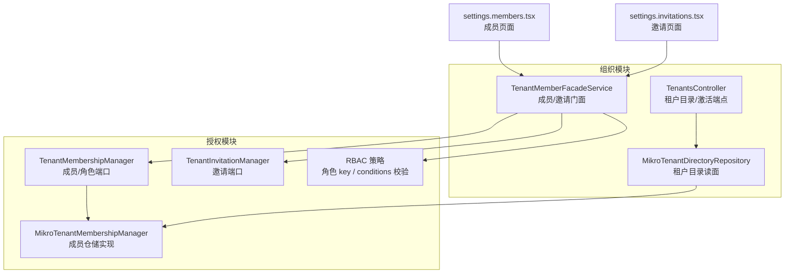
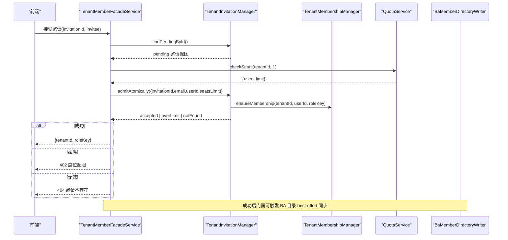
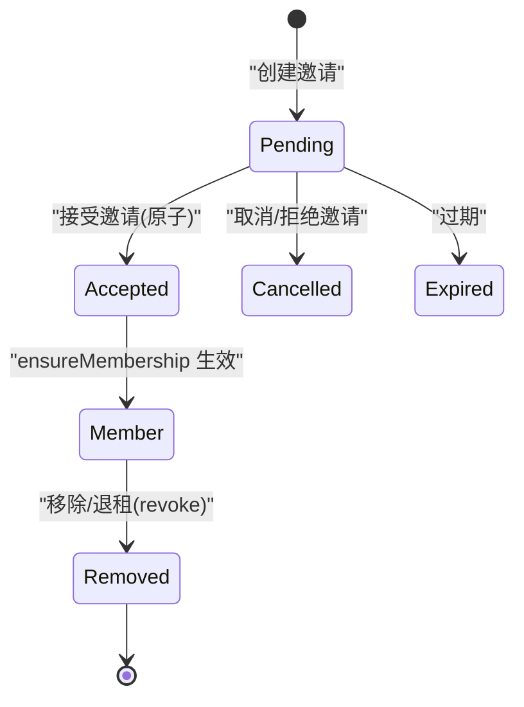
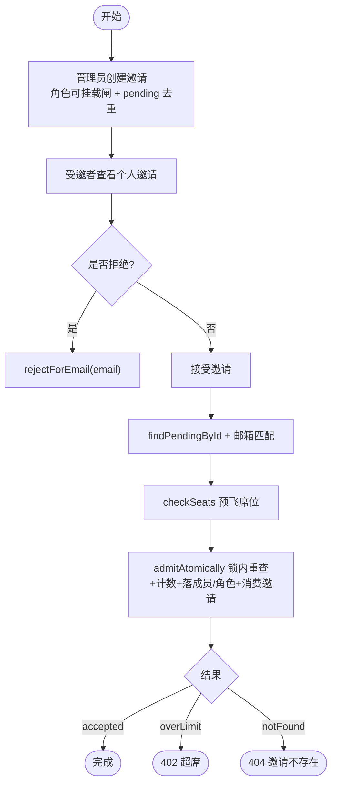
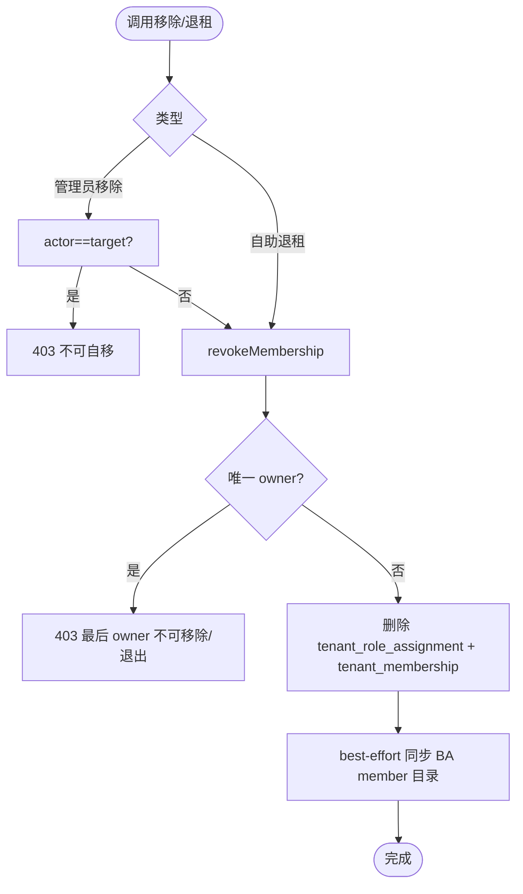
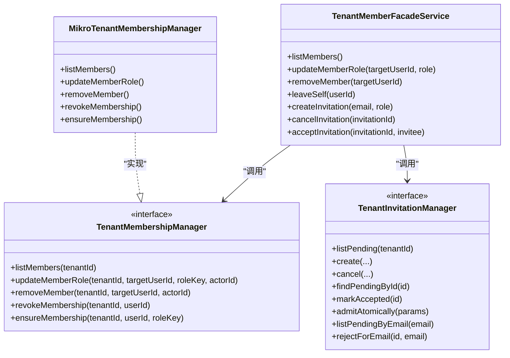
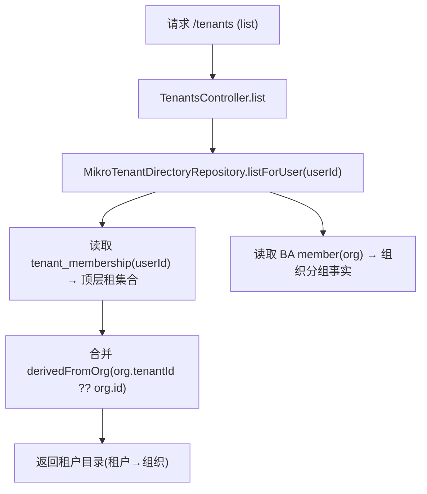
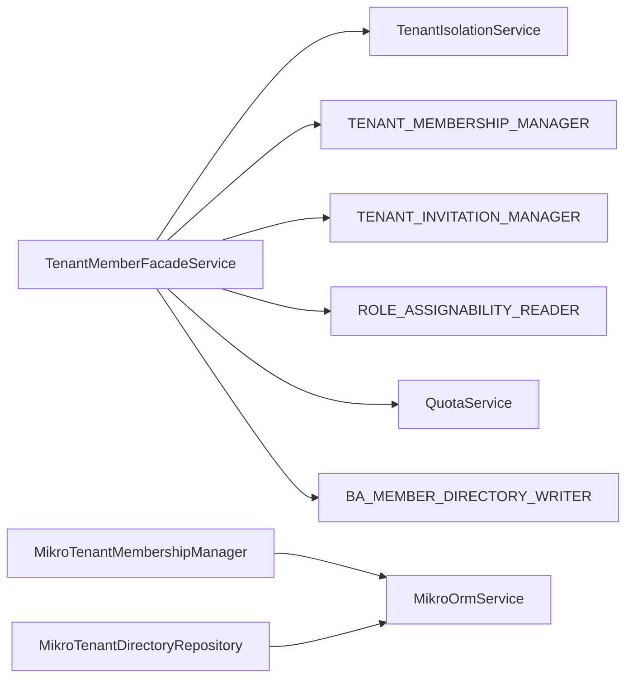

# 成员管理

<cite>
**本文引用的文件**   
- [apps/api/src/modules/organizations/application/tenant-member-facade.service.ts](file://apps/api/src/modules/organizations/application/tenant-member-facade.service.ts)
- [apps/api/src/modules/authorization/domain/ports/tenant-membership.port.ts](file://apps/api/src/modules/authorization/domain/ports/tenant-membership.port.ts)
- [apps/api/src/modules/authorization/domain/ports/tenant-invitation.port.ts](file://apps/api/src/modules/authorization/domain/ports/tenant-invitation.port.ts)
- [apps/api/src/modules/authorization/infrastructure/repositories/mikro-tenant-membership.repository.ts](file://apps/api/src/modules/authorization/infrastructure/repositories/mikro-tenant-membership.repository.ts)
- [apps/api/src/modules/organizations/infrastructure/repositories/mikro-tenant-directory.repository.ts](file://apps/api/src/modules/organizations/infrastructure/repositories/mikro-tenant-directory.repository.ts)
- [apps/api/src/modules/authorization/domain/policies/rbac.policy.ts](file://apps/api/src/modules/authorization/domain/policies/rbac.policy.ts)
- [apps/web/src/routes/settings.members.tsx](file://apps/web/src/routes/settings.members.tsx)
- [apps/web/src/routes/settings.invitations.tsx](file://apps/web/src/routes/settings.invitations.tsx)
- [apps/api/src/modules/organizations/api/tenants.controller.ts](file://apps/api/src/modules/organizations/api/tenants.controller.ts)
</cite>

## 目录
1. [简介](#简介)
2. [项目结构](#项目结构)
3. [核心组件](#核心组件)
4. [架构总览](#架构总览)
5. [详细组件分析](#详细组件分析)
6. [依赖关系分析](#依赖关系分析)
7. [性能与并发特性](#性能与并发特性)
8. [故障排查指南](#故障排查指南)
9. [结论](#结论)
10. [附录：API 与前端使用示例](#附录api-与前端使用示例)

## 简介
本文件面向“成员管理”能力，覆盖成员邀请、加入、移除、角色分配等完整流程；解释成员资格生命周期与状态变更；说明权限继承机制与权限范围控制；描述成员目录的查询与过滤；包含批量操作与权限同步机制；给出 API 接口与前端组件使用示例；并解释与 RBAC 系统的集成方式及权限检查逻辑。

## 项目结构
成员管理相关代码分布在两个主要模块：
- 组织模块（organizations）：提供门面编排、租户目录、会话级活动租户切换等。
- 授权模块（authorization）：定义租级成员/邀请端口、RBAC 策略、MikroORM 仓储实现。

**图表来源**
- [apps/api/src/modules/organizations/application/tenant-member-facade.service.ts:1-264](file://apps/api/src/modules/organizations/application/tenant-member-facade.service.ts#L1-L264)
- [apps/api/src/modules/authorization/domain/ports/tenant-membership.port.ts:1-98](file://apps/api/src/modules/authorization/domain/ports/tenant-membership.port.ts#L1-L98)
- [apps/api/src/modules/authorization/domain/ports/tenant-invitation.port.ts:1-130](file://apps/api/src/modules/authorization/domain/ports/tenant-invitation.port.ts#L1-L130)
- [apps/api/src/modules/authorization/infrastructure/repositories/mikro-tenant-membership.repository.ts:1-154](file://apps/api/src/modules/authorization/infrastructure/repositories/mikro-tenant-membership.repository.ts#L1-L154)
- [apps/api/src/modules/organizations/infrastructure/repositories/mikro-tenant-directory.repository.ts:18-64](file://apps/api/src/modules/organizations/infrastructure/repositories/mikro-tenant-directory.repository.ts#L18-L64)
- [apps/api/src/modules/authorization/domain/policies/rbac.policy.ts:1-95](file://apps/api/src/modules/authorization/domain/policies/rbac.policy.ts#L1-L95)
- [apps/web/src/routes/settings.members.tsx:1-184](file://apps/web/src/routes/settings.members.tsx#L1-L184)
- [apps/web/src/routes/settings.invitations.tsx:1-158](file://apps/web/src/routes/settings.invitations.tsx#L1-L158)
- [apps/api/src/modules/organizations/api/tenants.controller.ts:1-102](file://apps/api/src/modules/organizations/api/tenants.controller.ts#L1-L102)

**章节来源**
- [apps/api/src/modules/organizations/application/tenant-member-facade.service.ts:1-264](file://apps/api/src/modules/organizations/application/tenant-member-facade.service.ts#L1-L264)
- [apps/api/src/modules/authorization/domain/ports/tenant-membership.port.ts:1-98](file://apps/api/src/modules/authorization/domain/ports/tenant-membership.port.ts#L1-L98)
- [apps/api/src/modules/authorization/domain/ports/tenant-invitation.port.ts:1-130](file://apps/api/src/modules/authorization/domain/ports/tenant-invitation.port.ts#L1-L130)
- [apps/api/src/modules/authorization/infrastructure/repositories/mikro-tenant-membership.repository.ts:1-154](file://apps/api/src/modules/authorization/infrastructure/repositories/mikro-tenant-membership.repository.ts#L1-L154)
- [apps/api/src/modules/organizations/infrastructure/repositories/mikro-tenant-directory.repository.ts:18-64](file://apps/api/src/modules/organizations/infrastructure/repositories/mikro-tenant-directory.repository.ts#L18-L64)
- [apps/api/src/modules/authorization/domain/policies/rbac.policy.ts:1-95](file://apps/api/src/modules/authorization/domain/policies/rbac.policy.ts#L1-L95)
- [apps/web/src/routes/settings.members.tsx:1-184](file://apps/web/src/routes/settings.members.tsx#L1-L184)
- [apps/web/src/routes/settings.invitations.tsx:1-158](file://apps/web/src/routes/settings.invitations.tsx#L1-L158)
- [apps/api/src/modules/organizations/api/tenants.controller.ts:1-102](file://apps/api/src/modules/organizations/api/tenants.controller.ts#L1-L102)

## 核心组件
- 成员门面服务（TenantMemberFacadeService）：统一编排成员/邀请/席位/BA 目录同步，对外暴露成员列表、角色更新、移除、自助退租、邀请创建/取消/接受/拒绝等能力。
- 成员端口（TenantMembershipManager）：定义成员读模型与写原语（列出成员、更新角色、移除成员、撤销成员、确保成员存在）。
- 邀请端口（TenantInvitationManager）：定义邀请读模型与写原语（列出待处理邀请、创建、取消、按 id 查找、标记接受、原子入租、个人通道列/拒）。
- 成员仓储实现（MikroTenantMembershipManager）：基于 MikroORM 对 tenant_membership/tenant_role_assignment/user 表进行读写，实现 last-owner/self-removal 守卫与幂等 ensureMembership。
- 租户目录仓库（MikroTenantDirectoryRepository）：以 tenant_membership 为 SSOT 并集 BA member 派生租，输出用户可见的租户与组织目录。
- RBAC 策略（rbac.policy.ts）：角色 key 词法校验、conditions 白名单校验、规范化比较。

**章节来源**
- [apps/api/src/modules/organizations/application/tenant-member-facade.service.ts:32-264](file://apps/api/src/modules/organizations/application/tenant-member-facade.service.ts#L32-L264)
- [apps/api/src/modules/authorization/domain/ports/tenant-membership.port.ts:1-98](file://apps/api/src/modules/authorization/domain/ports/tenant-membership.port.ts#L1-L98)
- [apps/api/src/modules/authorization/domain/ports/tenant-invitation.port.ts:1-130](file://apps/api/src/modules/authorization/domain/ports/tenant-invitation.port.ts#L1-L130)
- [apps/api/src/modules/authorization/infrastructure/repositories/mikro-tenant-membership.repository.ts:14-154](file://apps/api/src/modules/authorization/infrastructure/repositories/mikro-tenant-membership.repository.ts#L14-L154)
- [apps/api/src/modules/organizations/infrastructure/repositories/mikro-tenant-directory.repository.ts:18-64](file://apps/api/src/modules/organizations/infrastructure/repositories/mikro-tenant-directory.repository.ts#L18-L64)
- [apps/api/src/modules/authorization/domain/policies/rbac.policy.ts:1-95](file://apps/api/src/modules/authorization/domain/policies/rbac.policy.ts#L1-L95)

## 架构总览
成员管理采用“门面 + 端口 + 仓储实现”的分层设计：
- 门面层（organizations.application）负责跨域编排、守卫重建、错误映射、配额卡点与 BA 目录 best-effort 同步。
- 领域端口层（authorization.domain.ports）定义跨上下文契约，隔离数据所有权。
- 基础设施层（authorization.infrastructure.repositories）实现具体持久化逻辑，保证事务性与并发安全。

**图表来源**
- [apps/api/src/modules/organizations/application/tenant-member-facade.service.ts:206-243](file://apps/api/src/modules/organizations/application/tenant-member-facade.service.ts#L206-L243)
- [apps/api/src/modules/authorization/domain/ports/tenant-invitation.port.ts:102-113](file://apps/api/src/modules/authorization/domain/ports/tenant-invitation.port.ts#L102-L113)
- [apps/api/src/modules/authorization/domain/ports/tenant-membership.port.ts:89-96](file://apps/api/src/modules/authorization/domain/ports/tenant-membership.port.ts#L89-L96)

## 详细组件分析

### 成员生命周期与状态变更
- 成员存在性：由 tenant_membership 表示；角色分配由 tenant_role_assignment.roleKey 决定，缺省为 member。
- 关键状态：
  - 新增成员：通过 ensureMembership 幂等写入（建成员行 + 若缺失则落角色）。
  - 角色变更：updateMemberRole 修改或补建角色分配，受 last-owner 守卫保护。
  - 移除成员：removeMember 走 revokeMembership 删除两行（成员+角色），同时 best-effort 清理 BA member。
  - 自助退租：leaveSelf 复用 revokeMembership，允许 actor==target，但禁止最后 owner 退出。
  - 邀请状态：pending → accepted/cancelled/expired；accept 时原子完成席位检查、成员落库、邀请消费。

**图表来源**
- [apps/api/src/modules/authorization/domain/ports/tenant-invitation.port.ts:30-46](file://apps/api/src/modules/authorization/domain/ports/tenant-invitation.port.ts#L30-L46)
- [apps/api/src/modules/authorization/domain/ports/tenant-membership.port.ts:89-96](file://apps/api/src/modules/authorization/domain/ports/tenant-membership.port.ts#L89-L96)
- [apps/api/src/modules/authorization/infrastructure/repositories/mikro-tenant-membership.repository.ts:120-144](file://apps/api/src/modules/authorization/infrastructure/repositories/mikro-tenant-membership.repository.ts#L120-L144)

**章节来源**
- [apps/api/src/modules/authorization/domain/ports/tenant-membership.port.ts:15-34](file://apps/api/src/modules/authorization/domain/ports/tenant-membership.port.ts#L15-L34)
- [apps/api/src/modules/authorization/infrastructure/repositories/mikro-tenant-membership.repository.ts:61-118](file://apps/api/src/modules/authorization/infrastructure/repositories/mikro-tenant-membership.repository.ts#L61-L118)
- [apps/api/src/modules/authorization/domain/ports/tenant-invitation.port.ts:66-128](file://apps/api/src/modules/authorization/domain/ports/tenant-invitation.port.ts#L66-L128)

### 成员邀请流程
- 管理员发邀：createInvitation 先校验角色可挂载，再写入 pending 邀请；同邮箱重复 pending 返回冲突。
- 管理员取消：cancelInvitation 将 pending 转为 cancelled。
- 受邀者查看：listMyInvitations 按 email 列出个人通道待处理邀请（跨租可见）。
- 受邀者拒绝：rejectInvitation 限受邀邮箱匹配，fail-closed。
- 受邀者接受：acceptInvitation 校验邀请归属与席位，admitAtomically 在单事务内串行化并发、最终裁决席位并落成员/角色。

**图表来源**
- [apps/api/src/modules/organizations/application/tenant-member-facade.service.ts:176-243](file://apps/api/src/modules/organizations/application/tenant-member-facade.service.ts#L176-L243)
- [apps/api/src/modules/authorization/domain/ports/tenant-invitation.port.ts:66-128](file://apps/api/src/modules/authorization/domain/ports/tenant-invitation.port.ts#L66-L128)

**章节来源**
- [apps/api/src/modules/organizations/application/tenant-member-facade.service.ts:144-243](file://apps/api/src/modules/organizations/application/tenant-member-facade.service.ts#L144-L243)
- [apps/api/src/modules/authorization/domain/ports/tenant-invitation.port.ts:66-128](file://apps/api/src/modules/authorization/domain/ports/tenant-invitation.port.ts#L66-L128)

### 成员移除与自助退租
- 管理员移除：removeMember 自移判定（actor==target 拒绝），last-owner 判定，删除成员+角色两行，best-effort 清理 BA member。
- 自助退租：leaveSelf 允许 self，同样禁止最后 owner 退出，复用 revokeMembership 并 best-effort 清理 BA member。

**图表来源**
- [apps/api/src/modules/organizations/application/tenant-member-facade.service.ts:100-142](file://apps/api/src/modules/organizations/application/tenant-member-facade.service.ts#L100-L142)
- [apps/api/src/modules/authorization/infrastructure/repositories/mikro-tenant-membership.repository.ts:94-118](file://apps/api/src/modules/authorization/infrastructure/repositories/mikro-tenant-membership.repository.ts#L94-L118)

**章节来源**
- [apps/api/src/modules/organizations/application/tenant-member-facade.service.ts:96-142](file://apps/api/src/modules/organizations/application/tenant-member-facade.service.ts#L96-L142)
- [apps/api/src/modules/authorization/infrastructure/repositories/mikro-tenant-membership.repository.ts:94-118](file://apps/api/src/modules/authorization/infrastructure/repositories/mikro-tenant-membership.repository.ts#L94-L118)

### 角色分配与权限继承
- 角色键合法性：系统保留键（owner/admin/member）与自定义键（小写字母数字开头，含 `-`/`_`，长度限制）由 rbac.policy 校验。
- 角色可挂载：门面在更新角色前调用 RoleAssignabilityReader.isRoleAssignable，非法角色直接 400。
- 权限继承：成员默认 member；显式分配覆盖；owner 作为最高权限，last-owner 守卫防止清空唯一属主。
- 条件授权：grant.conditions 仅允许原始量或 $in 数组，避免复杂运算符注入风险。

**图表来源**
- [apps/api/src/modules/organizations/application/tenant-member-facade.service.ts:56-264](file://apps/api/src/modules/organizations/application/tenant-member-facade.service.ts#L56-L264)
- [apps/api/src/modules/authorization/domain/ports/tenant-membership.port.ts:46-97](file://apps/api/src/modules/authorization/domain/ports/tenant-membership.port.ts#L46-L97)
- [apps/api/src/modules/authorization/domain/ports/tenant-invitation.port.ts:59-128](file://apps/api/src/modules/authorization/domain/ports/tenant-invitation.port.ts#L59-L128)
- [apps/api/src/modules/authorization/infrastructure/repositories/mikro-tenant-membership.repository.ts:34-154](file://apps/api/src/modules/authorization/infrastructure/repositories/mikro-tenant-membership.repository.ts#L34-L154)

**章节来源**
- [apps/api/src/modules/authorization/domain/policies/rbac.policy.ts:11-36](file://apps/api/src/modules/authorization/domain/policies/rbac.policy.ts#L11-L36)
- [apps/api/src/modules/authorization/domain/policies/rbac.policy.ts:51-71](file://apps/api/src/modules/authorization/domain/policies/rbac.policy.ts#L51-L71)
- [apps/api/src/modules/authorization/infrastructure/repositories/mikro-tenant-membership.repository.ts:61-91](file://apps/api/src/modules/authorization/infrastructure/repositories/mikro-tenant-membership.repository.ts#L61-L91)

### 成员目录查询与过滤
- 目录入口：TenantsController.list 返回当前用户可见的租户及其下组织。
- 可见性收敛：以 tenant_membership 为主（SSOT），并集 BA member 派生租（兼容过渡期未盖章 org），按 org 分组展示二级组织。
- 过滤维度：按 userId 命中成员/组织关系，非跨用户泄露；scoped:false 绕过全局 tenantId filter，避免多租用户目录丢失。

**图表来源**
- [apps/api/src/modules/organizations/api/tenants.controller.ts:50-66](file://apps/api/src/modules/organizations/api/tenants.controller.ts#L50-L66)
- [apps/api/src/modules/organizations/infrastructure/repositories/mikro-tenant-directory.repository.ts:40-64](file://apps/api/src/modules/organizations/infrastructure/repositories/mikro-tenant-directory.repository.ts#L40-L64)

**章节来源**
- [apps/api/src/modules/organizations/api/tenants.controller.ts:26-66](file://apps/api/src/modules/organizations/api/tenants.controller.ts#L26-L66)
- [apps/api/src/modules/organizations/infrastructure/repositories/mikro-tenant-directory.repository.ts:18-64](file://apps/api/src/modules/organizations/infrastructure/repositories/mikro-tenant-directory.repository.ts#L18-L64)

### 批量成员操作与权限同步
- 批量成员列表：listMembers 一次拉取 tenant_membership/tenant_role_assignment，并按 userIds 批量取 user 信息，避免 N+1。
- 批量目录构建：directory listForUser 批量读取成员/组织，归组后返回。
- 权限同步：移除/退租后 best-effort 调用 BaMemberDirectoryWriter.removeAcrossTenant 清理 BA member 遗留观测轴；失败不回滚（BA 非 SSOT）。

**章节来源**
- [apps/api/src/modules/authorization/infrastructure/repositories/mikro-tenant-membership.repository.ts:38-59](file://apps/api/src/modules/authorization/infrastructure/repositories/mikro-tenant-membership.repository.ts#L38-L59)
- [apps/api/src/modules/organizations/infrastructure/repositories/mikro-tenant-directory.repository.ts:40-64](file://apps/api/src/modules/organizations/infrastructure/repositories/mikro-tenant-directory.repository.ts#L40-L64)
- [apps/api/src/modules/organizations/application/tenant-member-facade.service.ts:118-120](file://apps/api/src/modules/organizations/application/tenant-member-facade.service.ts#L118-L120)
- [apps/api/src/modules/organizations/application/tenant-member-facade.service.ts:141-142](file://apps/api/src/modules/organizations/application/tenant-member-facade.service.ts#L141-L142)

## 依赖关系分析
- 门面依赖：
  - TenantIsolationService：获取活动租户与操作者身份。
  - TENANT_MEMBERSHIP_MANAGER/TENANT_INVITATION_MANAGER：成员/邀请写原语。
  - ROLE_ASSIGNABILITY_READER：角色可挂载校验。
  - QuotaService：席位限额检查。
  - BA_MEMBER_DIRECTORY_WRITER：BA 目录 best-effort 同步。
- 仓储实现依赖：
  - MikroOrmService：fork scoped:false 跨租查询，nativeDelete 高效删除。
  - 实体：TenantMembership、TenantRoleAssignment、User、Member、Organization。

**图表来源**
- [apps/api/src/modules/organizations/application/tenant-member-facade.service.ts:56-64](file://apps/api/src/modules/organizations/application/tenant-member-facade.service.ts#L56-L64)
- [apps/api/src/modules/authorization/infrastructure/repositories/mikro-tenant-membership.repository.ts:34-36](file://apps/api/src/modules/authorization/infrastructure/repositories/mikro-tenant-membership.repository.ts#L34-L36)
- [apps/api/src/modules/organizations/infrastructure/repositories/mikro-tenant-directory.repository.ts:36-42](file://apps/api/src/modules/organizations/infrastructure/repositories/mikro-tenant-directory.repository.ts#L36-L42)

**章节来源**
- [apps/api/src/modules/organizations/application/tenant-member-facade.service.ts:56-64](file://apps/api/src/modules/organizations/application/tenant-member-facade.service.ts#L56-L64)
- [apps/api/src/modules/authorization/infrastructure/repositories/mikro-tenant-membership.repository.ts:34-36](file://apps/api/src/modules/authorization/infrastructure/repositories/mikro-tenant-membership.repository.ts#L34-L36)
- [apps/api/src/modules/organizations/infrastructure/repositories/mikro-tenant-directory.repository.ts:36-42](file://apps/api/src/modules/organizations/infrastructure/repositories/mikro-tenant-directory.repository.ts#L36-L42)

## 性能与并发特性
- 列表优化：listMembers 批量取 user 信息，避免 N+1；目录查询批量取组织与成员。
- 并发安全：admitAtomically 使用事务 + advisory lock 串行化同租并发 accept，TOCTOU 硬化，最终裁决席位。
- 删除效率：nativeDelete 直接执行 SQL 删除两行，无级联开销。
- 跨租隔离：所有仓储 fork scoped:false 显式锚定 where{tenantId}，避免 ALS 误筛。

**章节来源**
- [apps/api/src/modules/authorization/infrastructure/repositories/mikro-tenant-membership.repository.ts:47-49](file://apps/api/src/modules/authorization/infrastructure/repositories/mikro-tenant-membership.repository.ts#L47-L49)
- [apps/api/src/modules/authorization/infrastructure/repositories/mikro-tenant-membership.repository.ts:113-116](file://apps/api/src/modules/authorization/infrastructure/repositories/mikro-tenant-membership.repository.ts#L113-L116)
- [apps/api/src/modules/authorization/domain/ports/tenant-invitation.port.ts:102-113](file://apps/api/src/modules/authorization/domain/ports/tenant-invitation.port.ts#L102-L113)

## 故障排查指南
- 400 角色不存在：角色 key 不在可挂载集合中，检查角色命名与租户配置。
- 403 最后 owner：尝试降级或移除最后一个 owner，需先增加新的 owner。
- 403 自移：管理员移除面不允许移除自己，应使用自助退租。
- 404 邀请不存在：邀请已过期/被消费/邮箱不匹配，确认 invitationId 与会话邮箱一致。
- 402 席位超限：租户席位不足，需扩容或减少活跃成员。
- 404 非成员：自助退租时目标用户不是该租户成员。

**章节来源**
- [apps/api/src/modules/organizations/application/tenant-member-facade.service.ts:76-94](file://apps/api/src/modules/organizations/application/tenant-member-facade.service.ts#L76-L94)
- [apps/api/src/modules/organizations/application/tenant-member-facade.service.ts:100-120](file://apps/api/src/modules/organizations/application/tenant-member-facade.service.ts#L100-L120)
- [apps/api/src/modules/organizations/application/tenant-member-facade.service.ts:128-142](file://apps/api/src/modules/organizations/application/tenant-member-facade.service.ts#L128-L142)
- [apps/api/src/modules/organizations/application/tenant-member-facade.service.ts:162-197](file://apps/api/src/modules/organizations/application/tenant-member-facade.service.ts#L162-L197)
- [apps/api/src/modules/organizations/application/tenant-member-facade.service.ts:206-243](file://apps/api/src/modules/organizations/application/tenant-member-facade.service.ts#L206-L243)

## 结论
成员管理以门面编排为核心，结合端口契约与仓储实现，实现了成员邀请、加入、移除、角色分配的完整闭环；通过 RBAC 策略与 last-owner/self-removal 守卫保障权限安全；目录查询以 tenant_membership 为 SSOT 并集 BA member，确保新轴下的可见性；并发与性能通过批量查询与原子事务得到保障；BA 目录同步以 best-effort 方式维持双轴一致性。

## 附录：API 与前端使用示例

### API 接口概览（成员/邀请/目录）
- 成员列表：GET /api/v1/organizations/members
- 成员改角色：POST /api/v1/organizations/members/role
- 成员移除：POST /api/v1/organizations/members/remove
- 自助退租：POST /api/v1/organizations/members/leave
- 邀请列表（管理员）：GET /api/v1/organizations/invitations
- 创建邀请：POST /api/v1/organizations/invitations
- 取消邀请：POST /api/v1/organizations/invitations/cancel
- 个人邀请列表：GET /api/v1/organizations/invitations/mine
- 拒绝邀请：POST /api/v1/organizations/invitations/reject
- 接受邀请：POST /api/v1/organizations/invitations/accept
- 租户目录：GET /api/v1/tenants
- 设置活动租户：PUT /api/v1/tenants/active

**章节来源**
- [apps/web/src/routes/settings.members.tsx:21-35](file://apps/web/src/routes/settings.members.tsx#L21-L35)
- [apps/web/src/routes/settings.members.tsx:95-114](file://apps/web/src/routes/settings.members.tsx#L95-L114)
- [apps/web/src/routes/settings.invitations.tsx:39-53](file://apps/web/src/routes/settings.invitations.tsx#L39-L53)
- [apps/web/src/routes/settings.invitations.tsx:68-85](file://apps/web/src/routes/settings.invitations.tsx#L68-L85)
- [apps/web/src/routes/settings.invitations.tsx:130-141](file://apps/web/src/routes/settings.invitations.tsx#L130-L141)
- [apps/api/src/modules/organizations/api/tenants.controller.ts:50-66](file://apps/api/src/modules/organizations/api/tenants.controller.ts#L50-L66)
- [apps/api/src/modules/organizations/api/tenants.controller.ts:79-100](file://apps/api/src/modules/organizations/api/tenants.controller.ts#L79-L100)

### 前端组件使用要点
- 成员页面（settings.members.tsx）：
  - 加载成员列表，渲染 MembersView 表格。
  - 支持单成员改角色与移除，调用对应 API。
  - 支持自助退租按钮，调用 leave 接口。
- 邀请页面（settings.invitations.tsx）：
  - 管理员发送邀请表单，选择角色（admin/member）。
  - 展示待处理邀请，支持撤回。
  - 客户端使用共享契约进行字段校验。

**章节来源**
- [apps/web/src/routes/settings.members.tsx:43-87](file://apps/web/src/routes/settings.members.tsx#L43-L87)
- [apps/web/src/routes/settings.members.tsx:89-134](file://apps/web/src/routes/settings.members.tsx#L89-L134)
- [apps/web/src/routes/settings.members.tsx:151-183](file://apps/web/src/routes/settings.members.tsx#L151-L183)
- [apps/web/src/routes/settings.invitations.tsx:55-85](file://apps/web/src/routes/settings.invitations.tsx#L55-L85)
- [apps/web/src/routes/settings.invitations.tsx:130-157](file://apps/web/src/routes/settings.invitations.tsx#L130-L157)