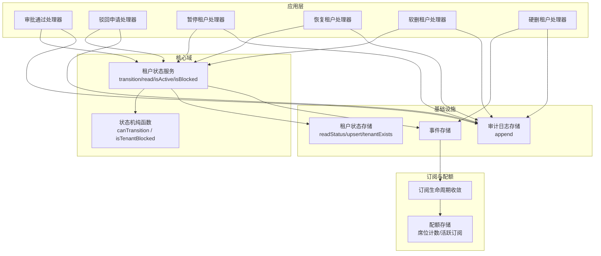
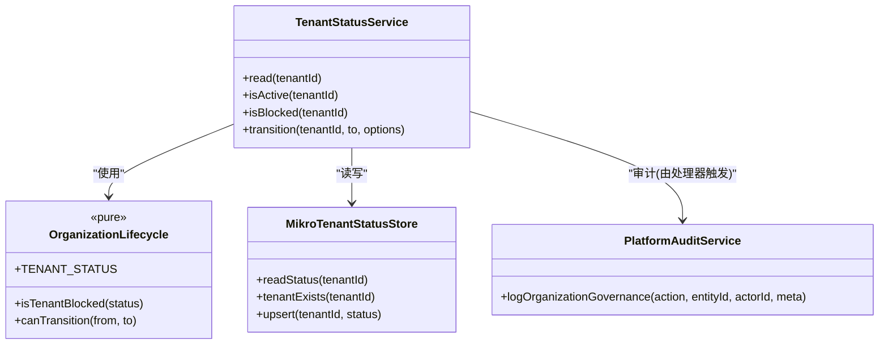
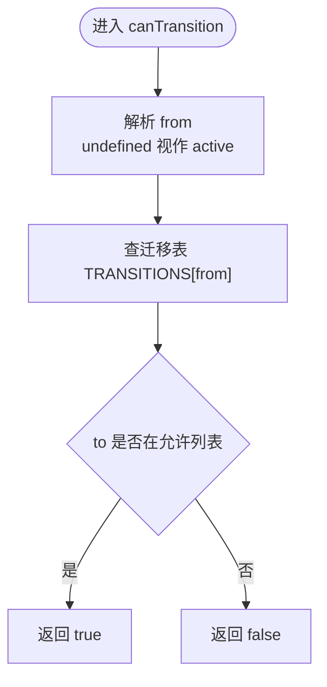
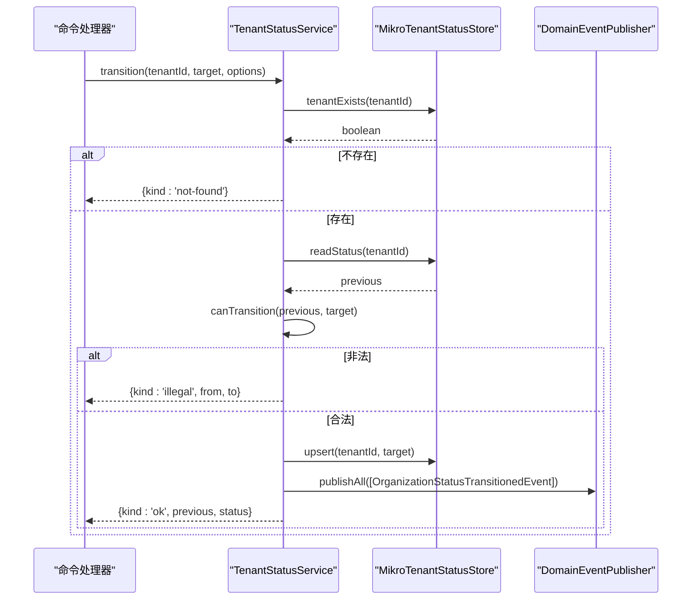
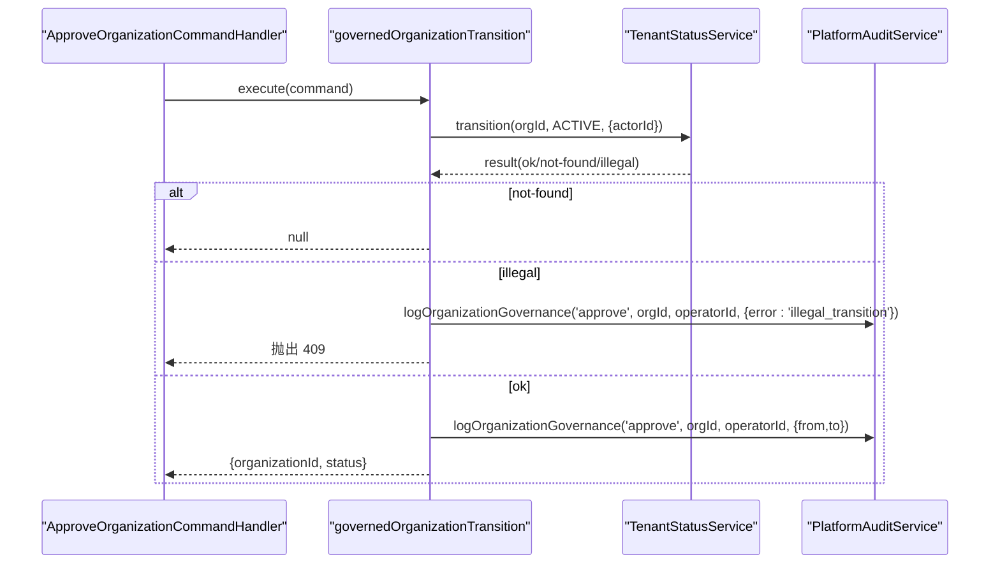
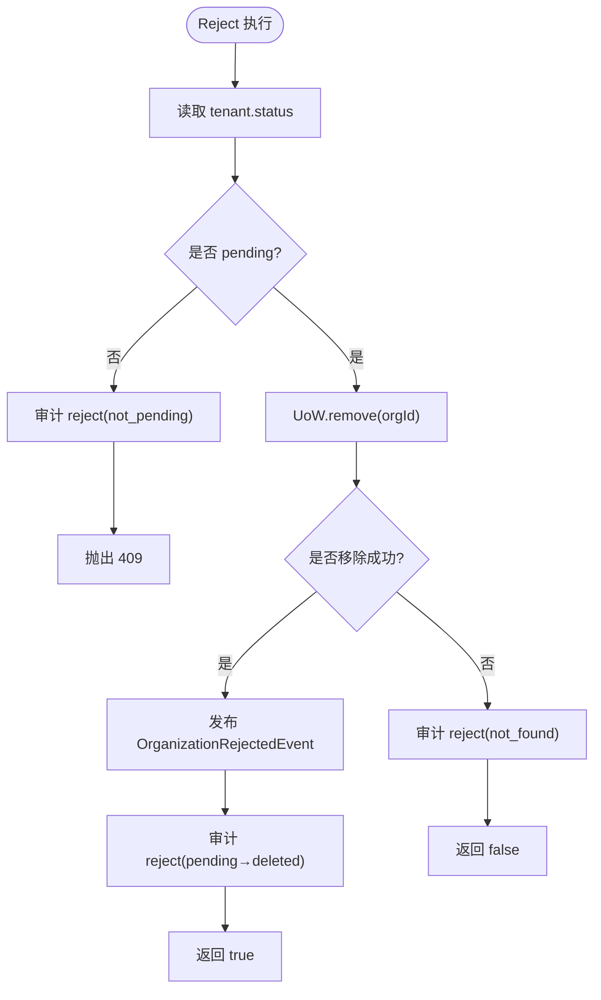
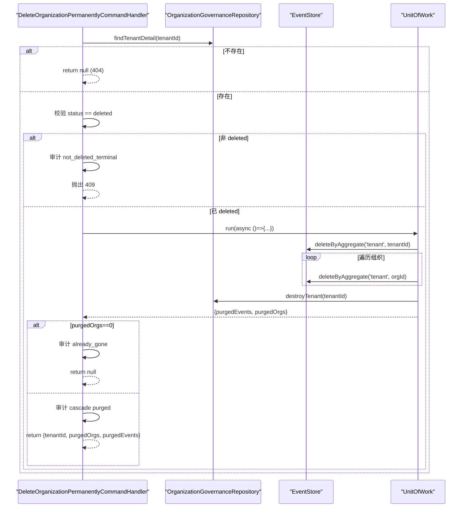
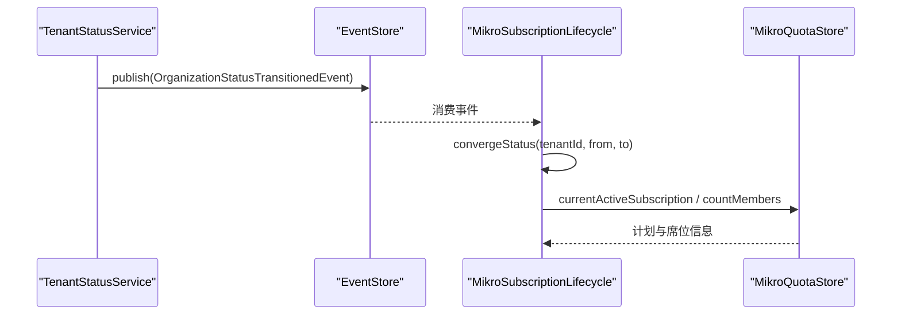
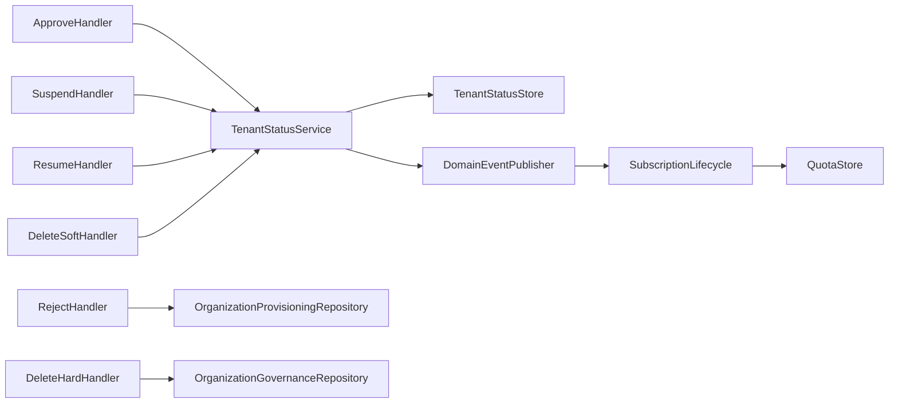

# 租户生命周期管理

<cite>
**本文引用的文件**   
- [organization-lifecycle.ts](file://libs/core/src/modules/organizations/lifecycle/organization-lifecycle.ts)
- [tenant-status.service.ts](file://libs/core/src/modules/organizations/lifecycle/tenant-status.service.ts)
- [mikro-tenant-status.store.ts](file://apps/api/src/modules/organizations/infrastructure/mikro-tenant-status.store.ts)
- [approve-organization.command-handler.ts](file://apps/api/src/modules/organizations/application/commands/handlers/approve-organization.command-handler.ts)
- [reject-organization.command-handler.ts](file://apps/api/src/modules/organizations/application/commands/handlers/reject-organization.command-handler.ts)
- [suspend-organization.command-handler.ts](file://apps/api/src/modules/organizations/application/commands/handlers/suspend-organization.command-handler.ts)
- [resume-organization.command-handler.ts](file://apps/api/src/modules/organizations/application/commands/handlers/resume-organization.command-handler.ts)
- [delete-organization.command-handler.ts](file://apps/api/src/modules/organizations/application/commands/handlers/delete-organization.command-handler.ts)
- [delete-organization-permanently.command-handler.ts](file://apps/api/src/modules/organizations/application/commands/handlers/delete-organization-permanently.command-handler.ts)
- [governed-organization-transition.ts](file://apps/api/src/modules/organizations/application/commands/handlers/governed-organization-transition.ts)
- [governed-tenant-transition.ts](file://apps/api/src/modules/organizations/application/commands/handlers/governed-tenant-transition.ts)
- [mikro-audit-log.store.ts](file://apps/api/src/modules/organizations/infrastructure/mikro-audit-log.store.ts)
- [tenants.controller.ts](file://apps/api/src/modules/organizations/api/tenants.controller.ts)
- [mikro-quota.store.ts](file://apps/api/src/modules/subscriptions/infrastructure/mikro-quota.store.ts)
- [mikro-subscription.lifecycle.ts](file://apps/api/src/modules/subscriptions/infrastructure/mikro-subscription.lifecycle.ts)
- [organization-lifecycle.test.ts](file://apps/api/src/modules/organizations/lifecycle/organization-lifecycle.test.ts)
</cite>

## 目录
1. [引言](#引言)
2. [项目结构](#项目结构)
3. [核心组件](#核心组件)
4. [架构总览](#架构总览)
5. [详细组件分析](#详细组件分析)
6. [依赖关系分析](#依赖关系分析)
7. [性能与一致性](#性能与一致性)
8. [故障排查指南](#故障排查指南)
9. [结论](#结论)
10. [附录：API 调用示例与错误处理](#附录api-调用示例与错误处理)

## 引言
本文件系统性梳理“审批制租户”的生命周期管理，覆盖状态机、命令处理器、状态存储与一致性、审计日志、以及订阅与配额集成。目标是让非技术读者也能理解从提交申请到平台审批、拒绝、暂停、恢复、软删除和硬删除的完整流程，并掌握各阶段的 API 行为与错误策略。

## 项目结构
围绕租户生命周期，代码按领域分层组织：
- 领域纯函数与状态机定义位于核心库；
- 应用层命令处理器封装业务规则与审计；
- 基础设施层提供状态存储、审计日志与事件持久化；
- 订阅与配额子系统通过事件与租户状态联动。

**图示来源**
- [tenant-status.service.ts:33-44](file://libs/core/src/modules/organizations/lifecycle/tenant-status.service.ts#L33-L44)
- [organization-lifecycle.ts:15-69](file://libs/core/src/modules/organizations/lifecycle/organization-lifecycle.ts#L15-L69)
- [mikro-tenant-status.store.ts:7-16](file://apps/api/src/modules/organizations/infrastructure/mikro-tenant-status.store.ts#L7-L16)
- [mikro-audit-log.store.ts:9-17](file://apps/api/src/modules/organizations/infrastructure/mikro-audit-log.store.ts#L9-L17)
- [mikro-subscription.lifecycle.ts:25-44](file://apps/api/src/modules/subscriptions/infrastructure/mikro-subscription.lifecycle.ts#L25-L44)
- [mikro-quota.store.ts:16-25](file://apps/api/src/modules/subscriptions/infrastructure/mikro-quota.store.ts#L16-L25)

**章节来源**
- [organization-lifecycle.ts:1-70](file://libs/core/src/modules/organizations/lifecycle/organization-lifecycle.ts#L1-L70)
- [tenant-status.service.ts:1-123](file://libs/core/src/modules/organizations/lifecycle/tenant-status.service.ts#L1-L123)

## 核心组件
- 状态机纯函数：定义租户状态枚举、拦截判定与合法迁移表。
- 租户状态服务：唯一读写卡点，负责严格迁移、事务边界、事件发布与审计上下文。
- 状态存储适配：基于 MikroORM 对 tenant 表的读取、存在性检查与更新。
- 审计日志存储：追加式审计记录，不可篡改。
- 命令处理器：将平台治理动作（审批、驳回、暂停、恢复、软删、硬删）映射为状态迁移或物理删除。
- 订阅与配额：订阅生命周期消费租户状态事件，配额系统按租户维度计量席位与计划。

**章节来源**
- [organization-lifecycle.ts:15-69](file://libs/core/src/modules/organizations/lifecycle/organization-lifecycle.ts#L15-L69)
- [tenant-status.service.ts:33-122](file://libs/core/src/modules/organizations/lifecycle/tenant-status.service.ts#L33-L122)
- [mikro-tenant-status.store.ts:7-40](file://apps/api/src/modules/organizations/infrastructure/mikro-tenant-status.store.ts#L7-L40)
- [mikro-audit-log.store.ts:9-37](file://apps/api/src/modules/organizations/infrastructure/mikro-audit-log.store.ts#L9-L37)

## 架构总览
审批制租户的状态机以 `tenant.status` 为权威真相源，所有治理动作必须经过 `TenantStatusService.transition` 进行严格裁决，并通过领域事件驱动下游订阅与配额联动。

**图示来源**
- [tenant-status.service.ts:33-122](file://libs/core/src/modules/organizations/lifecycle/tenant-status.service.ts#L33-L122)
- [organization-lifecycle.ts:15-69](file://libs/core/src/modules/organizations/lifecycle/organization-lifecycle.ts#L15-L69)
- [mikro-tenant-status.store.ts:7-40](file://apps/api/src/modules/organizations/infrastructure/mikro-tenant-status.store.ts#L7-L40)

## 详细组件分析

### 状态机与拦截策略
- 状态集合：pending_approval、active、suspended、deleted。
- 拦截策略：仅显式处于 pending_approval、suspended、deleted 时阻断访问；无状态记录视为不阻断（兼容存量）。
- 迁移表：
  - pending_approval → active / deleted
  - active → active（幂等）/ suspended / deleted
  - suspended → active / deleted
  - deleted 终态不接受任何迁移

**图示来源**
- [organization-lifecycle.ts:45-69](file://libs/core/src/modules/organizations/lifecycle/organization-lifecycle.ts#L45-L69)

**章节来源**
- [organization-lifecycle.ts:15-69](file://libs/core/src/modules/organizations/lifecycle/organization-lifecycle.ts#L15-L69)
- [organization-lifecycle.test.ts:14-50](file://apps/api/src/modules/organizations/lifecycle/organization-lifecycle.test.ts#L14-L50)

### 租户状态服务与一致性
- 读接口：read、isActive、isBlocked。
- 迁移 transition：
  - 在 UnitOfWork 内执行，保证写回与事件发布的原子性。
  - 先校验 tenantExists，不存在返回 not-found。
  - 用 canTransition 严格裁决，非法返回 illegal。
  - 成功后 upsert 写入 tenant.status，并发布 OrganizationStatusTransitionedEvent。
- 审计：由上层处理器统一落审计，服务本身不直接写审计。

**图示来源**
- [tenant-status.service.ts:83-122](file://libs/core/src/modules/organizations/lifecycle/tenant-status.service.ts#L83-L122)
- [mikro-tenant-status.store.ts:22-40](file://apps/api/src/modules/organizations/infrastructure/mikro-tenant-status.store.ts#L22-L40)

**章节来源**
- [tenant-status.service.ts:33-122](file://libs/core/src/modules/organizations/lifecycle/tenant-status.service.ts#L33-L122)

### 命令处理器与业务规则

#### 审批通过（pending_approval → active）
- 入口：ApproveOrganizationCommandHandler。
- 逻辑：委托 governedOrganizationTransition，调用 TenantStatusService.transition 目标为 active。
- 结果：
  - not-found → null（控制层转 404）。
  - illegal → 审计 + 409。
  - ok → 审计 + 返回组织应用读模型。

**图示来源**
- [approve-organization.command-handler.ts:10-49](file://apps/api/src/modules/organizations/application/commands/handlers/approve-organization.command-handler.ts#L10-L49)
- [governed-organization-transition.ts:40-90](file://apps/api/src/modules/organizations/application/commands/handlers/governed-organization-transition.ts#L40-L90)

**章节来源**
- [approve-organization.command-handler.ts:10-49](file://apps/api/src/modules/organizations/application/commands/handlers/approve-organization.command-handler.ts#L10-L49)
- [governed-organization-transition.ts:40-90](file://apps/api/src/modules/organizations/application/commands/handlers/governed-organization-transition.ts#L40-L90)

#### 驳回申请（仅 pending 可驳回）
- 入口：RejectOrganizationCommandHandler。
- 前置：读取 tenant.status，若非 pending → 审计并抛 409。
- 执行：在 UoW 中 remove 组织行，若成功则发布 OrganizationRejectedEvent。
- 审计：无论成败均落结构化审计。

**图示来源**
- [reject-organization.command-handler.ts:26-110](file://apps/api/src/modules/organizations/application/commands/handlers/reject-organization.command-handler.ts#L26-L110)

**章节来源**
- [reject-organization.command-handler.ts:26-110](file://apps/api/src/modules/organizations/application/commands/handlers/reject-organization.command-handler.ts#L26-L110)

#### 暂停租户（active → suspended）
- 入口：SuspendOrganizationCommandHandler。
- 逻辑：委托 governedTenantTransition，目标 suspended。
- 结果：not-found → null；illegal → 409；ok → 审计 + 返回租户治理回执。

**章节来源**
- [suspend-organization.command-handler.ts:10-45](file://apps/api/src/modules/organizations/application/commands/handlers/suspend-organization.command-handler.ts#L10-L45)
- [governed-tenant-transition.ts:40-80](file://apps/api/src/modules/organizations/application/commands/handlers/governed-tenant-transition.ts#L40-L80)

#### 恢复租户（suspended → active）
- 入口：ResumeOrganizationCommandHandler。
- 逻辑：委托 governedTenantTransition，目标 active。
- 结果：同暂停。

**章节来源**
- [resume-organization.command-handler.ts:10-44](file://apps/api/src/modules/organizations/application/commands/handlers/resume-organization.command-handler.ts#L10-L44)
- [governed-tenant-transition.ts:40-80](file://apps/api/src/modules/organizations/application/commands/handlers/governed-tenant-transition.ts#L40-L80)

#### 软删租户（任意可迁移态 → deleted）
- 入口：DeleteOrganizationCommandHandler。
- 逻辑：直接调用 TenantStatusService.transition(target=deleted)。
- 结果：not-found → null；illegal → 审计 + 409；ok → 审计 + 返回治理回执。

**章节来源**
- [delete-organization.command-handler.ts:10-57](file://apps/api/src/modules/organizations/application/commands/handlers/delete-organization.command-handler.ts#L10-L57)

#### 硬删租户（仅 deleted 终态可硬删）
- 入口：DeleteOrganizationPermanentlyCommandHandler。
- 前置：查询租户详情，若非 deleted → 审计 + 409。
- 执行：在 UoW 内先补删事件（tenant 聚合下 tenantId 与各 orgId），再连带删除主行（组织→订阅→租户本体）。
- 并发安全：若并发已被他人硬删，返回 null（幂等 404）并审计 already_gone。

**图示来源**
- [delete-organization-permanently.command-handler.ts:20-114](file://apps/api/src/modules/organizations/application/commands/handlers/delete-organization-permanently.command-handler.ts#L20-L114)

**章节来源**
- [delete-organization-permanently.command-handler.ts:20-114](file://apps/api/src/modules/organizations/application/commands/handlers/delete-organization-permanently.command-handler.ts#L20-L114)

### 审计日志记录方式
- 所有治理动作（approve/reject/suspend/resume/delete/hard_delete）均通过 PlatformAuditService.logOrganizationGovernance 落结构化审计。
- 审计存储实现为追加式 append-only，字段包含实体类型、实体 id、动作、前后状态、操作者、原因、关联请求 id 与时间戳。

**章节来源**
- [mikro-audit-log.store.ts:9-37](file://apps/api/src/modules/organizations/infrastructure/mikro-audit-log.store.ts#L9-L37)

### 与订阅系统与配额控制的集成
- 订阅生命周期：消费租户状态迁移事件，将租户级订阅状态同步至 tenant_subscription 表；支持事件流作为真相源的 R4c 模式。
- 配额控制：按 tenantId 读取活跃订阅与席位用量（tenant_membership 计数），用于计费与容量管控。

**图示来源**
- [mikro-subscription.lifecycle.ts:25-44](file://apps/api/src/modules/subscriptions/infrastructure/mikro-subscription.lifecycle.ts#L25-L44)
- [mikro-quota.store.ts:16-25](file://apps/api/src/modules/subscriptions/infrastructure/mikro-quota.store.ts#L16-L25)

**章节来源**
- [mikro-subscription.lifecycle.ts:25-157](file://apps/api/src/modules/subscriptions/infrastructure/mikro-subscription.lifecycle.ts#L25-L157)
- [mikro-quota.store.ts:16-81](file://apps/api/src/modules/subscriptions/infrastructure/mikro-quota.store.ts#L16-L81)

## 依赖关系分析
- 命令处理器依赖：
  - TenantStatusService（状态迁移）、PlatformAuditService（审计）、必要时 OrganizationProvisioningRepository/OrganizationGovernanceRepository（物理删除）。
- 状态服务依赖：
  - TenantStatusStore（状态读写）、DomainEventPublisher（事件发布）、UnitOfWork（事务）。
- 订阅与配额依赖：
  - 订阅生命周期依赖 EventStore、DomainEventPublisher、UnitOfWork；
  - 配额存储依赖 MikroOrmService 与租户维度的成员表。

**图示来源**
- [approve-organization.command-handler.ts:10-49](file://apps/api/src/modules/organizations/application/commands/handlers/approve-organization.command-handler.ts#L10-L49)
- [reject-organization.command-handler.ts:26-110](file://apps/api/src/modules/organizations/application/commands/handlers/reject-organization.command-handler.ts#L26-L110)
- [tenant-status.service.ts:33-122](file://libs/core/src/modules/organizations/lifecycle/tenant-status.service.ts#L33-L122)
- [mikro-subscription.lifecycle.ts:25-44](file://apps/api/src/modules/subscriptions/infrastructure/mikro-subscription.lifecycle.ts#L25-L44)
- [mikro-quota.store.ts:16-25](file://apps/api/src/modules/subscriptions/infrastructure/mikro-quota.store.ts#L16-L25)

**章节来源**
- [tenant-status.service.ts:33-122](file://libs/core/src/modules/organizations/lifecycle/tenant-status.service.ts#L33-L122)
- [mikro-subscription.lifecycle.ts:25-157](file://apps/api/src/modules/subscriptions/infrastructure/mikro-subscription.lifecycle.ts#L25-L157)
- [mikro-quota.store.ts:16-81](file://apps/api/src/modules/subscriptions/infrastructure/mikro-quota.store.ts#L16-L81)

## 性能与一致性
- 状态迁移在 UnitOfWork 内完成，确保数据库写与事件发布原子一致。
- 状态存储每次 fork 独立 EntityManager，避免共享状态污染。
- 硬删路径在 UoW 内先补删事件后连带删除主行，防止孤儿事件残留。
- 订阅生命周期支持事件流真相源模式，投影与事件追加同事务原子。

[本节为通用指导，不直接分析具体文件]

## 故障排查指南
- 非法迁移 409：
  - 常见原因：对已 deleted 的租户再次迁移、从非 allowed 前态迁移。
  - 处理：确认当前状态与目标状态是否符合迁移表；查看审计日志中的 error=illegal_transition。
- 目标不存在 404：
  - 常见原因：租户本体不存在或已被硬删。
  - 处理：确认租户是否存在；硬删后幂等返回 null。
- 驳回失败：
  - 常见原因：申请非 pending 状态。
  - 处理：查看审计日志 error=not_pending；仅 pending 可申请驳回。
- 硬删未生效：
  - 常见原因：并发被其他事务先执行；或租户不在 deleted 终态。
  - 处理：确认状态为 deleted；重试幂等；审计日志可能记录 already_gone。

**章节来源**
- [approve-organization.command-handler.ts:10-49](file://apps/api/src/modules/organizations/application/commands/handlers/approve-organization.command-handler.ts#L10-L49)
- [reject-organization.command-handler.ts:26-110](file://apps/api/src/modules/organizations/application/commands/handlers/reject-organization.command-handler.ts#L26-L110)
- [delete-organization-permanently.command-handler.ts:20-114](file://apps/api/src/modules/organizations/application/commands/handlers/delete-organization-permanently.command-handler.ts#L20-L114)

## 结论
本方案以 tenant.status 为权威真相源，通过严格的迁移表与统一的状态服务，确保租户生命周期的一致性与可审计性。命令处理器将平台治理动作标准化，结合事件驱动机制与订阅/配额子系统，形成端到端的租户治理闭环。

[本节为总结性内容，不直接分析具体文件]

## 附录：API 调用示例与错误处理

### 平台侧治理端点（示例）
- 审批通过
  - 方法：POST /platform/organizations/:id/approve
  - 入参：operatorId（平台操作者）
  - 成功：返回组织应用读模型
  - 失败：404（租户不存在）、409（非法迁移）
- 驳回申请
  - 方法：POST /platform/organizations/:id/reject
  - 入参：operatorId
  - 成功：返回布尔值（是否移除）
  - 失败：404（不存在）、409（非 pending）
- 暂停租户
  - 方法：POST /platform/tenants/:id/suspend
  - 入参：operatorId
  - 成功：返回租户治理回执
  - 失败：404（不存在）、409（非法迁移）
- 恢复租户
  - 方法：POST /platform/tenants/:id/resume
  - 入参：operatorId
  - 成功：返回租户治理回执
  - 失败：404（不存在）、409（非法迁移）
- 软删租户
  - 方法：POST /platform/tenants/:id/delete
  - 入参：operatorId
  - 成功：返回租户治理回执
  - 失败：404（不存在）、409（非法迁移）
- 硬删租户
  - 方法：DELETE /platform/tenants/:id/permanent
  - 入参：operatorId
  - 成功：返回 {tenantId, purgedOrgs, purgedEvents}
  - 失败：404（不存在/已硬删）、409（非 deleted 终态）

### 用户侧租户目录与激活
- 列出可见租户目录
  - 方法：GET /tenants
  - 说明：跨租可见，按成员资格收敛
- 设置会话活动租户
  - 方法：PUT /tenants/active
  - 入参：tenantId
  - 说明：仅设置会话级 activeTenantId，不影响租户生命周期状态

**章节来源**
- [tenants.controller.ts:26-101](file://apps/api/src/modules/organizations/api/tenants.controller.ts#L26-L101)