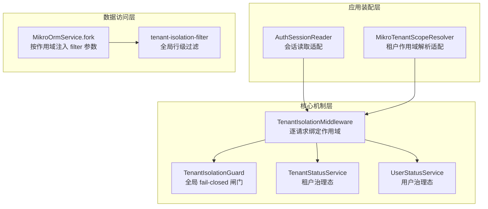
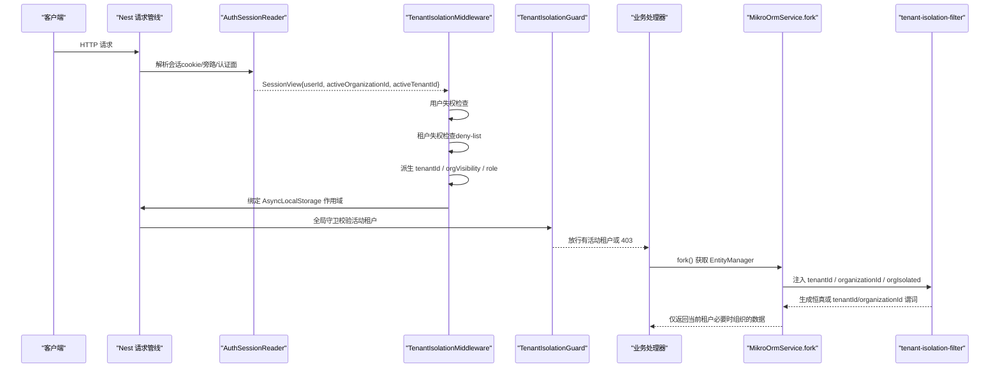
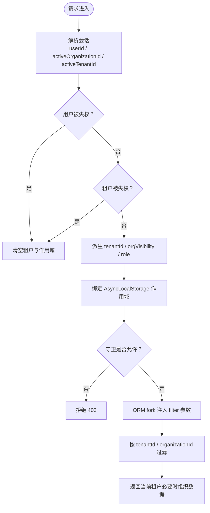
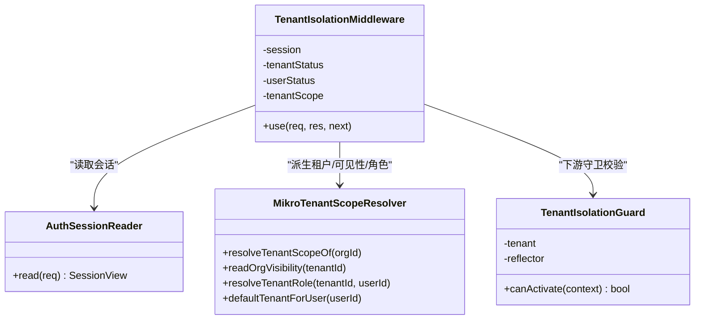
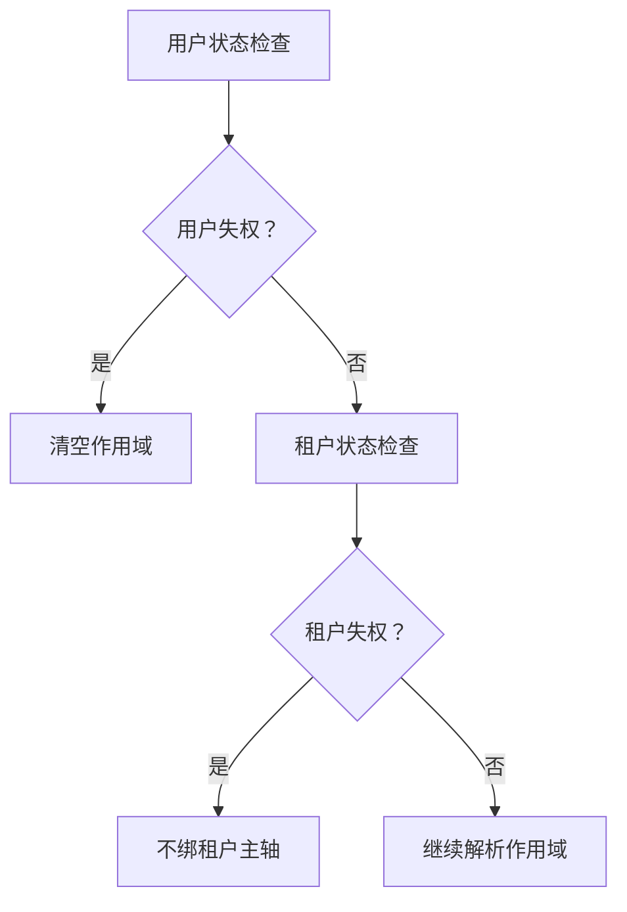
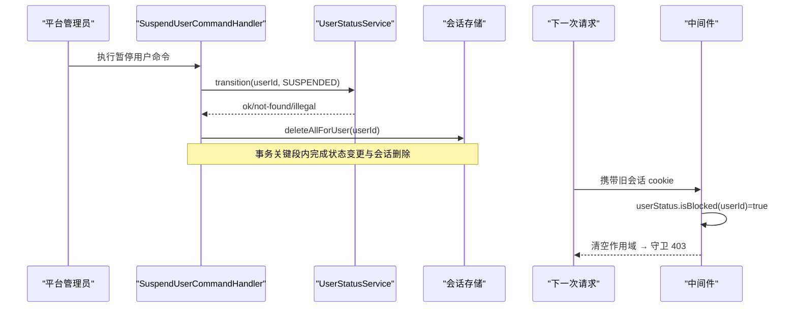
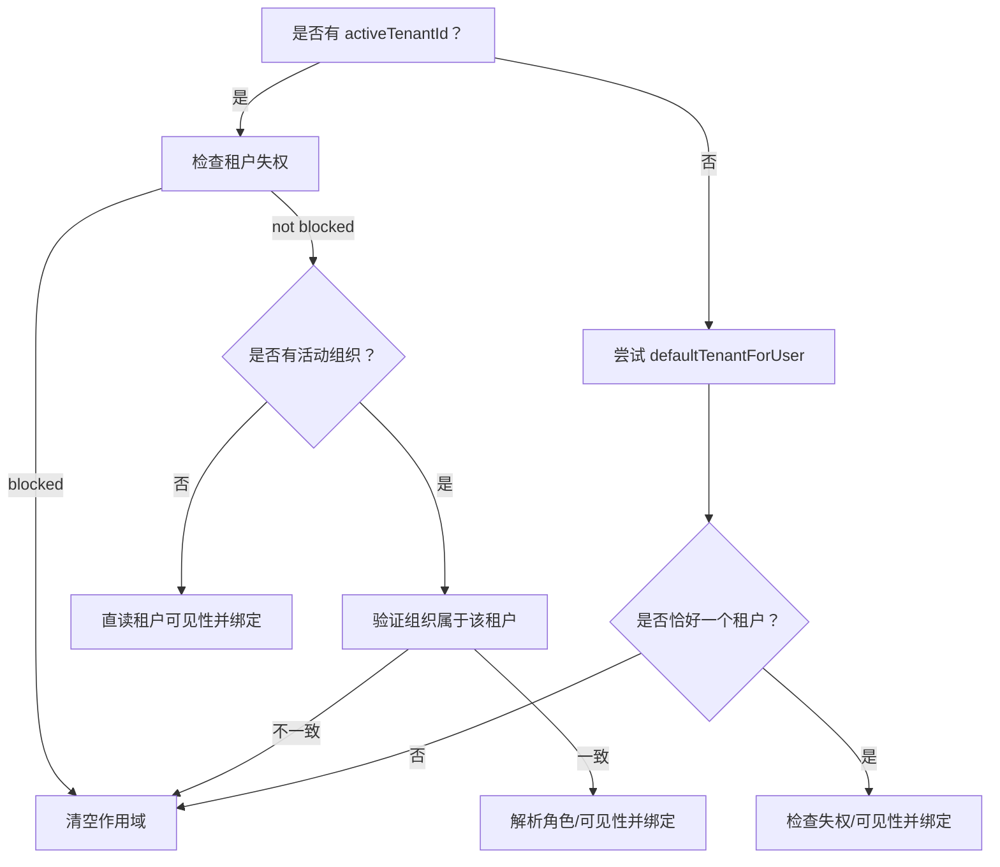
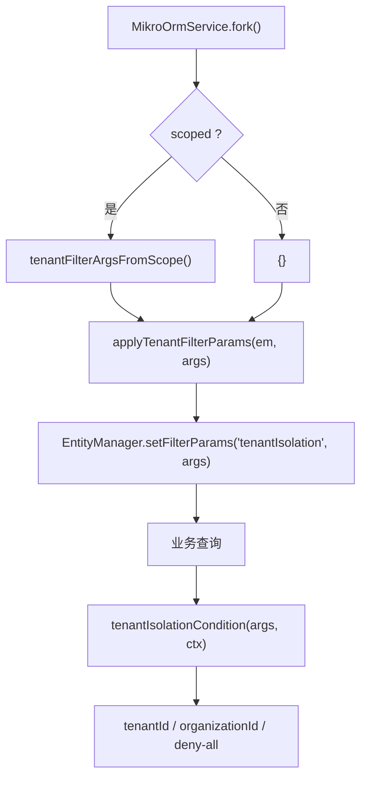
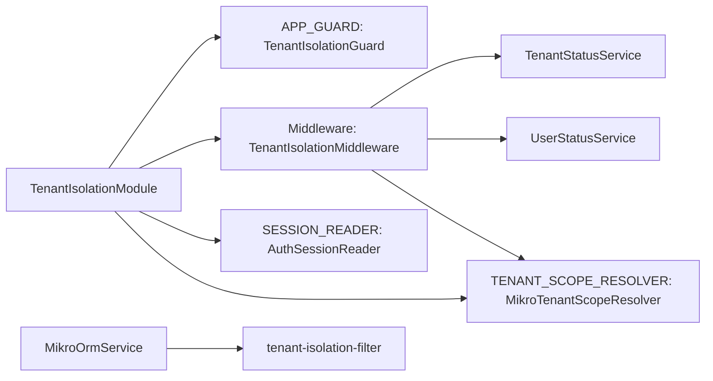

# 租户隔离机制

<cite>
**本文引用的文件**   
- [apps/api/src/tenant-isolation/tenant-isolation.module.ts](file://apps/api/src/tenant-isolation/tenant-isolation.module.ts)
- [libs/core/src/tenant-isolation/tenant-isolation.middleware.ts](file://libs/core/src/tenant-isolation/tenant-isolation.middleware.ts)
- [libs/core/src/tenant-isolation/tenant-isolation.guard.ts](file://libs/core/src/tenant-isolation/tenant-isolation.guard.ts)
- [apps/api/src/tenant-isolation/infrastructure/auth-session.reader.ts](file://apps/api/src/tenant-isolation/infrastructure/auth-session.reader.ts)
- [apps/api/src/tenant-isolation/infrastructure/mikro-tenant-scope.resolver.ts](file://apps/api/src/tenant-isolation/infrastructure/mikro-tenant-scope.resolver.ts)
- [apps/api/src/database/mikro/tenant-isolation-filter.ts](file://apps/api/src/database/mikro/tenant-isolation-filter.ts)
- [apps/api/src/database/mikro/mikro-orm.service.ts](file://apps/api/src/database/mikro/mikro-orm.service.ts)
- [libs/core/src/modules/organizations/lifecycle/tenant-status.service.ts](file://libs/core/src/modules/organizations/lifecycle/tenant-status.service.ts)
- [libs/core/src/modules/organizations/lifecycle/user-status.service.ts](file://libs/core/src/modules/organizations/lifecycle/user-status.service.ts)
- [apps/api/src/modules/organizations/application/commands/handlers/set-session-active-tenant.command-handler.ts](file://apps/api/src/modules/organizations/application/commands/handlers/set-session-active-tenant.command-handler.ts)
</cite>

## 目录
1. [引言](#引言)
2. [项目结构](#项目结构)
3. [核心组件](#核心组件)
4. [架构总览](#架构总览)
5. [详细组件分析](#详细组件分析)
6. [依赖关系分析](#依赖关系分析)
7. [性能与可扩展性](#性能与可扩展性)
8. [故障排查指南](#故障排查指南)
9. [结论](#结论)
10. [附录：三层权限矩阵与最佳实践](#附录三层权限矩阵与最佳实践)

## 引言
本文件系统性说明 SaaS 多租户的隔离机制，围绕“租户级隔离、组织级可见性、用户级权限”三层权限矩阵展开，解释中间件与守卫如何协作建立请求级作用域，失权清单（deny-list）如何实现即时失能，会话失效与租户激活状态检查如何配合防止提权，以及数据库查询过滤器如何兜底行级隔离。文档同时给出安全建议与最佳实践，帮助开发者在新增路由、仓储和领域逻辑时保持 fail-closed 的安全基线。

## 项目结构
租户隔离能力由“应用装配层 + 核心机制层 + 数据访问层”共同构成：
- 应用装配层负责把会话读取、租户作用域解析等实现绑定到核心端口；
- 核心机制层提供中间件、守卫、服务与存储抽象；
- 数据访问层通过 MikroORM 全局 filter 强制行级过滤。

图表来源
- [apps/api/src/tenant-isolation/infrastructure/auth-session.reader.ts:44-78](file://apps/api/src/tenant-isolation/infrastructure/auth-session.reader.ts#L44-L78)
- [apps/api/src/tenant-isolation/infrastructure/mikro-tenant-scope.resolver.ts:25-83](file://apps/api/src/tenant-isolation/infrastructure/mikro-tenant-scope.resolver.ts#L25-L83)
- [libs/core/src/tenant-isolation/tenant-isolation.middleware.ts:28-41](file://libs/core/src/tenant-isolation/tenant-isolation.middleware.ts#L28-L41)
- [libs/core/src/tenant-isolation/tenant-isolation.guard.ts:37-42](file://libs/core/src/tenant-isolation/tenant-isolation.guard.ts#L37-L42)
- [apps/api/src/database/mikro/mikro-orm.service.ts:54-66](file://apps/api/src/database/mikro/mikro-orm.service.ts#L54-L66)
- [apps/api/src/database/mikro/tenant-isolation-filter.ts:113-128](file://apps/api/src/database/mikro/tenant-isolation-filter.ts#L113-L128)

章节来源
- [apps/api/src/tenant-isolation/tenant-isolation.module.ts:11-43](file://apps/api/src/tenant-isolation/tenant-isolation.module.ts#L11-L43)

## 核心组件
- 租户隔离模块：注册全局守卫、中间件，并导出会话读取与租户作用域解析端口。
- 会话读取适配：从 Better Auth 会话中解析用户 ID、活动组织、显式激活租户，并对免认证路径做廉价短路。
- 租户作用域解析适配：根据活动组织派生租户主轴，并回读租户的组织可见性策略；按租户解析用户角色；为冷启动提供单租默认租户。
- 租户隔离中间件：逐请求解析会话、校验用户与租户失权、派生租户主轴、绑定 AsyncLocalStorage 作用域。
- 租户隔离守卫：全局 fail-closed 闸门，要求请求具备活动租户上下文。
- 租户状态服务：唯一读写卡点，提供活跃性与失权判断，支持严格迁移与事件发布。
- 用户状态服务：复用租户状态机子集，提供用户级失权判断与迁移。
- ORM 服务与全局 filter：每次 fork 自动注入租户/组织过滤参数，无上下文或跨租场景不筛。

章节来源
- [apps/api/src/tenant-isolation/tenant-isolation.module.ts:44-71](file://apps/api/src/tenant-isolation/tenant-isolation.module.ts#L44-L71)
- [apps/api/src/tenant-isolation/infrastructure/auth-session.reader.ts:44-78](file://apps/api/src/tenant-isolation/infrastructure/auth-session.reader.ts#L44-L78)
- [apps/api/src/tenant-isolation/infrastructure/mikro-tenant-scope.resolver.ts:25-83](file://apps/api/src/tenant-isolation/infrastructure/mikro-tenant-scope.resolver.ts#L25-L83)
- [libs/core/src/tenant-isolation/tenant-isolation.middleware.ts:50-199](file://libs/core/src/tenant-isolation/tenant-isolation.middleware.ts#L50-L199)
- [libs/core/src/tenant-isolation/tenant-isolation.guard.ts:52-67](file://libs/core/src/tenant-isolation/tenant-isolation.guard.ts#L52-L67)
- [libs/core/src/modules/organizations/lifecycle/tenant-status.service.ts:47-81](file://libs/core/src/modules/organizations/lifecycle/tenant-status.service.ts#L47-L81)
- [libs/core/src/modules/organizations/lifecycle/user-status.service.ts:53-83](file://libs/core/src/modules/organizations/lifecycle/user-status.service.ts#L53-L83)
- [apps/api/src/database/mikro/mikro-orm.service.ts:54-66](file://apps/api/src/database/mikro/mikro-orm.service.ts#L54-L66)
- [apps/api/src/database/mikro/tenant-isolation-filter.ts:43-87](file://apps/api/src/database/mikro/tenant-isolation-filter.ts#L43-L87)

## 架构总览
下图展示一次受保护请求从进入 Nest 到数据库查询的完整链路：会话解析、失权检查、租户作用域绑定、全局守卫拦截、ORM 作用域注入、行级过滤。

图表来源
- [apps/api/src/tenant-isolation/infrastructure/auth-session.reader.ts:48-78](file://apps/api/src/tenant-isolation/infrastructure/auth-session.reader.ts#L48-L78)
- [libs/core/src/tenant-isolation/tenant-isolation.middleware.ts:50-199](file://libs/core/src/tenant-isolation/tenant-isolation.middleware.ts#L50-L199)
- [libs/core/src/tenant-isolation/tenant-isolation.guard.ts:52-67](file://libs/core/src/tenant-isolation/tenant-isolation.guard.ts#L52-L67)
- [apps/api/src/database/mikro/mikro-orm.service.ts:54-66](file://apps/api/src/database/mikro/mikro-orm.service.ts#L54-L66)
- [apps/api/src/database/mikro/tenant-isolation-filter.ts:43-87](file://apps/api/src/database/mikro/tenant-isolation-filter.ts#L43-L87)

## 详细组件分析

### 三层权限矩阵：租户级隔离、组织级可见性、用户级权限
- 租户级隔离：中间件解析出活动租户后，守卫要求存在活动 `tenantId`；ORM 全局 filter 对在册实体追加 `tenantId` 条件，形成跨租户硬地板。
- 组织级可见性：当租户启用组织隔离且存在活动组织时，filter 追加 `organizationId`；若无活动组织但处于隔离模式，针对带组织分区列的实体触发“拒所有”哨兵值，避免机密泄露。
- 用户级权限：中间件在活动租户上解析用户角色，供 RBAC 使用；用户级失权（暂停/删除）会直接清空租户与作用域，使下游全部 fail-closed。

图表来源
- [libs/core/src/tenant-isolation/tenant-isolation.middleware.ts:105-193](file://libs/core/src/tenant-isolation/tenant-isolation.middleware.ts#L105-L193)
- [libs/core/src/tenant-isolation/tenant-isolation.guard.ts:52-67](file://libs/core/src/tenant-isolation/tenant-isolation.guard.ts#L52-L67)
- [apps/api/src/database/mikro/tenant-isolation-filter.ts:65-87](file://apps/api/src/database/mikro/tenant-isolation-filter.ts#L65-L87)

章节来源
- [libs/core/src/tenant-isolation/tenant-isolation.middleware.ts:50-199](file://libs/core/src/tenant-isolation/tenant-isolation.middleware.ts#L50-L199)
- [apps/api/src/database/mikro/tenant-isolation-filter.ts:43-87](file://apps/api/src/database/mikro/tenant-isolation-filter.ts#L43-L87)

### 租户隔离守卫与中间件工作机制
- 中间件职责：
  - 通过端口读取会话，避免直接耦合认证实现；
  - 先检查用户失权，再检查租户失权；
  - 优先处理显式激活租户，否则从活动组织派生租户主轴；
  - 解析租户角色与组织可见性，最终绑定作用域。
- 守卫职责：
  - 作为全局 APP_GUARD，默认 deny-by-default；
  - 对 `@Public` 与 `@TenantIsolationExempt` 进行旁路；
  - 无活动租户上下文时抛出 403。

图表来源
- [libs/core/src/tenant-isolation/tenant-isolation.middleware.ts:28-41](file://libs/core/src/tenant-isolation/tenant-isolation.middleware.ts#L28-L41)
- [libs/core/src/tenant-isolation/tenant-isolation.guard.ts:37-42](file://libs/core/src/tenant-isolation/tenant-isolation.guard.ts#L37-L42)
- [apps/api/src/tenant-isolation/infrastructure/auth-session.reader.ts:44-78](file://apps/api/src/tenant-isolation/infrastructure/auth-session.reader.ts#L44-L78)
- [apps/api/src/tenant-isolation/infrastructure/mikro-tenant-scope.resolver.ts:25-83](file://apps/api/src/tenant-isolation/infrastructure/mikro-tenant-scope.resolver.ts#L25-L83)

章节来源
- [libs/core/src/tenant-isolation/tenant-isolation.middleware.ts:50-199](file://libs/core/src/tenant-isolation/tenant-isolation.middleware.ts#L50-L199)
- [libs/core/src/tenant-isolation/tenant-isolation.guard.ts:52-67](file://libs/core/src/tenant-isolation/tenant-isolation.guard.ts#L52-L67)

### 失权清单（deny-list）的实现与安全保障
- 用户级失权：用户状态服务将 suspended/deleted 视为失权；中间件在解析租户前即检查，命中则清空作用域，导致后续所有守卫 fail-closed。
- 租户级失权：租户状态服务提供 isBlocked，涵盖 pending_approval/suspended/deleted 等准入失败态；中间件在派生租户主轴后检查，命中则不绑主轴，守卫 403。
- 安全底线：
  - 失权检查早于租户解析，避免利用未解析上下文绕过；
  - 显式激活租户路径仍过失权检查；
  - 解析失败一律 fail-closed，不降级为放行。

图表来源
- [libs/core/src/modules/organizations/lifecycle/user-status.service.ts:74-83](file://libs/core/src/modules/organizations/lifecycle/user-status.service.ts#L74-L83)
- [libs/core/src/modules/organizations/lifecycle/tenant-status.service.ts:74-81](file://libs/core/src/modules/organizations/lifecycle/tenant-status.service.ts#L74-L81)
- [libs/core/src/tenant-isolation/tenant-isolation.middleware.ts:105-193](file://libs/core/src/tenant-isolation/tenant-isolation.middleware.ts#L105-L193)

章节来源
- [libs/core/src/modules/organizations/lifecycle/user-status.service.ts:53-83](file://libs/core/src/modules/organizations/lifecycle/user-status.service.ts#L53-L83)
- [libs/core/src/modules/organizations/lifecycle/tenant-status.service.ts:47-81](file://libs/core/src/modules/organizations/lifecycle/tenant-status.service.ts#L47-L81)
- [libs/core/src/tenant-isolation/tenant-isolation.middleware.ts:105-193](file://libs/core/src/tenant-isolation/tenant-isolation.middleware.ts#L105-L193)

### 即时失权机制与会话失效处理
- 即时失权：用户或租户状态变更后，中间件在下一次请求即生效，因为失权检查发生在每个请求的中间件阶段。
- 会话失效：治理命令处理器在用户暂停时会调用会话存储删除该用户的全部会话，缩短失权窗口；结合中间件失权检查，形成双重保障。
- 租户激活：设置会话激活租户的命令处理器会先校验目标租户是否在用户可见目录内，防止跨租户提权。

图表来源
- [libs/core/src/modules/organizations/lifecycle/user-status.service.ts:100-127](file://libs/core/src/modules/organizations/lifecycle/user-status.service.ts#L100-L127)
- [libs/core/src/tenant-isolation/tenant-isolation.middleware.ts:105-114](file://libs/core/src/tenant-isolation/tenant-isolation.middleware.ts#L105-L114)
- [apps/api/src/modules/organizations/application/commands/handlers/set-session-active-tenant.command-handler.ts:37-55](file://apps/api/src/modules/organizations/application/commands/handlers/set-session-active-tenant.command-handler.ts#L37-L55)

章节来源
- [libs/core/src/modules/organizations/lifecycle/user-status.service.ts:100-127](file://libs/core/src/modules/organizations/lifecycle/user-status.service.ts#L100-L127)
- [libs/core/src/tenant-isolation/tenant-isolation.middleware.ts:105-114](file://libs/core/src/tenant-isolation/tenant-isolation.middleware.ts#L105-L114)
- [apps/api/src/modules/organizations/application/commands/handlers/set-session-active-tenant.command-handler.ts:37-55](file://apps/api/src/modules/organizations/application/commands/handlers/set-session-active-tenant.command-handler.ts#L37-L55)

### 租户激活状态检查与权限提升防护
- 显式激活租户：会话可携带 activeTenantId；中间件优先使用该轴，但仍过租户失权检查。
- 活动组织派生：若未显式激活租户，则从活动组织派生租户主轴；解析不出归属则不绑主轴，守卫 403。
- 防提权：
  - 设置会话激活租户前校验目标租户在用户可见目录内；
  - 显式租户与活动组织不一致时不绑主轴，避免借他租组织身份越权；
  - 角色只随活动租户解析，切组织不翻角色。

图表来源
- [libs/core/src/tenant-isolation/tenant-isolation.middleware.ts:127-193](file://libs/core/src/tenant-isolation/tenant-isolation.middleware.ts#L127-L193)
- [apps/api/src/modules/organizations/application/commands/handlers/set-session-active-tenant.command-handler.ts:37-55](file://apps/api/src/modules/organizations/application/commands/handlers/set-session-active-tenant.command-handler.ts#L37-L55)
- [apps/api/src/tenant-isolation/infrastructure/mikro-tenant-scope.resolver.ts:71-83](file://apps/api/src/tenant-isolation/infrastructure/mikro-tenant-scope.resolver.ts#L71-L83)

章节来源
- [libs/core/src/tenant-isolation/tenant-isolation.middleware.ts:127-193](file://libs/core/src/tenant-isolation/tenant-isolation.middleware.ts#L127-L193)
- [apps/api/src/modules/organizations/application/commands/handlers/set-session-active-tenant.command-handler.ts:37-55](file://apps/api/src/modules/organizations/application/commands/handlers/set-session-active-tenant.command-handler.ts#L37-L55)
- [apps/api/src/tenant-isolation/infrastructure/mikro-tenant-scope.resolver.ts:71-83](file://apps/api/src/tenant-isolation/infrastructure/mikro-tenant-scope.resolver.ts#L71-L83)

### 与数据库查询过滤器的集成方式
- 全局 filter：定义名为 `tenantIsolation` 的全局 filter，默认开启；cond 函数根据 ALS 作用域生成 `tenantId` 与可选 `organizationId` 条件。
- 组织隔离收紧：当租户启用组织隔离且有活动组织时追加组织条件；若无活动组织但处于隔离模式，对带组织分区列的实体返回“拒所有”哨兵值。
- ORM 注入：MikroOrmService.fork 默认从 ALS 派生 filter 参数；scoped:false 用于跨租/治理/seed 等需要绕过过滤的场景。
- 实体元数据：通过 em 元数据判断实体是否携带组织分区列，从而决定是否触发拒所有哨兵值。

图表来源
- [apps/api/src/database/mikro/mikro-orm.service.ts:54-66](file://apps/api/src/database/mikro/mikro-orm.service.ts#L54-L66)
- [apps/api/src/database/mikro/tenant-isolation-filter.ts:43-87](file://apps/api/src/database/mikro/tenant-isolation-filter.ts#L43-L87)
- [apps/api/src/database/mikro/tenant-isolation-filter.ts:113-128](file://apps/api/src/database/mikro/tenant-isolation-filter.ts#L113-L128)

章节来源
- [apps/api/src/database/mikro/mikro-orm.service.ts:54-66](file://apps/api/src/database/mikro/mikro-orm.service.ts#L54-L66)
- [apps/api/src/database/mikro/tenant-isolation-filter.ts:43-87](file://apps/api/src/database/mikro/tenant-isolation-filter.ts#L43-L87)
- [apps/api/src/database/mikro/tenant-isolation-filter.ts:113-128](file://apps/api/src/database/mikro/tenant-isolation-filter.ts#L113-L128)

## 依赖关系分析
- 模块装配：TenantIsolationModule 将中间件应用到所有路由，并将守卫注册为全局 APP_GUARD；同时导出 SESSION_READER 与 TENANT_SCOPE_RESOLVER 端口。
- 端口倒置：核心机制通过端口消费会话与租户作用域，应用侧提供具体实现（AuthSessionReader、MikroTenantScopeResolver），降低耦合。
- 状态服务：租户与用户状态服务通过 store 端口与事件总线解耦，保证写操作的事务原子与审计可追溯。
- ORM 集成：MikroOrmService 统一负责连接生命周期与 EM fork，确保每次查询都携带正确的租户/组织过滤参数。

图表来源
- [apps/api/src/tenant-isolation/tenant-isolation.module.ts:44-71](file://apps/api/src/tenant-isolation/tenant-isolation.module.ts#L44-L71)
- [libs/core/src/tenant-isolation/tenant-isolation.middleware.ts:32-41](file://libs/core/src/tenant-isolation/tenant-isolation.middleware.ts#L32-L41)
- [apps/api/src/database/mikro/mikro-orm.service.ts:54-66](file://apps/api/src/database/mikro/mikro-orm.service.ts#L54-L66)

章节来源
- [apps/api/src/tenant-isolation/tenant-isolation.module.ts:44-71](file://apps/api/src/tenant-isolation/tenant-isolation.module.ts#L44-L71)
- [libs/core/src/tenant-isolation/tenant-isolation.middleware.ts:32-41](file://libs/core/src/tenant-isolation/tenant-isolation.middleware.ts#L32-L41)
- [apps/api/src/database/mikro/mikro-orm.service.ts:54-66](file://apps/api/src/database/mikro/mikro-orm.service.ts#L54-L66)

## 性能与可扩展性
- 会话解析短路：对无 cookie、认证面与旁路路径不做会话查询，减少不必要的数据库访问。
- 作用域解析缓存：会话解析结果在一次请求内复用；租户作用域解析为纯读，适合高频访问。
- ORM fork 开销：每次查询独立 EM，避免共享状态；在事务内复用事务 EM，减少连接与事务开销。
- 扩展点：新增路由默认受全局守卫保护；如需豁免需显式标注旁路装饰器；新增实体应纳入全局 filter 的在册集合。

[本节为通用指导，不直接分析具体文件]

## 故障排查指南
- 401 先于 403：全局会话墙先于租户墙运行，未认证请求先返回 401；认证成功但无活动租户返回 403。
- 无活动租户上下文：检查中间件是否正确绑定作用域；确认会话解析是否返回有效组织或显式租户。
- 组织隔离下数据为空：确认租户 orgVisibility 是否为 isolated；若有活动组织则必须匹配 organizationId；若无活动组织且实体带组织分区列，会被拒所有。
- 失权后立即访问仍成功：确认会话是否已失效；检查用户/租户状态服务是否更新；查看治理命令处理器是否删除了用户会话。
- 跨租提权风险：检查设置会话激活租户的命令处理器是否校验了用户可见目录；确认显式租户与活动组织一致性校验。

章节来源
- [libs/core/src/tenant-isolation/tenant-isolation.guard.ts:52-67](file://libs/core/src/tenant-isolation/tenant-isolation.guard.ts#L52-L67)
- [libs/core/src/tenant-isolation/tenant-isolation.middleware.ts:50-199](file://libs/core/src/tenant-isolation/tenant-isolation.middleware.ts#L50-L199)
- [apps/api/src/database/mikro/tenant-isolation-filter.ts:65-87](file://apps/api/src/database/mikro/tenant-isolation-filter.ts#L65-L87)
- [apps/api/src/modules/organizations/application/commands/handlers/set-session-active-tenant.command-handler.ts:37-55](file://apps/api/src/modules/organizations/application/commands/handlers/set-session-active-tenant.command-handler.ts#L37-L55)

## 结论
本项目的租户隔离机制以“中间件绑定作用域 + 全局守卫 fail-closed + ORM 全局 filter 行级过滤”为核心，辅以用户与租户两级失权清单、会话失效与租户激活校验，形成纵深防御体系。通过端口倒置与模块装配，机制层与应用侧解耦，便于扩展与维护。建议在新增路由与实体时遵循默认隔离原则，谨慎使用旁路与跨租 fork，确保数据安全边界不被弱化。

[本节为总结性内容，不直接分析具体文件]

## 附录：三层权限矩阵与最佳实践

### 三层权限矩阵
- 租户级隔离：
  - 中间件解析活动租户；
  - 守卫要求活动租户上下文；
  - ORM filter 强制 tenantId 过滤。
- 组织级可见性：
  - 租户启用组织隔离时，filter 追加 organizationId；
  - 无活动组织且隔离模式下，对组织分区实体拒所有。
- 用户级权限：
  - 用户失权立即清空作用域；
  - 租户失权阻止绑定租户主轴；
  - 角色按活动租户解析，供 RBAC 使用。

### 最佳实践与安全建议
- 默认隔离：所有路由默认受全局守卫保护；仅对确实无需租户上下文的接口使用旁路装饰器。
- 谨慎旁路：旁路不等于无鉴权；仍需其他守卫或服务校验权限。
- 仓储纪律：不要手写 where tenant_id；依赖全局 filter；确需跨租时使用 scoped:false。
- 状态变更闭环：治理动作完成后务必删除相关会话，缩短失权窗口。
- 显式激活校验：设置会话激活租户前校验用户可见目录，防止跨租户提权。
- 组织隔离测试：覆盖 isolated/shared 两种策略，验证有/无活动组织下的数据可见性。
- 审计与事件：状态迁移通过事件总线记录，便于追踪与联动。

[本节为通用指导，不直接分析具体文件]