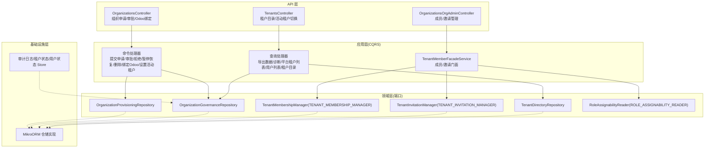
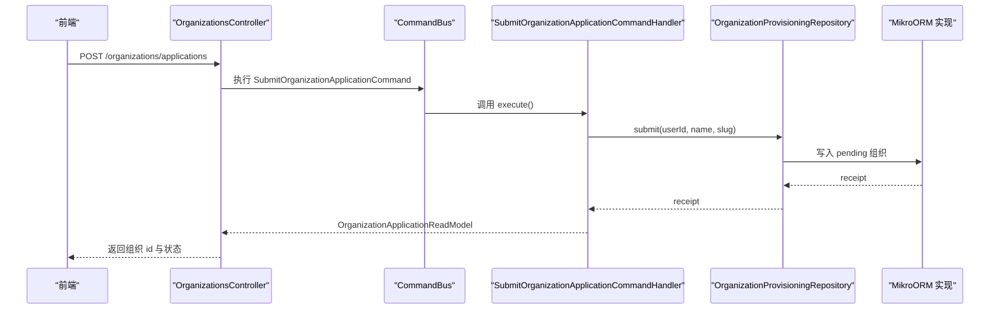
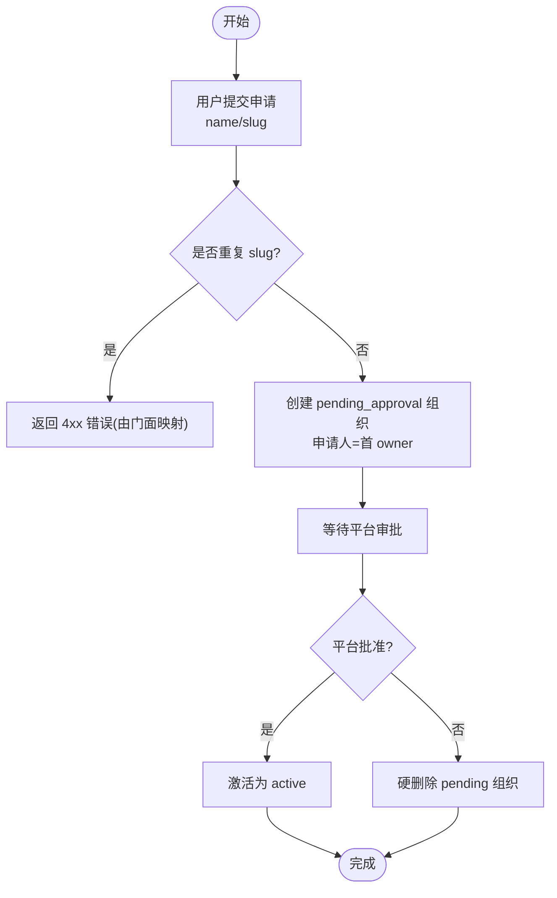
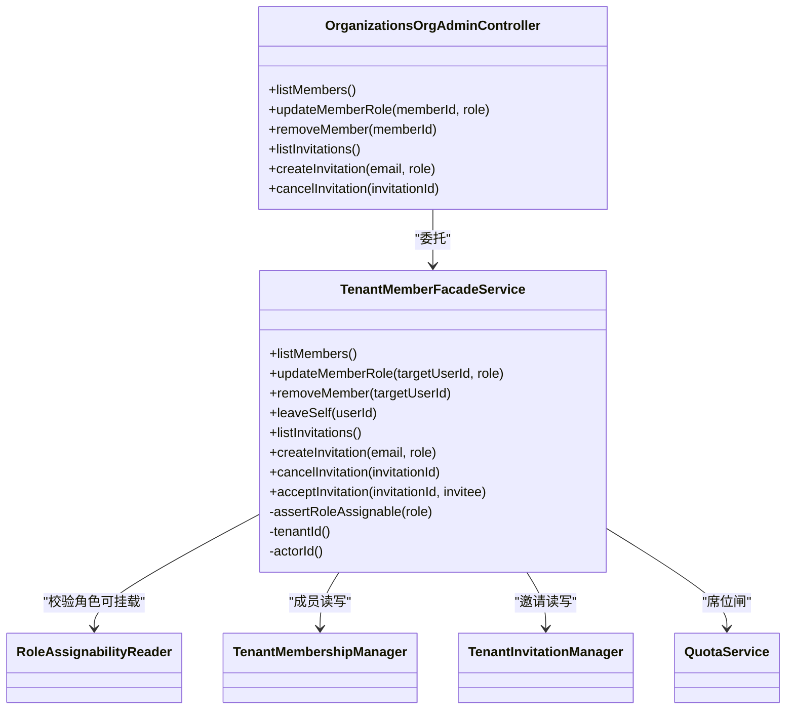
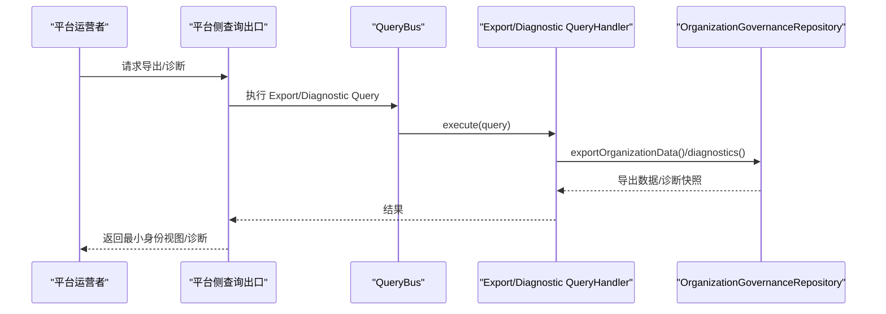
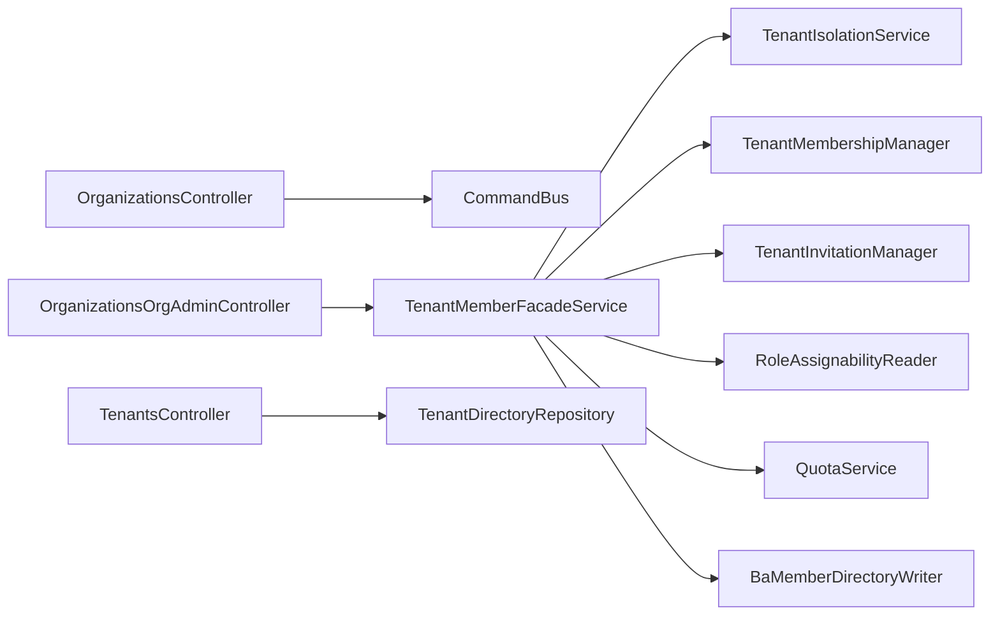

# 组织管理

<cite>
**本文引用的文件**   
- [organizations.module.ts](file://apps/api/src/modules/organizations/organizations.module.ts)
- [organizations.controller.ts](file://apps/api/src/modules/organizations/api/organizations.controller.ts)
- [organizations-org-admin.controller.ts](file://apps/api/src/modules/organizations/api/organizations-org-admin.controller.ts)
- [tenants.controller.ts](file://apps/api/src/modules/organizations/api/tenants.controller.ts)
- [submit-organization-application.command.ts](file://apps/api/src/modules/organizations/application/commands/submit-organization-application.command.ts)
- [submit-organization-application.command-handler.ts](file://apps/api/src/modules/organizations/application/commands/handlers/submit-organization-application.command-handler.ts)
- [tenant-member-facade.service.ts](file://apps/api/src/modules/organizations/application/tenant-member-facade.service.ts)
- [organization-application.read-model.ts](file://apps/api/src/modules/organizations/application/read-models/organization-application.read-model.ts)
- [organization-data-export.read-model.ts](file://apps/api/src/modules/organizations/application/read-models/organization-data-export.read-model.ts)
- [export-organization-data.query-handler.ts](file://apps/api/src/modules/organizations/application/queries/handlers/export-organization-data.query-handler.ts)
- [get-organization-diagnostics.query-handler.ts](file://apps/api/src/modules/organizations/application/queries/handlers/get-organization-diagnostics.query-handler.ts)
</cite>

## 目录
1. [简介](#简介)
2. [项目结构](#项目结构)
3. [核心组件](#核心组件)
4. [架构总览](#架构总览)
5. [详细组件分析](#详细组件分析)
6. [依赖关系分析](#依赖关系分析)
7. [性能与扩展性](#性能与扩展性)
8. [故障排查指南](#故障排查指南)
9. [结论](#结论)
10. [附录：API 规范与前端交互示例](#附录api-规范与前端交互示例)

## 简介
本文件面向“组织（租户）管理”能力，覆盖组织的创建申请、平台审批、成员与邀请管理、工作区与成员的关联、数据导出与诊断等高级功能，并说明与 RBAC 权限系统的集成方式及权限继承机制。文档以代码仓库中的组织模块为核心依据，提供从 API 到 CQRS 命令/查询处理器、门面服务、读模型与仓储端口的完整链路说明，帮助读者理解端到端的数据流、权限边界与错误处理策略。

## 项目结构
组织管理相关代码集中在 `apps/api/src/modules/organizations` 下，采用分层与切片组织：
- API 层：HTTP 控制器暴露 REST 接口，使用 NestJS + ORPC 契约驱动。
- 应用层：CQRS 命令/查询处理器编排领域逻辑；门面服务聚合多端口协作。
- 领域层：仓储端口定义跨实现抽象（治理、供应、成员、目录）。
- 基础设施层：MikroORM 实体与仓储实现、审计日志与状态存储适配。
- 生命周期与隔离：租户/用户状态机、RBAC 授权、租户隔离中间件。

图表来源
- [organizations.module.ts:86-146](file://apps/api/src/modules/organizations/organizations.module.ts#L86-L146)
- [organizations.controller.ts:64-175](file://apps/api/src/modules/organizations/api/organizations.controller.ts#L64-L175)
- [organizations-org-admin.controller.ts:58-156](file://apps/api/src/modules/organizations/api/organizations-org-admin.controller.ts#L58-L156)
- [tenants.controller.ts:42-101](file://apps/api/src/modules/organizations/api/tenants.controller.ts#L42-L101)

章节来源
- [organizations.module.ts:86-146](file://apps/api/src/modules/organizations/organizations.module.ts#L86-L146)

## 核心组件
- 组织申请与审批控制器：负责用户提交建租申请、平台运营者批准/驳回、Odoo 公司绑定回填。
- 组织管理员门面控制器：基于 RBAC 的租户级成员与邀请管理（增删改查、角色更新、邀请发/取/取消）。
- 租户目录控制器：列出当前用户可见的租户及其组织、设置会话级活动租户。
- 门面服务 TenantMemberFacadeService：统一编排成员/邀请/席位/角色可挂载判定，封装 BA 遗留轴同步。
- 读模型：组织申请回执、组织数据导出最小身份视图。
- 查询处理器：按租户导出数据、获取诊断快照。

章节来源
- [organizations.controller.ts:64-175](file://apps/api/src/modules/organizations/api/organizations.controller.ts#L64-L175)
- [organizations-org-admin.controller.ts:58-156](file://apps/api/src/modules/organizations/api/organizations-org-admin.controller.ts#L58-L156)
- [tenants.controller.ts:42-101](file://apps/api/src/modules/organizations/api/tenants.controller.ts#L42-L101)
- [tenant-member-facade.service.ts:55-263](file://apps/api/src/modules/organizations/application/tenant-member-facade.service.ts#L55-L263)
- [organization-application.read-model.ts:11-16](file://apps/api/src/modules/organizations/application/read-models/organization-application.read-model.ts#L11-L16)
- [organization-data-export.read-model.ts:1-16](file://apps/api/src/modules/organizations/application/read-models/organization-data-export.read-model.ts#L1-L16)

## 架构总览
组织管理采用 CQRS 与门面模式：
- 写路径：控制器 → CommandBus → 命令处理器 → 领域仓储端口 → 基础设施实现。
- 读路径：控制器 → QueryBus → 查询处理器 → 治理/目录仓储端口 → 读模型。
- 权限：SessionGuard/PlatformOperatorGuard/TenantIsolationGuard/AuthorizationGuard(@Can) 组合守卫；RBAC 通过 RoleAssignabilityReader 校验角色可挂载。
- 隔离：租户隔离中间件对租户级路由强制 active tenant；组织申请/审批/目录为跨租户场景豁免。

图表来源
- [organizations.controller.ts:72-91](file://apps/api/src/modules/organizations/api/organizations.controller.ts#L72-L91)
- [submit-organization-application.command.ts:12-20](file://apps/api/src/modules/organizations/application/commands/submit-organization-application.command.ts#L12-L20)
- [submit-organization-application.command-handler.ts:18-38](file://apps/api/src/modules/organizations/application/commands/handlers/submit-organization-application.command-handler.ts#L18-L38)

## 详细组件分析

### 组织申请与审批（CRUD 中的 Create/Approve/Reject）
- 创建（申请）：已登录用户提交组织名与 slug，系统以“系统动作”在 Better Auth 侧创建 pending_approval 组织，申请人成为首个 owner。
- 批准：平台运营者将 pending 组织激活为 active。
- 驳回：平台运营者硬删除 pending 组织。
- Odoo 绑定回填：平台运营者为 active 组织绑定 Odoo 公司。

图表来源
- [organizations.controller.ts:72-140](file://apps/api/src/modules/organizations/api/organizations.controller.ts#L72-L140)
- [submit-organization-application.command-handler.ts:32-37](file://apps/api/src/modules/organizations/application/commands/handlers/submit-organization-application.command-handler.ts#L32-L37)

章节来源
- [organizations.controller.ts:72-140](file://apps/api/src/modules/organizations/api/organizations.controller.ts#L72-L140)
- [submit-organization-application.command.ts:12-20](file://apps/api/src/modules/organizations/application/commands/submit-organization-application.command.ts#L12-L20)
- [submit-organization-application.command-handler.ts:18-38](file://apps/api/src/modules/organizations/application/commands/handlers/submit-organization-application.command-handler.ts#L18-L38)

### 组织管理员权限模型与操作边界
- 权限入口：`@UseGuards(TenantIsolationGuard, AuthorizationGuard)` + 方法级 `@Can('read'|'update'|'delete'|'create'|'cancel', 'Member'|'Invitation')`。
- 角色可挂载：通过 `RoleAssignabilityReader.isRoleAssignable(role)` 严格校验，词汇外角色直接拒绝。
- 关键边界：
  - 禁止降为最后一个 owner。
  - 禁止自移（管理员面）。
  - 接受邀请时邮箱必须匹配，且受席位配额限制。
  - 撤销成员/退租会同时清理 BA 遗留 member 行（best-effort）。

图表来源
- [organizations-org-admin.controller.ts:58-156](file://apps/api/src/modules/organizations/api/organizations-org-admin.controller.ts#L58-L156)
- [tenant-member-facade.service.ts:55-263](file://apps/api/src/modules/organizations/application/tenant-member-facade.service.ts#L55-L263)

章节来源
- [organizations-org-admin.controller.ts:58-156](file://apps/api/src/modules/organizations/api/organizations-org-admin.controller.ts#L58-L156)
- [tenant-member-facade.service.ts:55-263](file://apps/api/src/modules/organizations/application/tenant-member-facade.service.ts#L55-L263)

### 组织与工作区、成员的关联关系
- 成员：通过 `TenantMembershipManager` 维护租户维度的成员关系与角色分配。
- 邀请：通过 `TenantInvitationManager` 维护待处理邀请，支持按邮箱查询、接受/拒绝/取消。
- 工作区：工作区属于租户下的业务分组，成员在工作区的权限由 RBAC 与角色分配决定；本模块不直接持有工作区实体，但通过目录与成员读模型支撑前端展示与切换。
- 目录：`TenantDirectoryRepository.listForUser(userId)` 返回用户可见的租户及其组织集合，供前端双层切换器渲染。

章节来源
- [tenant-member-facade.service.ts:66-155](file://apps/api/src/modules/organizations/application/tenant-member-facade.service.ts#L66-L155)
- [tenants.controller.ts:50-65](file://apps/api/src/modules/organizations/api/tenants.controller.ts#L50-L65)

### 组织数据导出与诊断（高级功能）
- 数据导出：平台级只读接口，返回最小身份视图（id/name/email/handle），不含任何凭据；用于合规取证与主体数据权。
- 诊断信息：平台级只读接口，返回租户诊断快照，便于运维排障。

图表来源
- [export-organization-data.query-handler.ts:17-34](file://apps/api/src/modules/organizations/application/queries/handlers/export-organization-data.query-handler.ts#L17-L34)
- [get-organization-diagnostics.query-handler.ts:17-34](file://apps/api/src/modules/organizations/application/queries/handlers/get-organization-diagnostics.query-handler.ts#L17-L34)
- [organization-data-export.read-model.ts:1-16](file://apps/api/src/modules/organizations/application/read-models/organization-data-export.read-model.ts#L1-L16)

章节来源
- [export-organization-data.query-handler.ts:17-34](file://apps/api/src/modules/organizations/application/queries/handlers/export-organization-data.query-handler.ts#L17-L34)
- [get-organization-diagnostics.query-handler.ts:17-34](file://apps/api/src/modules/organizations/application/queries/handlers/get-organization-diagnostics.query-handler.ts#L17-L34)
- [organization-data-export.read-model.ts:1-16](file://apps/api/src/modules/organizations/application/read-models/organization-data-export.read-model.ts#L1-L16)

### 组织申请表单数据结构与验证规则
- 输入字段：`name`（组织名称）、`slug`（组织标识）。
- 校验规则：
  - slug 唯一性由底层供应流程保证；重复 slug 经门面统一映射为 4xx 错误。
  - 申请主体来自会话（非请求体），防止伪造。
- 输出模型：`OrganizationApplicationReadModel` 仅包含 `organizationId` 与 `status`。

章节来源
- [organizations.controller.ts:72-91](file://apps/api/src/modules/organizations/api/organizations.controller.ts#L72-L91)
- [submit-organization-application.command.ts:12-20](file://apps/api/src/modules/organizations/application/commands/submit-organization-application.command.ts#L12-L20)
- [organization-application.read-model.ts:11-16](file://apps/api/src/modules/organizations/application/read-models/organization-application.read-model.ts#L11-L16)

### 与 RBAC 权限系统的集成与权限继承
- 授权守卫：`AuthorizationGuard` 配合 `@Can(action, subject)` 进行细粒度授权。
- 角色可挂载：通过 `RoleAssignabilityReader` 判断角色在当前租户是否可分配，避免非法角色注入。
- 权限继承：成员角色决定其对资源的操作能力；最后 owner 保护、自移除保护等边界在门面层实现 fail-closed。
- 平台级 vs 租户级：组织申请/审批/目录为平台或跨租户能力，成员/邀请管理为租户级能力，需 active tenant。

章节来源
- [organizations-org-admin.controller.ts:58-156](file://apps/api/src/modules/organizations/api/organizations-org-admin.controller.ts#L58-L156)
- [tenant-member-facade.service.ts:245-252](file://apps/api/src/modules/organizations/application/tenant-member-facade.service.ts#L245-L252)

## 依赖关系分析
- 控制器依赖：
  - `OrganizationsController` 依赖 `CommandBus` 与多个命令类型。
  - `OrganizationsOrgAdminController` 依赖 `TenantMemberFacadeService`。
  - `TenantsController` 依赖 `TenantDirectoryRepository` 与 `CommandBus`。
- 门面服务依赖：
  - `TenantIsolationService`、`TenantMembershipManager`、`TenantInvitationManager`、`RoleAssignabilityReader`、`QuotaService`、`BaMemberDirectoryWriter`。
- 模块装配：
  - `OrganizationsModule` 注册所有控制器、命令/查询处理器、仓储端口实现、状态与审计 store，并导出跨上下文消费的服务与端口。

图表来源
- [organizations.controller.ts:64-175](file://apps/api/src/modules/organizations/api/organizations.controller.ts#L64-L175)
- [organizations-org-admin.controller.ts:58-156](file://apps/api/src/modules/organizations/api/organizations-org-admin.controller.ts#L58-L156)
- [tenants.controller.ts:42-101](file://apps/api/src/modules/organizations/api/tenants.controller.ts#L42-L101)
- [tenant-member-facade.service.ts:55-64](file://apps/api/src/modules/organizations/application/tenant-member-facade.service.ts#L55-L64)

章节来源
- [organizations.module.ts:86-146](file://apps/api/src/modules/organizations/organizations.module.ts#L86-L146)

## 性能与扩展性
- CQRS 解耦：写路径与读路径分离，便于独立扩展与优化。
- 门面聚合：复杂成员/邀请流程收敛于门面，减少控制器复杂度，提升可测试性。
- 幂等与一致性：席位检查与成员落库原子化，避免 TOCTOU 竞态。
- 可扩展点：新增组织生命周期状态、Odoo 绑定、诊断维度均可通过仓储端口扩展，无需改动控制器。

[本节为通用指导，不直接分析具体文件]

## 故障排查指南
- 常见错误码与语义：
  - 组织申请重复 slug：4xx（由门面映射）。
  - 组织不存在：404（errorCode 明确）。
  - 成员不存在：404。
  - 最后 owner 被降级/移除：403。
  - 自移除：403。
  - 邀请不存在/过期：404。
  - 席位超限：402。
  - 角色不可挂载：400。
- 排查建议：
  - 确认会话与会话 ID 是否存在（活动租户切换失败常因 sessionId 缺失）。
  - 确认当前租户是否为活动租户（租户隔离守卫失败会 403）。
  - 检查角色是否在租户内可挂载。
  - 查看审计日志与诊断快照定位问题根因。

章节来源
- [tenant-member-facade.service.ts:76-142](file://apps/api/src/modules/organizations/application/tenant-member-facade.service.ts#L76-L142)
- [tenant-member-facade.service.ts:176-243](file://apps/api/src/modules/organizations/application/tenant-member-facade.service.ts#L176-L243)
- [tenants.controller.ts:86-99](file://apps/api/src/modules/organizations/api/tenants.controller.ts#L86-L99)

## 结论
组织管理模块以 CQRS 与门面模式为核心，结合 RBAC 与租户隔离，实现了从组织申请、审批、成员与邀请管理到数据导出与诊断的完整闭环。通过严格的权限边界与错误映射，系统在安全性、一致性与可维护性方面具备良好基础。后续可在仓储端口与读模型上继续扩展诊断维度与导出范围，以满足更多合规与运营需求。

[本节为总结性内容，不直接分析具体文件]

## 附录：API 规范与前端交互示例

### API 接口规范（节选）
- 组织申请
  - 方法：POST
  - 路径：/organizations/applications
  - 鉴权：SessionGuard
  - 入参：{ name, slug }
  - 出参：{ organizationId, status }
  - 错误：重复 slug 等 4xx（门面映射）
- 组织批准
  - 方法：POST
  - 路径：/organizations/applications/:id/approve
  - 鉴权：PlatformOperatorGuard
  - 入参：{ id }
  - 出参：{ organizationId, status }
  - 错误：不存在 404
- 组织驳回
  - 方法：POST
  - 路径：/organizations/applications/:id/reject
  - 鉴权：PlatformOperatorGuard
  - 入参：{ id }
  - 出参：无（204）
  - 错误：不存在 404
- Odoo 绑定回填
  - 方法：POST
  - 路径：/organizations/bind-odoo-company
  - 鉴权：PlatformOperatorGuard
  - 入参：{ id, odooCompanyId, odooCompanyName }
  - 出参：绑定视图
  - 错误：不存在 404；占用/非 active 409
- 成员管理
  - 列出成员：GET /members（需要 read Member）
  - 更新角色：PUT /members/:memberId/role（需要 update Member）
  - 移除成员：DELETE /members/:memberId（需要 delete Member）
- 邀请管理
  - 列出邀请：GET /invitations（需要 read Invitation）
  - 创建邀请：POST /invitations（需要 create Invitation）
  - 取消邀请：DELETE /invitations/:invitationId（需要 cancel Invitation）
- 租户目录
  - 列出目录：GET /tenants（需要 SessionGuard）
  - 设置活动租户：PUT /tenants/active（需要 SessionGuard）

章节来源
- [organizations.controller.ts:72-175](file://apps/api/src/modules/organizations/api/organizations.controller.ts#L72-L175)
- [organizations-org-admin.controller.ts:67-156](file://apps/api/src/modules/organizations/api/organizations-org-admin.controller.ts#L67-L156)
- [tenants.controller.ts:55-101](file://apps/api/src/modules/organizations/api/tenants.controller.ts#L55-L101)

### 前端交互示例（概念流程）
- 创建组织申请
  - 用户在表单中输入组织名与 slug，提交后显示“待审批”。
- 平台审批
  - 平台运营者在后台列表中点击“批准”或“驳回”，成功后刷新列表。
- 成员与邀请
  - 管理员在租户设置页添加成员、分配角色、发送邀请；受邀者自助接受邀请并加入租户。
- 租户切换
  - 用户在顶部选择器中切换活动租户，后续操作均在该租户上下文中执行。

[本节为概念性示例，不直接分析具体文件]