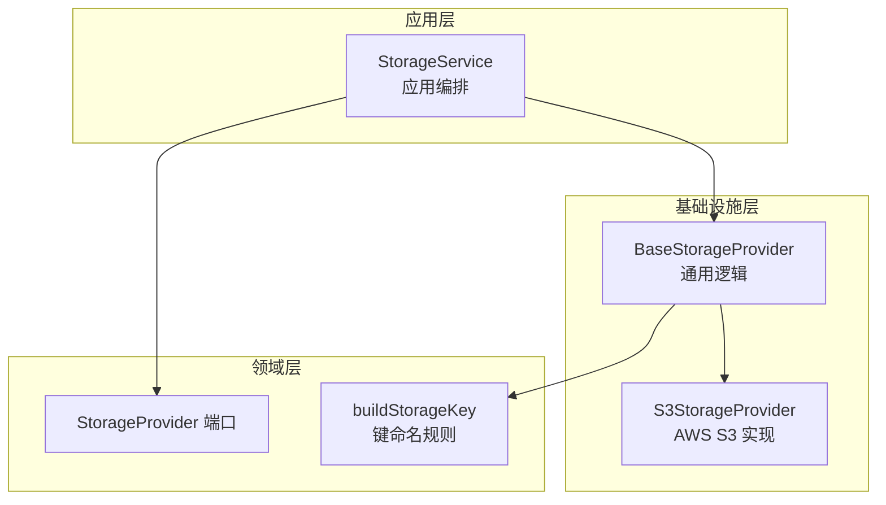
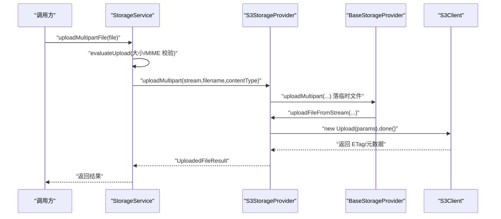
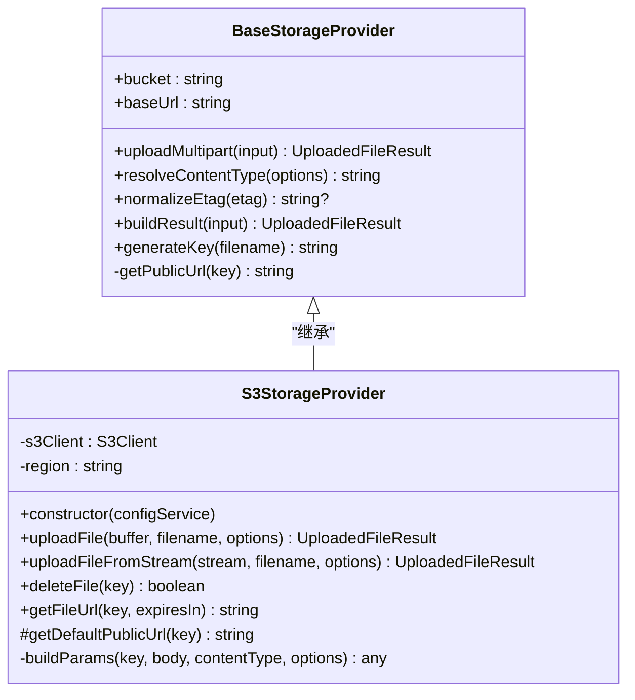
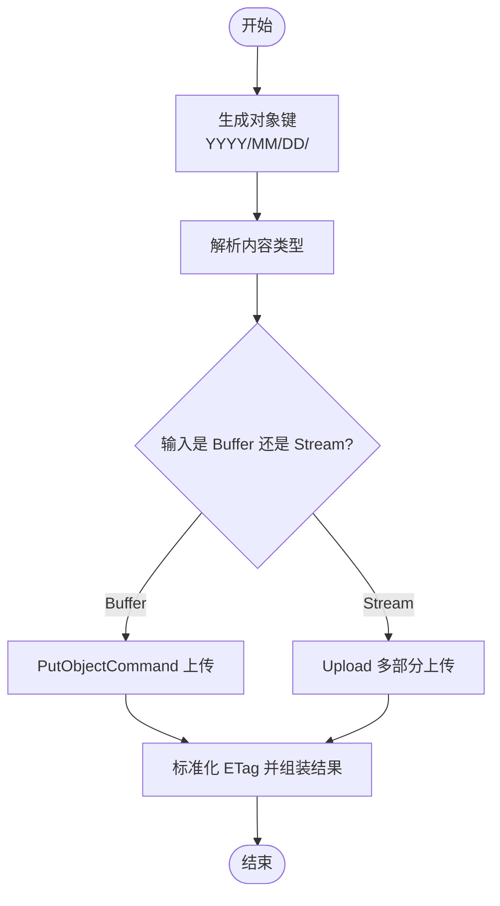
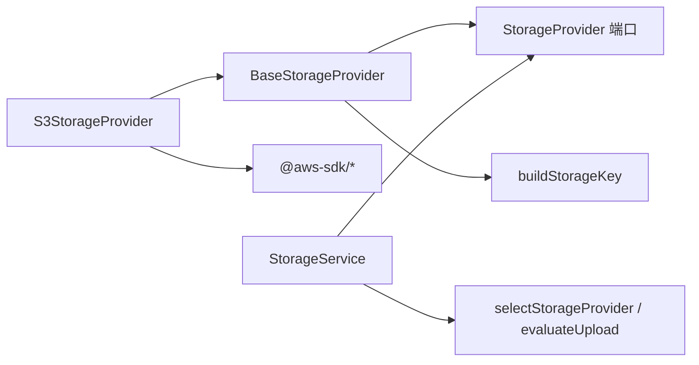

# AWS S3 存储提供商

<cite>
**本文引用的文件**   
- [s3-storage.provider.ts](file://apps/api/src/modules/storage/infrastructure/s3-storage.provider.ts)
- [base-storage.provider.ts](file://apps/api/src/modules/storage/infrastructure/base-storage.provider.ts)
- [storage-provider.port.ts](file://apps/api/src/modules/storage/domain/ports/storage-provider.port.ts)
- [storage-key.ts](file://apps/api/src/modules/storage/domain/value-objects/storage-key.ts)
- [storage.service.ts](file://apps/api/src/modules/storage/application/storage.service.ts)
- [storage.module.ts](file://apps/api/src/modules/storage/storage.module.ts)
- [config.module.ts](file://apps/api/src/config/config.module.ts)
- [default.ts](file://apps/api/src/config/envs/default.ts)
- [production.ts](file://apps/api/src/config/envs/production.ts)
- [deploy-swagger.yml](file://.github/workflows/deploy-swagger.yml)
</cite>

## 目录
1. [简介](#简介)
2. [项目结构](#项目结构)
3. [核心组件](#核心组件)
4. [架构总览](#架构总览)
5. [详细组件分析](#详细组件分析)
6. [依赖关系分析](#依赖关系分析)
7. [性能与优化建议](#性能与优化建议)
8. [故障排查指南](#故障排查指南)
9. [结论](#结论)
10. [附录：配置与环境变量](#附录配置与环境变量)

## 简介
本文件面向在 NestJS 应用中接入 AWS S3 或 S3 兼容对象存储（如 MinIO）的开发者，聚焦 `S3StorageProvider` 的实现细节、与基础抽象类的协作、上传流程、删除与签名 URL 生成、错误处理策略、性能优化建议，以及与 MinIO 等 S3 兼容服务的集成方式。文档同时给出完整的配置示例与环境变量说明，帮助你在不同环境中快速落地。

## 项目结构
S3 存储能力位于 `apps/api/src/modules/storage` 下，采用分层设计：
- domain：定义端口接口与领域值对象（键命名规则）。
- application：编排层，负责校验、选择 provider、异常映射。
- infrastructure：具体实现（S3、阿里云 OSS、腾讯云 COS），共享基类封装通用逻辑。
- storage.module：动态注册 provider 并暴露 StorageService。

图表来源
- [storage.service.ts:17-98](file://apps/api/src/modules/storage/application/storage.service.ts#L17-L98)
- [storage-provider.port.ts:44-100](file://apps/api/src/modules/storage/domain/ports/storage-provider.port.ts#L44-L100)
- [base-storage.provider.ts:28-119](file://apps/api/src/modules/storage/infrastructure/base-storage.provider.ts#L28-L119)
- [s3-storage.provider.ts:20-149](file://apps/api/src/modules/storage/infrastructure/s3-storage.provider.ts#L20-L149)
- [storage-key.ts:14-23](file://apps/api/src/modules/storage/domain/value-objects/storage-key.ts#L14-L23)

章节来源
- [storage.module.ts:11-47](file://apps/api/src/modules/storage/storage.module.ts#L11-L47)
- [storage.service.ts:17-98](file://apps/api/src/modules/storage/application/storage.service.ts#L17-L98)

## 核心组件
- S3StorageProvider：基于 AWS SDK v3 的 S3 客户端实现，负责构造 S3Client、区域与凭据、上传、删除、签名 URL 生成与默认公开 URL 拼接。
- BaseStorageProvider：抽象基类，提供多部分上传临时文件落盘、流式上传、内容类型默认值、ETag 规范化、结果组装、键生成与公开 URL 解析等通用能力。
- StorageProvider 端口：定义统一接口，包括缓冲区上传、流式上传、multipart 上传、删除、获取签名 URL。
- StorageService：应用编排层，负责上传前校验（大小、MIME）、选择 provider、异常映射到 HTTP 语义。
- 键命名规则 buildStorageKey：纯函数，统一输出 `YYYY/MM/DD/<uuid><ext>` 格式的对象键。

章节来源
- [s3-storage.provider.ts:20-149](file://apps/api/src/modules/storage/infrastructure/s3-storage.provider.ts#L20-L149)
- [base-storage.provider.ts:28-119](file://apps/api/src/modules/storage/infrastructure/base-storage.provider.ts#L28-L119)
- [storage-provider.port.ts:7-100](file://apps/api/src/modules/storage/domain/ports/storage-provider.port.ts#L7-L100)
- [storage.service.ts:17-98](file://apps/api/src/modules/storage/application/storage.service.ts#L17-L98)
- [storage-key.ts:14-23](file://apps/api/src/modules/storage/domain/value-objects/storage-key.ts#L14-L23)

## 架构总览
下图展示从请求进入 StorageService 到最终写入 S3 的关键调用链，以及 S3 客户端初始化与参数构建过程。

图表来源
- [storage.service.ts:43-79](file://apps/api/src/modules/storage/application/storage.service.ts#L43-L79)
- [base-storage.provider.ts:61-83](file://apps/api/src/modules/storage/infrastructure/base-storage.provider.ts#L61-L83)
- [s3-storage.provider.ts:73-102](file://apps/api/src/modules/storage/infrastructure/s3-storage.provider.ts#L73-L102)

## 详细组件分析

### S3StorageProvider 类分析
职责与关键点：
- 构造函数中读取存储配置，构造 S3Client，支持自定义 endpoint 与 path-style（MinIO 等兼容服务需要）。
- uploadFile：使用 PutObjectCommand 直接上传 Buffer，返回标准化结果。
- uploadFileFromStream：使用 @aws-sdk/lib-storage 的 Upload 进行多部分上传，适合大文件。
- deleteFile：DeleteObjectCommand 删除对象。
- getFileUrl：通过 getSignedUrl 生成带时效的访问链接。
- getDefaultPublicUrl：当未配置 baseUrl 时，回退到 AWS S3 标准域名拼接。
- buildParams：统一构建 Bucket/Key/Body/ContentType/Metadata/ACL 等参数。

图表来源
- [base-storage.provider.ts:28-119](file://apps/api/src/modules/storage/infrastructure/base-storage.provider.ts#L28-L119)
- [s3-storage.provider.ts:20-149](file://apps/api/src/modules/storage/infrastructure/s3-storage.provider.ts#L20-L149)

#### 构造函数与 S3Client 初始化
- 从 ConfigService 读取 region、accessKeyId、secretAccessKey、endpoint。
- 若配置了 endpoint，则启用 forcePathStyle=true，适配 MinIO 等 S3 兼容服务。
- 实例化 S3Client，并将 region 缓存用于默认公开 URL 拼接。

章节来源
- [s3-storage.provider.ts:25-45](file://apps/api/src/modules/storage/infrastructure/s3-storage.provider.ts#L25-L45)

#### 文件上传方法
- uploadFile：
  - 生成 key、确定 contentType。
  - 使用 PutObjectCommand 上传 Buffer。
  - 标准化 ETag，组装结果。
- uploadFileFromStream：
  - 使用 Upload（多部分上传）处理流式数据，适合大文件。
  - 无法直接获知 size，返回 -1；ETag 同样被规范化。

图表来源
- [s3-storage.provider.ts:47-102](file://apps/api/src/modules/storage/infrastructure/s3-storage.provider.ts#L47-L102)
- [base-storage.provider.ts:89-115](file://apps/api/src/modules/storage/infrastructure/base-storage.provider.ts#L89-L115)
- [storage-key.ts:14-23](file://apps/api/src/modules/storage/domain/value-objects/storage-key.ts#L14-L23)

章节来源
- [s3-storage.provider.ts:47-102](file://apps/api/src/modules/storage/infrastructure/s3-storage.provider.ts#L47-L102)

#### 删除与签名 URL
- deleteFile：发送 DeleteObjectCommand，成功返回 true。
- getFileUrl：使用 getSignedUrl 生成带过期时间的签名 URL，默认有效期为 3600 秒。

章节来源
- [s3-storage.provider.ts:104-129](file://apps/api/src/modules/storage/infrastructure/s3-storage.provider.ts#L104-L129)

#### 默认公开 URL 与 baseUrl
- 若配置了 baseUrl，则公开 URL 为 `${baseUrl}/${key}`。
- 否则默认使用 AWS S3 标准域名：`https://${bucket}.s3.${region}.amazonaws.com/${key}`。

章节来源
- [base-storage.provider.ts:117-119](file://apps/api/src/modules/storage/infrastructure/base-storage.provider.ts#L117-L119)
- [s3-storage.provider.ts:131-133](file://apps/api/src/modules/storage/infrastructure/s3-storage.provider.ts#L131-L133)

### BaseStorageProvider 通用逻辑
- uploadMultipart：将 multipart 原始流写入临时文件，再调用 uploadFileFromStream 上传，最后清理临时文件。
- resolveContentType：未指定时使用 `application/octet-stream`。
- normalizeEtag：去除云厂商包裹 ETag 的双引号。
- buildResult：统一组装 key/url/etag/size/mimetype/originalname。
- generateKey：调用领域层 buildStorageKey 生成规范键名。

章节来源
- [base-storage.provider.ts:61-119](file://apps/api/src/modules/storage/infrastructure/base-storage.provider.ts#L61-L119)

### StorageService 编排层
- 根据配置选择 provider（优先配置的 provider，未注册则回落 s3）。
- 上传前执行 evaluateUpload 校验（大小、MIME），失败抛出 BadRequestException。
- 委托 provider.uploadMultipart 完成 IO，捕获异常并映射为业务错误码。
- 透传 deleteFile 与 getFileUrl 给底层 provider。

章节来源
- [storage.service.ts:17-98](file://apps/api/src/modules/storage/application/storage.service.ts#L17-L98)

### 模块装配与 Provider 选择
- StorageModule.register 动态注入 STORAGE_PROVIDERS，始终包含 s3，并按配置注入 alioss/tencentoss。
- selectStorageProvider 纯函数决定实际使用的 provider，未命中则 fallback 到 s3。

章节来源
- [storage.module.ts:17-46](file://apps/api/src/modules/storage/storage.module.ts#L17-L46)
- [provider-selection.policy.ts:14-20](file://apps/api/src/modules/storage/domain/policies/provider-selection.policy.ts#L14-L20)

## 依赖关系分析
- S3StorageProvider 依赖：
  - AWS SDK v3：@aws-sdk/client-s3、@aws-sdk/lib-storage、@aws-sdk/s3-request-presigner。
  - 应用内：ConfigService、BaseStorageProvider、StorageProvider 端口。
- BaseStorageProvider 依赖：
  - Node.js fs/path/stream/util。
  - 领域层：StorageProvider 端口、buildStorageKey。
- StorageService 依赖：
  - ConfigService、StorageProvider 端口、domain 策略（provider-selection、upload.policy）。

图表来源
- [s3-storage.provider.ts:1-18](file://apps/api/src/modules/storage/infrastructure/s3-storage.provider.ts#L1-L18)
- [base-storage.provider.ts:1-14](file://apps/api/src/modules/storage/infrastructure/base-storage.provider.ts#L1-L14)
- [storage.service.ts:1-6](file://apps/api/src/modules/storage/application/storage.service.ts#L1-L6)

章节来源
- [s3-storage.provider.ts:1-18](file://apps/api/src/modules/storage/infrastructure/s3-storage.provider.ts#L1-L18)
- [base-storage.provider.ts:1-14](file://apps/api/src/modules/storage/infrastructure/base-storage.provider.ts#L1-L14)
- [storage.service.ts:1-6](file://apps/api/src/modules/storage/application/storage.service.ts#L1-L6)

## 性能与优化建议
- 大文件上传：
  - 优先使用 uploadFileFromStream（内部使用 Upload 多部分上传），避免内存峰值过高。
  - 合理设置分片大小与并发（由 SDK 默认策略控制，可按需扩展）。
- 临时文件：
  - BaseStorageProvider.uploadMultipart 会写 tmp 目录，确保运行环境有足够磁盘空间与权限。
- 网络与端点：
  - 使用就近区域与 endpoint，减少延迟；MinIO 等兼容服务务必开启 forcePathStyle。
- ACL 与可见性：
  - 默认 ACL 为 private；如需公开访问，结合 CDN 或配置 baseUrl 指向可公开访问的域名。
- ETag 与一致性：
  - 对 ETag 做规范化处理，避免双引号影响上层比较逻辑。
- 连接复用：
  - S3Client 单例复用，避免频繁创建连接带来的开销。

[本节为通用指导，不直接分析具体文件]

## 故障排查指南
- 上传失败：
  - 检查 accessKeyId/secretAccessKey 是否正确，endpoint 是否可达。
  - 确认 bucket 存在且当前凭证具备读写权限。
  - 查看临时目录是否有写入权限与足够空间。
- 签名 URL 无效：
  - 检查 expiresIn 是否过期。
  - 确认 S3 对象未被删除或 ACL 不允许匿名访问。
- 兼容服务（MinIO）：
  - 必须设置 endpoint 并启用 forcePathStyle。
  - 若使用自定义域名访问，请配置 baseUrl 以匹配前端直连地址。
- 文件大小与类型限制：
  - 超过 maxFileSize 或 MIME 不在允许列表会触发 400 错误。
  - 调整 STORAGE_MAX_FILE_SIZE 与 STORAGE_ALLOWED_MIME_TYPES。

章节来源
- [storage.service.ts:43-79](file://apps/api/src/modules/storage/application/storage.service.ts#L43-L79)
- [s3-storage.provider.ts:68-101](file://apps/api/src/modules/storage/infrastructure/s3-storage.provider.ts#L68-L101)
- [base-storage.provider.ts:61-83](file://apps/api/src/modules/storage/infrastructure/base-storage.provider.ts#L61-L83)

## 结论
S3StorageProvider 在 BaseStorageProvider 提供的通用能力之上，实现了与 AWS S3 及 S3 兼容服务的对接。通过 StorageService 的编排与校验，系统在易用性、可扩展性与健壮性之间取得平衡。配合合理的配置与环境变量，可在生产环境稳定运行，并方便地迁移至 MinIO 等兼容平台。

[本节为总结性内容，不直接分析具体文件]

## 附录：配置与环境变量
- 环境变量清单（来自配置模块与部署脚本）：
  - STORAGE_PROVIDER：存储提供者标识（s3/alioss/tencentoss）。
  - STORAGE_BUCKET：目标桶名称。
  - STORAGE_REGION：S3 区域。
  - STORAGE_ENDPOINT：自定义 endpoint（MinIO 等兼容服务必填）。
  - STORAGE_ACCESS_KEY_ID：访问密钥 ID。
  - STORAGE_ACCESS_KEY_SECRET：访问密钥 Secret。
  - STORAGE_BASE_URL：可选，公开访问的基础 URL（覆盖默认域名拼接）。
  - STORAGE_MAX_FILE_SIZE：最大文件大小（字节）。
  - STORAGE_ALLOWED_MIME_TYPES：允许的 MIME 类型列表（逗号分隔）。

- 典型环境变量示例（参考部署脚本）：
  - STORAGE_PROVIDER=s3
  - STORAGE_BUCKET=my-bucket
  - STORAGE_REGION=us-east-1
  - STORAGE_ENDPOINT=s3.us-east-1.amazonaws.com
  - STORAGE_ACCESS_KEY_ID=<your-access-key-id>
  - STORAGE_ACCESS_KEY_SECRET=<your-access-key-secret>
  - STORAGE_BASE_URL=https://my-bucket.s3.us-east-1.amazonaws.com
  - STORAGE_MAX_FILE_SIZE=10485760
  - STORAGE_ALLOWED_MIME_TYPES=image/jpeg,image/png,image/gif,application/pdf

- MinIO 集成要点：
  - 设置 STORAGE_ENDPOINT 为 MinIO 服务地址。
  - 启用 forcePathStyle（由代码自动处理）。
  - 如需前端直连，设置 STORAGE_BASE_URL 为 MinIO 可访问域名。

章节来源
- [config.module.ts:33-43](file://apps/api/src/config/config.module.ts#L33-L43)
- [default.ts:43-52](file://apps/api/src/config/envs/default.ts#L43-L52)
- [production.ts:40-49](file://apps/api/src/config/envs/production.ts#L40-L49)
- [deploy-swagger.yml:48-57](file://.github/workflows/deploy-swagger.yml#L48-L57)