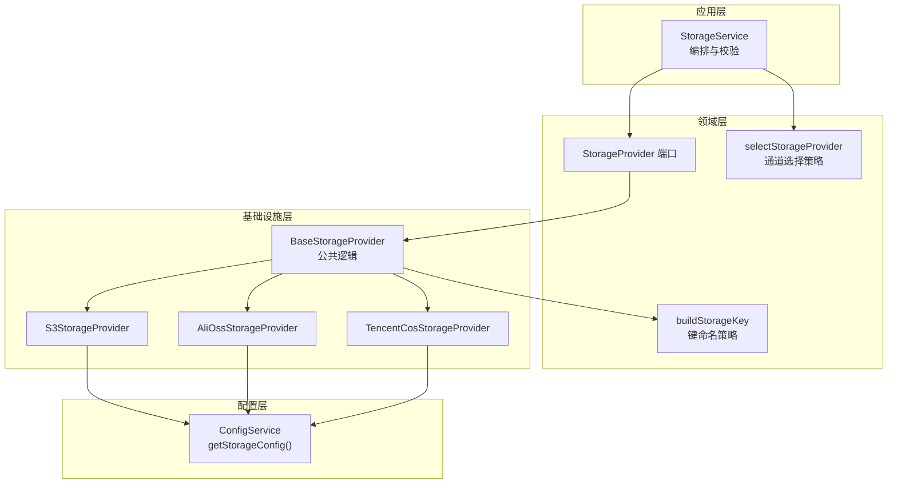
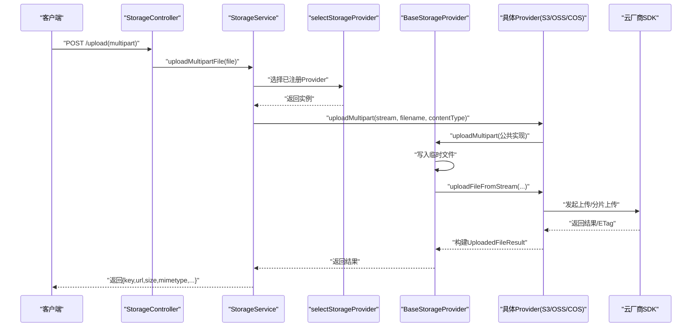
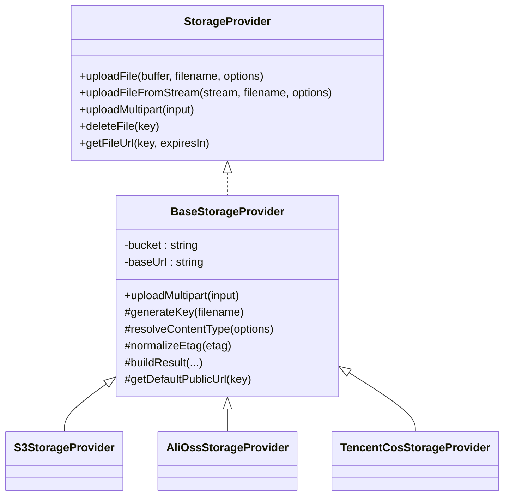
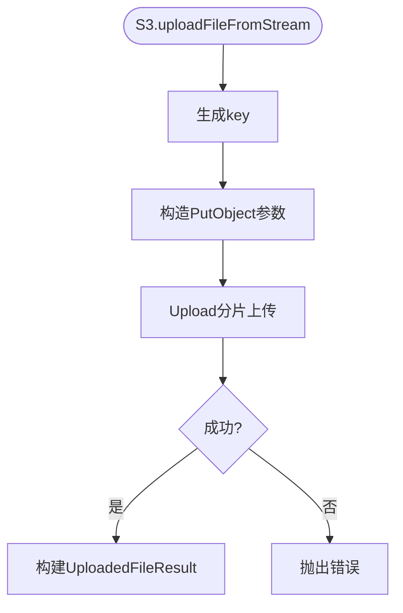
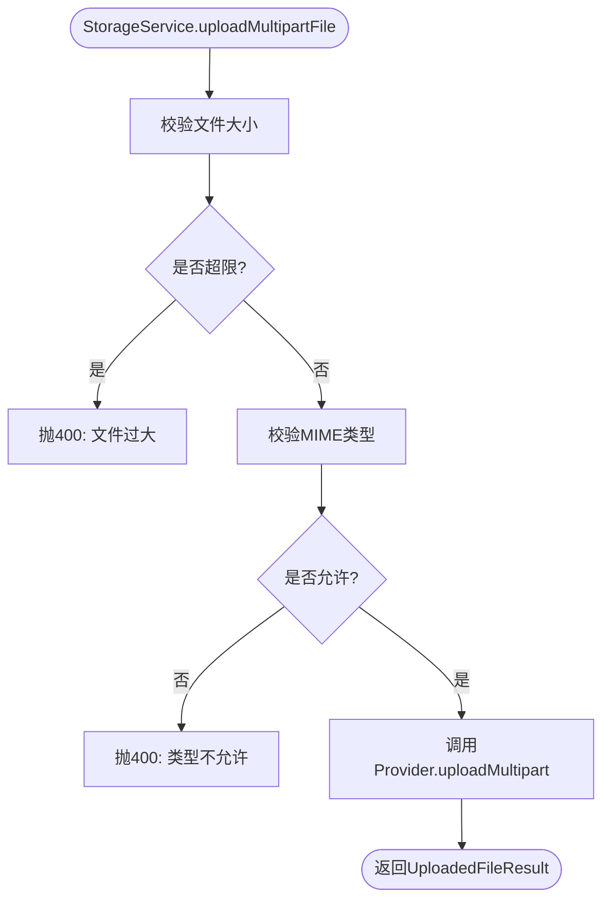
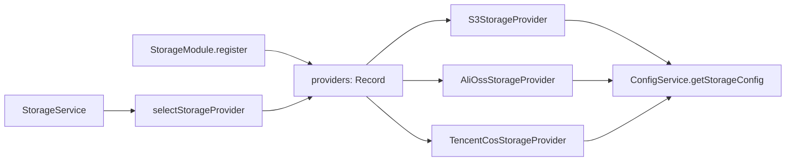
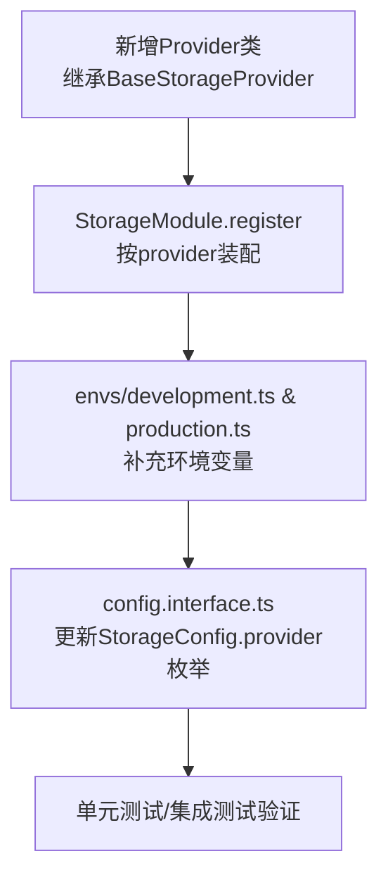

# 存储提供商集成

<cite>
**本文引用的文件**   
- [storage.module.ts](file://apps/api/src/modules/storage/storage.module.ts)
- [storage.service.ts](file://apps/api/src/modules/storage/application/storage.service.ts)
- [storage-provider.port.ts](file://apps/api/src/modules/storage/domain/ports/storage-provider.port.ts)
- [base-storage.provider.ts](file://apps/api/src/modules/storage/infrastructure/base-storage.provider.ts)
- [s3-storage.provider.ts](file://apps/api/src/modules/storage/infrastructure/s3-storage.provider.ts)
- [alioss-storage.provider.ts](file://apps/api/src/modules/storage/infrastructure/alioss-storage.provider.ts)
- [tencentcos-storage.provider.ts](file://apps/api/src/modules/storage/infrastructure/tencentcos-storage.provider.ts)
- [config.interface.ts](file://apps/api/src/config/interfaces/config.interface.ts)
- [config.service.ts](file://apps/api/src/config/config.service.ts)
- [config.module.ts](file://apps/api/src/config/config.module.ts)
- [development.ts](file://apps/api/src/config/envs/development.ts)
- [production.ts](file://apps/api/src/config/envs/production.ts)
- [provider-selection.policy.ts](file://apps/api/src/modules/storage/domain/policies/provider-selection.policy.ts)
- [storage-key.ts](file://apps/api/src/modules/storage/domain/value-objects/storage-key.ts)
</cite>

## 目录
1. [简介](#简介)
2. [项目结构](#项目结构)
3. [核心组件](#核心组件)
4. [架构总览](#架构总览)
5. [详细组件分析](#详细组件分析)
6. [依赖关系分析](#依赖关系分析)
7. [性能与特性对比](#性能与特性对比)
8. [配置与环境变量](#配置与环境变量)
9. [常见问题与排错](#常见问题与排错)
10. [最佳实践](#最佳实践)
11. [如何新增存储提供商](#如何新增存储提供商)
12. [结论](#结论)

## 简介
本文件面向“对象存储”能力，系统性说明 AWS S3、阿里云 OSS、腾讯云 COS 三种存储提供商在该 NestJS SaaS 工程中的集成方式。文档覆盖：
- 分层架构与关键类职责
- 各提供商的配置参数、认证方式与 SDK 调用要点
- 上传流程、URL 签名、删除等核心操作
- 配置项与环境变量清单
- 常见错误与排错建议
- 扩展新提供商的步骤与注意事项

## 项目结构
存储模块采用清晰的分层设计：
- domain（领域）：定义 StorageProvider 端口、键命名策略、通道选择策略
- application（应用）：StorageService 编排校验、异常映射与 IO 委托
- infrastructure（基础设施）：S3/OSS/COS 的具体实现
- config（配置）：统一读取环境变量并注入到各 Provider

图表来源
- [storage.service.ts:1-100](file://apps/api/src/modules/storage/application/storage.service.ts#L1-L100)
- [storage-provider.port.ts:1-101](file://apps/api/src/modules/storage/domain/ports/storage-provider.port.ts#L1-L101)
- [base-storage.provider.ts:1-121](file://apps/api/src/modules/storage/infrastructure/base-storage.provider.ts#L1-L121)
- [s3-storage.provider.ts:1-151](file://apps/api/src/modules/storage/infrastructure/s3-storage.provider.ts#L1-L151)
- [alioss-storage.provider.ts:1-129](file://apps/api/src/modules/storage/infrastructure/alioss-storage.provider.ts#L1-L129)
- [tencentcos-storage.provider.ts:1-142](file://apps/api/src/modules/storage/infrastructure/tencentcos-storage.provider.ts#L1-L142)
- [config.service.ts:31-33](file://apps/api/src/config/config.service.ts#L31-L33)
- [storage-key.ts:1-23](file://apps/api/src/modules/storage/domain/value-objects/storage-key.ts#L1-L23)
- [provider-selection.policy.ts:1-20](file://apps/api/src/modules/storage/domain/policies/provider-selection.policy.ts#L1-L20)

章节来源
- [storage.module.ts:11-47](file://apps/api/src/modules/storage/storage.module.ts#L11-L47)
- [storage.service.ts:1-100](file://apps/api/src/modules/storage/application/storage.service.ts#L1-L100)
- [storage-provider.port.ts:1-101](file://apps/api/src/modules/storage/domain/ports/storage-provider.port.ts#L1-L101)
- [base-storage.provider.ts:1-121](file://apps/api/src/modules/storage/infrastructure/base-storage.provider.ts#L1-L121)
- [config.service.ts:1-72](file://apps/api/src/config/config.service.ts#L1-L72)

## 核心组件
- StorageProvider 端口：定义统一的上传、流式上传、multipart 上传、删除、签名 URL 接口
- BaseStorageProvider：封装 multipart 临时文件落盘、key 生成、ETag 归一化、默认公开 URL 拼装
- S3/AliOSS/TencentCOS Provider：各自对接官方 SDK，实现具体上传/删除/签名 URL
- StorageService：编排上传校验（大小/MIME）、异常映射、委托 Provider 执行 IO
- ConfigService.getStorageConfig：集中读取 storage.* 环境变量

章节来源
- [storage-provider.port.ts:1-101](file://apps/api/src/modules/storage/domain/ports/storage-provider.port.ts#L1-L101)
- [base-storage.provider.ts:17-121](file://apps/api/src/modules/storage/infrastructure/base-storage.provider.ts#L17-L121)
- [s3-storage.provider.ts:20-151](file://apps/api/src/modules/storage/infrastructure/s3-storage.provider.ts#L20-L151)
- [alioss-storage.provider.ts:12-129](file://apps/api/src/modules/storage/infrastructure/alioss-storage.provider.ts#L12-L129)
- [tencentcos-storage.provider.ts:12-142](file://apps/api/src/modules/storage/infrastructure/tencentcos-storage.provider.ts#L12-L142)
- [storage.service.ts:17-99](file://apps/api/src/modules/storage/application/storage.service.ts#L17-L99)
- [config.service.ts:31-33](file://apps/api/src/config/config.service.ts#L31-L33)

## 架构总览
下图展示一次 HTTP 多段上传的端到端流程：控制器 → 应用服务 → 领域策略 → 基础提供者 → 具体 SDK。

图表来源
- [storage.service.ts:43-79](file://apps/api/src/modules/storage/application/storage.service.ts#L43-L79)
- [base-storage.provider.ts:61-83](file://apps/api/src/modules/storage/infrastructure/base-storage.provider.ts#L61-L83)
- [s3-storage.provider.ts:73-102](file://apps/api/src/modules/storage/infrastructure/s3-storage.provider.ts#L73-L102)
- [alioss-storage.provider.ts:55-79](file://apps/api/src/modules/storage/infrastructure/alioss-storage.provider.ts#L55-L79)
- [tencentcos-storage.provider.ts:40-49](file://apps/api/src/modules/storage/infrastructure/tencentcos-storage.provider.ts#L40-L49)

## 详细组件分析

### 通用端口与基类
- StorageProvider 端口定义了五类能力：缓冲区上传、流式上传、multipart 上传、删除、签名 URL
- BaseStorageProvider 提供：
  - multipart 临时文件落盘与清理
  - key 生成（YYYY/MM/DD/<uuid><ext>）
  - ETag 去引号标准化
  - 公开 URL 拼装（优先 baseUrl，否则使用各 Provider 默认格式）

图表来源
- [storage-provider.port.ts:1-101](file://apps/api/src/modules/storage/domain/ports/storage-provider.port.ts#L1-L101)
- [base-storage.provider.ts:28-121](file://apps/api/src/modules/storage/infrastructure/base-storage.provider.ts#L28-L121)
- [s3-storage.provider.ts:20-151](file://apps/api/src/modules/storage/infrastructure/s3-storage.provider.ts#L20-L151)
- [alioss-storage.provider.ts:12-129](file://apps/api/src/modules/storage/infrastructure/alioss-storage.provider.ts#L12-L129)
- [tencentcos-storage.provider.ts:12-142](file://apps/api/src/modules/storage/infrastructure/tencentcos-storage.provider.ts#L12-L142)

章节来源
- [storage-provider.port.ts:1-101](file://apps/api/src/modules/storage/domain/ports/storage-provider.port.ts#L1-L101)
- [base-storage.provider.ts:17-121](file://apps/api/src/modules/storage/infrastructure/base-storage.provider.ts#L17-L121)

### AWS S3 提供商
- SDK：@aws-sdk/client-s3、@aws-sdk/lib-storage、@aws-sdk/s3-request-presigner
- 认证：accessKeyId / accessKeySecret；可选 endpoint + forcePathStyle（兼容 MinIO 等）
- 上传：Buffer 用 PutObjectCommand；流式用 Upload 分片上传
- 删除：DeleteObjectCommand
- 签名 URL：GetObjectCommand + getSignedUrl
- 默认公开 URL：https://{bucket}.s3.{region}.amazonaws.com/{key}

图表来源
- [s3-storage.provider.ts:73-102](file://apps/api/src/modules/storage/infrastructure/s3-storage.provider.ts#L73-L102)
- [s3-storage.provider.ts:131-133](file://apps/api/src/modules/storage/infrastructure/s3-storage.provider.ts#L131-L133)

章节来源
- [s3-storage.provider.ts:20-151](file://apps/api/src/modules/storage/infrastructure/s3-storage.provider.ts#L20-L151)

### 阿里云 OSS 提供商
- SDK：ali-oss
- 认证：accessKeyId / accessKeySecret / region / bucket / endpoint
- 上传：put(Buffer)/putStream(Stream)，设置 x-oss-object-acl、x-oss-meta-*
- 删除：delete(key)
- 签名 URL：signatureUrl({ expires })
- 默认公开 URL：https://{bucket}.{endpoint}/{key}

章节来源
- [alioss-storage.provider.ts:12-129](file://apps/api/src/modules/storage/infrastructure/alioss-storage.provider.ts#L12-L129)

### 腾讯云 COS 提供商
- SDK：cos-nodejs-sdk-v5
- 认证：SecretId / SecretKey；Region 用于请求
- 上传：putObject(Buffer/Stream)
- 删除：deleteObject(Bucket, Region, Key)
- 签名 URL：getObjectUrl({ Sign: true, Expires })
- 默认公开 URL：https://{bucket}.cos.{region}.myqcloud.com/{key}

章节来源
- [tencentcos-storage.provider.ts:12-142](file://apps/api/src/modules/storage/infrastructure/tencentcos-storage.provider.ts#L12-L142)

### 应用服务与策略
- StorageService：
  - 通过 selectStorageProvider 从已注册 Provider 中选择（未命中则回退 s3）
  - evaluateUpload 校验文件大小与 MIME 类型，失败抛 400
  - 委托 Provider 执行 uploadMultipart/deleteFile/getFileUrl
- provider-selection.policy：纯函数，按 requested 选择，fallback 为 s3

图表来源
- [storage.service.ts:43-79](file://apps/api/src/modules/storage/application/storage.service.ts#L43-L79)
- [provider-selection.policy.ts:14-20](file://apps/api/src/modules/storage/domain/policies/provider-selection.policy.ts#L14-L20)

章节来源
- [storage.service.ts:17-99](file://apps/api/src/modules/storage/application/storage.service.ts#L17-L99)
- [provider-selection.policy.ts:1-20](file://apps/api/src/modules/storage/domain/policies/provider-selection.policy.ts#L1-L20)

## 依赖关系分析
- StorageModule.register 根据 storage.provider 动态装配 Provider 集合，始终包含 s3
- StorageService 构造时通过 selectStorageProvider 选择实际 Provider
- 所有 Provider 均继承 BaseStorageProvider，复用 key 生成、ETag 处理、multipart 临时文件逻辑
- ConfigService.getStorageConfig 暴露 storage.* 配置供各 Provider 消费

图表来源
- [storage.module.ts:17-46](file://apps/api/src/modules/storage/storage.module.ts#L17-L46)
- [storage.service.ts:23-34](file://apps/api/src/modules/storage/application/storage.service.ts#L23-L34)
- [provider-selection.policy.ts:14-20](file://apps/api/src/modules/storage/domain/policies/provider-selection.policy.ts#L14-L20)
- [config.service.ts:31-33](file://apps/api/src/config/config.service.ts#L31-L33)

章节来源
- [storage.module.ts:11-47](file://apps/api/src/modules/storage/storage.module.ts#L11-L47)
- [storage.service.ts:17-34](file://apps/api/src/modules/storage/application/storage.service.ts#L17-L34)

## 性能与特性对比
- 大文件上传
  - S3：使用 @aws-sdk/lib-storage 的 Upload 进行分片上传，适合大文件与不稳定网络
  - OSS：putStream 支持流式上传
  - COS：putObject 支持 Buffer/Stream
- 签名 URL
  - S3：getSignedUrl，可指定过期时间
  - OSS：signatureUrl，支持 expires
  - COS：getObjectUrl({ Sign: true, Expires })
- 公开访问 URL
  - 若配置了 STORAGE_BASE_URL，将优先使用该 baseUrl 拼接 key
  - 否则使用各 Provider 默认域名格式（S3/OSS/COS 不同）
- 元数据与 ACL
  - S3：Metadata、ACL（ObjectCannedACL）
  - OSS：x-oss-object-acl、x-oss-meta-*
  - COS：通过 SDK 参数传递（类型限制处使用 any）

注意：价格与区域可用性会随厂商政策变化，请以各云厂商官网为准。此处不给出静态价格表。

章节来源
- [s3-storage.provider.ts:73-102](file://apps/api/src/modules/storage/infrastructure/s3-storage.provider.ts#L73-L102)
- [alioss-storage.provider.ts:55-79](file://apps/api/src/modules/storage/infrastructure/alioss-storage.provider.ts#L55-L79)
- [tencentcos-storage.provider.ts:40-49](file://apps/api/src/modules/storage/infrastructure/tencentcos-storage.provider.ts#L40-L49)
- [base-storage.provider.ts:117-119](file://apps/api/src/modules/storage/infrastructure/base-storage.provider.ts#L117-L119)

## 配置与环境变量
- 配置接口 StorageConfig 字段：
  - provider: 's3' | 'alioss' | 'tencentoss'
  - bucket: string
  - region?: string
  - endpoint?: string
  - accessKeyId: string
  - accessKeySecret: string
  - baseUrl?: string
  - maxFileSize: number（字节）
  - allowedMimeTypes: string[]
- 环境变量（开发/生产环境示例）：
  - STORAGE_PROVIDER
  - STORAGE_BUCKET
  - STORAGE_REGION
  - STORAGE_ENDPOINT
  - STORAGE_ACCESS_KEY_ID
  - STORAGE_ACCESS_KEY_SECRET
  - STORAGE_BASE_URL
  - STORAGE_MAX_FILE_SIZE
  - STORAGE_ALLOWED_MIME_TYPES

章节来源
- [config.interface.ts:39-49](file://apps/api/src/config/interfaces/config.interface.ts#L39-L49)
- [config.module.ts:33-43](file://apps/api/src/config/config.module.ts#L33-L43)
- [development.ts:45-57](file://apps/api/src/config/envs/development.ts#L45-L57)
- [production.ts:39-51](file://apps/api/src/config/envs/production.ts#L39-L51)

## 常见问题与排错
- 上传失败（400）
  - 可能原因：文件大小超过 STORAGE_MAX_FILE_SIZE，或 MIME 不在 STORAGE_ALLOWED_MIME_TYPES
  - 处理：调整配置或前端校验
- 无法连接存储后端
  - 检查 STORAGE_REGION、STORAGE_ENDPOINT、AK/SK 是否正确
  - S3 兼容服务需开启 endpoint 与 forcePathStyle
- 签名 URL 无效
  - 确认 expiresIn 合理，且存储桶权限允许签名访问
- 公开 URL 不正确
  - 如未配置 STORAGE_BASE_URL，将使用各 Provider 默认域名；如需自定义，请设置 STORAGE_BASE_URL

章节来源
- [storage.service.ts:43-79](file://apps/api/src/modules/storage/application/storage.service.ts#L43-L79)
- [s3-storage.provider.ts:25-45](file://apps/api/src/modules/storage/infrastructure/s3-storage.provider.ts#L25-L45)
- [base-storage.provider.ts:117-119](file://apps/api/src/modules/storage/infrastructure/base-storage.provider.ts#L117-L119)

## 最佳实践
- 使用流式上传处理大文件，避免内存峰值
- 显式设置 Content-Type，避免浏览器下载行为异常
- 对敏感对象使用私有 ACL，并通过签名 URL 短期授权访问
- 使用 STORAGE_BASE_URL 统一 CDN/反代地址，便于切换域名与缓存策略
- 在配置中严格限定 allowedMimeTypes，减少恶意类型风险
- 使用合理的 maxFileSize，结合前端与后端双重校验

[本节为通用指导，不直接分析具体文件]

## 如何新增存储提供商
步骤概览：
1. 在 infrastructure 下新增 Provider 类，继承 BaseStorageProvider，实现：
   - uploadFile / uploadFileFromStream / deleteFile / getFileUrl
   - getDefaultPublicUrl（当未配置 baseUrl 时的默认公开 URL）
2. 在 StorageModule.register 中，根据 storage.provider 值装配新 Provider
3. 在 config.interface.ts 的 StorageConfig 中确保 provider 枚举包含新值
4. 在 development.ts / production.ts 中补充对应环境变量映射
5. 验证 selectStorageProvider 的回退逻辑与新 Provider 的可用性

图表来源
- [base-storage.provider.ts:28-56](file://apps/api/src/modules/storage/infrastructure/base-storage.provider.ts#L28-L56)
- [storage.module.ts:17-46](file://apps/api/src/modules/storage/storage.module.ts#L17-L46)
- [config.interface.ts:39-49](file://apps/api/src/config/interfaces/config.interface.ts#L39-L49)
- [development.ts:45-57](file://apps/api/src/config/envs/development.ts#L45-L57)
- [production.ts:39-51](file://apps/api/src/config/envs/production.ts#L39-L51)

章节来源
- [storage.module.ts:17-46](file://apps/api/src/modules/storage/storage.module.ts#L17-L46)
- [config.interface.ts:39-49](file://apps/api/src/config/interfaces/config.interface.ts#L39-L49)
- [development.ts:45-57](file://apps/api/src/config/envs/development.ts#L45-L57)
- [production.ts:39-51](file://apps/api/src/config/envs/production.ts#L39-L51)

## 结论
该存储集成方案通过清晰的领域端口与基础设施实现分离，使 S3、OSS、COS 三者在同一抽象下被统一调用。应用层专注业务校验与异常映射，基础设施层专注 SDK 细节。配合集中化的配置与环境变量管理，既保证了可扩展性，也降低了接入新存储的成本。建议在上线前完成容量规划、CDN 与缓存策略、以及安全与合规（如数据驻留）的评估与验证。