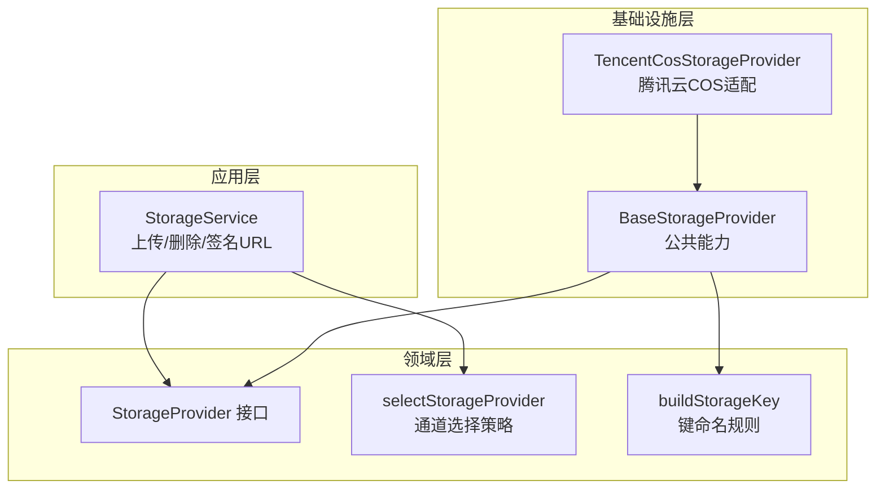
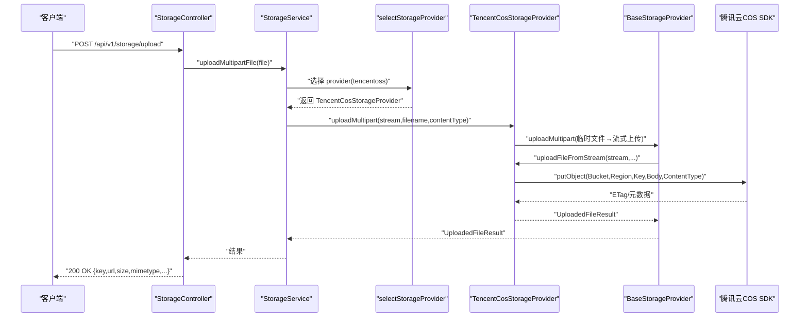
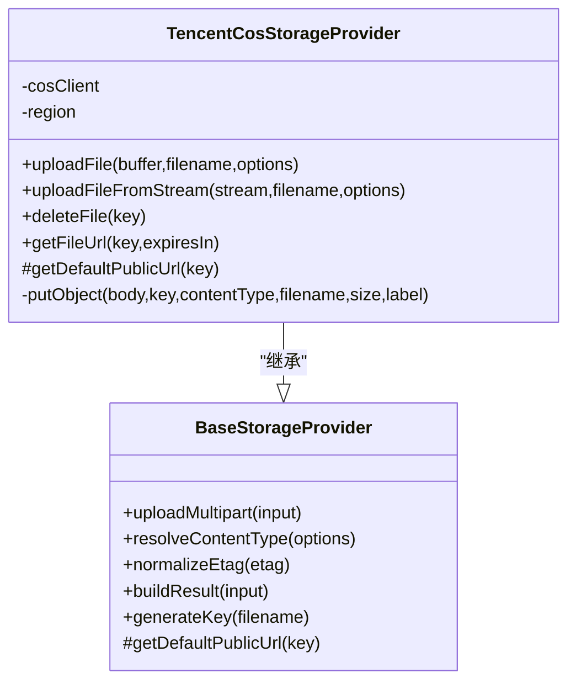
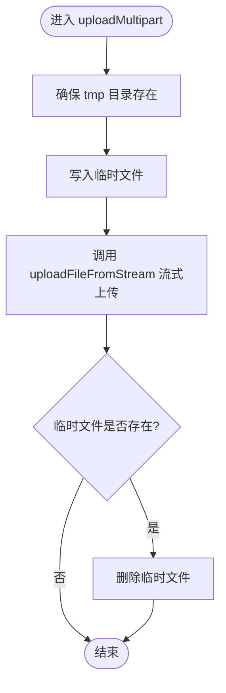
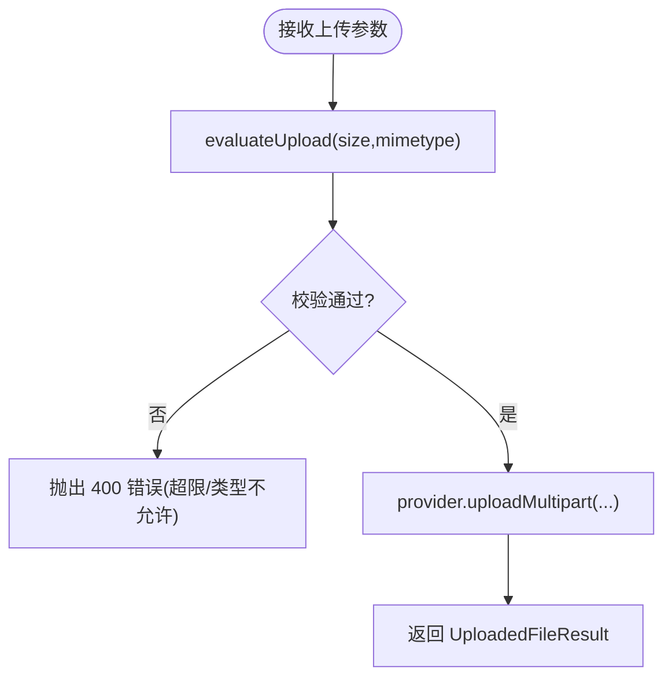
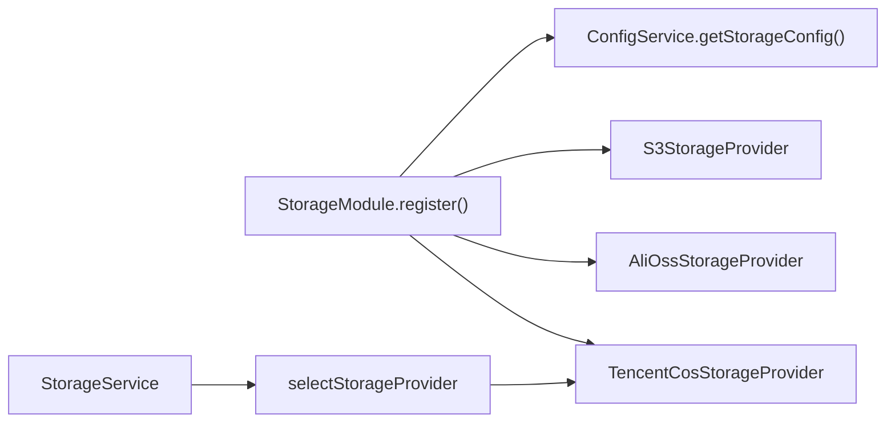

# 腾讯云 COS 存储提供商

<cite>
**本文引用的文件**   
- [tencentcos-storage.provider.ts](file://apps/api/src/modules/storage/infrastructure/tencentcos-storage.provider.ts)
- [base-storage.provider.ts](file://apps/api/src/modules/storage/infrastructure/base-storage.provider.ts)
- [storage-provider.port.ts](file://apps/api/src/modules/storage/domain/ports/storage-provider.port.ts)
- [storage.service.ts](file://apps/api/src/modules/storage/application/storage.service.ts)
- [storage.module.ts](file://apps/api/src/modules/storage/storage.module.ts)
- [config.interface.ts](file://apps/api/src/config/interfaces/config.interface.ts)
- [config.service.ts](file://apps/api/src/config/config.service.ts)
- [default.ts](file://apps/api/src/config/envs/default.ts)
- [production.ts](file://apps/api/src/config/envs/production.ts)
- [provider-selection.policy.ts](file://apps/api/src/modules/storage/domain/policies/provider-selection.policy.ts)
- [storage-key.ts](file://apps/api/src/modules/storage/domain/value-objects/storage-key.ts)
</cite>

## 目录
1. [简介](#简介)
2. [项目结构](#项目结构)
3. [核心组件](#核心组件)
4. [架构总览](#架构总览)
5. [详细组件分析](#详细组件分析)
6. [依赖关系分析](#依赖关系分析)
7. [性能与容量规划](#性能与容量规划)
8. [权限模型与访问控制](#权限模型与访问控制)
9. [配置与环境变量](#配置与环境变量)
10. [常见问题排查](#常见问题排查)
11. [结论](#结论)

## 简介
本文面向在 NestJS SaaS 项目中集成腾讯云对象存储（COS）的开发者，系统性说明腾讯云 COS 存储提供者的实现方式、调用流程、配置项、权限模型以及性能优化建议。文档基于仓库中已实现的腾讯云 COS 适配器与通用存储基础设施进行解读，帮助读者快速完成接入、排错与扩展。

## 项目结构
存储模块采用分层设计：领域层定义端口与策略，应用层编排业务逻辑，基础设施层实现具体云厂商 SDK。腾讯云 COS 适配器继承通用基类，复用键生成、内容类型默认值、ETag 规范化、公开 URL 拼装等公共能力。

**图表来源**
- [storage.service.ts:1-100](file://apps/api/src/modules/storage/application/storage.service.ts#L1-L100)
- [storage-provider.port.ts:1-101](file://apps/api/src/modules/storage/domain/ports/storage-provider.port.ts#L1-L101)
- [provider-selection.policy.ts:1-21](file://apps/api/src/modules/storage/domain/policies/provider-selection.policy.ts#L1-L21)
- [storage-key.ts:1-24](file://apps/api/src/modules/storage/domain/value-objects/storage-key.ts#L1-L24)
- [base-storage.provider.ts:1-121](file://apps/api/src/modules/storage/infrastructure/base-storage.provider.ts#L1-L121)
- [tencentcos-storage.provider.ts:1-142](file://apps/api/src/modules/storage/infrastructure/tencentcos-storage.provider.ts#L1-L142)

**章节来源**
- [storage.service.ts:1-100](file://apps/api/src/modules/storage/application/storage.service.ts#L1-L100)
- [storage-provider.port.ts:1-101](file://apps/api/src/modules/storage/domain/ports/storage-provider.port.ts#L1-L101)
- [base-storage.provider.ts:1-121](file://apps/api/src/modules/storage/infrastructure/base-storage.provider.ts#L1-L121)
- [tencentcos-storage.provider.ts:1-142](file://apps/api/src/modules/storage/infrastructure/tencentcos-storage.provider.ts#L1-L142)

## 核心组件
- StorageProvider 接口：定义统一上传、流式上传、分块上传入口、删除、签名 URL 获取等能力。
- BaseStorageProvider：抽象基类，封装临时文件落盘、流式上传、ETag 清洗、公开 URL 拼装、键生成等跨厂商一致逻辑。
- TencentCosStorageProvider：腾讯云 COS 的具体实现，使用 cos-nodejs-sdk-v5 完成对象上传、删除、签名 URL 生成。
- StorageService：应用门面，负责校验（大小/MIME）、选择 provider、委托 IO 并映射异常。
- StorageModule：动态注册各 provider，按配置装配 tencentoss 通道。
- ConfigService + StorageConfig：集中读取 storage.* 环境变量，注入到 provider。

**章节来源**
- [storage-provider.port.ts:1-101](file://apps/api/src/modules/storage/domain/ports/storage-provider.port.ts#L1-L101)
- [base-storage.provider.ts:1-121](file://apps/api/src/modules/storage/infrastructure/base-storage.provider.ts#L1-L121)
- [tencentcos-storage.provider.ts:1-142](file://apps/api/src/modules/storage/infrastructure/tencentcos-storage.provider.ts#L1-L142)
- [storage.service.ts:1-100](file://apps/api/src/modules/storage/application/storage.service.ts#L1-L100)
- [storage.module.ts:1-48](file://apps/api/src/modules/storage/storage.module.ts#L1-L48)
- [config.service.ts:1-72](file://apps/api/src/config/config.service.ts#L1-L72)
- [config.interface.ts:39-49](file://apps/api/src/config/interfaces/config.interface.ts#L39-L49)

## 架构总览
下图展示一次 HTTP multipart 上传请求从控制器到腾讯云 COS 的完整调用链。

**图表来源**
- [storage.service.ts:43-79](file://apps/api/src/modules/storage/application/storage.service.ts#L43-L79)
- [provider-selection.policy.ts:14-20](file://apps/api/src/modules/storage/domain/policies/provider-selection.policy.ts#L14-L20)
- [base-storage.provider.ts:61-83](file://apps/api/src/modules/storage/infrastructure/base-storage.provider.ts#L61-L83)
- [tencentcos-storage.provider.ts:40-49](file://apps/api/src/modules/storage/infrastructure/tencentcos-storage.provider.ts#L40-L49)
- [tencentcos-storage.provider.ts:103-140](file://apps/api/src/modules/storage/infrastructure/tencentcos-storage.provider.ts#L103-L140)

## 详细组件分析

### 腾讯云 COS 适配器（TencentCosStorageProvider）
- SDK 初始化：构造时读取 accessKeyId/accessKeySecret 创建 COS 客户端实例；region 从配置读取。
- 上传：
  - uploadFile：将 Buffer 通过 putObject 上传，size 为 Buffer.length。
  - uploadFileFromStream：以流方式上传，size 传 -1 表示未知。
- 删除：deleteObject 异步回调包装为 Promise。
- 签名 URL：getObjectUrl 生成带签名的访问链接，支持过期时间。
- 公开 URL：未配置 baseUrl 时使用腾讯云默认格式 https://{bucket}.cos.{region}.myqcloud.com/{key}。

**图表来源**
- [base-storage.provider.ts:28-121](file://apps/api/src/modules/storage/infrastructure/base-storage.provider.ts#L28-L121)
- [tencentcos-storage.provider.ts:13-142](file://apps/api/src/modules/storage/infrastructure/tencentcos-storage.provider.ts#L13-L142)

**章节来源**
- [tencentcos-storage.provider.ts:17-27](file://apps/api/src/modules/storage/infrastructure/tencentcos-storage.provider.ts#L17-L27)
- [tencentcos-storage.provider.ts:29-49](file://apps/api/src/modules/storage/infrastructure/tencentcos-storage.provider.ts#L29-L49)
- [tencentcos-storage.provider.ts:51-69](file://apps/api/src/modules/storage/infrastructure/tencentcos-storage.provider.ts#L51-L69)
- [tencentcos-storage.provider.ts:71-96](file://apps/api/src/modules/storage/infrastructure/tencentcos-storage.provider.ts#L71-L96)
- [tencentcos-storage.provider.ts:98-101](file://apps/api/src/modules/storage/infrastructure/tencentcos-storage.provider.ts#L98-L101)
- [tencentcos-storage.provider.ts:103-140](file://apps/api/src/modules/storage/infrastructure/tencentcos-storage.provider.ts#L103-L140)

### 通用存储基类（BaseStorageProvider）
- 公共职责：
  - 从配置读取 bucket 与 baseUrl。
  - uploadMultipart：HTTP multipart → 临时文件 → 流式上传 → 清理临时文件。
  - resolveContentType：缺省 application/octet-stream。
  - normalizeEtag：去除云厂商 ETag 两侧引号。
  - buildResult：组装 key/url/etag/size/mimetype/originalname。
  - generateKey：调用领域纯函数构建 YYYY/MM/DD/<uuid><ext> 键名。

**图表来源**
- [base-storage.provider.ts:61-83](file://apps/api/src/modules/storage/infrastructure/base-storage.provider.ts#L61-L83)

**章节来源**
- [base-storage.provider.ts:28-36](file://apps/api/src/modules/storage/infrastructure/base-storage.provider.ts#L28-L36)
- [base-storage.provider.ts:85-119](file://apps/api/src/modules/storage/infrastructure/base-storage.provider.ts#L85-L119)

### 应用门面（StorageService）
- 职责：
  - 根据配置选择 provider（优先 tencentoss，未注册回落 s3）。
  - 执行上传前校验（文件大小、MIME 白名单），失败抛 BadRequest。
  - 委托 provider.uploadMultipart 完成 IO。
  - 透传 deleteFile/getFileUrl。

**图表来源**
- [storage.service.ts:43-79](file://apps/api/src/modules/storage/application/storage.service.ts#L43-L79)

**章节来源**
- [storage.service.ts:17-34](file://apps/api/src/modules/storage/application/storage.service.ts#L17-L34)
- [storage.service.ts:43-98](file://apps/api/src/modules/storage/application/storage.service.ts#L43-L98)

### 键命名策略（buildStorageKey）
- 规则：YYYY/MM/DD/<id><ext>，其中 id 为 UUID，ext 取自原文件名扩展名。
- 目的：统一所有存储通道的对象键命名，便于归档与检索。

**章节来源**
- [storage-key.ts:1-24](file://apps/api/src/modules/storage/domain/value-objects/storage-key.ts#L1-L24)

### 通道选择策略（selectStorageProvider）
- 行为：若配置的 provider 未注册则回落到 s3。
- 意义：保证系统始终具备可用通道，提升健壮性。

**章节来源**
- [provider-selection.policy.ts:1-21](file://apps/api/src/modules/storage/domain/policies/provider-selection.policy.ts#L1-L21)

## 依赖关系分析
- StorageModule 动态装配：
  - 始终注册 s3。
  - 当 storage.provider === 'alioss' 时注册 alioss。
  - 当 storage.provider === 'tencentoss' 时注册 tencentoss。
- StorageService 构造期通过 selectStorageProvider 选择实际 provider。
- TencentCosStorageProvider 依赖 cos-nodejs-sdk-v5 与 ConfigService。

**图表来源**
- [storage.module.ts:17-46](file://apps/api/src/modules/storage/storage.module.ts#L17-L46)
- [storage.service.ts:23-34](file://apps/api/src/modules/storage/application/storage.service.ts#L23-L34)
- [provider-selection.policy.ts:14-20](file://apps/api/src/modules/storage/domain/policies/provider-selection.policy.ts#L14-L20)

**章节来源**
- [storage.module.ts:1-48](file://apps/api/src/modules/storage/storage.module.ts#L1-L48)
- [storage.service.ts:17-34](file://apps/api/src/modules/storage/application/storage.service.ts#L17-L34)

## 性能与容量规划
- 大文件上传
  - 当前实现通过临时文件中转后走流式上传，适合中等体积文件。对超大文件可考虑服务端直传或启用 COS 分块上传以提升吞吐与断点续传能力。
- 并发与连接池
  - 合理设置 Node.js 进程数与 COS SDK 连接池参数（由 SDK 内部决定），避免单进程瓶颈。
- 缓存与 CDN
  - 结合腾讯云 CDN 加速静态资源访问，减少源站压力。
- 带宽与配额
  - 关注 COS 带宽上限与请求次数配额，必要时申请扩容或开启限流。
- 压缩与转码
  - 图片建议在 COS 数据万象中进行缩略图、水印、格式转换，降低传输体积。

[本节为通用指导，不直接分析具体文件]

## 权限模型与访问控制
- 密钥与最小权限
  - SecretId/SecretKey 应遵循最小权限原则，仅授予目标 Bucket 的读写权限。
- 对象 ACL
  - 可通过 FileUploadOptions.acl 指定对象级访问控制（例如私有/公有读），但需配合 Bucket 策略与 CORS 配置。
- 签名 URL
  - 私有 Bucket 下通过 getObjectUrl 生成带签名的临时访问链接，适合受控下载场景。
- 跨域（CORS）
  - 在 COS 控制台配置允许的 Origin、Method、Header，确保前端可直接访问签名 URL。
- 网络与安全
  - 建议绑定自定义域名并通过 HTTPS 访问，关闭公网直写，使用后端签名下发临时链接。

[本节为通用指导，不直接分析具体文件]

## 配置与环境变量
- 关键配置项（StorageConfig）
  - provider：可选 s3/alioss/tencentoss。
  - bucket：存储桶名称。
  - region：区域标识（如 ap-guangzhou）。
  - endpoint：可选端点（COS 通常无需显式配置）。
  - accessKeyId/accessKeySecret：腾讯云密钥。
  - baseUrl：可选自定义域名前缀，用于拼接公开 URL。
  - maxFileSize：最大文件大小（字节）。
  - allowedMimeTypes：允许的文件 MIME 类型列表。
- 环境变量映射
  - STORAGE_PROVIDER、STORAGE_BUCKET、STORAGE_REGION、STORAGE_ENDPOINT、STORAGE_ACCESS_KEY_ID、STORAGE_ACCESS_KEY_SECRET、STORAGE_BASE_URL、STORAGE_MAX_FILE_SIZE、STORAGE_ALLOWED_MIME_TYPES。
- 运行时读取
  - ConfigService.getStorageConfig 暴露 storage 配置供各组件使用。

**章节来源**
- [config.interface.ts:39-49](file://apps/api/src/config/interfaces/config.interface.ts#L39-L49)
- [config.service.ts:31-33](file://apps/api/src/config/config.service.ts#L31-L33)
- [default.ts:42-54](file://apps/api/src/config/envs/default.ts#L42-L54)
- [production.ts:39-51](file://apps/api/src/config/envs/production.ts#L39-L51)

## 常见问题排查
- 上传失败（网络/鉴权）
  - 检查 SecretId/SecretKey 是否正确、Bucket 与 Region 是否匹配、网络连通性。
- 签名 URL 无效
  - 确认 Bucket 是否为私有、GetObjectUrl 的 Expires 是否过期、CORS 是否放行。
- 文件类型被拒
  - 检查 allowedMimeTypes 是否包含该类型，或调整策略。
- 文件大小超限
  - 调整 STORAGE_MAX_FILE_SIZE，同时注意 COS 单对象大小限制。
- 公开 URL 不正确
  - 若设置了 baseUrl，则以 baseUrl 为准；否则使用腾讯云默认域名格式。

**章节来源**
- [tencentcos-storage.provider.ts:51-96](file://apps/api/src/modules/storage/infrastructure/tencentcos-storage.provider.ts#L51-L96)
- [base-storage.provider.ts:117-119](file://apps/api/src/modules/storage/infrastructure/base-storage.provider.ts#L117-L119)
- [storage.service.ts:43-79](file://apps/api/src/modules/storage/application/storage.service.ts#L43-L79)

## 结论
本项目通过统一的 StorageProvider 接口与 BaseStorageProvider 抽象，将腾讯云 COS 的 SDK 细节隔离在基础设施层，应用层仅关注业务编排与校验。借助环境变量驱动的 StorageConfig，可在不同环境灵活切换存储通道。对于生产环境，建议结合 COS 数据万象进行图片处理、CDN 加速与严格的权限控制，以获得更好的性能与安全性。