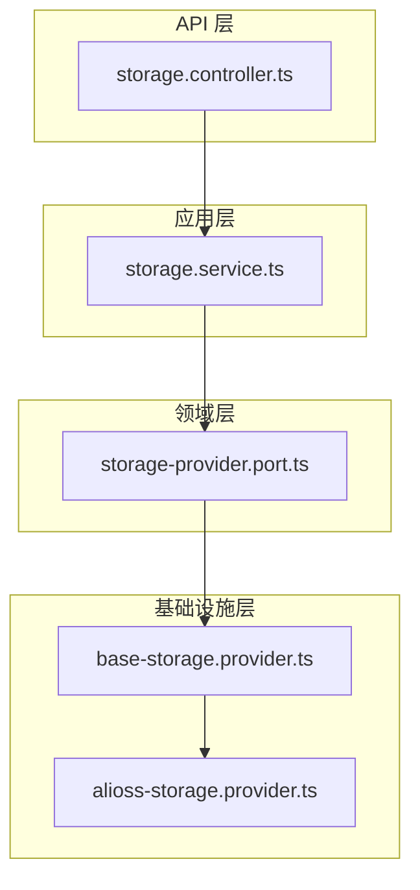
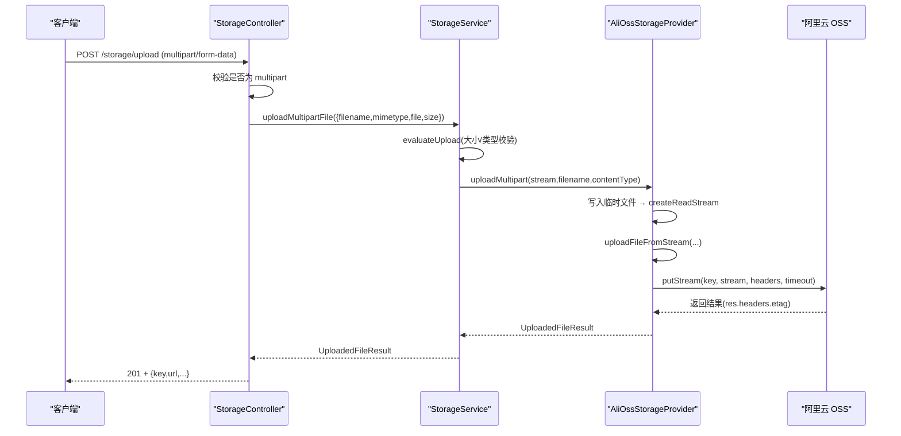
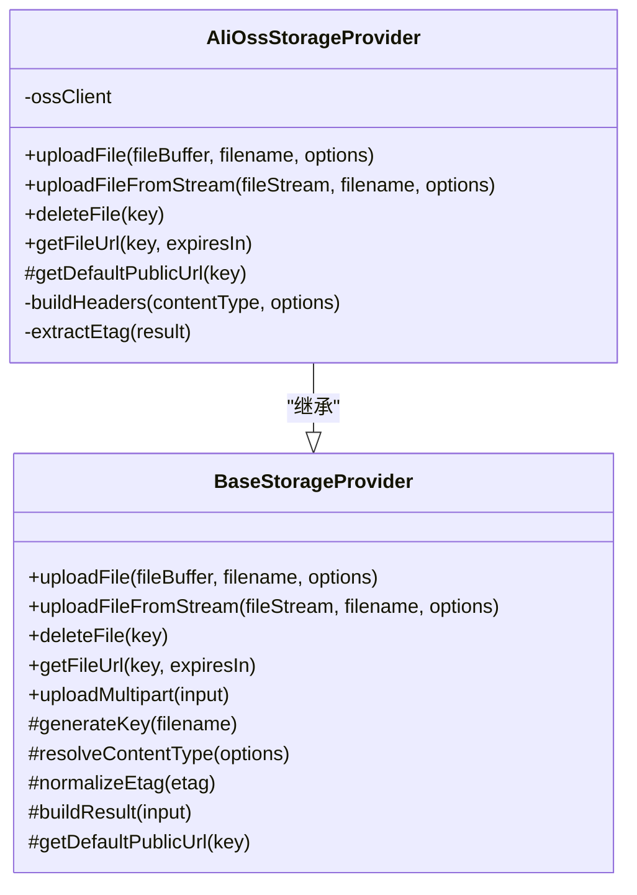
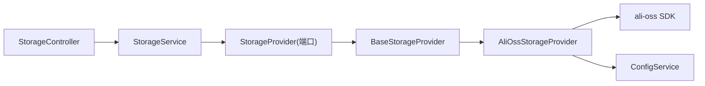

# 阿里云 OSS 存储提供商

<cite>
**本文引用的文件**   
- [alioss-storage.provider.ts](file://apps/api/src/modules/storage/infrastructure/alioss-storage.provider.ts)
- [base-storage.provider.ts](file://apps/api/src/modules/storage/infrastructure/base-storage.provider.ts)
- [storage-provider.port.ts](file://apps/api/src/modules/storage/domain/ports/storage-provider.port.ts)
- [storage.service.ts](file://apps/api/src/modules/storage/application/storage.service.ts)
- [storage.controller.ts](file://apps/api/src/modules/storage/api/storage.controller.ts)
- [config.interface.ts](file://apps/api/src/config/interfaces/config.interface.ts)
- [config.module.ts](file://apps/api/src/config/config.module.ts)
- [default.ts](file://apps/api/src/config/envs/default.ts)
- [development.ts](file://apps/api/src/config/envs/development.ts)
- [production.ts](file://apps/api/src/config/envs/production.ts)
- [docker-compose.yml](file://docker-compose.yml)
</cite>

## 目录
1. [简介](#简介)
2. [项目结构](#项目结构)
3. [核心组件](#核心组件)
4. [架构总览](#架构总览)
5. [详细组件分析](#详细组件分析)
6. [依赖关系分析](#依赖关系分析)
7. [性能与可靠性建议](#性能与可靠性建议)
8. [配置与环境变量](#配置与环境变量)
9. [权限模型与访问控制](#权限模型与访问控制)
10. [常见问题排查](#常见问题排查)
11. [结论](#结论)

## 简介
本文面向在 NestJS SaaS 项目中集成阿里云对象存储（OSS）的开发者，系统性说明阿里云 OSS 存储提供方的实现方式、配置方法、上传下载删除流程、权限模型以及常见问题的处理策略。文档基于仓库中 storage 模块的实际代码进行解读，重点覆盖：
- AliOssStorageProvider 的初始化与 Endpoint、AccessKey 认证
- 文件上传、下载（签名 URL）、删除的实现路径
- 分片上传与断点续传的现状与建议
- 生命周期管理的现状与建议
- 环境变量与 Docker Compose 注入方式
- 权限模型与 ACL 配置
- 性能优化与排错指南

## 项目结构
storage 模块采用分层设计：API 层暴露接口，Application 层编排校验与异常映射，Domain 层定义端口与策略，Infrastructure 层实现具体云厂商适配器。阿里云 OSS 适配位于 infrastructure 层，并通过 BaseStorageProvider 复用通用逻辑。

图表来源
- [storage.controller.ts:1-181](file://apps/api/src/modules/storage/api/storage.controller.ts#L1-L181)
- [storage.service.ts:1-100](file://apps/api/src/modules/storage/application/storage.service.ts#L1-L100)
- [storage-provider.port.ts:1-101](file://apps/api/src/modules/storage/domain/ports/storage-provider.port.ts#L1-L101)
- [base-storage.provider.ts:1-121](file://apps/api/src/modules/storage/infrastructure/base-storage.provider.ts#L1-L121)
- [alioss-storage.provider.ts:1-129](file://apps/api/src/modules/storage/infrastructure/alioss-storage.provider.ts#L1-L129)

章节来源
- [storage.controller.ts:1-181](file://apps/api/src/modules/storage/api/storage.controller.ts#L1-L181)
- [storage.service.ts:1-100](file://apps/api/src/modules/storage/application/storage.service.ts#L1-L100)
- [storage-provider.port.ts:1-101](file://apps/api/src/modules/storage/domain/ports/storage-provider.port.ts#L1-L101)
- [base-storage.provider.ts:1-121](file://apps/api/src/modules/storage/infrastructure/base-storage.provider.ts#L1-L121)
- [alioss-storage.provider.ts:1-129](file://apps/api/src/modules/storage/infrastructure/alioss-storage.provider.ts#L1-L129)

## 核心组件
- AliOssStorageProvider：阿里云 OSS 的具体实现，负责 OSSClient 初始化、上传、流式上传、删除、签名 URL 生成、默认公开 URL 构造等。
- BaseStorageProvider：抽象基类，封装 key 生成、内容类型默认值、ETag 归一化、公共 URL 拼装、multipart 临时文件落盘与清理等通用能力。
- StorageProvider 端口：定义统一的存储接口，包括缓冲区上传、流式上传、multipart 上传、删除、获取签名 URL。
- StorageService：应用层门面，负责选择 provider、执行上传策略校验、将底层异常映射为 HTTP 错误。
- StorageController：对外暴露 REST 上传接口与 oRPC 删除、签名 URL 接口。

章节来源
- [alioss-storage.provider.ts:1-129](file://apps/api/src/modules/storage/infrastructure/alioss-storage.provider.ts#L1-L129)
- [base-storage.provider.ts:1-121](file://apps/api/src/modules/storage/infrastructure/base-storage.provider.ts#L1-L121)
- [storage-provider.port.ts:1-101](file://apps/api/src/modules/storage/domain/ports/storage-provider.port.ts#L1-L101)
- [storage.service.ts:1-100](file://apps/api/src/modules/storage/application/storage.service.ts#L1-L100)
- [storage.controller.ts:1-181](file://apps/api/src/modules/storage/api/storage.controller.ts#L1-L181)

## 架构总览
下图展示一次单文件上传从请求到 OSS 的完整调用链，并标注关键职责边界。

图表来源
- [storage.controller.ts:84-142](file://apps/api/src/modules/storage/api/storage.controller.ts#L84-L142)
- [storage.service.ts:43-79](file://apps/api/src/modules/storage/application/storage.service.ts#L43-L79)
- [base-storage.provider.ts:61-83](file://apps/api/src/modules/storage/infrastructure/base-storage.provider.ts#L61-L83)
- [alioss-storage.provider.ts:55-79](file://apps/api/src/modules/storage/infrastructure/alioss-storage.provider.ts#L55-L79)

## 详细组件分析

### AliOssStorageProvider：阿里云 OSS 适配器
- OSSClient 初始化：从 ConfigService 读取 region、accessKeyId、accessKeySecret、bucket、endpoint，构建 OSS SDK 实例。
- 上传（缓冲区）：通过 ossClient.put 上传 Buffer，设置超时与自定义头（Content-Type、x-oss-object-acl），从响应头提取 ETag。
- 上传（流式）：通过 ossClient.putStream 上传可读流，适用于大文件或流式场景；size 暂无法直接获取，返回 -1。
- 删除：调用 ossClient.delete，成功返回 true，失败抛出错误。
- 签名 URL：使用 ossClient.signatureUrl 生成带签名的访问地址，适合私有 Bucket 的临时访问。
- 默认公开 URL：当未配置 baseUrl 时，按 bucket.endpoint/key 拼接公开地址。
- 元数据与 ACL：通过 buildHeaders 支持 x-oss-meta-* 自定义元数据与对象级 ACL。

图表来源
- [base-storage.provider.ts:28-121](file://apps/api/src/modules/storage/infrastructure/base-storage.provider.ts#L28-L121)
- [alioss-storage.provider.ts:12-129](file://apps/api/src/modules/storage/infrastructure/alioss-storage.provider.ts#L12-L129)

章节来源
- [alioss-storage.provider.ts:16-27](file://apps/api/src/modules/storage/infrastructure/alioss-storage.provider.ts#L16-L27)
- [alioss-storage.provider.ts:29-53](file://apps/api/src/modules/storage/infrastructure/alioss-storage.provider.ts#L29-L53)
- [alioss-storage.provider.ts:55-79](file://apps/api/src/modules/storage/infrastructure/alioss-storage.provider.ts#L55-L79)
- [alioss-storage.provider.ts:81-88](file://apps/api/src/modules/storage/infrastructure/alioss-storage.provider.ts#L81-L88)
- [alioss-storage.provider.ts:90-107](file://apps/api/src/modules/storage/infrastructure/alioss-storage.provider.ts#L90-L107)
- [alioss-storage.provider.ts:109-127](file://apps/api/src/modules/storage/infrastructure/alioss-storage.provider.ts#L109-L127)

### BaseStorageProvider：通用存储能力
- Key 生成：结合日期与 UUID，交由 domain 层的 buildStorageKey 统一命名规则。
- 内容类型：若未指定则回退 application/octet-stream。
- ETag 归一化：去除云厂商可能包裹的双引号。
- 公共 URL：优先使用配置的 baseUrl，否则调用子类 getDefaultPublicUrl。
- multipart 上传：将原始流写入 tmp 目录临时文件，再转为 ReadStream 走 uploadFileFromStream，最后清理临时文件。

章节来源
- [base-storage.provider.ts:28-36](file://apps/api/src/modules/storage/infrastructure/base-storage.provider.ts#L28-L36)
- [base-storage.provider.ts:61-83](file://apps/api/src/modules/storage/infrastructure/base-storage.provider.ts#L61-L83)
- [base-storage.provider.ts:85-119](file://apps/api/src/modules/storage/infrastructure/base-storage.provider.ts#L85-L119)

### StorageService：应用层编排
- Provider 选择：根据配置 provider 选择 alioss/s3/tencentcos 实现。
- 上传校验：调用 domain 策略 evaluateUpload 校验文件大小与 MIME 类型，超限或非法类型抛 BadRequestException。
- 委托上传：调用 Provider.uploadMultipart，将底层异常包装为业务错误码。
- 删除与签名 URL：透传至 Provider。

章节来源
- [storage.service.ts:18-34](file://apps/api/src/modules/storage/application/storage.service.ts#L18-L34)
- [storage.service.ts:43-79](file://apps/api/src/modules/storage/application/storage.service.ts#L43-L79)
- [storage.service.ts:86-98](file://apps/api/src/modules/storage/application/storage.service.ts#L86-L98)

### StorageController：对外接口
- 单文件上传（REST）：POST /storage/upload，要求 multipart/form-data，解析 Fastify 文件流后交给 StorageService。
- 删除（oRPC）：Impl(storageDeleteContract)，输入 key，返回 success。
- 签名 URL（oRPC）：Impl(storageUrlContract)，输入 key 与可选 expiresIn，返回 url。

章节来源
- [storage.controller.ts:72-75](file://apps/api/src/modules/storage/api/storage.controller.ts#L72-L75)
- [storage.controller.ts:84-142](file://apps/api/src/modules/storage/api/storage.controller.ts#L84-L142)
- [storage.controller.ts:149-159](file://apps/api/src/modules/storage/api/storage.controller.ts#L149-L159)
- [storage.controller.ts:168-179](file://apps/api/src/modules/storage/api/storage.controller.ts#L168-L179)

## 依赖关系分析
- AliOssStorageProvider 依赖：
  - @nestjs/common 的 Injectable 与 Inject
  - ali-oss SDK
  - ConfigService 读取存储配置
  - BaseStorageProvider 复用通用逻辑
- StorageService 依赖：
  - ConfigService 读取 provider、maxFileSize、allowedMimeTypes
  - Domain 策略 selectStorageProvider、evaluateUpload
  - StorageProvider 端口
- StorageController 依赖：
  - NestJS 控制器装饰器与 FastifyRequest
  - oRPC Impl 契约
  - StorageService

图表来源
- [storage.controller.ts:1-181](file://apps/api/src/modules/storage/api/storage.controller.ts#L1-L181)
- [storage.service.ts:1-100](file://apps/api/src/modules/storage/application/storage.service.ts#L1-L100)
- [storage-provider.port.ts:1-101](file://apps/api/src/modules/storage/domain/ports/storage-provider.port.ts#L1-L101)
- [base-storage.provider.ts:1-121](file://apps/api/src/modules/storage/infrastructure/base-storage.provider.ts#L1-L121)
- [alioss-storage.provider.ts:1-129](file://apps/api/src/modules/storage/infrastructure/alioss-storage.provider.ts#L1-L129)

章节来源
- [storage.controller.ts:1-181](file://apps/api/src/modules/storage/api/storage.controller.ts#L1-L181)
- [storage.service.ts:1-100](file://apps/api/src/modules/storage/application/storage.service.ts#L1-L100)
- [storage-provider.port.ts:1-101](file://apps/api/src/modules/storage/domain/ports/storage-provider.port.ts#L1-L101)
- [base-storage.provider.ts:1-121](file://apps/api/src/modules/storage/infrastructure/base-storage.provider.ts#L1-L121)
- [alioss-storage.provider.ts:1-129](file://apps/api/src/modules/storage/infrastructure/alioss-storage.provider.ts#L1-L129)

## 性能与可靠性建议
- 上传方式选择：
  - 小文件：使用缓冲区上传（put），可获得准确 size 与 ETag。
  - 大文件或流式数据：使用流式上传（putStream），避免内存峰值，但 size 暂为 -1。
- 超时与重试：
  - 当前实现设置了 60 秒超时，建议在网络不稳定环境增加重试与退避策略。
- 临时文件清理：
  - multipart 上传会写 tmp 目录，需确保进程有写权限且定期清理，避免磁盘占满。
- 连接池与并发：
  - 在高并发上传场景，考虑调整 SDK 的连接池参数（由 SDK 侧决定），并结合队列限流。
- CDN 加速：
  - 若启用 baseUrl 指向 CDN，可显著降低 OSS 直连延迟与带宽成本。

[本节为通用指导，不直接分析具体文件]

## 配置与环境变量
- 配置接口：StorageConfig 包含 provider、bucket、region、endpoint、accessKeyId、accessKeySecret、baseUrl、maxFileSize、allowedMimeTypes。
- 环境变量映射：
  - STORAGE_PROVIDER：默认 alioss
  - STORAGE_BUCKET：默认 my-bucket
  - STORAGE_REGION：默认 oss-cn-hangzhou
  - STORAGE_ENDPOINT：默认 oss-cn-hangzhou.aliyuncs.com
  - STORAGE_ACCESS_KEY_ID：必填
  - STORAGE_ACCESS_KEY_SECRET：必填
  - STORAGE_BASE_URL：可选，用于覆盖默认公开 URL
  - STORAGE_MAX_FILE_SIZE：字节单位，默认 10MB
  - STORAGE_ALLOWED_MIME_TYPES：逗号分隔的允许类型
- Docker Compose 注入：
  - 在 docker-compose.yml 中以环境变量形式注入上述键值，缺失必填项会在启动时报错。

章节来源
- [config.interface.ts:39-49](file://apps/api/src/config/interfaces/config.interface.ts#L39-L49)
- [config.module.ts:33-43](file://apps/api/src/config/config.module.ts#L33-L43)
- [default.ts:44-48](file://apps/api/src/config/envs/default.ts#L44-L48)
- [development.ts:47-51](file://apps/api/src/config/envs/development.ts#L47-L51)
- [production.ts:41-43](file://apps/api/src/config/envs/production.ts#L41-L43)
- [docker-compose.yml:36-39](file://docker-compose.yml#L36-L39)

## 权限模型与访问控制
- 对象级 ACL：
  - 通过 FileUploadOptions.acl 传入 x-oss-object-acl，默认 private。
  - 支持的值取决于阿里云 OSS 的对象 ACL 策略（如 private、public-read 等）。
- 元数据：
  - 通过 FileUploadOptions.metadata 设置 x-oss-meta-* 自定义元数据键值对。
- 签名 URL：
  - getFileUrl 使用 signatureUrl 生成带签名的访问地址，适合私有 Bucket 的临时访问。
- Bucket 级别权限：
  - 本仓库未直接管理 Bucket ACL 或 Bucket Policy，需在阿里云控制台或外部脚本配置 Bucket 级别的读写策略。
- 安全建议：
  - 生产环境建议使用最小权限的 AccessKey，仅授予目标 Bucket 的必要权限。
  - 优先使用签名 URL 而非公开读，减少安全风险。

章节来源
- [alioss-storage.provider.ts:109-122](file://apps/api/src/modules/storage/infrastructure/alioss-storage.provider.ts#L109-L122)
- [alioss-storage.provider.ts:90-101](file://apps/api/src/modules/storage/infrastructure/alioss-storage.provider.ts#L90-L101)

## 常见问题排查
- 上传失败（非 HttpException）：
  - 控制器捕获非 HttpException 异常并包装为 STORAGE_UPLOAD_FAILED，检查日志中的底层错误信息。
- 文件过大或类型不允许：
  - StorageService 在 evaluateUpload 失败时抛出 STORAGE_FILE_TOO_LARGE 或 STORAGE_FILE_TYPE_NOT_ALLOWED，确认 maxFileSize 与 allowedMimeTypes 配置。
- 非 multipart 请求：
  - 控制器检测到非 multipart 请求抛出 STORAGE_NOT_MULTIPART，检查前端表单 enctype。
- 无文件上传：
  - 控制器检测到无文件时抛出 STORAGE_NO_FILE，检查前端字段名与表单结构。
- 签名 URL 生成失败：
  - Provider 抛出错误，检查 accessKeyId/accessKeySecret/bucket/endpoint 是否正确。
- 删除失败：
  - Provider 抛出错误，检查 key 是否存在与权限是否足够。

章节来源
- [storage.controller.ts:103-142](file://apps/api/src/modules/storage/api/storage.controller.ts#L103-L142)
- [storage.service.ts:43-79](file://apps/api/src/modules/storage/application/storage.service.ts#L43-L79)
- [alioss-storage.provider.ts:81-101](file://apps/api/src/modules/storage/infrastructure/alioss-storage.provider.ts#L81-L101)

## 分片上传与断点续传
- 现状：
  - 当前 AliOssStorageProvider 未实现分片上传（multipart upload）与断点续传（resume upload）逻辑，仅提供缓冲区上传与流式上传。
- 建议实现：
  - 在 AliOssStorageProvider 中扩展 uploadMultipart 或新增 uploadResumable 方法，调用 ali-oss 的分片 API（例如分片上传与断点续传相关接口）。
  - 在 BaseStorageProvider 中保留临时文件与流式处理的通用逻辑，将分片任务调度与状态持久化下沉到基础设施层。
  - 在 StorageService 中增加分片上传策略校验与进度回调。

[本节为概念性建议，不直接分析具体文件]

## 生命周期管理
- 现状：
  - 当前代码未涉及 OSS 生命周期管理（如自动转低频、归档、过期删除等）。
- 建议实现：
  - 通过阿里云控制台或 CLI 配置 Bucket 生命周期规则。
  - 在应用层可通过外部脚本或运维平台触发生命周期策略变更，不在业务代码中直接管理。

[本节为概念性建议，不直接分析具体文件]

## 结论
本项目已实现阿里云 OSS 的基础接入：OSSClient 初始化、Endpoint 与 AccessKey 认证、缓冲区与流式上传、删除、签名 URL 生成与默认公开 URL 拼接。应用层提供了上传策略校验与异常归一化，基础设施层复用通用逻辑。当前未内置分片上传与断点续传、也未在代码中管理生命周期策略，但这些能力可在现有架构基础上扩展。生产环境应严格配置环境变量与权限，优先使用签名 URL，并结合 CDN 与重试机制提升性能与稳定性。