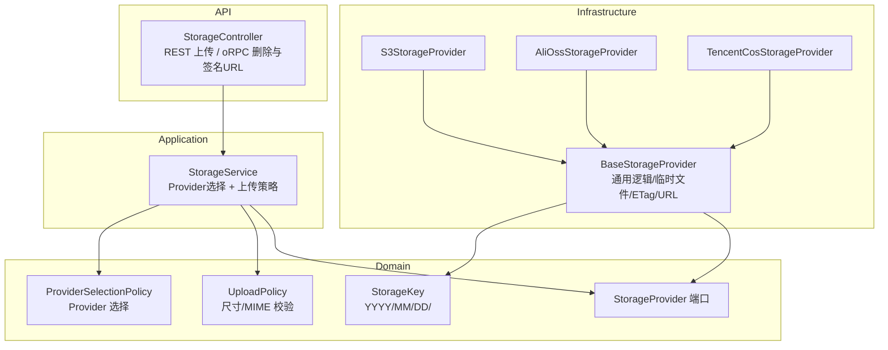
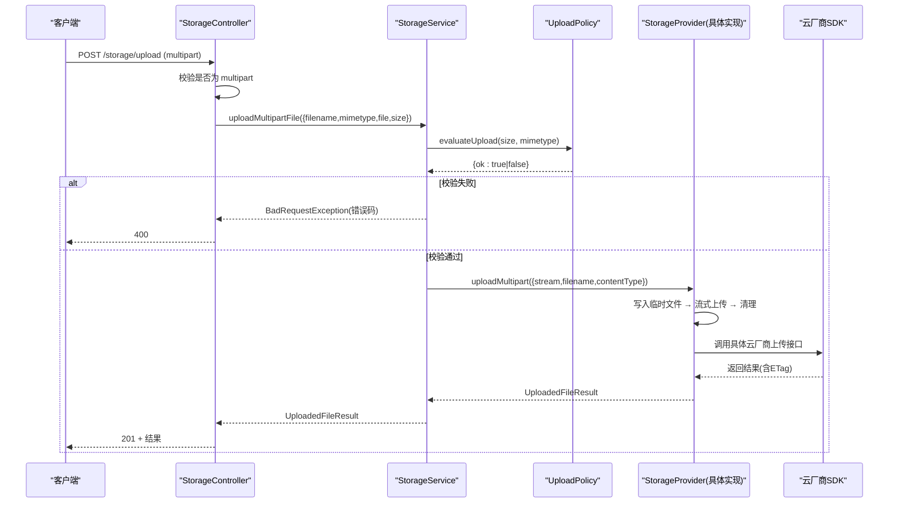
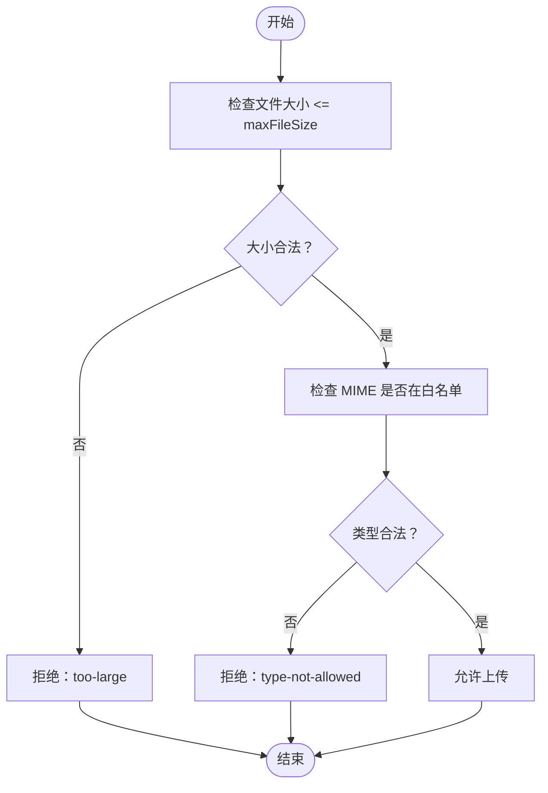
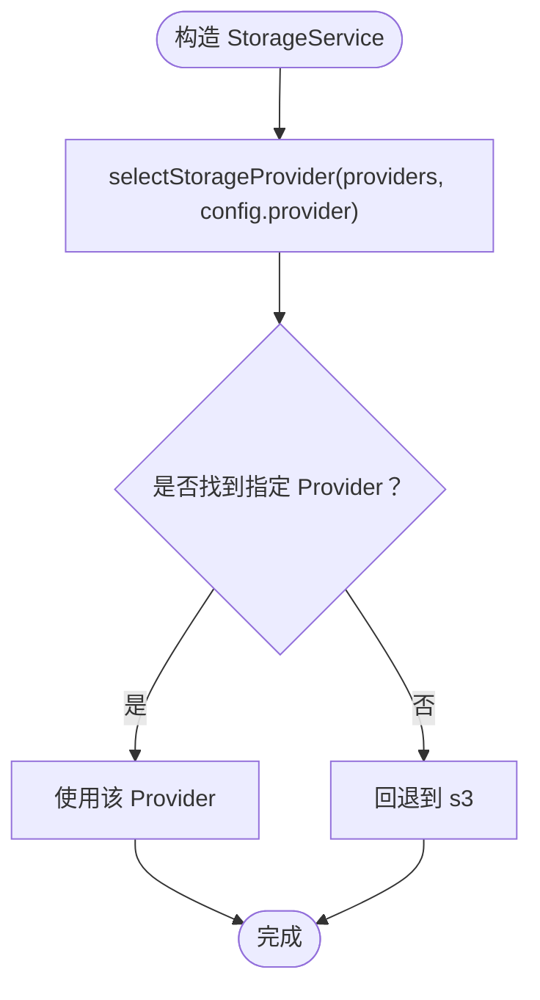
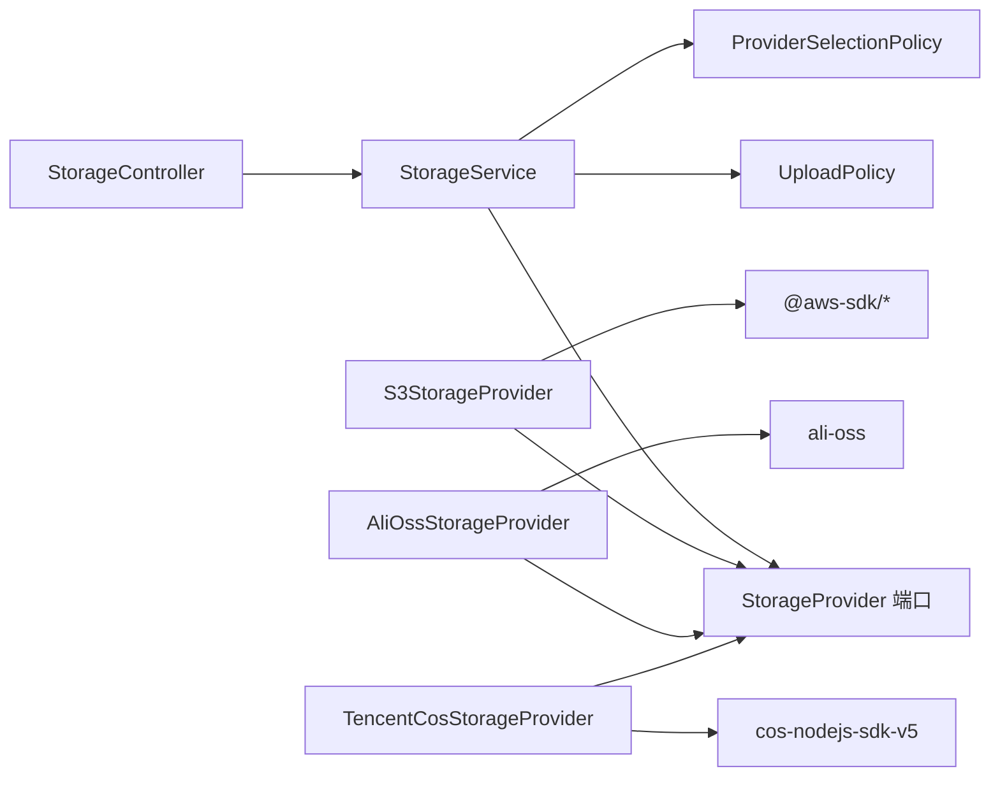

# 存储服务

<cite>
**本文引用的文件**   
- [storage.module.ts](file://apps/api/src/modules/storage/storage.module.ts)
- [base-storage.provider.ts](file://apps/api/src/modules/storage/infrastructure/base-storage.provider.ts)
- [s3-storage.provider.ts](file://apps/api/src/modules/storage/infrastructure/s3-storage.provider.ts)
- [alioss-storage.provider.ts](file://apps/api/src/modules/storage/infrastructure/alioss-storage.provider.ts)
- [tencentcos-storage.provider.ts](file://apps/api/src/modules/storage/infrastructure/tencentcos-storage.provider.ts)
- [storage-provider.port.ts](file://apps/api/src/modules/storage/domain/ports/storage-provider.port.ts)
- [storage.service.ts](file://apps/api/src/modules/storage/application/storage.service.ts)
- [storage.controller.ts](file://apps/api/src/modules/storage/api/storage.controller.ts)
- [storage-key.ts](file://apps/api/src/modules/storage/domain/value-objects/storage-key.ts)
- [upload.policy.ts](file://apps/api/src/modules/storage/domain/policies/upload.policy.ts)
- [provider-selection.policy.ts](file://apps/api/src/modules/storage/domain/policies/provider-selection.policy.ts)
</cite>

## 目录
1. [简介](#简介)
2. [项目结构](#项目结构)
3. [核心组件](#核心组件)
4. [架构总览](#架构总览)
5. [详细组件分析](#详细组件分析)
6. [依赖关系分析](#依赖关系分析)
7. [性能与高级特性](#性能与高级特性)
8. [配置与安全](#配置与安全)
9. [最佳实践](#最佳实践)
10. [故障排查](#故障排查)
11. [结论](#结论)

## 简介
本模块实现多云对象存储的统一接入层，抽象出 AWS S3、阿里云 OSS、腾讯云 COS 等后端，对外暴露统一的上传、删除、签名 URL 接口。通过领域策略（Provider 选择、上传校验）与应用编排（StorageService），将 HTTP 面、领域规则与基础设施解耦；同时提供可插拔的 Provider 注册机制，便于扩展新的云厂商或本地兼容端点。

## 项目结构
存储模块采用分层与 DDD 风格组织：
- API 层：REST 上传入口与 oRPC 删除/签名 URL 方法
- Application 层：编排 Provider 选择、上传策略校验、异常映射
- Domain 层：端口定义、纯函数策略、值对象
- Infrastructure 层：S3/OSS/COS 具体实现与公共基类

图表来源
- [storage.controller.ts:72-180](file://apps/api/src/modules/storage/api/storage.controller.ts#L72-L180)
- [storage.service.ts:17-99](file://apps/api/src/modules/storage/application/storage.service.ts#L17-L99)
- [storage-provider.port.ts:44-100](file://apps/api/src/modules/storage/domain/ports/storage-provider.port.ts#L44-L100)
- [upload.policy.ts:48-56](file://apps/api/src/modules/storage/domain/policies/upload.policy.ts#L48-L56)
- [provider-selection.policy.ts:14-20](file://apps/api/src/modules/storage/domain/policies/provider-selection.policy.ts#L14-L20)
- [base-storage.provider.ts:28-119](file://apps/api/src/modules/storage/infrastructure/base-storage.provider.ts#L28-L119)
- [s3-storage.provider.ts:20-149](file://apps/api/src/modules/storage/infrastructure/s3-storage.provider.ts#L20-L149)
- [alioss-storage.provider.ts:12-127](file://apps/api/src/modules/storage/infrastructure/alioss-storage.provider.ts#L12-L127)
- [tencentcos-storage.provider.ts:12-140](file://apps/api/src/modules/storage/infrastructure/tencentcos-storage.provider.ts#L12-L140)
- [storage-key.ts:14-23](file://apps/api/src/modules/storage/domain/value-objects/storage-key.ts#L14-L23)

章节来源
- [storage.module.ts:11-47](file://apps/api/src/modules/storage/storage.module.ts#L11-L47)
- [storage.controller.ts:72-180](file://apps/api/src/modules/storage/api/storage.controller.ts#L72-L180)
- [storage.service.ts:17-99](file://apps/api/src/modules/storage/application/storage.service.ts#L17-L99)

## 核心组件
- StorageProvider 端口：统一声明上传（Buffer/Stream）、multipart 原始流上传、删除、签名 URL 能力
- BaseStorageProvider：封装键生成、内容类型默认、ETag 归一化、公开 URL 拼装、临时文件落盘与清理
- 具体 Provider：S3StorageProvider、AliOssStorageProvider、TencentCosStorageProvider
- StorageService：应用编排，负责 Provider 选择、上传策略校验、异常映射
- StorageController：REST 上传入口与 oRPC 删除/签名 URL 方法
- 领域策略：UploadPolicy（尺寸/MIME 校验）、ProviderSelectionPolicy（Provider 选择与降级）
- 值对象：StorageKey（YYYY/MM/DD/<uuid><ext>）

章节来源
- [storage-provider.port.ts:7-100](file://apps/api/src/modules/storage/domain/ports/storage-provider.port.ts#L7-L100)
- [base-storage.provider.ts:28-119](file://apps/api/src/modules/storage/infrastructure/base-storage.provider.ts#L28-L119)
- [s3-storage.provider.ts:20-149](file://apps/api/src/modules/storage/infrastructure/s3-storage.provider.ts#L20-L149)
- [alioss-storage.provider.ts:12-127](file://apps/api/src/modules/storage/infrastructure/alioss-storage.provider.ts#L12-L127)
- [tencentcos-storage.provider.ts:12-140](file://apps/api/src/modules/storage/infrastructure/tencentcos-storage.provider.ts#L12-L140)
- [storage.service.ts:17-99](file://apps/api/src/modules/storage/application/storage.service.ts#L17-L99)
- [storage.controller.ts:72-180](file://apps/api/src/modules/storage/api/storage.controller.ts#L72-L180)
- [upload.policy.ts:48-56](file://apps/api/src/modules/storage/domain/policies/upload.policy.ts#L48-L56)
- [provider-selection.policy.ts:14-20](file://apps/api/src/modules/storage/domain/policies/provider-selection.policy.ts#L14-L20)
- [storage-key.ts:14-23](file://apps/api/src/modules/storage/domain/value-objects/storage-key.ts#L14-L23)

## 架构总览
下图展示一次单文件 multipart 上传的端到端调用链：

图表来源
- [storage.controller.ts:84-141](file://apps/api/src/modules/storage/api/storage.controller.ts#L84-L141)
- [storage.service.ts:43-79](file://apps/api/src/modules/storage/application/storage.service.ts#L43-L79)
- [upload.policy.ts:48-56](file://apps/api/src/modules/storage/domain/policies/upload.policy.ts#L48-L56)
- [base-storage.provider.ts:61-83](file://apps/api/src/modules/storage/infrastructure/base-storage.provider.ts#L61-L83)
- [s3-storage.provider.ts:73-101](file://apps/api/src/modules/storage/infrastructure/s3-storage.provider.ts#L73-L101)
- [alioss-storage.provider.ts:55-79](file://apps/api/src/modules/storage/infrastructure/alioss-storage.provider.ts#L55-L79)
- [tencentcos-storage.provider.ts:40-49](file://apps/api/src/modules/storage/infrastructure/tencentcos-storage.provider.ts#L40-L49)

## 详细组件分析

### 存储 Provider 抽象层
- 端口 StorageProvider 定义了 Buffer/Stream 上传、multipart 原始流上传、删除、签名 URL 的统一契约
- BaseStorageProvider 集中处理：
  - 键生成：委托 domain 的 buildStorageKey，注入时间与 uuid
  - 内容类型默认：未指定时回退为 application/octet-stream
  - ETag 归一化：去除云厂商包裹的双引号
  - 公开 URL：优先使用 baseUrl，否则走各 Provider 的默认 URL 格式
  - multipart 原始流：写临时文件 → 流式上传 → 清理

```mermaid
classDiagram
class StorageProvider {
+uploadFile(fileBuffer, filename, options)
+uploadFileFromStream(fileStream, filename, options)
+uploadMultipart(input)
+deleteFile(key)
+getFileUrl(key, expiresIn)
}
class BaseStorageProvider {
-bucket : string
-baseUrl : string
+uploadMultipart(input)
#resolveContentType(options)
#normalizeEtag(etag)
#buildResult(...)
#generateKey(filename)
-getPublicUrl(key)
}
class S3StorageProvider
class AliOssStorageProvider
class TencentCosStorageProvider
StorageProvider <|.. BaseStorageProvider
BaseStorageProvider <|-- S3StorageProvider
BaseStorageProvider <|-- AliOssStorageProvider
BaseStorageProvider <|-- TencentCosStorageProvider
```

图表来源
- [storage-provider.port.ts:44-100](file://apps/api/src/modules/storage/domain/ports/storage-provider.port.ts#L44-L100)
- [base-storage.provider.ts:28-119](file://apps/api/src/modules/storage/infrastructure/base-storage.provider.ts#L28-L119)
- [s3-storage.provider.ts:20-149](file://apps/api/src/modules/storage/infrastructure/s3-storage.provider.ts#L20-L149)
- [alioss-storage.provider.ts:12-127](file://apps/api/src/modules/storage/infrastructure/alioss-storage.provider.ts#L12-L127)
- [tencentcos-storage.provider.ts:12-140](file://apps/api/src/modules/storage/infrastructure/tencentcos-storage.provider.ts#L12-L140)

章节来源
- [storage-provider.port.ts:7-100](file://apps/api/src/modules/storage/domain/ports/storage-provider.port.ts#L7-L100)
- [base-storage.provider.ts:28-119](file://apps/api/src/modules/storage/infrastructure/base-storage.provider.ts#L28-L119)

### 具体 Provider 实现要点
- S3StorageProvider
  - 支持自定义 endpoint（如 MinIO），开启 forcePathStyle
  - 小文件用 PutObject，大文件用 Upload（分片上传）
  - 签名 URL 使用 getSignedUrl，过期时间由参数控制
  - 默认公开 URL 基于 bucket.region.amazonaws.com
- AliOssStorageProvider
  - 使用 ali-oss SDK，put/putStream 分别对应 Buffer/Stream
  - 设置 x-oss-object-acl 与 x-oss-meta-* 元数据
  - 签名 URL 使用 signatureUrl，默认公开 URL 基于 bucket.endpoint
- TencentCosStorageProvider
  - 回调式 SDK，封装 Promise 以适配异步流程
  - 签名 URL 使用 getObjectUrl(Sign=true)，默认公开 URL 基于 bucket.cos.region.myqcloud.com

章节来源
- [s3-storage.provider.ts:20-149](file://apps/api/src/modules/storage/infrastructure/s3-storage.provider.ts#L20-L149)
- [alioss-storage.provider.ts:12-127](file://apps/api/src/modules/storage/infrastructure/alioss-storage.provider.ts#L12-L127)
- [tencentcos-storage.provider.ts:12-140](file://apps/api/src/modules/storage/infrastructure/tencentcos-storage.provider.ts#L12-L140)

### 访问控制机制
- 对象 ACL
  - S3：通过 ACL 字段传入 ObjectCannedACL，默认 private
  - AliOSS：通过 x-oss-object-acl 头设置，默认 private
  - COS：当前实现未显式设置 ACL，遵循桶/对象默认策略
- 访问 URL
  - 私有对象应使用 getFileUrl 获取签名 URL，避免直接暴露公网地址
  - 若配置了 baseUrl，则公开 URL 拼接 baseUrl/key；否则使用各 Provider 默认 URL

章节来源
- [s3-storage.provider.ts:135-149](file://apps/api/src/modules/storage/infrastructure/s3-storage.provider.ts#L135-L149)
- [alioss-storage.provider.ts:109-122](file://apps/api/src/modules/storage/infrastructure/alioss-storage.provider.ts#L109-L122)
- [base-storage.provider.ts:117-119](file://apps/api/src/modules/storage/infrastructure/base-storage.provider.ts#L117-L119)

### 文件上传策略与校验
- 上传策略 UploadPolicy
  - 先校验文件大小是否超过 maxFileSize
  - 再校验 MIME 是否在 allowedMimeTypes 白名单
  - 返回 result-union：通过或拒绝原因（too-large/type-not-allowed）
- 应用层 StorageService
  - 根据策略结果抛出 BadRequestException，并附带标准化错误码
  - 校验通过后委托 Provider.uploadMultipart 执行 IO

图表来源
- [upload.policy.ts:48-56](file://apps/api/src/modules/storage/domain/policies/upload.policy.ts#L48-L56)
- [storage.service.ts:43-79](file://apps/api/src/modules/storage/application/storage.service.ts#L43-L79)

章节来源
- [upload.policy.ts:11-56](file://apps/api/src/modules/storage/domain/policies/upload.policy.ts#L11-L56)
- [storage.service.ts:43-79](file://apps/api/src/modules/storage/application/storage.service.ts#L43-L79)

### Provider 选择与降级
- ProviderSelectionPolicy
  - 优先使用 storageConfig.provider 指定的 Provider
  - 若未注册，则回退到 s3（模块始终注册 s3）
- StorageModule.register
  - 动态装配 providers：s3 始终存在；当 provider=alioss 或 tencentoss 时追加对应实例

图表来源
- [provider-selection.policy.ts:14-20](file://apps/api/src/modules/storage/domain/policies/provider-selection.policy.ts#L14-L20)
- [storage.module.ts:17-46](file://apps/api/src/modules/storage/storage.module.ts#L17-L46)
- [storage.service.ts:23-34](file://apps/api/src/modules/storage/application/storage.service.ts#L23-L34)

章节来源
- [provider-selection.policy.ts:14-20](file://apps/api/src/modules/storage/domain/policies/provider-selection.policy.ts#L14-L20)
- [storage.module.ts:17-46](file://apps/api/src/modules/storage/storage.module.ts#L17-L46)
- [storage.service.ts:23-34](file://apps/api/src/modules/storage/application/storage.service.ts#L23-L34)

### 文件键命名规则
- 统一采用 YYYY/MM/DD/<uuid><ext> 格式
- 扩展名提取对齐 path.extname 语义（首字符为点的文件视为无扩展名）
- 该规则下沉至 domain 值对象，确保所有 Provider 一致

章节来源
- [storage-key.ts:14-23](file://apps/api/src/modules/storage/domain/value-objects/storage-key.ts#L14-L23)
- [base-storage.provider.ts:112-115](file://apps/api/src/modules/storage/infrastructure/base-storage.provider.ts#L112-L115)

## 依赖关系分析
- API 层依赖 Application 层
- Application 层依赖 Domain 层（端口与策略）
- Infrastructure 层实现 Domain 端口，并依赖 SDK
- Module 层负责 Provider 的动态装配与导出

图表来源
- [storage.controller.ts:72-180](file://apps/api/src/modules/storage/api/storage.controller.ts#L72-L180)
- [storage.service.ts:17-99](file://apps/api/src/modules/storage/application/storage.service.ts#L17-L99)
- [s3-storage.provider.ts:1-18](file://apps/api/src/modules/storage/infrastructure/s3-storage.provider.ts#L1-L18)
- [alioss-storage.provider.ts:1-10](file://apps/api/src/modules/storage/infrastructure/alioss-storage.provider.ts#L1-L10)
- [tencentcos-storage.provider.ts:1-10](file://apps/api/src/modules/storage/infrastructure/tencentcos-storage.provider.ts#L1-L10)

章节来源
- [storage.module.ts:11-47](file://apps/api/src/modules/storage/storage.module.ts#L11-L47)
- [storage.controller.ts:72-180](file://apps/api/src/modules/storage/api/storage.controller.ts#L72-L180)
- [storage.service.ts:17-99](file://apps/api/src/modules/storage/application/storage.service.ts#L17-L99)

## 性能与高级特性
- 分片上传
  - S3：使用 @aws-sdk/lib-storage 的 Upload 进行分片上传，适合大文件与不稳定网络
  - AliOSS：putStream 内部会按 SDK 策略处理分片
  - COS：回调式 putObject，SDK 内部处理分片
- 断点续传
  - 当前实现未内置断点续传；如需支持，可在应用层记录分片状态并与 Provider 的分片上传 API 结合
- 流式上传
  - 所有 Provider 均支持从 ReadableStream 上传，减少内存占用
- 临时文件 I/O
  - multipart 原始流先落 tmp 目录，上传完成后自动清理；建议在生产环境监控磁盘空间与权限

章节来源
- [s3-storage.provider.ts:73-101](file://apps/api/src/modules/storage/infrastructure/s3-storage.provider.ts#L73-L101)
- [alioss-storage.provider.ts:55-79](file://apps/api/src/modules/storage/infrastructure/alioss-storage.provider.ts#L55-L79)
- [tencentcos-storage.provider.ts:40-49](file://apps/api/src/modules/storage/infrastructure/tencentcos-storage.provider.ts#L40-L49)
- [base-storage.provider.ts:61-83](file://apps/api/src/modules/storage/infrastructure/base-storage.provider.ts#L61-L83)

## 配置与安全
- 配置项（来自 ConfigService.getStorageConfig）
  - region：区域标识
  - accessKeyId/accessKeySecret：访问密钥
  - bucket：存储桶名称
  - endpoint：自定义端点（S3 兼容服务如 MinIO；AliOSS/TencentCOS 也支持）
  - baseUrl：公开访问前缀（若配置则覆盖默认 URL 拼接）
  - maxFileSize：最大文件大小（字节）
  - allowedMimeTypes：允许的 MIME 类型白名单
- 安全建议
  - 使用最小权限的 AK/SK，限制仅对目标 bucket 的读写
  - 私有对象优先使用签名 URL 访问，避免直连公网地址
  - 在 CDN 或反向代理层启用 HTTPS，并对签名 URL 做二次鉴权（可选）
  - 定期轮换密钥，并在日志中脱敏敏感信息

章节来源
- [s3-storage.provider.ts:25-45](file://apps/api/src/modules/storage/infrastructure/s3-storage.provider.ts#L25-L45)
- [alioss-storage.provider.ts:16-27](file://apps/api/src/modules/storage/infrastructure/alioss-storage.provider.ts#L16-L27)
- [tencentcos-storage.provider.ts:17-27](file://apps/api/src/modules/storage/infrastructure/tencentcos-storage.provider.ts#L17-L27)
- [base-storage.provider.ts:32-36](file://apps/api/src/modules/storage/infrastructure/base-storage.provider.ts#L32-L36)
- [storage.service.ts:23-34](file://apps/api/src/modules/storage/application/storage.service.ts#L23-L34)

## 最佳实践
- 存储提供商配置示例
  - AWS S3
    - 设置 region、accessKeyId、accessKeySecret、bucket
    - 如需连接 MinIO 或其他 S3 兼容服务，设置 endpoint 并启用 forcePathStyle（已在 Provider 内处理）
  - 阿里云 OSS
    - 设置 region、accessKeyId、accessKeySecret、bucket、endpoint（可为空，默认 oss-{region}.aliyuncs.com）
  - 腾讯云 COS
    - 设置 SecretId、SecretKey、bucket、region（Provider 内部已读取）
- 集成指南
  - 在 StorageModule.register 中按需启用 alioss 或 tencentoss
  - 通过 storageConfig.provider 切换默认 Provider
- 文件访问 URL 与 CDN
  - 配置 baseUrl 指向 CDN 域名，实现静态资源加速
  - 对私有对象使用 getFileUrl 获取签名 URL，CDN 侧可缓存短时效签名 URL 以提升性能
- 上传策略
  - 合理设置 maxFileSize 与 allowedMimeTypes，防止恶意大文件或危险类型上传
- 性能优化
  - 大文件优先使用流式上传
  - 针对 S3 使用 Upload 分片上传
  - 在 CDN 层开启压缩与缓存策略

章节来源
- [storage.module.ts:17-46](file://apps/api/src/modules/storage/storage.module.ts#L17-L46)
- [s3-storage.provider.ts:25-45](file://apps/api/src/modules/storage/infrastructure/s3-storage.provider.ts#L25-L45)
- [alioss-storage.provider.ts:16-27](file://apps/api/src/modules/storage/infrastructure/alioss-storage.provider.ts#L16-L27)
- [tencentcos-storage.provider.ts:17-27](file://apps/api/src/modules/storage/infrastructure/tencentcos-storage.provider.ts#L17-L27)
- [base-storage.provider.ts:117-119](file://apps/api/src/modules/storage/infrastructure/base-storage.provider.ts#L117-L119)
- [storage.service.ts:43-79](file://apps/api/src/modules/storage/application/storage.service.ts#L43-L79)

## 故障排查
- 常见错误
  - 非 multipart 请求：控制器抛出不为 multipart 的错误
  - 未上传文件：控制器抛出无文件错误
  - 文件大小超限：应用层抛出 too-large 错误
  - MIME 类型不允许：应用层抛出 type-not-allowed 错误
  - 上传失败：Provider 抛出的异常被归一化为 STORAGE_UPLOAD_FAILED
- 定位建议
  - 检查 storageConfig.provider 是否正确且已注册
  - 检查 AK/SK、bucket、region、endpoint 配置
  - 检查临时目录权限与磁盘空间
  - 查看 Provider 抛出的底层 SDK 错误信息

章节来源
- [storage.controller.ts:103-141](file://apps/api/src/modules/storage/api/storage.controller.ts#L103-L141)
- [storage.service.ts:43-79](file://apps/api/src/modules/storage/application/storage.service.ts#L43-L79)
- [s3-storage.provider.ts:68-70](file://apps/api/src/modules/storage/infrastructure/s3-storage.provider.ts#L68-L70)
- [alioss-storage.provider.ts:50-52](file://apps/api/src/modules/storage/infrastructure/alioss-storage.provider.ts#L50-L52)
- [tencentcos-storage.provider.ts:123-125](file://apps/api/src/modules/storage/infrastructure/tencentcos-storage.provider.ts#L123-L125)

## 结论
本存储服务通过清晰的层次划分与领域策略，实现了多云对象存储的统一接入。Provider 抽象层屏蔽了不同云厂商的差异，应用层专注策略与编排，API 层提供稳定接口。借助分片上传、流式上传与签名 URL，系统具备良好的可扩展性与安全性。生产环境中建议配合 CDN、严格的访问控制与完善的监控告警，以获得更优的性能与稳定性。