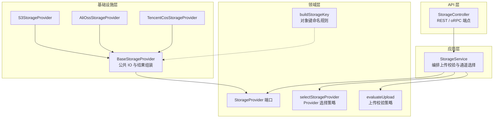
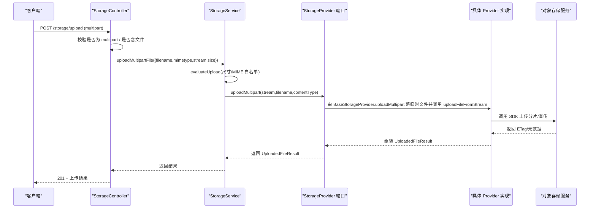
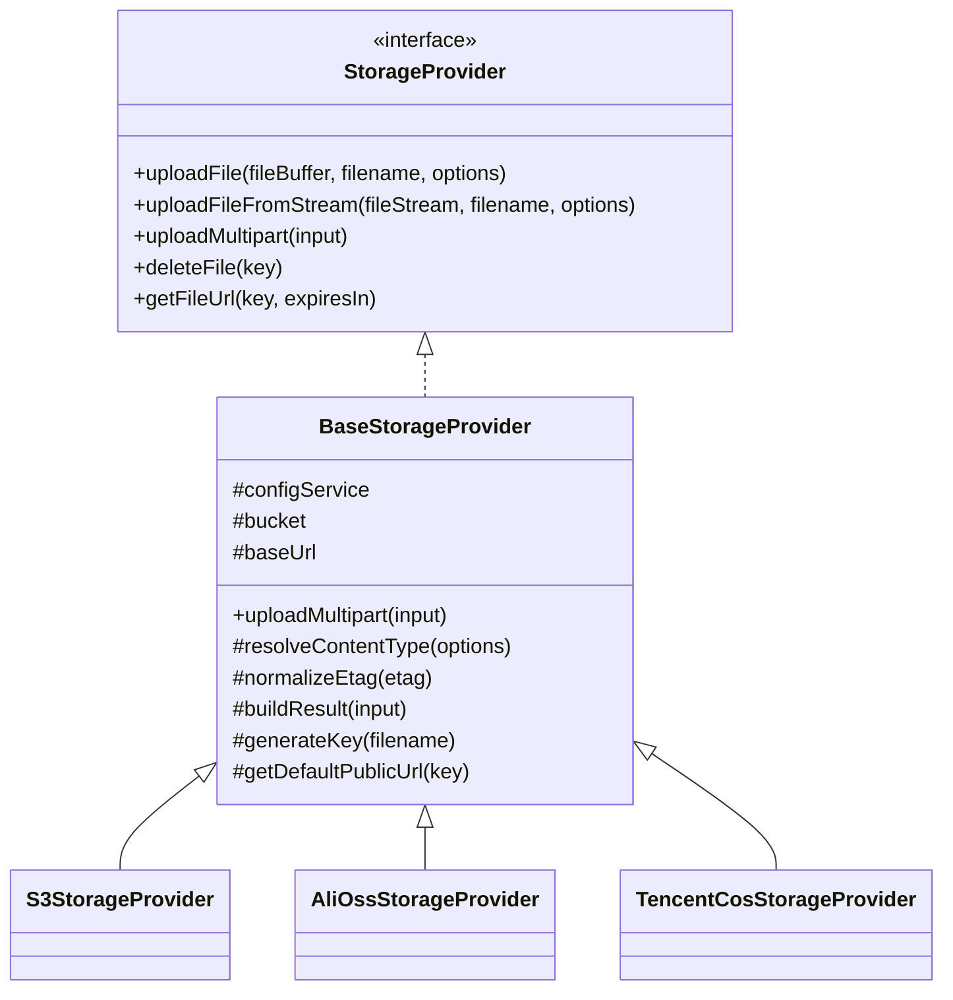
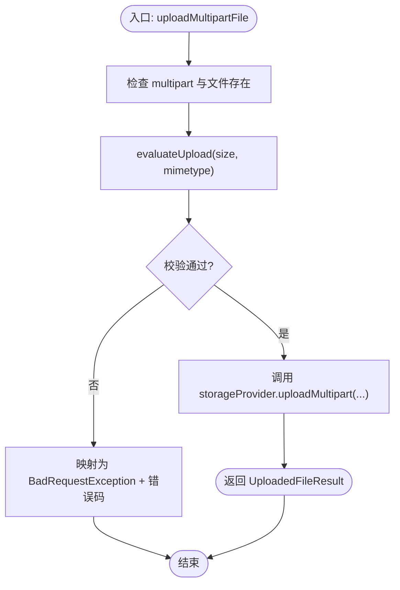
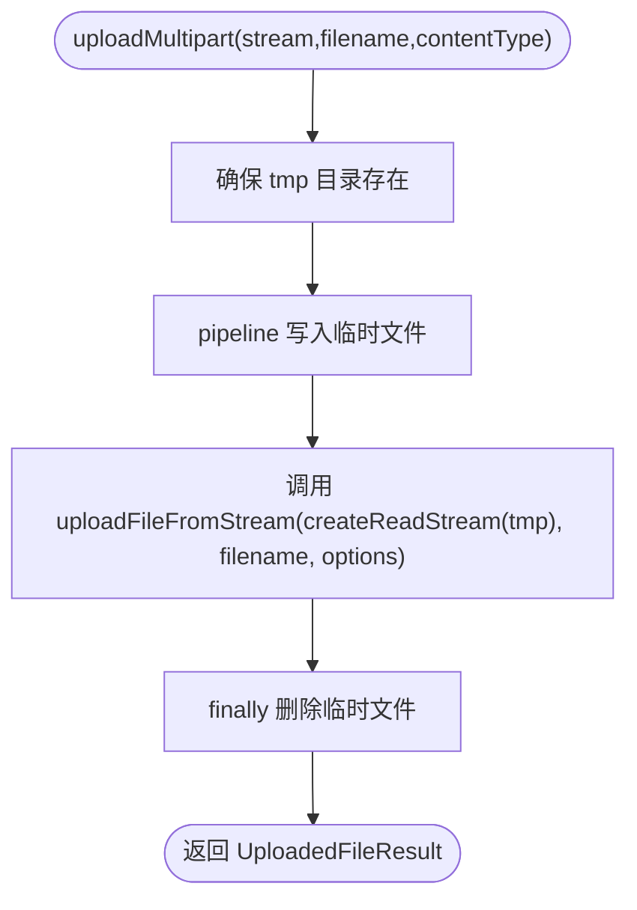
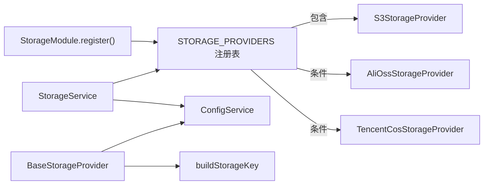

# 存储架构设计

<cite>
**本文引用的文件**   
- [storage-provider.port.ts](file://apps/api/src/modules/storage/domain/ports/storage-provider.port.ts)
- [provider-selection.policy.ts](file://apps/api/src/modules/storage/domain/policies/provider-selection.policy.ts)
- [upload.policy.ts](file://apps/api/src/modules/storage/domain/policies/upload.policy.ts)
- [storage-key.ts](file://apps/api/src/modules/storage/domain/value-objects/storage-key.ts)
- [storage.service.ts](file://apps/api/src/modules/storage/application/storage.service.ts)
- [base-storage.provider.ts](file://apps/api/src/modules/storage/infrastructure/base-storage.provider.ts)
- [s3-storage.provider.ts](file://apps/api/src/modules/storage/infrastructure/s3-storage.provider.ts)
- [alioss-storage.provider.ts](file://apps/api/src/modules/storage/infrastructure/alioss-storage.provider.ts)
- [tencentcos-storage.provider.ts](file://apps/api/src/modules/storage/infrastructure/tencentcos-storage.provider.ts)
- [storage.controller.ts](file://apps/api/src/modules/storage/api/storage.controller.ts)
- [storage.module.ts](file://apps/api/src/modules/storage/storage.module.ts)
</cite>

## 目录
1. [引言](#引言)
2. [项目结构](#项目结构)
3. [核心组件](#核心组件)
4. [架构总览](#架构总览)
5. [详细组件分析](#详细组件分析)
6. [依赖关系分析](#依赖关系分析)
7. [性能与可靠性考量](#性能与可靠性考量)
8. [故障排查指南](#故障排查指南)
9. [结论](#结论)

## 引言
本文件面向多云对象存储的统一接入层，说明以下目标：
- 抽象层如何定义统一的 StorageProvider 接口，屏蔽 S3、阿里云 OSS、腾讯云 COS 的差异。
- Application 层的 StorageService 如何编排策略（上传校验、通道选择）并协调具体 Provider。
- BaseStorageProvider 基类如何通过模板方法模式收敛公共逻辑，降低实现成本。
- 存储策略选择、错误处理、重试机制等关键设计决策。
- 提供架构图和数据流图，展示从控制器到具体存储提供商的完整请求流程。

## 项目结构
存储模块采用分层 + 领域驱动的组织方式：
- domain/ports：定义 StorageProvider 端口（出站网关），仅依赖 Node.js 类型，零框架耦合。
- domain/policies：纯函数策略，如“上传校验”和“Provider 选择”。
- domain/value-objects：值对象，如统一对象键命名规则。
- application：应用服务层 StorageService，负责编排策略与调用端口。
- infrastructure：具体存储实现（S3、AliOSS、TencentCOS），继承 BaseStorageProvider。
- api：HTTP 面端点，接收 multipart 上传、删除、签名 URL。
- storage.module：动态装配 Provider 注册表。

图表来源
- [storage.controller.ts:71-180](file://apps/api/src/modules/storage/api/storage.controller.ts#L71-L180)
- [storage.service.ts:17-99](file://apps/api/src/modules/storage/application/storage.service.ts#L17-L99)
- [storage-provider.port.ts:44-100](file://apps/api/src/modules/storage/domain/ports/storage-provider.port.ts#L44-L100)
- [provider-selection.policy.ts:14-20](file://apps/api/src/modules/storage/domain/policies/provider-selection.policy.ts#L14-L20)
- [upload.policy.ts:48-56](file://apps/api/src/modules/storage/domain/policies/upload.policy.ts#L48-L56)
- [storage-key.ts:14-23](file://apps/api/src/modules/storage/domain/value-objects/storage-key.ts#L14-L23)
- [base-storage.provider.ts:28-120](file://apps/api/src/modules/storage/infrastructure/base-storage.provider.ts#L28-L120)
- [s3-storage.provider.ts:20-149](file://apps/api/src/modules/storage/infrastructure/s3-storage.provider.ts#L20-L149)
- [alioss-storage.provider.ts:12-127](file://apps/api/src/modules/storage/infrastructure/alioss-storage.provider.ts#L12-L127)
- [tencentcos-storage.provider.ts:12-141](file://apps/api/src/modules/storage/infrastructure/tencentcos-storage.provider.ts#L12-L141)

章节来源
- [storage.module.ts:11-47](file://apps/api/src/modules/storage/storage.module.ts#L11-L47)

## 核心组件
- StorageProvider 端口：定义上传（Buffer/Stream/multipart）、删除、签名 URL 的统一能力。
- StorageService：应用服务，负责读取配置、选择 Provider、执行上传校验、委托 Provider 完成 IO。
- BaseStorageProvider：抽象基类，封装临时文件落盘、流式上传、ETag 归一化、URL 拼装、对象键生成等通用逻辑。
- 具体 Provider：S3StorageProvider、AliOssStorageProvider、TencentCosStorageProvider，分别对接不同 SDK。
- 策略与值对象：selectStorageProvider（Provider 选择）、evaluateUpload（上传校验）、buildStorageKey（对象键命名）。

章节来源
- [storage-provider.port.ts:3-100](file://apps/api/src/modules/storage/domain/ports/storage-provider.port.ts#L3-L100)
- [storage.service.ts:17-99](file://apps/api/src/modules/storage/application/storage.service.ts#L17-L99)
- [base-storage.provider.ts:17-120](file://apps/api/src/modules/storage/infrastructure/base-storage.provider.ts#L17-L120)
- [s3-storage.provider.ts:20-149](file://apps/api/src/modules/storage/infrastructure/s3-storage.provider.ts#L20-L149)
- [alioss-storage.provider.ts:12-127](file://apps/api/src/modules/storage/infrastructure/alioss-storage.provider.ts#L12-L127)
- [tencentcos-storage.provider.ts:12-141](file://apps/api/src/modules/storage/infrastructure/tencentcos-storage.provider.ts#L12-L141)
- [provider-selection.policy.ts:1-20](file://apps/api/src/modules/storage/domain/policies/provider-selection.policy.ts#L1-L20)
- [upload.policy.ts:1-56](file://apps/api/src/modules/storage/domain/policies/upload.policy.ts#L1-L56)
- [storage-key.ts:1-23](file://apps/api/src/modules/storage/domain/value-objects/storage-key.ts#L1-L23)

## 架构总览
下图展示一次单文件 multipart 上传的端到端流程：控制器解析原始流 → 应用服务做策略校验 → 通过 Provider 端口落到具体云厂商。

图表来源
- [storage.controller.ts:103-142](file://apps/api/src/modules/storage/api/storage.controller.ts#L103-L142)
- [storage.service.ts:43-79](file://apps/api/src/modules/storage/application/storage.service.ts#L43-L79)
- [base-storage.provider.ts:61-83](file://apps/api/src/modules/storage/infrastructure/base-storage.provider.ts#L61-L83)
- [s3-storage.provider.ts:73-102](file://apps/api/src/modules/storage/infrastructure/s3-storage.provider.ts#L73-L102)
- [alioss-storage.provider.ts:55-79](file://apps/api/src/modules/storage/infrastructure/alioss-storage.provider.ts#L55-L79)
- [tencentcos-storage.provider.ts:40-49](file://apps/api/src/modules/storage/infrastructure/tencentcos-storage.provider.ts#L40-L49)

## 详细组件分析

### StorageProvider 端口与实现模式
- 端口职责：
  - uploadFile：基于 Buffer 的同步内容上传。
  - uploadFileFromStream：基于 ReadableStream 的流式上传，适合大文件。
  - uploadMultipart：HTTP multipart 原始流转临时文件再流式上传，属基础设施关注点。
  - deleteFile：按 key 删除对象。
  - getFileUrl：生成带时效的访问 URL。
- 实现模式：
  - 所有具体 Provider 均实现 StorageProvider。
  - 公共逻辑下沉至 BaseStorageProvider，子类仅需实现 SDK 差异部分（上传、删除、签名 URL、默认公开 URL）。

图表来源
- [storage-provider.port.ts:44-100](file://apps/api/src/modules/storage/domain/ports/storage-provider.port.ts#L44-L100)
- [base-storage.provider.ts:28-120](file://apps/api/src/modules/storage/infrastructure/base-storage.provider.ts#L28-L120)
- [s3-storage.provider.ts:20-149](file://apps/api/src/modules/storage/infrastructure/s3-storage.provider.ts#L20-L149)
- [alioss-storage.provider.ts:12-127](file://apps/api/src/modules/storage/infrastructure/alioss-storage.provider.ts#L12-L127)
- [tencentcos-storage.provider.ts:12-141](file://apps/api/src/modules/storage/infrastructure/tencentcos-storage.provider.ts#L12-L141)

章节来源
- [storage-provider.port.ts:3-100](file://apps/api/src/modules/storage/domain/ports/storage-provider.port.ts#L3-L100)
- [base-storage.provider.ts:17-120](file://apps/api/src/modules/storage/infrastructure/base-storage.provider.ts#L17-L120)

### StorageService 应用服务层
- 职责边界：
  - 构造期根据配置选择 Provider（未命中则回退 s3）。
  - 上传前调用 evaluateUpload 进行尺寸与 MIME 白名单校验。
  - 将 HTTP 异常映射为业务错误码（如 TOO_LARGE、TYPE_NOT_ALLOWED、UPLOAD_FAILED）。
  - 不直接操作文件系统或路径，IO 细节下沉至 BaseStorageProvider。
- 关键流程：
  - uploadMultipartFile：先校验，后委托 Provider.uploadMultipart。
  - deleteFile/getFileUrl：透传至 Provider。

图表来源
- [storage.service.ts:43-79](file://apps/api/src/modules/storage/application/storage.service.ts#L43-L79)
- [upload.policy.ts:48-56](file://apps/api/src/modules/storage/domain/policies/upload.policy.ts#L48-L56)

章节来源
- [storage.service.ts:17-99](file://apps/api/src/modules/storage/application/storage.service.ts#L17-L99)

### BaseStorageProvider 基类设计与扩展机制
- 公共能力：
  - uploadMultipart：创建 tmp 目录、写入临时文件、调用 uploadFileFromStream、finally 清理临时文件。
  - resolveContentType：缺省为 application/octet-stream。
  - normalizeEtag：去除云厂商包裹的双引号。
  - buildResult：统一组装 UploadedFileResult（key/url/etag/size/mimetype/originalname）。
  - generateKey：调用领域值对象 buildStorageKey，注入时间与 uuid。
  - getPublicUrl：优先使用 baseUrl，否则走 getDefaultPublicUrl。
- 扩展点：
  - 子类需实现 uploadFile、uploadFileFromStream、deleteFile、getFileUrl、getDefaultPublicUrl。
  - 可覆写 resolveContentType、normalizeEtag、buildResult 以适配特定 SDK 行为。

图表来源
- [base-storage.provider.ts:61-83](file://apps/api/src/modules/storage/infrastructure/base-storage.provider.ts#L61-L83)
- [storage-key.ts:14-23](file://apps/api/src/modules/storage/domain/value-objects/storage-key.ts#L14-L23)

章节来源
- [base-storage.provider.ts:17-120](file://apps/api/src/modules/storage/infrastructure/base-storage.provider.ts#L17-L120)

### 具体 Provider 实现要点
- S3StorageProvider：
  - 使用 @aws-sdk/client-s3 与 @aws-sdk/lib-storage 的 Upload 支持分片上传。
  - 支持自定义 endpoint（MinIO 等 S3 兼容）并启用 forcePathStyle。
  - getFileUrl 使用 getSignedUrl 生成签名链接。
- AliOssStorageProvider：
  - 使用 ali-oss SDK，put/putStream 上传，signatureUrl 生成签名 URL。
  - 默认公开 URL 格式遵循阿里云 OSS 规范。
- TencentCosStorageProvider：
  - 使用 cos-nodejs-sdk-v5，回调风格 API 包装为 Promise。
  - getObjectUrl 生成签名 URL。

章节来源
- [s3-storage.provider.ts:20-149](file://apps/api/src/modules/storage/infrastructure/s3-storage.provider.ts#L20-L149)
- [alioss-storage.provider.ts:12-127](file://apps/api/src/modules/storage/infrastructure/alioss-storage.provider.ts#L12-L127)
- [tencentcos-storage.provider.ts:12-141](file://apps/api/src/modules/storage/infrastructure/tencentcos-storage.provider.ts#L12-L141)

### 策略与值对象
- Provider 选择策略 selectStorageProvider：
  - 输入 providers 注册表与 requested provider id。
  - 若 requested 不存在，回退到 fallbackKey（默认 s3）。
  - 该策略在 StorageModule.register() 中保证 s3 始终可用，从而回落恒成立。
- 上传校验策略 evaluateUpload：
  - 先判断 size > maxFileSize，再判断 mimetype 是否在 allowedMimeTypes。
  - 返回 result-union：{ok:true} 或 {ok:false, reason:'too-large'|'type-not-allowed'}。
- 对象键命名规则 buildStorageKey：
  - 统一格式 YYYY/MM/DD/<uuid><ext>，避免跨云厂商命名不一致。

章节来源
- [provider-selection.policy.ts:1-20](file://apps/api/src/modules/storage/domain/policies/provider-selection.policy.ts#L1-L20)
- [upload.policy.ts:1-56](file://apps/api/src/modules/storage/domain/policies/upload.policy.ts#L1-L56)
- [storage-key.ts:1-23](file://apps/api/src/modules/storage/domain/value-objects/storage-key.ts#L1-L23)

## 依赖关系分析
- 控制器依赖 StorageService；StorageService 依赖 ConfigService 与 STORAGE_PROVIDERS 注册表。
- StorageModule.register() 根据 storageConfig.provider 动态装配 alioss/tencentoss，但 s3 始终注册。
- BaseStorageProvider 依赖 ConfigService 获取 bucket/baseUrl，并依赖领域层 buildStorageKey。
- 各 Provider 依赖各自 SDK 客户端。

图表来源
- [storage.module.ts:17-46](file://apps/api/src/modules/storage/storage.module.ts#L17-L46)
- [storage.service.ts:23-34](file://apps/api/src/modules/storage/application/storage.service.ts#L23-L34)
- [base-storage.provider.ts:32-36](file://apps/api/src/modules/storage/infrastructure/base-storage.provider.ts#L32-L36)
- [storage-key.ts:14-23](file://apps/api/src/modules/storage/domain/value-objects/storage-key.ts#L14-L23)

章节来源
- [storage.module.ts:11-47](file://apps/api/src/modules/storage/storage.module.ts#L11-L47)
- [storage.service.ts:23-34](file://apps/api/src/modules/storage/application/storage.service.ts#L23-L34)

## 性能与可靠性考量
- 流式上传与大文件：
  - S3 使用 lib-storage 的 Upload 进行分片上传，减少内存占用并提升稳定性。
  - BaseStorageProvider.uploadMultipart 通过 pipeline 将 HTTP 流写入临时文件，再转为 ReadStream 上传，避免一次性加载大文件到内存。
- 对象键与缓存友好：
  - 统一 YYYY/MM/DD 目录结构，利于 CDN/边缘缓存与日志归档。
- 超时与失败：
  - AliOSS 显式设置 timeout；S3/TencentCOS 抛出 Error，由上层统一捕获并转换为业务异常。
- 重试机制：
  - 当前代码未实现自动重试；如需增强，可在 StorageService 或 Provider 层引入重试策略（指数退避、幂等性保障、可重试错误分类）。

[本节为通用指导，不直接分析具体文件]

## 故障排查指南
- 非 multipart 请求：
  - 控制器检测到非 multipart 时抛出 BAD_REQUEST，错误码指向 STORAGE_NOT_MULTIPART。
- 未携带文件：
  - req.file() 为空时抛出 BAD_REQUEST，错误码指向 STORAGE_NO_FILE。
- 文件大小超限：
  - evaluateUpload 判定 too-large，StorageService 抛出 BAD_REQUEST，错误码 STORAGE_FILE_TOO_LARGE。
- MIME 类型不允许：
  - evaluateUpload 判定 type-not-allowed，StorageService 抛出 BAD_REQUEST，错误码 STORAGE_FILE_TYPE_NOT_ALLOWED。
- 上传失败（Provider 层）：
  - Provider 抛出 Error，StorageService 捕获并转换为 BAD_REQUEST，错误码 STORAGE_UPLOAD_FAILED。
- 删除/签名 URL 失败：
  - 各 Provider 内部捕获 SDK 异常并抛出 Error，由上层统一处理。

章节来源
- [storage.controller.ts:103-142](file://apps/api/src/modules/storage/api/storage.controller.ts#L103-L142)
- [storage.service.ts:43-79](file://apps/api/src/modules/storage/application/storage.service.ts#L43-L79)
- [s3-storage.provider.ts:68-70](file://apps/api/src/modules/storage/infrastructure/s3-storage.provider.ts#L68-L70)
- [alioss-storage.provider.ts:50-52](file://apps/api/src/modules/storage/infrastructure/alioss-storage.provider.ts#L50-L52)
- [tencentcos-storage.provider.ts:122-139](file://apps/api/src/modules/storage/infrastructure/tencentcos-storage.provider.ts#L122-L139)

## 结论
该存储架构通过清晰的层次划分与端口抽象，实现了多云对象存储的统一接入：
- 领域层定义稳定接口与纯函数策略，保持业务语义清晰且可测试。
- 应用层专注编排与错误映射，不触碰基础设施细节。
- 基础设施层通过 BaseStorageProvider 收敛公共逻辑，具体 Provider 仅关注 SDK 差异。
- 策略选择与上传校验均以纯函数形式表达，便于扩展与回归测试。
- 当前未内置重试机制，可按需在上层或 Provider 层引入健壮的重试与降级策略。