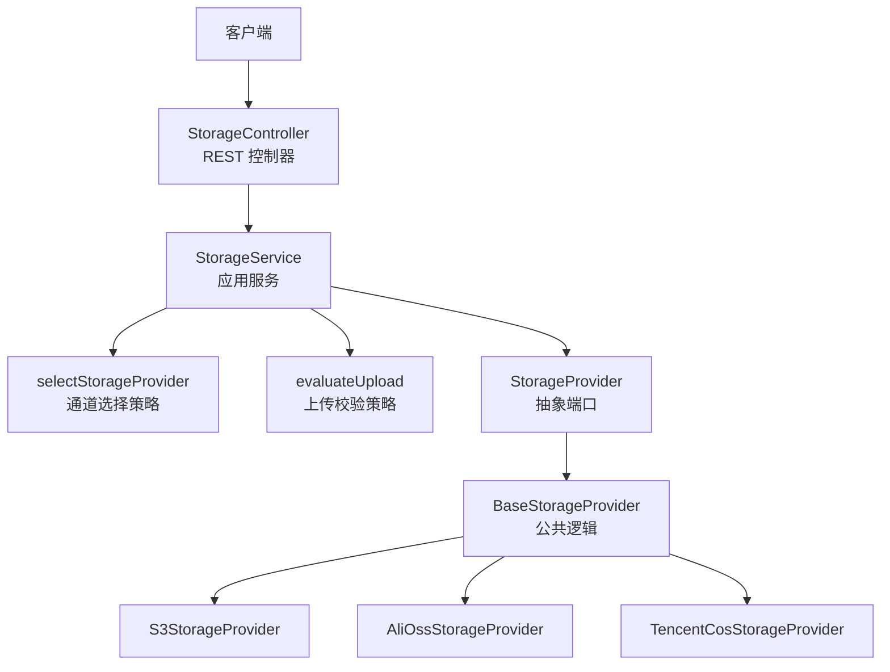
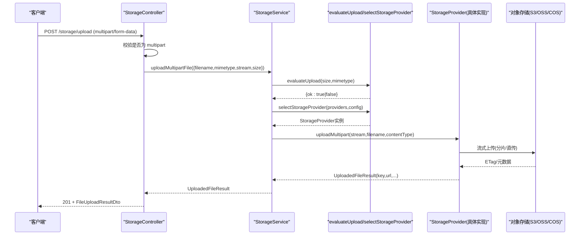
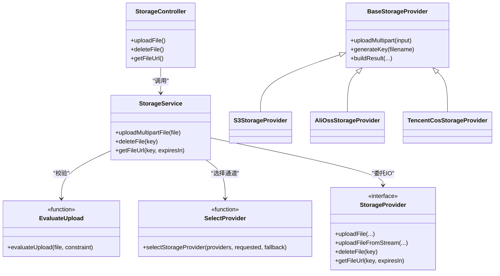

# 文件上传下载

<cite>
**本文引用的文件**   
- [storage.controller.ts](file://apps/api/src/modules/storage/api/storage.controller.ts)
- [storage.service.ts](file://apps/api/src/modules/storage/application/storage.service.ts)
- [upload.policy.ts](file://apps/api/src/modules/storage/domain/policies/upload.policy.ts)
- [provider-selection.policy.ts](file://apps/api/src/modules/storage/domain/policies/provider-selection.policy.ts)
- [base-storage.provider.ts](file://apps/api/src/modules/storage/infrastructure/base-storage.provider.ts)
- [s3-storage.provider.ts](file://apps/api/src/modules/storage/infrastructure/s3-storage.provider.ts)
- [alioss-storage.provider.ts](file://apps/api/src/modules/storage/infrastructure/alioss-storage.provider.ts)
- [tencentcos-storage.provider.ts](file://apps/api/src/modules/storage/infrastructure/tencentcos-storage.provider.ts)
- [storage-key.ts](file://apps/api/src/modules/storage/domain/value-objects/storage-key.ts)
- [file-upload.dto.ts](file://apps/api/src/modules/storage/api/dto/file-upload.dto.ts)
</cite>

## 目录
1. [简介](#简介)
2. [项目结构](#项目结构)
3. [核心组件](#核心组件)
4. [架构总览](#架构总览)
5. [详细组件分析](#详细组件分析)
6. [依赖关系分析](#依赖关系分析)
7. [性能与扩展性](#性能与扩展性)
8. [故障排查指南](#故障排查指南)
9. [结论](#结论)
10. [附录：API 契约与示例](#附录api-契约与示例)

## 简介
本文件面向“文件上传下载”能力，覆盖 RESTful API 接口设计、文件验证规则（大小限制、类型检查）、分片上传与断点续传机制说明、文件命名策略与路径生成算法、存储键值设计、请求响应示例、错误码定义与状态码说明，以及客户端集成建议与最佳实践。该功能基于 NestJS 模块组织，采用分层架构（API 层 → 应用服务层 → 领域策略层 → 基础设施提供者），并通过可插拔的对象存储适配器（S3、阿里云 OSS、腾讯云 COS）实现统一抽象。

## 项目结构
围绕 storage 模块的关键目录与职责如下：
- api：REST 控制器与 DTO/Response 定义，暴露上传、删除、签名 URL 等接口
- application：编排层 StorageService，负责校验、选择通道、委托 IO
- domain：纯函数策略（上传校验、通道选择）与值对象（存储键生成）
- infrastructure：具体对象存储实现（S3、AliOSS、TencentCOS）及公共基类

图表来源
- [storage.controller.ts:71-180](file://apps/api/src/modules/storage/api/storage.controller.ts#L71-L180)
- [storage.service.ts:18-99](file://apps/api/src/modules/storage/application/storage.service.ts#L18-L99)
- [provider-selection.policy.ts:14-20](file://apps/api/src/modules/storage/domain/policies/provider-selection.policy.ts#L14-L20)
- [upload.policy.ts:48-56](file://apps/api/src/modules/storage/domain/policies/upload.policy.ts#L48-L56)
- [base-storage.provider.ts:28-120](file://apps/api/src/modules/storage/infrastructure/base-storage.provider.ts#L28-L120)
- [s3-storage.provider.ts:20-151](file://apps/api/src/modules/storage/infrastructure/s3-storage.provider.ts#L20-L151)
- [alioss-storage.provider.ts:12-129](file://apps/api/src/modules/storage/infrastructure/alioss-storage.provider.ts#L12-L129)
- [tencentcos-storage.provider.ts:12-142](file://apps/api/src/modules/storage/infrastructure/tencentcos-storage.provider.ts#L12-L142)

章节来源
- [storage.controller.ts:71-180](file://apps/api/src/modules/storage/api/storage.controller.ts#L71-L180)
- [storage.service.ts:18-99](file://apps/api/src/modules/storage/application/storage.service.ts#L18-L99)

## 核心组件
- StorageController：对外暴露 REST 接口（multipart 上传、删除、签名 URL）。上传走 Fastify 原生 multipart 流；删除与签名 URL 通过 oRPC Impl 路由到 StorageService。
- StorageService：编排层，负责调用领域策略进行上传校验、选择存储通道、委托 Provider 执行 IO，并将异常归一为 HTTP 400 + 业务错误码。
- 领域策略：
  - evaluateUpload：纯函数校验文件大小与 MIME 白名单，返回裁决结果。
  - selectStorageProvider：根据配置选择 provider，未命中则回落到 s3。
- BaseStorageProvider：公共基础设施逻辑，包括临时文件落盘、流式上传、ETag 规范化、公开 URL 拼接、键生成（YYYY/MM/DD/<uuid><ext>）。
- 具体 Provider：S3StorageProvider、AliOssStorageProvider、TencentCosStorageProvider，分别对接不同云厂商 SDK，实现上传、删除、签名 URL 与默认公开 URL。

章节来源
- [storage.controller.ts:71-180](file://apps/api/src/modules/storage/api/storage.controller.ts#L71-L180)
- [storage.service.ts:18-99](file://apps/api/src/modules/storage/application/storage.service.ts#L18-L99)
- [upload.policy.ts:11-56](file://apps/api/src/modules/storage/domain/policies/upload.policy.ts#L11-L56)
- [provider-selection.policy.ts:14-20](file://apps/api/src/modules/storage/domain/policies/provider-selection.policy.ts#L14-L20)
- [base-storage.provider.ts:28-120](file://apps/api/src/modules/storage/infrastructure/base-storage.provider.ts#L28-L120)

## 架构总览
下图展示一次单文件上传的端到端流程：客户端以 multipart/form-data 提交，控制器解析原始流，服务层先做领域校验，再交由基础设施 Provider 完成流式上传并返回结果。

图表来源
- [storage.controller.ts:84-142](file://apps/api/src/modules/storage/api/storage.controller.ts#L84-L142)
- [storage.service.ts:43-79](file://apps/api/src/modules/storage/application/storage.service.ts#L43-L79)
- [upload.policy.ts:48-56](file://apps/api/src/modules/storage/domain/policies/upload.policy.ts#L48-L56)
- [provider-selection.policy.ts:14-20](file://apps/api/src/modules/storage/domain/policies/provider-selection.policy.ts#L14-L20)
- [base-storage.provider.ts:61-83](file://apps/api/src/modules/storage/infrastructure/base-storage.provider.ts#L61-L83)
- [s3-storage.provider.ts:73-102](file://apps/api/src/modules/storage/infrastructure/s3-storage.provider.ts#L73-L102)

## 详细组件分析

### 控制器层：StorageController
- 上传接口
  - 方法：POST /storage/upload
  - 内容类型：multipart/form-data
  - 入参：表单字段 file（二进制）
  - 行为：
    - 非 multipart 直接返回 400（错误码 STORAGE_NOT_MULTIPART）
    - 无文件返回 400（错误码 STORAGE_NO_FILE）
    - 调用 StorageService.uploadMultipartFile 并返回 FileUploadResultDto
    - 捕获非 HttpException 的未知异常，归一为 400（错误码 STORAGE_UPLOAD_FAILED）
- 删除接口
  - 方法：oRPC Impl（内部映射为 REST 风格）
  - 输入：key（对象唯一键）
  - 输出：{ success: boolean }
- 签名 URL 接口
  - 方法：oRPC Impl（内部映射为 REST 风格）
  - 输入：key、expiresIn（秒，可选）
  - 输出：{ url: string }

章节来源
- [storage.controller.ts:77-142](file://apps/api/src/modules/storage/api/storage.controller.ts#L77-L142)
- [storage.controller.ts:144-179](file://apps/api/src/modules/storage/api/storage.controller.ts#L144-L179)

### 应用服务层：StorageService
- 构造期：
  - 从配置读取 provider、maxFileSize、allowedMimeTypes、bucket、baseUrl 等
  - 使用 selectStorageProvider 选择具体 Provider（未注册时回落 s3）
- 上传流程：
  - 调用 evaluateUpload 校验 size 与 mimetype
  - 超限或类型不允许抛出 400（对应错误码 STORAGE_FILE_TOO_LARGE / STORAGE_FILE_TYPE_NOT_ALLOWED）
  - 调用 Provider.uploadMultipart 完成流式上传
  - 其他异常归一为 400（STORAGE_UPLOAD_FAILED）
- 删除与签名 URL：透传至 Provider

章节来源
- [storage.service.ts:18-34](file://apps/api/src/modules/storage/application/storage.service.ts#L18-L34)
- [storage.service.ts:43-79](file://apps/api/src/modules/storage/application/storage.service.ts#L43-L79)
- [storage.service.ts:86-98](file://apps/api/src/modules/storage/application/storage.service.ts#L86-L98)

### 领域策略层
- 上传校验策略 evaluateUpload
  - 判定顺序：先尺寸、后类型
  - 返回 result-union：通过或拒因（too-large / type-not-allowed）
- 通道选择策略 selectStorageProvider
  - 优先使用配置的 provider id
  - 未命中则回落到 s3（始终注册，保证可用）

章节来源
- [upload.policy.ts:11-56](file://apps/api/src/modules/storage/domain/policies/upload.policy.ts#L11-L56)
- [provider-selection.policy.ts:14-20](file://apps/api/src/modules/storage/domain/policies/provider-selection.policy.ts#L14-L20)

### 基础设施层：BaseStorageProvider 与具体实现
- BaseStorageProvider
  - 公共逻辑：
    - uploadMultipart：写入临时文件 → 流式上传 → 清理临时文件
    - generateKey：YYYY/MM/DD/<uuid><ext>（由 buildStorageKey 实现）
    - getPublicUrl：优先 baseUrl，否则使用各 Provider 默认公开 URL
    - normalizeEtag：去除云厂商包裹的引号
    - buildResult：组装 key/url/etag/size/mimetype/originalname
- S3StorageProvider
  - 上传：Buffer 直传；Stream 使用 @aws-sdk/lib-storage Upload（内部分片）
  - 删除：DeleteObjectCommand
  - 签名 URL：getSignedUrl（默认有效期 3600 秒）
  - 默认公开 URL：https://{bucket}.s3.{region}.amazonaws.com/{key}
- AliOssStorageProvider
  - 上传：put（Buffer）/ putStream（Stream）
  - 删除：delete
  - 签名 URL：signatureUrl（默认有效期 3600 秒）
  - 默认公开 URL：https://{bucket}.{endpoint}/{key}
- TencentCosStorageProvider
  - 上传：putObject（回调封装 Promise）
  - 删除：deleteObject
  - 签名 URL：getObjectUrl（Sign=true，默认有效期 3600 秒）
  - 默认公开 URL：https://{bucket}.cos.{region}.myqcloud.com/{key}

章节来源
- [base-storage.provider.ts:28-120](file://apps/api/src/modules/storage/infrastructure/base-storage.provider.ts#L28-L120)
- [s3-storage.provider.ts:47-151](file://apps/api/src/modules/storage/infrastructure/s3-storage.provider.ts#L47-L151)
- [alioss-storage.provider.ts:29-129](file://apps/api/src/modules/storage/infrastructure/alioss-storage.provider.ts#L29-L129)
- [tencentcos-storage.provider.ts:29-142](file://apps/api/src/modules/storage/infrastructure/tencentcos-storage.provider.ts#L29-L142)

### 存储键值与命名策略
- 命名规则：YYYY/MM/DD/<uuid><ext>
- 实现位置：buildStorageKey（domain 值对象），BaseStorageProvider.generateKey 注入时间与 uuid
- 优点：按日期分桶、UUID 去重、保留原扩展名便于浏览器识别

章节来源
- [storage-key.ts:14-23](file://apps/api/src/modules/storage/domain/value-objects/storage-key.ts#L14-L23)
- [base-storage.provider.ts:112-115](file://apps/api/src/modules/storage/infrastructure/base-storage.provider.ts#L112-L115)

## 依赖关系分析
- 控制器依赖 StorageService
- 服务依赖领域策略（evaluateUpload、selectStorageProvider）与 StorageProvider 端口
- 基础设施层继承 BaseStorageProvider，实现具体 SDK 调用
- 键生成策略独立于基础设施，确保多通道一致

图表来源
- [storage.controller.ts:71-180](file://apps/api/src/modules/storage/api/storage.controller.ts#L71-L180)
- [storage.service.ts:18-99](file://apps/api/src/modules/storage/application/storage.service.ts#L18-L99)
- [upload.policy.ts:48-56](file://apps/api/src/modules/storage/domain/policies/upload.policy.ts#L48-L56)
- [provider-selection.policy.ts:14-20](file://apps/api/src/modules/storage/domain/policies/provider-selection.policy.ts#L14-L20)
- [base-storage.provider.ts:28-120](file://apps/api/src/modules/storage/infrastructure/base-storage.provider.ts#L28-L120)
- [s3-storage.provider.ts:20-151](file://apps/api/src/modules/storage/infrastructure/s3-storage.provider.ts#L20-L151)
- [alioss-storage.provider.ts:12-129](file://apps/api/src/modules/storage/infrastructure/alioss-storage.provider.ts#L12-L129)
- [tencentcos-storage.provider.ts:12-142](file://apps/api/src/modules/storage/infrastructure/tencentcos-storage.provider.ts#L12-L142)

## 性能与扩展性
- 流式上传与分片
  - S3：使用 @aws-sdk/lib-storage Upload，自动分片处理大文件
  - AliOSS/TencentCOS：SDK 提供流式上传接口，避免内存峰值
- 临时文件
  - BaseStorageProvider.uploadMultipart 将 multipart 流写入 tmp 目录后再流式上传，完成后清理
- 可扩展性
  - 新增 Provider：继承 BaseStorageProvider，实现抽象方法即可
  - 新增校验规则：在 evaluateUpload 中扩展拒绝原因与判定逻辑
  - 通道选择：selectStorageProvider 支持自定义 fallbackKey

章节来源
- [s3-storage.provider.ts:73-102](file://apps/api/src/modules/storage/infrastructure/s3-storage.provider.ts#L73-L102)
- [base-storage.provider.ts:61-83](file://apps/api/src/modules/storage/infrastructure/base-storage.provider.ts#L61-L83)
- [upload.policy.ts:48-56](file://apps/api/src/modules/storage/domain/policies/upload.policy.ts#L48-L56)
- [provider-selection.policy.ts:14-20](file://apps/api/src/modules/storage/domain/policies/provider-selection.policy.ts#L14-L20)

## 故障排查指南
- 常见错误码与含义
  - STORAGE_NOT_MULTIPART：请求不是 multipart/form-data
  - STORAGE_NO_FILE：未检测到文件字段
  - STORAGE_FILE_TOO_LARGE：文件大小超过配置上限
  - STORAGE_FILE_TYPE_NOT_ALLOWED：MIME 类型不在白名单
  - STORAGE_UPLOAD_FAILED：上传失败（网络/权限/SDK 异常等）
- 定位步骤
  - 确认 Content-Type 为 multipart/form-data，且包含 file 字段
  - 检查服务端日志中的 ERROR_CODES 与异常堆栈
  - 核对配置项：maxFileSize、allowedMimeTypes、provider、bucket、region、endpoint、accessKeyId/Secret
  - 若使用私有桶，确认签名 URL 是否过期（expiresIn）
- 恢复建议
  - 调整 maxFileSize 或 allowedMimeTypes 以适配业务需求
  - 检查云厂商凭证与网络连通性
  - 对大文件启用分片上传（S3 已自动处理；AliOSS/COS 使用流式上传）

章节来源
- [storage.controller.ts:103-142](file://apps/api/src/modules/storage/api/storage.controller.ts#L103-L142)
- [storage.service.ts:50-79](file://apps/api/src/modules/storage/application/storage.service.ts#L50-L79)

## 结论
该文件上传下载方案通过分层架构与可插拔 Provider 实现了跨云厂商的统一能力，具备清晰的校验策略、健壮的异常归一化、流式与大文件分片上传支持，并提供签名 URL 访问能力。建议在客户端侧做好重试、进度反馈与错误提示，并在服务端侧持续优化校验规则与 Provider 实现以满足不同场景的性能与稳定性要求。

## 附录：API 契约与示例

### REST 接口定义
- 上传文件
  - 方法：POST
  - 路径：/storage/upload
  - 内容类型：multipart/form-data
  - 请求体：表单字段 file（二进制）
  - 成功响应：201，Body 为 FileUploadResultDto
  - 失败响应：400，携带 errorCode（见下节）
- 删除文件
  - 方法：DELETE（或内部 oRPC Impl 映射）
  - 路径：/storage/files/:key
  - 成功响应：200，{ success: true }
  - 失败响应：400/5xx（视 Provider 异常）
- 获取签名 URL
  - 方法：GET（或内部 oRPC Impl 映射）
  - 路径：/storage/files/:key/url?expiresIn=秒数
  - 成功响应：200，{ url: string }

章节来源
- [storage.controller.ts:84-142](file://apps/api/src/modules/storage/api/storage.controller.ts#L84-L142)
- [storage.controller.ts:149-179](file://apps/api/src/modules/storage/api/storage.controller.ts#L149-L179)

### 响应模型：FileUploadResultDto
- 字段
  - key：对象存储键
  - url：文件访问 URL（公开或签名）
  - etag：内容标识（可能为空）
  - size：字节大小（流式上传可能为 -1）
  - mimetype：MIME 类型
  - originalname：原始文件名

章节来源
- [file-upload.dto.ts:9-33](file://apps/api/src/modules/storage/api/dto/file-upload.dto.ts#L9-L33)

### 错误码定义
- STORAGE_NOT_MULTIPART：请求非 multipart
- STORAGE_NO_FILE：未上传文件
- STORAGE_FILE_TOO_LARGE：超出最大文件大小
- STORAGE_FILE_TYPE_NOT_ALLOWED：MIME 类型不被允许
- STORAGE_UPLOAD_FAILED：上传失败（通用）

章节来源
- [storage.controller.ts:103-142](file://apps/api/src/modules/storage/api/storage.controller.ts#L103-L142)
- [storage.service.ts:50-79](file://apps/api/src/modules/storage/application/storage.service.ts#L50-L79)

### 状态码说明
- 201：上传成功
- 200：删除/查询成功
- 400：参数/校验失败或上传失败
- 5xx：服务器或下游存储异常

章节来源
- [storage.controller.ts:100-142](file://apps/api/src/modules/storage/api/storage.controller.ts#L100-L142)

### 客户端集成示例与最佳实践
- 上传
  - 使用 FormData 发送 file 字段，Content-Type 设为 multipart/form-data
  - 显示上传进度（如浏览器支持）
  - 处理 400 错误码并提示用户（超限/类型不允许）
- 下载
  - 使用 GET 获取签名 URL，注意 expiresIn 设置合理有效期
  - 对私有桶务必使用签名 URL，避免直接暴露 key
- 删除
  - 谨慎操作，建议二次确认
  - 记录审计日志
- 大文件
  - 前端分片上传（如需）：结合后端分片接口（当前实现由 Provider 内部处理分片）
  - 断点续传：可在上层引入会话 ID 与分片索引，配合 Provider 的分片能力（需扩展）
- 安全
  - 校验 MIME 与扩展名一致性
  - 限制 maxFileSize 与 allowedMimeTypes
  - 使用签名 URL 控制访问时效

[本节为概念性指导，不直接分析具体源码文件]