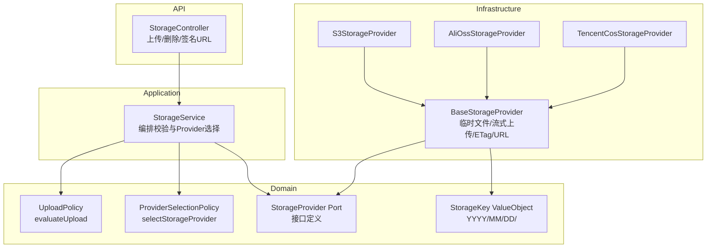
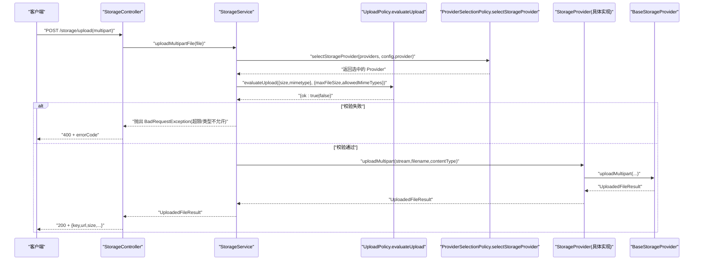
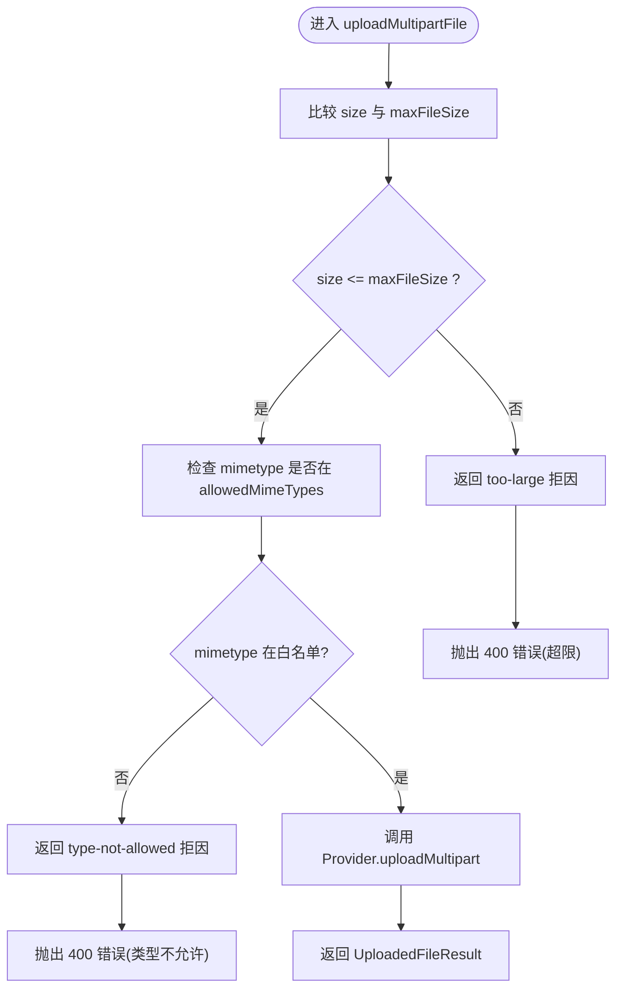
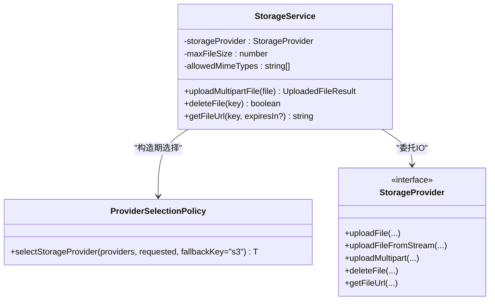
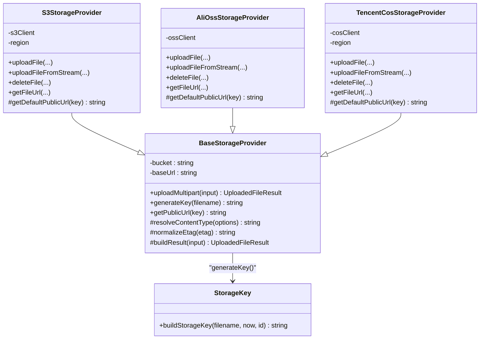
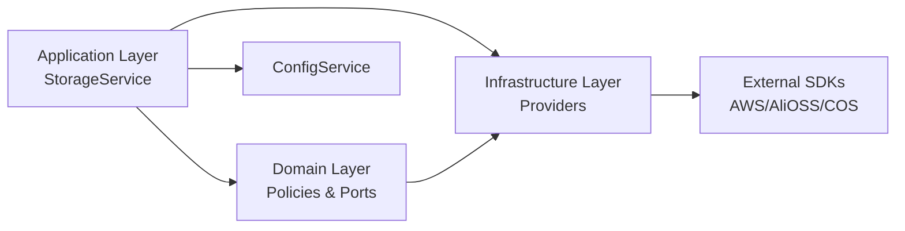

# 访问控制与安全

<cite>
**本文引用的文件**   
- [apps/api/src/modules/storage/application/storage.service.ts](file://apps/api/src/modules/storage/application/storage.service.ts)
- [apps/api/src/modules/storage/domain/policies/upload.policy.ts](file://apps/api/src/modules/storage/domain/policies/upload.policy.ts)
- [apps/api/src/modules/storage/domain/policies/provider-selection.policy.ts](file://apps/api/src/modules/storage/domain/policies/provider-selection.policy.ts)
- [apps/api/src/modules/storage/domain/ports/storage-provider.port.ts](file://apps/api/src/modules/storage/domain/ports/storage-provider.port.ts)
- [apps/api/src/modules/storage/domain/value-objects/storage-key.ts](file://apps/api/src/modules/storage/domain/value-objects/storage-key.ts)
- [apps/api/src/modules/storage/infrastructure/base-storage.provider.ts](file://apps/api/src/modules/storage/infrastructure/base-storage.provider.ts)
- [apps/api/src/modules/storage/infrastructure/s3-storage.provider.ts](file://apps/api/src/modules/storage/infrastructure/s3-storage.provider.ts)
- [apps/api/src/modules/storage/infrastructure/alioss-storage.provider.ts](file://apps/api/src/modules/storage/infrastructure/alioss-storage.provider.ts)
- [apps/api/src/modules/storage/infrastructure/tencentcos-storage.provider.ts](file://apps/api/src/modules/storage/infrastructure/tencentcos-storage.provider.ts)
- [apps/api/src/config/config.service.ts](file://apps/api/src/config/config.service.ts)
- [libs/core/src/shared-kernel/audit/audit-log.store.ts](file://libs/core/src/shared-kernel/audit/audit-log.store.ts)
- [libs/core/src/platform/platform-audit.service.ts](file://libs/core/src/platform/platform-audit.service.ts)
</cite>

## 目录
1. [引言](#引言)
2. [项目结构](#项目结构)
3. [核心组件](#核心组件)
4. [架构总览](#架构总览)
5. [详细组件分析](#详细组件分析)
6. [依赖关系分析](#依赖关系分析)
7. [性能与可扩展性](#性能与可扩展性)
8. [故障排查指南](#故障排查指南)
9. [安全最佳实践与威胁防护](#安全最佳实践与威胁防护)
10. [结论](#结论)

## 引言
本文聚焦本仓库中“访问控制与安全”相关实现，围绕以下目标展开：
- 文件访问权限控制策略：私有对象、公共对象的访问方式与 URL 生成机制。
- 上传策略验证：文件大小限制、MIME 类型白名单校验顺序与错误语义。
- Provider 选择策略：根据配置动态选择存储提供商，并具备回退能力。
- 安全配置管理：密钥与敏感配置的读取入口、最小化暴露面。
- 访问日志与审计：结构化日志与持久化审计账本的使用边界。
- 安全最佳实践与常见威胁防护建议。

## 项目结构
存储模块采用清晰的领域驱动分层：
- API 层：对外暴露上传、删除、签名 URL 等接口。
- Application 层：编排上传校验、Provider 选择、异常映射。
- Domain 层：纯函数策略（上传校验、Provider 选择）、端口定义、值对象（Key 命名规则）。
- Infrastructure 层：S3、阿里云 OSS、腾讯云 COS 的具体实现，以及共享基础设施基类。

**图表来源**
- [apps/api/src/modules/storage/application/storage.service.ts:1-100](file://apps/api/src/modules/storage/application/storage.service.ts#L1-L100)
- [apps/api/src/modules/storage/domain/policies/upload.policy.ts:1-56](file://apps/api/src/modules/storage/domain/policies/upload.policy.ts#L1-L56)
- [apps/api/src/modules/storage/domain/policies/provider-selection.policy.ts:1-21](file://apps/api/src/modules/storage/domain/policies/provider-selection.policy.ts#L1-L21)
- [apps/api/src/modules/storage/domain/ports/storage-provider.port.ts:1-101](file://apps/api/src/modules/storage/domain/ports/storage-provider.port.ts#L1-L101)
- [apps/api/src/modules/storage/domain/value-objects/storage-key.ts:1-24](file://apps/api/src/modules/storage/domain/value-objects/storage-key.ts#L1-L24)
- [apps/api/src/modules/storage/infrastructure/base-storage.provider.ts:1-121](file://apps/api/src/modules/storage/infrastructure/base-storage.provider.ts#L1-L121)
- [apps/api/src/modules/storage/infrastructure/s3-storage.provider.ts:1-151](file://apps/api/src/modules/storage/infrastructure/s3-storage.provider.ts#L1-L151)
- [apps/api/src/modules/storage/infrastructure/alioss-storage.provider.ts:1-129](file://apps/api/src/modules/storage/infrastructure/alioss-storage.provider.ts#L1-L129)
- [apps/api/src/modules/storage/infrastructure/tencentcos-storage.provider.ts:1-142](file://apps/api/src/modules/storage/infrastructure/tencentcos-storage.provider.ts#L1-L142)

**章节来源**
- [apps/api/src/modules/storage/application/storage.service.ts:1-100](file://apps/api/src/modules/storage/application/storage.service.ts#L1-L100)
- [apps/api/src/modules/storage/domain/policies/upload.policy.ts:1-56](file://apps/api/src/modules/storage/domain/policies/upload.policy.ts#L1-L56)
- [apps/api/src/modules/storage/domain/policies/provider-selection.policy.ts:1-21](file://apps/api/src/modules/storage/domain/policies/provider-selection.policy.ts#L1-L21)
- [apps/api/src/modules/storage/domain/ports/storage-provider.port.ts:1-101](file://apps/api/src/modules/storage/domain/ports/storage-provider.port.ts#L1-L101)
- [apps/api/src/modules/storage/domain/value-objects/storage-key.ts:1-24](file://apps/api/src/modules/storage/domain/value-objects/storage-key.ts#L1-L24)
- [apps/api/src/modules/storage/infrastructure/base-storage.provider.ts:1-121](file://apps/api/src/modules/storage/infrastructure/base-storage.provider.ts#L1-L121)
- [apps/api/src/modules/storage/infrastructure/s3-storage.provider.ts:1-151](file://apps/api/src/modules/storage/infrastructure/s3-storage.provider.ts#L1-L151)
- [apps/api/src/modules/storage/infrastructure/alioss-storage.provider.ts:1-129](file://apps/api/src/modules/storage/infrastructure/alioss-storage.provider.ts#L1-L129)
- [apps/api/src/modules/storage/infrastructure/tencentcos-storage.provider.ts:1-142](file://apps/api/src/modules/storage/infrastructure/tencentcos-storage.provider.ts#L1-L142)

## 核心组件
- StorageService：应用门面，负责从配置加载上传约束、选择 Provider、执行上传校验、委托底层 Provider 完成 IO。
- UploadPolicy：上传校验纯函数，先检查文件大小，再检查 MIME 白名单，返回裁决结果。
- ProviderSelectionPolicy：Provider 选择纯函数，优先使用配置指定的 Provider，未注册时回退到 s3。
- StorageProvider Port：定义上传、删除、签名 URL 等出站接口。
- BaseStorageProvider：共享基础设施，处理临时文件落盘、流式上传、ETag 归一化、默认公开 URL 拼接。
- S3/AliOSS/TencentCOS Providers：具体云厂商实现，提供上传、删除、签名 URL 能力。
- ConfigService：统一配置读取入口，包含 storage 配置项。

**章节来源**
- [apps/api/src/modules/storage/application/storage.service.ts:1-100](file://apps/api/src/modules/storage/application/storage.service.ts#L1-L100)
- [apps/api/src/modules/storage/domain/policies/upload.policy.ts:1-56](file://apps/api/src/modules/storage/domain/policies/upload.policy.ts#L1-L56)
- [apps/api/src/modules/storage/domain/policies/provider-selection.policy.ts:1-21](file://apps/api/src/modules/storage/domain/policies/provider-selection.policy.ts#L1-L21)
- [apps/api/src/modules/storage/domain/ports/storage-provider.port.ts:1-101](file://apps/api/src/modules/storage/domain/ports/storage-provider.port.ts#L1-L101)
- [apps/api/src/modules/storage/infrastructure/base-storage.provider.ts:1-121](file://apps/api/src/modules/storage/infrastructure/base-storage.provider.ts#L1-L121)
- [apps/api/src/config/config.service.ts:1-72](file://apps/api/src/config/config.service.ts#L1-L72)

## 架构总览
下图展示一次 multipart 上传请求的完整调用链，包括策略校验、Provider 选择、基础设施 IO 与最终结果返回。

**图表来源**
- [apps/api/src/modules/storage/application/storage.service.ts:43-79](file://apps/api/src/modules/storage/application/storage.service.ts#L43-L79)
- [apps/api/src/modules/storage/domain/policies/upload.policy.ts:48-56](file://apps/api/src/modules/storage/domain/policies/upload.policy.ts#L48-L56)
- [apps/api/src/modules/storage/domain/policies/provider-selection.policy.ts:14-20](file://apps/api/src/modules/storage/domain/policies/provider-selection.policy.ts#L14-L20)
- [apps/api/src/modules/storage/infrastructure/base-storage.provider.ts:61-83](file://apps/api/src/modules/storage/infrastructure/base-storage.provider.ts#L61-L83)

## 详细组件分析

### 上传策略与访问控制
- 文件大小限制：由 `UploadConstraint.maxFileSize` 决定；超过即拒绝。
- MIME 类型白名单：由 `UploadConstraint.allowedMimeTypes` 决定；不在白名单即拒绝。
- 判定顺序：先尺寸后类型；两者皆违规时优先报告尺寸超限。
- HTTP 语义：校验失败在触 IO 前抛出 `BadRequestException`，携带明确错误码。
- 访问控制：
  - 对象 ACL：S3 默认 `private`；AliOSS 默认 `private`；COS 通过签名 URL 访问私有对象。
  - 公开访问：若配置了 `baseUrl`，则公开 URL 以该 base 拼接 key；否则各 Provider 提供默认公开 URL 格式。
  - 签名 URL：所有 Provider 均支持按有效期生成签名 URL，用于私有对象的安全访问。

**图表来源**
- [apps/api/src/modules/storage/application/storage.service.ts:43-79](file://apps/api/src/modules/storage/application/storage.service.ts#L43-L79)
- [apps/api/src/modules/storage/domain/policies/upload.policy.ts:48-56](file://apps/api/src/modules/storage/domain/policies/upload.policy.ts#L48-L56)

**章节来源**
- [apps/api/src/modules/storage/domain/policies/upload.policy.ts:1-56](file://apps/api/src/modules/storage/domain/policies/upload.policy.ts#L1-L56)
- [apps/api/src/modules/storage/application/storage.service.ts:43-79](file://apps/api/src/modules/storage/application/storage.service.ts#L43-L79)
- [apps/api/src/modules/storage/infrastructure/s3-storage.provider.ts:135-149](file://apps/api/src/modules/storage/infrastructure/s3-storage.provider.ts#L135-L149)
- [apps/api/src/modules/storage/infrastructure/alioss-storage.provider.ts:109-122](file://apps/api/src/modules/storage/infrastructure/alioss-storage.provider.ts#L109-L122)
- [apps/api/src/modules/storage/infrastructure/tencentcos-storage.provider.ts:71-96](file://apps/api/src/modules/storage/infrastructure/tencentcos-storage.provider.ts#L71-L96)
- [apps/api/src/modules/storage/infrastructure/base-storage.provider.ts:117-119](file://apps/api/src/modules/storage/infrastructure/base-storage.provider.ts#L117-L119)

### Provider 选择策略
- 策略逻辑：优先使用配置指定的 provider id；若未注册，则回退到 s3。
- 可测试性：选择逻辑为纯函数，便于单测覆盖命中与回退路径。
- 扩展性：新增 Provider 只需注册到 DI 容器，并通过配置切换。

**图表来源**
- [apps/api/src/modules/storage/domain/policies/provider-selection.policy.ts:14-20](file://apps/api/src/modules/storage/domain/policies/provider-selection.policy.ts#L14-L20)
- [apps/api/src/modules/storage/application/storage.service.ts:23-34](file://apps/api/src/modules/storage/application/storage.service.ts#L23-L34)
- [apps/api/src/modules/storage/domain/ports/storage-provider.port.ts:44-100](file://apps/api/src/modules/storage/domain/ports/storage-provider.port.ts#L44-L100)

**章节来源**
- [apps/api/src/modules/storage/domain/policies/provider-selection.policy.ts:1-21](file://apps/api/src/modules/storage/domain/policies/provider-selection.policy.ts#L1-L21)
- [apps/api/src/modules/storage/application/storage.service.ts:23-34](file://apps/api/src/modules/storage/application/storage.service.ts#L23-L34)

### 基础设施与对象键命名
- 临时文件与流式上传：BaseStorageProvider 将 multipart 流写入临时文件，再流式上传至云存储，并在 finally 中清理临时文件。
- ETag 归一化：去除云厂商 SDK 返回的引号包裹，保证一致性。
- 公开 URL 拼接：若配置 baseUrl，则以 `${baseUrl}/${key}` 形式返回；否则由各 Provider 提供默认公开 URL。
- 对象键命名：统一采用 `YYYY/MM/DD/<uuid><ext>`，避免文件名冲突且利于分片归档。

**图表来源**
- [apps/api/src/modules/storage/infrastructure/base-storage.provider.ts:28-121](file://apps/api/src/modules/storage/infrastructure/base-storage.provider.ts#L28-L121)
- [apps/api/src/modules/storage/infrastructure/s3-storage.provider.ts:20-151](file://apps/api/src/modules/storage/infrastructure/s3-storage.provider.ts#L20-L151)
- [apps/api/src/modules/storage/infrastructure/alioss-storage.provider.ts:12-129](file://apps/api/src/modules/storage/infrastructure/alioss-storage.provider.ts#L12-L129)
- [apps/api/src/modules/storage/infrastructure/tencentcos-storage.provider.ts:12-142](file://apps/api/src/modules/storage/infrastructure/tencentcos-storage.provider.ts#L12-L142)
- [apps/api/src/modules/storage/domain/value-objects/storage-key.ts:14-23](file://apps/api/src/modules/storage/domain/value-objects/storage-key.ts#L14-L23)

**章节来源**
- [apps/api/src/modules/storage/infrastructure/base-storage.provider.ts:57-119](file://apps/api/src/modules/storage/infrastructure/base-storage.provider.ts#L57-L119)
- [apps/api/src/modules/storage/domain/value-objects/storage-key.ts:1-24](file://apps/api/src/modules/storage/domain/value-objects/storage-key.ts#L1-L24)

### 安全配置管理与密钥处理
- 配置入口：ConfigService.getStorageConfig() 统一读取 storage 配置，包含 region、accessKeyId、accessKeySecret、endpoint、bucket、baseUrl、provider、maxFileSize、allowedMimeTypes 等。
- 敏感信息：Provider 构造时直接注入 accessKeyId/accessKeySecret，不应在日志或响应中输出。
- 端点与路径样式：S3 兼容服务可通过 endpoint 与 forcePathStyle 启用路径风格访问。
- 公开 URL 与签名 URL：
  - 公开 URL：当 baseUrl 存在时使用自定义域名；否则使用各 Provider 默认域名。
  - 签名 URL：S3 使用 presigner，AliOSS 使用 signatureUrl，COS 使用 getObjectUrl(Sign=true)。

**章节来源**
- [apps/api/src/config/config.service.ts:31-33](file://apps/api/src/config/config.service.ts#L31-L33)
- [apps/api/src/modules/storage/infrastructure/s3-storage.provider.ts:25-45](file://apps/api/src/modules/storage/infrastructure/s3-storage.provider.ts#L25-L45)
- [apps/api/src/modules/storage/infrastructure/alioss-storage.provider.ts:16-27](file://apps/api/src/modules/storage/infrastructure/alioss-storage.provider.ts#L16-L27)
- [apps/api/src/modules/storage/infrastructure/tencentcos-storage.provider.ts:17-27](file://apps/api/src/modules/storage/infrastructure/tencentcos-storage.provider.ts#L17-L27)
- [apps/api/src/modules/storage/infrastructure/s3-storage.provider.ts:118-129](file://apps/api/src/modules/storage/infrastructure/s3-storage.provider.ts#L118-L129)
- [apps/api/src/modules/storage/infrastructure/alioss-storage.provider.ts:90-101](file://apps/api/src/modules/storage/infrastructure/alioss-storage.provider.ts#L90-L101)
- [apps/api/src/modules/storage/infrastructure/tencentcos-storage.provider.ts:71-96](file://apps/api/src/modules/storage/infrastructure/tencentcos-storage.provider.ts#L71-L96)

### 访问日志与审计
- 结构化日志：平台治理审计单点 PlatformAuditService 同时输出 pino 结构化日志与持久化 audit_log 表，仅记录操作者与被治理实体标识，遵循 PII 最小化原则。
- 审计出口：所有 approve/reject/suspend/resume/delete/hard_delete 等治理动作经此单点，禁止 handler 散点手搓 logger.info。
- 存储侧日志：StorageController 对删除与签名 URL 获取进行基础日志记录，便于问题定位。

**章节来源**
- [libs/core/src/platform/platform-audit.service.ts:49-70](file://libs/core/src/platform/platform-audit.service.ts#L49-L70)
- [libs/core/src/shared-kernel/audit/audit-log.store.ts:1-26](file://libs/core/src/shared-kernel/audit/audit-log.store.ts#L1-L26)
- [apps/api/src/modules/storage/api/storage.controller.ts:144-180](file://apps/api/src/modules/storage/api/storage.controller.ts#L144-L180)

## 依赖关系分析
- 低耦合：Domain 层不依赖框架与基础设施，仅定义策略与端口；Application 层编排策略与端口；Infrastructure 层实现具体 SDK。
- 外部依赖：AWS SDK、AliOSS SDK、COS SDK 仅在 Infrastructure 层引入，降低业务层耦合。
- 配置依赖：所有 Provider 与 Service 通过 ConfigService 获取配置，避免硬编码。

**图表来源**
- [apps/api/src/modules/storage/application/storage.service.ts:1-100](file://apps/api/src/modules/storage/application/storage.service.ts#L1-L100)
- [apps/api/src/modules/storage/domain/policies/upload.policy.ts:1-56](file://apps/api/src/modules/storage/domain/policies/upload.policy.ts#L1-L56)
- [apps/api/src/modules/storage/domain/ports/storage-provider.port.ts:1-101](file://apps/api/src/modules/storage/domain/ports/storage-provider.port.ts#L1-L101)
- [apps/api/src/modules/storage/infrastructure/s3-storage.provider.ts:1-151](file://apps/api/src/modules/storage/infrastructure/s3-storage.provider.ts#L1-L151)
- [apps/api/src/modules/storage/infrastructure/alioss-storage.provider.ts:1-129](file://apps/api/src/modules/storage/infrastructure/alioss-storage.provider.ts#L1-L129)
- [apps/api/src/modules/storage/infrastructure/tencentcos-storage.provider.ts:1-142](file://apps/api/src/modules/storage/infrastructure/tencentcos-storage.provider.ts#L1-L142)
- [apps/api/src/config/config.service.ts:1-72](file://apps/api/src/config/config.service.ts#L1-L72)

**章节来源**
- [apps/api/src/modules/storage/application/storage.service.ts:1-100](file://apps/api/src/modules/storage/application/storage.service.ts#L1-L100)
- [apps/api/src/modules/storage/domain/policies/upload.policy.ts:1-56](file://apps/api/src/modules/storage/domain/policies/upload.policy.ts#L1-L56)
- [apps/api/src/modules/storage/domain/ports/storage-provider.port.ts:1-101](file://apps/api/src/modules/storage/domain/ports/storage-provider.port.ts#L1-L101)
- [apps/api/src/modules/storage/infrastructure/base-storage.provider.ts:1-121](file://apps/api/src/modules/storage/infrastructure/base-storage.provider.ts#L1-L121)
- [apps/api/src/config/config.service.ts:1-72](file://apps/api/src/config/config.service.ts#L1-L72)

## 性能与可扩展性
- 流式上传：BaseStorageProvider 与 S3/AliOSS/COS 均支持流式上传，减少内存占用，适合大文件。
- 临时文件清理：finally 块确保临时文件被删除，避免磁盘泄漏。
- 可扩展 Provider：新增 Provider 仅需实现 StorageProvider 接口，并在 DI 容器中注册，即可通过配置切换。
- 策略可测：UploadPolicy 与 ProviderSelectionPolicy 为纯函数，易于单测与回归保护。

[本节为通用指导，无需特定文件引用]

## 故障排查指南
- 上传失败（400）：
  - 检查文件大小是否超过 maxFileSize。
  - 检查 MIME 类型是否在 allowedMimeTypes 白名单。
  - 确认 multipart 请求是否正确解析。
- Provider 选择异常：
  - 确认配置中的 provider id 已注册到 DI 容器。
  - 若未注册，将回退到 s3；检查 s3 配置是否有效。
- 签名 URL 不可用：
  - 检查 Provider 的签名 URL 实现（S3 presigner、AliOSS signatureUrl、COS getObjectUrl）。
  - 确认 bucket、region、endpoint 配置正确。
- 公开 URL 访问失败：
  - 若使用 baseUrl，检查域名与 CORS 设置。
  - 若使用默认公开 URL，检查对象 ACL 是否为 public 或允许匿名访问。

**章节来源**
- [apps/api/src/modules/storage/application/storage.service.ts:43-79](file://apps/api/src/modules/storage/application/storage.service.ts#L43-L79)
- [apps/api/src/modules/storage/domain/policies/provider-selection.policy.ts:14-20](file://apps/api/src/modules/storage/domain/policies/provider-selection.policy.ts#L14-L20)
- [apps/api/src/modules/storage/infrastructure/s3-storage.provider.ts:118-129](file://apps/api/src/modules/storage/infrastructure/s3-storage.provider.ts#L118-L129)
- [apps/api/src/modules/storage/infrastructure/alioss-storage.provider.ts:90-101](file://apps/api/src/modules/storage/infrastructure/alioss-storage.provider.ts#L90-L101)
- [apps/api/src/modules/storage/infrastructure/tencentcos-storage.provider.ts:71-96](file://apps/api/src/modules/storage/infrastructure/tencentcos-storage.provider.ts#L71-L96)

## 安全最佳实践与威胁防护
- 上传策略
  - 始终启用文件大小限制与 MIME 白名单，拒绝可执行文件与脚本类型。
  - 在应用层校验之外，建议在网关/CDN 层再次校验 Content-Type 与大小。
- 访问控制
  - 默认对象 ACL 设为 private，通过签名 URL 访问；避免开放匿名写权限。
  - 对公开资源使用独立域名与严格 CORS 策略。
- 密钥管理
  - 使用环境变量或密钥管理服务注入 accessKeyId/accessKeySecret，禁止硬编码。
  - 最小化日志输出，避免泄露敏感字段。
- 审计与合规
  - 关键治理操作经 PlatformAuditService 输出结构化日志与持久化审计账本。
  - 遵循 PII 最小化原则，审计条目仅含标识符，不含邮箱等个人数据。
- 常见威胁防护
  - 防止超大文件攻击：结合网关限流与后端大小限制。
  - 防止恶意文件上传：严格 MIME 白名单 + 内容检测（如病毒扫描）。
  - 防止越权访问：签名 URL 短期有效 + 服务端鉴权后再签发。
  - 防止配置泄露：集中配置管理 + 最小权限原则。

[本节为通用指导，无需特定文件引用]

## 结论
本仓库在存储模块中实现了清晰的分层架构与安全的访问控制机制：
- 通过 UploadPolicy 与 ProviderSelectionPolicy 将核心策略下沉至 Domain 层，提升可测性与可维护性。
- 通过 BaseStorageProvider 抽象出跨云厂商的共享逻辑，简化具体实现。
- 通过签名 URL 与默认 private ACL 保障私有对象安全访问。
- 通过 ConfigService 统一管理配置，结合审计日志与持久化审计账本满足合规要求。
建议在生产环境中进一步结合网关层校验、内容检测与密钥管理服务，构建纵深防御体系。

[本节为总结性内容，无需特定文件引用]