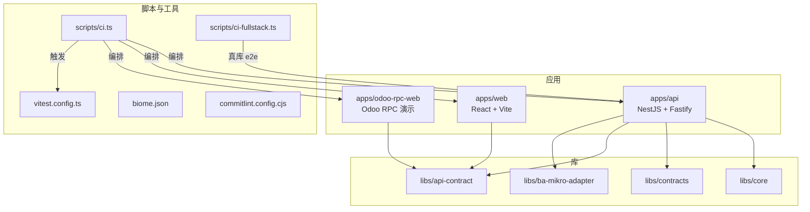
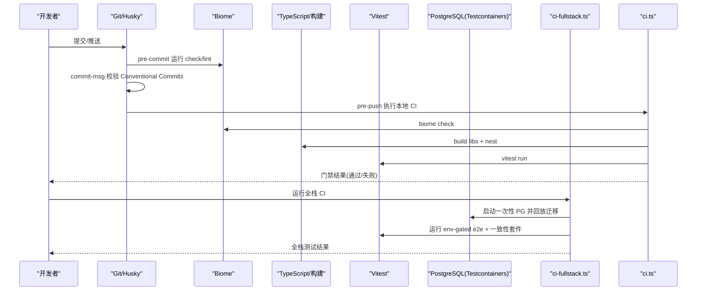
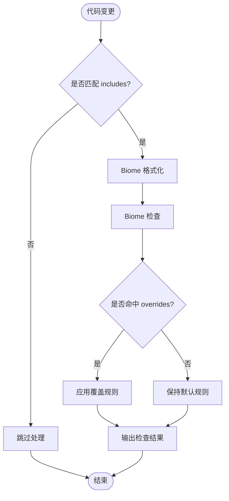
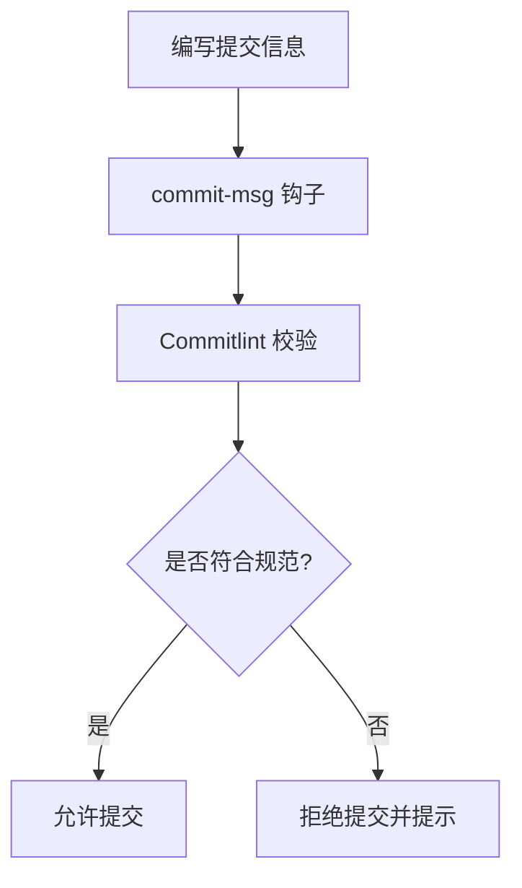
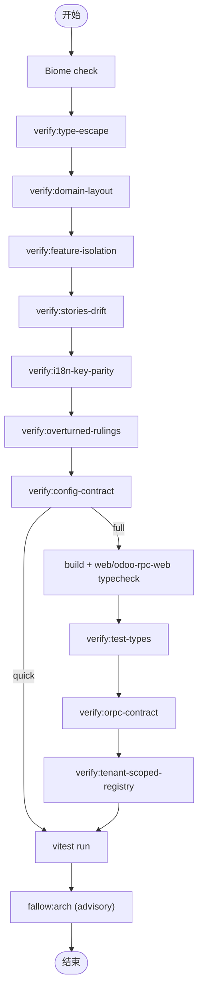
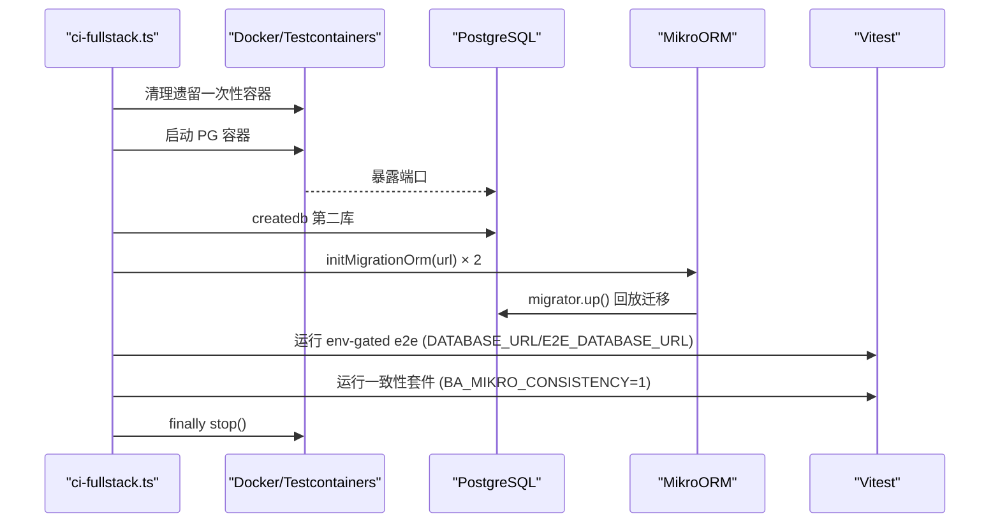
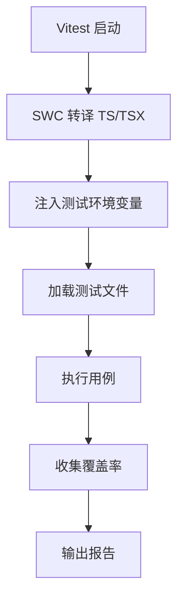
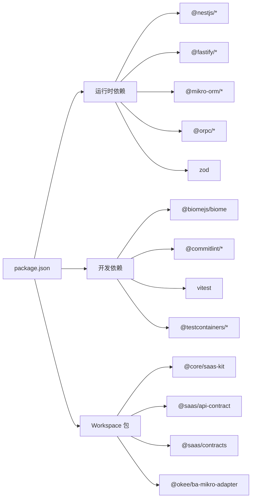

# 开发指南

<cite>
**本文引用的文件**   
- [package.json](file://package.json)
- [biome.json](file://biome.json)
- [COMMIT_CONVENTION.md](file://COMMIT_CONVENTION.md)
- [commitlint.config.cjs](file://commitlint.config.cjs)
- [vitest.config.ts](file://vitest.config.ts)
- [scripts/ci.ts](file://scripts/ci.ts)
- [scripts/ci-fullstack.ts](file://scripts/ci-fullstack.ts)
- [.husky/_/husky.sh](file://.husky/_/husky.sh)
- [AGENTS.md](file://AGENTS.md)
</cite>

## 目录
1. [简介](#简介)
2. [项目结构](#项目结构)
3. [核心组件](#核心组件)
4. [架构总览](#架构总览)
5. [详细组件分析](#详细组件分析)
6. [依赖关系分析](#依赖关系分析)
7. [性能与构建优化](#性能与构建优化)
8. [故障排查指南](#故障排查指南)
9. [结论](#结论)
10. [附录：工作流速查](#附录工作流速查)

## 简介
本指南面向后端、前端与全栈开发者，覆盖代码规范、开发流程、Git 工作流、质量门禁、本地 CI、自动化测试、新功能与模块开发规范、API 设计原则、调试技巧与性能优化建议。本项目采用 pnpm monorepo + NestJS + Fastify + MikroORM + PostgreSQL + React/Vite 技术栈，并通过 Biome、Commitlint、Vitest、Testcontainers 等工具链实现严格的本地与远程质量门禁。

## 项目结构
仓库为 pnpm workspace 多包工程，核心目录如下：
- apps/api：NestJS 后端应用（Fastify、MikroORM、i18n、邮件、鉴权、组织、支付、存储、订阅、用户、工作区、平台能力、事件总线、租户隔离等）
- apps/web：React + Vite 前端应用
- apps/odoo-rpc-web：Odoo RPC 集成演示前端
- libs/*：共享库（core、contracts、api-contract、ba-mikro-adapter）
- scripts/*：本地 CI、迁移、验证脚本
- openapi：OpenAPI 文档产物
- docker：容器化与示例环境

图表来源
- [package.json:7-10](file://package.json#L7-L10)
- [scripts/ci.ts:44-114](file://scripts/ci.ts#L44-L114)
- [scripts/ci-fullstack.ts:221-240](file://scripts/ci-fullstack.ts#L221-L240)

章节来源
- [package.json:1-16](file://package.json#L1-L16)
- [AGENTS.md:43-51](file://AGENTS.md#L43-L51)

## 核心组件
- 代码规范与格式化：Biome（规则集、格式化器、覆盖规则）
- 提交信息校验：Commitlint（Conventional Commits）
- 单元测试与覆盖率：Vitest（SWC 转换、环境变量、包含/排除策略）
- 本地 CI 编排：scripts/ci.ts（check → build → test 硬闸 + fallow 佐证）
- 全栈 CI（含数据库）：scripts/ci-fullstack.ts（Testcontainers 一次性 PG，env-gated e2e + 一致性套件）
- Git Hooks：Husky（pre-commit、commit-msg、pre-push）

章节来源
- [biome.json:1-116](file://biome.json#L1-L116)
- [commitlint.config.cjs:1-36](file://commitlint.config.cjs#L1-L36)
- [vitest.config.ts:1-84](file://vitest.config.ts#L1-L84)
- [scripts/ci.ts:1-137](file://scripts/ci.ts#L1-L137)
- [scripts/ci-fullstack.ts:1-249](file://scripts/ci-fullstack.ts#L1-L249)
- [.husky/_/husky.sh:1-9](file://.husky/_/husky.sh#L1-L9)

## 架构总览
下图展示“开发→本地 CI→全栈 CI”的端到端流水线，以及各工具之间的协作关系。

图表来源
- [scripts/ci.ts:44-114](file://scripts/ci.ts#L44-L114)
- [scripts/ci-fullstack.ts:187-240](file://scripts/ci-fullstack.ts#L187-L240)
- [vitest.config.ts:33-81](file://vitest.config.ts#L33-L81)
- [biome.json:21-84](file://biome.json#L21-L84)
- [commitlint.config.cjs:1-36](file://commitlint.config.cjs#L1-L36)

## 详细组件分析

### 代码规范与格式化（Biome）
- 作用域与忽略：支持 .ts/.tsx/.js/.json，排除生成文件与特定目录
- 格式化：空格缩进、行宽 100、单引号、分号、尾逗号
- Lint 规则：启用 recommended 预设，按 correctness/style/suspicious/performance/security 分组细化；对 controller/test 文件有覆盖规则
- JSON 格式化：统一缩进

图表来源
- [biome.json:8-20](file://biome.json#L8-L20)
- [biome.json:21-84](file://biome.json#L21-L84)
- [biome.json:92-114](file://biome.json#L92-L114)

章节来源
- [biome.json:1-116](file://biome.json#L1-L116)

### 提交信息与分支管理（Conventional Commits + Commitlint）
- 提交类型：feat/fix/docs/style/refactor/perf/test/build/ci/chore/revert
- 约束：主体小写、禁止句号、正文/页脚空行、行宽限制
- 本地强制：commit-msg 钩子自动校验，不符合则拒绝提交

图表来源
- [COMMIT_CONVENTION.md:1-147](file://COMMIT_CONVENTION.md#L1-L147)
- [commitlint.config.cjs:1-36](file://commitlint.config.cjs#L1-L36)

章节来源
- [COMMIT_CONVENTION.md:1-147](file://COMMIT_CONVENTION.md#L1-L147)
- [commitlint.config.cjs:1-36](file://commitlint.config.cjs#L1-L36)

### 本地 CI 与质量门禁（scripts/ci.ts）
- 两种模式：
  - full（默认）：check → 多项恒等闸 → build → web/odoo-rpc-web typecheck → test typecheck → oRPC 契约对拍 → tenant-scoped registry guard → tests
  - quick：仅 check + 轻量恒等闸 + tests
- 恒等闸（纯文本/目录扫描，快速失败）：
  - 类型逃逸棘轮（type-escape ratchet）
  - Domain 布局守卫（domain layout guard）
  - Feature 叠加层隔离（feature isolation guard）
  - Stories drift 守卫（stories drift guard）
  - i18n 键级完整性（i18n key parity guard）
  - 已推翻裁定注释同步（overturned rulings guard）
  - 配置供给面四角契约（config contract guard）
  - 租户实体登记恒等（tenant-scoped registry guard）
- 佐证（不阻断）：fallow 架构边界检查

图表来源
- [scripts/ci.ts:44-114](file://scripts/ci.ts#L44-L114)
- [scripts/ci.ts:116-129](file://scripts/ci.ts#L116-L129)

章节来源
- [scripts/ci.ts:1-137](file://scripts/ci.ts#L1-L137)

### 全栈 CI（含数据库）（scripts/ci-fullstack.ts）
- 使用 Testcontainers 拉起一次性 PostgreSQL 容器，创建两个库：
  - ci_e2e：用于 env-gated 全栈 e2e
  - mikro_ba_consistency：用于 BA authFlow 一致性套件
- 两库均回放基线迁移（generate+migrate 纪律），不执行 schema.create/synchronize
- 先校验 gated 清单与实存双向恒等，再运行测试
- 结束后显式停止容器，零残留

图表来源
- [scripts/ci-fullstack.ts:187-240](file://scripts/ci-fullstack.ts#L187-L240)
- [scripts/ci-fullstack.ts:221-240](file://scripts/ci-fullstack.ts#L221-L240)

章节来源
- [scripts/ci-fullstack.ts:1-249](file://scripts/ci-fullstack.ts#L1-L249)

### 自动化测试（Vitest）
- SWC 转译：启用 decorators 与 decoratorMetadata，满足 Nest DI/reflect-metadata
- 环境变量：提供最小必要变量，避免 ConfigModule 校验失败
- 包含/排除：apps/libs/packages/scripts 下的 *.test.*，排除浏览器测试
- 覆盖率：v8 provider，输出 text/html/lcov，报告目录 coverage

图表来源
- [vitest.config.ts:14-31](file://vitest.config.ts#L14-L31)
- [vitest.config.ts:33-81](file://vitest.config.ts#L33-L81)

章节来源
- [vitest.config.ts:1-84](file://vitest.config.ts#L1-L84)

### Git Hooks 与本地门禁
- Husky 作为 Git Hooks 管理器（当前存在 deprecated 提示，需关注升级路径）
- 推荐门禁顺序（参考 AGENTS.md）：
  - pre-commit：自动修复格式（lint:fix）
  - commit-msg：commitlint 校验
  - pre-push：本地 CI（pnpm run ci）

章节来源
- [.husky/_/husky.sh:1-9](file://.husky/_/husky.sh#L1-L9)
- [AGENTS.md:43-51](file://AGENTS.md#L43-L51)

### 新功能开发指南
- 领域驱动分层：modules/<上下文>/{domain,application,infrastructure,api}
- 特性叠加层：features/<名>/{application,infrastructure,api}，与 modules 双向隔离
- 新增 gated e2e（*.e2e.test.ts）必须同步登记到 scripts/ci-fullstack.ts 的 GATED_E2E_FILES，否则会被恒等闸拦截
- 新增配置项需通过 verify:config-contract 四角契约校验（无死配置、读键⊆样例∪白名单、必填键⊆compose）

章节来源
- [AGENTS.md:43-51](file://AGENTS.md#L43-L51)
- [scripts/ci-fullstack.ts:32-88](file://scripts/ci-fullstack.ts#L32-L88)
- [scripts/ci.ts:74-79](file://scripts/ci.ts#L74-L79)

### 模块开发规范
- 目录命名与职责：
  - domain：领域模型、值对象、仓储接口
  - application：用例/命令/查询、编排逻辑
  - infrastructure：持久化、外部服务适配
  - api：控制器、路由、响应 DTO
- 跨模块依赖：通过 ports/interfaces 解耦，避免直接耦合基础设施或 API 层
- 测试要求：单元测 + 集成测 + e2e（如需要真库则走 gated 机制）

章节来源
- [AGENTS.md:43-51](file://AGENTS.md#L43-L51)

### API 设计原则
- 以 zod schema 为单一事实源，配合 @orpc 契约派生类型，确保前后端一致
- OpenAPI 由 router 编译期派生，避免手工维护漂移
- 错误体与响应 envelope 标准化，便于客户端统一处理

章节来源
- [package.json:102-107](file://package.json#L102-L107)
- [scripts/ci.ts:97-106](file://scripts/ci.ts#L97-L106)

## 依赖关系分析
- 运行时依赖：NestJS/Fastify/MikroORM/Stripe/Orpc/Zod 等
- 开发依赖：Biome/Commitlint/Vitest/Playwright/Testcontainers/SWC/TsNode 等
- Workspace 包：@core/saas-kit、@saas/api-contract、@saas/contracts、@okee/ba-mikro-adapter

图表来源
- [package.json:78-158](file://package.json#L78-L158)

章节来源
- [package.json:78-158](file://package.json#L78-L158)

## 性能与构建优化
- 构建加速：
  - 使用 SWC 构建 Nest 应用与库（nest build --builder swc）
  - 并行 workspace 构建（pnpm 工作区）
- 测试加速：
  - Vitest + SWC 转译，减少编译开销
  - 合理设置 include/exclude，避免无关文件参与测试
- 类型检查：
  - 区分 build 与 test typecheck，仅在 full 模式执行完整类型检查
- 缓存与增量：
  - 利用 pnpm 缓存与 Node 版本锁定（engines.node >= 22）

章节来源
- [package.json:11-16](file://package.json#L11-L16)
- [package.json:74-76](file://package.json#L74-L76)
- [vitest.config.ts:14-31](file://vitest.config.ts#L14-L31)
- [scripts/ci.ts:80-96](file://scripts/ci.ts#L80-L96)

## 故障排查指南
- 提交被拒绝：
  - 检查 commit-msg 是否符合 Conventional Commits（大小写、长度、标点）
  - 确认 subject-case/type-case/type-enum 规则
- 本地 CI 失败：
  - 查看具体步骤输出（Lint/Build/Test/Verify-*）
  - quick 模式仅包含轻量闸，full 模式包含更多严格检查
- 全栈 CI 失败：
  - 确认 Docker 可用且无遗留容器
  - 检查 GATED_E2E_FILES 是否与实存一致
  - 核对 DATABASE_URL/E2E_DATABASE_URL 是否正确指向容器库
- 测试环境问题：
  - 检查 vitest.config.ts 中环境变量是否齐全
  - 确认 SWC 装饰器与元数据开关已启用

章节来源
- [commitlint.config.cjs:1-36](file://commitlint.config.cjs#L1-L36)
- [scripts/ci.ts:44-114](file://scripts/ci.ts#L44-L114)
- [scripts/ci-fullstack.ts:157-182](file://scripts/ci-fullstack.ts#L157-L182)
- [vitest.config.ts:48-66](file://vitest.config.ts#L48-L66)

## 结论
本项目通过 Biome、Commitlint、Vitest、Testcontainers 与自研本地 CI 编排脚本，构建了从代码风格、提交规范、类型安全、架构约束到端到端测试的全链路质量门禁。遵循本指南可显著提升团队协作效率与代码质量，降低回归风险，并为持续交付提供稳定基础。

## 附录：工作流速查
- 本地开发
  - 启动：pnpm start / pnpm start:dev
  - 调试：pnpm start:debug
  - 格式化：pnpm format
  - 检查：pnpm check / pnpm lint
- 测试
  - 单元测试：pnpm test
  - 覆盖率：pnpm test:cov
  - 全栈 e2e：pnpm test:fullstack
- 构建
  - 构建全部：pnpm build
  - 仅 Nest：pnpm build:nest
  - 仅 Web：pnpm build:web
- 数据库
  - 初始化：pnpm db:setup
  - 重置：pnpm db:reset
  - 种子：pnpm db:seed
- 文档
  - 导出 OpenAPI：pnpm openapi:export
  - 生成 API 文档：pnpm docs:api

章节来源
- [package.json:11-65](file://package.json#L11-L65)