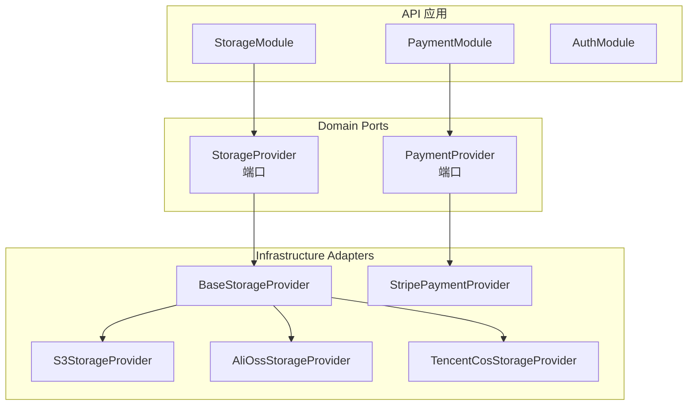
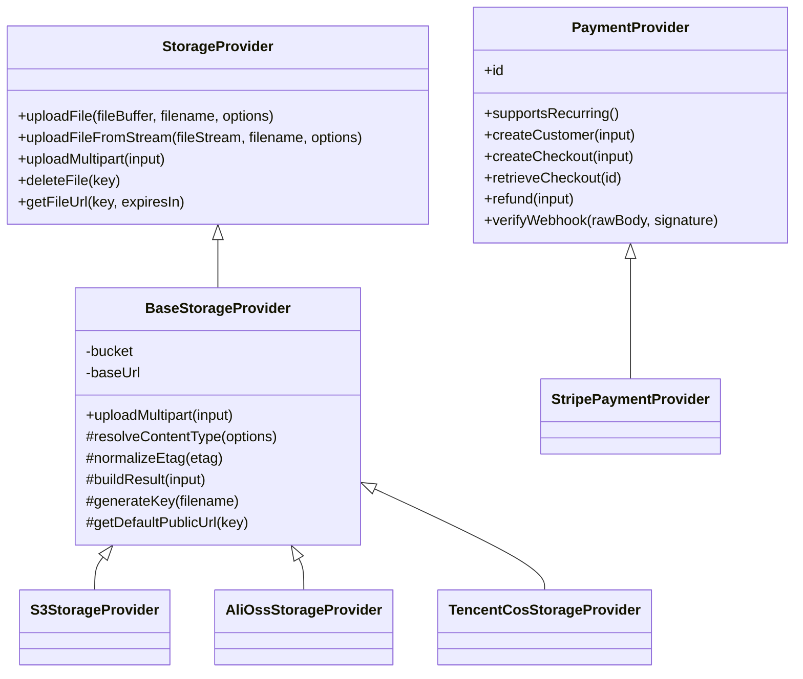
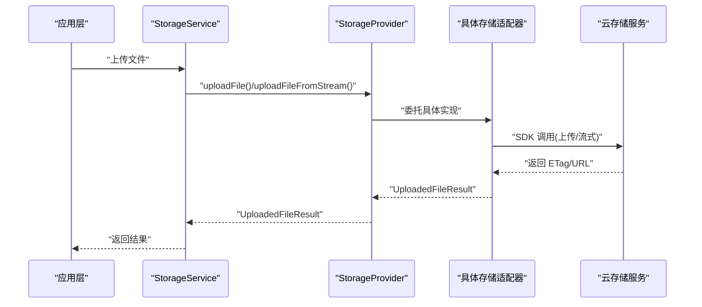
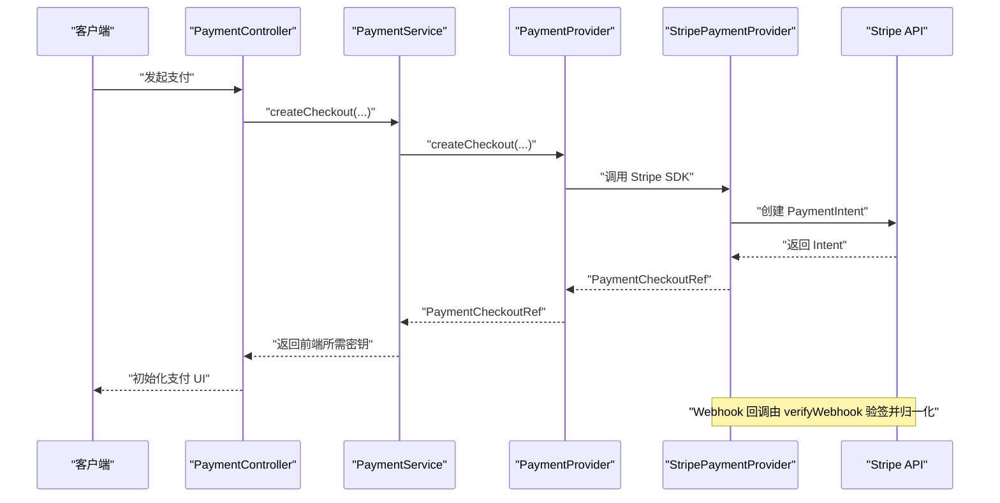
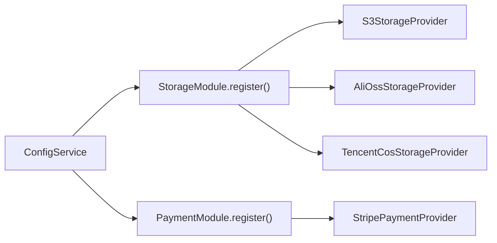

# Provider 扩展

<cite>
**本文引用的文件**   
- [storage-provider.port.ts](file://apps/api/src/modules/storage/domain/ports/storage-provider.port.ts)
- [base-storage.provider.ts](file://apps/api/src/modules/storage/infrastructure/base-storage.provider.ts)
- [s3-storage.provider.ts](file://apps/api/src/modules/storage/infrastructure/s3-storage.provider.ts)
- [alioss-storage.provider.ts](file://apps/api/src/modules/storage/infrastructure/alioss-storage.provider.ts)
- [tencentcos-storage.provider.ts](file://apps/api/src/modules/storage/infrastructure/tencentcos-storage.provider.ts)
- [storage.module.ts](file://apps/api/src/modules/storage/storage.module.ts)
- [payment-provider.port.ts](file://apps/api/src/modules/payment/domain/ports/payment-provider.port.ts)
- [stripe-payment.provider.ts](file://apps/api/src/modules/payment/infrastructure/stripe-payment.provider.ts)
- [payment.module.ts](file://apps/api/src/modules/payment/payment.module.ts)
- [auth.interface.ts](file://apps/api/src/modules/auth/auth.interface.ts)
- [README.md](file://README.md)
</cite>

## 目录
1. [引言](#引言)
2. [项目结构](#项目结构)
3. [核心组件](#核心组件)
4. [架构总览](#架构总览)
5. [详细组件分析](#详细组件分析)
6. [依赖关系分析](#依赖关系分析)
7. [性能与可扩展性建议](#性能与可扩展性建议)
8. [故障排除指南](#故障排除指南)
9. [结论](#结论)
10. [附录：Provider 扩展开发清单](#附录provider-扩展开发清单)

## 引言
本文件面向需要在系统中扩展“存储提供商”“支付渠道”和“认证提供商”的开发者。仓库采用 Clean Architecture 与六边形架构风格，通过 domain/ports 定义抽象接口、infrastructure 提供具体实现、Module.register() 完成依赖注入装配。文档将解释 Provider 抽象层的设计模式、端口接口定义、适配器实现、依赖注入配置，并给出存储与支付的扩展方法、回调处理、退款管理、测试与排错要点。

## 项目结构
本项目在 apps/api 下按领域模块组织代码，每个 Provider 相关能力位于对应模块内：
- storage：对象存储 Provider（S3 / 阿里云 OSS / 腾讯云 COS）
- payment：支付 Provider（Stripe 已实现，支付宝/微信支付预留）
- auth：认证能力（Better Auth 集成，会话/用户等端口由应用侧适配）

图表来源
- [storage.module.ts:1-48](file://apps/api/src/modules/storage/storage.module.ts#L1-L48)
- [payment.module.ts:1-48](file://apps/api/src/modules/payment/payment.module.ts#L1-L48)
- [storage-provider.port.ts:1-101](file://apps/api/src/modules/storage/domain/ports/storage-provider.port.ts#L1-L101)
- [payment-provider.port.ts:1-158](file://apps/api/src/modules/payment/domain/ports/payment-provider.port.ts#L1-L158)
- [base-storage.provider.ts:1-121](file://apps/api/src/modules/storage/infrastructure/base-storage.provider.ts#L1-L121)
- [s3-storage.provider.ts:1-151](file://apps/api/src/modules/storage/infrastructure/s3-storage.provider.ts#L1-L151)
- [alioss-storage.provider.ts:1-129](file://apps/api/src/modules/storage/infrastructure/alioss-storage.provider.ts#L1-L129)
- [tencentcos-storage.provider.ts:1-142](file://apps/api/src/modules/storage/infrastructure/tencentcos-storage.provider.ts#L1-L142)
- [stripe-payment.provider.ts:1-108](file://apps/api/src/modules/payment/infrastructure/stripe-payment.provider.ts#L1-L108)

章节来源
- [README.md:55-76](file://README.md#L55-L76)

## 核心组件
- 存储 Provider 端口：定义上传、流式上传、删除、签名 URL 等统一能力，屏蔽底层 SDK 差异。
- 支付 Provider 端口：定义客户创建、下单/收款意图、查询、退款、Webhook 验签与归一化事件。
- 基础设施适配器：各云厂商或第三方服务的具体实现，继承基类或直接实现端口。
- 模块装配：通过 Module.register() 动态注册可用 Provider，依据配置选择默认实现。

章节来源
- [storage-provider.port.ts:1-101](file://apps/api/src/modules/storage/domain/ports/storage-provider.port.ts#L1-L101)
- [payment-provider.port.ts:1-158](file://apps/api/src/modules/payment/domain/ports/payment-provider.port.ts#L1-L158)
- [base-storage.provider.ts:1-121](file://apps/api/src/modules/storage/infrastructure/base-storage.provider.ts#L1-L121)
- [stripe-payment.provider.ts:1-108](file://apps/api/src/modules/payment/infrastructure/stripe-payment.provider.ts#L1-L108)
- [storage.module.ts:1-48](file://apps/api/src/modules/storage/storage.module.ts#L1-L48)
- [payment.module.ts:1-48](file://apps/api/src/modules/payment/payment.module.ts#L1-L48)

## 架构总览
Provider 抽象层遵循“端口-适配器”模式：
- domain/ports 仅声明稳定契约，不包含框架与第三方 SDK 依赖。
- infrastructure 提供具体实现，封装 SDK 细节与错误转换。
- application 层调用端口，不感知具体实现。
- Module.register() 根据环境变量/配置决定启用哪些 Provider。

图表来源
- [storage-provider.port.ts:1-101](file://apps/api/src/modules/storage/domain/ports/storage-provider.port.ts#L1-L101)
- [base-storage.provider.ts:1-121](file://apps/api/src/modules/storage/infrastructure/base-storage.provider.ts#L1-L121)
- [s3-storage.provider.ts:1-151](file://apps/api/src/modules/storage/infrastructure/s3-storage.provider.ts#L1-L151)
- [alioss-storage.provider.ts:1-129](file://apps/api/src/modules/storage/infrastructure/alioss-storage.provider.ts#L1-L129)
- [tencentcos-storage.provider.ts:1-142](file://apps/api/src/modules/storage/infrastructure/tencentcos-storage.provider.ts#L1-L142)
- [payment-provider.port.ts:1-158](file://apps/api/src/modules/payment/domain/ports/payment-provider.port.ts#L1-L158)
- [stripe-payment.provider.ts:1-108](file://apps/api/src/modules/payment/infrastructure/stripe-payment.provider.ts#L1-L108)

## 详细组件分析

### 存储 Provider 扩展
- 端口设计
  - 上传：支持 Buffer 与 ReadStream 两种输入；multipart 入口由基类统一处理临时文件 IO。
  - 访问控制：通过 FileUploadOptions.acl 传递对象 ACL；不同云厂商映射到各自头或参数。
  - 元数据：通过 metadata 透传键值对，供下游检索或审计。
  - URL 生成：支持自定义 baseUrl 或各云默认公开地址；私有桶使用签名 URL。
- 适配器实现
  - BaseStorageProvider：统一 key 命名、ETag 规范化、结果组装、multipart 流程。
  - S3StorageProvider：AWS SDK v3，支持直传与分片上传，签名 URL 使用 presigner。
  - AliOssStorageProvider：阿里云 OSS SDK，设置 x-oss-object-acl 与 x-oss-meta-*。
  - TencentCosStorageProvider：腾讯云 COS SDK，回调转 Promise，签名 URL 使用 getObjectUrl。
- 依赖注入配置
  - StorageModule.register() 根据 storageConfig.provider 动态注册 s3/alioss/tencentoss。
  - 默认始终包含 S3；其他通道按需启用。

图表来源
- [storage-provider.port.ts:1-101](file://apps/api/src/modules/storage/domain/ports/storage-provider.port.ts#L1-L101)
- [base-storage.provider.ts:1-121](file://apps/api/src/modules/storage/infrastructure/base-storage.provider.ts#L1-L121)
- [s3-storage.provider.ts:1-151](file://apps/api/src/modules/storage/infrastructure/s3-storage.provider.ts#L1-L151)
- [alioss-storage.provider.ts:1-129](file://apps/api/src/modules/storage/infrastructure/alioss-storage.provider.ts#L1-L129)
- [tencentcos-storage.provider.ts:1-142](file://apps/api/src/modules/storage/infrastructure/tencentcos-storage.provider.ts#L1-L142)

章节来源
- [storage-provider.port.ts:1-101](file://apps/api/src/modules/storage/domain/ports/storage-provider.port.ts#L1-L101)
- [base-storage.provider.ts:1-121](file://apps/api/src/modules/storage/infrastructure/base-storage.provider.ts#L1-L121)
- [s3-storage.provider.ts:1-151](file://apps/api/src/modules/storage/infrastructure/s3-storage.provider.ts#L1-L151)
- [alioss-storage.provider.ts:1-129](file://apps/api/src/modules/storage/infrastructure/alioss-storage.provider.ts#L1-L129)
- [tencentcos-storage.provider.ts:1-142](file://apps/api/src/modules/storage/infrastructure/tencentcos-storage.provider.ts#L1-L142)
- [storage.module.ts:1-48](file://apps/api/src/modules/storage/storage.module.ts#L1-L48)

#### 多云支持与访问控制
- 多云支持：通过 provider-selection 策略与 register() 工厂函数，按环境切换不同云厂商。
- 访问控制：
  - S3：ACL 参数映射为 ObjectCannedACL，缺省 private。
  - 阿里云：x-oss-object-acl 头，metadata 前缀 x-oss-meta-*。
  - 腾讯云：通过 SDK 参数与签名 URL 控制访问权限。

章节来源
- [s3-storage.provider.ts:135-149](file://apps/api/src/modules/storage/infrastructure/s3-storage.provider.ts#L135-L149)
- [alioss-storage.provider.ts:109-127](file://apps/api/src/modules/storage/infrastructure/alioss-storage.provider.ts#L109-L127)
- [tencentcos-storage.provider.ts:103-140](file://apps/api/src/modules/storage/infrastructure/tencentcos-storage.provider.ts#L103-L140)

### 支付 Provider 扩展
- 端口设计
  - 客户：createCustomer 返回跨通道归一化的 PaymentCustomerRef。
  - 结账：createCheckout/retrieveCheckout 返回 PaymentCheckoutRef，含状态与 clientSecret。
  - 退款：refund 返回 PaymentRefundRef，包含金额与状态。
  - Webhook：verifyWebhook 验签后返回 NormalizedPaymentEvent，便于上层统一处理。
- 适配器实现
  - StripePaymentProvider：基于 stripe SDK，映射 PaymentIntent/refunds/webhooks。
- 依赖注入配置
  - PaymentModule.register() 仅在配置了 secretKey 时注册 Stripe；境内通道（支付宝/微信）预留扩展点。

图表来源
- [payment-provider.port.ts:1-158](file://apps/api/src/modules/payment/domain/ports/payment-provider.port.ts#L1-L158)
- [stripe-payment.provider.ts:1-108](file://apps/api/src/modules/payment/infrastructure/stripe-payment.provider.ts#L1-L108)
- [payment.module.ts:1-48](file://apps/api/src/modules/payment/payment.module.ts#L1-L48)

章节来源
- [payment-provider.port.ts:1-158](file://apps/api/src/modules/payment/domain/ports/payment-provider.port.ts#L1-L158)
- [stripe-payment.provider.ts:1-108](file://apps/api/src/modules/payment/infrastructure/stripe-payment.provider.ts#L1-L108)
- [payment.module.ts:1-48](file://apps/api/src/modules/payment/payment.module.ts#L1-L48)

#### 支付处理、回调与退款
- 支付处理：createCheckout 创建支付意图，返回 clientSecret 供前端初始化。
- 回调处理：verifyWebhook 使用 SDK 验签，返回标准化事件类型与数据。
- 退款管理：refund 传入 checkoutId 与可选金额/原因，返回退款引用。

章节来源
- [stripe-payment.provider.ts:43-96](file://apps/api/src/modules/payment/infrastructure/stripe-payment.provider.ts#L43-L96)

### 认证 Provider 扩展
- 认证实例类型：通过 CreateAuth 返回的 auth 实例类型导出，供应用侧注入与使用。
- 适配方式：认证能力由 Better Auth 提供，应用侧通过基础设施适配（如会话读取器、用户存储）对接领域端口。

章节来源
- [auth.interface.ts:1-8](file://apps/api/src/modules/auth/auth.interface.ts#L1-L8)

## 依赖关系分析
- 模块装配
  - StorageModule.register()：根据 storageConfig.provider 动态注册 S3/AliOSS/TencentCOS。
  - PaymentModule.register()：根据是否配置 Stripe secretKey 决定是否注册 StripePaymentProvider。
- 依赖方向
  - application 层依赖 domain/ports，不感知 infrastructure。
  - infrastructure 依赖 ConfigService 获取凭据与端点。

图表来源
- [storage.module.ts:17-46](file://apps/api/src/modules/storage/storage.module.ts#L17-L46)
- [payment.module.ts:20-46](file://apps/api/src/modules/payment/payment.module.ts#L20-L46)

章节来源
- [storage.module.ts:1-48](file://apps/api/src/modules/storage/storage.module.ts#L1-L48)
- [payment.module.ts:1-48](file://apps/api/src/modules/payment/payment.module.ts#L1-L48)

## 性能与可扩展性建议
- 大文件上传
  - 优先使用流式上传（uploadFileFromStream），避免内存峰值。
  - S3 使用分片上传（@aws-sdk/lib-storage Upload），提升稳定性与吞吐。
- 并发与重试
  - 对网络请求增加指数退避重试；对幂等操作（如 delete）进行去重。
- URL 签名
  - 合理设置 expiresIn，避免频繁签名计算；必要时缓存短期签名 URL。
- 多云扩展
  - 新增 Provider 仅需实现端口并在 register() 中注册；保持 key 命名规则一致。
- 日志与可观测性
  - 记录关键步骤（上传开始/结束、签名 URL 生成、Webhook 验签）与异常堆栈。

[本节为通用指导，无需列出具体文件来源]

## 故障排除指南
- 存储上传失败
  - 检查 bucket/region/endpoint/credentials 配置是否正确。
  - 确认 ACL 与 Content-Type 是否符合目标云要求。
  - 查看异常信息中的 SDK 错误码与消息。
- 签名 URL 不可用
  - 确认 bucket 是否为私有；签名有效期是否过短。
  - 检查 endpoint 与 region 是否与 SDK 配置一致。
- 支付回调验签失败
  - 核对 webhookSecret 配置与 Stripe 控制台一致。
  - 确保 rawBody 与 signature 完整且顺序正确。
- 退款失败
  - 校验 checkoutId 是否存在且处于可退款状态。
  - 检查 amount 是否不超过原订单金额。

章节来源
- [s3-storage.provider.ts:47-129](file://apps/api/src/modules/storage/infrastructure/s3-storage.provider.ts#L47-L129)
- [alioss-storage.provider.ts:29-101](file://apps/api/src/modules/storage/infrastructure/alioss-storage.provider.ts#L29-L101)
- [tencentcos-storage.provider.ts:29-96](file://apps/api/src/modules/storage/infrastructure/tencentcos-storage.provider.ts#L29-L96)
- [stripe-payment.provider.ts:87-96](file://apps/api/src/modules/payment/infrastructure/stripe-payment.provider.ts#L87-L96)

## 结论
本项目的 Provider 抽象层以端口-适配器为核心，结合 NestJS 的动态模块装配，实现了存储与支付能力的多云与多渠道扩展。通过统一的 domain/ports 契约，业务层无需关心底层 SDK 差异；基础设施层专注实现与错误转换；模块装配层负责按环境启用能力。该设计具备良好的可维护性与可扩展性，适合持续引入新的存储与支付通道。

[本节为总结性内容，无需列出具体文件来源]

## 附录：Provider 扩展开发清单
- 存储 Provider
  - 实现 StorageProvider 接口（或继承 BaseStorageProvider）。
  - 在 StorageModule.register() 中按配置注册新 Provider。
  - 覆盖 getDefaultPublicUrl() 与必要的构建参数逻辑。
  - 编写单元测试覆盖上传、删除、签名 URL 与异常路径。
- 支付 Provider
  - 实现 PaymentProvider 接口。
  - 在 PaymentModule.register() 中按配置注册新 Provider。
  - 实现 supportsRecurring()、createCustomer/createCheckout/retrieveCheckout/refund/verifyWebhook。
  - 编写单元测试覆盖正常流程与 Webhook 验签。
- 认证 Provider
  - 复用 Better Auth 提供的认证能力，通过基础设施适配对接领域端口。
  - 确保会话读取器与用户存储适配满足领域契约。

[本节为操作清单，无需列出具体文件来源]