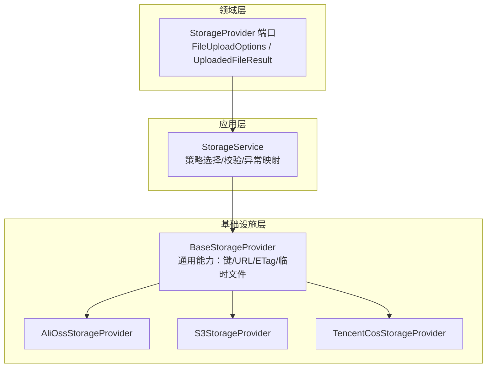
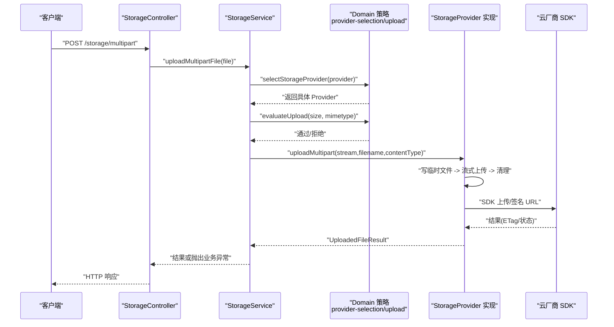
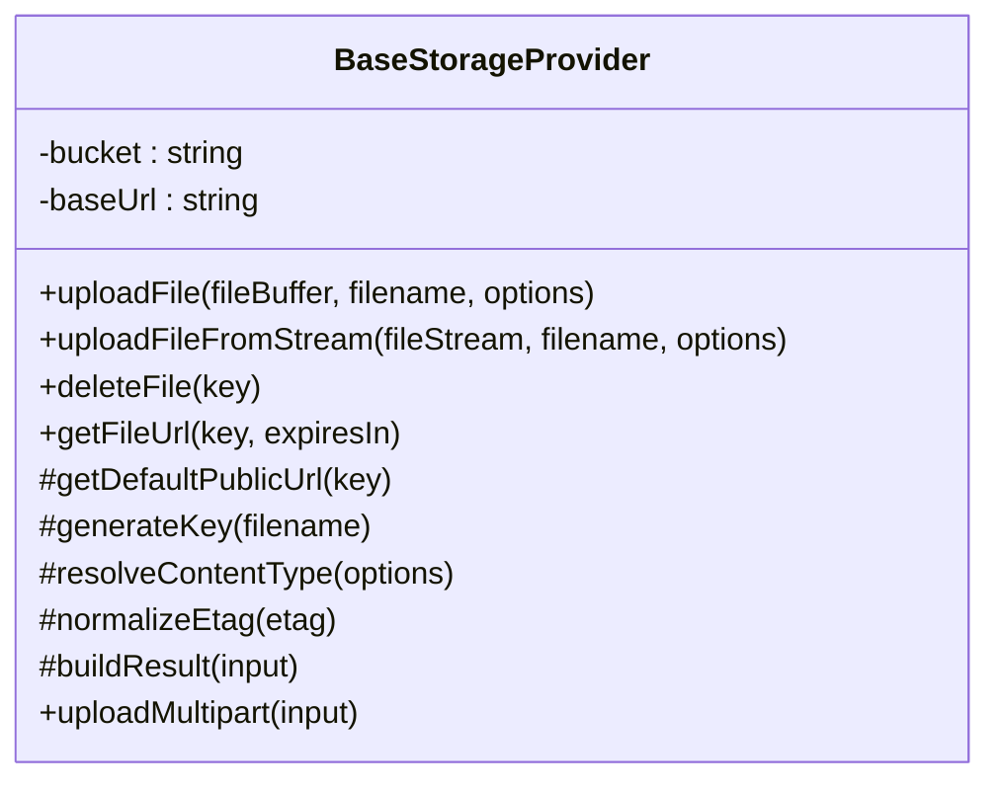
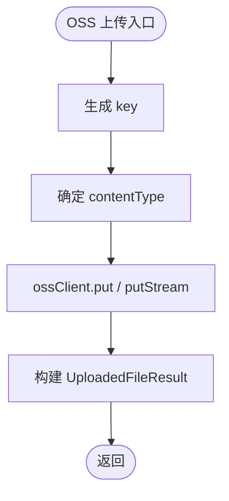
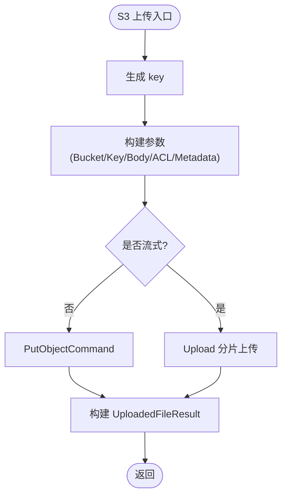
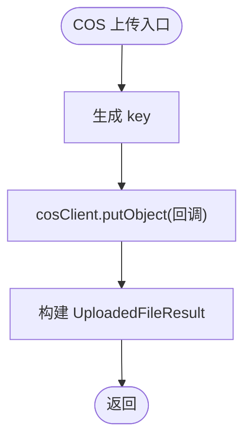
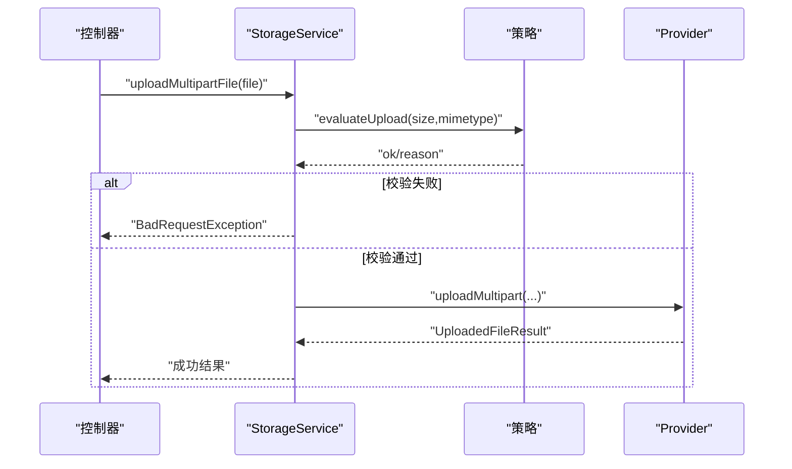
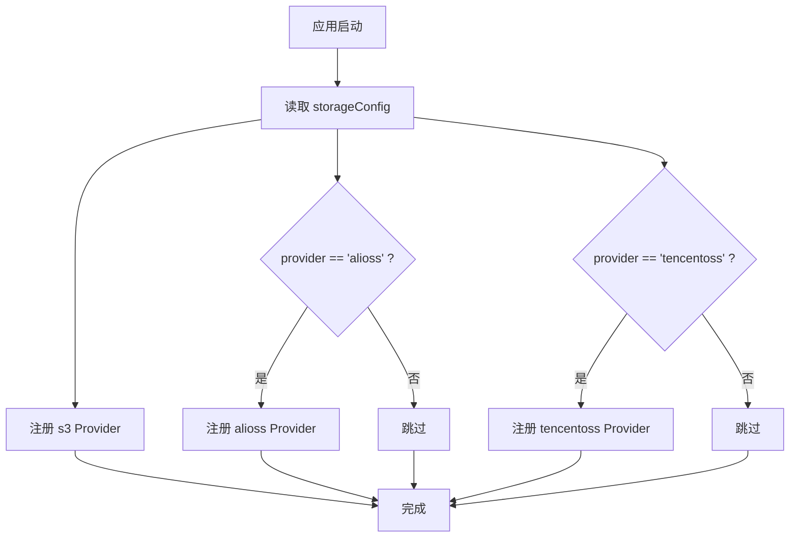
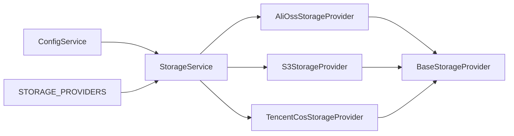

# 存储 Provider 扩展

<cite>
**本文引用的文件**   
- [base-storage.provider.ts](file://apps/api/src/modules/storage/infrastructure/base-storage.provider.ts)
- [alioss-storage.provider.ts](file://apps/api/src/modules/storage/infrastructure/alioss-storage.provider.ts)
- [s3-storage.provider.ts](file://apps/api/src/modules/storage/infrastructure/s3-storage.provider.ts)
- [tencentcos-storage.provider.ts](file://apps/api/src/modules/storage/infrastructure/tencentcos-storage.provider.ts)
- [storage-provider.port.ts](file://apps/api/src/modules/storage/domain/ports/storage-provider.port.ts)
- [storage.service.ts](file://apps/api/src/modules/storage/application/storage.service.ts)
- [storage.module.ts](file://apps/api/src/modules/storage/storage.module.ts)
</cite>

## 目录
1. [引言](#引言)
2. [项目结构](#项目结构)
3. [核心组件](#核心组件)
4. [架构总览](#架构总览)
5. [详细组件分析](#详细组件分析)
6. [依赖关系分析](#依赖关系分析)
7. [性能与优化建议](#性能与优化建议)
8. [故障排查指南](#故障排查指南)
9. [结论](#结论)
10. [附录：多云切换配置与最佳实践](#附录多云切换配置与最佳实践)

## 引言
本文件面向需要在当前 SaaS 后端中扩展“云对象存储”能力的开发者，系统性说明如何基于现有抽象基类实现自定义存储 Provider。文档覆盖以下要点：
- BaseStorageProvider 抽象基类的设计模式与通用能力（键生成、ETag 标准化、公共 URL 拼装、临时文件与流式上传）。
- StorageProvider 端口接口的职责边界与实现要求。
- 阿里云 OSS、AWS S3、腾讯云 COS 的具体实现差异与配置项。
- 多云存储的运行时切换机制、错误处理策略与性能优化建议。

## 项目结构
存储模块采用分层与 DDD 风格组织：
- domain/ports：定义 StorageProvider 端口接口与数据模型。
- application：编排层 StorageService，负责策略选择、校验与异常映射。
- infrastructure：具体云厂商实现（S3/OSS/COS）与共享基类。
- storage.module：动态注册不同 Provider 实例。

图表来源
- [storage-provider.port.ts:3-33](file://apps/api/src/modules/storage/domain/ports/storage-provider.port.ts#L3-L33)
- [storage.service.ts:17-34](file://apps/api/src/modules/storage/application/storage.service.ts#L17-L34)
- [base-storage.provider.ts:17-27](file://apps/api/src/modules/storage/infrastructure/base-storage.provider.ts#L17-L27)

章节来源
- [storage-provider.port.ts:1-101](file://apps/api/src/modules/storage/domain/ports/storage-provider.port.ts#L1-L101)
- [storage.service.ts:1-100](file://apps/api/src/modules/storage/application/storage.service.ts#L1-L100)
- [base-storage.provider.ts:1-121](file://apps/api/src/modules/storage/infrastructure/base-storage.provider.ts#L1-L121)

## 核心组件
- StorageProvider 端口：定义上传、删除、签名 URL 等稳定契约，不包含任何框架或 SDK 细节。
- BaseStorageProvider：封装跨实现的通用逻辑，包括：
  - 统一 key 生成（日期 + UUID），由 domain 命名规则提供。
  - 内容类型默认值与 ETag 去引号标准化。
  - 公共 URL 拼装（优先 baseUrl，否则调用各实现的 getDefaultPublicUrl）。
  - multipart 临时文件落盘、流式上传与清理。
- 具体 Provider：AliOssStorageProvider、S3StorageProvider、TencentCosStorageProvider，分别对接各自 SDK。
- StorageService：应用编排层，负责策略选择、上传前校验、异常映射与透传调用。
- StorageModule：根据运行期配置动态注入 Provider 实例。

章节来源
- [storage-provider.port.ts:35-100](file://apps/api/src/modules/storage/domain/ports/storage-provider.port.ts#L35-L100)
- [base-storage.provider.ts:28-119](file://apps/api/src/modules/storage/infrastructure/base-storage.provider.ts#L28-L119)
- [storage.service.ts:17-99](file://apps/api/src/modules/storage/application/storage.service.ts#L17-L99)
- [storage.module.ts:11-47](file://apps/api/src/modules/storage/storage.module.ts#L11-L47)

## 架构总览
下图展示一次 HTTP multipart 上传从控制器到具体云厂商的完整流程。

图表来源
- [storage.service.ts:43-79](file://apps/api/src/modules/storage/application/storage.service.ts#L43-L79)
- [base-storage.provider.ts:61-83](file://apps/api/src/modules/storage/infrastructure/base-storage.provider.ts#L61-L83)
- [alioss-storage.provider.ts:29-79](file://apps/api/src/modules/storage/infrastructure/alioss-storage.provider.ts#L29-L79)
- [s3-storage.provider.ts:47-102](file://apps/api/src/modules/storage/infrastructure/s3-storage.provider.ts#L47-L102)
- [tencentcos-storage.provider.ts:29-49](file://apps/api/src/modules/storage/infrastructure/tencentcos-storage.provider.ts#L29-L49)

## 详细组件分析

### StorageProvider 端口接口
- FileUploadOptions：支持 contentType、metadata、acl。
- UploadedFileResult：包含 key、url、etag、size、mimetype、originalname。
- StorageProvider：
  - uploadFile：缓冲区上传。
  - uploadFileFromStream：流式上传。
  - uploadMultipart：multipart 原始流上传（由基类实现）。
  - deleteFile：删除对象。
  - getFileUrl：生成可访问 URL（支持过期时间）。

实现要求：
- 所有方法需返回 Promise，保持异步一致性。
- 对底层 SDK 的错误进行包装并向上抛出，便于应用层统一捕获。
- ETag 必须经基类 normalizeEtag 处理，去除两端引号。
- URL 生成优先使用 baseUrl；未配置时调用 getDefaultPublicUrl。

章节来源
- [storage-provider.port.ts:3-33](file://apps/api/src/modules/storage/domain/ports/storage-provider.port.ts#L3-L33)
- [storage-provider.port.ts:35-100](file://apps/api/src/modules/storage/domain/ports/storage-provider.port.ts#L35-L100)

### BaseStorageProvider 抽象基类
设计要点：
- 构造阶段从 ConfigService 读取 bucket 与 baseUrl。
- generateKey：组合日期与 UUID，实际路径规则在 domain 层 buildStorageKey。
- resolveContentType：若未指定则回退为 application/octet-stream。
- normalizeEtag：去除两端双引号，保证 ETag 一致。
- buildResult：组装 UploadedFileResult，并通过 getPublicUrl 决定最终 URL。
- uploadMultipart：将 NodeJS.ReadableStream 写入 tmp 目录，再转为 ReadStream 调用 uploadFileFromStream，并在 finally 中清理临时文件。

图表来源
- [base-storage.provider.ts:28-119](file://apps/api/src/modules/storage/infrastructure/base-storage.provider.ts#L28-L119)

章节来源
- [base-storage.provider.ts:17-119](file://apps/api/src/modules/storage/infrastructure/base-storage.provider.ts#L17-L119)

### 阿里云 OSS 实现（AliOssStorageProvider）
- 初始化：region、accessKeyId、accessKeySecret、bucket、endpoint。
- uploadFile：使用 ossClient.put，设置超时与 headers（ACL、Content-Type、x-oss-meta-*）。
- uploadFileFromStream：使用 ossClient.putStream，size 标记为 -1。
- deleteFile：ossClient.delete。
- getFileUrl：signatureUrl 生成带签名的私有访问链接。
- getDefaultPublicUrl：https://{bucket}.{endpoint}/{key}。

图表来源
- [alioss-storage.provider.ts:29-79](file://apps/api/src/modules/storage/infrastructure/alioss-storage.provider.ts#L29-L79)

章节来源
- [alioss-storage.provider.ts:12-128](file://apps/api/src/modules/storage/infrastructure/alioss-storage.provider.ts#L12-L128)

### AWS S3 实现（S3StorageProvider）
- 初始化：region、credentials；当 endpoint 存在时启用 forcePathStyle（兼容 MinIO 等）。
- uploadFile：PutObjectCommand，ETag 来自 result.ETag。
- uploadFileFromStream：@aws-sdk/lib-storage 的 Upload 进行分片上传，适合大文件。
- deleteFile：DeleteObjectCommand。
- getFileUrl：GetObjectCommand + getSignedUrl。
- getDefaultPublicUrl：https://{bucket}.s3.{region}.amazonaws.com/{key}。

图表来源
- [s3-storage.provider.ts:47-102](file://apps/api/src/modules/storage/infrastructure/s3-storage.provider.ts#L47-L102)

章节来源
- [s3-storage.provider.ts:20-150](file://apps/api/src/modules/storage/infrastructure/s3-storage.provider.ts#L20-L150)

### 腾讯云 COS 实现（TencentCosStorageProvider）
- 初始化：SecretId、SecretKey；region 用于 URL 与删除操作。
- uploadFile / uploadFileFromStream：putObject 回调封装为 Promise，size 在流式时为 -1。
- deleteFile：deleteObject 回调封装为 Promise。
- getFileUrl：getObjectUrl 生成签名 URL。
- getDefaultPublicUrl：https://{bucket}.cos.{region}.myqcloud.com/{key}。

图表来源
- [tencentcos-storage.provider.ts:29-49](file://apps/api/src/modules/storage/infrastructure/tencentcos-storage.provider.ts#L29-L49)

章节来源
- [tencentcos-storage.provider.ts:12-141](file://apps/api/src/modules/storage/infrastructure/tencentcos-storage.provider.ts#L12-L141)

### 应用编排层（StorageService）
职责：
- 通过 selectStorageProvider 从注入的 providers 中选择目标 Provider。
- evaluateUpload 执行大小与 MIME 类型校验，失败抛 BadRequestException。
- 委托 Provider.uploadMultipart 完成临时文件与流式上传。
- 透传 deleteFile 与 getFileUrl。

图表来源
- [storage.service.ts:43-79](file://apps/api/src/modules/storage/application/storage.service.ts#L43-L79)

章节来源
- [storage.service.ts:1-100](file://apps/api/src/modules/storage/application/storage.service.ts#L1-L100)

### 模块装配与多云切换（StorageModule）
- 始终注册 s3 Provider。
- 当 storageConfig.provider === 'alioss' 时注册 alioss。
- 当 storageConfig.provider === 'tencentoss' 时注册 tencentoss。
- 以 'STORAGE_PROVIDERS' 令牌暴露 Map，供 StorageService 按 provider 名称选择。

图表来源
- [storage.module.ts:17-46](file://apps/api/src/modules/storage/storage.module.ts#L17-L46)

章节来源
- [storage.module.ts:11-47](file://apps/api/src/modules/storage/storage.module.ts#L11-L47)

## 依赖关系分析
- StorageService 依赖：
  - ConfigService：读取 provider、maxFileSize、allowedMimeTypes 等。
  - 'STORAGE_PROVIDERS'：运行时注入的 Provider 集合。
- 各 Provider 依赖：
  - BaseStorageProvider：复用通用逻辑。
  - 各自 SDK：ali-oss、@aws-sdk/*、cos-nodejs-sdk-v5。
- 关键耦合点：
  - Provider 选择策略下沉至 domain（selectStorageProvider），避免在基础设施层硬编码。
  - URL 生成策略解耦：baseUrl 优先，否则调用 getDefaultPublicUrl。

图表来源
- [storage.service.ts:23-34](file://apps/api/src/modules/storage/application/storage.service.ts#L23-L34)
- [storage.module.ts:20-42](file://apps/api/src/modules/storage/storage.module.ts#L20-L42)

章节来源
- [storage.service.ts:1-100](file://apps/api/src/modules/storage/application/storage.service.ts#L1-L100)
- [storage.module.ts:11-47](file://apps/api/src/modules/storage/storage.module.ts#L11-L47)

## 性能与优化建议
- 大文件上传
  - S3：使用 @aws-sdk/lib-storage 的 Upload 进行分片上传，提升稳定性与吞吐。
  - OSS/COS：优先使用流式上传接口，避免内存峰值过高。
- 网络与超时
  - OSS：显式设置 timeout（示例为 60 秒），可根据业务调整。
  - S3：合理配置并发与分片大小（通过 SDK 参数）。
- 临时文件
  - BaseStorageProvider 已自动创建 tmp 目录并清理，确保磁盘空间可用且权限正确。
- URL 生成
  - 私有桶场景使用签名 URL；公开桶可配置 baseUrl 直接访问，减少签名开销。
- 元数据与 ACL
  - 通过 FileUploadOptions.metadata/acl 传递，避免额外 API 调用。

[本节为通用指导，不直接分析具体文件]

## 故障排查指南
常见问题与定位思路：
- 上传失败
  - OSS/S3/COS 均会包装底层错误并抛出 Error，检查日志中的供应商名称与消息。
  - 确认 accessKeyId/accessKeySecret/region/bucket/endpoint 配置正确。
- 签名 URL 失败
  - 检查 expiresIn 是否为正数；确认桶策略允许签名访问。
- 临时文件问题
  - 确认 tmp 目录存在且可写；检查磁盘空间与权限。
- 类型与大小限制
  - StorageService 会在 IO 前进行 size 与 mimetype 校验，失败抛 BadRequestException，检查 allowedMimeTypes 与 maxFileSize。

章节来源
- [alioss-storage.provider.ts:50-52](file://apps/api/src/modules/storage/infrastructure/alioss-storage.provider.ts#L50-L52)
- [alioss-storage.provider.ts:76-78](file://apps/api/src/modules/storage/infrastructure/alioss-storage.provider.ts#L76-L78)
- [alioss-storage.provider.ts:98-100](file://apps/api/src/modules/storage/infrastructure/alioss-storage.provider.ts#L98-L100)
- [s3-storage.provider.ts:68-70](file://apps/api/src/modules/storage/infrastructure/s3-storage.provider.ts#L68-L70)
- [s3-storage.provider.ts:99-101](file://apps/api/src/modules/storage/infrastructure/s3-storage.provider.ts#L99-L101)
- [s3-storage.provider.ts:126-128](file://apps/api/src/modules/storage/infrastructure/s3-storage.provider.ts#L126-L128)
- [tencentcos-storage.provider.ts:123-125](file://apps/api/src/modules/storage/infrastructure/tencentcos-storage.provider.ts#L123-L125)
- [tencentcos-storage.provider.ts:84-94](file://apps/api/src/modules/storage/infrastructure/tencentcos-storage.provider.ts#L84-L94)
- [storage.service.ts:49-78](file://apps/api/src/modules/storage/application/storage.service.ts#L49-L78)

## 结论
通过 StorageProvider 端口与 BaseStorageProvider 抽象基类，本项目实现了云存储适配器的清晰分层与高内聚低耦合。新增 Provider 只需关注 SDK 调用与 URL 生成策略，即可无缝接入多云环境。应用层通过策略选择与校验保障健壮性，模块装配层支持运行期多云切换。

[本节为总结性内容，不直接分析具体文件]

## 附录：多云切换配置与最佳实践
- 配置项（由 ConfigService.getStorageConfig 提供）
  - provider：s3 | alioss | tencentoss
  - region：区域标识（如 cn-hangzhou、us-east-1、ap-shanghai）
  - accessKeyId / accessKeySecret：访问凭证
  - bucket：存储桶名
  - endpoint：可选，S3 兼容服务需开启 forcePathStyle
  - baseUrl：可选，若配置则优先使用该域名拼接 key
  - maxFileSize / allowedMimeTypes：上传尺寸与类型限制
- 认证方式
  - S3：AK/SK；兼容 MinIO 等 S3 协议时设置 endpoint 与 forcePathStyle。
  - OSS：AK/SK + endpoint；签名 URL 通过 signatureUrl。
  - COS：SecretId/SecretKey；签名 URL 通过 getObjectUrl。
- URL 生成策略
  - 优先 baseUrl/key；未配置时调用各 Provider 的 getDefaultPublicUrl。
  - 私有桶建议使用签名 URL，控制有效期。
- 最佳实践
  - 大文件走流式上传；小文件可直接 Buffer 上传。
  - 合理设置 ACL 与元数据，减少后续请求。
  - 统一错误包装与日志记录，便于追踪。
  - 在测试环境中使用本地 S3 兼容服务（如 MinIO）验证。

[本节为通用指导，不直接分析具体文件]