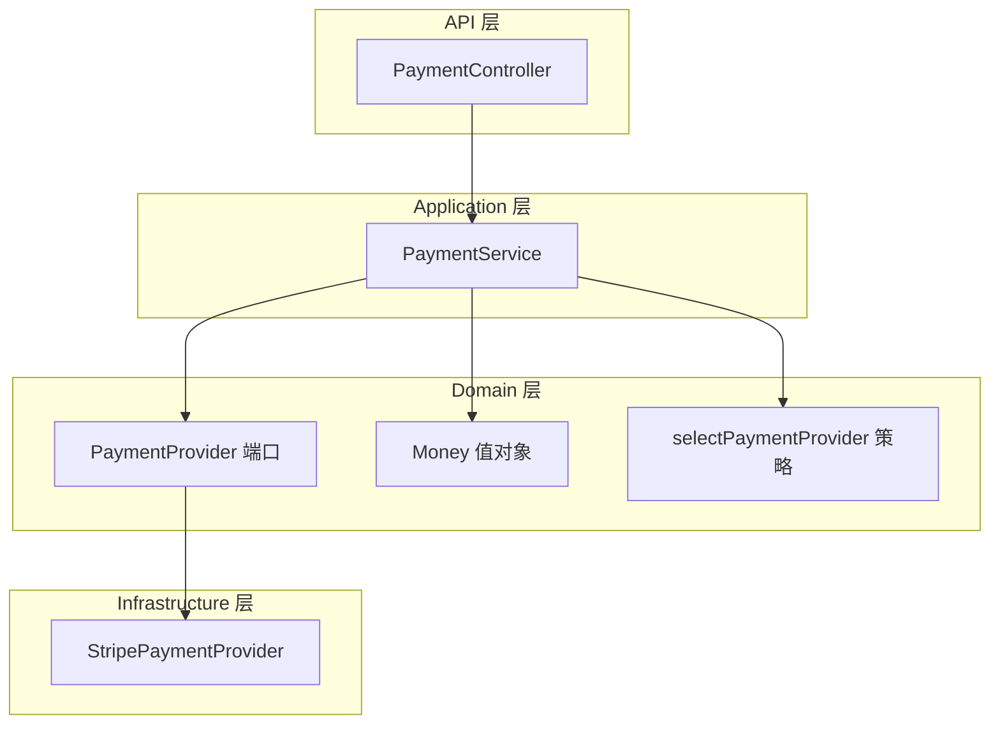
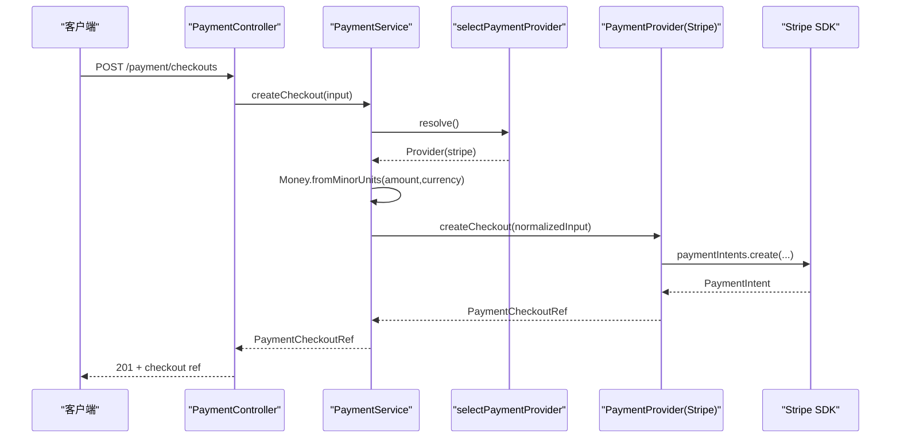
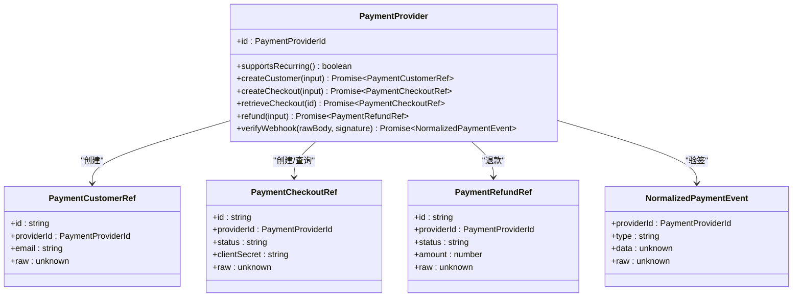
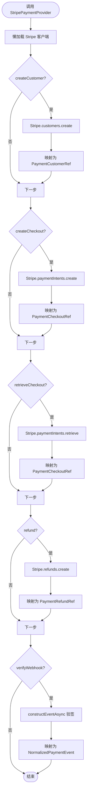
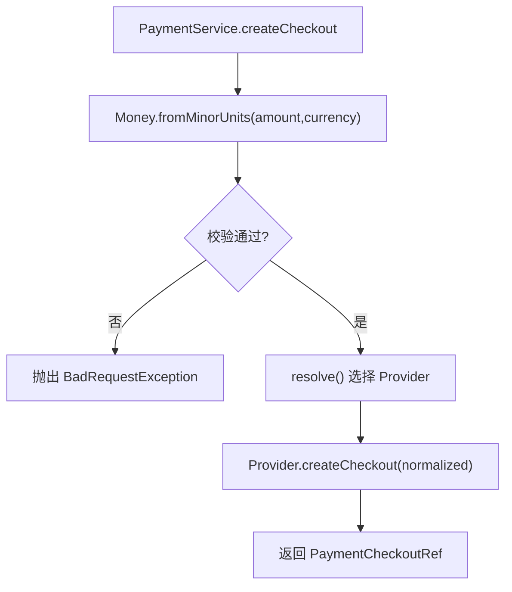
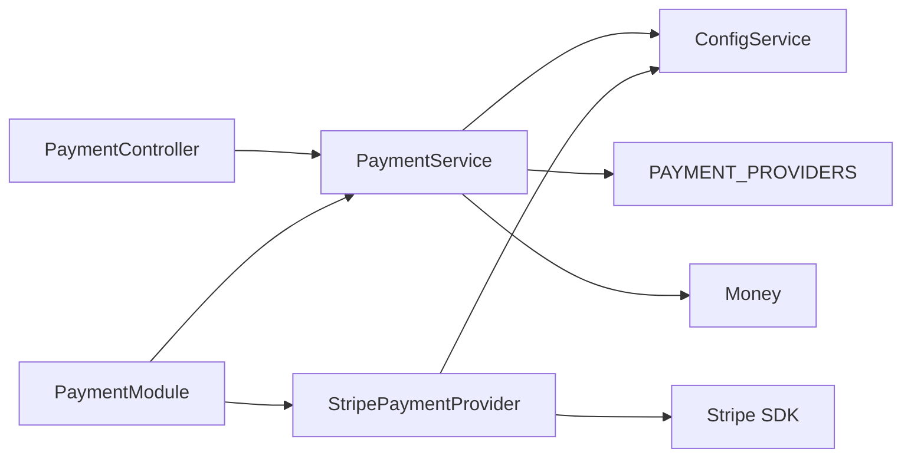

# 支付 Provider 扩展

<cite>
**本文引用的文件 **
- [payment-provider.port.ts](file://apps/api/src/modules/payment/domain/ports/payment-provider.port.ts)
- [stripe-payment.provider.ts](file://apps/api/src/modules/payment/infrastructure/stripe-payment.provider.ts)
- [payment.service.ts](file://apps/api/src/modules/payment/application/payment.service.ts)
- [money.ts](file://apps/api/src/modules/payment/domain/value-objects/money.ts)
- [payment.module.ts](file://apps/api/src/modules/payment/payment.module.ts)
- [payment.controller.ts](file://apps/api/src/modules/payment/api/payment.controller.ts)
- [provider-selection.policy.ts](file://apps/api/src/modules/payment/domain/policies/provider-selection.policy.ts)
</cite>

## 目录
1. [引言](#引言)
2. [项目结构](#项目结构)
3. [核心组件](#核心组件)
4. [架构总览](#架构总览)
5. [详细组件分析](#详细组件分析)
6. [依赖关系分析](#依赖关系分析)
7. [性能与可靠性](#性能与可靠性)
8. [安全与幂等性](#安全与幂等性)
9. [新增支付渠道集成指南](#新增支付渠道集成指南)
10. [故障排查](#故障排查)
11. [结论](#结论)

## 引言
本文面向需要在现有 SaaS 后端中接入或扩展支付渠道的开发者，系统性说明“支付 Provider 扩展”的设计与实现。重点包括：
- PaymentProvider 端口接口的设计模式与职责边界
- Stripe 支付提供商的具体实现（客户、结账、退款、Webhook）
- Money 值对象在金额与货币处理中的使用
- 支付流程的状态管理、安全考虑与幂等性保证
- 新增支付渠道的适配步骤、测试要点与生产部署注意事项

## 项目结构
支付模块采用分层与领域驱动风格组织：
- API 层：REST 控制器暴露支付相关端点，负责入参校验、路由与响应序列化
- Application 层：PaymentService 编排业务逻辑，选择具体 Provider，并做输入不变量校验
- Domain 层：定义 PaymentProvider 端口、Money 值对象与通道选择策略
- Infrastructure 层：StripePaymentProvider 对接 Stripe SDK

图表来源
- [payment.controller.ts:66-172](file://apps/api/src/modules/payment/api/payment.controller.ts#L66-L172)
- [payment.service.ts:32-123](file://apps/api/src/modules/payment/application/payment.service.ts#L32-L123)
- [payment-provider.port.ts:124-157](file://apps/api/src/modules/payment/domain/ports/payment-provider.port.ts#L124-L157)
- [money.ts:23-43](file://apps/api/src/modules/payment/domain/value-objects/money.ts#L23-L43)
- [provider-selection.policy.ts:13-17](file://apps/api/src/modules/payment/domain/policies/provider-selection.policy.ts#L13-L17)
- [stripe-payment.provider.ts:19-107](file://apps/api/src/modules/payment/infrastructure/stripe-payment.provider.ts#L19-L107)

章节来源
- [payment.controller.ts:66-172](file://apps/api/src/modules/payment/api/payment.controller.ts#L66-L172)
- [payment.service.ts:32-123](file://apps/api/src/modules/payment/application/payment.service.ts#L32-L123)
- [payment-provider.port.ts:124-157](file://apps/api/src/modules/payment/domain/ports/payment-provider.port.ts#L124-L157)
- [money.ts:23-43](file://apps/api/src/modules/payment/domain/value-objects/money.ts#L23-L43)
- [provider-selection.policy.ts:13-17](file://apps/api/src/modules/payment/domain/policies/provider-selection.policy.ts#L13-L17)
- [stripe-payment.provider.ts:19-107](file://apps/api/src/modules/payment/infrastructure/stripe-payment.provider.ts#L19-L107)

## 核心组件
- PaymentProvider 端口：统一抽象所有支付通道能力，包括创建客户、下单/收款意图、查询结账、退款、验签 Webhook，以及周期性扣款能力门
- StripePaymentProvider：Stripe 通道的具体实现，将 Stripe 原生对象归一化为跨通道一致的结构
- PaymentService：应用编排层，按配置选择 Provider，并在创建结账前用 Money 值对象校验金额与币种
- Money：不可变值对象，封装最小货币单位金额与 ISO 货币码，提供构造失败的原因联合
- PaymentModule：动态注册 Provider，根据配置决定是否注入 Stripe 通道
- PaymentController：对外暴露 REST 端点，包含 Webhook 原始请求入口

章节来源
- [payment-provider.port.ts:1-157](file://apps/api/src/modules/payment/domain/ports/payment-provider.port.ts#L1-L157)
- [stripe-payment.provider.ts:1-107](file://apps/api/src/modules/payment/infrastructure/stripe-payment.provider.ts#L1-L107)
- [payment.service.ts:1-123](file://apps/api/src/modules/payment/application/payment.service.ts#L1-L123)
- [money.ts:1-45](file://apps/api/src/modules/payment/domain/value-objects/money.ts#L1-L45)
- [payment.module.ts:1-48](file://apps/api/src/modules/payment/payment.module.ts#L1-L48)
- [payment.controller.ts:1-173](file://apps/api/src/modules/payment/api/payment.controller.ts#L1-L173)

## 架构总览
支付模块通过“端口 + 适配器”解耦领域与第三方服务；应用层仅依赖端口，基础设施层实现具体通道。

图表来源
- [payment.controller.ts:103-110](file://apps/api/src/modules/payment/api/payment.controller.ts#L103-L110)
- [payment.service.ts:75-82](file://apps/api/src/modules/payment/application/payment.service.ts#L75-L82)
- [provider-selection.policy.ts:13-17](file://apps/api/src/modules/payment/domain/policies/provider-selection.policy.ts#L13-L17)
- [stripe-payment.provider.ts:57-65](file://apps/api/src/modules/payment/infrastructure/stripe-payment.provider.ts#L57-L65)

## 详细组件分析

### PaymentProvider 端口设计
- 统一标识 id 与 supportsRecurring 能力门，屏蔽不同通道的订阅/周期扣款差异
- 标准化三类引用：客户、结账、退款，均携带 providerId 与 raw 透传字段，便于渐进迁移与调试
- verifyWebhook 返回 NormalizedPaymentEvent，统一事件类型与数据载荷
- 该端口位于 domain 层，零框架依赖，确保领域稳定

图表来源
- [payment-provider.port.ts:11-157](file://apps/api/src/modules/payment/domain/ports/payment-provider.port.ts#L11-L157)

章节来源
- [payment-provider.port.ts:1-157](file://apps/api/src/modules/payment/domain/ports/payment-provider.port.ts#L1-L157)

### StripePaymentProvider 实现
- 懒初始化 Stripe 客户端，避免启动期强依赖
- createCustomer：映射 email/name/metadata 到 Stripe Customer
- createCheckout/retrieveCheckout：映射 PaymentIntent，返回统一 Checkout 引用
- refund：基于 PaymentIntent 发起退款，返回统一 Refund 引用
- verifyWebhook：使用 webhookSecret 验签并返回归一化事件

图表来源
- [stripe-payment.provider.ts:28-96](file://apps/api/src/modules/payment/infrastructure/stripe-payment.provider.ts#L28-L96)

章节来源
- [stripe-payment.provider.ts:1-107](file://apps/api/src/modules/payment/infrastructure/stripe-payment.provider.ts#L1-L107)

### PaymentService 编排与 Money 值对象
- 懒解析 Provider：构造期不校验，实际调用时若无可用 Provider 抛出服务不可用异常
- createCheckout 先经 Money.fromMinorUnits 校验金额与币种，再委托 Provider
- describe/supporstRecurring/refund/retrieveCheckout/verifyWebhook 均为薄包装，保持领域与基础设施解耦

图表来源
- [payment.service.ts:75-82](file://apps/api/src/modules/payment/application/payment.service.ts#L75-L82)
- [money.ts:35-43](file://apps/api/src/modules/payment/domain/value-objects/money.ts#L35-L43)

章节来源
- [payment.service.ts:32-123](file://apps/api/src/modules/payment/application/payment.service.ts#L32-L123)
- [money.ts:1-45](file://apps/api/src/modules/payment/domain/value-objects/money.ts#L1-L45)

### PaymentModule 动态装配
- 根据 ConfigService.getStripeConfig 是否含 secretKey 决定是否注册 Stripe 通道
- 预留 alipay/wechat_pay 扩展点，按环境变量追加 Provider
- 以 'PAYMENT_PROVIDERS' 令牌注入 Record<string, PaymentProvider>

章节来源
- [payment.module.ts:1-48](file://apps/api/src/modules/payment/payment.module.ts#L1-L48)

### PaymentController 端点与 Webhook
- 常规端点：test/createCustomer/createCheckout/retrieveCheckout/refund，均委托 PaymentService
- Webhook 端点保留 REST 原始请求体，用于 Stripe 签名校验；事件分发点在 switch(event.type)
- 非 Webhook 路由豁免租户隔离但仍受会话守卫保护；Webhook 方法级 @Public 旁路会话墙

章节来源
- [payment.controller.ts:66-172](file://apps/api/src/modules/payment/api/payment.controller.ts#L66-L172)

## 依赖关系分析
- PaymentController 依赖 PaymentService
- PaymentService 依赖 ConfigService、'PAYMENT_PROVIDERS' 与 Money
- PaymentModule 导出 PaymentService，并动态注册 StripePaymentProvider
- StripePaymentProvider 依赖 ConfigService 与 Stripe SDK

图表来源
- [payment.controller.ts:66-172](file://apps/api/src/modules/payment/api/payment.controller.ts#L66-L172)
- [payment.service.ts:32-123](file://apps/api/src/modules/payment/application/payment.service.ts#L32-L123)
- [payment.module.ts:1-48](file://apps/api/src/modules/payment/payment.module.ts#L1-L48)
- [stripe-payment.provider.ts:1-107](file://apps/api/src/modules/payment/infrastructure/stripe-payment.provider.ts#L1-L107)

章节来源
- [payment.controller.ts:66-172](file://apps/api/src/modules/payment/api/payment.controller.ts#L66-L172)
- [payment.service.ts:32-123](file://apps/api/src/modules/payment/application/payment.service.ts#L32-L123)
- [payment.module.ts:1-48](file://apps/api/src/modules/payment/payment.module.ts#L1-L48)
- [stripe-payment.provider.ts:1-107](file://apps/api/src/modules/payment/infrastructure/stripe-payment.provider.ts#L1-L107)

## 性能与可靠性
- 懒初始化 Stripe 客户端：仅在首次调用时创建，减少启动开销
- 懒解析 Provider：未配置通道不会导致启动失败，按需报错
- 幂等建议：对退款与 Webhook 处理应结合外部幂等键（如订单号+操作类型），避免重复入账或重复退款
- 重试策略：对 Stripe SDK 的网络错误可在基础设施层增加指数退避重试；注意区分可重试与不可重试错误
- 资源释放：Stripe 客户端为轻量实例，无需显式关闭；但应避免在高频路径中重复构造

[本节为通用指导，不直接分析具体文件]

## 安全与幂等性
- Webhook 安全：必须使用 Stripe webhookSecret 进行签名校验，禁止信任未经校验的请求体
- 权限控制：Webhook 端点使用 @Public 旁路会话墙，但依赖 Stripe 签名而非会话；其他端点仍受全局会话守卫保护
- 租户隔离：非 Webhook 路由豁免租户墙，因为支付通道侧实体不属于租户仓储；Webhook 需自行关联租户上下文
- 幂等性：建议在应用层维护幂等表（如 order_id + action），在处理 Webhook 与退款前检查是否已处理
- 敏感信息：secret key、webhookSecret 等通过配置注入，严禁硬编码或日志输出

章节来源
- [payment.controller.ts:147-171](file://apps/api/src/modules/payment/api/payment.controller.ts#L147-L171)
- [stripe-payment.provider.ts:87-96](file://apps/api/src/modules/payment/infrastructure/stripe-payment.provider.ts#L87-L96)

## 新增支付渠道集成指南

### 1. 定义新的 Provider 实现
- 新建类实现 PaymentProvider 端口，提供 id、supportsRecurring、createCustomer、createCheckout、retrieveCheckout、refund、verifyWebhook
- 将第三方 SDK 的原生对象映射为统一的 PaymentCustomerRef/PaymentCheckoutRef/PaymentRefundRef/NormalizedPaymentEvent
- 若支持周期扣款，supportsRecurring 返回 true；否则返回 false

章节来源
- [payment-provider.port.ts:124-157](file://apps/api/src/modules/payment/domain/ports/payment-provider.port.ts#L124-L157)

### 2. 在 PaymentModule 中注册
- 在 PaymentModule.register 中按环境变量判断是否注册新 Provider
- 使用 'PAYMENT_PROVIDERS' 令牌注入到 Record<string, PaymentProvider>

章节来源
- [payment.module.ts:20-42](file://apps/api/src/modules/payment/payment.module.ts#L20-L42)

### 3. 配置与选择
- 在配置中启用新通道 id（如 'alipay'/'wechat_pay'）
- selectPaymentProvider 会优先使用 wanted 通道，未注册则回落到 stripe

章节来源
- [provider-selection.policy.ts:13-17](file://apps/api/src/modules/payment/domain/policies/provider-selection.policy.ts#L13-L17)

### 4. 编写测试用例
- 单元测试：模拟 Provider 行为，验证 PaymentService 的选择与降级逻辑
- 契约测试：校验 API 输入输出 schema 与返回值结构
- 端到端测试：在沙箱环境调用第三方支付 SDK，验证 Webhook 验签与状态流转

章节来源
- [payment.service.ts:112-122](file://apps/api/src/modules/payment/application/payment.service.ts#L112-L122)

### 5. 生产部署注意事项
- 配置项：确保新通道的密钥、回调地址、签名密钥等配置正确
- 网络与超时：合理设置 SDK 超时与重试策略，避免雪崩
- 监控与告警：记录关键指标（成功率、延迟、错误码）、对失败事件告警
- 灰度发布：逐步切换流量，观察对账与退款一致性

[本节为通用指导，不直接分析具体文件]

## 故障排查
- 无可用 Provider：当未配置任何通道时，调用支付操作会抛出服务不可用异常；检查 PaymentModule 注册与配置
- 金额或币种非法：Money.fromMinorUnits 校验失败会抛出参数错误；检查前端传入的最小单位金额与 ISO 货币码
- Webhook 验签失败：确认请求体未被篡改、签名头正确、webhookSecret 匹配
- 退款失败：核对 checkoutId 与 amount 是否在允许范围内，原因字段是否符合通道要求

章节来源
- [payment.service.ts:112-122](file://apps/api/src/modules/payment/application/payment.service.ts#L112-L122)
- [money.ts:35-43](file://apps/api/src/modules/payment/domain/value-objects/money.ts#L35-L43)
- [stripe-payment.provider.ts:87-96](file://apps/api/src/modules/payment/infrastructure/stripe-payment.provider.ts#L87-L96)

## 结论
本方案通过 PaymentProvider 端口抽象支付通道，结合 StripePaymentProvider 的具体实现与 PaymentService 的编排，实现了可扩展、可测试、可演进的支付体系。Money 值对象确保金额与货币的领域语义与不变量约束；PaymentModule 的动态装配与懒解析提升了系统的健壮性与可配置性。新增支付渠道只需实现端口并在模块中注册，即可无缝融入现有流程。在生产环境中，应重点关注 Webhook 安全、幂等性、重试策略与监控告警，以确保资金链路的安全与稳定。