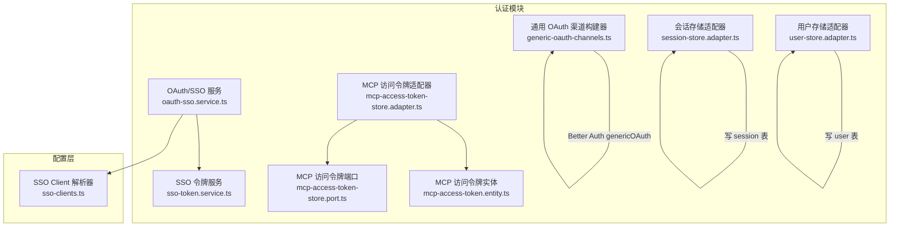
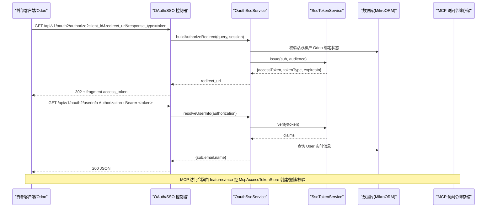
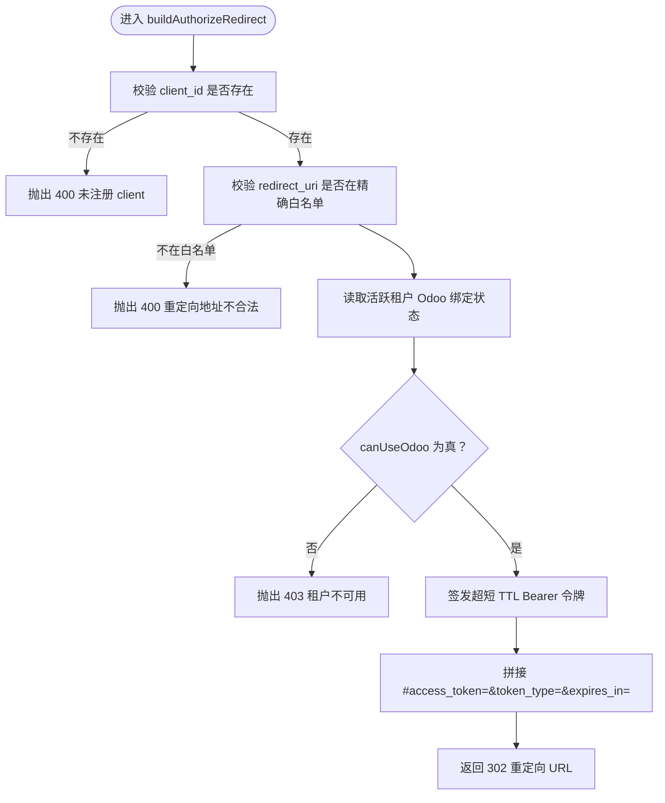
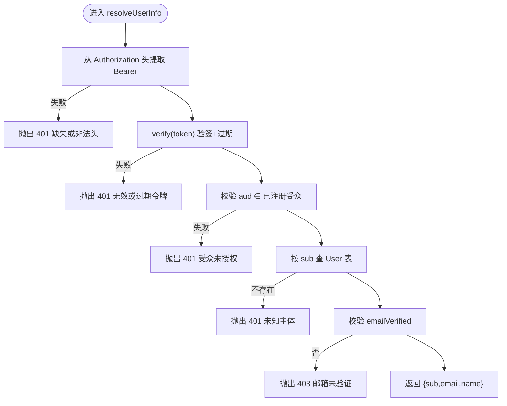
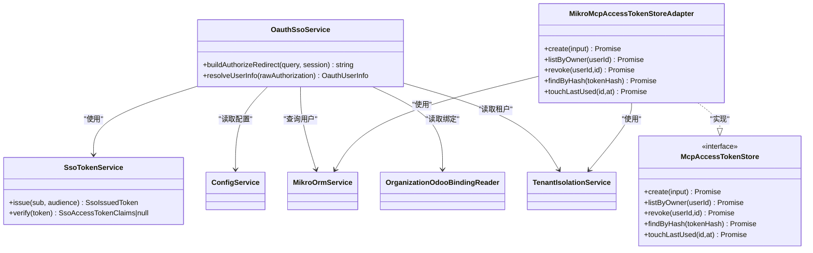

# 认证 Provider 扩展

<cite>
**本文引用的文件**   
- [oauth-sso.e2e.test.ts](file://apps/api/src/modules/auth/oauth-sso.e2e.test.ts)
- [oauth-sso.service.ts](file://apps/api/src/modules/auth/infrastructure/oauth-sso.service.ts)
- [sso-token.service.ts](file://apps/api/src/modules/auth/infrastructure/sso-token.service.ts)
- [generic-oauth-channels.ts](file://apps/api/src/modules/auth/infrastructure/generic-oauth-channels.ts)
- [mcp-access-token-store.port.ts](file://apps/api/src/modules/auth/application/ports/mcp-access-token-store.port.ts)
- [mcp-access-token-store.adapter.ts](file://apps/api/src/modules/auth/infrastructure/mcp-access-token-store.adapter.ts)
- [mcp-access-token.entity.ts](file://apps/api/src/modules/auth/infrastructure/entities/mcp-access-token.entity.ts)
- [session-store.adapter.ts](file://apps/api/src/modules/auth/infrastructure/session-store.adapter.ts)
- [session-store.port.ts](file://apps/api/src/modules/auth/domain/ports/session-store.port.ts)
- [user-store.adapter.ts](file://apps/api/src/modules/auth/infrastructure/user-store.adapter.ts)
- [user-store.port.ts](file://apps/api/src/modules/auth/domain/ports/user-store.port.ts)
- [sso-clients.ts](file://apps/api/src/config/envs/sso-clients.ts)
</cite>

## 目录
1. [引言](#引言)
2. [项目结构](#项目结构)
3. [核心组件](#核心组件)
4. [架构总览](#架构总览)
5. [详细组件分析](#详细组件分析)
6. [依赖关系分析](#依赖关系分析)
7. [性能与可扩展性](#性能与可扩展性)
8. [故障排查指南](#故障排查指南)
9. [结论](#结论)
10. [附录：第三方 Provider 集成示例](#附录第三方-provider-集成示例)

## 引言
本文件面向需要在系统中扩展“认证 Provider”的开发者，聚焦以下目标：
- 自定义 OAuth2/SSO 身份提供者的接入方式与注册机制。
- 解释隐式流令牌交换、用户信息映射、以及 MCP 访问令牌的存储与校验流程。
- 说明会话管理、权限映射、租户隔离与生命周期控制。
- 给出 GitHub、Google、企业 SSO 等常见场景的集成思路与安全最佳实践（CSRF、令牌刷新、审计日志）。

本项目在 auth 模块内实现了两类能力：
- 面向外部系统（如 Odoo）的极简 OIDC OP：通过 `authorize` 端点签发超短 TTL 的 Bearer 访问令牌，并通过 `/userinfo` 返回权威用户信息。
- 面向内部登录渠道的 Generic OAuth 通道：以 Better Auth 插件形式接入飞书等渠道，复用现有邮箱账号体系。

同时，MCP 访问令牌作为“租级有界委托凭证”，由 auth 域属主维护，供 features/mcp 编排面调用。

## 项目结构
与认证 Provider 扩展直接相关的代码集中在 `apps/api/src/modules/auth` 下，并辅以配置层 `apps/api/src/config/envs`。

图表来源
- [oauth-sso.service.ts:22-117](file://apps/api/src/modules/auth/infrastructure/oauth-sso.service.ts#L22-L117)
- [sso-token.service.ts:42-106](file://apps/api/src/modules/auth/infrastructure/sso-token.service.ts#L42-L106)
- [generic-oauth-channels.ts:3-13](file://apps/api/src/modules/auth/infrastructure/generic-oauth-channels.ts#LL3-L13)
- [mcp-access-token-store.port.ts:45-77](file://apps/api/src/modules/auth/application/ports/mcp-access-token-store.port.ts#L45-L77)
- [mcp-access-token-store.adapter.ts:13-21](file://apps/api/src/modules/auth/infrastructure/mcp-access-token-store.adapter.ts#L13-L21)
- [mcp-access-token.entity.ts:5-18](file://apps/api/src/modules/auth/infrastructure/entities/mcp-access-token.entity.ts#L5-L18)
- [session-store.adapter.ts:6-13](file://apps/api/src/modules/auth/infrastructure/session-store.adapter.ts#L6-L13)
- [user-store.adapter.ts:6-13](file://apps/api/src/modules/auth/infrastructure/user-store.adapter.ts#L6-L13)
- [sso-clients.ts:3-10](file://apps/api/src/config/envs/sso-clients.ts#L3-L10)

章节来源
- [oauth-sso.service.ts:22-117](file://apps/api/src/modules/auth/infrastructure/oauth-sso.service.ts#L22-L117)
- [generic-oauth-channels.ts:3-13](file://apps/api/src/modules/auth/infrastructure/generic-oauth-channels.ts#L3-L13)
- [mcp-access-token-store.port.ts:45-77](file://apps/api/src/modules/auth/application/ports/mcp-access-token-store.port.ts#L45-L77)
- [sso-clients.ts:3-10](file://apps/api/src/config/envs/sso-clients.ts#L3-L10)

## 核心组件
- OAuth/SSO 服务：负责 client 白名单校验、redirect_uri 精确匹配、Odoo 可用性门禁、签发隐式流 fragment 令牌，以及验签后返回权威 userinfo。
- SSO 令牌服务：基于 HS256 紧凑 JWS 实现超短 TTL 访问令牌的签发与验签，包含 aud 绑定与防重放 jti。
- 通用 OAuth 渠道构建器：为 Better Auth 的 genericOAuth 插件装配各渠道配置，当前已落地飞书，其他渠道为接口位。
- MCP 访问令牌端口与适配器：定义受控读写入口，并以 MikroORM 实现落库；实体层面明确哈希唯一、撤销软位、租户隔离。
- 会话与用户存储适配器：对 session/user 表的受控写入，保证跨上下文写路径合规与事务一致性。
- SSO Client 配置解析：从环境变量解析 client 注册表，fail-closed 默认无注册即拒绝所有 authorize 请求。

章节来源
- [oauth-sso.service.ts:22-117](file://apps/api/src/modules/auth/infrastructure/oauth-sso.service.ts#L22-L117)
- [sso-token.service.ts:42-106](file://apps/api/src/modules/auth/infrastructure/sso-token.service.ts#L42-L106)
- [generic-oauth-channels.ts:3-13](file://apps/api/src/modules/auth/infrastructure/generic-oauth-channels.ts#L3-L13)
- [mcp-access-token-store.port.ts:45-77](file://apps/api/src/modules/auth/application/ports/mcp-access-token-store.port.ts#L45-L77)
- [mcp-access-token-store.adapter.ts:13-21](file://apps/api/src/modules/auth/infrastructure/mcp-access-token-store.adapter.ts#L13-L21)
- [mcp-access-token.entity.ts:5-18](file://apps/api/src/modules/auth/infrastructure/entities/mcp-access-token.entity.ts#L5-L18)
- [session-store.adapter.ts:6-13](file://apps/api/src/modules/auth/infrastructure/session-store.adapter.ts#L6-L13)
- [user-store.adapter.ts:6-13](file://apps/api/src/modules/auth/infrastructure/user-store.adapter.ts#L6-L13)
- [sso-clients.ts:3-10](file://apps/api/src/config/envs/sso-clients.ts#L3-L10)

## 架构总览
下图展示 OAuth2/SSO 隐式流与 MCP 访问令牌的端到端交互。

图表来源
- [oauth-sso.e2e.test.ts:131-163](file://apps/api/src/modules/auth/oauth-sso.e2e.test.ts#L131-L163)
- [oauth-sso.e2e.test.ts:205-218](file://apps/api/src/modules/auth/oauth-sso.e2e.test.ts#L205-L218)
- [oauth-sso.service.ts:52-116](file://apps/api/src/modules/auth/infrastructure/oauth-sso.service.ts#L52-L116)
- [sso-token.service.ts:56-101](file://apps/api/src/modules/auth/infrastructure/sso-token.service.ts#L56-L101)
- [mcp-access-token-store.port.ts:45-77](file://apps/api/src/modules/auth/application/ports/mcp-access-token-store.port.ts#L45-L77)

## 详细组件分析

### OAuth/SSO 服务（authorize 与 userinfo）
职责要点：
- authorize：校验 client_id 是否在注册表；对 redirect_uri 做逐字节精确匹配；在铸令牌前检查活跃租户是否可进入 Odoo；生成超短 TTL 的 Bearer 令牌并拼接 fragment。
- userinfo：从 Authorization 头提取 Bearer；验签并校验 aud；从数据库读取权威用户信息；若邮箱未验证则拒绝。

关键流程（authorize）：

图表来源
- [oauth-sso.service.ts:52-90](file://apps/api/src/modules/auth/infrastructure/oauth-sso.service.ts#L52-L90)

关键流程（userinfo）：

图表来源
- [oauth-sso.service.ts:99-116](file://apps/api/src/modules/auth/infrastructure/oauth-sso.service.ts#L99-L116)

章节来源
- [oauth-sso.service.ts:22-117](file://apps/api/src/modules/auth/infrastructure/oauth-sso.service.ts#L22-L117)
- [oauth-sso.e2e.test.ts:131-163](file://apps/api/src/modules/auth/oauth-sso.e2e.test.ts#L131-L163)
- [oauth-sso.e2e.test.ts:205-218](file://apps/api/src/modules/auth/oauth-sso.e2e.test.ts#L205-L218)

### SSO 令牌服务（HS256 紧凑 JWS）
职责要点：
- issue：使用 HS256 对 header.payload 签名，注入 sub、aud、iss、iat、exp、jti，TTL 固定为极短时长。
- verify：校验三段结构、HMAC 签名、exp 未过期；aud 归属策略由调用方决定。

复杂度与安全性：
- 时间复杂度 O(1)，空间复杂度 O(1)。
- 使用 timingSafeEqual 比较签名，避免时序攻击。
- 通过 aud 绑定 client 受众，防止混淆副手攻击。

章节来源
- [sso-token.service.ts:42-106](file://apps/api/src/modules/auth/infrastructure/sso-token.service.ts#L42-L106)

### 通用 OAuth 渠道构建器（Better Auth genericOAuth）
职责要点：
- 为 Better Auth 的 genericOAuth 插件装配渠道配置。
- 当前仅实现飞书：自定义 getToken（JSON body）、getUserInfo（嵌套 data）、accountSubject（union_id/open_id/user_id），mapProfileToUser 补充 emailVerified=false。
- 其他渠道（微信、钉钉、企微）为接口位，未提供构建器时跳过注册，启动期输出诊断信息。

章节来源
- [generic-oauth-channels.ts:3-13](file://apps/api/src/modules/auth/infrastructure/generic-oauth-channels.ts#L3-L13)
- [generic-oauth-channels.ts:30-103](file://apps/api/src/modules/auth/infrastructure/generic-oauth-channels.ts#L30-L103)
- [generic-oauth-channels.ts:119-180](file://apps/api/src/modules/auth/infrastructure/generic-oauth-channels.ts#L119-L180)
- [generic-oauth-channels.ts:182-197](file://apps/api/src/modules/auth/infrastructure/generic-oauth-channels.ts#L182-L197)

### MCP 访问令牌存储端口与适配器
端口设计要点：
- create：由可信 ALS 盖章 tenantId，明文 token 不入库，只存 sha256 hex 与辨认前缀。
- listByOwner：按 userId 列出“我的凭证”，createdAt 降序。
- revoke：软撤销（revokedAt），幂等成功。
- findByHash：消费面校验时走全租单行查找（scoped:false），命中后安全由行自带 tenantId 承担。
- touchLastUsed：成功后刷 lastUsedAt，失败不阻断主路。

适配器实现要点：
- 所有写操作均 fork() 独立 em，避免共享状态。
- findByHash 使用 scoped:false 绕过租户过滤，但仅返回扁平记录不含敏感哈希。
- revoke 与 listByOwner 均带 tenantId 与 userId 双界约束。

章节来源
- [mcp-access-token-store.port.ts:45-77](file://apps/api/src/modules/auth/application/ports/mcp-access-token-store.port.ts#L45-L77)
- [mcp-access-token-store.adapter.ts:13-21](file://apps/api/src/modules/auth/infrastructure/mcp-access-token-store.adapter.ts#L13-L21)
- [mcp-access-token-store.adapter.ts:34-100](file://apps/api/src/modules/auth/infrastructure/mcp-access-token-store.adapter.ts#L34-L100)

### MCP 访问令牌实体
字段与约束要点：
- tokenHash 唯一索引，作为鉴权查找键。
- scopes 为 JSON 数组，表示授权面词汇。
- revokedAt 软撤销位，lastUsedAt 用于审计。
- 租户隔离过滤器启用，确保读侧隔离。

章节来源
- [mcp-access-token.entity.ts:5-18](file://apps/api/src/modules/auth/infrastructure/entities/mcp-access-token.entity.ts#L5-L18)
- [mcp-access-token.entity.ts:20-52](file://apps/api/src/modules/auth/infrastructure/entities/mcp-access-token.entity.ts#L20-L52)
- [mcp-access-token.entity.ts:54-76](file://apps/api/src/modules/auth/infrastructure/entities/mcp-access-token.entity.ts#L54-L76)

### 会话与用户存储适配器
会话存储：
- deleteAllForUser：删除用户全部会话，即时失权。
- setActiveTenant/clearActiveTenant：设置或清除会话的 activeTenantId，并与 activeOrganizationId 互斥，避免跨租借权。

用户存储：
- hardDelete：PIPL 硬删用户本体，FK 级联处理 account/session/consent。
- updateStatus：治理写 user.status/statusReason，更新 updatedAt。

章节来源
- [session-store.adapter.ts:6-13](file://apps/api/src/modules/auth/infrastructure/session-store.adapter.ts#L6-L13)
- [session-store.adapter.ts:18-46](file://apps/api/src/modules/auth/infrastructure/session-store.adapter.ts#L18-L46)
- [session-store.port.ts:8-17](file://apps/api/src/modules/auth/domain/ports/session-store.port.ts#L8-L17)
- [session-store.port.ts:18-42](file://apps/api/src/modules/auth/domain/ports/session-store.port.ts#L18-L42)
- [user-store.adapter.ts:6-13](file://apps/api/src/modules/auth/infrastructure/user-store.adapter.ts#L6-L13)
- [user-store.adapter.ts:18-41](file://apps/api/src/modules/auth/infrastructure/user-store.adapter.ts#L18-L41)
- [user-store.port.ts:8-15](file://apps/api/src/modules/auth/domain/ports/user-store.port.ts#L8-L15)
- [user-store.port.ts:16-31](file://apps/api/src/modules/auth/domain/ports/user-store.port.ts#L16-L31)

## 依赖关系分析
- OauthSsoService 依赖：
  - ConfigService：读取 SSO client 注册表与 JWT 密钥。
  - SsoTokenService：签发与验签访问令牌。
  - MikroOrmService：查询 User 表获取权威用户信息。
  - OrganizationOdooBindingReader + canUseOdoo：判断活跃租户是否可进入 Odoo。
  - TenantIsolationService：读取活跃租户 ID。

- SsoTokenService 依赖：
  - ConfigService：读取 JWT secret 与应用名。

- MCP 访问令牌适配器依赖：
  - MikroOrmService：执行 CRUD。
  - TenantIsolationService：fail-closed 获取 activeTenantId。

图表来源
- [oauth-sso.service.ts:34-42](file://apps/api/src/modules/auth/infrastructure/oauth-sso.service.ts#L34-L42)
- [sso-token.service.ts:52-54](file://apps/api/src/modules/auth/infrastructure/sso-token.service.ts#L52-L54)
- [mcp-access-token-store.port.ts:57-77](file://apps/api/src/modules/auth/application/ports/mcp-access-token-store.port.ts#L57-L77)
- [mcp-access-token-store.adapter.ts:22-27](file://apps/api/src/modules/auth/infrastructure/mcp-access-token-store.adapter.ts#L22-L27)

章节来源
- [oauth-sso.service.ts:34-42](file://apps/api/src/modules/auth/infrastructure/oauth-sso.service.ts#L34-L42)
- [sso-token.service.ts:52-54](file://apps/api/src/modules/auth/infrastructure/sso-token.service.ts#L52-L54)
- [mcp-access-token-store.adapter.ts:22-27](file://apps/api/src/modules/auth/infrastructure/mcp-access-token-store.adapter.ts#L22-L27)

## 性能与可扩展性
- 令牌签发与验签：HS256 计算开销极低，TTL 极短降低泄露风险与缓存压力。
- 数据库访问：所有写操作使用 fork() 隔离 em，避免共享状态；MCP 令牌查找使用唯一索引，O(log n) 级别。
- 可扩展性：
  - 新增 SSO client：通过环境变量配置，无需改代码。
  - 新增 Generic OAuth 渠道：在 CHANNEL_BUILDERS 中增加构建器，并在 KNOWN_GENERIC_CHANNELS 登记。
  - MCP 访问令牌：端口抽象便于替换底层存储（如 Redis），但需保持哈希唯一与租户隔离语义。

[本节为一般性指导，不直接分析具体文件]

## 故障排查指南
常见问题与建议：
- authorize 返回 400：
  - 检查 client_id 是否已在 SSO_OAUTH_CLIENTS 注册。
  - 检查 redirect_uri 是否与注册表完全一致（非前缀匹配）。
- authorize 返回 403：
  - 检查活跃租户是否已绑定 Odoo 且处于可用状态。
- userinfo 返回 401：
  - 检查 Authorization 头格式是否为 Bearer。
  - 检查令牌是否过期或 aud 是否属于已注册受众。
- userinfo 返回 403：
  - 检查用户邮箱是否已验证。
- MCP 令牌无法校验：
  - 确认 tokenHash 是否正确（sha256 hex）。
  - 确认令牌未被撤销（revokedAt 为空）。
  - 确认 expiresAt 未过期。

章节来源
- [oauth-sso.e2e.test.ts:187-203](file://apps/api/src/modules/auth/oauth-sso.e2e.test.ts#L187-L203)
- [oauth-sso.e2e.test.ts:220-238](file://apps/api/src/modules/auth/oauth-sso.e2e.test.ts#L220-L238)
- [mcp-access-token-store.adapter.ts:76-100](file://apps/api/src/modules/auth/infrastructure/mcp-access-token-store.adapter.ts#L76-L100)

## 结论
本项目的认证 Provider 扩展围绕两条主线展开：
- 对外：通过极简 OIDC OP 为外部系统（如 Odoo）提供隐式流令牌与权威 userinfo，强调 fail-closed 的门禁策略与超短 TTL 令牌。
- 对内：通过 Better Auth 的 genericOAuth 接入境内渠道，复用邮箱账号体系，并以端口化设计扩展 MCP 访问令牌的生命周期管理。

建议在扩展时遵循：
- 严格白名单与精确匹配（client_id、redirect_uri、aud）。
- 令牌最小暴露面（超短 TTL、aud 绑定、jti 防重放）。
- 数据权威源（userinfo 取实时用户表而非 claims）。
- 租户隔离与会话激活位互斥，避免跨租借权。
- 审计留痕（lastUsedAt、revokedAt、statusReason）。

[本节为总结性内容，不直接分析具体文件]

## 附录：第三方 Provider 集成示例

### GitHub 集成（建议方案）
- 类型：Generic OAuth 渠道（Better Auth genericOAuth）。
- 关键点：
  - 配置 authorizationUrl、tokenUrl、userInfoUrl。
  - 使用 PKCE（authorization_code + PKCE）提升安全性。
  - mapProfileToUser 将 GitHub profile 映射到 name/email/image，emailVerified 根据平台策略设定。
  - accountSubject 使用 GitHub 稳定 id（如 login 或 id）。
- 安全建议：
  - 启用 CSRF 防护（state 参数）。
  - 限制 scope 至必要范围（如 read:user）。
  - 校验 redirect_uri 精确匹配。

### Google 集成（建议方案）
- 类型：Generic OAuth 渠道（Better Auth genericOAuth）。
- 关键点：
  - 配置 Google 的 authorize/token/userinfo 端点。
  - 使用 PKCE。
  - mapProfileToUser 映射 name/email/picture。
  - accountSubject 使用 Google 稳定 sub。
- 安全建议：
  - 校验 aud/iss（若使用 ID Token）。
  - 限制 scope（openid profile email）。
  - 启用 CSRF 防护（state）。

### 企业 SSO（SAML/OIDC）集成（建议方案）
- 类型：若为企业 OIDC，可作为 Generic OAuth 渠道；若为 SAML，需额外适配 SAML IdP。
- 关键点：
  - 对接企业 IdP 的 metadata 或手动配置端点。
  - 使用 state 与 nonce 防 CSRF 与重放。
  - 对用户属性进行映射（name/email/roles），结合 RBAC 做权限映射。
- 安全建议：
  - 强制 HTTPS。
  - 限制 redirect_uri 精确匹配。
  - 审计日志记录登录事件与权限变更。

[本节为概念性指导，不直接分析具体文件]