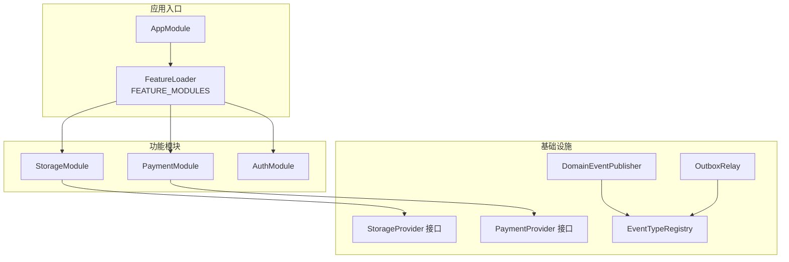
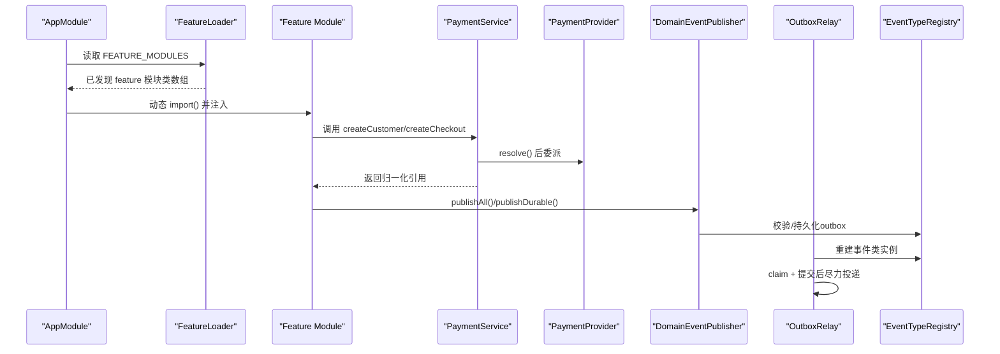
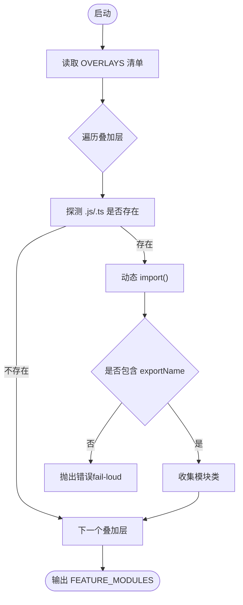
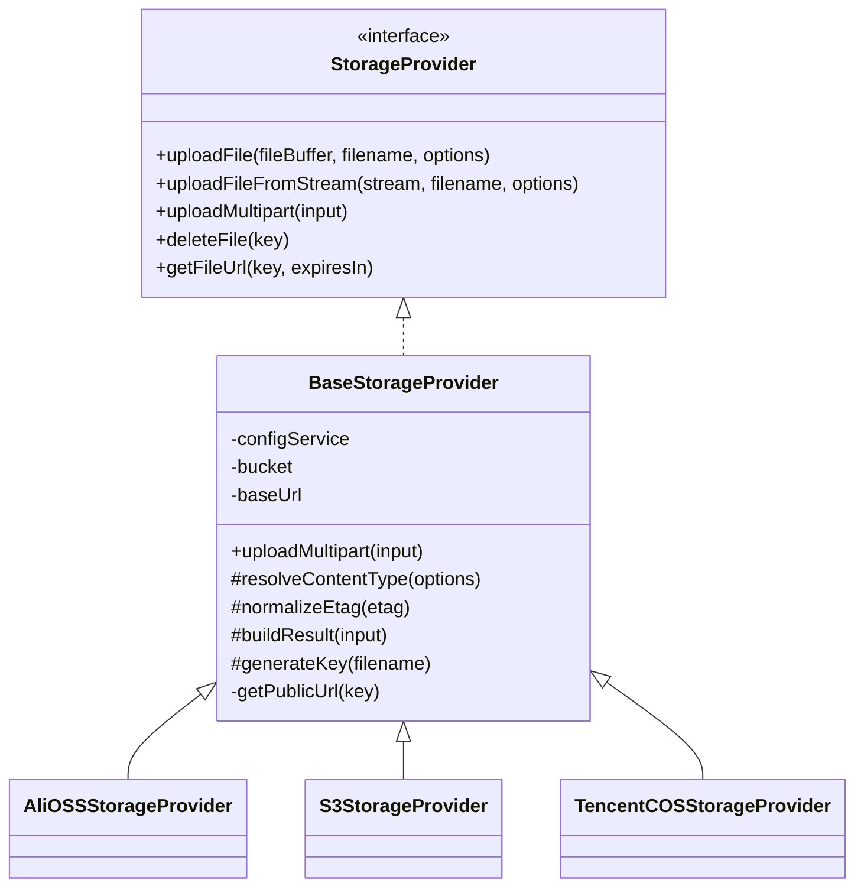
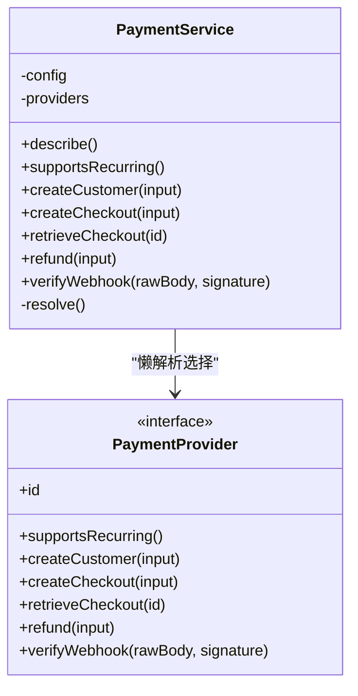
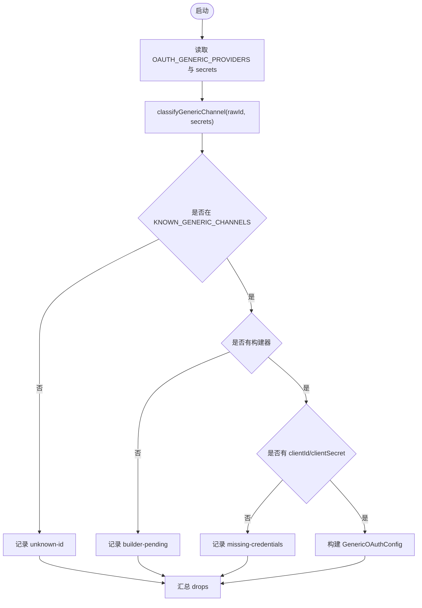
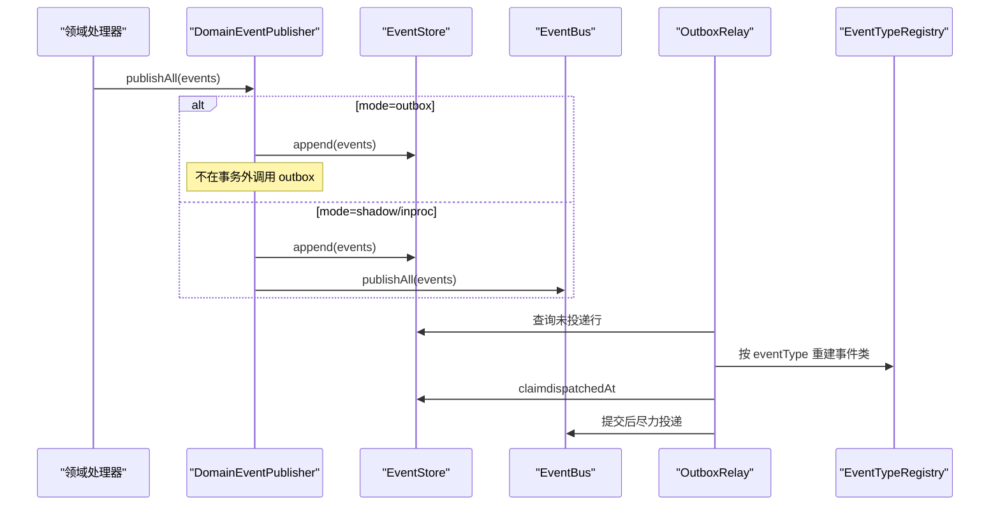
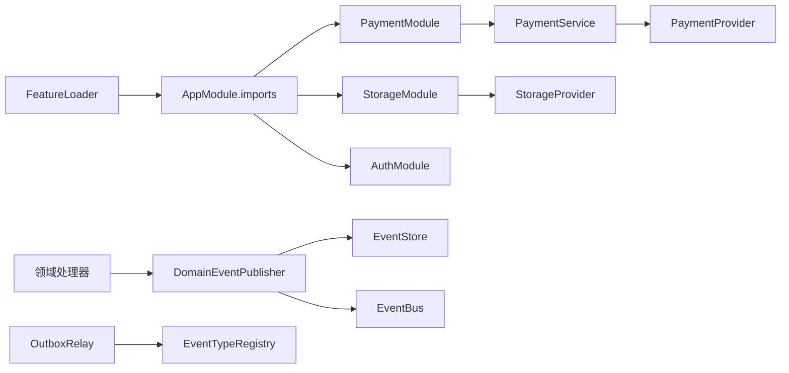

# 扩展开发

<cite>
**本文引用的文件**   
- [apps/api/src/features/feature-loader.ts](file://apps/api/src/features/feature-loader.ts)
- [apps/api/src/modules/storage/domain/ports/storage-provider.port.ts](file://apps/api/src/modules/storage/domain/ports/storage-provider.port.ts)
- [apps/api/src/modules/storage/infrastructure/base-storage.provider.ts](file://apps/api/src/modules/storage/infrastructure/base-storage.provider.ts)
- [apps/api/src/modules/payment/domain/ports/payment-provider.port.ts](file://apps/api/src/modules/payment/domain/ports/payment-provider.port.ts)
- [apps/api/src/modules/payment/application/payment.service.ts](file://apps/api/src/modules/payment/application/payment.service.ts)
- [apps/api/src/modules/auth/infrastructure/generic-oauth-channels.ts](file://apps/api/src/modules/auth/infrastructure/generic-oauth-channels.ts)
- [apps/api/src/database/eventing/domain-event-publisher.ts](file://apps/api/src/database/eventing/domain-event-publisher.ts)
- [apps/api/src/database/eventing/outbox-relay.ts](file://apps/api/src/database/eventing/outbox-relay.ts)
- [apps/api/src/database/eventing/event-type-registry.ts](file://apps/api/src/database/eventing/event-type-registry.ts)
- [libs/core/src/shared-kernel/domain/domain-event.ts](file://libs/core/src/shared-kernel/domain/domain-event.ts)
- [libs/core/src/shared-kernel/domain/event-publisher.port.ts](file://libs/core/src/shared-kernel/domain/event-publisher.port.ts)
</cite>

## 目录
1. [引言](#引言)
2. [项目结构](#项目结构)
3. [核心组件](#核心组件)
4. [架构总览](#架构总览)
5. [详细组件分析](#详细组件分析)
6. [依赖关系分析](#依赖关系分析)
7. [性能与可靠性考量](#性能与可靠性考量)
8. [扩展开发规范](#扩展开发规范)
9. [故障排查指南](#故障排查指南)
10. [结论](#结论)

## 引言
本文件面向需要在现有 SaaS 后端中扩展现有功能、接入新第三方能力的开发者。仓库采用 NestJS + DDD + Provider 抽象层 + Feature Overlay 的叠加装配模式，既保证核心能力稳定，又允许通过声明式注册和运行时模块加载扩展存储、支付、认证等能力，并通过领域事件与 Outbox 机制实现可靠异步集成。

## 项目结构
扩展相关的关键代码集中在 `apps/api/src`：
- `features/`：Feature Loader 与第三方叠加层（如 Odoo、MCP）。
- `modules/`：按业务域划分的功能模块，每个模块内部遵循 domain/application/infrastructure 分层，并在 infrastructure 提供具体 Provider 实现。
- `database/eventing/`：领域事件发布器、Outbox Relay、事件类型注册表。
- `libs/core/...`：框架无关的领域基类与端口定义。

**图表来源**
- [apps/api/src/features/feature-loader.ts:27-60](file://apps/api/src/features/feature-loader.ts#L27-L60)
- [apps/api/src/modules/storage/domain/ports/storage-provider.port.ts:35-100](file://apps/api/src/modules/storage/domain/ports/storage-provider.port.ts#L35-L100)
- [apps/api/src/modules/payment/domain/ports/payment-provider.port.ts:112-157](file://apps/api/src/modules/payment/domain/ports/payment-provider.port.ts#L112-L157)
- [apps/api/src/database/eventing/domain-event-publisher.ts:9-72](file://apps/api/src/database/eventing/domain-event-publisher.ts#L9-L72)
- [apps/api/src/database/eventing/outbox-relay.ts:16-38](file://apps/api/src/database/eventing/outbox-relay.ts#L16-L38)
- [apps/api/src/database/eventing/event-type-registry.ts:11-38](file://apps/api/src/database/eventing/event-type-registry.ts#L11-L38)

**章节来源**
- [apps/api/src/features/feature-loader.ts:1-61](file://apps/api/src/features/feature-loader.ts#L1-L61)

## 核心组件
- Feature Loader：以声明式叠加层清单驱动运行时动态导入 feature 模块，新增第三方集成只需登记一行。
- Storage Provider 抽象层：统一对象存储接口，提供 BaseStorageProvider 复用通用逻辑，子类仅实现厂商差异。
- Payment Provider 抽象层：统一支付通道接口，Application Service 懒解析并选择当前 provider。
- Auth Generic OAuth 渠道：声明已知渠道、构建器与凭证裁决，支持“未配即降级”。
- 领域事件系统：DomainEvent 基类、DomainEventPublisher 三模发布、Outbox Relay 投递、EventTypeRegistry 双向锁定。

**章节来源**
- [apps/api/src/features/feature-loader.ts:5-60](file://apps/api/src/features/feature-loader.ts#L5-L60)
- [apps/api/src/modules/storage/domain/ports/storage-provider.port.ts:35-100](file://apps/api/src/modules/storage/domain/ports/storage-provider.port.ts#L35-L100)
- [apps/api/src/modules/storage/infrastructure/base-storage.provider.ts:17-120](file://apps/api/src/modules/storage/infrastructure/base-storage.provider.ts#L17-L120)
- [apps/api/src/modules/payment/domain/ports/payment-provider.port.ts:112-157](file://apps/api/src/modules/payment/domain/ports/payment-provider.port.ts#L112-L157)
- [apps/api/src/modules/payment/application/payment.service.ts:23-124](file://apps/api/src/modules/payment/application/payment.service.ts#L23-L124)
- [apps/api/src/modules/auth/infrastructure/generic-oauth-channels.ts:15-198](file://apps/api/src/modules/auth/infrastructure/generic-oauth-channels.ts#L15-L198)
- [libs/core/src/shared-kernel/domain/domain-event.ts:36-76](file://libs/core/src/shared-kernel/domain/domain-event.ts#L36-L76)
- [apps/api/src/database/eventing/domain-event-publisher.ts:9-72](file://apps/api/src/database/eventing/domain-event-publisher.ts#L9-L72)
- [apps/api/src/database/eventing/outbox-relay.ts:16-190](file://apps/api/src/database/eventing/outbox-relay.ts#L16-L190)
- [apps/api/src/database/eventing/event-type-registry.ts:11-38](file://apps/api/src/database/eventing/event-type-registry.ts#L11-L38)

## 架构总览
下图展示扩展点如何被装配、选择与消费：

**图表来源**
- [apps/api/src/features/feature-loader.ts:39-60](file://apps/api/src/features/feature-loader.ts#L39-L60)
- [apps/api/src/modules/payment/application/payment.service.ts:112-122](file://apps/api/src/modules/payment/application/payment.service.ts#L112-L122)
- [apps/api/src/database/eventing/domain-event-publisher.ts:33-71](file://apps/api/src/database/eventing/domain-event-publisher.ts#L33-L71)
- [apps/api/src/database/eventing/outbox-relay.ts:81-129](file://apps/api/src/database/eventing/outbox-relay.ts#L81-L129)
- [apps/api/src/database/eventing/event-type-registry.ts:27-38](file://apps/api/src/database/eventing/event-type-registry.ts#L27-L38)

## 详细组件分析

### Feature Loader 与运行时模块加载
- 设计要点
  - 使用 `OVERLAYS` 登记表集中声明第三方 feature；新增 feature 仅需登记 `dir/moduleFile/exportName`。
  - 运行期探测 `.js/.ts` 两种形态，缺席分支返回空数组，构建解耦且零副作用。
  - 若存在但缺导出，fail-loud 报错，避免静默跳过。
- 扩展方式
  - 在 `features/<your-feature>/api/<module>.ts` 暴露指定导出类。
  - 在 `OVERLAYS` 追加一行，无需改动主应用装配逻辑。

**图表来源**
- [apps/api/src/features/feature-loader.ts:27-60](file://apps/api/src/features/feature-loader.ts#L27-L60)

**章节来源**
- [apps/api/src/features/feature-loader.ts:5-60](file://apps/api/src/features/feature-loader.ts#L5-L60)

### 存储 Provider 抽象层
- 接口契约
  - `StorageProvider` 定义缓冲区上传、流式上传、multipart 上传、删除、获取 URL 等能力。
  - 结果对象 `UploadedFileResult` 统一 key/url/etag/size/mimetype/originalname。
- 基类复用
  - `BaseStorageProvider` 封装临时文件 IO、ETag 清理、公共 URL 拼接、key 生成等通用逻辑。
  - 子类只需实现 SDK 差异方法：`uploadFile`、`uploadFileFromStream`、`deleteFile`、`getFileUrl`、`getDefaultPublicUrl`。
- 扩展步骤
  - 在 `modules/storage/infrastructure` 新增 `<vendor>-storage.provider.ts`，继承 `BaseStorageProvider`。
  - 在对应 Module 中按配置注册该 Provider，供 `StorageService` 选择。

**图表来源**
- [apps/api/src/modules/storage/domain/ports/storage-provider.port.ts:35-100](file://apps/api/src/modules/storage/domain/ports/storage-provider.port.ts#L35-L100)
- [apps/api/src/modules/storage/infrastructure/base-storage.provider.ts:17-120](file://apps/api/src/modules/storage/infrastructure/base-storage.provider.ts#L17-L120)

**章节来源**
- [apps/api/src/modules/storage/domain/ports/storage-provider.port.ts:1-101](file://apps/api/src/modules/storage/domain/ports/storage-provider.port.ts#L1-L101)
- [apps/api/src/modules/storage/infrastructure/base-storage.provider.ts:1-121](file://apps/api/src/modules/storage/infrastructure/base-storage.provider.ts#L1-L121)

### 支付 Provider 抽象层与选择策略
- 接口契约
  - `PaymentProvider` 定义 id、周期扣款能力门、创建客户、下单/结账、取回结账、退款、验签 Webhook。
  - 所有返回体为跨通道归一化引用 + raw 透传，便于渐进迁移。
- 应用服务编排
  - `PaymentService` 从 DI token `'PAYMENT_PROVIDERS'` 注入多个 Provider，懒解析当前 selected provider。
  - 若无可用通道，抛 `ServiceUnavailableException`，符合“未配即降级”的非功能性要求。
- 扩展步骤
  - 新增 `<vendor>-payment.provider.ts` 实现 `PaymentProvider`。
  - 在 `PaymentModule` 中按配置注册，确保 `id` 与配置一致。
  - 在 `domain/policies/provider-selection.policy` 中补充选择策略（如有需要）。

**图表来源**
- [apps/api/src/modules/payment/domain/ports/payment-provider.port.ts:112-157](file://apps/api/src/modules/payment/domain/ports/payment-provider.port.ts#L112-L157)
- [apps/api/src/modules/payment/application/payment.service.ts:32-124](file://apps/api/src/modules/payment/application/payment.service.ts#L32-L124)

**章节来源**
- [apps/api/src/modules/payment/domain/ports/payment-provider.port.ts:1-158](file://apps/api/src/modules/payment/domain/ports/payment-provider.port.ts#L1-L158)
- [apps/api/src/modules/payment/application/payment.service.ts:1-124](file://apps/api/src/modules/payment/application/payment.service.ts#L1-L124)

### 认证 Provider 扩展（Generic OAuth 渠道）
- 设计要点
  - 通过 `KNOWN_GENERIC_CHANNELS` 声明已知渠道；`CHANNEL_BUILDERS` 提供构建器。
  - `buildGenericOAuthConfigs` 根据启用列表与凭证装配配置，缺失构建器或缺少 clientId/clientSecret 时走“未配即降级”。
  - 诊断信息可格式化输出，便于定位 unknown-id / builder-pending / missing-credentials。
- 扩展步骤
  - 在 `KNOWN_GENERIC_CHANNELS` 加入新渠道标识。
  - 在 `CHANNEL_BUILDERS` 增加构建函数，返回 `GenericOAuthConfig`。
  - 在配置中启用该渠道并提供凭证；生产环境建议 fail-loud 防止静默降级。

**图表来源**
- [apps/api/src/modules/auth/infrastructure/generic-oauth-channels.ts:15-198](file://apps/api/src/modules/auth/infrastructure/generic-oauth-channels.ts#L15-L198)

**章节来源**
- [apps/api/src/modules/auth/infrastructure/generic-oauth-channels.ts:1-198](file://apps/api/src/modules/auth/infrastructure/generic-oauth-channels.ts#L1-L198)

### 领域事件系统与 Outbox 投递
- DomainEvent 基类
  - 框架无关，携带聚合根、事件类型、版本、时间戳、关联/因果链等元数据。
- DomainEventPublisher
  - 三模：`inproc`（进程内总线）、`shadow`（先 append 再 publish）、`outbox`（仅在活跃 UoW 事务内 append，不即时派发）。
  - `publishDurable` 用于真相源写路径，总是带乐观锁 append，再按 mode 决定派发。
- EventTypeRegistry
  - 字符串到事件类的单源映射，由测试双向锁定，防止 relay 运行期找不到类。
- OutboxRelay
  - 定时轮询未投递行，claim（置 dispatchedAt）+ 提交后尽力投递 EventBus。
  - 对未知 eventType 或超版本事件 parkRow（attemptCount 顶上限），避免毒行拖垮 relay。

**图表来源**
- [libs/core/src/shared-kernel/domain/domain-event.ts:36-76](file://libs/core/src/shared-kernel/domain/domain-event.ts#L36-L76)
- [apps/api/src/database/eventing/domain-event-publisher.ts:33-71](file://apps/api/src/database/eventing/domain-event-publisher.ts#L33-L71)
- [apps/api/src/database/eventing/event-type-registry.ts:27-38](file://apps/api/src/database/eventing/event-type-registry.ts#L27-L38)
- [apps/api/src/database/eventing/outbox-relay.ts:81-129](file://apps/api/src/database/eventing/outbox-relay.ts#L81-L129)

**章节来源**
- [libs/core/src/shared-kernel/domain/domain-event.ts:1-76](file://libs/core/src/shared-kernel/domain/domain-event.ts#L1-L76)
- [libs/core/src/shared-kernel/domain/event-publisher.port.ts:1-14](file://libs/core/src/shared-kernel/domain/event-publisher.port.ts#L1-L14)
- [apps/api/src/database/eventing/domain-event-publisher.ts:9-72](file://apps/api/src/database/eventing/domain-event-publisher.ts#L9-L72)
- [apps/api/src/database/eventing/outbox-relay.ts:16-190](file://apps/api/src/database/eventing/outbox-relay.ts#L16-L190)
- [apps/api/src/database/eventing/event-type-registry.ts:11-38](file://apps/api/src/database/eventing/event-type-registry.ts#L11-L38)

## 依赖关系分析
- Feature Loader 与模块装配
  - `FEATURE_MODULES` 直接展开到 `AppModule.imports`，新增 feature 只改 `OVERLAYS`。
- Provider 选择与配置
  - `PaymentService` 通过配置项选择 provider，无可用则抛错；Storage 同理。
- 事件链路
  - 领域处理器依赖 `DOMAIN_EVENT_PUBLISHER` 端口，实现侧封装 append/publish 顺序。
  - OutboxRelay 依赖 `EVENT_TYPE_REGISTRY` 进行事件类还原。

**图表来源**
- [apps/api/src/features/feature-loader.ts:57-60](file://apps/api/src/features/feature-loader.ts#L57-L60)
- [apps/api/src/modules/payment/application/payment.service.ts:32-124](file://apps/api/src/modules/payment/application/payment.service.ts#L32-L124)
- [apps/api/src/database/eventing/domain-event-publisher.ts:33-71](file://apps/api/src/database/eventing/domain-event-publisher.ts#L33-L71)
- [apps/api/src/database/eventing/outbox-relay.ts:81-129](file://apps/api/src/database/eventing/outbox-relay.ts#L81-L129)
- [apps/api/src/database/eventing/event-type-registry.ts:27-38](file://apps/api/src/database/eventing/event-type-registry.ts#L27-L38)

**章节来源**
- [apps/api/src/features/feature-loader.ts:27-60](file://apps/api/src/features/feature-loader.ts#L27-L60)
- [apps/api/src/modules/payment/application/payment.service.ts:32-124](file://apps/api/src/modules/payment/application/payment.service.ts#L32-L124)
- [apps/api/src/database/eventing/domain-event-publisher.ts:33-71](file://apps/api/src/database/eventing/domain-event-publisher.ts#L33-L71)
- [apps/api/src/database/eventing/outbox-relay.ts:81-129](file://apps/api/src/database/eventing/outbox-relay.ts#L81-L129)
- [apps/api/src/database/eventing/event-type-registry.ts:27-38](file://apps/api/src/database/eventing/event-type-registry.ts#L27-L38)

## 性能与可靠性考量
- Feature Loader
  - 动态 import 仅在模块存在时执行；缺席分支零网络、零副作用。
- Provider 选择
  - PaymentService 懒解析，避免启动期校验失败；无可用通道才抛错。
- 事件与 Outbox
  - OutboxRelay 批量拉取、claim 后提交再投递，消灭幻影事件。
  - 去重窗限制内存增长；毒行 parkRow 不影响整体投递。
  - 多实例并发安全：FOR UPDATE SKIP LOCKED + 有序 ID。

[本节为通用指导，不直接分析具体文件]

## 扩展开发规范

### 领域建模与接口设计
- 将对外能力收敛到 domain/ports 接口，application 层编排，infrastructure 提供实现。
- 接口应稳定、最小化，返回体尽量归一化，保留 raw 字段以便渐进迁移。
- 值对象与不变量下沉 domain（如金额 Money、存储 Key 生成规则）。

**章节来源**
- [apps/api/src/modules/storage/domain/ports/storage-provider.port.ts:35-100](file://apps/api/src/modules/storage/domain/ports/storage-provider.port.ts#L35-L100)
- [apps/api/src/modules/payment/domain/ports/payment-provider.port.ts:112-157](file://apps/api/src/modules/payment/domain/ports/payment-provider.port.ts#L112-L157)

### 扩展点识别与钩子机制
- Feature Overlay：新增第三方集成通过 `OVERLAYS` 登记，约定 `<dir>/api/<module>.ts` 导出类名。
- Generic OAuth 渠道：通过 `KNOWN_GENERIC_CHANNELS` + `CHANNEL_BUILDERS` 扩展登录渠道。
- 领域事件：通过 `EventTypeRegistry` 注册新事件类，配合 `DomainEventPublisher` 与 `OutboxRelay` 实现可靠投递。

**章节来源**
- [apps/api/src/features/feature-loader.ts:27-60](file://apps/api/src/features/feature-loader.ts#L27-L60)
- [apps/api/src/modules/auth/infrastructure/generic-oauth-channels.ts:15-198](file://apps/api/src/modules/auth/infrastructure/generic-oauth-channels.ts#L15-L198)
- [apps/api/src/database/eventing/event-type-registry.ts:27-38](file://apps/api/src/database/eventing/event-type-registry.ts#L27-L38)

### 测试要求
- Provider 单元测试：验证选择策略、异常路径（如无可用通道）。
- Event 契约测试：EventTypeRegistry 与常量、事件类静态 EVENT_TYPE 双向锁定。
- Outbox e2e：覆盖事务外 fail-loud、parkRow、去重窗、批量投递。

**章节来源**
- [apps/api/src/modules/payment/application/payment.service.test.ts:83-96](file://apps/api/src/modules/payment/application/payment.service.test.ts#L83-L96)
- [apps/api/src/database/eventing/outbox-relay.e2e.test.ts:243-263](file://apps/api/src/database/eventing/outbox-relay.e2e.test.ts#L243-L263)

### 高级扩展技术
- 事件监听：基于 `@nestjs/cqrs` 的 `@EventsHandler(Class)`，需确保 EventTypeRegistry 正确映射。
- 事务边界：Outbox 模式下必须在活跃 UoW 事务内调用 publishAll，否则 fail-loud。
- 幂等与重试：消费者需自身幂等；OutboxRelay 提供 at-least-once-to-claim + best-effort in-process。

**章节来源**
- [apps/api/src/database/eventing/outbox-relay.ts:16-38](file://apps/api/src/database/eventing/outbox-relay.ts#L16-L38)
- [apps/api/src/database/eventing/domain-event-publisher.ts:33-71](file://apps/api/src/database/eventing/domain-event-publisher.ts#L33-L71)

## 故障排查指南
- Feature Loader 报错
  - 现象：启动时报缺少导出类。
  - 处理：检查 `OVERLAYS` 中 `exportName` 是否与模块导出一致。
- Payment 不可用
  - 现象：调用支付接口抛 `ServiceUnavailableException`。
  - 处理：确认配置中的 `payment.provider` 已在 DI 中注册。
- Generic OAuth 渠道未注册
  - 现象：启动日志提示 drop 原因。
  - 处理：补齐构建器或凭证；生产环境建议 fail-loud。
- Outbox 事件未投递
  - 现象：事件持久化但未进入 EventBus。
  - 处理：确认处于 outbox 模式且在活跃 UoW 事务内调用；检查 EventTypeRegistry 是否注册事件类。

**章节来源**
- [apps/api/src/features/feature-loader.ts:46-52](file://apps/api/src/features/feature-loader.ts#L46-L52)
- [apps/api/src/modules/payment/application/payment.service.ts:112-122](file://apps/api/src/modules/payment/application/payment.service.ts#L112-L122)
- [apps/api/src/modules/auth/infrastructure/generic-oauth-channels.ts:182-197](file://apps/api/src/modules/auth/infrastructure/generic-oauth-channels.ts#L182-L197)
- [apps/api/src/database/eventing/outbox-relay.ts:131-164](file://apps/api/src/database/eventing/outbox-relay.ts#L131-L164)

## 结论
本项目通过 Feature Loader、Provider 抽象层与领域事件系统，构建了可扩展、可插拔、可靠的扩展体系。扩展者只需遵循接口契约、在相应登记表新增条目，即可在不侵入核心装配的前提下接入新的存储、支付、认证能力，并通过 Outbox 机制保证事件投递的正确性与可观测性。