# 扩展点与钩子

<cite>
**本文引用的文件**   
- [apps/api/src/common/filters/http-exception.filter.ts](file://apps/api/src/common/filters/http-exception.filter.ts)
- [apps/api/src/common/filters/standard-schema-validation.filter.ts](file://apps/api/src/common/filters/standard-schema-validation.filter.ts)
- [apps/api/src/common/interceptors/logging.interceptor.ts](file://apps/api/src/common/interceptors/logging.interceptor.ts)
- [apps/api/src/common/interceptors/transform.interceptor.ts](file://apps/api/src/common/interceptors/transform.interceptor.ts)
- [apps/api/src/common/request-id.hook.ts](file://apps/api/src/common/request-id.hook.ts)
- [apps/api/src/tenant-isolation/tenant-isolation.module.ts](file://apps/api/src/tenant-isolation/tenant-isolation.module.ts)
- [apps/api/src/app.module.ts](file://apps/api/src/app.module.ts)
- [apps/api/src/modules/auth/auth.module.ts](file://apps/api/src/modules/auth/auth.module.ts)
- [apps/api/src/modules/auth/infrastructure/auth.bootstrap.ts](file://apps/api/src/modules/auth/infrastructure/auth.bootstrap.ts)
- [libs/core/src/shared-kernel/domain/domain-event.ts](file://libs/core/src/shared-kernel/domain/domain-event.ts)
- [libs/core/src/shared-kernel/domain/event-store.port.ts](file://libs/core/src/shared-kernel/domain/event-store.port.ts)
- [libs/core/src/shared-kernel/domain/event-publisher.port.ts](file://libs/core/src/shared-kernel/domain/event-publisher.port.ts)
- [apps/api/src/database/eventing/mikro-event-store.ts](file://apps/api/src/database/eventing/mikro-event-store.ts)
- [apps/api/src/database/eventing/domain-event-publisher.ts](file://apps/api/src/database/eventing/domain-event-publisher.ts)
- [apps/api/src/database/eventing/outbox-relay.ts](file://apps/api/src/database/eventing/outbox-relay.ts)
- [apps/api/src/database/eventing/event-hydration.ts](file://apps/api/src/database/eventing/event-hydration.ts)
- [apps/api/src/modules/subscriptions/infrastructure/mikro-subscription.lifecycle.ts](file://apps/api/src/modules/subscriptions/infrastructure/mikro-subscription.lifecycle.ts)
</cite>

## 目录
1. [引言](#引言)
2. [项目结构中的扩展点定位](#项目结构中的扩展点定位)
3. [核心扩展机制总览](#核心扩展机制总览)
4. [中间件、守卫、拦截器与过滤器](#中间件守卫拦截器与过滤器)
5. [事件驱动架构：领域事件发布订阅](#事件驱动架构领域事件发布订阅)
6. [生命周期钩子：请求链与数据库操作](#生命周期钩子请求链与数据库操作)
7. [监听系统事件与扩展默认行为](#监听系统事件与扩展默认行为)
8. [扩展开发最佳实践与注意事项](#扩展开发最佳实践与注意事项)
9. [故障排查指南](#故障排查指南)
10. [结论](#结论)

## 引言
本文件面向需要在系统中进行横向能力扩展的开发者，系统性说明以下扩展点与钩子：
- 中间件、守卫、拦截器、过滤器的职责边界、使用场景与扩展方式。
- 事件驱动架构中的领域事件定义、持久化、发布与处理流程。
- 请求处理生命周期钩子与数据库操作生命周期钩子的接入位置。
- 如何监听系统事件、扩展默认行为并实现自定义逻辑。
- 不同层次（HTTP 面、应用层、领域层、基础设施层）的具体扩展示例路径。
- 扩展开发的最佳实践、风险点与性能考量。

## 项目结构中的扩展点定位
系统在 NestJS 基础上，通过模块装配、全局提供者、Fastify 原生钩子以及领域事件端口，形成多层扩展点：
- HTTP 层：Fastify `onRequest` 钩子、Nest 中间件、守卫、拦截器、异常过滤器。
- 应用层：模块级生命周期钩子、业务服务中的领域事件发布。
- 领域层：框架无关的领域事件基类与事件端口契约。
- 基础设施层：MikroORM 事件存储、Outbox 投递器、事务范围与配置开关。

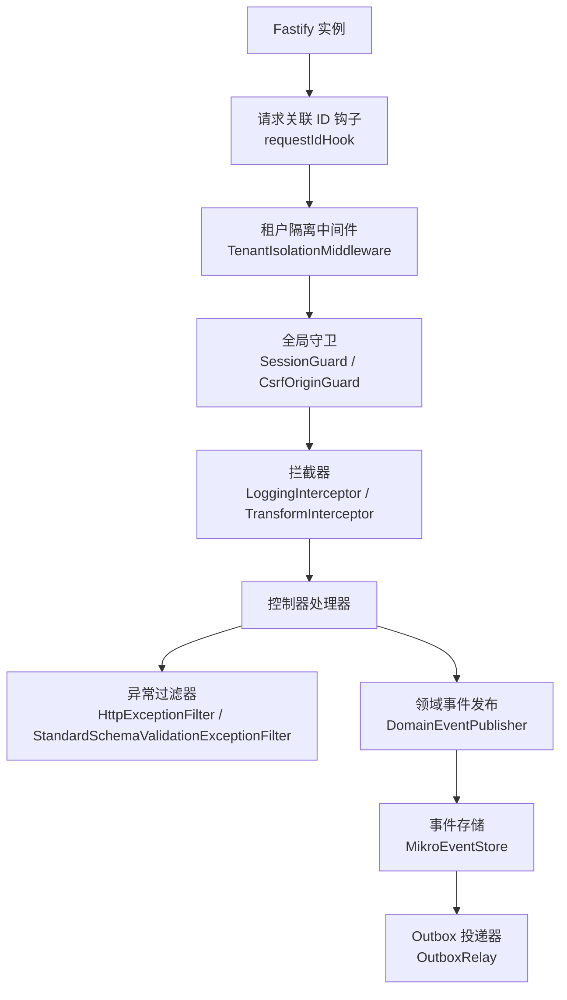

**图表来源**
- [apps/api/src/common/request-id.hook.ts:1-16](file://apps/api/src/common/request-id.hook.ts#L1-L16)
- [apps/api/src/tenant-isolation/tenant-isolation.module.ts:68-71](file://apps/api/src/tenant-isolation/tenant-isolation.module.ts#L68-L71)
- [apps/api/src/modules/auth/auth.module.ts:40-85](file://apps/api/src/modules/auth/auth.module.ts#L40-L85)
- [apps/api/src/common/interceptors/logging.interceptor.ts:1-78](file://apps/api/src/common/interceptors/logging.interceptor.ts#L1-L78)
- [apps/api/src/common/filters/http-exception.filter.ts:1-97](file://apps/api/src/common/filters/http-exception.filter.ts#L1-L97)
- [apps/api/src/database/eventing/domain-event-publisher.ts:9-72](file://apps/api/src/database/eventing/domain-event-publisher.ts#L9-L72)
- [apps/api/src/database/eventing/mikro-event-store.ts:9-110](file://apps/api/src/database/eventing/mikro-event-store.ts#L9-L110)
- [apps/api/src/database/eventing/outbox-relay.ts:16-190](file://apps/api/src/database/eventing/outbox-relay.ts#L16-L190)

**章节来源**
- [apps/api/src/app.module.ts:33-57](file://apps/api/src/app.module.ts#L33-L57)
- [apps/api/src/common/request-id.hook.ts:1-16](file://apps/api/src/common/request-id.hook.ts#L1-L16)
- [apps/api/src/tenant-isolation/tenant-isolation.module.ts:68-71](file://apps/api/src/tenant-isolation/tenant-isolation.module.ts#L68-L71)

## 核心扩展机制总览
- 中间件：用于横切请求上下文准备与租户隔离，典型为租户隔离中间件在路由前注入租户上下文。
- 守卫：用于鉴权与安全策略，如会话守卫、CSRF Origin 守卫，可全局注册或按控制器/方法挂载。
- 拦截器：用于日志记录、响应体转换等横切逻辑，可在请求进入处理器前后执行。
- 过滤器：用于统一错误响应格式与校验失败渲染，保证 API 信封一致。
- 领域事件：定义领域变更语义，支持进程内发布、影子持久化与 Outbox 投递三种模式。
- 生命周期钩子：包括 Fastify 请求钩子、Nest 应用生命周期钩子、数据库事务范围钩子。

**章节来源**
- [apps/api/src/common/filters/http-exception.filter.ts:16-97](file://apps/api/src/common/filters/http-exception.filter.ts#L16-L97)
- [apps/api/src/common/filters/standard-schema-validation.filter.ts:11-56](file://apps/api/src/common/filters/standard-schema-validation.filter.ts#L11-L56)
- [apps/api/src/common/interceptors/logging.interceptor.ts:13-78](file://apps/api/src/common/interceptors/logging.interceptor.ts#L13-L78)
- [apps/api/src/common/interceptors/transform.interceptor.ts:10-49](file://apps/api/src/common/interceptors/transform.interceptor.ts#L10-L49)
- [libs/core/src/shared-kernel/domain/domain-event.ts:36-77](file://libs/core/src/shared-kernel/domain/domain-event.ts#L36-L77)
- [apps/api/src/database/eventing/domain-event-publisher.ts:9-72](file://apps/api/src/database/eventing/domain-event-publisher.ts#L9-L72)

## 中间件、守卫、拦截器与过滤器

### 中间件：租户隔离与请求上下文
- 租户隔离中间件通过 `configure(consumer)` 绑定到所有路由，确保每个请求具备租户上下文。
- 该中间件是横向扩展点，适合在请求早期注入租户信息、权限上下文或审计元数据。

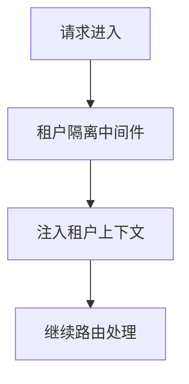

**图表来源**
- [apps/api/src/tenant-isolation/tenant-isolation.module.ts:68-71](file://apps/api/src/tenant-isolation/tenant-isolation.module.ts#L68-L71)

**章节来源**
- [apps/api/src/tenant-isolation/tenant-isolation.module.ts:68-71](file://apps/api/src/tenant-isolation/tenant-isolation.module.ts#L68-L71)

### 守卫：会话与 CSRF 安全墙
- 全局守卫：`SessionGuard` 与 `CsrfOriginGuard` 在模块中作为 `APP_GUARD` 提供，对所有路由生效。
- 公共路由旁路：通过反射元数据标记公共路由，跳过会话检查。
- 扩展方式：新增守卫时可通过 `APP_GUARD` 全局注册，或在控制器/方法上显式挂载。

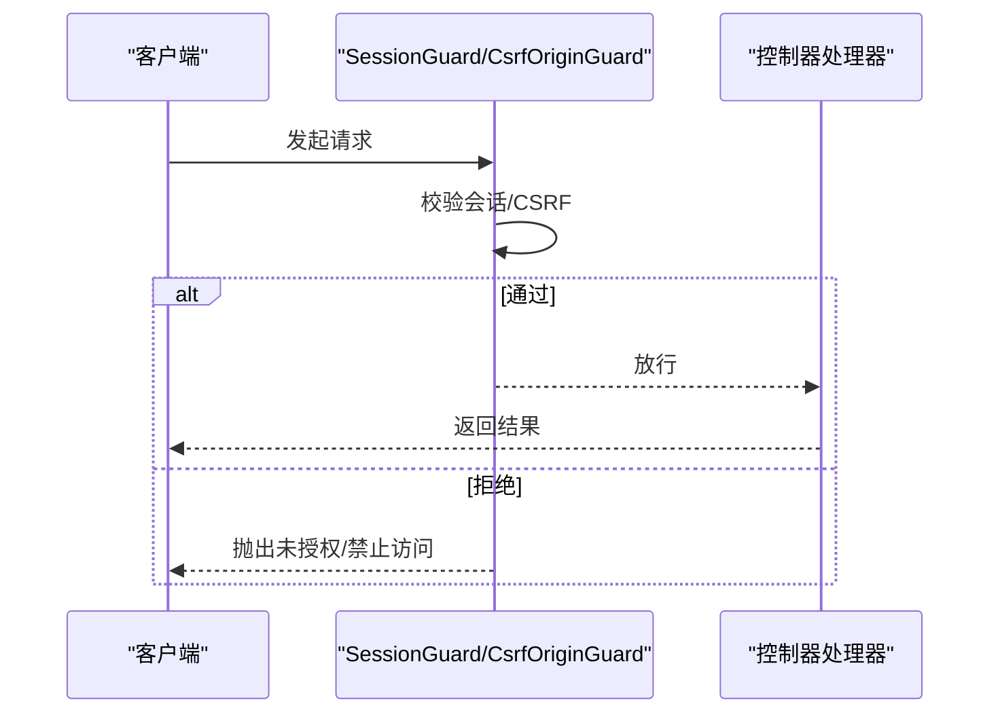

**图表来源**
- [apps/api/src/modules/auth/auth.module.ts:40-85](file://apps/api/src/modules/auth/auth.module.ts#L40-L85)

**章节来源**
- [apps/api/src/modules/auth/auth.module.ts:40-85](file://apps/api/src/modules/auth/auth.module.ts#L40-L85)

### 拦截器：日志与响应转换
- 日志拦截器：记录请求入参、用户代理、IP、响应时间与状态码，并与请求关联 ID 对齐。
- 响应转换拦截器：将普通返回值包装为标准响应信封，支持分页结果与已有信封对象。

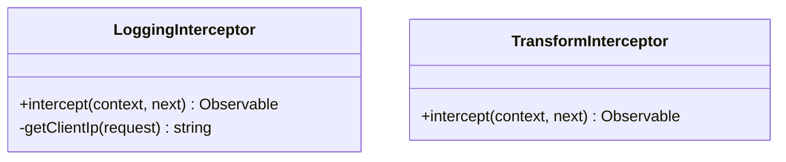

**图表来源**
- [apps/api/src/common/interceptors/logging.interceptor.ts:13-78](file://apps/api/src/common/interceptors/logging.interceptor.ts#L13-L78)
- [apps/api/src/common/interceptors/transform.interceptor.ts:10-49](file://apps/api/src/common/interceptors/transform.interceptor.ts#L10-L49)

**章节来源**
- [apps/api/src/common/interceptors/logging.interceptor.ts:13-78](file://apps/api/src/common/interceptors/logging.interceptor.ts#L13-L78)
- [apps/api/src/common/interceptors/transform.interceptor.ts:10-49](file://apps/api/src/common/interceptors/transform.interceptor.ts#L10-L49)

### 过滤器：统一错误响应与校验失败渲染
- HTTP 异常过滤器：统一 HttpException 与非 HttpException 的错误响应体，避免内部信息泄露。
- 标准 Schema 校验过滤器：将校验失败转换为标准错误信封，支持 i18n 翻译与字段级明细。

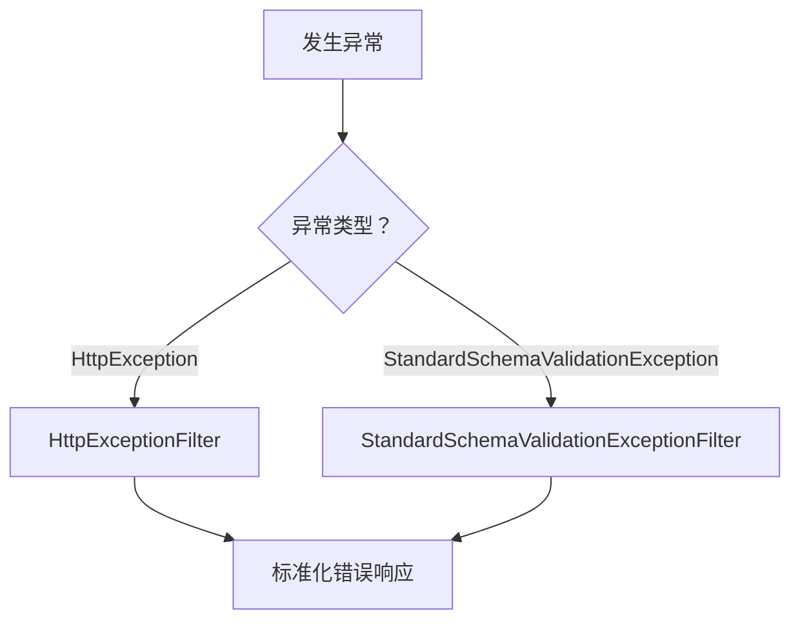

**图表来源**
- [apps/api/src/common/filters/http-exception.filter.ts:16-97](file://apps/api/src/common/filters/http-exception.filter.ts#L16-L97)
- [apps/api/src/common/filters/standard-schema-validation.filter.ts:11-56](file://apps/api/src/common/filters/standard-schema-validation.filter.ts#L11-L56)

**章节来源**
- [apps/api/src/common/filters/http-exception.filter.ts:16-97](file://apps/api/src/common/filters/http-exception.filter.ts#L16-L97)
- [apps/api/src/common/filters/standard-schema-validation.filter.ts:11-56](file://apps/api/src/common/filters/standard-schema-validation.filter.ts#L11-L56)

## 事件驱动架构：领域事件发布订阅

### 领域事件定义与契约
- 领域事件基类：定义事件唯一标识、聚合根标识、事件类型、版本、时间戳、关联与因果链、负载。
- 事件存储端口：定义追加、回放读取、级联补删三个核心操作，强调 fail-loud 与乐观锁。
- 事件发布端口：收口命令处理器的派发点，封装 event store 启用时的双模顺序。

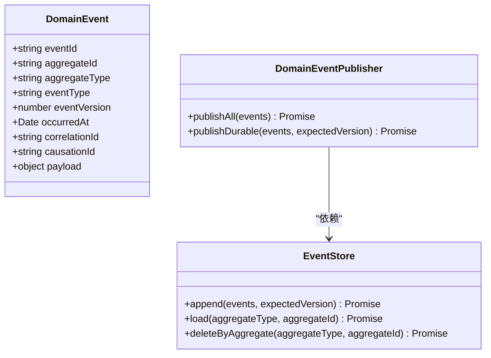

**图表来源**
- [libs/core/src/shared-kernel/domain/domain-event.ts:36-77](file://libs/core/src/shared-kernel/domain/domain-event.ts#L36-L77)
- [libs/core/src/shared-kernel/domain/event-store.port.ts:30-60](file://libs/core/src/shared-kernel/domain/event-store.port.ts#L30-L60)
- [libs/core/src/shared-kernel/domain/event-publisher.port.ts:1-14](file://libs/core/src/shared-kernel/domain/event-publisher.port.ts#L1-L14)

**章节来源**
- [libs/core/src/shared-kernel/domain/domain-event.ts:36-77](file://libs/core/src/shared-kernel/domain/domain-event.ts#L36-L77)
- [libs/core/src/shared-kernel/domain/event-store.port.ts:30-60](file://libs/core/src/shared-kernel/domain/event-store.port.ts#L30-L60)
- [libs/core/src/shared-kernel/domain/event-publisher.port.ts:1-14](file://libs/core/src/shared-kernel/domain/event-publisher.port.ts#L1-L14)

### 事件持久化与回放
- MikroORM 事件存储：实现事件追加、流版本递增、乐观锁校验、PIPL 级联补删与回放读取。
- 事件行重建：单源 hydration 函数负责从数据库行反序列化为领域事件实例，未知事件类型拒回放。

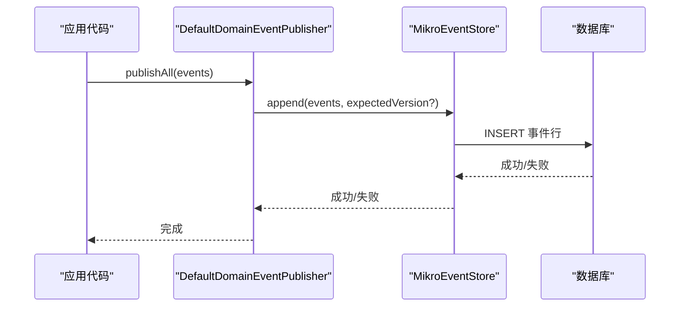

**图表来源**
- [apps/api/src/database/eventing/mikro-event-store.ts:37-68](file://apps/api/src/database/eventing/mikro-event-store.ts#L37-L68)
- [apps/api/src/database/eventing/domain-event-publisher.ts:33-52](file://apps/api/src/database/eventing/domain-event-publisher.ts#L33-L52)

**章节来源**
- [apps/api/src/database/eventing/mikro-event-store.ts:9-110](file://apps/api/src/database/eventing/mikro-event-store.ts#L9-L110)
- [apps/api/src/database/eventing/event-hydration.ts:1-21](file://apps/api/src/database/eventing/event-hydration.ts#L1-L21)

### Outbox 投递与至少一次投递保证
- Outbox Relay：定时轮询未投递事件，事务内置 `dispatchedAt` 后提交再尽力投递，消灭幻影事件。
- 去重与停重试：已投递事件去重窗；毒事件行级停重试，表内 `lastError`/`attemptCount=MAX` 即 DLQ。

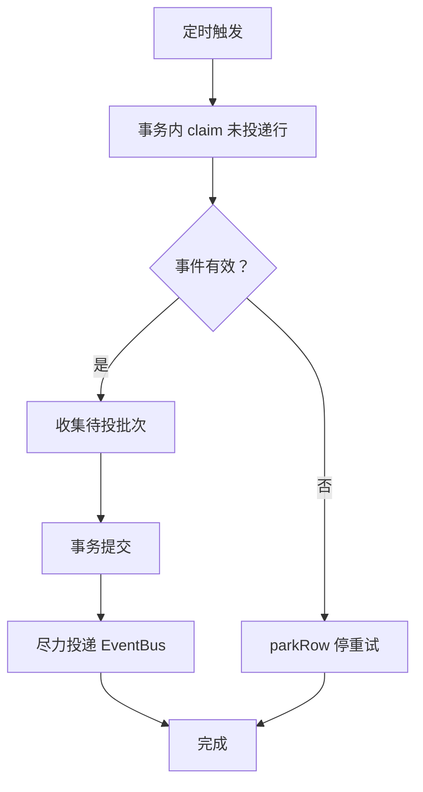

**图表来源**
- [apps/api/src/database/eventing/outbox-relay.ts:16-190](file://apps/api/src/database/eventing/outbox-relay.ts#L16-L190)

**章节来源**
- [apps/api/src/database/eventing/outbox-relay.ts:16-190](file://apps/api/src/database/eventing/outbox-relay.ts#L16-L190)

## 生命周期钩子：请求链与数据库操作

### 请求处理生命周期钩子
- Fastify `onRequest` 钩子：统一设置请求关联 ID，回写响应头，并通过异步本地存储贯穿后续链路。
- 该钩子早于 Nest 中间件/守卫/拦截器，覆盖所有路由包括健康检查等旁路路由。

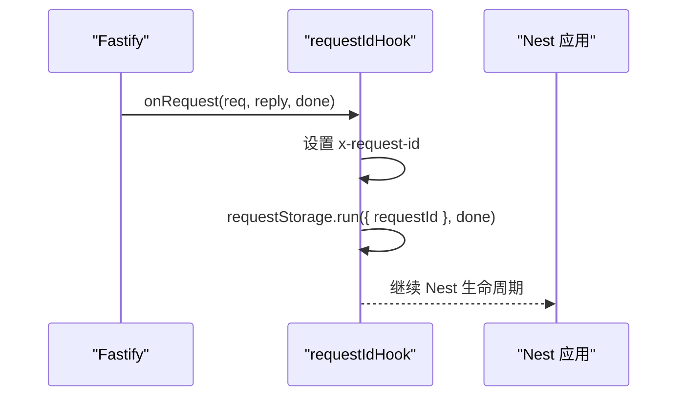

**图表来源**
- [apps/api/src/common/request-id.hook.ts:1-16](file://apps/api/src/common/request-id.hook.ts#L1-L16)

**章节来源**
- [apps/api/src/common/request-id.hook.ts:1-16](file://apps/api/src/common/request-id.hook.ts#L1-L16)

### 数据库操作生命周期钩子
- 订阅生命周期服务：在订阅状态收敛过程中，可选择走事件真相源路径，先持久化事件再投影更新。
- 事务范围：Outbox 模式要求事件发布在活跃 UoW 事务内，域行与事件行同生共死。

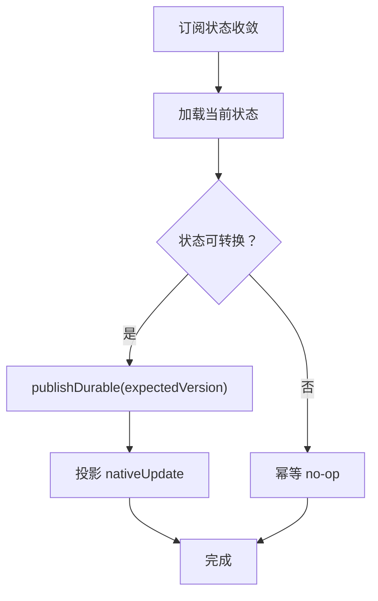

**图表来源**
- [apps/api/src/modules/subscriptions/infrastructure/mikro-subscription.lifecycle.ts:40-53](file://apps/api/src/modules/subscriptions/infrastructure/mikro-subscription.lifecycle.ts#L40-L53)
- [apps/api/src/database/eventing/domain-event-publisher.ts:54-72](file://apps/api/src/database/eventing/domain-event-publisher.ts#L54-L72)

**章节来源**
- [apps/api/src/modules/subscriptions/infrastructure/mikro-subscription.lifecycle.ts:40-53](file://apps/api/src/modules/subscriptions/infrastructure/mikro-subscription.lifecycle.ts#L40-L53)
- [apps/api/src/database/eventing/domain-event-publisher.ts:54-72](file://apps/api/src/database/eventing/domain-event-publisher.ts#L54-L72)

## 监听系统事件与扩展默认行为

### 监听进程内事件总线
- 通过 `EventBus` 订阅领域事件，适用于进程内同步消费场景。
- Outbox 模式下，事件先持久化再由 relay 投递，消费者需自身幂等。

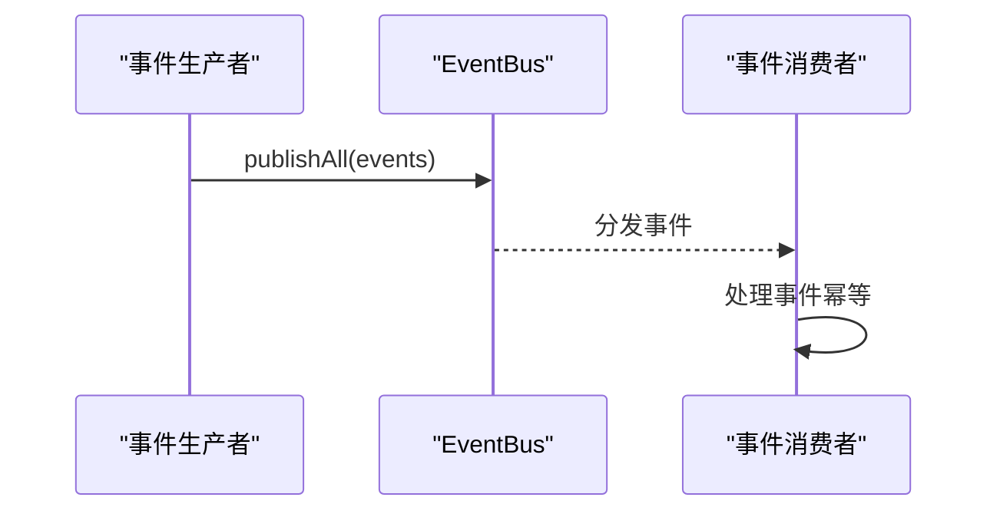

**图表来源**
- [apps/api/src/database/eventing/outbox-relay.ts:116-124](file://apps/api/src/database/eventing/outbox-relay.ts#L116-L124)

**章节来源**
- [apps/api/src/database/eventing/outbox-relay.ts:116-124](file://apps/api/src/database/eventing/outbox-relay.ts#L116-L124)

### 扩展默认行为
- 替换事件存储实现：通过 `EVENT_STORE` token 注入自定义 `EventStore` 实现。
- 替换事件发布者：通过 `DOMAIN_EVENT_PUBLISHER` token 注入自定义 `DomainEventPublisher` 实现。
- 新增守卫/拦截器/过滤器：通过模块提供者或装饰器挂载。

**章节来源**
- [libs/core/src/shared-kernel/domain/event-store.port.ts:3-28](file://libs/core/src/shared-kernel/domain/event-store.port.ts#L3-L28)
- [libs/core/src/shared-kernel/domain/event-publisher.port.ts:3-14](file://libs/core/src/shared-kernel/domain/event-publisher.port.ts#L3-L14)
- [apps/api/src/modules/auth/auth.module.ts:40-85](file://apps/api/src/modules/auth/auth.module.ts#L40-L85)

## 扩展开发最佳实践与注意事项

### 通用原则
- 明确扩展点层级：HTTP 层用中间件/守卫/拦截器/过滤器；应用层用服务与事件；领域层用事件与端口；基础设施层用适配器与存储。
- 保持 fail-loud：对冲突、未知事件类型、非法状态等如实抛错，不静默吞错。
- 保证幂等：事件消费者必须幂等，避免重复投递导致副作用。
- 控制副作用：非 HttpException 的内部错误不应暴露给客户端，仅记录堆栈。

### 具体建议
- 中间件：仅在必要时注入上下文，避免阻塞请求链。
- 守卫：优先全局守卫，局部守卫用于细粒度权限控制。
- 拦截器：日志拦截器应轻量，避免敏感信息泄露。
- 过滤器：统一错误信封，区分业务错误与系统错误。
- 领域事件：事件类型稳定，payload 类型清晰，版本号管理演进。
- Outbox：仅在 outbox 模式下启用 relay，注意事务边界与投递保证。

**章节来源**
- [apps/api/src/common/filters/http-exception.filter.ts:67-92](file://apps/api/src/common/filters/http-exception.filter.ts#L67-L92)
- [apps/api/src/database/eventing/outbox-relay.ts:19-35](file://apps/api/src/database/eventing/outbox-relay.ts#L19-L35)

## 故障排查指南

### 常见问题
- 会话守卫 401：检查 Cookie 是否携带、公共路由是否标记 @Public。
- CSRF Origin 403：检查请求来源白名单与配置。
- 校验失败 400：检查 standard-schema 校验规则与 i18n 翻译键。
- 事件未投递：检查 EVENT_PUBLISH_MODE 是否为 outbox，relay 是否启动，事件类型是否注册。
- 事件重复投递：检查消费者幂等性，确认 Outbox 去重窗与 claim 语义。

**章节来源**
- [apps/api/src/modules/auth/auth.module.ts:40-85](file://apps/api/src/modules/auth/auth.module.ts#L40-L85)
- [apps/api/src/common/filters/standard-schema-validation.filter.ts:11-56](file://apps/api/src/common/filters/standard-schema-validation.filter.ts#L11-L56)
- [apps/api/src/database/eventing/outbox-relay.ts:131-165](file://apps/api/src/database/eventing/outbox-relay.ts#L131-L165)

## 结论
本系统通过分层扩展点与钩子机制，提供了灵活的横向能力扩展入口。开发者可根据需求在 HTTP 层、应用层、领域层与基础设施层选择合适的扩展点，结合领域事件与 Outbox 机制实现可靠的事件驱动架构。遵循最佳实践与注意事项，可有效降低扩展带来的风险与复杂度，提升系统的可维护性与可扩展性。