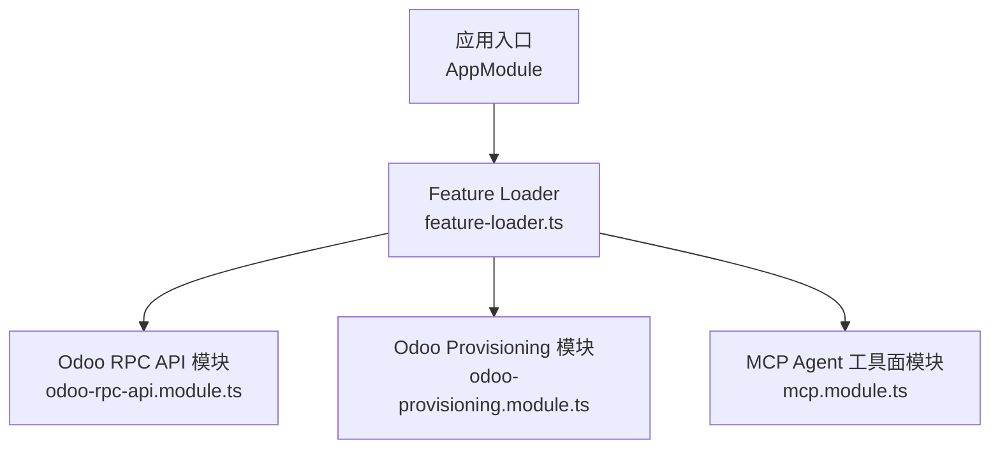
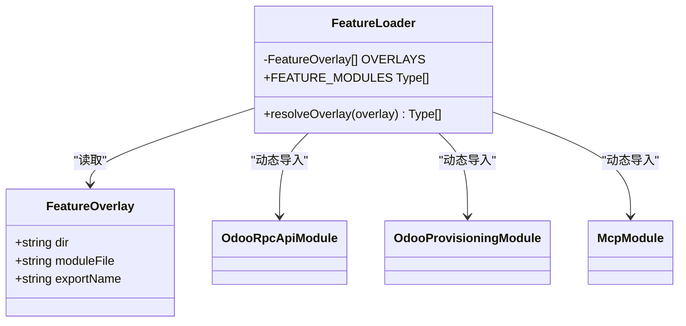
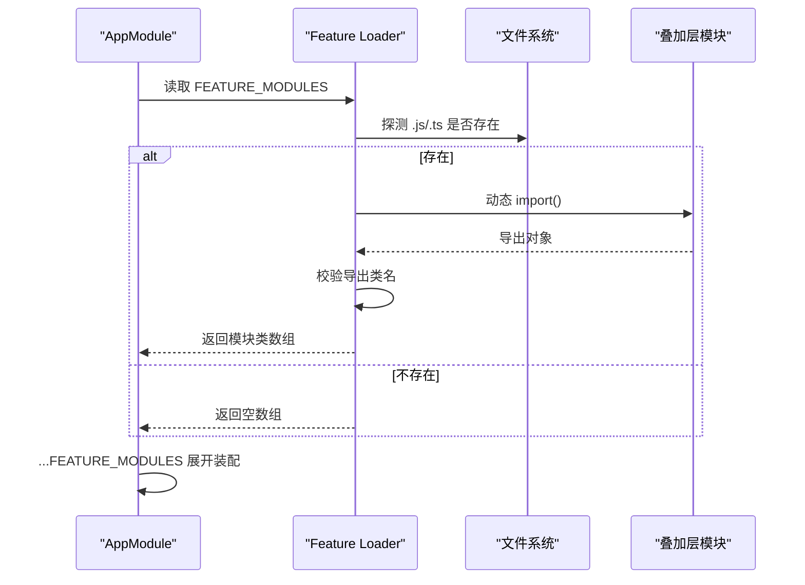
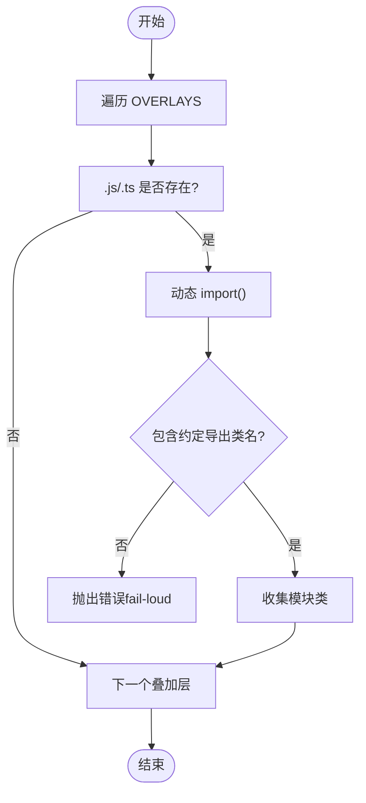
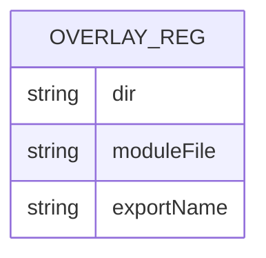
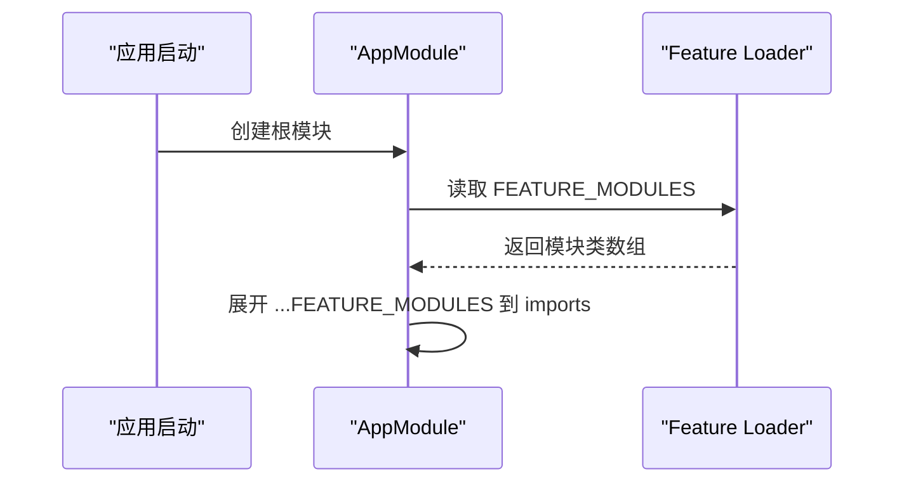
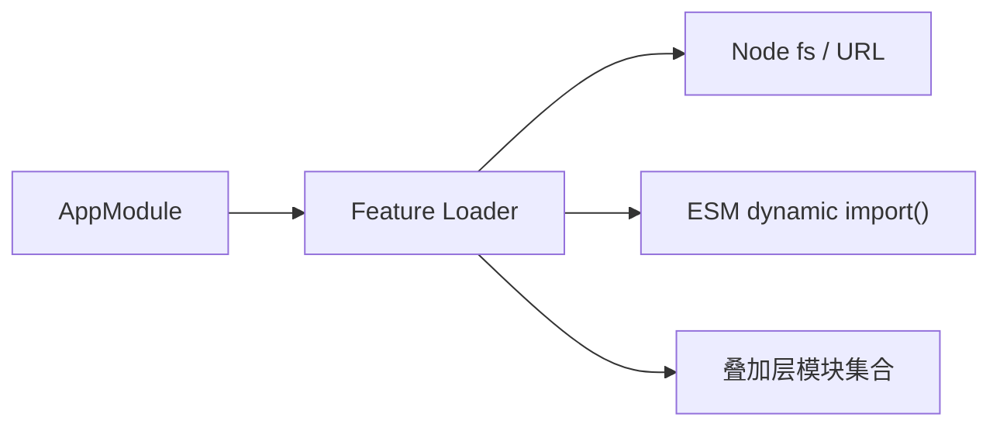
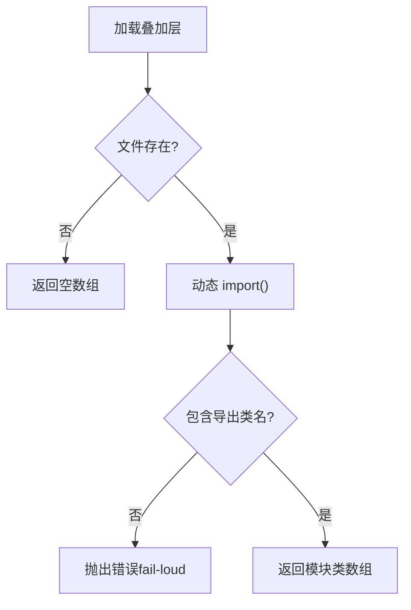

# 插件系统

<cite>
**本文引用的文件**   
- [apps/api/src/features/feature-loader.ts](file://apps/api/src/features/feature-loader.ts)
- [apps/api/src/app.module.ts](file://apps/api/src/app.module.ts)
- [apps/api/src/features/odoo-rpc-api/api/odoo-rpc-api.module.ts](file://apps/api/src/features/odoo-rpc-api/api/odoo-rpc-api.module.ts)
- [apps/api/src/features/odoo-provisioning/api/odoo-provisioning.module.ts](file://apps/api/src/features/odoo-provisioning/api/odoo-provisioning.module.ts)
- [apps/api/src/features/mcp/api/mcp.module.ts](file://apps/api/src/features/mcp/api/mcp.module.ts)
</cite>

## 目录
1. [引言](#引言)
2. [项目结构](#项目结构)
3. [核心组件](#核心组件)
4. [架构总览](#架构总览)
5. [详细组件分析](#详细组件分析)
6. [依赖关系分析](#依赖关系分析)
7. [性能与构建特性](#性能与构建特性)
8. [扩展指南：如何添加新的功能叠加层](#扩展指南如何添加新的功能叠加层)
9. [错误处理机制](#错误处理机制)
10. [故障排查](#故障排查)
11. [结论](#结论)

## 引言
本文件面向希望理解并扩展本仓库“插件系统”的开发者，重点解释 Feature Loader 的运行时模块加载机制、叠加层（Overlay）概念与实现、OVERLAYS 注册表设计、动态 import() 的使用方式、构建时解耦原理，以及如何安全地新增功能叠加层。文档同时覆盖装配流程、约定规范、fail-loud 错误策略以及最佳实践建议。

## 项目结构
Feature Loader 位于 `apps/api/src/features/feature-loader.ts`，负责在应用启动阶段扫描并动态导入已注册的 feature 模块；实际的功能叠加层以 NestJS Module 形式存放在 `apps/api/src/features/<feature>/api/*.module.ts` 下，并由 `AppModule` 在启动时展开装配。

**图表来源**
- [apps/api/src/app.module.ts:15-17](file://apps/api/src/app.module.ts#L15-L17)
- [apps/api/src/app.module.ts:71-72](file://apps/api/src/app.module.ts#L71-L72)
- [apps/api/src/features/feature-loader.ts:27-37](file://apps/api/src/features/feature-loader.ts#L27-L37)
- [apps/api/src/features/feature-loader.ts:57-60](file://apps/api/src/features/feature-loader.ts#L57-L60)

**章节来源**
- [apps/api/src/app.module.ts:15-17](file://apps/api/src/app.module.ts#L15-L17)
- [apps/api/src/app.module.ts:71-72](file://apps/api/src/app.module.ts#L71-L72)
- [apps/api/src/features/feature-loader.ts:5-16](file://apps/api/src/features/feature-loader.ts#L5-L16)

## 核心组件
- Feature Overlay 契约：描述一个叠加层的目录名、模块文件名和导出类名。
- OVERLAYS 注册表：声明式列出所有待探测的叠加层。
- resolveOverlay：按约定路径探测文件是否存在，存在则动态 import，校验导出是否满足契约，失败即 fail-loud。
- FEATURE_MODULES：聚合所有成功解析的叠加层模块，供 AppModule 直接展开到 imports。

**图表来源**
- [apps/api/src/features/feature-loader.ts:18-25](file://apps/api/src/features/feature-loader.ts#L18-L25)
- [apps/api/src/features/feature-loader.ts:27-37](file://apps/api/src/features/feature-loader.ts#L27-L37)
- [apps/api/src/features/feature-loader.ts:39-55](file://apps/api/src/features/feature-loader.ts#L39-L55)
- [apps/api/src/features/feature-loader.ts:57-60](file://apps/api/src/features/feature-loader.ts#L57-L60)
- [apps/api/src/features/odoo-rpc-api/api/odoo-rpc-api.module.ts:13-14](file://apps/api/src/features/odoo-rpc-api/api/odoo-rpc-api.module.ts#L13-L14)
- [apps/api/src/features/odoo-provisioning/api/odoo-provisioning.module.ts:17-25](file://apps/api/src/features/odoo-provisioning/api/odoo-provisioning.module.ts#L17-L25)
- [apps/api/src/features/mcp/api/mcp.module.ts:20-33](file://apps/api/src/features/mcp/api/mcp.module.ts#L20-L33)

**章节来源**
- [apps/api/src/features/feature-loader.ts:18-25](file://apps/api/src/features/feature-loader.ts#L18-L25)
- [apps/api/src/features/feature-loader.ts:27-37](file://apps/api/src/features/feature-loader.ts#L27-L37)
- [apps/api/src/features/feature-loader.ts:39-60](file://apps/api/src/features/feature-loader.ts#L39-L60)

## 架构总览
Feature Loader 在应用初始化阶段执行顶层 await，遍历 OVERLAYS 列表，对每个叠加层尝试定位 `<dir>/api/<moduleFile>.js|.ts`，若存在则通过动态 import() 加载模块，并校验其是否导出约定的类名。最终将解析到的模块类数组返回给 AppModule，由 `...FEATURE_MODULES` 展开注入。

**图表来源**
- [apps/api/src/app.module.ts:71-72](file://apps/api/src/app.module.ts#L71-L72)
- [apps/api/src/features/feature-loader.ts:39-55](file://apps/api/src/features/feature-loader.ts#L39-L55)
- [apps/api/src/features/feature-loader.ts:57-60](file://apps/api/src/features/feature-loader.ts#L57-L60)

## 详细组件分析

### Feature Loader 运行时加载机制
- 探测顺序：先 `.js`（编译产物），再 `.ts`（开发直跑），两者任一存在即可继续。
- 动态导入：使用 `import(specifier)`，specifier 为运行期拼接字符串，避免静态分析绑定具体 feature。
- 导出校验：若目标模块未导出约定的类名，立即抛出错误（fail-loud）。
- 结果聚合：使用 Promise.all 并行解析所有 OVERLAYS，flat 后得到最终模块数组。

**图表来源**
- [apps/api/src/features/feature-loader.ts:39-55](file://apps/api/src/features/feature-loader.ts#L39-L55)

**章节来源**
- [apps/api/src/features/feature-loader.ts:39-60](file://apps/api/src/features/feature-loader.ts#L39-L60)

### 叠加层（Overlay）概念与 OVERLAYS 注册表
- 叠加层定义：每个叠加层对应一个 NestJS Module，遵循 `{application, infrastructure, api}` 分层，无 `domain/`。
- 注册表设计：OVERLAYS 是一个只读数组，每项包含 dir、moduleFile、exportName，新增叠加层只需登记一行，无需修改主逻辑分支。
- 当前示例：
  - odoo-rpc-api：导出 OdooRpcApiModule
  - odoo-provisioning：导出 OdooProvisioningModule
  - mcp：导出 McpModule

**图表来源**
- [apps/api/src/features/feature-loader.ts:27-37](file://apps/api/src/features/feature-loader.ts#L27-L37)

**章节来源**
- [apps/api/src/features/feature-loader.ts:27-37](file://apps/api/src/features/feature-loader.ts#L27-L37)
- [apps/api/src/features/odoo-rpc-api/api/odoo-rpc-api.module.ts:6-14](file://apps/api/src/features/odoo-rpc-api/api/odoo-rpc-api.module.ts#L6-L14)
- [apps/api/src/features/odoo-provisioning/api/odoo-provisioning.module.ts:8-25](file://apps/api/src/features/odoo-provisioning/api/odoo-provisioning.module.ts#L8-L25)
- [apps/api/src/features/mcp/api/mcp.module.ts:11-33](file://apps/api/src/features/mcp/api/mcp.module.ts#L11-L33)

### 构建时解耦的实现方式
- 动态 specifier：import 说明符由运行期拼接，tsc/swc 无法静态分析，因此不会把具体 feature 绑定进构建图。
- 缺席态零副作用：若目录不存在，返回空数组，不影响主应用构建与启动。
- 顶层 await：导出已是解析后的类数组，AppModule 可直接展开，不依赖 Nest 对 Promise 的特殊处理。

**章节来源**
- [apps/api/src/features/feature-loader.ts:5-16](file://apps/api/src/features/feature-loader.ts#L5-L16)
- [apps/api/src/features/feature-loader.ts:57-60](file://apps/api/src/features/feature-loader.ts#L57-L60)

### 装配流程与 AppModule 集成
- AppModule 引入 FEATURE_MODULES，并在 imports 尾部展开，确保 feature 不干扰全局守卫排序等既有语义。
- 叠加层尾置：注释明确说明 feature 不注册 APP_GUARD，落尾部保持导入序不变。

**图表来源**
- [apps/api/src/app.module.ts:15-17](file://apps/api/src/app.module.ts#L15-L17)
- [apps/api/src/app.module.ts:71-72](file://apps/api/src/app.module.ts#L71-L72)
- [apps/api/src/features/feature-loader.ts:57-60](file://apps/api/src/features/feature-loader.ts#L57-L60)

**章节来源**
- [apps/api/src/app.module.ts:15-17](file://apps/api/src/app.module.ts#L15-L17)
- [apps/api/src/app.module.ts:71-72](file://apps/api/src/app.module.ts#L71-L72)

## 依赖关系分析
- AppModule 依赖 Feature Loader 提供的模块数组。
- Feature Loader 依赖 Node.js 文件系统 API 与 ESM 动态 import。
- 各叠加层模块之间尽量保持低耦合，必要时通过 @Global 模块或端口接口共享能力。

**图表来源**
- [apps/api/src/app.module.ts:15-17](file://apps/api/src/app.module.ts#L15-L17)
- [apps/api/src/features/feature-loader.ts:1-3](file://apps/api/src/features/feature-loader.ts#L1-L3)
- [apps/api/src/features/feature-loader.ts:39-55](file://apps/api/src/features/feature-loader.ts#L39-L55)

**章节来源**
- [apps/api/src/app.module.ts:15-17](file://apps/api/src/app.module.ts#L15-L17)
- [apps/api/src/features/feature-loader.ts:1-3](file://apps/api/src/features/feature-loader.ts#L1-L3)
- [apps/api/src/features/feature-loader.ts:39-55](file://apps/api/src/features/feature-loader.ts#L39-L55)

## 性能与构建特性
- 并行解析：Promise.all 并行处理 OVERLAYS，减少启动等待时间。
- 两态兼容：同时支持 .js（dist）与 .ts（dev/vitest），按需探测，缺失分支零成本。
- 构建解耦：computed specifier 避免静态分析绑定，新增/移除叠加层不绑架主应用构建闭合。

**章节来源**
- [apps/api/src/features/feature-loader.ts:39-60](file://apps/api/src/features/feature-loader.ts#L39-L60)
- [apps/api/src/features/feature-loader.ts:5-16](file://apps/api/src/features/feature-loader.ts#L5-L16)

## 扩展指南：如何添加新的功能叠加层
步骤如下：
1. 在 `apps/api/src/features/` 下新建目录，例如 `your-feature/`。
2. 在该目录下创建 `api/your-feature.module.ts`，导出一个 NestJS Module 类，类名需与 OVERLAYS 中约定的 exportName 一致。
3. 在 `apps/api/src/features/feature-loader.ts` 的 OVERLAYS 中添加一行，填写 dir、moduleFile、exportName。
4. 确保模块内部遵循 `{application, infrastructure, api}` 分层，无 `domain/`。
5. 启动应用，Feature Loader 将在运行期探测并动态导入该模块。

目录结构约定示例：
- `apps/api/src/features/<dir>/api/<moduleFile>.ts`
- 可选：`application/`、`infrastructure/` 子目录组织业务与基础设施代码。

模块导出规范：
- 必须导出与 OVERLAYS 中 exportName 一致的类。
- 若未导出，将触发 fail-loud 错误。

装配流程要点：
- 新增叠加层仅修改 OVERLAYS 注册表，无需改动主逻辑分支。
- 模块被尾置装配，不干扰全局守卫等已有导入序语义。

**章节来源**
- [apps/api/src/features/feature-loader.ts:27-37](file://apps/api/src/features/feature-loader.ts#L27-L37)
- [apps/api/src/features/feature-loader.ts:39-55](file://apps/api/src/features/feature-loader.ts#L39-L55)
- [apps/api/src/app.module.ts:71-72](file://apps/api/src/app.module.ts#L71-L72)

## 错误处理机制
- fail-loud 策略：当叠加层模块存在但未导出约定的类名时，立即抛出错误，拒绝静默跳过。
- 缺失导出检测：在动态 import 后检查 `overlay.exportName in mod`，不满足则抛错。
- 缺失文件处理：若目录不存在，返回空数组，不影响主应用装配。

**图表来源**
- [apps/api/src/features/feature-loader.ts:39-55](file://apps/api/src/features/feature-loader.ts#L39-L55)

**章节来源**
- [apps/api/src/features/feature-loader.ts:39-55](file://apps/api/src/features/feature-loader.ts#L39-L55)

## 故障排查
常见问题与建议：
- 启动时报“缺导出”错误：检查叠加层模块是否正确导出了约定的类名，且与 OVERLAYS 中的 exportName 一致。
- 叠加层未被加载：确认目录结构与文件名符合约定，且 OVERLAYS 已登记。
- 构建期报错：确认未引入静态依赖导致 computed specifier 失效；Feature Loader 依赖运行期探测，不应在静态 import 中引用具体 feature。
- 模块间耦合问题：尽量通过 @Global 模块或端口接口共享能力，避免叠加层之间直接互相依赖。

**章节来源**
- [apps/api/src/features/feature-loader.ts:39-55](file://apps/api/src/features/feature-loader.ts#L39-L55)
- [apps/api/src/app.module.ts:71-72](file://apps/api/src/app.module.ts#L71-L72)

## 结论
Feature Loader 通过 OVERLAYS 注册表与运行期动态 import() 实现了“严格叠加·构建解耦”的插件体系。新增叠加层仅需声明式登记，缺失态零副作用，fail-loud 策略保证装配契约不被破坏。该机制使第三方集成与私有功能可以安全、可观测地扩展主应用，同时保持构建与运行的清晰边界。