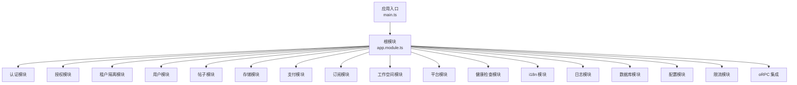
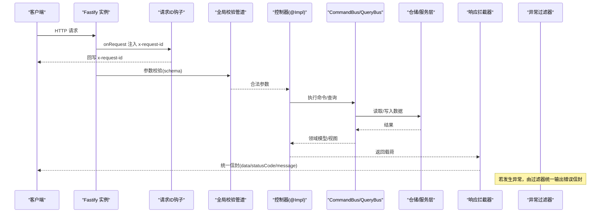
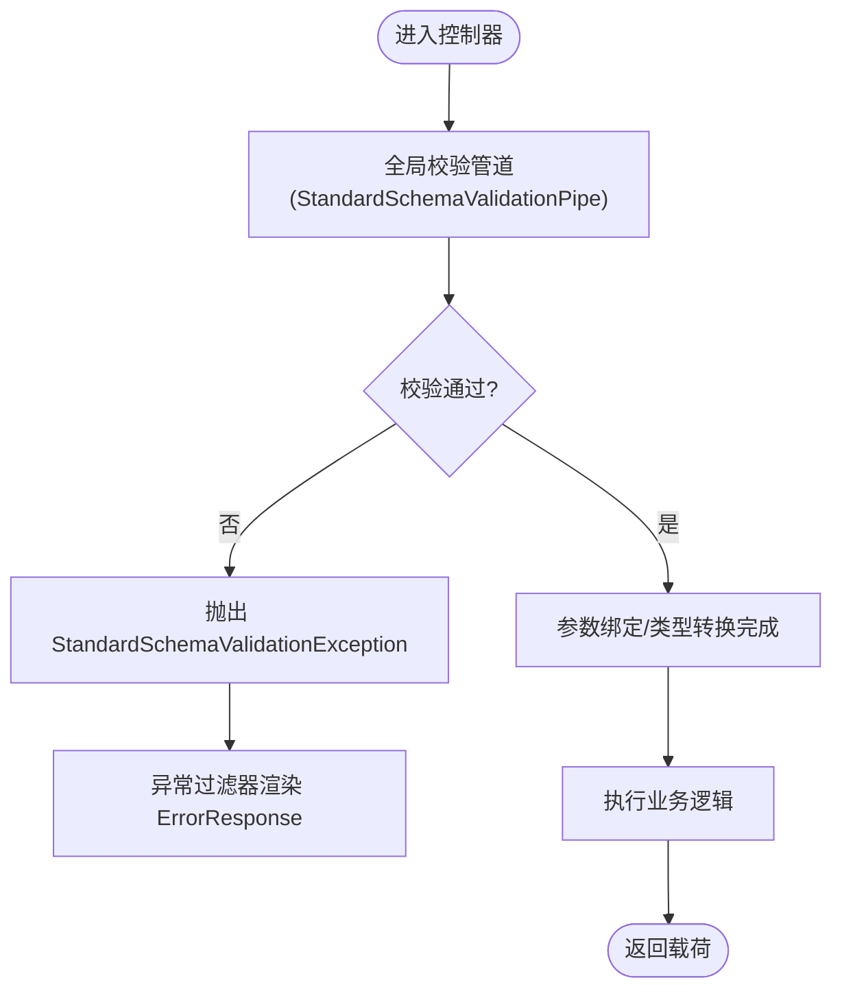
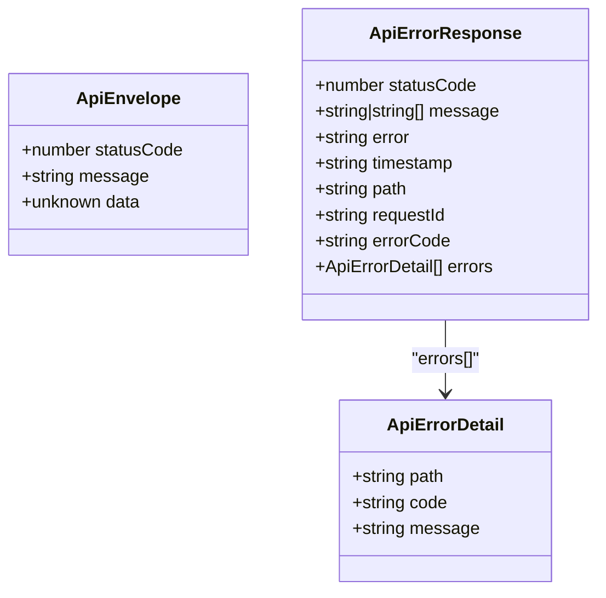
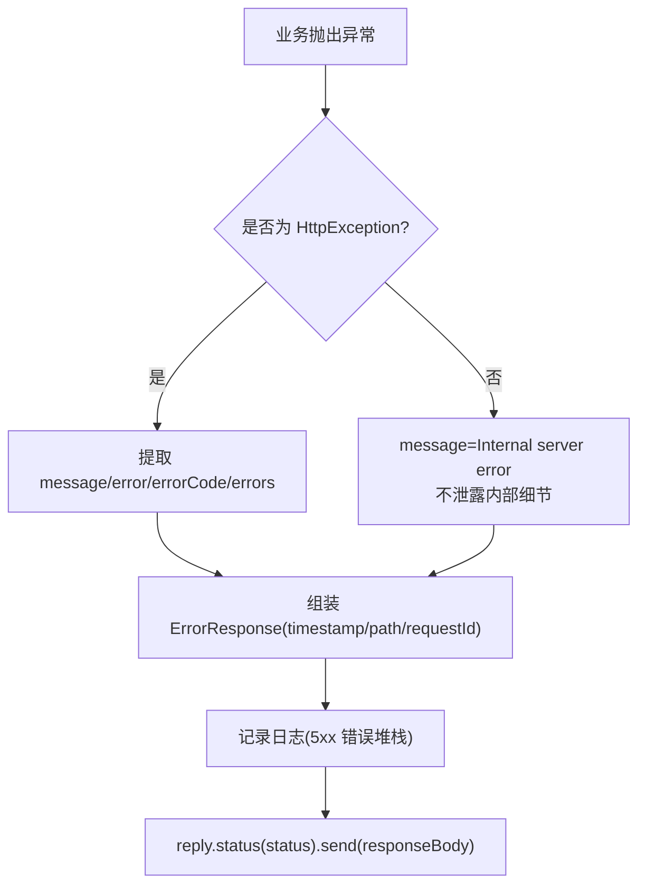
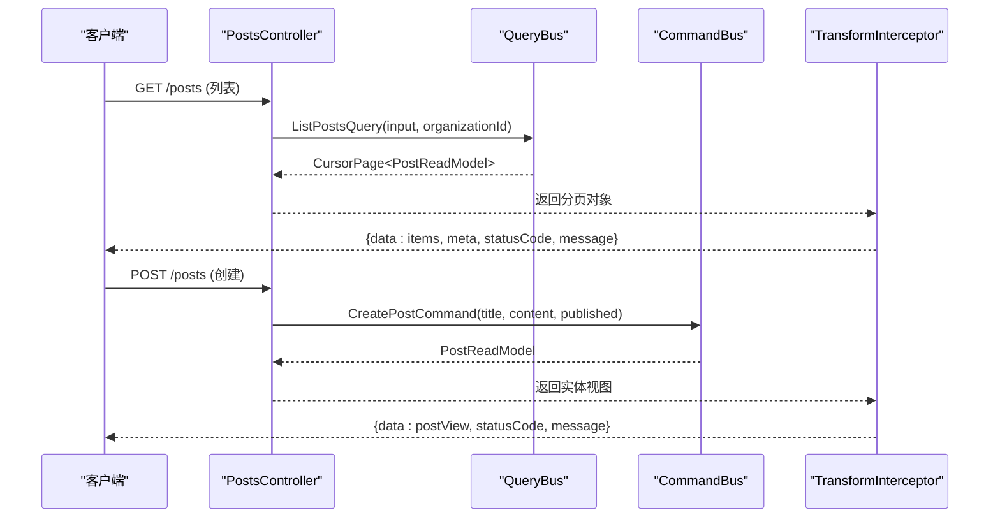
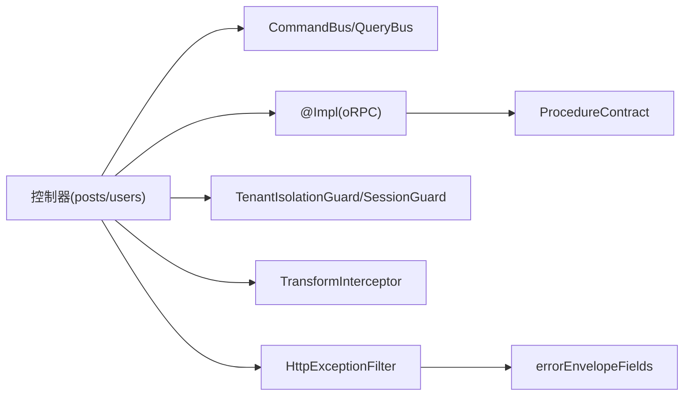

# API 控制器开发

<cite>
**本文引用的文件**   
- [main.ts](file://apps/api/src/main.ts)
- [app.module.ts](file://apps/api/src/app.module.ts)
- [posts.controller.ts](file://apps/api/src/modules/posts/api/posts.controller.ts)
- [users.controller.ts](file://apps/api/src/modules/users/api/users.controller.ts)
- [create-post.command.ts](file://apps/api/src/modules/posts/application/commands/create-post.command.ts)
- [list-posts.query.ts](file://apps/api/src/modules/posts/application/queries/list-posts.query.ts)
- [api-contracts.ts](file://apps/api/src/common/contracts/api-contracts.ts)
- [validation-pipe.ts](file://apps/api/src/common/validation-pipe.ts)
- [transform.interceptor.ts](file://apps/api/src/common/interceptors/transform.interceptor.ts)
- [http-exception.filter.ts](file://apps/api/src/common/filters/http-exception.filter.ts)
- [error-envelope-fields.ts](file://apps/api/src/common/errors/error-envelope-fields.ts)
- [response-error-detail.ts](file://apps/api/src/common/errors/response-error-detail.ts)
</cite>

## 目录
1. [引言](#引言)
2. [项目结构](#项目结构)
3. [核心组件](#核心组件)
4. [架构总览](#架构总览)
5. [详细组件分析](#详细组件分析)
6. [依赖关系分析](#依赖关系分析)
7. [性能与可扩展性](#性能与可扩展性)
8. [故障排查指南](#故障排查指南)
9. [结论](#结论)
10. [附录：RESTful 设计最佳实践与安全清单](#附录restful-设计最佳实践与安全清单)

## 引言
本文件面向在 NestJS + Fastify 技术栈上开发 RESTful API 控制器的工程师，系统说明控制器职责边界、请求验证与参数绑定、响应格式化、DTO 设计与使用、错误处理策略、状态码规范以及 API 版本管理。文档基于仓库现有实现进行提炼，提供从路由定义到响应返回的完整流程示例，并给出可操作的实践建议与安全注意事项。

## 项目结构
本项目采用模块化组织方式，API 控制器位于各业务模块的 `api` 子目录中；全局横切能力（校验、拦截器、过滤器、契约）集中在 `common` 目录；应用启动与中间件装配在 `main.ts`，根模块在 `app.module.ts` 中统一导入。

图表来源
- [main.ts:20-151](file://apps/api/src/main.ts#L20-L151)
- [app.module.ts:33-73](file://apps/api/src/app.module.ts#L33-L73)

章节来源
- [main.ts:20-151](file://apps/api/src/main.ts#L20-L151)
- [app.module.ts:33-73](file://apps/api/src/app.module.ts#L33-L73)

## 核心组件
- 全局请求管道：统一使用标准 Schema 校验，负责参数类型转换与校验失败时的异常抛出。
- 响应拦截器：将控制器返回值包装为统一信封 `{data, statusCode, message}`，并对分页对象做特殊提升。
- 全局异常过滤器：将框架或业务抛出的异常转换为统一的错误响应体，包含时间戳、路径、请求关联 ID 等字段。
- API 契约与装饰器组合子：为 Swagger/OpenAPI 生成一致的请求/响应 schema，避免文档与运行时漂移。
- oRPC 集成：通过 `@Impl` 将 procedure contract 映射到具体方法，保留 Nest 守卫、元数据与错误语义。

章节来源
- [validation-pipe.ts:7-25](file://apps/api/src/common/validation-pipe.ts#L7-L25)
- [transform.interceptor.ts:17-48](file://apps/api/src/common/interceptors/transform.interceptor.ts#L17-L48)
- [http-exception.filter.ts:22-96](file://apps/api/src/common/filters/http-exception.filter.ts#L22-L96)
- [api-contracts.ts:8-118](file://apps/api/src/common/contracts/api-contracts.ts#L8-L118)
- [posts.controller.ts:29-46](file://apps/api/src/modules/posts/api/posts.controller.ts#L29-L46)

## 架构总览
下图展示一次典型 REST 请求从进入应用到返回响应的关键阶段：全局钩子注入请求 ID → 全局校验管道 → 控制器方法（oRPC `@Impl`）→ 命令/查询总线 → 领域仓储 → 响应拦截器封装 → 异常过滤器兜底。

图表来源
- [main.ts:90-113](file://apps/api/src/main.ts#L90-L113)
- [validation-pipe.ts:19-25](file://apps/api/src/common/validation-pipe.ts#L19-L25)
- [posts.controller.ts:59-89](file://apps/api/src/modules/posts/api/posts.controller.ts#L59-L89)
- [transform.interceptor.ts:19-47](file://apps/api/src/common/interceptors/transform.interceptor.ts#L19-L47)
- [http-exception.filter.ts:26-94](file://apps/api/src/common/filters/http-exception.filter.ts#L26-L94)

## 详细组件分析

### 控制器职责边界
- 仅负责接收请求、参数校验、鉴权上下文获取、调用领域服务/仓储、返回 DTO。
- 不直接操作数据库，不包含复杂业务规则。
- 通过 CQRS 总线将读写逻辑下沉至命令/查询处理器。

示例：帖子控制器
- 列出帖子：通过 `QueryBus` 执行只读查询，返回游标分页视图。
- 创建帖子：通过 `CommandBus` 执行写命令，返回已持久化的视图。

章节来源
- [posts.controller.ts:47-89](file://apps/api/src/modules/posts/api/posts.controller.ts#L47-L89)
- [create-post.command.ts:12-20](file://apps/api/src/modules/posts/application/commands/create-post.command.ts#L12-L20)
- [list-posts.query.ts:13-20](file://apps/api/src/modules/posts/application/queries/list-posts.query.ts#L13-L20)

### 请求验证与参数绑定
- 全局管道使用官方 `StandardSchemaValidationPipe`，对带 `schema` 的参数进行强校验与类型转换。
- 无 `schema` 的参数原样透传，保持向后兼容。
- 校验失败抛出结构化异常，由过滤器渲染为标准错误响应。

图表来源
- [validation-pipe.ts:19-25](file://apps/api/src/common/validation-pipe.ts#L19-L25)
- [http-exception.filter.ts:26-94](file://apps/api/src/common/filters/http-exception.filter.ts#L26-L94)

章节来源
- [validation-pipe.ts:7-25](file://apps/api/src/common/validation-pipe.ts#L7-L25)

### 响应格式化与 DTO 设计
- 成功响应统一被 `TransformInterceptor` 包裹为 `{data, statusCode, message}`。
- 分页对象 `{items, meta}` 会被提升为 `{data: items, meta}`，便于前端消费。
- 对外暴露的 DTO 通过 `@nestjs/swagger` 类与组合子生成 OpenAPI schema，保证文档与运行一致。
- 透传型响应使用 `apiOkPassthrough` 声明自由对象，避免过度精确导致前端误判。

图表来源
- [api-contracts.ts:20-88](file://apps/api/src/common/contracts/api-contracts.ts#L20-L88)

章节来源
- [transform.interceptor.ts:17-48](file://apps/api/src/common/interceptors/transform.interceptor.ts#L17-L48)
- [api-contracts.ts:8-118](file://apps/api/src/common/contracts/api-contracts.ts#L8-L118)

### 错误处理策略与状态码规范
- 所有异常最终由 `HttpExceptionFilter` 统一处理。
- 非 `HttpException` 的内部错误不会把原始 message 暴露给客户端，防止信息泄露。
- 错误响应包含 `timestamp/path/requestId` 三字段，便于追踪。
- 支持携带 `errorCode` 与结构化 `errors` 明细，便于前端分类处理。

图表来源
- [http-exception.filter.ts:26-94](file://apps/api/src/common/filters/http-exception.filter.ts#L26-L94)
- [error-envelope-fields.ts:18-27](file://apps/api/src/common/errors/error-envelope-fields.ts#L18-L27)

章节来源
- [http-exception.filter.ts:22-96](file://apps/api/src/common/filters/http-exception.filter.ts#L22-L96)
- [error-envelope-fields.ts:1-29](file://apps/api/src/common/errors/error-envelope-fields.ts#L1-L29)
- [response-error-detail.ts:1-12](file://apps/api/src/common/errors/response-error-detail.ts#L1-L12)

### API 版本管理
- 启用 URI 版本化，默认版本为 `1`。
- 可通过 `@Version('1')` 等方法级装饰器指定接口版本。
- Swagger 文档与 OpenAPI YAML 端点独立于 API 前缀，便于查阅。

章节来源
- [main.ts:74-83](file://apps/api/src/main.ts#L74-L83)
- [main.ts:124-148](file://apps/api/src/main.ts#L124-L148)

### 控制器实现示例：从路由到响应
以“列出帖子”和“创建帖子”为例，展示从路由定义到响应返回的完整流程。

图表来源
- [posts.controller.ts:59-89](file://apps/api/src/modules/posts/api/posts.controller.ts#L59-L89)
- [transform.interceptor.ts:19-47](file://apps/api/src/common/interceptors/transform.interceptor.ts#L19-L47)

章节来源
- [posts.controller.ts:59-89](file://apps/api/src/modules/posts/api/posts.controller.ts#L59-L89)

### 用户自助面控制器示例
用户导出与删除接口需登录态，使用会话守卫保护，并通过 oRPC `@Impl` 暴露 procedure。

章节来源
- [users.controller.ts:35-76](file://apps/api/src/modules/users/api/users.controller.ts#L35-L76)

## 依赖关系分析
- 控制器依赖 CQRS 总线，解耦读写逻辑。
- 全局管道、拦截器、过滤器在应用启动时装配，控制器无需感知。
- oRPC 集成将 procedure contract 映射到控制器方法，保留 Nest 守卫与错误语义。

图表来源
- [posts.controller.ts:47-89](file://apps/api/src/modules/posts/api/posts.controller.ts#L47-L89)
- [users.controller.ts:35-76](file://apps/api/src/modules/users/api/users.controller.ts#L35-L76)
- [transform.interceptor.ts:17-48](file://apps/api/src/common/interceptors/transform.interceptor.ts#L17-L48)
- [http-exception.filter.ts:22-96](file://apps/api/src/common/filters/http-exception.filter.ts#L22-L96)
- [error-envelope-fields.ts:18-27](file://apps/api/src/common/errors/error-envelope-fields.ts#L18-L27)

章节来源
- [posts.controller.ts:47-89](file://apps/api/src/modules/posts/api/posts.controller.ts#L47-L89)
- [users.controller.ts:35-76](file://apps/api/src/modules/users/api/users.controller.ts#L35-L76)

## 性能与可扩展性
- 使用 Fastify 作为底层 HTTP 引擎，配合压缩、Helmet、CORS 等插件提升性能与安全。
- 全局校验管道集中配置，减少重复代码，提高一致性。
- 分页采用游标模式，适合大数据量场景。
- 通过 oRPC 将契约与实现分离，便于测试与演进。

[本节为通用指导，不直接分析具体文件]

## 故障排查指南
- 校验失败：检查参数是否附带 `schema`，确认 schema 中的类型与约束是否正确。
- 响应格式异常：确认控制器返回的是普通对象或分页对象，避免返回未包装的异常对象。
- 错误信息泄露：确保业务异常使用 `HttpException` 子类，不要直接 throw 原始 Error。
- 请求关联 ID 缺失：检查 `x-request-id` 是否在请求头中传递，或确认全局钩子是否生效。

章节来源
- [validation-pipe.ts:7-25](file://apps/api/src/common/validation-pipe.ts#L7-L25)
- [http-exception.filter.ts:67-94](file://apps/api/src/common/filters/http-exception.filter.ts#L67-L94)
- [main.ts:90-113](file://apps/api/src/main.ts#L90-L113)

## 结论
本项目的 API 控制器遵循清晰的职责边界：以 CQRS 解耦读写、以全局管道与拦截器统一校验与响应、以过滤器兜底错误、以契约驱动文档与类型安全。在此基础上，结合 URI 版本化、CORS/Helmet/压缩等基础设施，形成高内聚、低耦合、易维护的 RESTful API 体系。

[本节为总结性内容，不直接分析具体文件]

## 附录：RESTful 设计最佳实践与安全清单
- 资源命名：使用名词复数表示集合，动词放在 HTTP 方法中。
- 状态码：正确使用 2xx/4xx/5xx，避免滥用 200 承载业务错误。
- 分页：优先游标分页，避免深度偏移带来的性能问题。
- 版本化：通过 URI 版本控制接口演进，保持向后兼容。
- 安全：启用 CORS 白名单、Helmet、压缩；限制上传大小；敏感信息不落响应体。
- 可观测性：统一 requestId、timestamp、path，便于全链路追踪。
- 文档：Swagger/OpenAPI 与运行时契约保持一致，避免漂移。

[本节为通用指导，不直接分析具体文件]