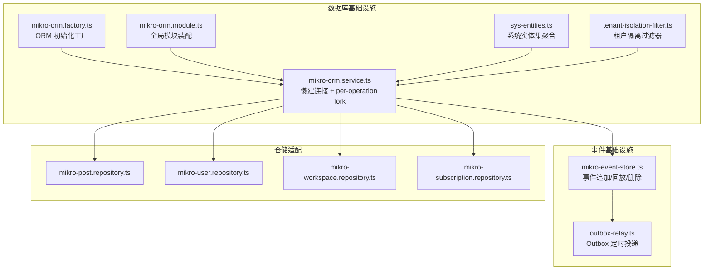
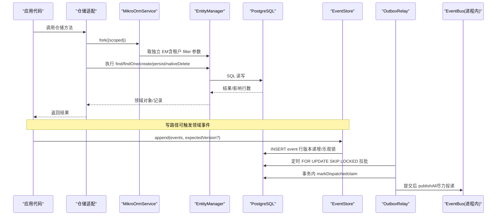
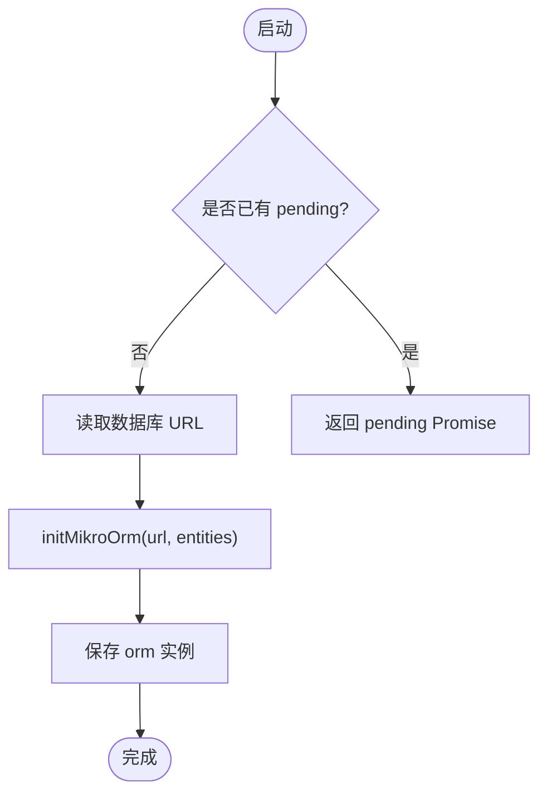
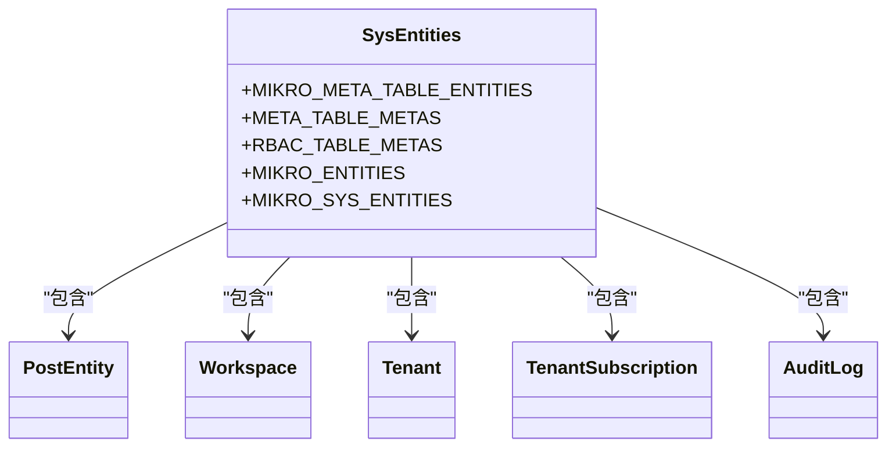
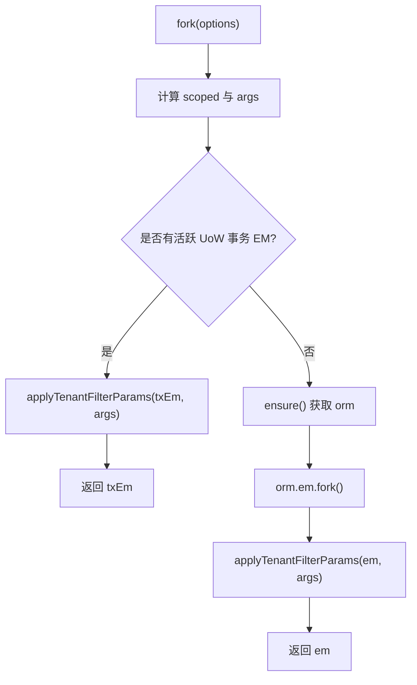
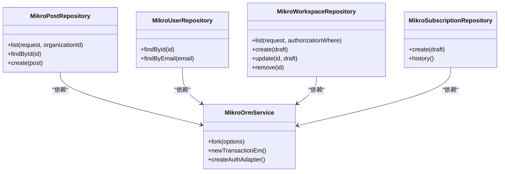
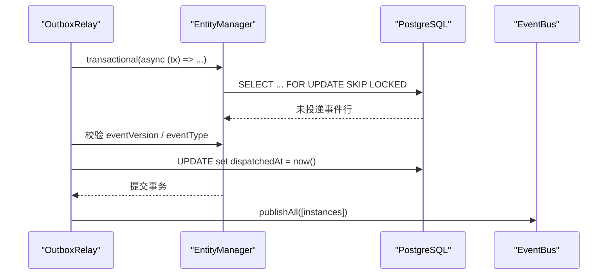
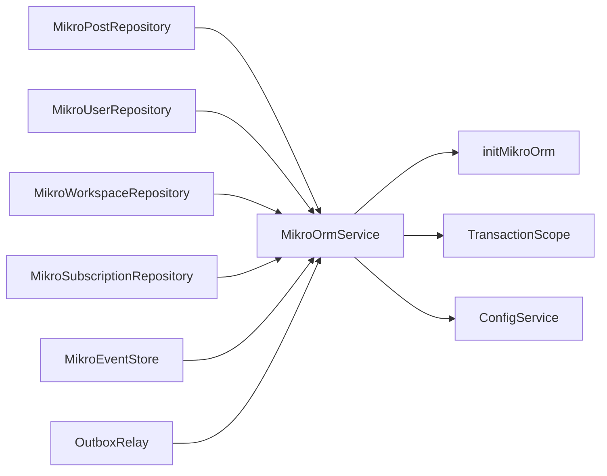

# 基础设施层开发

<cite>
**本文引用的文件**   
- [apps/api/src/database/mikro/mikro-orm.factory.ts](file://apps/api/src/database/mikro/mikro-orm.factory.ts)
- [apps/api/src/database/mikro/mikro-orm.module.ts](file://apps/api/src/database/mikro/mikro-orm.module.ts)
- [apps/api/src/database/mikro/mikro-orm.service.ts](file://apps/api/src/database/mikro/mikro-orm.service.ts)
- [apps/api/src/database/mikro/sys-entities.ts](file://apps/api/src/database/mikro/sys-entities.ts)
- [apps/api/src/database/mikro/tenant-isolation-filter.ts](file://apps/api/src/database/mikro/tenant-isolation-filter.ts)
- [apps/api/src/modules/posts/infrastructure/repositories/mikro-post.repository.ts](file://apps/api/src/modules/posts/infrastructure/repositories/mikro-post.repository.ts)
- [apps/api/src/modules/users/infrastructure/repositories/mikro-user.repository.ts](file://apps/api/src/modules/users/infrastructure/repositories/mikro-user.repository.ts)
- [apps/api/src/modules/workspaces/infrastructure/repositories/mikro-workspace.repository.ts](file://apps/api/src/modules/workspaces/infrastructure/repositories/mikro-workspace.repository.ts)
- [apps/api/src/modules/subscriptions/infrastructure/repositories/mikro-subscription.repository.ts](file://apps/api/src/modules/subscriptions/infrastructure/repositories/mikro-subscription.repository.ts)
- [apps/api/src/database/eventing/mikro-event-store.ts](file://apps/api/src/database/eventing/mikro-event-store.ts)
- [apps/api/src/database/eventing/outbox-relay.ts](file://apps/api/src/database/eventing/outbox-relay.ts)
</cite>

## 目录
1. [引言](#引言)
2. [项目结构](#项目结构)
3. [核心组件](#核心组件)
4. [架构总览](#架构总览)
5. [详细组件分析](#详细组件分析)
6. [依赖关系分析](#依赖关系分析)
7. [性能与优化](#性能与优化)
8. [测试策略](#测试策略)
9. [故障排查](#故障排查)
10. [结论](#结论)

## 引言
本文件聚焦基础设施层的实现细节，围绕 MikroORM 的初始化、连接管理、实体装配、租户隔离过滤、仓储适配、事件存储与 Outbox 投递等关键路径展开。目标是帮助开发者理解：
- 如何通过工厂与服务对象安全地创建与管理 ORM 实例；
- 如何配置实体映射与命名策略，保证列名与属性一致；
- 如何在仓储中正确使用查询构建器、分页、事务与作用域；
- 如何实现外部服务集成（Better Auth）、消息队列（Outbox）与缓存（概念性建议）；
- 如何编写仓储示例与测试，并给出性能监控与优化建议。

## 项目结构
基础设施层主要位于 `apps/api/src/database` 与业务模块的 `infrastructure/repositories` 下：
- `database/mikro`：MikroORM 工厂、模块、服务、实体集装配、租户隔离过滤器；
- `database/eventing`：领域事件持久化与 Outbox 投递；
- `modules/*/infrastructure/repositories`：各业务上下文的仓储实现（Posts、Users、Workspaces、Subscriptions）。

**图表来源**
- [apps/api/src/database/mikro/mikro-orm.factory.ts:22-34](file://apps/api/src/database/mikro/mikro-orm.factory.ts#L22-L34)
- [apps/api/src/database/mikro/mikro-orm.module.ts:19-29](file://apps/api/src/database/mikro/mikro-orm.module.ts#L19-L29)
- [apps/api/src/database/mikro/mikro-orm.service.ts:21-92](file://apps/api/src/database/mikro/mikro-orm.service.ts#L21-L92)
- [apps/api/src/database/mikro/sys-entities.ts:47-86](file://apps/api/src/database/mikro/sys-entities.ts#L47-L86)
- [apps/api/src/database/mikro/tenant-isolation-filter.ts:23-137](file://apps/api/src/database/mikro/tenant-isolation-filter.ts#L23-L137)
- [apps/api/src/database/eventing/mikro-event-store.ts:33-109](file://apps/api/src/database/eventing/mikro-event-store.ts#L33-L109)
- [apps/api/src/database/eventing/outbox-relay.ts:37-189](file://apps/api/src/database/eventing/outbox-relay.ts#L37-L189)

**章节来源**
- [apps/api/src/database/mikro/mikro-orm.factory.ts:22-34](file://apps/api/src/database/mikro/mikro-orm.factory.ts#L22-L34)
- [apps/api/src/database/mikro/mikro-orm.module.ts:19-29](file://apps/api/src/database/mikro/mikro-orm.module.ts#L19-L29)
- [apps/api/src/database/mikro/mikro-orm.service.ts:21-92](file://apps/api/src/database/mikro/mikro-orm.service.ts#L21-L92)
- [apps/api/src/database/mikro/sys-entities.ts:47-86](file://apps/api/src/database/mikro/sys-entities.ts#L47-L86)
- [apps/api/src/database/mikro/tenant-isolation-filter.ts:23-137](file://apps/api/src/database/mikro/tenant-isolation-filter.ts#L23-L137)

## 核心组件
- MikroORM 初始化工厂：解析数据库 URL，使用 PostgreSQL 驱动，启用全局上下文与驼峰命名策略，集中注册实体集。
- MikroORM 模块：以全局模块暴露服务、事务作用域与 UoW 端口实现。
- MikroORM 服务：懒建连接、per-operation fork、在活跃 UoW 事务内返回事务 EM、为 Better Auth 提供适配器工厂。
- 租户隔离过滤器：基于 ALS 作用域注入 tenantId/organizationId，支持 isolated 模式下的组织级收窄与拒所有哨兵值。
- 系统实体集：聚合各上下文实体与元数据，作为 app 侧唯一 ORM 实体清单。
- 仓储适配：Posts/Users/Workspaces/Subscriptions 仓储统一通过 MikroOrmService.fork() 获取独立 EM，遵循租户隔离与写侧盖章。
- 事件存储：追加事件、按流版本递增、乐观锁校验、PIPL 级联删除、回放重建。
- Outbox 中继：定时轮询未投递事件，事务内 claim（设置 dispatchedAt），提交后尽力投递进程内 EventBus，具备去重窗与停重试机制。

**章节来源**
- [apps/api/src/database/mikro/mikro-orm.factory.ts:22-34](file://apps/api/src/database/mikro/mikro-orm.factory.ts#L22-L34)
- [apps/api/src/database/mikro/mikro-orm.module.ts:19-29](file://apps/api/src/database/mikro/mikro-orm.module.ts#L19-L29)
- [apps/api/src/database/mikro/mikro-orm.service.ts:21-92](file://apps/api/src/database/mikro/mikro-orm.service.ts#L21-L21)
- [apps/api/src/database/mikro/tenant-isolation-filter.ts:23-137](file://apps/api/src/database/mikro/tenant-isolation-filter.ts#L23-L137)
- [apps/api/src/database/mikro/sys-entities.ts:47-86](file://apps/api/src/database/mikro/sys-entities.ts#L47-L86)
- [apps/api/src/database/eventing/mikro-event-store.ts:33-109](file://apps/api/src/database/eventing/mikro-event-store.ts#L33-L109)
- [apps/api/src/database/eventing/outbox-relay.ts:37-189](file://apps/api/src/database/eventing/outbox-relay.ts#L37-L189)

## 架构总览
下图展示从请求到数据持久化的关键路径：仓储通过 MikroOrmService 获取 EM，应用租户隔离过滤器，执行查询或写入；事件面通过 EventStore 追加事件，OutboxRelay 定时将事件投递至进程内总线。

**图表来源**
- [apps/api/src/database/mikro/mikro-orm.service.ts:54-72](file://apps/api/src/database/mikro/mikro-orm.service.ts#L54-L72)
- [apps/api/src/database/mikro/tenant-isolation-filter.ts:135-137](file://apps/api/src/database/mikro/tenant-isolation-filter.ts#L135-L137)
- [apps/api/src/database/eventing/mikro-event-store.ts:37-68](file://apps/api/src/database/eventing/mikro-event-store.ts#L37-L68)
- [apps/api/src/database/eventing/outbox-relay.ts:81-129](file://apps/api/src/database/eventing/outbox-relay.ts#L81-L129)

## 详细组件分析

### MikroORM 初始化与连接管理
- 工厂函数解析数据库 URL，使用 PostgreSQL 驱动初始化 ORM，启用全局上下文与驼峰命名策略，避免 snake/camel 转换开销。
- 模块以 @Global 暴露服务与事务相关提供者，不构造期建连，保持 DB-free 冒烟能力。
- 服务懒建连接，首次真正使用时 ensure()；每次 fork() 返回独立 EM，避免共享全局 EM；在活跃 UoW 事务内返回事务 EM；提供 createAuthAdapter() 给 Better Auth。

**图表来源**
- [apps/api/src/database/mikro/mikro-orm.service.ts:34-44](file://apps/api/src/database/mikro/mikro-orm.service.ts#L34-L44)
- [apps/api/src/database/mikro/mikro-orm.factory.ts:22-34](file://apps/api/src/database/mikro/mikro-orm.factory.ts#L22-L34)

**章节来源**
- [apps/api/src/database/mikro/mikro-orm.factory.ts:22-34](file://apps/api/src/database/mikro/mikro-orm.factory.ts#L22-L34)
- [apps/api/src/database/mikro/mikro-orm.module.ts:19-29](file://apps/api/src/database/mikro/mikro-orm.module.ts#L19-L29)
- [apps/api/src/database/mikro/mikro-orm.service.ts:21-92](file://apps/api/src/database/mikro/mikro-orm.service.ts#L21-L92)

### 实体映射与命名策略
- 使用 EntityCaseNamingStrategy，属性名原样映射为列名（camelCase），减少键名转换成本，便于手写 SQL 与 adapter 直读直写。
- sys-entities.ts 聚合各上下文实体与元数据，作为 app 侧唯一 ORM 实体清单；迁移专用实体集与之解耦，确保迁移基线忠实于 schema。

**图表来源**
- [apps/api/src/database/mikro/sys-entities.ts:47-86](file://apps/api/src/database/mikro/sys-entities.ts#L47-L86)

**章节来源**
- [apps/api/src/database/mikro/sys-entities.ts:47-86](file://apps/api/src/database/mikro/sys-entities.ts#L47-L86)

### 租户隔离过滤器
- 通过 ALS 作用域派生 tenantId/organizationId/orgIsolated，默认生效；无活动租户时恒真不筛，平台治理/跨租场景自然豁免。
- isolated 模式下对 org-partitioned 实体在无活动组织时拒所有（哨兵值），防止泄露；shared 模式仅按 tenantId 过滤。
- 在 fork() 中 applyTenantFilterParams(em, args)，使所有查询自动带上隔离条件。

**图表来源**
- [apps/api/src/database/mikro/mikro-orm.service.ts:54-66](file://apps/api/src/database/mikro/mikro-orm.service.ts#L54-L66)
- [apps/api/src/database/mikro/tenant-isolation-filter.ts:44-54](file://apps/api/src/database/mikro/tenant-isolation-filter.ts#L44-L54)
- [apps/api/src/database/mikro/tenant-isolation-filter.ts:135-137](file://apps/api/src/database/mikro/tenant-isolation-filter.ts#L135-L137)

**章节来源**
- [apps/api/src/database/mikro/tenant-isolation-filter.ts:23-137](file://apps/api/src/database/mikro/tenant-isolation-filter.ts#L23-L137)
- [apps/api/src/database/mikro/mikro-orm.service.ts:54-66](file://apps/api/src/database/mikro/mikro-orm.service.ts#L54-L66)

### 仓储接口与实现（Posts/Users/Workspaces/Subscriptions）
- Posts 仓储：读侧仅锚 tenantId（同租跨组织互见），可选 workspaceId/organizationId 收窄；写侧双盖章 tenantId+organizationId；使用 UUIDv7 排序与游标分页，limit+1 探下一页，避免 COUNT。
- Users 仓储：纯读，适配 BA 身份实体，字段镜像转换。
- Workspaces 仓储：目录按 tenantId 作用域，写侧双盖章；更新仅在脏字段时更新时间戳；删除使用 nativeDelete 带 tenantId 谓词。
- Subscriptions 仓储：历史表追加新行，create 显式赋 periodStart/updatedAt；history 按 periodStart 倒序。

**图表来源**
- [apps/api/src/modules/posts/infrastructure/repositories/mikro-post.repository.ts:38-139](file://apps/api/src/modules/posts/infrastructure/repositories/mikro-post.repository.ts#L38-L139)
- [apps/api/src/modules/users/infrastructure/repositories/mikro-user.repository.ts:34-49](file://apps/api/src/modules/users/infrastructure/repositories/mikro-user.repository.ts#L34-L49)
- [apps/api/src/modules/workspaces/infrastructure/repositories/mikro-workspace.repository.ts:34-135](file://apps/api/src/modules/workspaces/infrastructure/repositories/mikro-workspace.repository.ts#L34-L135)
- [apps/api/src/modules/subscriptions/infrastructure/repositories/mikro-subscription.repository.ts:29-88](file://apps/api/src/modules/subscriptions/infrastructure/repositories/mikro-subscription.repository.ts#L29-L88)
- [apps/api/src/database/mikro/mikro-orm.service.ts:54-83](file://apps/api/src/database/mikro/mikro-orm.service.ts#L54-L83)

**章节来源**
- [apps/api/src/modules/posts/infrastructure/repositories/mikro-post.repository.ts:38-139](file://apps/api/src/modules/posts/infrastructure/repositories/mikro-post.repository.ts#L38-L139)
- [apps/api/src/modules/users/infrastructure/repositories/mikro-user.repository.ts:34-49](file://apps/api/src/modules/users/infrastructure/repositories/mikro-user.repository.ts#L34-L49)
- [apps/api/src/modules/workspaces/infrastructure/repositories/mikro-workspace.repository.ts:34-135](file://apps/api/src/modules/workspaces/infrastructure/repositories/mikro-workspace.repository.ts#L34-L135)
- [apps/api/src/modules/subscriptions/infrastructure/repositories/mikro-subscription.repository.ts:29-88](file://apps/api/src/modules/subscriptions/infrastructure/repositories/mikro-subscription.repository.ts#L29-L88)

### 事件存储与 Outbox 投递
- EventStore：append 逐条插入，version 按流 max+1 递增；expectedVersion 可选乐观锁校验；deleteByAggregate 用于 PIPL 级联补删；load 按 version 升序回放。
- OutboxRelay：定时 tickOnce，事务内 FOR UPDATE SKIP LOCKED 拉批，claim（置 dispatchedAt），提交后 publishAll；对未知 eventType 或过高 eventVersion 的行 parkRow（attemptCount 顶上限）；内存去重窗 LRU 淘汰。

**图表来源**
- [apps/api/src/database/eventing/outbox-relay.ts:81-129](file://apps/api/src/database/eventing/outbox-relay.ts#L81-L129)
- [apps/api/src/database/eventing/outbox-relay.ts:131-178](file://apps/api/src/database/eventing/outbox-relay.ts#L131-L178)
- [apps/api/src/database/eventing/mikro-event-store.ts:37-68](file://apps/api/src/database/eventing/mikro-event-store.ts#L37-L68)

**章节来源**
- [apps/api/src/database/eventing/mikro-event-store.ts:33-109](file://apps/api/src/database/eventing/mikro-event-store.ts#L33-L109)
- [apps/api/src/database/eventing/outbox-relay.ts:37-189](file://apps/api/src/database/eventing/outbox-relay.ts#L37-L189)

## 依赖关系分析
- 仓储类依赖 MikroOrmService 获取 EM，并通过 TenantIsolationService 解析可信租户上下文；
- MikroOrmService 依赖 ConfigService 与 TransactionScope，组合 initMikroOrm 工厂；
- EventStore 与 OutboxRelay 同样依赖 MikroOrmService；
- sys-entities.ts 聚合各上下文实体，供 ORM 初始化使用。

**图表来源**
- [apps/api/src/modules/posts/infrastructure/repositories/mikro-post.repository.ts:38-42](file://apps/api/src/modules/posts/infrastructure/repositories/mikro-post.repository.ts#L38-L42)
- [apps/api/src/modules/users/infrastructure/repositories/mikro-user.repository.ts:34-36](file://apps/api/src/modules/users/infrastructure/repositories/mikro-user.repository.ts#L34-L36)
- [apps/api/src/modules/workspaces/infrastructure/repositories/mikro-workspace.repository.ts:34-39](file://apps/api/src/modules/workspaces/infrastructure/repositories/mikro-workspace.repository.ts#L34-L39)
- [apps/api/src/modules/subscriptions/infrastructure/repositories/mikro-subscription.repository.ts:29-34](file://apps/api/src/modules/subscriptions/infrastructure/repositories/mikro-subscription.repository.ts#L29-L34)
- [apps/api/src/database/eventing/mikro-event-store.ts:33-35](file://apps/api/src/database/eventing/mikro-event-store.ts#L33-L35)
- [apps/api/src/database/eventing/outbox-relay.ts:50-55](file://apps/api/src/database/eventing/outbox-relay.ts#L50-L55)
- [apps/api/src/database/mikro/mikro-orm.service.ts:27-32](file://apps/api/src/database/mikro/mikro-orm.service.ts#L27-L32)
- [apps/api/src/database/mikro/mikro-orm.factory.ts:22-34](file://apps/api/src/database/mikro/mikro-orm.factory.ts#L22-L34)

**章节来源**
- [apps/api/src/database/mikro/mikro-orm.service.ts:27-32](file://apps/api/src/database/mikro/mikro-orm.service.ts#L27-L32)
- [apps/api/src/database/mikro/mikro-orm.factory.ts:22-34](file://apps/api/src/database/mikro/mikro-orm.factory.ts#L22-L34)

## 性能与优化
- 懒建连接：首次真正使用时才建立连接，避免启动阶段触库；onModuleDestroy 关闭连接。
- per-operation fork：每次读写取独立 EM，避免共享全局 EM 导致的并发问题。
- 命名策略：EntityCaseNamingStrategy 消除 snake/camel 转换，提升手写 SQL 与 adapter 效率。
- 分页优化：Posts 使用 limit+1 探下一页，避免 COUNT；UUIDv7 时间有序，ORDER BY id DESC 稳定。
- 租户隔离：全局 filter 自动注入 tenantId/organizationId，减少手写谓词遗漏风险。
- Outbox 批量处理：BATCH_SIZE=50，FOR UPDATE SKIP LOCKED 多实例并发安全；内存去重窗 LRU 控制大小。
- 事件追加：按流 max+1 递增，乐观锁校验 expectedVersion，失败 fail-loud。

[本节为通用指导，无需具体文件引用]

## 测试策略
- 仓储单元测试：mock EntityManager（findOne/create/persist/flush/nativeDelete），验证 fork 行为与租户隔离；例如用户仓储测试中对 fork 与 EM 方法的 spy 断言。
- Outbox 端到端：模拟 tickOnce 流程，验证 claim→提交→publishAll 的顺序与幂等性；parkRow 与 seenEventIds 去重逻辑需覆盖毒信封与重复投递场景。
- 事件存储 e2e：验证 append 版本递增、expectedVersion 校验、deleteByAggregate 删除条数、load 回放顺序。
- 租户隔离：验证 isolated 模式下 org-partitioned 实体在无活动组织时的拒所有行为；shared 模式仅按 tenantId 过滤。

**章节来源**
- [apps/api/src/modules/users/infrastructure/repositories/mikro-user.repository.test.ts:7-42](file://apps/api/src/modules/users/infrastructure/repositories/mikro-user.repository.test.ts#L7-L42)
- [apps/api/src/database/eventing/outbox-relay.ts:81-129](file://apps/api/src/database/eventing/outbox-relay.ts#L81-L129)
- [apps/api/src/database/eventing/mikro-event-store.ts:37-68](file://apps/api/src/database/eventing/mikro-event-store.ts#L37-L68)

## 故障排查
- 连接未建立：检查 ensure() 是否被触发（首次访问仓储或事件存储）；确认 ConfigService.getDatabaseConfig().url 有效。
- 租户隔离导致空结果：确认 ALS 作用域是否正确设置 tenantId；isolated 模式且无活动组织时 org-partitioned 实体将被拒所有。
- Outbox 未投递：检查 EVENT_PUBLISH_MODE 是否为 outbox；查看 parkRow 日志（unsupported eventVersion/unknown eventType）；确认 seenEventIds 去重窗未误吞。
- 事件追加失败：检查 expectedVersion 是否与流当前 max+1 一致；确认唯一键约束（aggregateType, aggregateId, version）未被破坏。

**章节来源**
- [apps/api/src/database/mikro/mikro-orm.service.ts:34-44](file://apps/api/src/database/mikro/mikro-orm.service.ts#L34-L44)
- [apps/api/src/database/mikro/tenant-isolation-filter.ts:73-87](file://apps/api/src/database/mikro/tenant-isolation-filter.ts#L73-L87)
- [apps/api/src/database/eventing/outbox-relay.ts:131-178](file://apps/api/src/database/eventing/outbox-relay.ts#L131-L178)
- [apps/api/src/database/eventing/mikro-event-store.ts:37-68](file://apps/api/src/database/eventing/mikro-event-store.ts#L37-L68)

## 结论
本基础设施层以 MikroORM 为核心，结合懒建连接、per-operation fork、租户隔离过滤器与系统实体集聚合，构建了安全、可扩展的数据访问基础。仓储适配在各业务上下文中保持一致的隔离与盖章语义；事件存储与 Outbox 提供了可靠的事件持久化与投递机制。建议在后续迭代中继续强化：
- 查询计划分析与索引优化（复合索引、覆盖索引）；
- 缓存层接入（如 Redis）以降低热点读压力；
- 外部服务集成（Better Auth、Odoo RPC、支付网关）的适配与重试/熔断策略；
- 性能监控（慢查询、连接池利用率、Outbox 堆积）与告警。

[本节为总结性内容，无需具体文件引用]