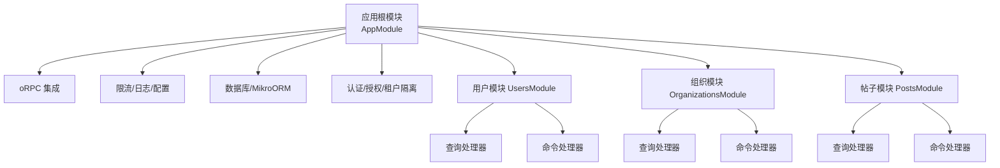
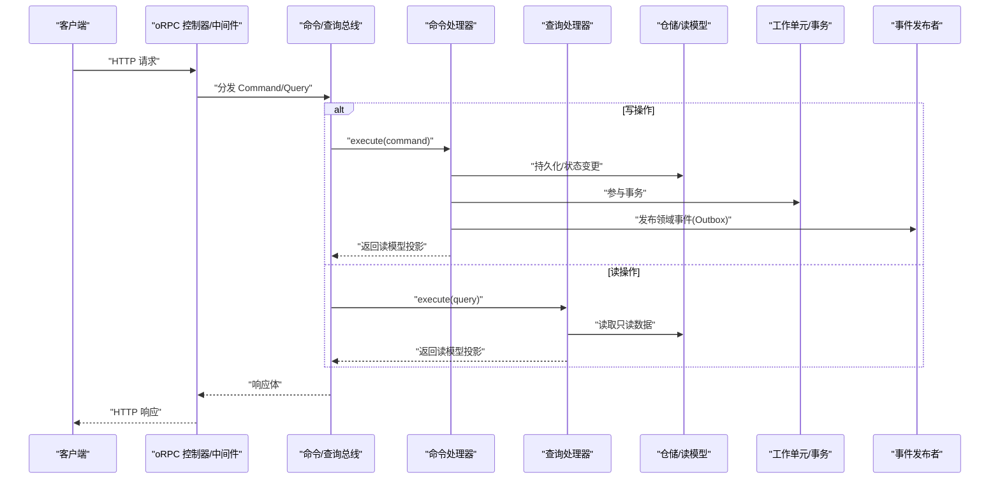
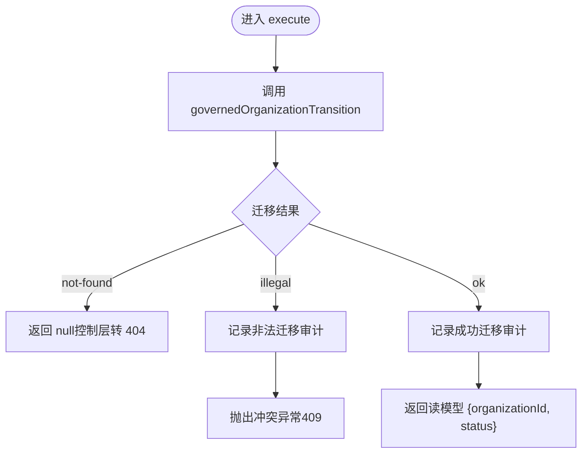
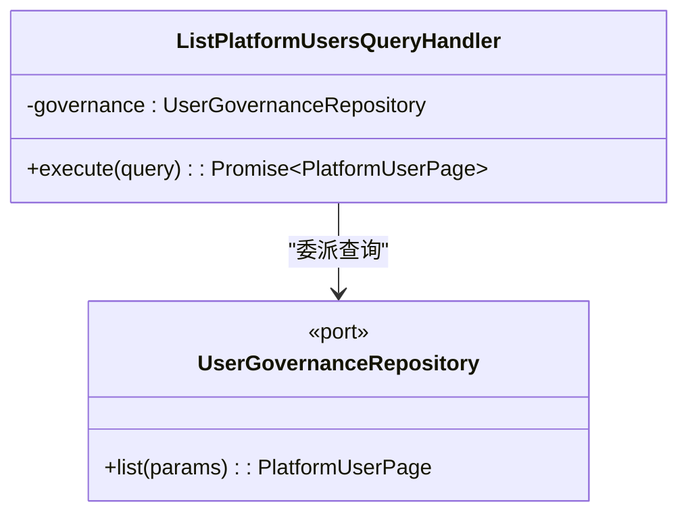
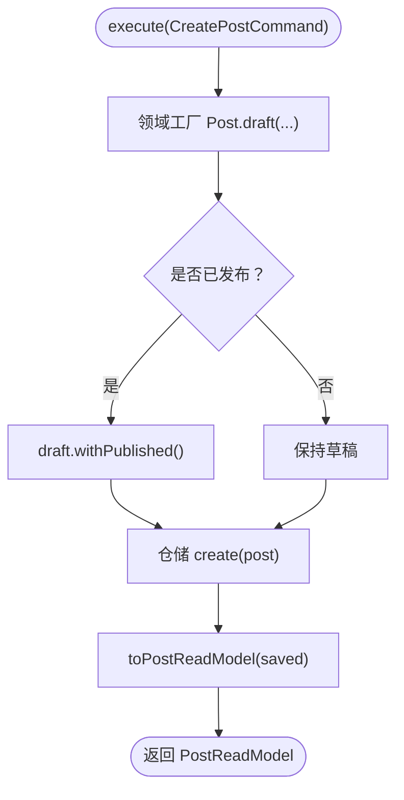
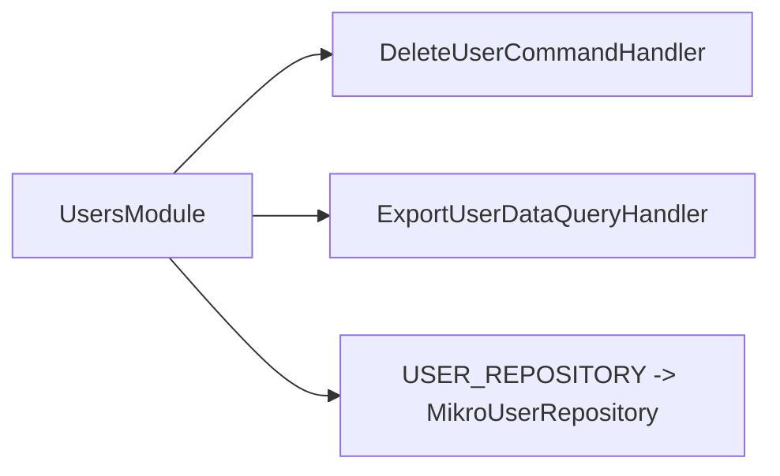
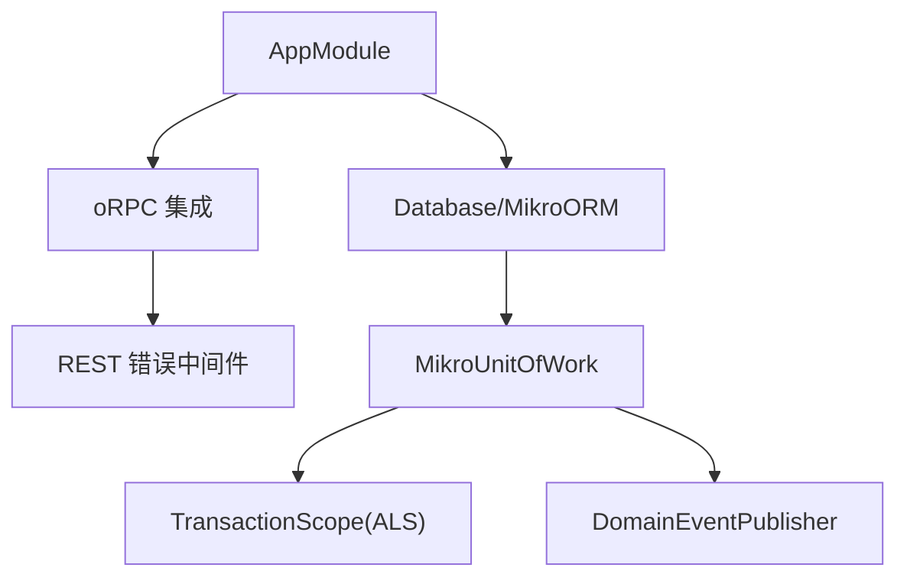

# 应用层开发

<cite>
**本文引用的文件**   
- [apps/api/src/app.module.ts](file://apps/api/src/app.module.ts)
- [libs/core/src/shared-kernel/cqrs/types.ts](file://libs/core/src/shared-kernel/cqrs/types.ts)
- [apps/api/src/modules/users/users.module.ts](file://apps/api/src/modules/users/users.module.ts)
- [apps/api/src/modules/organizations/application/commands/handlers/approve-organization.command-handler.ts](file://apps/api/src/modules/organizations/application/commands/handlers/approve-organization.command-handler.ts)
- [apps/api/src/modules/organizations/application/commands/handlers/governed-organization-transition.ts](file://apps/api/src/modules/organizations/application/commands/handlers/governed-organization-transition.ts)
- [apps/api/src/modules/organizations/application/read-models/organization-application.read-model.ts](file://apps/api/src/modules/organizations/application/read-models/organization-application.read-model.ts)
- [apps/api/src/modules/organizations/application/queries/handlers/list-platform-users.query-handler.ts](file://apps/api/src/modules/organizations/application/queries/handlers/list-platform-users.query-handler.ts)
- [apps/api/src/modules/posts/application/commands/handlers/create-post.command-handler.ts](file://apps/api/src/modules/posts/application/commands/handlers/create-post.command-handler.ts)
- [apps/api/src/modules/posts/application/read-models/post.read-model.ts](file://apps/api/src/modules/posts/application/read-models/post.read-model.ts)
- [apps/api/src/modules/users/application/read-models/user.read-model.ts](file://apps/api/src/modules/users/application/read-models/user.read-model.ts)
- [apps/api/src/common/orpc/rest-error.middleware.ts](file://apps/api/src/common/orpc/rest-error.middleware.ts)
- [apps/api/src/database/eventing/domain-event-publisher.ts](file://apps/api/src/database/eventing/domain-event-publisher.ts)
- [apps/api/src/database/eventing/mikro-unit-of-work.ts](file://apps/api/src/database/eventing/mikro-unit-of-work.ts)
- [apps/api/src/database/eventing/transaction-scope.ts](file://apps/api/src/database/eventing/transaction-scope.ts)
</cite>

## 目录
1. [引言](#引言)
2. [项目结构](#项目结构)
3. [核心组件](#核心组件)
4. [架构总览](#架构总览)
5. [详细组件分析](#详细组件分析)
6. [依赖关系分析](#依赖关系分析)
7. [性能考量](#性能考量)
8. [故障排查指南](#故障排查指南)
9. [结论](#结论)
10. [附录](#附录)

## 引言
本文件面向应用层开发者，系统性说明如何在 NestJS + @nestjs/cqrs 基础上实现 CQRS（命令查询职责分离）业务用例。文档聚焦以下目标：
- 命令与查询的设计原则：不可变数据、单一职责、薄约定基类。
- 命令处理器与查询处理器的实现要点：事务管理、错误处理、日志审计。
- 读写模型分离策略与性能优化实践。
- 从 API 调用到数据持久化的完整流程示例。
- 应用层最佳实践与性能调优建议。

## 项目结构
仓库采用按“模块/限界上下文”组织的应用层结构，CQRS 相关代码主要位于各模块的 `application/` 子目录中，包含 `commands/`、`queries/`、`read-models/` 等目录；基础设施与领域端口则位于 `infrastructure/` 与 `domain/`。根模块 `AppModule` 统一装配 oRPC、限流、配置、数据库、MikroORM、认证授权、租户隔离与各业务模块，确保请求在统一的横切能力下进入应用层。

图表来源
- [apps/api/src/app.module.ts:33-73](file://apps/api/src/app.module.ts#L33-L73)

章节来源
- [apps/api/src/app.module.ts:1-78](file://apps/api/src/app.module.ts#L1-L78)

## 核心组件
本节梳理 CQRS 在应用层的关键构件与设计约束。

- 公共基类与类型约定
  - 通过 `BaseCommand<TResult>` 与 `BaseQuery<TResult>` 为各限界上下文的命令与查询提供统一基类，使总线执行时的结果类型可被推断。
  - 该约定层仅薄封装 `@nestjs/cqrs` 的消息基类，保持领域纯净性。

- 命令处理器（Command Handler）
  - 使用 `@CommandHandler` 装饰器绑定具体命令类。
  - 典型职责：执行业务规则、调用仓储端口、写读模型投影、记录审计日志、抛出结构化异常。

- 查询处理器（Query Handler）
  - 使用 `@QueryHandler` 装饰器绑定具体查询类。
  - 典型职责：读取只读仓储或读模型、返回传输投影，不产生副作用。

- 读模型（Read Model / Projection）
  - 以接口形式定义对外返回形状，与存储模型解耦，便于演进与权限白名单控制。

章节来源
- [libs/core/src/shared-kernel/cqrs/types.ts:1-24](file://libs/core/src/shared-kernel/cqrs/types.ts#L1-L24)
- [apps/api/src/modules/posts/application/read-models/post.read-model.ts:1-54](file://apps/api/src/modules/posts/application/read-models/post.read-model.ts#L1-L54)
- [apps/api/src/modules/users/application/read-models/user.read-model.ts:1-41](file://apps/api/src/modules/users/application/read-models/user.read-model.ts#L1-L41)

## 架构总览
下图展示从 API 到应用层处理器再到基础设施的端到端流程，体现 oRPC 错误面承接、命令/查询分发、事务边界与事件发布通道。

图表来源
- [apps/api/src/common/orpc/rest-error.middleware.ts:1-22](file://apps/api/src/common/orpc/rest-error.middleware.ts#L1-L22)
- [apps/api/src/database/eventing/domain-event-publisher.ts:1-42](file://apps/api/src/database/eventing/domain-event-publisher.ts#L1-L42)
- [apps/api/src/database/eventing/mikro-unit-of-work.ts:1-30](file://apps/api/src/database/eventing/mikro-unit-of-work.ts#L1-L30)

## 详细组件分析

### 命令处理器：组织审批（ApproveOrganization）
该处理器负责将组织从待审批迁移至激活状态，并通过共享治理用例完成状态校验、审计与错误处理。

图表来源
- [apps/api/src/modules/organizations/application/commands/handlers/approve-organization.command-handler.ts:21-48](file://apps/api/src/modules/organizations/application/commands/handlers/approve-organization.command-handler.ts#L21-L48)
- [apps/api/src/modules/organizations/application/commands/handlers/governed-organization-transition.ts:61-90](file://apps/api/src/modules/organizations/application/commands/handlers/governed-organization-transition.ts#L61-L90)

设计要点
- 单一职责：处理器仅编排状态服务与审计服务，复杂迁移逻辑收敛至共享函数。
- 不可变输入：命令对象作为不可变参数传入，避免副作用扩散。
- 错误处理：非法迁移抛结构化冲突异常，并附带错误码；未找到返回 null 交由上层映射 404。
- 审计日志：成功与失败路径均记录结构化审计，便于追踪治理行为。

章节来源
- [apps/api/src/modules/organizations/application/commands/handlers/approve-organization.command-handler.ts:1-50](file://apps/api/src/modules/organizations/application/commands/handlers/approve-organization.command-handler.ts#L1-L50)
- [apps/api/src/modules/organizations/application/commands/handlers/governed-organization-transition.ts:1-91](file://apps/api/src/modules/organizations/application/commands/handlers/governed-organization-transition.ts#L1-L91)
- [apps/api/src/modules/organizations/application/read-models/organization-application.read-model.ts:1-17](file://apps/api/src/modules/organizations/application/read-models/organization-application.read-model.ts#L1-L17)

### 查询处理器：平台用户列表（ListPlatformUsers）
该处理器用于跨平台用户分页查询，属于平台级读侧，不施加租户过滤，访问由上游守卫控制。

图表来源
- [apps/api/src/modules/organizations/application/queries/handlers/list-platform-users.query-handler.ts:19-38](file://apps/api/src/modules/organizations/application/queries/handlers/list-platform-users.query-handler.ts#L19-L38)

设计要点
- 只读无副作用：仅调用仓储端口进行分页查询，不修改任何状态。
- 平台级语义：明确不应用租户过滤，安全边界由控制器层守卫保障。
- 传输投影：返回类型为平台用户分页结构，便于 API 契约稳定。

章节来源
- [apps/api/src/modules/organizations/application/queries/handlers/list-platform-users.query-handler.ts:1-40](file://apps/api/src/modules/organizations/application/queries/handlers/list-platform-users.query-handler.ts#L1-L40)

### 命令处理器：创建帖子（CreatePost）
该处理器演示了领域工厂构造实体、纯转移发布态、仓储落库与返回传输投影的典型写侧流程。

图表来源
- [apps/api/src/modules/posts/application/commands/handlers/create-post.command-handler.ts:12-28](file://apps/api/src/modules/posts/application/commands/handlers/create-post.command-handler.ts#L12-L28)
- [apps/api/src/modules/posts/application/read-models/post.read-model.ts:42-53](file://apps/api/src/modules/posts/application/read-models/post.read-model.ts#L42-L53)

设计要点
- 领域驱动：通过领域工厂与值对象方法表达不变量与状态转移。
- 纯转移：发布态转换返回新实例，避免可变状态污染。
- 传输投影：应用层负责将领域实体映射为对外投影，保证 API 契约稳定。

章节来源
- [apps/api/src/modules/posts/application/commands/handlers/create-post.command-handler.ts:1-29](file://apps/api/src/modules/posts/application/commands/handlers/create-post.command-handler.ts#L1-L29)
- [apps/api/src/modules/posts/application/read-models/post.read-model.ts:1-54](file://apps/api/src/modules/posts/application/read-models/post.read-model.ts#L1-L54)

### 模块装配与处理器注册
各模块通过 `CqrsModule` 暴露命令与查询处理器，并以依赖注入方式绑定仓储端口与基础设施实现。

图表来源
- [apps/api/src/modules/users/users.module.ts:15-25](file://apps/api/src/modules/users/users.module.ts#L15-L25)

章节来源
- [apps/api/src/modules/users/users.module.ts:1-28](file://apps/api/src/modules/users/users.module.ts#L1-L28)

## 依赖关系分析
- 应用层对基础设施的依赖通过仓储端口抽象，降低耦合度，便于替换实现与测试。
- 事件发布与事务边界通过工作单元与事务作用域解耦，保证域行与事件行的原子性。
- oRPC 错误面中间件确保 handler 内抛出的 HTTP 异常能正确还原状态码与错误信封，避免降级为 500。

图表来源
- [apps/api/src/app.module.ts:33-73](file://apps/api/src/app.module.ts#L33-L73)
- [apps/api/src/common/orpc/rest-error.middleware.ts:1-22](file://apps/api/src/common/orpc/rest-error.middleware.ts#L1-L22)
- [apps/api/src/database/eventing/mikro-unit-of-work.ts:1-30](file://apps/api/src/database/eventing/mikro-unit-of-work.ts#L1-L30)
- [apps/api/src/database/eventing/transaction-scope.ts:1-20](file://apps/api/src/database/eventing/transaction-scope.ts#L1-L20)
- [apps/api/src/database/eventing/domain-event-publisher.ts:1-42](file://apps/api/src/database/eventing/domain-event-publisher.ts#L1-L42)

章节来源
- [apps/api/src/common/orpc/rest-error.middleware.ts:1-22](file://apps/api/src/common/orpc/rest-error.middleware.ts#L1-L22)
- [apps/api/src/database/eventing/domain-event-publisher.ts:1-42](file://apps/api/src/database/eventing/domain-event-publisher.ts#L1-L42)
- [apps/api/src/database/eventing/mikro-unit-of-work.ts:1-30](file://apps/api/src/database/eventing/mikro-unit-of-work.ts#L1-L30)
- [apps/api/src/database/eventing/transaction-scope.ts:1-20](file://apps/api/src/database/eventing/transaction-scope.ts#L1-L20)

## 性能考量
- 读写分离
  - 查询处理器仅做只读访问，避免锁竞争与写放大；写处理器专注状态变更与事件产出。
- 投影与传输模型
  - 使用独立的读模型接口作为传输形状，减少不必要字段传输，提升序列化效率。
- 事务与工作单元
  - 通过工作单元与 ALS 作用域管理活跃事务连接，避免隐式连接泄漏与重复开启。
- 事件发布
  - 事件发布走 Outbox 模式，保证域行与事件行同事务提交，异步消费不影响主流程吞吐。
- 错误面优化
  - oRPC 错误中间件保留原始状态码与错误信封，避免全局过滤器二次包装带来的额外开销。

[本节为通用指导，无需特定文件引用]

## 故障排查指南
- 状态码丢失或全部变为 500
  - 检查 oRPC 错误中间件是否正确注册，确认 handler 内抛出的 `HttpException` 能被转换为 `ORPCError` 并恢复状态码。
- 非法迁移导致 409
  - 审查 `governedOrganizationTransition` 的分支逻辑，确认状态机目标与当前状态是否合法，并核对审计日志中的 from/to 字段。
- 事件未持久化或不同步
  - 检查工作单元是否在事务范围内运行，确认事件发布器与 Outbox 配置一致，避免异步消费导致的时序问题。
- 查询返回空或越权
  - 确认查询处理器是否误加了租户过滤；平台级查询应依赖控制器层守卫进行权限控制。

章节来源
- [apps/api/src/common/orpc/rest-error.middleware.ts:1-22](file://apps/api/src/common/orpc/rest-error.middleware.ts#L1-L22)
- [apps/api/src/modules/organizations/application/commands/handlers/governed-organization-transition.ts:61-90](file://apps/api/src/modules/organizations/application/commands/handlers/governed-organization-transition.ts#L61-L90)
- [apps/api/src/database/eventing/domain-event-publisher.ts:1-42](file://apps/api/src/database/eventing/domain-event-publisher.ts#L1-L42)

## 结论
本项目在应用层以 CQRS 为核心组织业务用例，通过命令与查询处理器清晰划分写与读的职责，结合仓储端口、读模型投影、工作单元与事件发布机制，实现了高内聚、低耦合且可扩展的业务实现。配合 oRPC 错误面与审计日志，系统在可观测性与错误处理方面具备良好工程实践。建议在新增用例时遵循不可变命令、单一职责、读写分离与投影解耦的原则，并在必要时引入 Outbox 与审计日志以提升可靠性与可追溯性。

[本节为总结性内容，无需特定文件引用]

## 附录
- 常用命令与查询命名建议
  - 命令：动词+名词（如 ApproveOrganization、CreatePost）。
  - 查询：Get/List/Export+资源名（如 ListPlatformUsers、ExportUserData）。
- 读模型设计建议
  - 以接口定义对外形状，避免直接暴露存储模型。
  - 对敏感字段提供列白名单，防止信息泄露。
- 事务与事件一致性
  - 所有写操作应在工作单元事务内执行，事件发布与域行写入需同事务提交。

[本节为概念性内容，无需特定文件引用]