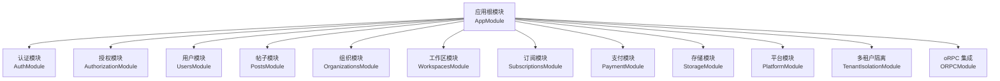
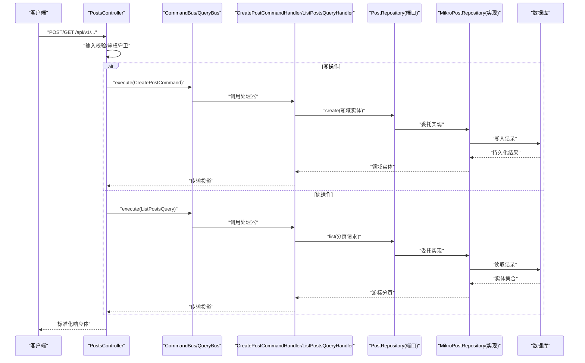
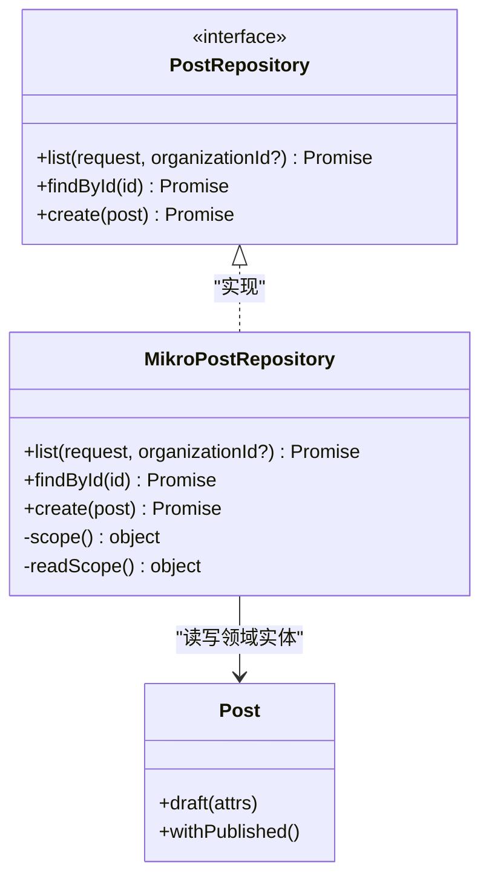
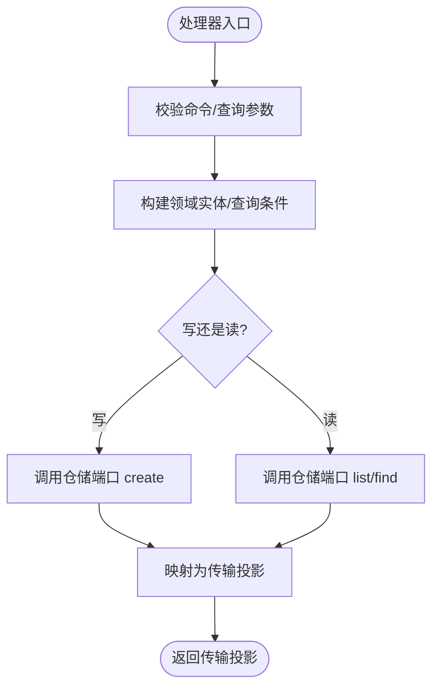
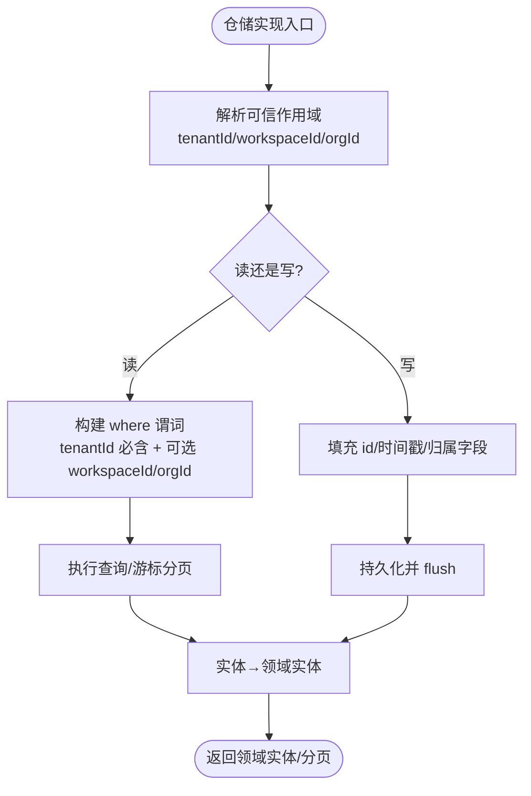
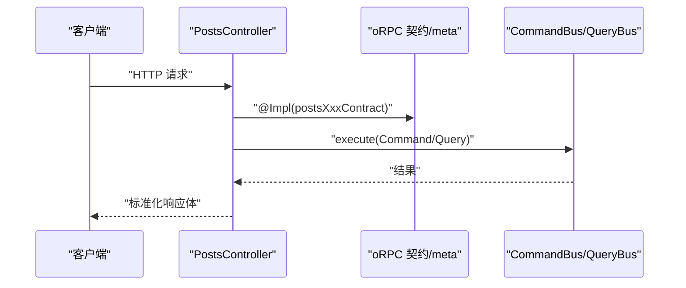
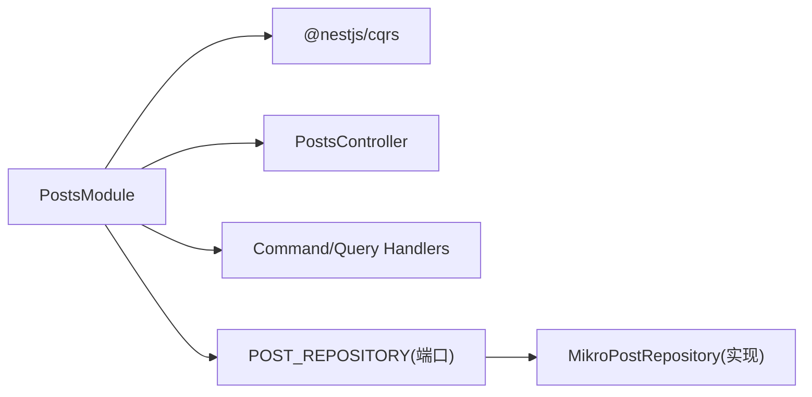
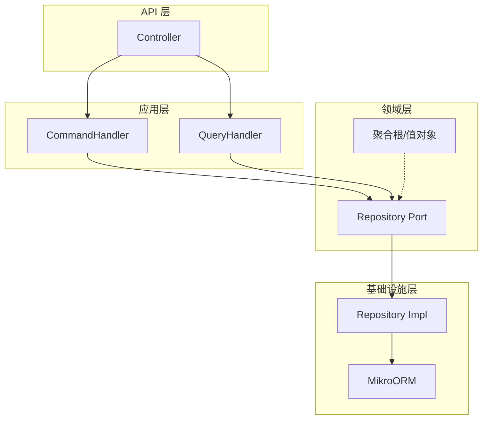

# 新模块开发

<cite>
**本文引用的文件**   
- [README.md](file://README.md)
- [app.module.ts](file://apps/api/src/app.module.ts)
- [verify-domain-layout.ts](file://scripts/verify-domain-layout.ts)
- [posts.module.ts](file://apps/api/src/modules/posts/posts.module.ts)
- [users.module.ts](file://apps/api/src/modules/users/users.module.ts)
- [post.repository.ts](file://apps/api/src/modules/posts/domain/repositories/post.repository.ts)
- [create-post.command-handler.ts](file://apps/api/src/modules/posts/application/commands/handlers/create-post.command-handler.ts)
- [list-posts.query-handler.ts](file://apps/api/src/modules/posts/application/queries/handlers/list-posts.query-handler.ts)
- [mikro-post.repository.ts](file://apps/api/src/modules/posts/infrastructure/repositories/mikro-post.repository.ts)
- [post.read-model.ts](file://apps/api/src/modules/posts/application/read-models/post.read-model.ts)
- [posts.controller.ts](file://apps/api/src/modules/posts/api/posts.controller.ts)
- [types.ts](file://libs/core/src/shared-kernel/cqrs/types.ts)
</cite>

## 目录
1. [引言](#引言)
2. [项目结构](#项目结构)
3. [核心组件](#核心组件)
4. [架构总览](#架构总览)
5. [详细组件分析](#详细组件分析)
6. [依赖关系分析](#依赖关系分析)
7. [性能与可扩展性](#性能与可扩展性)
8. [故障排查指南](#故障排查指南)
9. [结论](#结论)
10. [附录：从零到一的新模块开发示例](#附录从零到一的新模块开发示例)

## 引言
本文件面向“如何按照本项目架构规范开发一个新业务模块”的目标，结合仓库中已有的垂直切片（如 posts、users）与共享内核约定，系统说明 DDD 分层在模块中的体现、CQRS 命令/查询处理流程、聚合与值对象的设计要点、数据库实体与仓储实现、API 控制器开发方式，并给出从需求分析到代码实现的完整流程、测试要求、代码规范与最佳实践。

项目采用模块化单体 + Clean Architecture 的垂直切片组织：每个限界上下文内部自含 domain / application / infrastructure / api 四层；跨上下文通过领域事件集成。CQRS/ES/EDA 按需引入，简单上下文可直接调用服务，复杂上下文可演进为事件溯源聚合。

**章节来源**
- [README.md:78-128](file://README.md#L78-L128)

## 项目结构
- 应用根模块集中装配各限界上下文模块、oRPC、限流、日志、配置、数据库、多租户隔离等横切能力。
- 每个业务模块遵循“层有内容才存在”的原则，按 api / application / domain / infrastructure 组织。
- 领域层子目录受“领域子目录法”约束：entities、value-objects、events、repositories、ports、policies、constants。

**图表来源**
- [app.module.ts:33-73](file://apps/api/src/app.module.ts#L33-L73)

**章节来源**
- [README.md:78-101](file://README.md#L78-L101)
- [app.module.ts:33-73](file://apps/api/src/app.module.ts#L33-L73)

## 核心组件
- 领域层（domain）
  - 定义聚合根、值对象、领域事件、仓储端口（port）、策略与常量。
  - 不感知框架与基础设施细节，仅暴露抽象接口（ports）。
- 应用层（application）
  - 用例编排：命令处理器（CommandHandler）与查询处理器（QueryHandler），或简单 Service 直调。
  - 读模型映射：将领域实体映射为传输投影（ReadModel）。
- 基础设施层（infrastructure）
  - 仓储实现（MikroORM 适配）、外部系统集成（支付、存储、邮件等 provider 适配器）。
- API 层（api）
  - oRPC 端点（Controller + @Impl），负责输入校验、鉴权守卫、路由元数据与调用 CommandBus/QueryBus。

**章节来源**
- [README.md:78-101](file://README.md#L78-L101)

## 架构总览
下图展示一个典型请求在 posts 模块中的流转：API 层接收请求 → 校验与鉴权 → 分发到命令/查询总线 → 处理器执行业用逻辑 → 仓储端口持久化 → 返回传输投影。

**图表来源**
- [posts.controller.ts:47-90](file://apps/api/src/modules/posts/api/posts.controller.ts#L47-L90)
- [create-post.command-handler.ts:12-29](file://apps/api/src/modules/posts/application/commands/handlers/create-post.command-handler.ts#L12-L29)
- [list-posts.query-handler.ts:19-35](file://apps/api/src/modules/posts/application/queries/handlers/list-posts.query-handler.ts#L19-L35)
- [mikro-post.repository.ts:37-139](file://apps/api/src/modules/posts/infrastructure/repositories/mikro-post.repository.ts#L37-L139)

## 详细组件分析

### 领域层：聚合根、值对象与仓储端口
- 聚合根与值对象
  - 聚合根承载业务不变量与状态迁移方法（例如通过工厂方法创建草稿态，再经纯函数式转移进入发布态）。
  - 值对象表达不可变概念（如金额、货币、枚举状态等），避免裸字段散落。
- 仓储端口（Repository Port）
  - 由领域层定义 DI token 与接口，隐藏租户/工作区作用域细节，确保调用方无法传入任意租户 id。
  - 读写全走领域实体，不在端口暴露租户轴；租户与作用域在基础设施实现中强制注入。

**图表来源**
- [post.repository.ts:1-51](file://apps/api/src/modules/posts/domain/repositories/post.repository.ts#L1-L51)
- [mikro-post.repository.ts:37-139](file://apps/api/src/modules/posts/infrastructure/repositories/mikro-post.repository.ts#L37-L139)

**章节来源**
- [post.repository.ts:1-51](file://apps/api/src/modules/posts/domain/repositories/post.repository.ts#L1-L51)

### 应用层：CQRS 命令与查询处理器
- 命令处理器（CommandHandler）
  - 构造领域实体（工厂方法），执行状态转移，调用仓储端口持久化，返回传输投影。
- 查询处理器（QueryHandler）
  - 通过仓储端口获取领域实体集合，逐项映射为传输投影，重建游标分页信封。
- 公共基类
  - BaseCommand/BaseQuery 提供类型推断，便于 bus.execute<C,R> 推导返回类型。

**图表来源**
- [create-post.command-handler.ts:12-29](file://apps/api/src/modules/posts/application/commands/handlers/create-post.command-handler.ts#L12-L29)
- [list-posts.query-handler.ts:19-35](file://apps/api/src/modules/posts/application/queries/handlers/list-posts.query-handler.ts#L19-L35)
- [types.ts:1-23](file://libs/core/src/shared-kernel/cqrs/types.ts#L1-L23)

**章节来源**
- [create-post.command-handler.ts:12-29](file://apps/api/src/modules/posts/application/commands/handlers/create-post.command-handler.ts#L12-L29)
- [list-posts.query-handler.ts:19-35](file://apps/api/src/modules/posts/application/queries/handlers/list-posts.query-handler.ts#L19-L35)
- [types.ts:1-23](file://libs/core/src/shared-kernel/cqrs/types.ts#L1-L23)

### 基础设施层：数据库实体与仓储实现
- 数据库实体
  - 使用 MikroORM 实体定义物理表结构，命名策略与列名对齐 schema。
- 仓储实现
  - 唯一卡点：租户/工作区作用域在此处强制注入，绝不向调用方暴露租户参数。
  - 读路径：以 tenantId 为主谓词，workspaceId 与 organizationId 作为可选收窄维度。
  - 写路径：显式盖章 tenantId + organizationId + workspaceId（若存在）。
  - 游标分页：基于 UUIDv7 的时间有序 id，避免 createdAt 亚毫秒截断丢行。

**图表来源**
- [mikro-post.repository.ts:44-139](file://apps/api/src/modules/posts/infrastructure/repositories/mikro-post.repository.ts#L44-L139)

**章节来源**
- [mikro-post.repository.ts:19-139](file://apps/api/src/modules/posts/infrastructure/repositories/mikro-post.repository.ts#L19-L139)

### API 层：控制器与 oRPC 契约
- 控制器职责
  - 挂载 TenantIsolationGuard 保证无活动租户即拒绝。
  - 使用 @Impl(procedureContract) 绑定 oRPC procedure 契约与 meta。
  - 通过 CommandBus/QueryBus 分发到应用层处理器。
- 契约与序列化
  - 输入/输出 zod schema 单源，output 白名单控制 PII 字段。
  - successStatus 等 HTTP 语义由 meta 承载，统一错误体由全局编码器处理。

**图表来源**
- [posts.controller.ts:47-90](file://apps/api/src/modules/posts/api/posts.controller.ts#L47-L90)

**章节来源**
- [posts.controller.ts:1-91](file://apps/api/src/modules/posts/api/posts.controller.ts#L1-L91)

### 模块装配与依赖倒置
- 模块注册
  - 在模块中导入 CqrsModule，注册 CommandHandlers/QueryHandlers。
  - 通过 DI token 绑定领域端口与基础设施实现（依赖倒置）。
- 根模块装配
  - AppModule 集中导入各业务模块与横切模块，保持守卫与中间件顺序。

**图表来源**
- [posts.module.ts:1-25](file://apps/api/src/modules/posts/posts.module.ts#L1-L25)
- [users.module.ts:1-29](file://apps/api/src/modules/users/users.module.ts#L1-L29)

**章节来源**
- [posts.module.ts:1-25](file://apps/api/src/modules/posts/posts.module.ts#L1-L25)
- [users.module.ts:1-29](file://apps/api/src/modules/users/users.module.ts#L1-L29)
- [app.module.ts:33-73](file://apps/api/src/app.module.ts#L33-L73)

## 依赖关系分析
- 模块间耦合
  - 应用根模块对业务模块单向依赖；业务模块之间通过领域事件解耦。
- 层内依赖
  - api → application → domain ← infrastructure；domain 不反向依赖其他层。
- 外部依赖
  - oRPC、NestJS/CQRS、MikroORM、租户隔离机制、zod 契约。

**图表来源**
- [posts.module.ts:1-25](file://apps/api/src/modules/posts/posts.module.ts#L1-L25)
- [mikro-post.repository.ts:37-139](file://apps/api/src/modules/posts/infrastructure/repositories/mikro-post.repository.ts#L37-L139)

**章节来源**
- [README.md:78-101](file://README.md#L78-L101)

## 性能与可扩展性
- 游标分页优化
  - 基于 UUIDv7 的 id 降序排序，避免 COUNT 全量查询，减少重复扫描。
- 只读投影
  - 读侧通过仓储端口取领域实体后映射为传输投影，避免领域模型泄漏至 API 层。
- 扩展点
  - 新增 Provider（支付、存储、邮件）通过 port/adapter 模式替换实现，不影响领域与应用层。

[本节为通用指导，无需具体文件引用]

## 故障排查指南
- 租户隔离失败
  - 检查是否挂载 TenantIsolationGuard；确认仓储实现中 requireActiveTenantId() 先于任何 DB 访问抛出。
- 越租风险
  - 核查仓储实现 where 谓词是否恒包含 tenantId；organizationId/workspaceId 仅作为可选收窄维度。
- 分页异常
  - 校验 cursor 解码与 id 比较逻辑；确保 limit+1 探下一页与 nextCursor 生成正确。
- oRPC 契约漂移
  - 确保 @Impl 绑定的 contract 与 meta 同步更新；校验 input/output schema 与传输投影一致。

**章节来源**
- [mikro-post.repository.ts:44-139](file://apps/api/src/modules/posts/infrastructure/repositories/mikro-post.repository.ts#L44-L139)
- [posts.controller.ts:47-90](file://apps/api/src/modules/posts/api/posts.controller.ts#L47-L90)

## 结论
本项目以垂直切片 + Clean Architecture 组织业务，领域层专注不变量与聚合建模，应用层编排用例并通过 CQRS 拆分读写，基础设施层实现持久化与外部集成，API 层通过 oRPC 暴露契约化接口。新增模块应严格遵循领域子目录法、依赖倒置、租户隔离与契约单源原则，逐步从简单 CRUD 演进为事件驱动聚合。

[本节为总结性内容，无需具体文件引用]

## 附录：从零到一的新模块开发示例
以下以“订单上下文”为例，演示从需求分析到代码实现的完整流程。该示例为概念性指引，实际实现请参照 posts/users 模块的结构与约定。

- 需求分析
  - 明确边界：订单属于哪个限界上下文？与用户、组织、支付的关系是什么？
  - 识别用例：创建订单、取消订单、查询订单列表、导出订单数据。
  - 确定读写分离：是否需要独立读模型？是否需事件溯源？
- 设计领域模型
  - 聚合根：Order（含状态机、不变量、工厂方法与状态转移）。
  - 值对象：Money、Address、OrderItem。
  - 领域事件：OrderCreated、OrderCancelled。
  - 仓储端口：OrderRepository（list/findById/create/update）。
- 应用层用例
  - 命令处理器：CreateOrderCommandHandler、CancelOrderCommandHandler。
  - 查询处理器：ListOrdersQueryHandler、ExportOrdersQueryHandler。
  - 读模型：OrderReadModel（传输投影）。
- 基础设施实现
  - 数据库实体：OrderEntity（MikroORM）。
  - 仓储实现：MikroOrderRepository（租户/工作区作用域、游标分页、映射）。
- API 层
  - Controller：OrdersController（@Impl 契约、鉴权守卫、CommandBus/QueryBus 调用）。
  - 契约：input/output zod schema 与 meta（successStatus、错误码）。
- 模块装配
  - OrdersModule：注册 CqrsModule、Handlers、DI 绑定 OrderRepository 端口与实现。
- 测试要求
  - 单元测试：聚合根不变量、值对象不变性、处理器纯逻辑。
  - 集成测试：仓储实现与数据库交互、租户隔离、分页正确性。
  - 端到端测试：oRPC 端点契约、鉴权、错误体。
- 代码规范
  - 领域子目录法：entities/value-objects/events/repositories/ports/policies/constants。
  - 依赖倒置：领域持有端口，基础设施提供实现。
  - 契约单源：zod schema 与 @saas/contracts 同步。
  - 租户隔离：仓储实现中 fail-closed 校验租户，禁止调用方传入租户 id。
- 最佳实践
  - 简单上下文优先直接 Service 调用；复杂上下文再引入 CQRS/ES。
  - 读模型与写模型分离时，明确映射边界，避免领域模型泄漏。
  - 对外暴露最小字段集（PII 白名单），输出 schema 与传输投影一致。

[本节为概念性指导，无需具体文件引用]