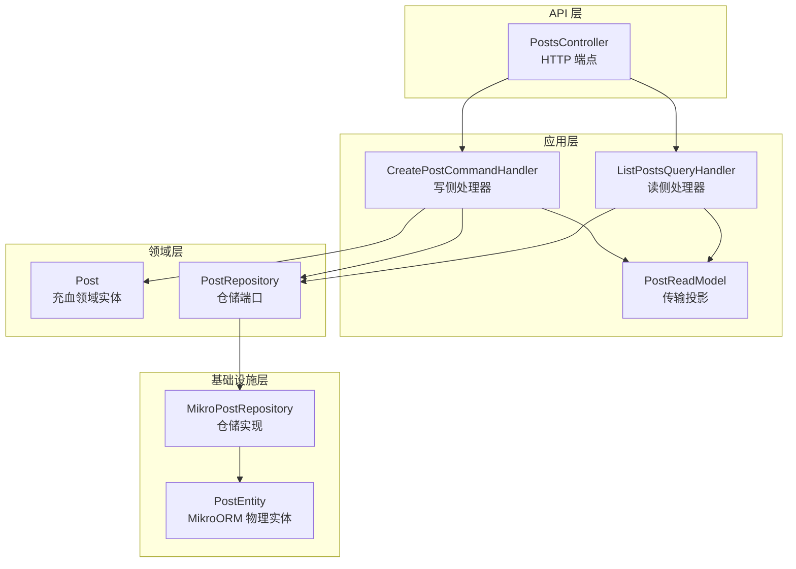
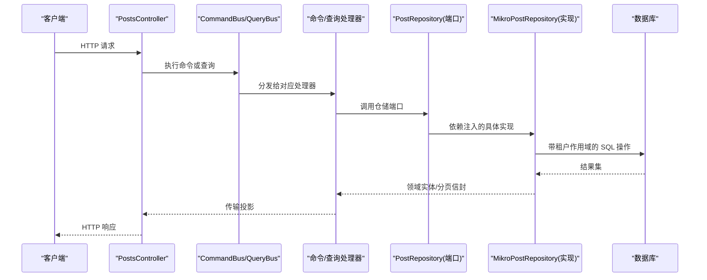
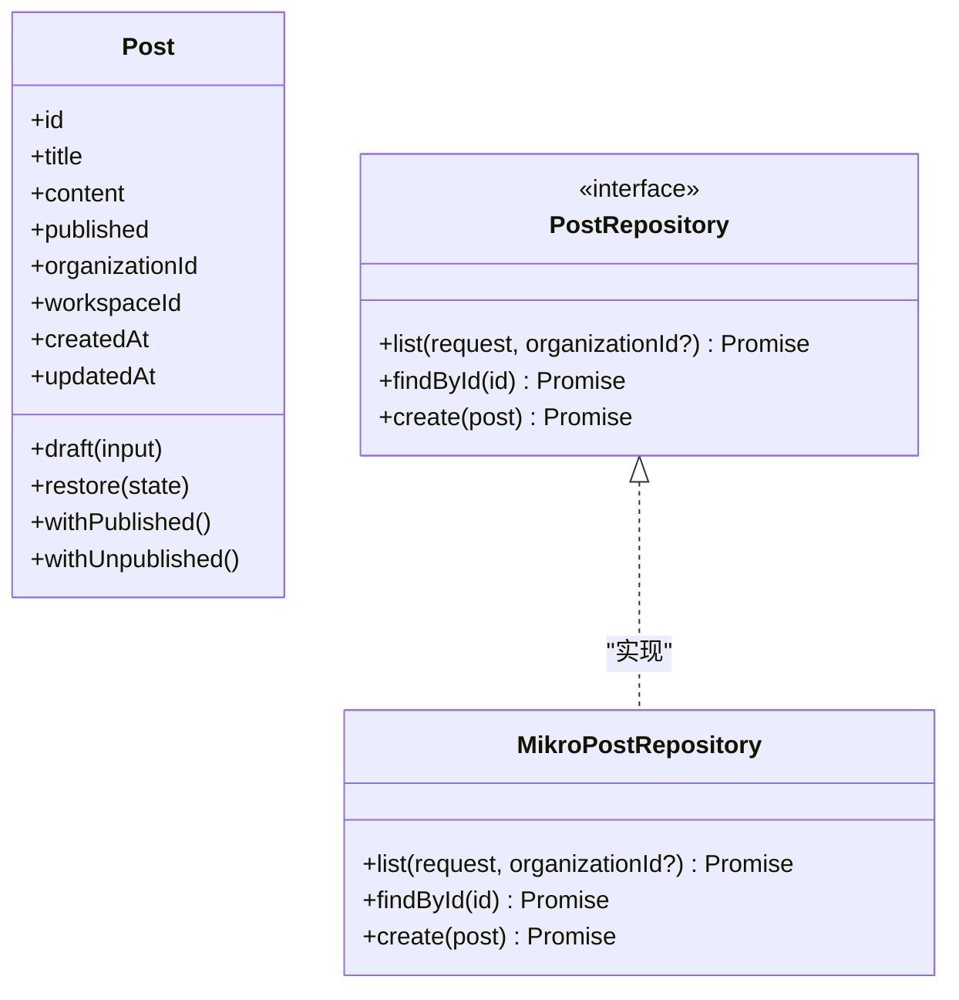
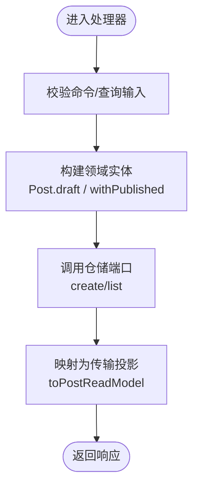
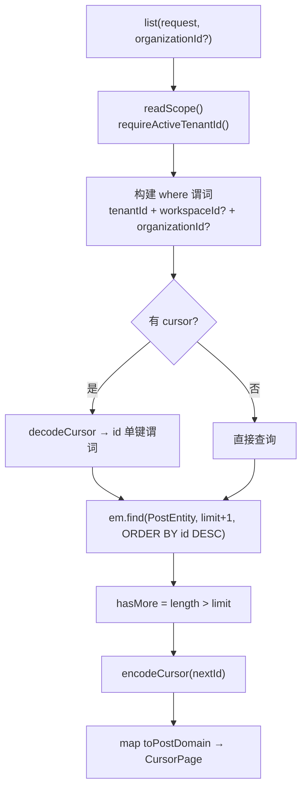
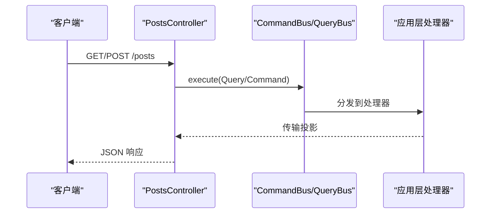
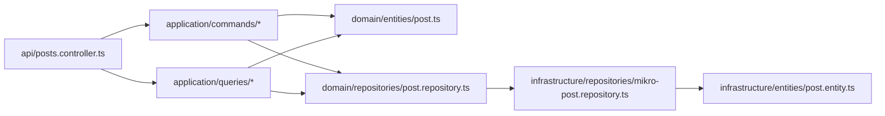

# 模块架构模式

<cite>
**本文引用的文件**   
- [posts.module.ts](file://apps/api/src/modules/posts/posts.module.ts)
- [posts.controller.ts](file://apps/api/src/modules/posts/api/posts.controller.ts)
- [post.repository.ts](file://apps/api/src/modules/posts/domain/repositories/post.repository.ts)
- [post.ts](file://apps/api/src/modules/posts/domain/entities/post.ts)
- [create-post.command.ts](file://apps/api/src/modules/posts/application/commands/create-post.command.ts)
- [create-post.command-handler.ts](file://apps/api/src/modules/posts/application/commands/handlers/create-post.command-handler.ts)
- [list-posts.query.ts](file://apps/api/src/modules/posts/application/queries/list-posts.query.ts)
- [list-posts.query-handler.ts](file://apps/api/src/modules/posts/application/queries/handlers/list-posts.query-handler.ts)
- [post.read-model.ts](file://apps/api/src/modules/posts/application/read-models/post.read-model.ts)
- [mikro-post.repository.ts](file://apps/api/src/modules/posts/infrastructure/repositories/mikro-post.repository.ts)
- [post.entity.ts](file://apps/api/src/modules/posts/infrastructure/entities/post.entity.ts)
</cite>

## 目录
1. [引言](#引言)
2. [项目结构](#项目结构)
3. [核心组件](#核心组件)
4. [架构总览](#架构总览)
5. [详细组件分析](#详细组件分析)
6. [依赖关系分析](#依赖关系分析)
7. [性能与可扩展性](#性能与可扩展性)
8. [故障排查指南](#故障排查指南)
9. [结论](#结论)
10. [附录：架构决策权衡与最佳实践](#附录架构决策权衡与最佳实践)

## 引言
本文件面向在 NestJS 中落地领域驱动设计（DDD）、六边形架构、端口适配器、依赖倒置原则以及 CQRS（命令查询职责分离）的工程师，以 posts 模块为具体案例，解释从 API 到领域再到基础设施的完整分层与数据流。文档同时说明聚合根、值对象、领域事件在本仓库中的概念与实现方式，并给出可操作的架构决策权衡与最佳实践建议。

## 项目结构
posts 模块采用清晰的分层组织：
- api：HTTP 控制器与契约绑定，仅负责请求校验、路由与调用应用层。
- application：CQRS 的命令与查询定义及处理器，编排业务用例，映射领域实体到传输模型。
- domain：领域模型（充血实体）、仓储端口（接口 + DI Token），承载不变量与领域行为。
- infrastructure：MikroORM 物理实体与仓储实现，负责持久化、租户隔离、游标分页等横切关注点。
- posts.module.ts：NestJS 模块装配，注册 CqrsModule、控制器、命令/查询处理器，并以依赖倒置注入仓储实现。

图表来源
- [posts.controller.ts:47-90](file://apps/api/src/modules/posts/api/posts.controller.ts#L47-L90)
- [create-post.command-handler.ts:12-29](file://apps/api/src/modules/posts/application/commands/handlers/create-post.command-handler.ts#L12-L29)
- [list-posts.query-handler.ts:19-35](file://apps/api/src/modules/posts/application/queries/handlers/list-posts.query-handler.ts#L19-L35)
- [post.repository.ts:29-50](file://apps/api/src/modules/posts/domain/repositories/post.repository.ts#L29-L50)
- [mikro-post.repository.ts:37-139](file://apps/api/src/modules/posts/infrastructure/repositories/mikro-post.repository.ts#L37-L139)
- [post.entity.ts:49-66](file://apps/api/src/modules/posts/infrastructure/entities/post.entity.ts#L49-L66)

章节来源
- [posts.module.ts:1-24](file://apps/api/src/modules/posts/posts.module.ts#L1-L24)

## 核心组件
- 领域实体 Post：不可变状态 + 构造期不变量 + 纯转移函数（withPublished/withUnpublished），通过 draft 与 restore 两阶段构造区分“新建意图”和“持久层复原”。
- 仓储端口 PostRepository：由领域层持有，暴露 list/findById/create；不暴露租户/工作区参数，租户作用域在基础设施适配层强制。
- 命令 CreatePostCommand 与处理器 CreatePostCommandHandler：封装创建意图，调用领域工厂与仓储，返回传输投影。
- 查询 ListPostsQuery 与处理器 ListPostsQueryHandler：封装列表查询意图，经仓储端口取当前租户内分页，映射为传输投影。
- 传输模型 PostReadModel：application 层输出形状，作为 API 契约真相源。
- 基础设施仓储 MikroPostRepository：唯一实现，负责租户隔离、游标分页、时间戳填充、领域实体与物理实体双向映射。
- 物理实体 PostEntity：MikroORM defineEntity，列名与 schema 对齐，启用租户过滤过滤器。

章节来源
- [post.ts:49-158](file://apps/api/src/modules/posts/domain/entities/post.ts#L49-L158)
- [post.repository.ts:4-50](file://apps/api/src/modules/posts/domain/repositories/post.repository.ts#L4-L50)
- [create-post.command.ts:12-20](file://apps/api/src/modules/posts/application/commands/create-post.command.ts#L12-L20)
- [create-post.command-handler.ts:12-29](file://apps/api/src/modules/posts/application/commands/handlers/create-post.command-handler.ts#L12-L29)
- [list-posts.query.ts:13-20](file://apps/api/src/modules/posts/application/queries/list-posts.query.ts#L13-L20)
- [list-posts.query-handler.ts:19-35](file://apps/api/src/modules/posts/application/queries/handlers/list-posts.query-handler.ts#L19-L35)
- [post.read-model.ts:13-53](file://apps/api/src/modules/posts/application/read-models/post.read-model.ts#L13-L53)
- [mikro-post.repository.ts:37-139](file://apps/api/src/modules/posts/infrastructure/repositories/mikro-post.repository.ts#L37-L139)
- [post.entity.ts:49-66](file://apps/api/src/modules/posts/infrastructure/entities/post.entity.ts#L49-L66)

## 架构总览
posts 模块遵循六边形架构思想：
- 端口（Ports）：PostRepository 接口位于领域层，定义系统能力边界。
- 适配器（Adapters）：MikroPostRepository 是基础设施适配器，将外部存储细节隐藏于端口之后。
- 依赖倒置（DIP）：模块通过 Symbol token POST_REPOSITORY 注入实现，领域层不依赖具体 ORM。
- CQRS：命令与查询分别由 CommandBus/QueryBus 分发，处理器只关心各自职责。
- 租户隔离：仓储适配器是唯一卡点，所有读写均基于可信上下文（ALS）解析 tenantId/workspaceId，禁止调用方传入任意租户标识。

图表来源
- [posts.controller.ts:47-90](file://apps/api/src/modules/posts/api/posts.controller.ts#L47-L90)
- [create-post.command-handler.ts:21-28](file://apps/api/src/modules/posts/application/commands/handlers/create-post.command-handler.ts#L21-L28)
- [list-posts.query-handler.ts:31-34](file://apps/api/src/modules/posts/application/queries/handlers/list-posts.query-handler.ts#L31-L34)
- [mikro-post.repository.ts:69-139](file://apps/api/src/modules/posts/infrastructure/repositories/mikro-post.repository.ts#L69-L139)

## 详细组件分析

### 领域层：充血实体与仓储端口
- Post 实体
  - 两阶段构造：draft 用于新建写意图（业务字段 + 不变量校验），restore 用于从持久层复原（技术字段）。
  - 不可变语义：withPublished/withUnpublished 返回新实例，避免原地修改。
  - 领域不变量：标题非空等约束在构造期防御。
- PostRepository 端口
  - 不暴露租户/工作区参数，租户作用域在适配器内强制。
  - list 支持可选 organizationId 收窄筛选，但主轴仍为 tenantId，确保跨租安全。
  - create 接收业务态 Post.draft(...)，由适配器补全 id/tenant/organization/workspace/time。

图表来源
- [post.ts:49-158](file://apps/api/src/modules/posts/domain/entities/post.ts#L49-L158)
- [post.repository.ts:29-50](file://apps/api/src/modules/posts/domain/repositories/post.repository.ts#L29-L50)
- [mikro-post.repository.ts:37-139](file://apps/api/src/modules/posts/infrastructure/repositories/mikro-post.repository.ts#L37-L139)

章节来源
- [post.ts:49-158](file://apps/api/src/modules/posts/domain/entities/post.ts#L49-L158)
- [post.repository.ts:4-50](file://apps/api/src/modules/posts/domain/repositories/post.repository.ts#L4-L50)

### 应用层：CQRS 命令与查询
- 命令 CreatePostCommand
  - 仅携带原始值（title/content/published），不包含租户信息。
- 命令处理器 CreatePostCommandHandler
  - 使用 Post.draft 构建领域实体，按 published 进行纯转移。
  - 调用仓储端口保存后，映射为 PostReadModel 返回。
- 查询 ListPostsQuery
  - 携带游标分页请求与可选 organizationId 收窄维度。
- 查询处理器 ListPostsQueryHandler
  - 通过仓储端口获取当前租户内的分页结果，逐项映射为 PostReadModel，重建游标信封。

图表来源
- [create-post.command-handler.ts:21-28](file://apps/api/src/modules/posts/application/commands/handlers/create-post.command-handler.ts#L21-L28)
- [list-posts.query-handler.ts:31-34](file://apps/api/src/modules/posts/application/queries/handlers/list-posts.query-handler.ts#L31-L34)
- [post.read-model.ts:42-53](file://apps/api/src/modules/posts/application/read-models/post.read-model.ts#L42-L53)

章节来源
- [create-post.command.ts:12-20](file://apps/api/src/modules/posts/application/commands/create-post.command.ts#L12-L20)
- [create-post.command-handler.ts:12-29](file://apps/api/src/modules/posts/application/commands/handlers/create-post.command-handler.ts#L12-L29)
- [list-posts.query.ts:13-20](file://apps/api/src/modules/posts/application/queries/list-posts.query.ts#L13-L20)
- [list-posts.query-handler.ts:19-35](file://apps/api/src/modules/posts/application/queries/handlers/list-posts.query-handler.ts#L19-L35)
- [post.read-model.ts:13-53](file://apps/api/src/modules/posts/application/read-models/post.read-model.ts#L13-L53)

### 基础设施层：仓储实现与物理实体
- MikroPostRepository
  - 租户隔离：通过 TenantIsolationService 解析 tenantId/workspaceId，fail-closed 无租户即拒绝。
  - 游标分页：基于 UUIDv7 的 id 单键排序，limit+1 探下一页，避免 COUNT 全量查询。
  - 时间戳：写路径显式设置 createdAt/updatedAt。
  - 映射：领域实体与物理实体之间通过 toPostDomain 转换。
- PostEntity
  - 零装饰器 defineEntity，列名与 schema 对齐（camelCase）。
  - 启用租户过滤过滤器，作为第二道防线。

图表来源
- [mikro-post.repository.ts:44-109](file://apps/api/src/modules/posts/infrastructure/repositories/mikro-post.repository.ts#L44-L109)

章节来源
- [mikro-post.repository.ts:37-139](file://apps/api/src/modules/posts/infrastructure/repositories/mikro-post.repository.ts#L37-L139)
- [post.entity.ts:49-66](file://apps/api/src/modules/posts/infrastructure/entities/post.entity.ts#L49-L66)

### API 层：控制器与契约
- PostsController
  - 使用 @UseGuards(TenantIsolationGuard) 保证类级租户隔离。
  - 通过 CommandBus/QueryBus 调用应用层命令与查询。
  - 使用 oRPC 的 @Impl 绑定契约与 meta，input/output schema 做运行时校验与 PII 白名单。

图表来源
- [posts.controller.ts:47-90](file://apps/api/src/modules/posts/api/posts.controller.ts#L47-L90)

章节来源
- [posts.controller.ts:47-90](file://apps/api/src/modules/posts/api/posts.controller.ts#L47-L90)

## 依赖关系分析
- 模块装配
  - PostsModule 导入 CqrsModule，注册控制器、命令处理器、查询处理器。
  - 通过 Symbol POST_REPOSITORY 注入 MikroPostRepository 实现，体现依赖倒置。
- 依赖方向
  - api → application → domain ← infrastructure
  - domain 不依赖任何框架或基础设施类型。
  - application 仅依赖 domain 与共享内核类型（如分页、CQRS 基类）。
  - infrastructure 依赖 domain 端口与外部 ORM/TenantIsolationService。

图表来源
- [posts.module.ts:10-21](file://apps/api/src/modules/posts/posts.module.ts#L10-L21)
- [post.repository.ts:4-50](file://apps/api/src/modules/posts/domain/repositories/post.repository.ts#L4-L50)
- [mikro-post.repository.ts:37-139](file://apps/api/src/modules/posts/infrastructure/repositories/mikro-post.repository.ts#L37-L139)

章节来源
- [posts.module.ts:1-24](file://apps/api/src/modules/posts/posts.module.ts#L1-L24)

## 性能与可扩展性
- 游标分页优化
  - 使用 limit+1 探测下一页，避免 COUNT 全量扫描。
  - 基于 UUIDv7 的 id 单键排序，保证稳定且高效的全序。
- 租户隔离
  - 在仓储适配器集中处理 tenantId/workspaceId，减少重复逻辑与越权风险。
- 扩展点
  - 新增命令/查询只需添加对应的 Command/Query 与 Handler，并在模块中注册。
  - 新增仓储实现仅需实现 PostRepository 端口，并通过 Symbol 注入替换。

[本节为通用指导，不直接分析具体文件]

## 故障排查指南
- 租户上下文缺失
  - 现象：403 或查询失败。
  - 原因：缺少活动租户上下文，仓储适配器 fail-closed。
  - 排查：确认 TenantIsolationGuard 已启用，且上下文中存在有效 tenantId。
- 游标无效
  - 现象：400 Invalid pagination cursor。
  - 原因：cursor 解码失败或载荷非法。
  - 排查：检查前端传递的 cursor 是否来自上一次响应，避免篡改。
- 数据未落库或时间戳异常
  - 现象：createdAt/updatedAt 为空或错误。
  - 原因：写路径未显式设置时间戳。
  - 排查：确认仓储 create 方法已设置 now 时间戳。

章节来源
- [mikro-post.repository.ts:44-109](file://apps/api/src/modules/posts/infrastructure/repositories/mikro-post.repository.ts#L44-L109)
- [mikro-post.repository.ts:120-137](file://apps/api/src/modules/posts/infrastructure/repositories/mikro-post.repository.ts#L120-L137)

## 结论
posts 模块展示了在 NestJS 中如何以 DDD 为核心，结合六边形架构与 CQRS，构建高内聚、低耦合、可测试的业务模块。领域层专注不变量与行为，应用层编排用例，基础设施层屏蔽存储细节，API 层仅承担协议与校验。仓储端口与依赖倒置确保了租户隔离与安全边界，游标分页与 UUIDv7 提升了查询性能与稳定性。

[本节为总结性内容，不直接分析具体文件]

## 附录：架构决策权衡与最佳实践

- 聚合根
  - 在本仓库中，Post 作为聚合根承载生命周期与不变量；当需要复杂事务或一致性边界时，应围绕聚合根组织领域服务与事件。
  - 建议：将跨聚合协调逻辑放入领域服务，而非散落在应用层。

- 值对象
  - 示例：Money.fromMinorUnits 的不可变性与不变量校验可作为值对象范式参考。
  - 建议：对金额、地址、坐标等具有内在一致性的数据建模为值对象，提升领域表达力。

- 领域事件
  - 仓库包含领域事件发布与存储基础设施（如 outbox-relay、event-store），可用于解耦跨聚合副作用。
  - 建议：在聚合根变更时发出领域事件，由外部处理器异步消费，保持写路径简洁。

- 端口适配器与 DIP
  - 通过 PostRepository 端口与 Symbol 注入，实现领域与基础设施解耦。
  - 建议：所有外部依赖（数据库、消息队列、第三方 API）均以端口形式暴露，便于替换与测试。

- CQRS 的职责划分
  - 命令处理器负责状态变更与不变量校验；查询处理器专注读取模型与投影。
  - 建议：避免在查询处理器中写入状态，避免在命令处理器中进行复杂查询。

- 租户隔离
  - 仓储适配器是唯一卡点，集中处理 tenantId/workspaceId，防止越权。
  - 建议：所有跨租户访问必须经过该卡点，不在调用方拼接 where 条件。

- 传输模型
  - PostReadModel 作为 application 层输出形状，避免领域实体泄漏至 API。
  - 建议：严格在 application 层进行领域实体到传输模型的映射。

章节来源
- [post.ts:49-158](file://apps/api/src/modules/posts/domain/entities/post.ts#L49-L158)
- [post.repository.ts:4-50](file://apps/api/src/modules/posts/domain/repositories/post.repository.ts#L4-L50)
- [mikro-post.repository.ts:37-139](file://apps/api/src/modules/posts/infrastructure/repositories/mikro-post.repository.ts#L37-L139)
- [post.read-model.ts:13-53](file://apps/api/src/modules/posts/application/read-models/post.read-model.ts#L13-L53)