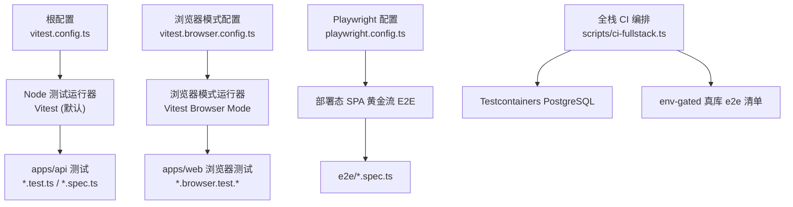
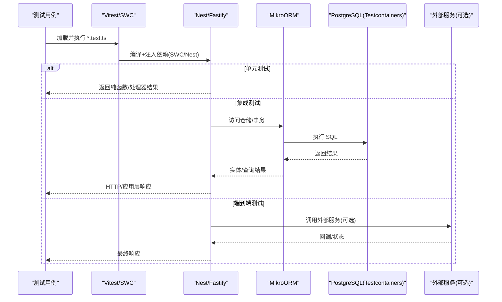
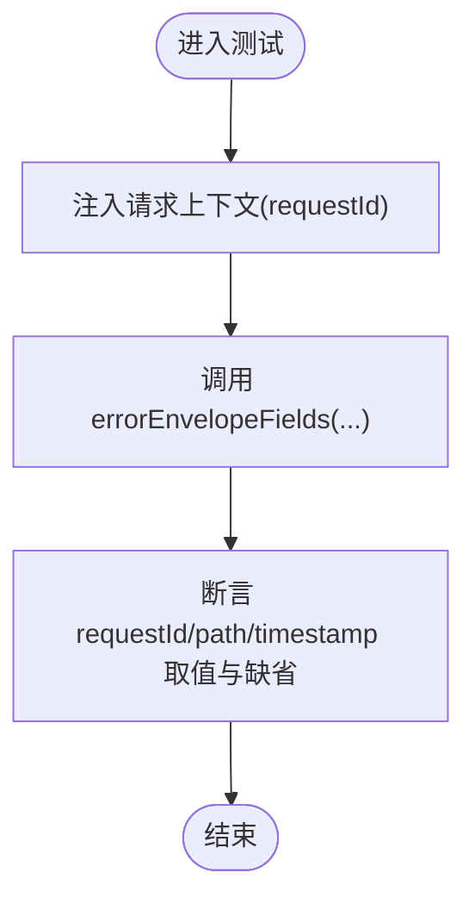
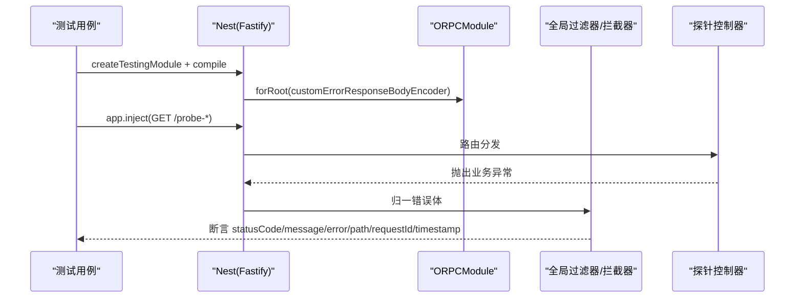
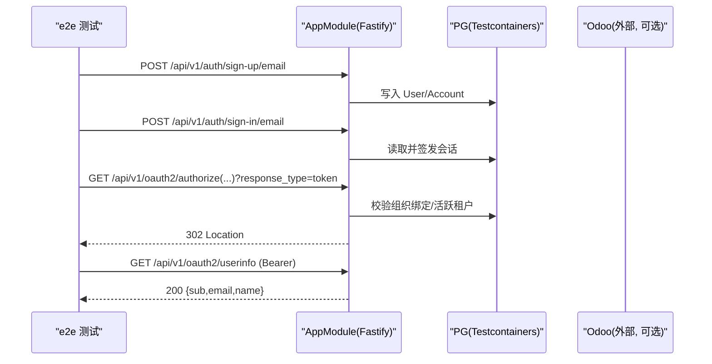
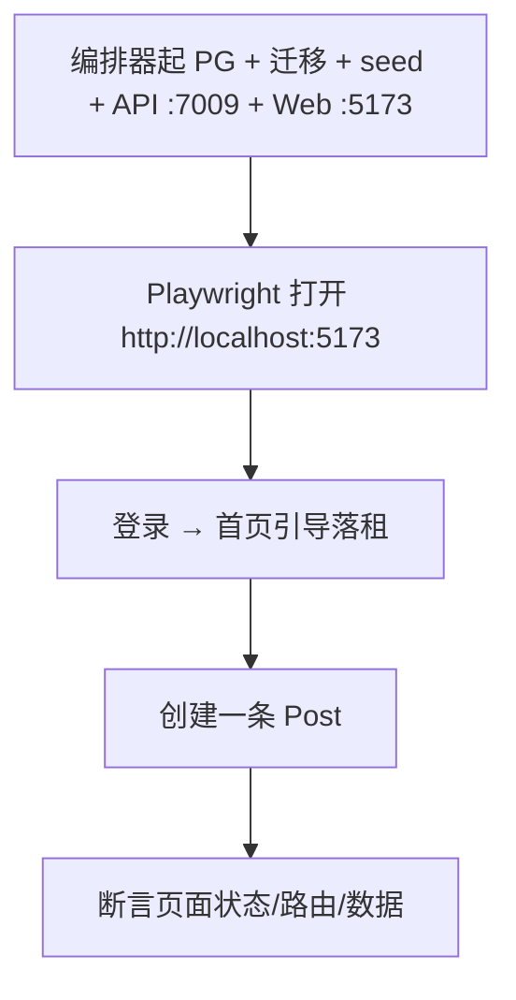
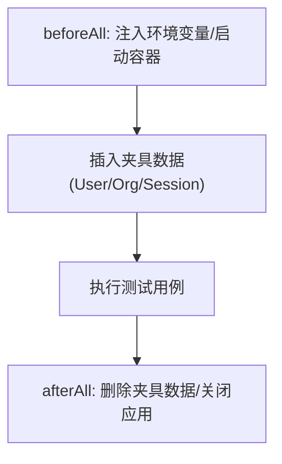
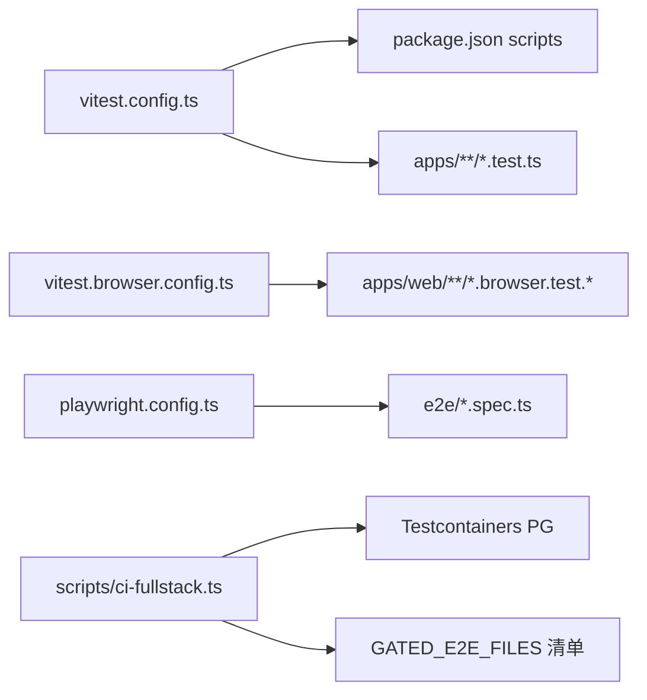

# 模块测试策略

<cite>
**本文引用的文件**   
- [vitest.config.ts](file://vitest.config.ts)
- [package.json](file://package.json)
- [apps/api/src/app.module.test.ts](file://apps/api/src/app.module.test.ts)
- [apps/api/src/app-boot.smoke.test.ts](file://apps/api/src/app-boot.smoke.test.ts)
- [apps/api/src/common/errors/error-envelope-fields.test.ts](file://apps/api/src/common/errors/error-envelope-fields.test.ts)
- [apps/api/src/common/orpc/rest-error.e2e.test.ts](file://apps/api/src/common/orpc/rest-error.e2e.test.ts)
- [apps/api/src/modules/auth/oauth-sso.e2e.test.ts](file://apps/api/src/modules/auth/oauth-sso.e2e.test.ts)
- [apps/api/src/modules/auth/oauth-sso.e2e.setup.ts](file://apps/api/src/modules/auth/oauth-sso.e2e.setup.ts)
- [scripts/ci-fullstack.ts](file://scripts/ci-fullstack.ts)
- [vitest.browser.config.ts](file://vitest.browser.config.ts)
- [playwright.config.ts](file://playwright.config.ts)
</cite>

## 目录
1. [引言](#引言)
2. [项目结构](#项目结构)
3. [核心组件](#核心组件)
4. [架构总览](#架构总览)
5. [详细组件分析](#详细组件分析)
6. [依赖关系分析](#依赖关系分析)
7. [性能与可维护性](#性能与可维护性)
8. [故障排查指南](#故障排查指南)
9. [结论](#结论)
10. [附录：分层测试清单与最佳实践](#附录分层测试清单与最佳实践)

## 引言
本文件面向“新的业务模块”，给出在 NestJS + Fastify + MikroORM + PostgreSQL 的 SaaS 工程内，如何编写覆盖单元测试、集成测试、端到端测试的分层测试策略。文档基于仓库现有测试基础设施与用例风格，说明测试数据准备、夹具与模拟对象、异步/数据库/外部服务调用测试方法，并给出覆盖率要求、持续集成配置与最佳实践。

## 项目结构
仓库采用多包工作区（pnpm workspaces），后端 API 位于 `apps/api`，前端 Web 位于 `apps/web`，浏览器 E2E 使用 Playwright，Node 侧测试统一由 Vitest 驱动。测试相关关键位置如下：
- 根级 Vitest 配置：`vitest.config.ts`
- 浏览器模式 Vitest 配置：`vitest.browser.config.ts`
- Playwright 配置：`playwright.config.ts`
- 全栈 CI 编排脚本：`scripts/ci-fullstack.ts`
- 示例测试：应用模块结构校验、冒烟启动、错误信封契约、SSO 隐式流 e2e 等

**图示来源**
- [vitest.config.ts:1-84](file://vitest.config.ts#L1-L84)
- [vitest.browser.config.ts:1-40](file://vitest.browser.config.ts#L1-L40)
- [playwright.config.ts:1-31](file://playwright.config.ts#L1-L31)
- [scripts/ci-fullstack.ts:1-249](file://scripts/ci-fullstack.ts#L1-L249)

**章节来源**
- [vitest.config.ts:1-84](file://vitest.config.ts#L1-L84)
- [package.json:11-65](file://package.json#L11-L65)

## 核心组件
- 测试运行器与转换链
  - Vitest 作为 Node 侧测试框架，配合 SWC 编译 TS/TSX，启用装饰器与元数据，满足 Nest DI 需求。
  - 浏览器模式通过 `@vitest/browser` + Playwright provider 运行真实 DOM 场景。
- 环境与时序
  - 根 Vitest 配置注入最小环境变量，避免 ConfigModule 在导入期校验失败；同时设置 DB-free 默认连接串。
  - 超时与钩子超时提升以容纳完整 AppModule 图解析。
- 覆盖率
  - 使用 v8 提供者，输出 text/html/lcov，排除 DTO、接口、入口、种子、模块定义与测试文件本身。
- 全栈 CI
  - Testcontainers 拉起一次性 PG，双库（e2e 与一致性校验库），回放基线迁移，再按清单跑 gated e2e 与一致性套件。

**章节来源**
- [vitest.config.ts:1-84](file://vitest.config.ts#L1-L84)
- [scripts/ci-fullstack.ts:1-249](file://scripts/ci-fullstack.ts#L1-L249)

## 架构总览
下图展示从测试代码到运行时基础设施的链路，以及不同层次测试的职责边界。

**图示来源**
- [vitest.config.ts:1-84](file://vitest.config.ts#L1-L84)
- [scripts/ci-fullstack.ts:187-249](file://scripts/ci-fullstack.ts#L187-L249)

## 详细组件分析

### 分层测试策略

#### 第一层：单元测试（无 IO）
目标：验证纯逻辑、值对象、命令/查询处理器、领域规则、工具函数。  
建议：
- 直接实例化被测类或调用函数，不引入 Nest 容器。
- 对副作用使用本地桩对象（实现相同接口）。
- 对上下文（如请求 ID）使用提供的存储 API 进行隔离。

参考实现要点：
- 错误信封字段单测：通过上下文存储注入 requestId，断言 path/timestamp/requestId 取值链与缺省行为。

**图示来源**
- [apps/api/src/common/errors/error-envelope-fields.test.ts:1-31](file://apps/api/src/common/errors/error-envelope-fields.test.ts#L1-L31)

**章节来源**
- [apps/api/src/common/errors/error-envelope-fields.test.ts:1-31](file://apps/api/src/common/errors/error-envelope-fields.test.ts#L1-L31)

#### 第二层：集成测试（真实依赖或轻量替换）
目标：验证控制器→中间件→过滤器→仓储→数据库的整条链路，但尽量控制外部依赖。  
建议：
- 使用 `Test.createTestingModule` 装配最小模块图，必要时 `overrideProvider` 替换后台任务（如 OutboxRelay）。
- 使用 `app.inject` 发起 HTTP 请求，断言状态码与响应体结构。
- 对数据库：优先使用内存/临时库或 Testcontainers 一次性库。

参考实现要点：
- oRPC 错误面线上等价集成测：仅引入 CommonModule + ORPCModule，零守卫零 DB，用探针 procedure 抛异常，断言 REST 错误信封与旧 REST 面逐字同形。

**图示来源**
- [apps/api/src/common/orpc/rest-error.e2e.test.ts:1-173](file://apps/api/src/common/orpc/rest-error.e2e.test.ts#L1-L173)

**章节来源**
- [apps/api/src/common/orpc/rest-error.e2e.test.ts:1-173](file://apps/api/src/common/orpc/rest-error.e2e.test.ts#L1-L173)

#### 第三层：端到端测试（带真实数据库/外部系统）
目标：验证跨模块、跨进程的真实交互，包括鉴权、租户隔离、事件出队、第三方服务等。  
建议：
- 使用 env-gated 开关（如 `E2E_DATABASE_URL`）控制是否运行。
- 通过 Testcontainers 提供一次性 PG，并在 CI 中回放基线迁移。
- 在测试前准备数据（用户/组织/会话/绑定），在 afterAll 清理。

参考实现要点：
- SSO 隐式流 e2e：先注册并登录获取会话 cookie，构造 ready/no-binding 组织，断言 authorize 302 fragment access_token、userinfo 裸 JSON、非法 token 401、邮箱未验证 403 等。
- client 注册表通过 setup 文件在 config 求值前注入环境变量。

**图示来源**
- [apps/api/src/modules/auth/oauth-sso.e2e.test.ts:1-247](file://apps/api/src/modules/auth/oauth-sso.e2e.test.ts#L1-L247)
- [apps/api/src/modules/auth/oauth-sso.e2e.setup.ts:1-17](file://apps/api/src/modules/auth/oauth-sso.e2e.setup.ts#L1-L17)

**章节来源**
- [apps/api/src/modules/auth/oauth-sso.e2e.test.ts:1-247](file://apps/api/src/modules/auth/oauth-sso.e2e.test.ts#L1-L247)
- [apps/api/src/modules/auth/oauth-sso.e2e.setup.ts:1-17](file://apps/api/src/modules/auth/oauth-sso.e2e.setup.ts#L1-L17)

#### 第四层：浏览器端到端（部署态 SPA）
目标：验证真实浏览器中的黄金流程（登录→引导落租→创建内容）。  
建议：
- 使用 Playwright 驱动 Chromium headless，串行执行，避免并发竞态。
- 由编排器提供共享栈（API + Web），测试只消费 baseURL。

**图示来源**
- [playwright.config.ts:1-31](file://playwright.config.ts#L1-L31)

**章节来源**
- [playwright.config.ts:1-31](file://playwright.config.ts#L1-L31)

### 测试数据准备与管理

- 测试夹具
  - 使用工厂函数生成唯一标识（时间戳+随机后缀），保证幂等与隔离。
  - 通过 `MikroOrmService.fork()` 获取独立 EntityManager，避免污染主连接。
- 数据清理
  - 在 `afterAll` 中删除本次测试产生的 User/Session/Account/Organization 等记录。
- 环境前置
  - 通过 setup 文件在模块导入前注入环境变量（如 SSO client 注册表），确保 ConfigModule 在导入期可用。

**图示来源**
- [apps/api/src/modules/auth/oauth-sso.e2e.test.ts:61-92](file://apps/api/src/modules/auth/oauth-sso.e2e.test.ts#L61-L92)
- [apps/api/src/modules/auth/oauth-sso.e2e.setup.ts:1-17](file://apps/api/src/modules/auth/oauth-sso.e2e.setup.ts#L1-L17)

**章节来源**
- [apps/api/src/modules/auth/oauth-sso.e2e.test.ts:61-92](file://apps/api/src/modules/auth/oauth-sso.e2e.test.ts#L61-L92)
- [apps/api/src/modules/auth/oauth-sso.e2e.setup.ts:1-17](file://apps/api/src/modules/auth/oauth-sso.e2e.setup.ts#L1-L17)

### 异步操作、数据库操作、外部服务调用的测试方法

- 异步操作
  - 使用 Vitest 的 async/await 与 `describe/it` 生命周期；必要时提高 `testTimeout`/`hookTimeout`。
- 数据库操作
  - 单元测试：不连库，仅验证仓储接口契约与返回值映射。
  - 集成测试：使用 Testcontainers 一次性 PG，回放基线迁移，避免 schema.synchronize。
  - 事务与隔离：使用 fork EM 或微事务封装，避免跨用例干扰。
- 外部服务调用
  - 优先使用端口桩/代理；若必须联调，使用 env-gated 与专用容器（如 Odoo RPC 联调）。
  - 对不可控外部错误，断言服务端收敛为通用错误信封，不泄露敏感信息。

**章节来源**
- [vitest.config.ts:33-66](file://vitest.config.ts#L33-L66)
- [scripts/ci-fullstack.ts:187-249](file://scripts/ci-fullstack.ts#L187-L249)
- [apps/api/src/common/orpc/rest-error.e2e.test.ts:153-171](file://apps/api/src/common/orpc/rest-error.e2e.test.ts#L153-L171)

### 完整的测试示例路径

- 应用模块结构校验（静态导入检查）
  - [apps/api/src/app.module.test.ts:1-25](file://apps/api/src/app.module.test.ts#L1-L25)
- 全 AppModule boot 冒烟（DI 图整树可解析，DB-free）
  - [apps/api/src/app-boot.smoke.test.ts:15-31](file://apps/api/src/app-boot.smoke.test.ts#L15-L31)
- 错误信封字段（ALS/Fastify 原生/缺省哨兵）
  - [apps/api/src/common/errors/error-envelope-fields.test.ts:1-31](file://apps/api/src/common/errors/error-envelope-fields.test.ts#L1-L31)
- oRPC 错误面线上等价集成测（REST 信封契约）
  - [apps/api/src/common/orpc/rest-error.e2e.test.ts:1-173](file://apps/api/src/common/orpc/rest-error.e2e.test.ts#L1-L173)
- SSO 隐式流 e2e（真库、env-gated）
  - [apps/api/src/modules/auth/oauth-sso.e2e.test.ts:1-247](file://apps/api/src/modules/auth/oauth-sso.e2e.test.ts#L1-L247)
  - [apps/api/src/modules/auth/oauth-sso.e2e.setup.ts:1-17](file://apps/api/src/modules/auth/oauth-sso.e2e.setup.ts#L1-L17)

**章节来源**
- [apps/api/src/app.module.test.ts:1-25](file://apps/api/src/app.module.test.ts#L1-L25)
- [apps/api/src/app-boot.smoke.test.ts:15-31](file://apps/api/src/app-boot.smoke.test.ts#L15-L31)
- [apps/api/src/common/errors/error-envelope-fields.test.ts:1-31](file://apps/api/src/common/errors/error-envelope-fields.test.ts#L1-L31)
- [apps/api/src/common/orpc/rest-error.e2e.test.ts:1-173](file://apps/api/src/common/orpc/rest-error.e2e.test.ts#L1-L173)
- [apps/api/src/modules/auth/oauth-sso.e2e.test.ts:1-247](file://apps/api/src/modules/auth/oauth-sso.e2e.test.ts#L1-L247)
- [apps/api/src/modules/auth/oauth-sso.e2e.setup.ts:1-17](file://apps/api/src/modules/auth/oauth-sso.e2e.setup.ts#L1-L17)

## 依赖关系分析

**图示来源**
- [vitest.config.ts:1-84](file://vitest.config.ts#L1-L84)
- [package.json:11-65](file://package.json#L11-L65)
- [vitest.browser.config.ts:1-40](file://vitest.browser.config.ts#L1-L40)
- [playwright.config.ts:1-31](file://playwright.config.ts#L1-L31)
- [scripts/ci-fullstack.ts:32-100](file://scripts/ci-fullstack.ts#L32-L100)

**章节来源**
- [scripts/ci-fullstack.ts:32-100](file://scripts/ci-fullstack.ts#L32-L100)

## 性能与可维护性
- 冷启动优化
  - 首次导入完整 AppModule 可能超过默认超时，已在 Vitest 配置中提升 test/hook 超时。
- 并行与隔离
  - 浏览器 E2E 串行执行，避免状态机链竞态；Node 测试默认并行，注意资源隔离（临时库、唯一命名）。
- 覆盖率阈值
  - 建议在 CI 中开启覆盖率报告，并对关键域（认证、授权、租户隔离、支付）设定最低阈值（例如行覆盖≥80%，分支覆盖≥70%）。
- 可维护性
  - 所有 gated e2e 文件需登记至清单，CI 会做双向恒等校验，防止漂移漏跑。

**章节来源**
- [vitest.config.ts:33-66](file://vitest.config.ts#L33-L66)
- [playwright.config.ts:15-29](file://playwright.config.ts#L15-L29)
- [scripts/ci-fullstack.ts:102-145](file://scripts/ci-fullstack.ts#L102-L145)

## 故障排查指南
- 无法解析依赖
  - 使用 AppModule boot 冒烟用例定位 UnknownDependenciesException。
- 环境变量缺失
  - 检查 Vitest 注入的最小环境变量；SSO 等需在导入前注入的环境变量应放在 setup 文件首行。
- 数据库连接失败
  - 确认 Testcontainers 已拉起 PG，且 DATABASE_URL/E2E_DATABASE_URL 指向正确容器地址。
- 外部服务泄露敏感信息
  - 断言错误响应不包含 SQL 片段或内部堆栈；统一走错误信封收敛。

**章节来源**
- [apps/api/src/app-boot.smoke.test.ts:15-31](file://apps/api/src/app-boot.smoke.test.ts#L15-L31)
- [apps/api/src/modules/auth/oauth-sso.e2e.setup.ts:1-17](file://apps/api/src/modules/auth/oauth-sso.e2e.setup.ts#L1-L17)
- [scripts/ci-fullstack.ts:187-249](file://scripts/ci-fullstack.ts#L187-L249)
- [apps/api/src/common/orpc/rest-error.e2e.test.ts:163-171](file://apps/api/src/common/orpc/rest-error.e2e.test.ts#L163-L171)

## 结论
本测试策略以 Vitest 为核心，结合 SWC 编译、Playwright 浏览器模式与 Testcontainers 数据库编排，形成四层测试体系：单元、集成、端到端、浏览器端到端。通过 env-gated 机制与清单恒等校验，保证关键特性在 CI 中稳定回归。新增业务模块应遵循“先单元、后集成、再 e2e”的顺序，严格隔离副作用，明确数据准备与清理，并以错误信封契约保障对外一致性。

## 附录：分层测试清单与最佳实践

- 单元测试
  - 直接调用函数/类方法，不引入 Nest 容器。
  - 使用本地桩对象替代外部依赖。
  - 对上下文使用 requestStorage 等 API 隔离。
- 集成测试
  - 使用 `Test.createTestingModule` 装配最小模块图。
  - 使用 `app.inject` 发起 HTTP 请求，断言状态码与响应体结构。
  - 对后台任务使用 `overrideProvider` 替换（如 OutboxRelay）。
- 端到端测试
  - 使用 env-gated（如 `E2E_DATABASE_URL`）控制运行。
  - 通过 Testcontainers 拉起一次性 PG，回放基线迁移。
  - beforeAll 准备数据，afterAll 清理数据。
- 浏览器端到端
  - 使用 Playwright 串行执行黄金流程。
  - 由编排器提供共享栈，测试只消费 baseURL。
- 覆盖率与 CI
  - 使用 v8 覆盖率，输出 text/html/lcov。
  - 在 CI 中开启覆盖率报告，并对关键域设定阈值。
  - 所有 gated e2e 文件登记至清单，CI 自动校验恒等。

**章节来源**
- [vitest.config.ts:67-81](file://vitest.config.ts#L67-L81)
- [scripts/ci-fullstack.ts:102-145](file://scripts/ci-fullstack.ts#L102-L145)