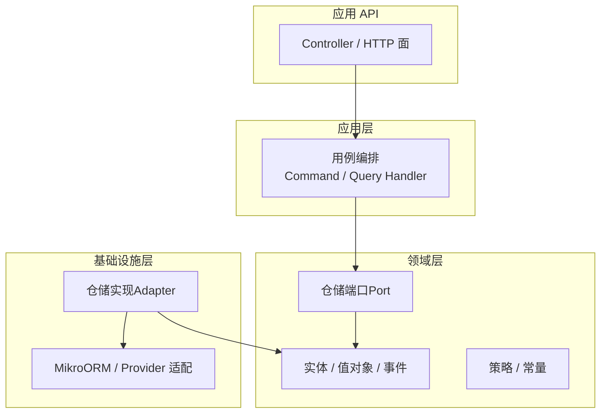
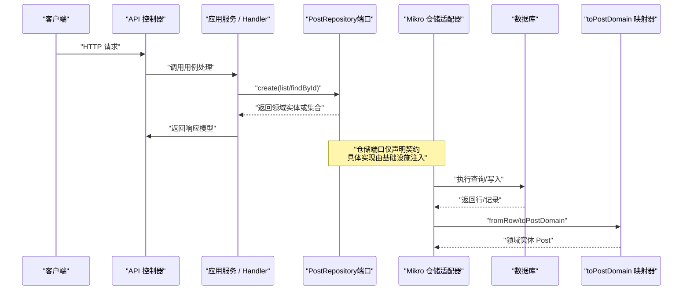
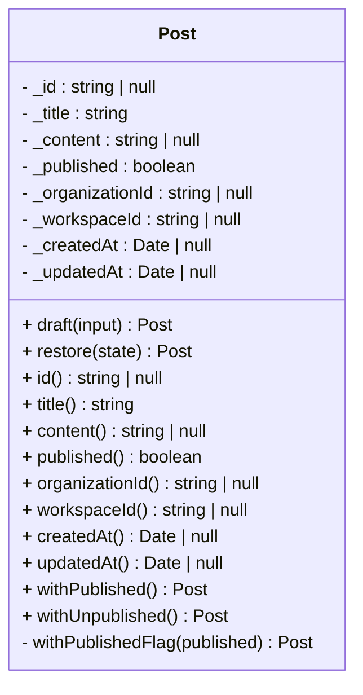
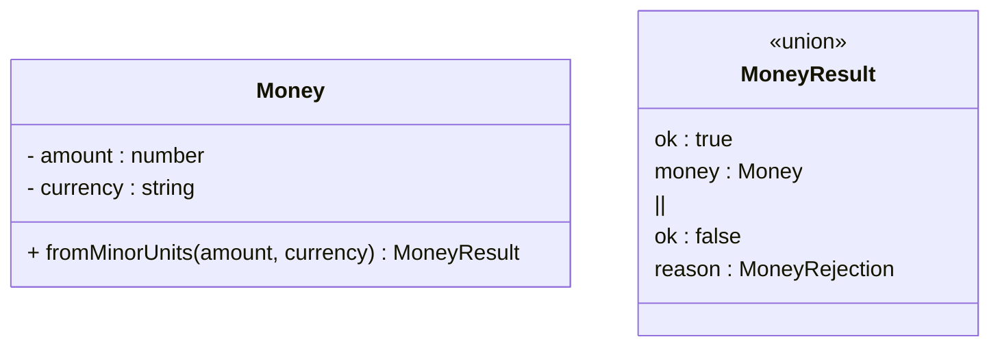
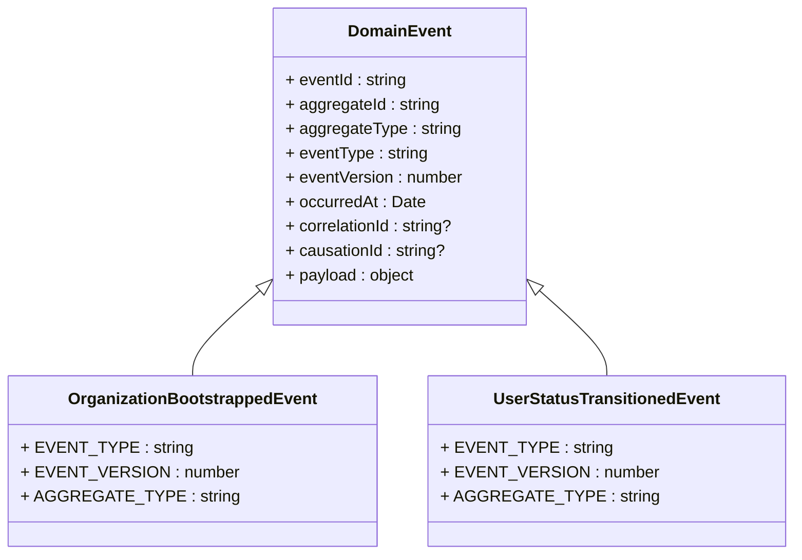
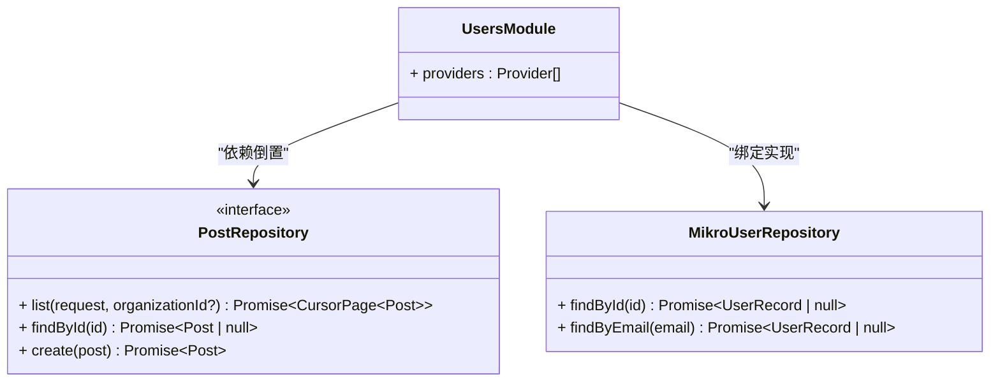
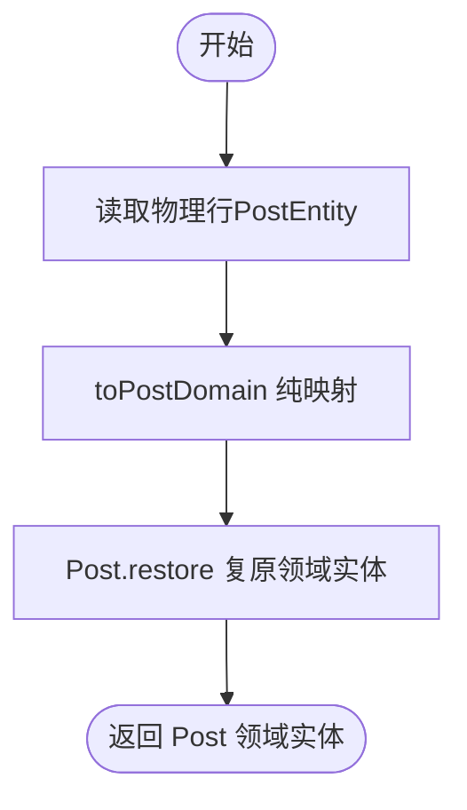
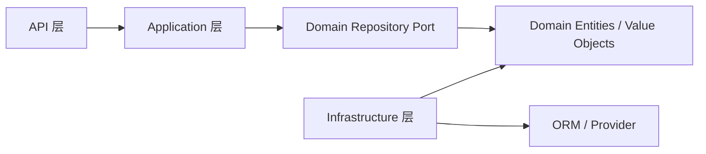
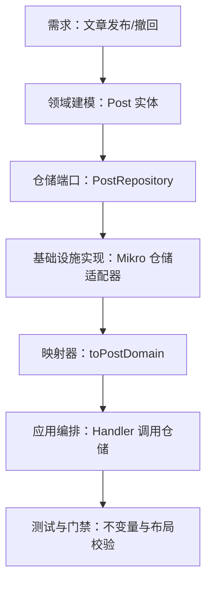

# 领域层开发

<cite>
**本文引用的文件**   
- [README.md](file://README.md)
- [verify-domain-layout.ts](file://scripts/verify-domain-layout.ts)
- [shared-kernel/index.ts](file://libs/core/src/shared-kernel/index.ts)
- [domain-event.ts](file://libs/core/src/shared-kernel/domain/domain-event.ts)
- [post.ts](file://apps/api/src/modules/posts/domain/entities/post.ts)
- [post.repository.ts](file://apps/api/src/modules/posts/domain/repositories/post.repository.ts)
- [post-mapping.ts](file://apps/api/src/modules/posts/infrastructure/repositories/post-mapping.ts)
- [money.ts](file://apps/api/src/modules/payment/domain/value-objects/money.ts)
- [organization-bootstrapped.event.ts](file://libs/core/src/modules/organizations/lifecycle/events/organization-bootstrapped.event.ts)
- [user-status-transitioned.event.ts](file://libs/core/src/modules/organizations/lifecycle/events/user-status-transitioned.event.ts)
- [event.entity.ts](file://apps/api/src/database/eventing/entities/event.entity.ts)
- [users.module.ts](file://apps/api/src/modules/users/users.module.ts)
- [mikro-user.repository.ts](file://apps/api/src/modules/users/infrastructure/repositories/mikro-user.repository.ts)
- [table-ownership.ts](file://apps/api/src/database/table-ownership.ts)
</cite>

## 目录
1. [引言](#引言)
2. [项目结构](#项目结构)
3. [核心组件](#核心组件)
4. [架构总览](#架构总览)
5. [详细组件分析](#详细组件分析)
6. [依赖关系分析](#依赖关系分析)
7. [性能与一致性考量](#性能与一致性考量)
8. [故障排查指南](#故障排查指南)
9. [结论](#结论)
10. [附录：从需求到实现的完整示例流程](#附录从需求到实现的完整示例流程)

## 引言
本文件面向领域层开发者，聚焦如何在本仓库中设计并实现业务领域的核心逻辑。文档围绕以下目标展开：
- 实体（Entity）、值对象（Value Object）、聚合根（Aggregate Root）的设计与实现方式
- 领域行为封装与业务规则验证
- 仓储接口（Port）抽象与数据访问解耦原则
- 完整的领域建模示例流程：从需求分析到代码落地
- 领域建模最佳实践与常见陷阱规避

本项目采用 Clean Architecture 与垂直切片组织，领域内核强调函数式、不可变状态与纯转移函数；基础设施通过 ports & adapters 解耦，仓储端口由领域自持，实现由基础设施提供。

**章节来源**
- [README.md:78-111](file://README.md#L78-L111)

## 项目结构
仓库以“垂直切片 + Clean Architecture”组织每个限界上下文（bounded context），典型结构如下：
- `modules/<context>/domain`：纯领域内核（entities / value-objects / events / repositories / ports / policies / constants）
- `modules/<context>/application`：用例编排（command/query handler 或简单 service）
- `modules/<context>/infrastructure`：仓储实现与外部集成（ORM、provider 适配等）
- `modules/<context>/api`：控制器与 HTTP 边界

此外，共享内核位于 `libs/core/src/shared-kernel`，提供领域事件基类、分页、错误码等通用能力。

**图示来源**
- [README.md:78-111](file://README.md#L78-L111)
- [verify-domain-layout.ts:20-30](file://scripts/verify-domain-layout.ts#L20-L30)

**章节来源**
- [README.md:78-111](file://README.md#L78-L111)
- [verify-domain-layout.ts:20-30](file://scripts/verify-domain-layout.ts#L20-L30)

## 核心组件
本节概述领域层的关键构件及其职责：
- 实体（Entity）：承载业务不变量与生命周期转移，保持不可变状态与纯转移方法
- 值对象（Value Object）：表达不可变的领域概念（如金额），构造即守不变量
- 领域事件（Domain Event）：描述已发生的事实，携带稳定契约名与版本
- 仓储端口（Repository Port）：定义领域数据的访问契约，隐藏持久化细节
- 映射器（Mapping）：在领域实体与物理数据实体之间做纯映射，避免框架侵入领域

这些构件共同保证领域内核的纯净性与可测试性，同时为上层应用与下层基础设施提供清晰边界。

**章节来源**
- [post.ts:35-59](file://apps/api/src/modules/posts/domain/entities/post.ts#L35-L59)
- [money.ts:13-27](file://apps/api/src/modules/payment/domain/value-objects/money.ts#L13-L27)
- [domain-event.ts:36-76](file://libs/core/src/shared-kernel/domain/domain-event.ts#L36-L76)
- [post.repository.ts:10-27](file://apps/api/src/modules/posts/domain/repositories/post.repository.ts#L10-L27)
- [post-mapping.ts:4-16](file://apps/api/src/modules/posts/infrastructure/repositories/post-mapping.ts#L4-L16)

## 架构总览
下图展示请求从 API 进入应用层，调用领域仓储端口，再由基础设施仓储实现完成数据存取，并通过映射器将物理实体转换为领域实体的整体流程。

**图示来源**
- [post.repository.ts:10-27](file://apps/api/src/modules/posts/domain/repositories/post.repository.ts#L10-L27)
- [post-mapping.ts:12-28](file://apps/api/src/modules/posts/infrastructure/repositories/post-mapping.ts#L12-L28)
- [users.module.ts:21-24](file://apps/api/src/modules/users/users.module.ts#L21-L24)

**章节来源**
- [post.repository.ts:10-27](file://apps/api/src/modules/posts/domain/repositories/post.repository.ts#L10-L27)
- [post-mapping.ts:12-28](file://apps/api/src/modules/posts/infrastructure/repositories/post-mapping.ts#L12-L28)
- [users.module.ts:21-24](file://apps/api/src/modules/users/users.module.ts#L21-L24)

## 详细组件分析

### 实体（Entity）：Post
Post 是 posts 上下文的充血领域实体，体现以下设计要点：
- 两阶段构造：`draft` 用于新建写意图（业务字段，id/租户/时间戳为空），`restore` 用于从持久层复原（含技术字段）
- 不可变状态：所有属性通过 getter 暴露，内部字段私有且只读
- 纯转移方法：`withPublished` / `withUnpublished` 返回新实例，幂等迁移生命周期
- 不变量校验：标题非空等规则在构造期防御，与 HTTP 边界 zod schema 对齐但不额外收紧

**图示来源**
- [post.ts:49-157](file://apps/api/src/modules/posts/domain/entities/post.ts#L49-L157)

**章节来源**
- [post.ts:35-157](file://apps/api/src/modules/posts/domain/entities/post.ts#L35-L157)

### 值对象（Value Object）：Money
Money 表达“金额+币种”的领域概念，遵循不可变与构造期守不变量的原则：
- 使用 result-union 模式返回成功或拒绝原因，避免异常流污染领域逻辑
- 与 HTTP 边界 zod schema 对齐，不额外收紧类型，确保边界为校验单源
- 作为领域概念被聚合或应用服务组合使用

**图示来源**
- [money.ts:23-43](file://apps/api/src/modules/payment/domain/value-objects/money.ts#L23-L43)

**章节来源**
- [money.ts:13-43](file://apps/api/src/modules/payment/domain/value-objects/money.ts#L13-L43)

### 领域事件（Domain Event）
领域事件基类提供稳定的事件元数据信封，包括事件 ID、聚合 ID、聚合类型、事件类型、版本号、发生时间、关联 ID 与因果链。具体事件（如组织引导事件、用户状态迁移事件）继承该基类并声明稳定契约名与聚合类型。

**图示来源**
- [domain-event.ts:45-76](file://libs/core/src/shared-kernel/domain/domain-event.ts#L45-L76)
- [organization-bootstrapped.event.ts:34-51](file://libs/core/src/modules/organizations/lifecycle/events/organization-bootstrapped.event.ts#L34-L51)
- [user-status-transitioned.event.ts:33-51](file://libs/core/src/modules/organizations/lifecycle/events/user-status-transitioned.event.ts#L33-L51)

**章节来源**
- [domain-event.ts:36-76](file://libs/core/src/shared-kernel/domain/domain-event.ts#L36-L76)
- [organization-bootstrapped.event.ts:17-51](file://libs/core/src/modules/organizations/lifecycle/events/organization-bootstrapped.event.ts#L17-L51)
- [user-status-transitioned.event.ts:21-51](file://libs/core/src/modules/organizations/lifecycle/events/user-status-transitioned.event.ts#L21-L51)

### 仓储接口（Repository Port）与实现（Adapter）
PostRepository 是领域自持的仓储端口，关键设计原则：
- 不向调用方暴露租户/工作区参数，隔离轴在适配器内基于可信请求上下文解析
- 端口流动的是充血领域实体（非裸记录），应用层负责投影到传输模型
- 通过 DI token 绑定具体实现，实现类位于 infrastructure 层

**图示来源**
- [post.repository.ts:10-27](file://apps/api/src/modules/posts/domain/repositories/post.repository.ts#L10-L27)
- [mikro-user.repository.ts:25-49](file://apps/api/src/modules/users/infrastructure/repositories/mikro-user.repository.ts#L25-L49)
- [users.module.ts:21-24](file://apps/api/src/modules/users/users.module.ts#L21-L24)

**章节来源**
- [post.repository.ts:10-27](file://apps/api/src/modules/posts/domain/repositories/post.repository.ts#L10-L27)
- [mikro-user.repository.ts:25-49](file://apps/api/src/modules/users/infrastructure/repositories/mikro-user.repository.ts#L25-L49)
- [users.module.ts:21-24](file://apps/api/src/modules/users/users.module.ts#L21-L24)

### 映射器（Mapping）：领域实体与物理实体
映射器承担领域实体与物理数据实体之间的转换，遵循“投影镜射教义”：
- 纯函数 `toPostDomain` 将数据实体转为领域实体
- 编译期一致性闸通过类型断言强制 `PostState` 与 `PostEntity` 同构，防止列漂移
- 领域层不 import infrastructure，依赖方向严格单向

**图示来源**
- [post-mapping.ts:12-28](file://apps/api/src/modules/posts/infrastructure/repositories/post-mapping.ts#L12-L28)
- [post-mapping.ts:30-39](file://apps/api/src/modules/posts/infrastructure/repositories/post-mapping.ts#L30-L39)

**章节来源**
- [post-mapping.ts:4-39](file://apps/api/src/modules/posts/infrastructure/repositories/post-mapping.ts#L4-L39)

### 领域建模最佳实践与常见陷阱
- 实体应承载不变量与生命周期转移，避免贫血模型；转移方法返回新实例，保持不可变
- 值对象用于表达强约束的领域概念（如金额），构造即守不变量，使用 result-union 表达失败
- 仓储端口由领域自持，不暴露安全轴（租户/工作区），隔离逻辑下沉至适配器
- 映射器集中处理领域实体与物理实体转换，并用编译期检查保障结构一致
- 领域事件携带稳定契约名与版本，便于未来事件溯源与回放
- 常见陷阱：
  - 在领域层引入框架依赖（NestJS/MikroORM），破坏依赖方向
  - 在仓储端口直接传入租户/工作区 ID，导致隔离点分散
  - 值对象过度收紧校验，改变 HTTP 接受面，违背“边界为校验单源”
  - 映射器遗漏新增列，导致运行时投影不一致

**章节来源**
- [post.ts:35-157](file://apps/api/src/modules/posts/domain/entities/post.ts#L35-L157)
- [money.ts:13-43](file://apps/api/src/modules/payment/domain/value-objects/money.ts#L13-L43)
- [post.repository.ts:10-27](file://apps/api/src/modules/posts/domain/repositories/post.repository.ts#L10-L27)
- [post-mapping.ts:4-39](file://apps/api/src/modules/posts/infrastructure/repositories/post-mapping.ts#L4-L39)
- [domain-event.ts:36-76](file://libs/core/src/shared-kernel/domain/domain-event.ts#L36-L76)

## 依赖关系分析
领域层的依赖方向严格向内：
- application 依赖 domain 的端口与实体
- infrastructure 依赖 domain 的实体与端口，并提供实现
- api 层仅消费 application 的输出，不直接访问领域实体

**图示来源**
- [README.md:78-111](file://README.md#L78-L111)
- [post.repository.ts:10-27](file://apps/api/src/modules/posts/domain/repositories/post.repository.ts#L10-L27)
- [post-mapping.ts:4-16](file://apps/api/src/modules/posts/infrastructure/repositories/post-mapping.ts#L4-L16)

**章节来源**
- [README.md:78-111](file://README.md#L78-L111)
- [post.repository.ts:10-27](file://apps/api/src/modules/posts/domain/repositories/post.repository.ts#L10-L27)
- [post-mapping.ts:4-16](file://apps/api/src/modules/posts/infrastructure/repositories/post-mapping.ts#L4-L16)

## 性能与一致性考量
- 不可变实体与纯转移方法提升可测试性与并发安全性
- 仓储端口统一隔离轴，减少重复 where 条件，降低 SQL 复杂度
- 映射器纯函数化，避免副作用，利于单元测试与缓存
- 领域事件为未来事件溯源预留钩子，当前进程内分发，避免额外 I/O

[本节为通用指导，不直接分析具体文件]

## 故障排查指南
- 若出现租户/工作区数据泄露：检查仓储端口是否暴露了隔离轴参数，确认适配器从可信请求上下文解析租户
- 若领域实体与物理实体不同步：检查映射器的编译期一致性闸（`__postStateIsSubtypeOfEntity` / `__entityIsSubtypeOfPostState`）
- 若领域事件契约漂移：核对事件的 `EVENT_TYPE`、`EVENT_VERSION`、`AGGREGATE_TYPE` 与契约注册表一致
- 若表所有权违规：参考 `TABLE_OWNERSHIP` 清单，确保写侧操作属于本上下文拥有表

**章节来源**
- [post.repository.ts:10-27](file://apps/api/src/modules/posts/domain/repositories/post.repository.ts#L10-L27)
- [post-mapping.ts:30-39](file://apps/api/src/modules/posts/infrastructure/repositories/post-mapping.ts#L30-L39)
- [organization-bootstrapped.event.ts:34-51](file://libs/core/src/modules/organizations/lifecycle/events/organization-bootstrapped.event.ts#L34-L51)
- [table-ownership.ts:1-17](file://apps/api/src/database/table-ownership.ts#L1-L17)

## 结论
本项目的领域层以 Clean Architecture 与函数式内核为核心，通过实体、值对象、领域事件与仓储端口构建清晰的业务边界。领域行为封装在不可变实体中，业务规则在构造期与转移方法中验证；仓储端口抽象数据访问，基础设施实现解耦持久化细节。映射器与一致性闸确保领域实体与物理实体同步，领域事件为事件溯源预留扩展点。遵循上述设计与实践，可在复杂多租户 SaaS 场景中保持领域模型的稳定性与可演进性。

[本节为总结性内容，不直接分析具体文件]

## 附录：从需求到实现的完整示例流程
以“文章发布/撤回”为例，展示从需求分析到代码实现的完整流程：

1. 需求分析
   - 业务规则：文章需具备标题与可选正文；支持发布与撤回；未落库时 id/租户/时间戳为空
   - 不变量：标题非空；发布/撤回幂等

2. 领域建模
   - 实体：Post（两阶段构造、不可变状态、纯转移方法）
   - 值对象：无（本例不涉及金额等强约束概念）
   - 事件：可选（发布/撤回可产生领域事件，供审计或下游集成）

3. 仓储端口设计
   - PostRepository：list/findById/create，不暴露租户/工作区参数
   - 隔离轴在适配器内解析，确保复合隔离（tenant/workspace）

4. 基础设施实现
   - Mikro 仓储适配器：实现 PostRepository，使用 fork em 获取独立连接
   - 映射器：toPostDomain 将物理实体转为领域实体，编译期一致性闸保障结构

5. 应用层编排
   - Command/Query Handler 调用 PostRepository，进行业务编排
   - 将领域实体投影为传输模型（PostReadModel），不越界进 api 层

6. 测试与门禁
   - 单元测试覆盖实体不变量与转移方法
   - 门禁脚本 verify-domain-layout 确保 domain 子目录规范

**图示来源**
- [post.ts:35-157](file://apps/api/src/modules/posts/domain/entities/post.ts#L35-L157)
- [post.repository.ts:10-27](file://apps/api/src/modules/posts/domain/repositories/post.repository.ts#L10-L27)
- [post-mapping.ts:12-28](file://apps/api/src/modules/posts/infrastructure/repositories/post-mapping.ts#L12-L28)
- [verify-domain-layout.ts:20-30](file://scripts/verify-domain-layout.ts#L20-L30)

**章节来源**
- [post.ts:35-157](file://apps/api/src/modules/posts/domain/entities/post.ts#L35-L157)
- [post.repository.ts:10-27](file://apps/api/src/modules/posts/domain/repositories/post.repository.ts#L10-L27)
- [post-mapping.ts:12-28](file://apps/api/src/modules/posts/infrastructure/repositories/post-mapping.ts#L12-L28)
- [verify-domain-layout.ts:20-30](file://scripts/verify-domain-layout.ts#L20-L30)