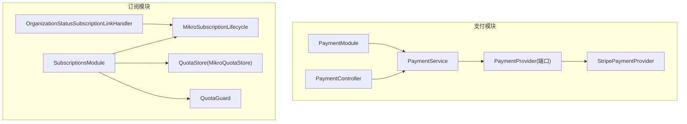
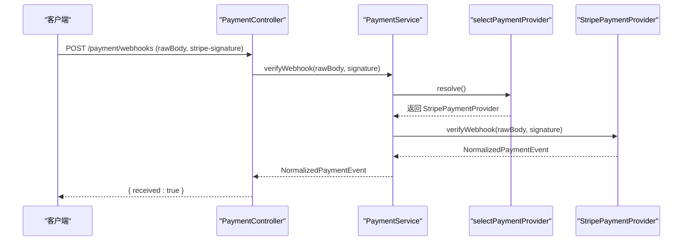
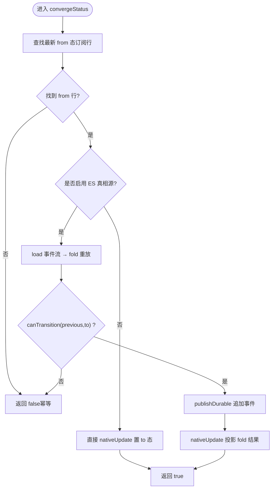
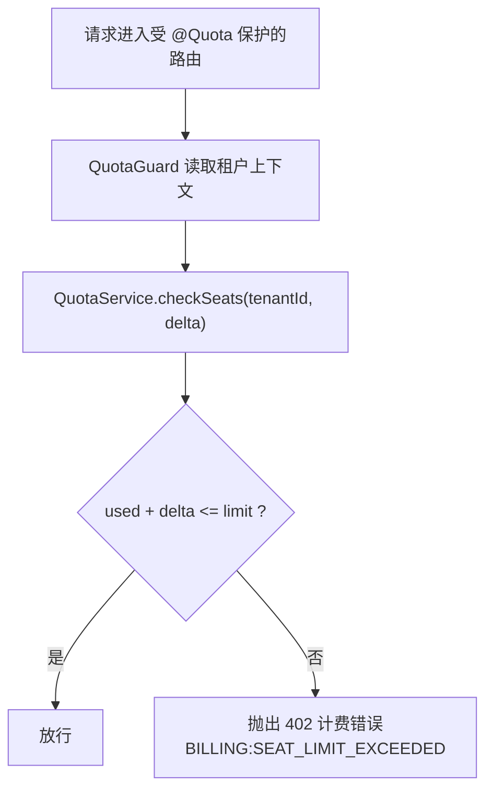
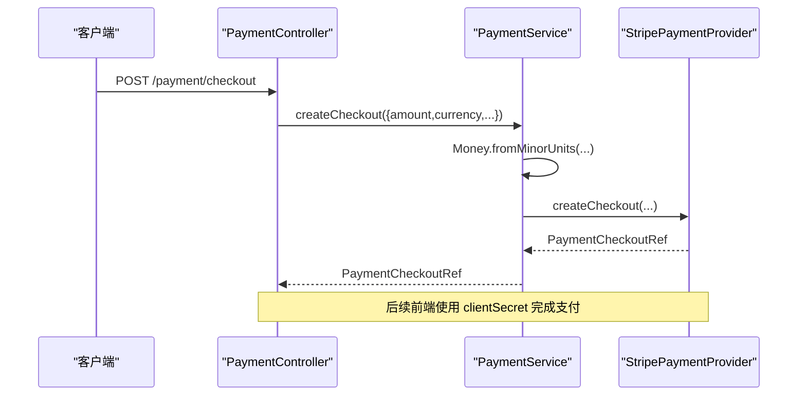
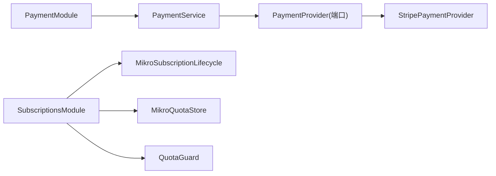

# 支付与订阅

<cite>
**本文引用的文件**   
- [payment.module.ts](file://apps/api/src/modules/payment/payment.module.ts)
- [payment.service.ts](file://apps/api/src/modules/payment/application/payment.service.ts)
- [payment-provider.port.ts](file://apps/api/src/modules/payment/domain/ports/payment-provider.port.ts)
- [stripe-payment.provider.ts](file://apps/api/src/modules/payment/infrastructure/stripe-payment.provider.ts)
- [provider-selection.policy.ts](file://apps/api/src/modules/payment/domain/policies/provider-selection.policy.ts)
- [payment.controller.ts](file://apps/api/src/modules/payment/api/payment.controller.ts)
- [subscriptions.module.ts](file://apps/api/src/modules/subscriptions/subscriptions.module.ts)
- [mikro-subscription.lifecycle.ts](file://apps/api/src/modules/subscriptions/infrastructure/mikro-subscription.lifecycle.ts)
- [org-status-subscription-link.handler.ts](file://apps/api/src/modules/subscriptions/infrastructure/dispatchers/org-status-subscription-link.handler.ts)
- [mikro-quota.store.ts](file://apps/api/src/modules/subscriptions/infrastructure/mikro-quota.store.ts)
- [subscription-lifecycle.ts](file://libs/core/src/modules/subscriptions/domain/subscription-lifecycle.ts)
- [subscription-created.event.ts](file://libs/core/src/modules/subscriptions/domain/events/subscription-created.event.ts)
</cite>

## 目录
1. [引言](#引言)
2. [项目结构](#项目结构)
3. [核心组件](#核心组件)
4. [架构总览](#架构总览)
5. [详细组件分析](#详细组件分析)
6. [依赖关系分析](#依赖关系分析)
7. [性能考量](#性能考量)
8. [故障排查指南](#故障排查指南)
9. [结论](#结论)
10. [附录](#附录)

## 引言
本文件面向支付与订阅系统，覆盖 Stripe 支付集成、订阅计划管理、配额控制与账单管理。重点说明：
- 支付提供商抽象层设计，支持 Stripe、微信支付、支付宝等多渠道扩展。
- 订阅生命周期管理：计划选择、支付处理、订阅激活、续费、取消等流程。
- 配额管理系统：席位限制、额度控制、超配额处理策略。
- Webhook 处理、支付安全、退款处理等高级能力。
- 支付集成配置示例与测试方法指引。

## 项目结构
支付与订阅相关代码分布在两个模块中：
- 支付模块（PaymentModule）：提供支付通道抽象、Stripe 实现、Webhook 入口与统一编排服务。
- 订阅模块（SubscriptionsModule）：承载订阅生命周期、配额存储与守卫、组织状态联动处理器。



图表来源
- [payment.module.ts:1-48](file://apps/api/src/modules/payment/payment.module.ts#L1-L48)
- [subscriptions.module.ts:1-73](file://apps/api/src/modules/subscriptions/subscriptions.module.ts#L1-L73)

章节来源
- [payment.module.ts:1-48](file://apps/api/src/modules/payment/payment.module.ts#L1-L48)
- [subscriptions.module.ts:1-73](file://apps/api/src/modules/subscriptions/subscriptions.module.ts#L1-L73)

## 核心组件
- 支付提供商端口（PaymentProvider）：定义跨通道的统一接口，包括创建客户、下单、查询结账、退款、验签 Webhook 等能力。
- 支付服务（PaymentService）：应用编排层，按配置选择具体支付通道，负责参数校验、错误映射与懒解析。
- Stripe 适配器（StripePaymentProvider）：将 Stripe SDK 调用归一化为端口契约，透传原始负载。
- 订阅生命周期（MikroSubscriptionLifecycle）：基于 MikroORM 的订阅状态收敛与事件投影，支持事件溯源真相源开关。
- 配额存储（MikroQuotaStore）：读取生效订阅与成员计数，支撑席位限额判定。
- 配额守卫（QuotaGuard）：路由级 opt-in 配额检查，超限返回 402。
- 组织状态联动处理器（OrganizationStatusSubscriptionLinkHandler）：租户状态变更时联动订阅状态。

章节来源
- [payment-provider.port.ts:1-158](file://apps/api/src/modules/payment/domain/ports/payment-provider.port.ts#L1-L158)
- [payment.service.ts:1-124](file://apps/api/src/modules/payment/application/payment.service.ts#L1-L124)
- [stripe-payment.provider.ts:1-108](file://apps/api/src/modules/payment/infrastructure/stripe-payment.provider.ts#L1-L108)
- [mikro-subscription.lifecycle.ts:1-157](file://apps/api/src/modules/subscriptions/infrastructure/mikro-subscription.lifecycle.ts#L1-L157)
- [mikro-quota.store.ts:1-81](file://apps/api/src/modules/subscriptions/infrastructure/mikro-quota.store.ts#L1-L81)
- [quota.guard.test.ts:1-82](file://apps/api/src/modules/subscriptions/quota/quota.guard.test.ts#L1-L82)
- [org-status-subscription-link.handler.ts:28-62](file://apps/api/src/modules/subscriptions/infrastructure/dispatchers/org-status-subscription-link.handler.ts#L28-L62)

## 架构总览
支付与订阅采用“领域端口 + 基础设施适配”的分层设计：
- 领域层仅依赖 PaymentProvider 端口；具体通道由模块装配注入。
- 订阅域通过 SubscriptionLifecycle 端口与持久化解耦，支持事件溯源真相源切换。
- 配额子系统以 QuotaStore 端口隔离 ORM 细节，QuotaGuard 在路由层做限额拦截。

```mermaid
classDiagram
class PaymentProvider {
<<interface>>
+id
+supportsRecurring()
+createCustomer(input)
+createCheckout(input)
+retrieveCheckout(id)
+refund(input)
+verifyWebhook(rawBody, signature)
}
class StripePaymentProvider {
+id = "stripe"
+supportsRecurring()
+createCustomer(input)
+createCheckout(input)
+retrieveCheckout(id)
+refund(input)
+verifyWebhook(rawBody, signature)
}
class PaymentService {
+describe()
+supportsRecurring()
+createCustomer(input)
+createCheckout(input)
+retrieveCheckout(id)
+refund(input)
+verifyWebhook(rawBody, signature)
-resolve()
}
class MikroSubscriptionLifecycle {
+convergeStatus(tenantId, from, to)
+rebuildProjection(subscriptionId)
}
class MikroQuotaStore {
+currentActiveSubscription(tenantId)
+countMembers(tenantId)
+reconcileMembers(tenantId)
}
PaymentService --> PaymentProvider : "选择并委派"
StripePaymentProvider ..|> PaymentProvider
MikroSubscriptionLifecycle --> "使用" : "订阅状态收敛"
MikroQuotaStore --> "使用" : "配额数据访问"
```

图表来源
- [payment-provider.port.ts:124-158](file://apps/api/src/modules/payment/domain/ports/payment-provider.port.ts#L124-L158)
- [stripe-payment.provider.ts:19-108](file://apps/api/src/modules/payment/infrastructure/stripe-payment.provider.ts#L19-L108)
- [payment.service.ts:32-124](file://apps/api/src/modules/payment/application/payment.service.ts#L32-L124)
- [mikro-subscription.lifecycle.ts:45-157](file://apps/api/src/modules/subscriptions/infrastructure/mikro-subscription.lifecycle.ts#L45-L157)
- [mikro-quota.store.ts:27-81](file://apps/api/src/modules/subscriptions/infrastructure/mikro-quota.store.ts#L27-L81)

## 详细组件分析

### 支付提供商抽象层与 Stripe 集成
- 抽象端口 PaymentProvider 定义了统一的支付能力，屏蔽 Stripe、支付宝、微信支付的差异。
- StripePaymentProvider 实现该端口，封装 Stripe SDK 的 Customer/PaymentIntent/Refund/Webhook 操作，并将原生对象以 raw 字段透传。
- PaymentService 作为门面，依据配置选择具体 Provider，并在未配置时抛出服务不可用异常，保证启动期不失败（懒解析）。
- 通道选择策略 selectPaymentProvider 优先使用配置指定的 provider，回退到 stripe，若无可用则返回 undefined，由上层抛错。



图表来源
- [payment.controller.ts:138-172](file://apps/api/src/modules/payment/api/payment.controller.ts#L138-L172)
- [payment.service.ts:102-123](file://apps/api/src/modules/payment/application/payment.service.ts#L102-L123)
- [provider-selection.policy.ts:1-19](file://apps/api/src/modules/payment/domain/policies/provider-selection.policy.ts#L1-L19)
- [stripe-payment.provider.ts:87-96](file://apps/api/src/modules/payment/infrastructure/stripe-payment.provider.ts#L87-L96)

章节来源
- [payment-provider.port.ts:1-158](file://apps/api/src/modules/payment/domain/ports/payment-provider.port.ts#L1-L158)
- [payment.service.ts:1-124](file://apps/api/src/modules/payment/application/payment.service.ts#L1-L124)
- [stripe-payment.provider.ts:1-108](file://apps/api/src/modules/payment/infrastructure/stripe-payment.provider.ts#L1-L108)
- [provider-selection.policy.ts:1-19](file://apps/api/src/modules/payment/domain/policies/provider-selection.policy.ts#L1-L19)
- [payment.controller.ts:138-172](file://apps/api/src/modules/payment/api/payment.controller.ts#L138-L172)

### 订阅生命周期管理
- 订阅状态词汇来源于 core 层，包含 active/suspended/expired/cancelled。
- MikroSubscriptionLifecycle 提供 convergeStatus 方法，按 tenantId 查找最新 from 态行，若存在则置 to 态并更新时间戳；无 from 行则幂等 no-op。
- 当开启 ES 真相源（ES_TRUTH_SOURCE_SUBSCRIPTIONS=true），写入走事件流：先 load→fold→canTransition→publishDurable→nativeUpdate 投影结果，确保一致性。
- OrganizationStatusSubscriptionLinkHandler 监听组织状态事件，将租户挂起/恢复映射为订阅状态的 SUSPENDED/ACTIVE 联动。



图表来源
- [mikro-subscription.lifecycle.ts:55-134](file://apps/api/src/modules/subscriptions/infrastructure/mikro-subscription.lifecycle.ts#L55-L134)
- [subscription-lifecycle.ts:1-30](file://libs/core/src/modules/subscriptions/domain/subscription-lifecycle.ts#L1-L30)
- [org-status-subscription-link.handler.ts:28-62](file://apps/api/src/modules/subscriptions/infrastructure/dispatchers/org-status-subscription-link.handler.ts#L28-L62)

章节来源
- [mikro-subscription.lifecycle.ts:1-157](file://apps/api/src/modules/subscriptions/infrastructure/mikro-subscription.lifecycle.ts#L1-L157)
- [subscription-lifecycle.ts:1-30](file://libs/core/src/modules/subscriptions/domain/subscription-lifecycle.ts#L1-L30)
- [org-status-subscription-link.handler.ts:28-62](file://apps/api/src/modules/subscriptions/infrastructure/dispatchers/org-status-subscription-link.handler.ts#L28-L62)

### 配额管理与席位控制
- MikroQuotaStore 读取当前生效订阅（按 periodStart 倒序取 ACTIVE 行）与成员数（tenant_membership 计数），并提供 BA 轴过渡诊断方法 reconcileMembers。
- QuotaService（core 层）根据 ActiveSubscriptionView 计算有效席位限额、用量与剩余，并在无活跃订阅时回退到 FREE_PLAN。
- QuotaGuard 在路由级 opt-in 检查配额，若超限返回 HTTP 402，携带计费错误码。



图表来源
- [mikro-quota.store.ts:30-62](file://apps/api/src/modules/subscriptions/infrastructure/mikro-quota.store.ts#L30-L62)
- [quota.guard.test.ts:33-81](file://apps/api/src/modules/subscriptions/quota/quota.guard.test.ts#L33-L81)

章节来源
- [mikro-quota.store.ts:1-81](file://apps/api/src/modules/subscriptions/infrastructure/mikro-quota.store.ts#L1-L81)
- [quota.guard.test.ts:1-82](file://apps/api/src/modules/subscriptions/quota/quota.guard.test.ts#L1-L82)

### 支付处理与退款流程
- PaymentService.createCheckout 会先经 Money 值对象校验金额与币种，再委托 Provider 创建结账意图。
- StripePaymentProvider 使用 PaymentIntent 创建/查询，并支持退款（refunds.create）。
- Webhook 入口 PaymentController.handleWebhook 使用 Stripe 签名头进行验签，随后分发事件类型（如 payment_intent.succeeded/payment_failed）。



图表来源
- [payment.service.ts:68-82](file://apps/api/src/modules/payment/application/payment.service.ts#L68-L82)
- [stripe-payment.provider.ts:57-70](file://apps/api/src/modules/payment/infrastructure/stripe-payment.provider.ts#L57-L70)

章节来源
- [payment.service.ts:1-124](file://apps/api/src/modules/payment/application/payment.service.ts#L1-L124)
- [stripe-payment.provider.ts:1-108](file://apps/api/src/modules/payment/infrastructure/stripe-payment.provider.ts#L1-L108)

### 订阅创建与事件起点
- 订阅创建事件 SubscriptionCreatedPayload 携带 plan、status、actorId，作为事件流的起点。
- 结合生命周期 fold/replay，订阅状态可被一致地重建与投影。

章节来源
- [subscription-created.event.ts:1-17](file://libs/core/src/modules/subscriptions/domain/events/subscription-created.event.ts#L1-L17)
- [subscription-lifecycle.ts:1-30](file://libs/core/src/modules/subscriptions/domain/subscription-lifecycle.ts#L1-L30)

## 依赖关系分析
- PaymentModule 注册 PAYMENT_PROVIDERS，按配置注入 StripePaymentProvider，并导出 PaymentService。
- SubscriptionsModule 绑定 QUOTA_STORE、SUBSCRIPTION_LIFECYCLE、CUSTOMER_PROVISIONER，并暴露 QuotaService/QuotaGuard。
- 订阅模块依赖 core 层的订阅生命周期与配额端口，基础设施实现位于 apps/api 下。



图表来源
- [payment.module.ts:1-48](file://apps/api/src/modules/payment/payment.module.ts#L1-L48)
- [subscriptions.module.ts:1-73](file://apps/api/src/modules/subscriptions/subscriptions.module.ts#L1-L73)

章节来源
- [payment.module.ts:1-48](file://apps/api/src/modules/payment/payment.module.ts#L1-L48)
- [subscriptions.module.ts:1-73](file://apps/api/src/modules/subscriptions/subscriptions.module.ts#L1-L73)

## 性能考量
- 懒解析支付通道：构造期不校验通道可用性，避免未配通道导致启动失败；仅在调用时抛错。
- 订阅状态收敛：直接 nativeUpdate 路径轻量高效；ES 真相源路径在 append 与投影间保持事务原子性（UoW 可选）。
- 配额计数：countMembers 使用独立 em fork 且 scoped:false，避免全局过滤器影响，减少误筛开销。
- Webhook 验签：使用 SDK 提供的 constructEventAsync，避免手工解析带来的性能与安全风险。

[本节为通用指导，无需源码引用]

## 故障排查指南
- 支付通道未配置：PaymentService.resolve 在无可用 Provider 时抛出 ServiceUnavailableException，错误码 BILLING_PROVIDER_NOT_CONFIGURED。检查配置中的 payment.provider 与对应通道密钥。
- Webhook 验签失败：确认传入的 stripe-signature 与 rawBody 一致，且 webhookSecret 配置正确。
- 订阅状态无法收敛：确认 from 态行是否存在；若启用 ES 真相源，需确保 EVENT_STORE 与 publishDurable 已装配。
- 配额超限：QuotaGuard 对超配额返回 402，错误码 BILLING:SEAT_LIMIT_EXCEEDED；检查当前订阅 seatsLimit 与成员计数。

章节来源
- [payment.service.ts:112-123](file://apps/api/src/modules/payment/application/payment.service.ts#L112-L123)
- [stripe-payment.provider.ts:87-96](file://apps/api/src/modules/payment/infrastructure/stripe-payment.provider.ts#L87-L96)
- [mikro-subscription.lifecycle.ts:89-134](file://apps/api/src/modules/subscriptions/infrastructure/mikro-subscription.lifecycle.ts#L89-L134)
- [quota.guard.test.ts:68-81](file://apps/api/src/modules/subscriptions/quota/quota.guard.test.ts#L68-L81)

## 结论
本系统通过清晰的端口抽象与基础设施适配，实现了多支付渠道的可插拔接入与 Stripe 先行落地；订阅生命周期支持事件溯源真相源切换，保障状态一致性；配额子系统以 store/guard 分离关注点，提供灵活而安全的席位控制。整体架构具备高内聚、低耦合、可扩展的特性，便于后续接入支付宝、微信支付等境内通道。

[本节为总结性内容，无需源码引用]

## 附录

### 支付集成配置要点
- 在 PaymentModule.register 中，仅当配置了 secretKey 时才注册 Stripe 通道；其他通道（alipay/wechat_pay）可按环境条件追加。
- PaymentService.describe 可用于健康检查，返回 selected 与 available 通道列表。
- Webhook 端点使用 @Public 旁路会话墙，依赖通道签名头进行安全校验。

章节来源
- [payment.module.ts:20-46](file://apps/api/src/modules/payment/payment.module.ts#L20-L46)
- [payment.service.ts:40-49](file://apps/api/src/modules/payment/application/payment.service.ts#L40-L49)
- [payment.controller.ts:138-172](file://apps/api/src/modules/payment/api/payment.controller.ts#L138-L172)

### 测试方法与用例参考
- 支付服务选择与降级：验证 wanted 通道命中与 fallback 行为。
- 配额服务：验证 currentSubscription/effectiveSeatsLimit/currentSeats/checkSeats/snapshot 的行为与边界。
- 配额守卫：验证 opt-in 行为、默认 seats=1、无租户上下文拒绝、超配额 402 翻译。
- 订阅生命周期：验证 convergeStatus 的 from 行不存在时的幂等性与 ES 真相源路径的事件追加与投影。

章节来源
- [payment.service.test.ts:20-49](file://apps/api/src/modules/payment/application/payment.service.test.ts#L20-L49)
- [quota.service.test.ts:1-96](file://apps/api/src/modules/subscriptions/quota/quota.service.test.ts#L1-L96)
- [quota.guard.test.ts:1-82](file://apps/api/src/modules/subscriptions/quota/quota.guard.test.ts#L1-L82)
- [mikro-subscription.lifecycle.ts:69-134](file://apps/api/src/modules/subscriptions/infrastructure/mikro-subscription.lifecycle.ts#L69-L134)