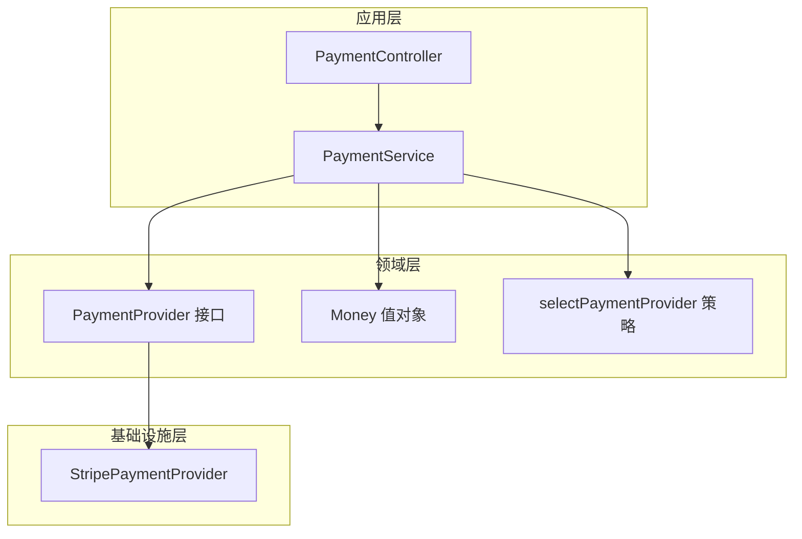
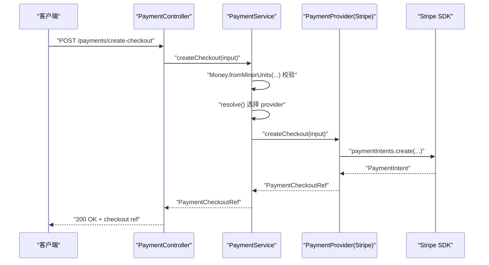
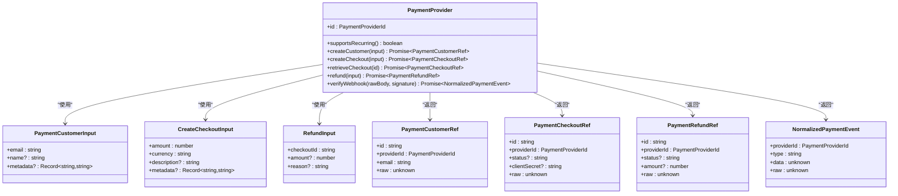
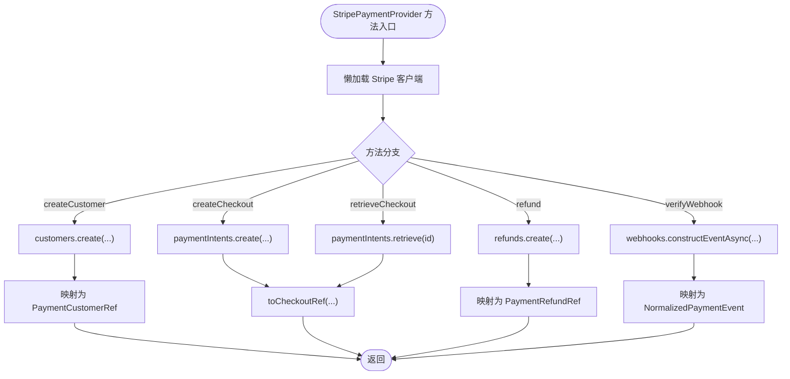
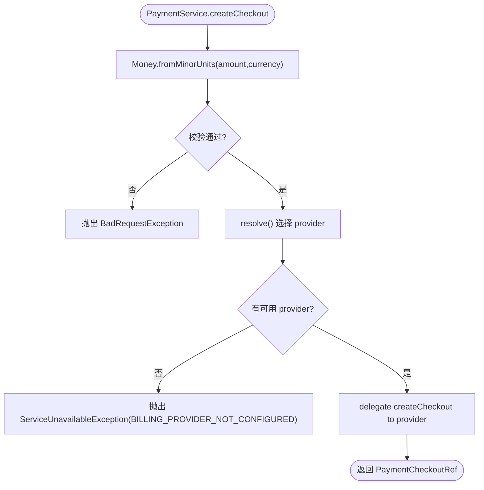
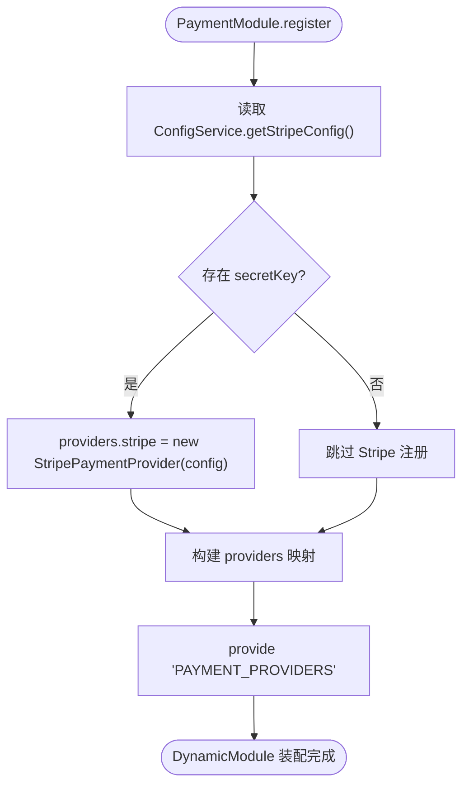
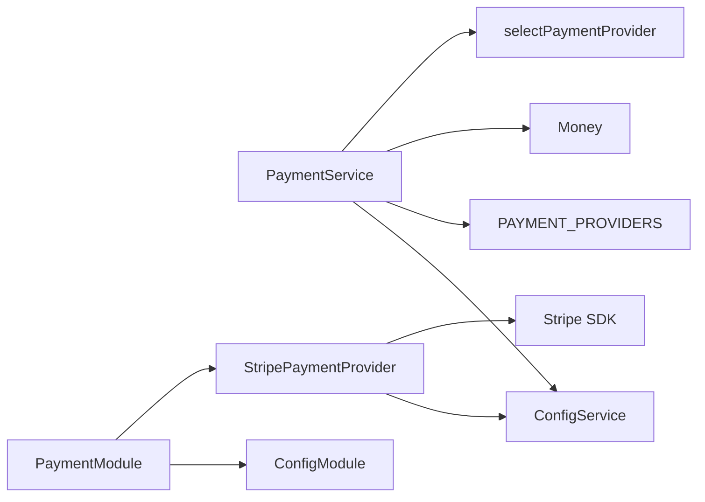

# 支付提供商抽象层

<cite>
**本文引用的文件**   
- [payment-provider.port.ts](file://apps/api/src/modules/payment/domain/ports/payment-provider.port.ts)
- [stripe-payment.provider.ts](file://apps/api/src/modules/payment/infrastructure/stripe-payment.provider.ts)
- [payment.service.ts](file://apps/api/src/modules/payment/application/payment.service.ts)
- [provider-selection.policy.ts](file://apps/api/src/modules/payment/domain/policies/provider-selection.policy.ts)
- [payment.module.ts](file://apps/api/src/modules/payment/payment.module.ts)
- [payment.controller.ts](file://apps/api/src/modules/payment/api/payment.controller.ts)
- [payment.response.ts](file://apps/api/src/modules/payment/api/response/payment.response.ts)
- [money.ts](file://apps/api/src/modules/payment/domain/value-objects/money.ts)
- [config.service.ts](file://apps/api/src/config/config.service.ts)
- [payment.service.test.ts](file://apps/api/src/modules/payment/application/payment.service.test.ts)
</cite>

## 目录
1. [引言](#引言)
2. [项目结构](#项目结构)
3. [核心组件](#核心组件)
4. [架构总览](#架构总览)
5. [详细组件分析](#详细组件分析)
6. [依赖关系分析](#依赖关系分析)
7. [性能与可靠性考量](#性能与可靠性考量)
8. [配置与环境变量](#配置与环境变量)
9. [测试策略](#测试策略)
10. [新增支付提供商实现指南](#新增支付提供商实现指南)
11. [故障排查](#故障排查)
12. [结论](#结论)

## 引言
本文件聚焦“支付提供商抽象层”，目标是：
- 明确 PaymentProvider 接口定义，覆盖支付创建、支付确认（通过 Webhook）、退款处理等核心能力。
- 解析 StripePaymentProvider 的具体实现，包括 API 调用、错误处理、数据映射。
- 说明支付提供商的动态注册机制，支持多种支付渠道扩展。
- 给出配置选项、环境变量设置建议与测试策略。
- 提供新增支付提供商的实现指南与最佳实践。

该抽象层将领域模型与具体支付通道解耦，使业务层仅依赖统一端口，从而降低耦合、提升可测试性与可扩展性。

## 项目结构
支付模块采用分层组织：
- domain/ports：定义跨通道的统一端口（PaymentProvider）及值对象。
- infrastructure：具体支付通道适配器（如 Stripe）。
- application：编排层门面（PaymentService），负责选择 provider、参数校验与异常映射。
- api：对外暴露的控制器与响应类型。
- policies：纯函数领域规则（如 provider 选择与降级）。

图表来源
- [payment.service.ts:1-124](file://apps/api/src/modules/payment/application/payment.service.ts#L1-L124)
- [payment-provider.port.ts:1-158](file://apps/api/src/modules/payment/domain/ports/payment-provider.port.ts#L1-L158)
- [stripe-payment.provider.ts:1-108](file://apps/api/src/modules/payment/infrastructure/stripe-payment.provider.ts#L1-L108)
- [provider-selection.policy.ts:1-19](file://apps/api/src/modules/payment/domain/policies/provider-selection.policy.ts#L1-L19)
- [money.ts](file://apps/api/src/modules/payment/domain/value-objects/money.ts)

章节来源
- [payment.module.ts:1-48](file://apps/api/src/modules/payment/payment.module.ts#L1-L48)
- [payment.controller.ts](file://apps/api/src/modules/payment/api/payment.controller.ts)

## 核心组件
- PaymentProvider 接口：定义统一的支付通道契约，包含 id、supportsRecurring、createCustomer、createCheckout、retrieveCheckout、refund、verifyWebhook 等方法。
- StripePaymentProvider：基于 Stripe SDK 的具体实现，完成客户创建、结账意图创建与查询、退款、Webhook 验签与归一化。
- PaymentService：门面服务，按配置选择 provider，进行 Money 不变量校验，并委派到对应 provider。
- selectPaymentProvider：纯函数策略，优先使用配置的 provider，未注册时回退 stripe；无可用则返回 undefined。
- PaymentModule.register：动态装配 providers，根据配置决定是否注册 Stripe 等通道。

章节来源
- [payment-provider.port.ts:112-158](file://apps/api/src/modules/payment/domain/ports/payment-provider.port.ts#L112-L158)
- [stripe-payment.provider.ts:15-108](file://apps/api/src/modules/payment/infrastructure/stripe-payment.provider.ts#L15-L108)
- [payment.service.ts:23-124](file://apps/api/src/modules/payment/application/payment.service.ts#L23-L124)
- [provider-selection.policy.ts:1-19](file://apps/api/src/modules/payment/domain/policies/provider-selection.policy.ts#L1-L19)
- [payment.module.ts:15-46](file://apps/api/src/modules/payment/payment.module.ts#L15-L46)

## 架构总览
支付流程从控制器进入门面服务，再委托给具体 provider。Webhook 回调由控制器接收后交由门面服务验证并归一化。

图表来源
- [payment.controller.ts](file://apps/api/src/modules/payment/api/payment.controller.ts)
- [payment.service.ts:75-82](file://apps/api/src/modules/payment/application/payment.service.ts#L75-L82)
- [stripe-payment.provider.ts:57-65](file://apps/api/src/modules/payment/infrastructure/stripe-payment.provider.ts#L57-L65)

## 详细组件分析

### PaymentProvider 接口
- 标识与能力门：id 为通道标识；supportsRecurring 表示是否支持周期扣款/订阅。
- 客户管理：createCustomer 创建或复用跨通道归一化的客户引用。
- 结账与收款：createCheckout 创建下单/收款意图；retrieveCheckout 按 id 取回结账引用。
- 退款：refund 对既有结账发起退款。
- Webhook：verifyWebhook 验签并归一化为 NormalizedPaymentEvent。

图表来源
- [payment-provider.port.ts:1-158](file://apps/api/src/modules/payment/domain/ports/payment-provider.port.ts#L1-L158)

章节来源
- [payment-provider.port.ts:112-158](file://apps/api/src/modules/payment/domain/ports/payment-provider.port.ts#L112-L158)

### StripePaymentProvider 实现
- 初始化：懒加载 Stripe SDK 客户端，读取 secretKey 与 apiVersion。
- supportsRecurring：返回 true，表示支持周期扣款。
- createCustomer：调用 customers.create，映射为 PaymentCustomerRef。
- createCheckout/retrieveCheckout：调用 paymentIntents.create/retrieve，映射为 PaymentCheckoutRef。
- refund：调用 refunds.create，映射为 PaymentRefundRef。
- verifyWebhook：构造事件并验签，返回 NormalizedPaymentEvent。
- 数据映射：toCheckoutRef 统一封装 Stripe.PaymentIntent 为内部引用。

图表来源
- [stripe-payment.provider.ts:28-37](file://apps/api/src/modules/payment/infrastructure/stripe-payment.provider.ts#L28-L37)
- [stripe-payment.provider.ts:43-96](file://apps/api/src/modules/payment/infrastructure/stripe-payment.provider.ts#L43-L96)
- [stripe-payment.provider.ts:98-106](file://apps/api/src/modules/payment/infrastructure/stripe-payment.provider.ts#L98-L106)

章节来源
- [stripe-payment.provider.ts:15-108](file://apps/api/src/modules/payment/infrastructure/stripe-payment.provider.ts#L15-L108)

### PaymentService 门面与 Provider 选择
- describe：返回当前选中的 provider 与已注册的 provider 列表，不抛错，用于健康检查。
- supportsRecurring：委派所选 provider。
- createCheckout：先经 Money 值对象校验金额与币种，非法抛出 BadRequestException；成功后委派 provider。
- retrieveCheckout/refund/verifyWebhook：直接委派所选 provider。
- resolve：读取配置期望的 provider，调用 selectPaymentProvider；若无可用则抛 ServiceUnavailableException，携带 BILLING_PROVIDER_NOT_CONFIGURED 错误码。

图表来源
- [payment.service.ts:75-82](file://apps/api/src/modules/payment/application/payment.service.ts#L75-L82)
- [payment.service.ts:112-122](file://apps/api/src/modules/payment/application/payment.service.ts#L112-L122)
- [provider-selection.policy.ts:13-18](file://apps/api/src/modules/payment/domain/policies/provider-selection.policy.ts#L13-L18)

章节来源
- [payment.service.ts:23-124](file://apps/api/src/modules/payment/application/payment.service.ts#L23-L124)
- [provider-selection.policy.ts:1-19](file://apps/api/src/modules/payment/domain/policies/provider-selection.policy.ts#L1-L19)

### 动态注册机制
- PaymentModule.register 返回 DynamicModule，注入 ConfigModule。
- 在 useFactory 中根据配置决定是否注册 StripePaymentProvider。
- 以 'PAYMENT_PROVIDERS' 键注入 Record<string, PaymentProvider>，供 PaymentService 消费。
- 预留 P2/P3 扩展点：可按环境追加 alipay/wechat_pay 等境内通道。

图表来源
- [payment.module.ts:20-42](file://apps/api/src/modules/payment/payment.module.ts#L20-L42)

章节来源
- [payment.module.ts:1-48](file://apps/api/src/modules/payment/payment.module.ts#L1-L48)

## 依赖关系分析
- PaymentService 依赖：
  - ConfigService：读取 payment.provider 与 Stripe 配置。
  - PAYMENT_PROVIDERS：注入的 provider 映射。
  - Money：金额与币种校验。
  - selectPaymentProvider：选择与降级策略。
- StripePaymentProvider 依赖：
  - ConfigService：读取 Stripe secretKey、apiVersion、webhookSecret。
  - Stripe SDK：执行 API 调用。
- PaymentModule 依赖：
  - ConfigModule：提供配置服务。
  - StripePaymentProvider：作为基础设施提供者。

图表来源
- [payment.service.ts:1-21](file://apps/api/src/modules/payment/application/payment.service.ts#L1-L21)
- [stripe-payment.provider.ts:1-13](file://apps/api/src/modules/payment/infrastructure/stripe-payment.provider.ts#L1-L13)
- [payment.module.ts:1-7](file://apps/api/src/modules/payment/payment.module.ts#L1-L7)

章节来源
- [payment.service.ts:1-21](file://apps/api/src/modules/payment/application/payment.service.ts#L1-L21)
- [stripe-payment.provider.ts:1-13](file://apps/api/src/modules/payment/infrastructure/stripe-payment.provider.ts#L1-L13)
- [payment.module.ts:1-7](file://apps/api/src/modules/payment/payment.module.ts#L1-L7)

## 性能与可靠性考量
- 懒加载 Stripe 客户端：仅在首次调用时初始化，避免启动开销。
- 懒解析 provider：构造期不校验，实际调用时才判断可用性，符合“未配即降级”的非功能性要求。
- 幂等与重试：Stripe SDK 本身具备幂等键与重试语义；建议在业务侧对关键操作（如退款）增加幂等键与重试策略。
- 资源隔离：不同 provider 实例独立持有 SDK 客户端，避免共享状态导致的竞态。
- 日志与可观测性：StripePaymentProvider 初始化时记录日志，便于排障。

[本节为通用指导，不直接分析具体文件]

## 配置与环境变量
- Stripe 配置：
  - secretKey：Stripe 密钥，若缺失则不注册 Stripe provider。
  - apiVersion：Stripe API 版本。
  - webhookSecret：用于验签 Webhook。
- 支付 provider 选择：
  - payment.provider：期望使用的 provider id（如 stripe/alipay/wechat_pay）。
- 配置读取：
  - ConfigService.getStripeConfig()：获取 Stripe 相关配置。
  - ConfigService.getPaymentConfig()：获取 payment.provider。

章节来源
- [stripe-payment.provider.ts:28-37](file://apps/api/src/modules/payment/infrastructure/stripe-payment.provider.ts#L28-L37)
- [payment.service.ts:112-114](file://apps/api/src/modules/payment/application/payment.service.ts#L112-L114)
- [config.service.ts](file://apps/api/src/config/config.service.ts)

## 测试策略
- 单元测试要点：
  - PaymentService.resolve 的选择与降级逻辑：wanted 已注册则用之；未注册则回落 stripe；无任何 provider 抛 ServiceUnavailableException。
  - supportsRecurring 委派所选 provider。
  - createCheckout 的金额与币种校验（Money 值对象）。
  - Webhook 验签与归一化。
- 测试数据与桩：
  - 使用 fakeProvider 模拟各 provider 行为，避免真实网络调用。
  - 针对 StripePaymentProvider 可使用 Stripe SDK 的 mock 或集成测试环境。
- 覆盖率目标：
  - 覆盖 provider 选择三态分支与懒解析降级路径。
  - 覆盖异常路径（未配置 provider、金额/币种非法）。

章节来源
- [payment.service.test.ts:1-96](file://apps/api/src/modules/payment/application/payment.service.test.ts#L1-L96)

## 新增支付提供商实现指南
步骤概览：
1. 定义新的 provider 类并实现 PaymentProvider 接口。
   - 实现 id、supportsRecurring、createCustomer、createCheckout、retrieveCheckout、refund、verifyWebhook。
   - 将第三方 SDK 响应映射为统一的 PaymentCustomerRef、PaymentCheckoutRef、PaymentRefundRef、NormalizedPaymentEvent。
2. 在 PaymentModule.register 中按需注册新 provider。
   - 根据环境变量或配置开关决定是否注册。
   - 将实例放入 providers 映射，键为 provider id。
3. 更新配置与环境变量。
   - 新增 provider 的配置项（如 alipayConfig.enabled、wechatConfig.enabled）。
   - 确保 payment.provider 可指向新 provider id。
4. 编写测试。
   - 单元测试：验证 provider 选择、降级、异常路径。
   - 集成测试：对接沙箱环境，验证 Webhook 验签与事件归一化。
5. 文档与契约对齐。
   - 更新 API 响应类型与 OpenAPI 描述（如有）。
   - 在 response/payment.response.ts 中保持通道词汇单源一致性。

最佳实践：
- 保持幂等与重试：对退款等写操作引入幂等键与重试策略。
- 安全与合规：敏感信息（密钥、签名）一律通过环境变量或密钥管理服务注入。
- 可观测性：记录关键事件（创建、失败、退款、Webhook 事件）以便追踪。
- 渐进迁移：保留 raw 字段透传原生载荷，便于既有调用方逐步适配。

章节来源
- [payment-provider.port.ts:112-158](file://apps/api/src/modules/payment/domain/ports/payment-provider.port.ts#L112-L158)
- [payment.module.ts:20-42](file://apps/api/src/modules/payment/payment.module.ts#L20-L42)
- [payment.response.ts:20](file://apps/api/src/modules/payment/api/response/payment.response.ts#L20)

## 故障排查
常见问题与定位：
- 启动正常但调用时报 ServiceUnavailableException：
  - 检查 payment.provider 配置是否存在且对应的 provider 已注册。
  - 检查 Stripe secretKey 是否配置；未配置则不会注册 Stripe provider。
- 金额或币种非法：
  - 检查前端传入 amount/currency 是否符合 Money 值对象约束。
  - 查看 createCheckout 防御性校验抛出的 BadRequestException。
- Webhook 验签失败：
  - 核对 webhookSecret 是否正确。
  - 检查请求体与签名头是否完整。
- 日志与诊断：
  - 使用 PaymentService.describe 获取 selected 与 available 通道列表。
  - 查看 StripePaymentProvider 初始化日志。

章节来源
- [payment.service.ts:112-122](file://apps/api/src/modules/payment/application/payment.service.ts#L112-L122)
- [stripe-payment.provider.ts:28-37](file://apps/api/src/modules/payment/infrastructure/stripe-payment.provider.ts#L28-L37)
- [payment.service.ts:75-82](file://apps/api/src/modules/payment/application/payment.service.ts#L75-L82)

## 结论
支付提供商抽象层通过 PaymentProvider 接口将领域与具体通道解耦，结合 PaymentService 的门面编排与 selectPaymentProvider 的策略选择，实现了灵活、可扩展且可靠的支付能力接入。StripePaymentProvider 提供了完整的 Stripe 通道实现，并通过动态注册机制支持未来多通道扩展。配合完善的测试策略与配置管理，团队可以高效地接入新的支付渠道并保持系统稳定性与可维护性。