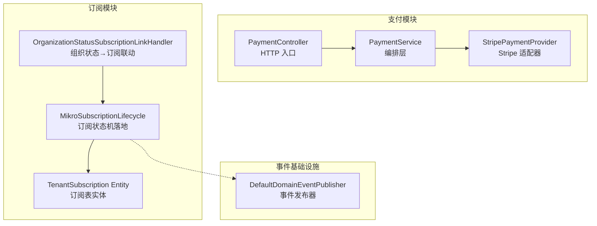
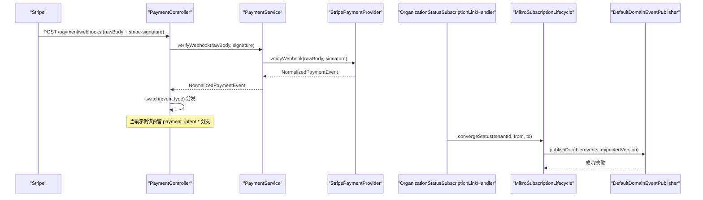
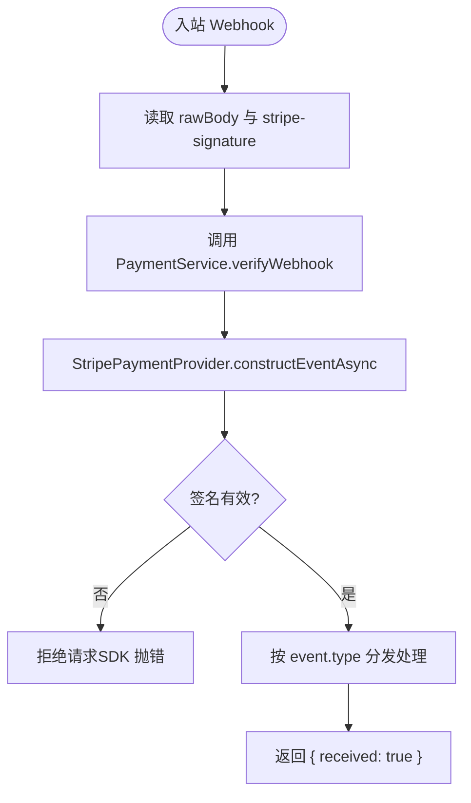
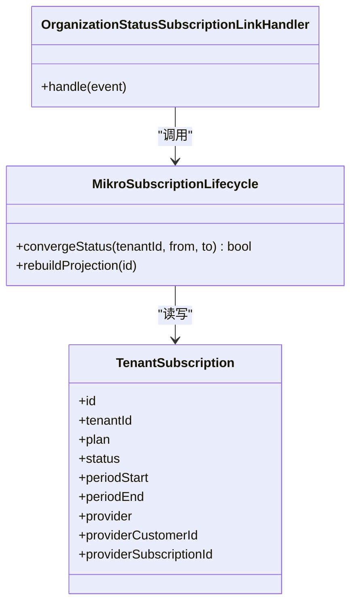
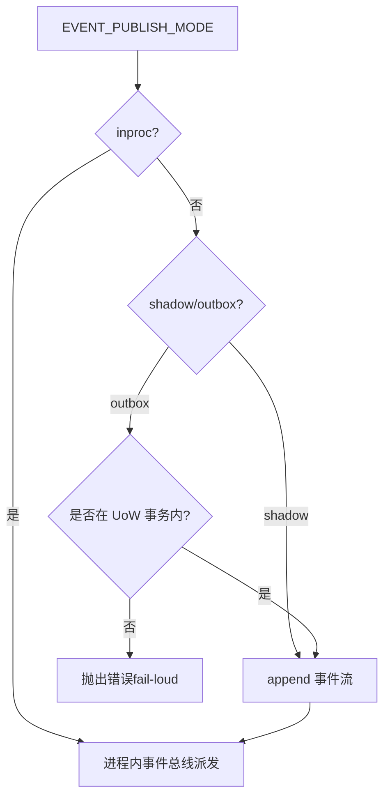
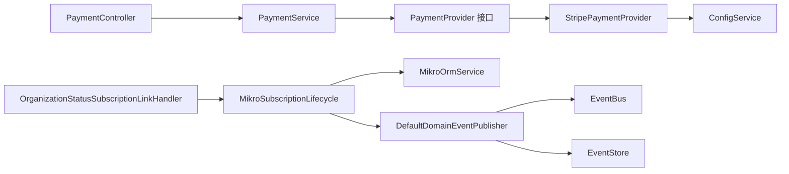

# Webhook 事件处理

<cite>
**本文引用的文件**   
- [apps/api/src/modules/payment/api/payment.controller.ts](file://apps/api/src/modules/payment/api/payment.controller.ts)
- [apps/api/src/modules/payment/application/payment.service.ts](file://apps/api/src/modules/payment/application/payment.service.ts)
- [apps/api/src/modules/payment/infrastructure/stripe-payment.provider.ts](file://apps/api/src/modules/payment/infrastructure/stripe-payment.provider.ts)
- [apps/api/src/config/envs/default.ts](file://apps/api/src/config/envs/default.ts)
- [apps/api/src/database/eventing/domain-event-publisher.ts](file://apps/api/src/database/eventing/domain-event-publisher.ts)
- [apps/api/src/modules/subscriptions/infrastructure/dispatchers/org-status-subscription-link.handler.ts](file://apps/api/src/modules/subscriptions/infrastructure/dispatchers/org-status-subscription-link.handler.ts)
- [apps/api/src/modules/subscriptions/infrastructure/mikro-subscription.lifecycle.ts](file://apps/api/src/modules/subscriptions/infrastructure/mikro-subscription.lifecycle.ts)
- [apps/api/src/modules/subscriptions/infrastructure/entities/tenant-subscription.entity.ts](file://apps/api/src/modules/subscriptions/infrastructure/entities/tenant-subscription.entity.ts)
</cite>

## 目录
1. [引言](#引言)
2. [项目结构](#项目结构)
3. [核心组件](#核心组件)
4. [架构总览](#架构总览)
5. [详细组件分析](#详细组件分析)
6. [依赖关系分析](#依赖关系分析)
7. [性能与可靠性](#性能与可靠性)
8. [故障排查指南](#故障排查指南)
9. [结论](#结论)

## 引言
本文围绕支付 webhook 的接收、签名验证、事件分发与幂等性，以及组织状态变更与订阅同步的联动机制展开。同时说明异步事件发布通道（inproc/shadow/outbox）、失败重试与可观测性建议，并给出安全配置、错误处理策略、调试方法与集成测试要点。

## 项目结构
本仓库采用 NestJS 模块化架构，支付与订阅分别位于 `modules/payment` 与 `modules/subscriptions`；webhook 入口在支付控制器中，Stripe 通道实现位于基础设施层；订阅状态同步通过领域事件处理器与生命周期端口完成；事件持久化与投递由数据库事件模块提供。

**图表来源**
- [apps/api/src/modules/payment/api/payment.controller.ts:147-170](file://apps/api/src/modules/payment/api/payment.controller.ts#L147-L170)
- [apps/api/src/modules/payment/application/payment.service.ts:102-122](file://apps/api/src/modules/payment/application/payment.service.ts#L102-L122)
- [apps/api/src/modules/payment/infrastructure/stripe-payment.provider.ts:87-96](file://apps/api/src/modules/payment/infrastructure/stripe-payment.provider.ts#L87-L96)
- [apps/api/src/modules/subscriptions/infrastructure/dispatchers/org-status-subscription-link.handler.ts:22-61](file://apps/api/src/modules/subscriptions/infrastructure/dispatchers/org-status-subscription-link.handler.ts#L22-L61)
- [apps/api/src/modules/subscriptions/infrastructure/mikro-subscription.lifecycle.ts:69-133](file://apps/api/src/modules/subscriptions/infrastructure/mikro-subscription.lifecycle.ts#L69-L133)
- [apps/api/src/modules/subscriptions/infrastructure/entities/tenant-subscription.entity.ts:19-45](file://apps/api/src/modules/subscriptions/infrastructure/entities/tenant-subscription.entity.ts#L19-L45)
- [apps/api/src/database/eventing/domain-event-publisher.ts:33-71](file://apps/api/src/database/eventing/domain-event-publisher.ts#L33-L71)

**章节来源**
- [apps/api/src/modules/payment/api/payment.controller.ts:42-57](file://apps/api/src/modules/payment/api/payment.controller.ts#L42-L57)
- [apps/api/src/config/envs/default.ts:55-77](file://apps/api/src/config/envs/default.ts#L55-L77)

## 核心组件
- 支付 HTTP 控制器：暴露 `/api/payment/webhooks` 端点，负责原始请求体透传与 Stripe 签名头提取，调用服务层验签后按事件类型分发。
- 支付服务门面：根据配置选择已注册的支付通道，统一对外暴露验签方法。
- Stripe 通道适配器：使用 Stripe SDK 对原始 body 与签名进行校验，返回归一化支付事件。
- 组织状态→订阅联动处理器：监听组织状态迁移事件，将租户挂起/恢复映射为订阅挂起/恢复。
- 订阅生命周期实现：以终态收敛方式更新订阅状态，支持 ES 真相源写路径与投影回写。
- 事件发布器：支持 inproc/shadow/outbox 三种模式，outbox 要求事务内 append，并提供 durable 版本乐观锁写入。

**章节来源**
- [apps/api/src/modules/payment/api/payment.controller.ts:138-170](file://apps/api/src/modules/payment/api/payment.controller.ts#L138-L170)
- [apps/api/src/modules/payment/application/payment.service.ts:102-122](file://apps/api/src/modules/payment/application/payment.service.ts#L102-L122)
- [apps/api/src/modules/payment/infrastructure/stripe-payment.provider.ts:87-96](file://apps/api/src/modules/payment/infrastructure/stripe-payment.provider.ts#L87-L96)
- [apps/api/src/modules/subscriptions/infrastructure/dispatchers/org-status-subscription-link.handler.ts:11-21](file://apps/api/src/modules/subscriptions/infrastructure/dispatchers/org-status-subscription-link.handler.ts#L11-L21)
- [apps/api/src/modules/subscriptions/infrastructure/mikro-subscription.lifecycle.ts:25-44](file://apps/api/src/modules/subscriptions/infrastructure/mikro-subscription.lifecycle.ts#L25-L44)
- [apps/api/src/database/eventing/domain-event-publisher.ts:11-20](file://apps/api/src/database/eventing/domain-event-publisher.ts#L11-L20)

## 架构总览
Webhook 从 Stripe 到达 API，经控制器保留 REST 语义与 rawBody，交由支付服务选择 Stripe 通道完成签名校验；随后进入事件分发分支。订阅联动通过领域事件处理器触发，最终落到订阅生命周期实现，必要时通过事件发布器持久化或投递事件。

**图表来源**
- [apps/api/src/modules/payment/api/payment.controller.ts:147-170](file://apps/api/src/modules/payment/api/payment.controller.ts#L147-L170)
- [apps/api/src/modules/payment/application/payment.service.ts:108-110](file://apps/api/src/modules/payment/application/payment.service.ts#L108-L110)
- [apps/api/src/modules/payment/infrastructure/stripe-payment.provider.ts:87-96](file://apps/api/src/modules/payment/infrastructure/stripe-payment.provider.ts#L87-L96)
- [apps/api/src/modules/subscriptions/infrastructure/dispatchers/org-status-subscription-link.handler.ts:30-55](file://apps/api/src/modules/subscriptions/infrastructure/dispatchers/org-status-subscription-link.handler.ts#L30-L55)
- [apps/api/src/modules/subscriptions/infrastructure/mikro-subscription.lifecycle.ts:69-133](file://apps/api/src/modules/subscriptions/infrastructure/mikro-subscription.lifecycle.ts#L69-L133)
- [apps/api/src/database/eventing/domain-event-publisher.ts:62-71](file://apps/api/src/database/eventing/domain-event-publisher.ts#L62-L71)

## 详细组件分析

### 支付 Webhook 接收与签名验证
- 入口端点：`POST /payment/webhooks`，使用 `@Public()` 旁路全局会话墙，依赖 Stripe 签名而非用户会话。
- 原始请求体：控制器保留 Fastify 的 `request.rawBody`，避免 JSON 解析破坏字节序列，确保 Stripe 验签正确。
- 验签流程：控制器调用 `PaymentService.verifyWebhook`，服务层委托到选中的 `PaymentProvider`，Stripe 适配器使用 SDK 的 `constructEventAsync` 完成签名校验。
- 事件分发：控制器内按 `event.type` 分支，当前示例预留 `payment_intent.succeeded` 与 `payment_intent.payment_failed` 分支，后续扩展在此收敛。

**图表来源**
- [apps/api/src/modules/payment/api/payment.controller.ts:147-170](file://apps/api/src/modules/payment/api/payment.controller.ts#L147-L170)
- [apps/api/src/modules/payment/application/payment.service.ts:108-110](file://apps/api/src/modules/payment/application/payment.service.ts#L108-L110)
- [apps/api/src/modules/payment/infrastructure/stripe-payment.provider.ts:87-96](file://apps/api/src/modules/payment/infrastructure/stripe-payment.provider.ts#L87-L96)

**章节来源**
- [apps/api/src/modules/payment/api/payment.controller.ts:138-170](file://apps/api/src/modules/payment/api/payment.controller.ts#L138-L170)
- [apps/api/src/modules/payment/application/payment.service.ts:102-122](file://apps/api/src/modules/payment/application/payment.service.ts#L102-L122)
- [apps/api/src/modules/payment/infrastructure/stripe-payment.provider.ts:87-96](file://apps/api/src/modules/payment/infrastructure/stripe-payment.provider.ts#L87-L96)

### 组织状态与订阅关联的事件处理
- 事件来源：组织生命周期事件 `OrganizationStatusTransitionedEvent`。
- 处理器职责：当组织状态变为挂起时，将对应租户的订阅状态收敛至挂起；当恢复为活跃时，将本次治理导致的挂起订阅恢复为活跃。
- 幂等保证：处理器调用 `SubscriptionLifecycle.convergeStatus`，该实现以“终态收敛”的方式工作——若不存在匹配的 from 态行则直接返回 false，重投/滞后事件天然 no-op。
- 数据模型：订阅实体 `TenantSubscription` 包含 status、periodStart/End、provider 信息等，索引覆盖 tenantId+status 与 tenantId+periodStart。

**图表来源**
- [apps/api/src/modules/subscriptions/infrastructure/dispatchers/org-status-subscription-link.handler.ts:22-61](file://apps/api/src/modules/subscriptions/infrastructure/dispatchers/org-status-subscription-link.handler.ts#L22-L61)
- [apps/api/src/modules/subscriptions/infrastructure/mikro-subscription.lifecycle.ts:69-133](file://apps/api/src/modules/subscriptions/infrastructure/mikro-subscription.lifecycle.ts#L69-L133)
- [apps/api/src/modules/subscriptions/infrastructure/entities/tenant-subscription.entity.ts:19-45](file://apps/api/src/modules/subscriptions/infrastructure/entities/tenant-subscription.entity.ts#L19-L45)

**章节来源**
- [apps/api/src/modules/subscriptions/infrastructure/dispatchers/org-status-subscription-link.handler.ts:11-21](file://apps/api/src/modules/subscriptions/infrastructure/dispatchers/org-status-subscription-link.handler.ts#L11-L21)
- [apps/api/src/modules/subscriptions/infrastructure/dispatchers/org-status-subscription-link.handler.ts:30-61](file://apps/api/src/modules/subscriptions/infrastructure/dispatchers/org-status-subscription-link.handler.ts#L30-L61)
- [apps/api/src/modules/subscriptions/infrastructure/mikro-subscription.lifecycle.ts:25-44](file://apps/api/src/modules/subscriptions/infrastructure/mikro-subscription.lifecycle.ts#L25-L44)
- [apps/api/src/modules/subscriptions/infrastructure/entities/tenant-subscription.entity.ts:19-45](file://apps/api/src/modules/subscriptions/infrastructure/entities/tenant-subscription.entity.ts#L19-L45)

### 异步任务调度、失败重试与可观测性
- 事件发布模式：通过 `EVENT_PUBLISH_MODE` 控制 `inproc`、`shadow`、`outbox` 三种模式。默认 `inproc`，不触库。
- Outbox 事务约束：当模式为 `outbox` 时，`publishAll` 必须在活跃 UoW 事务内执行，否则抛出错误；这保证域行与事件行同事务提交。
- 耐久写入：truth-source 写路径使用 `publishDurable`，先带乐观锁 `expectedVersion` 追加事件流，再按模式决定是否立即派发。
- 可观测性：处理器与生命周期实现均记录日志，便于追踪事件 ID、租户 ID、是否发生状态变更。

**图表来源**
- [apps/api/src/config/envs/default.ts:64-70](file://apps/api/src/config/envs/default.ts#L64-L70)
- [apps/api/src/database/eventing/domain-event-publisher.ts:33-71](file://apps/api/src/database/eventing/domain-event-publisher.ts#L33-L71)

**章节来源**
- [apps/api/src/config/envs/default.ts:64-77](file://apps/api/src/config/envs/default.ts#L64-L77)
- [apps/api/src/database/eventing/domain-event-publisher.ts:33-71](file://apps/api/src/database/eventing/domain-event-publisher.ts#L33-L71)

### Webhook 安全配置
- Stripe 密钥：`STRIPE_SECRET_KEY`、`STRIPE_PUBLIC_KEY`、`STRIPE_WEBHOOK_SECRET`、`STRIPE_API_VERSION` 在默认配置中定义。
- 通道选择：`PAYMENT_PROVIDER` 决定使用 stripe/alipay/wechat_pay 之一，未配置时支付服务会抛出不可用异常。
- 传输安全：webhook 端点依赖 Stripe 签名校验，不依赖会话；生产环境应启用 HTTPS 与反向代理白名单。

**章节来源**
- [apps/api/src/config/envs/default.ts:55-63](file://apps/api/src/config/envs/default.ts#L55-L63)
- [apps/api/src/modules/payment/application/payment.service.ts:112-122](file://apps/api/src/modules/payment/application/payment.service.ts#L112-L122)

### 错误处理策略
- 未配置支付通道：`PaymentService.resolve` 在未找到匹配 provider 时抛出 `ServiceUnavailableException`，附带错误码。
- Stripe 验签失败：Stripe SDK 的 `constructEventAsync` 在校验失败时会抛错，控制器侧未捕获即向上抛出，适合由网关或全局过滤器统一处理。
- Outbox 事务外发布：`DefaultDomainEventPublisher.publishAll` 在非事务环境下抛出错误，防止 outbox 语义被破坏。

**章节来源**
- [apps/api/src/modules/payment/application/payment.service.ts:112-122](file://apps/api/src/modules/payment/application/payment.service.ts#L112-L122)
- [apps/api/src/database/eventing/domain-event-publisher.ts:38-46](file://apps/api/src/database/eventing/domain-event-publisher.ts#L38-L46)

### 幂等性与一致性
- 订阅状态收敛：`MikroSubscriptionLifecycle.convergeStatus` 查找最新的 from 态行，存在才更新 to 态；若无 from 行则返回 false，天然幂等。
- truth-source 写路径：先 load 事件流 → fold 前态裁决 → `publishDurable` 乐观锁追加 → 投影回写；若前态不允许迁移则不发事件、不写，保持 fail-safe。
- 组织→订阅联动：处理器只关心目标状态（SUSPENDED/ACTIVE），并通过 lifecycle 收敛，避免重复计数或回溯历史。

**章节来源**
- [apps/api/src/modules/subscriptions/infrastructure/mikro-subscription.lifecycle.ts:69-133](file://apps/api/src/modules/subscriptions/infrastructure/mikro-subscription.lifecycle.ts#L69-L133)
- [apps/api/src/modules/subscriptions/infrastructure/dispatchers/org-status-subscription-link.handler.ts:30-61](file://apps/api/src/modules/subscriptions/infrastructure/dispatchers/org-status-subscription-link.handler.ts#L30-L61)

## 依赖关系分析
- 控制器依赖服务门面，服务门面依赖策略选择的 provider 注册表。
- Stripe 适配器依赖配置服务获取密钥与 API 版本。
- 订阅联动处理器依赖生命周期端口，生命周期实现依赖 ORM、事件发布器与可选的事件存储。
- 事件发布器依赖配置、事件总线与事件存储，并在 outbox 模式下依赖事务范围。

**图表来源**
- [apps/api/src/modules/payment/api/payment.controller.ts:66-69](file://apps/api/src/modules/payment/api/payment.controller.ts#L66-L69)
- [apps/api/src/modules/payment/application/payment.service.ts:32-38](file://apps/api/src/modules/payment/application/payment.service.ts#L32-L38)
- [apps/api/src/modules/payment/infrastructure/stripe-payment.provider.ts:19-26](file://apps/api/src/modules/payment/infrastructure/stripe-payment.provider.ts#L19-L26)
- [apps/api/src/modules/subscriptions/infrastructure/dispatchers/org-status-subscription-link.handler.ts:22-28](file://apps/api/src/modules/subscriptions/infrastructure/dispatchers/org-status-subscription-link.handler.ts#L22-L28)
- [apps/api/src/modules/subscriptions/infrastructure/mikro-subscription.lifecycle.ts:45-53](file://apps/api/src/modules/subscriptions/infrastructure/mikro-subscription.lifecycle.ts#L45-L53)
- [apps/api/src/database/eventing/domain-event-publisher.ts:33-71](file://apps/api/src/database/eventing/domain-event-publisher.ts#L33-L71)

**章节来源**
- [apps/api/src/modules/payment/api/payment.controller.ts:66-69](file://apps/api/src/modules/payment/api/payment.controller.ts#L66-L69)
- [apps/api/src/modules/payment/application/payment.service.ts:32-38](file://apps/api/src/modules/payment/application/payment.service.ts#L32-L38)
- [apps/api/src/modules/payment/infrastructure/stripe-payment.provider.ts:19-26](file://apps/api/src/modules/payment/infrastructure/stripe-payment.provider.ts#L19-L26)
- [apps/api/src/modules/subscriptions/infrastructure/dispatchers/org-status-subscription-link.handler.ts:22-28](file://apps/api/src/modules/subscriptions/infrastructure/dispatchers/org-status-subscription-link.handler.ts#L22-L28)
- [apps/api/src/modules/subscriptions/infrastructure/mikro-subscription.lifecycle.ts:45-53](file://apps/api/src/modules/subscriptions/infrastructure/mikro-subscription.lifecycle.ts#L45-L53)
- [apps/api/src/database/eventing/domain-event-publisher.ts:33-71](file://apps/api/src/database/eventing/domain-event-publisher.ts#L33-L71)

## 性能与可靠性
- 验签性能：Stripe SDK 的 `constructEventAsync` 为轻量计算，建议在网关层做 TLS 终止与速率限制，减少无效请求。
- 事件模式选择：
  - `inproc`：零额外 IO，适合开发/测试。
  - `shadow`：仅落盘事件流，不改变业务派发行为，用于审计与回放。
  - `outbox`：强一致投递，需开启事务与 relay 轮询；注意 pollMs 配置与目标库迁移。
- 订阅状态收敛：基于索引 `tenant_subscription_tenant_status_idx` 与 `tenant_subscription_tenant_period_idx` 的快速查询，避免全表扫描。
- 幂等设计：通过终态收敛与乐观锁避免重复处理与乱序影响。

[本节为通用指导，不直接分析具体文件]

## 故障排查指南
- Stripe 验签失败：
  - 检查 `STRIPE_WEBHOOK_SECRET` 是否与 Stripe 控制台一致。
  - 确认请求头 `stripe-signature` 与原始 body 未被中间件篡改。
- 支付通道未配置：
  - 检查 `PAYMENT_PROVIDER` 与对应 provider 是否注册。
  - 查看 `PaymentService.describe` 输出诊断 selected/available。
- Outbox 事务外发布：
  - 确保在 UoW 事务内调用 `publishAll`，或在 truth-source 写路径使用 `publishDurable`。
- 订阅状态未联动：
  - 检查组织状态事件是否正确发布并被订阅模块消费。
  - 查看处理器日志中的 eventId 与 changed 标志。

**章节来源**
- [apps/api/src/modules/payment/application/payment.service.ts:40-49](file://apps/api/src/modules/payment/application/payment.service.ts#L40-L49)
- [apps/api/src/database/eventing/domain-event-publisher.ts:38-46](file://apps/api/src/database/eventing/domain-event-publisher.ts#L38-L46)
- [apps/api/src/modules/subscriptions/infrastructure/dispatchers/org-status-subscription-link.handler.ts:39-53](file://apps/api/src/modules/subscriptions/infrastructure/dispatchers/org-status-subscription-link.handler.ts#L39-L53)

## 结论
本项目实现了安全的 Stripe webhook 验签与可扩展的事件分发点，结合组织状态事件驱动订阅状态同步，并通过终态收敛与乐观锁保障幂等与一致性。事件发布支持多模式切换，outbox 模式提供事务级可靠投递。建议在生产环境严格配置 Stripe 密钥、启用 HTTPS 与速率限制，并根据负载选择合适的 EVENT_PUBLISH_MODE，配合监控告警与日志追踪提升可观测性与稳定性。

[本节为总结性内容，不直接分析具体文件]