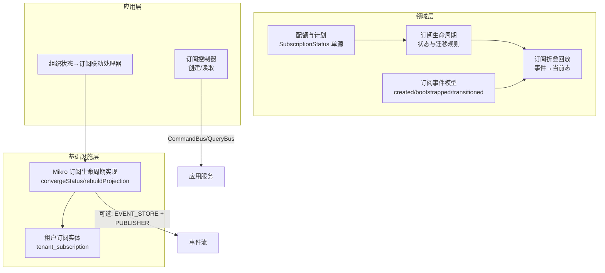
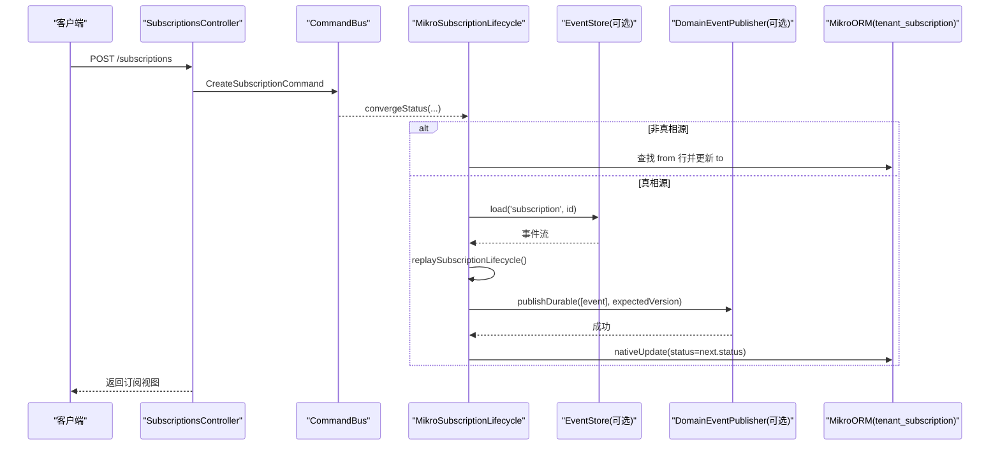
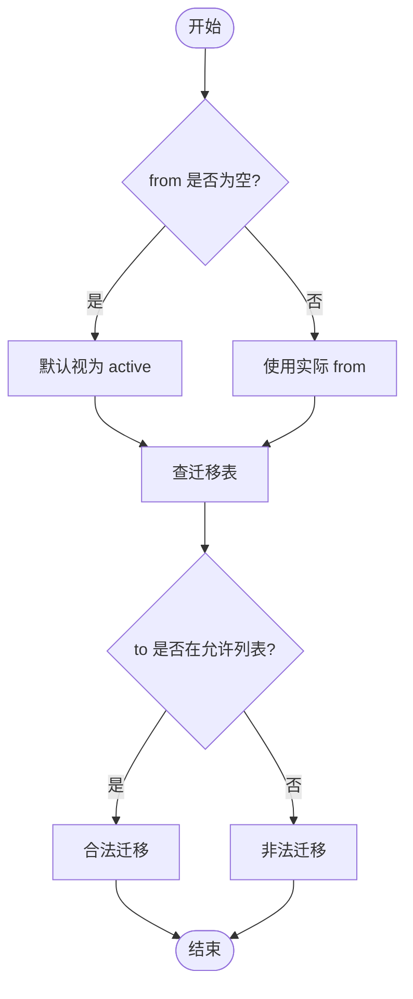
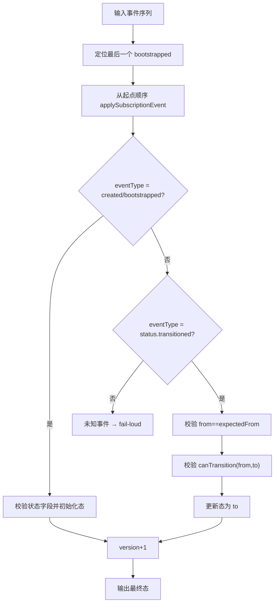
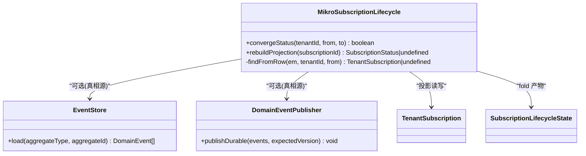
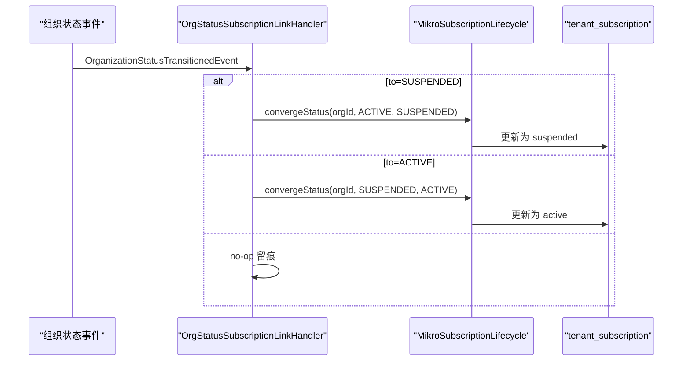
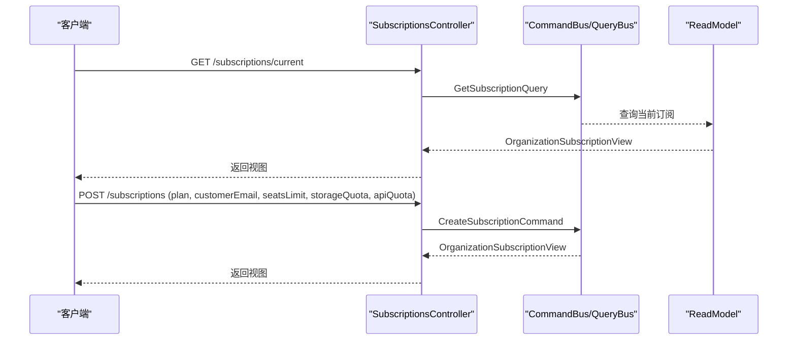
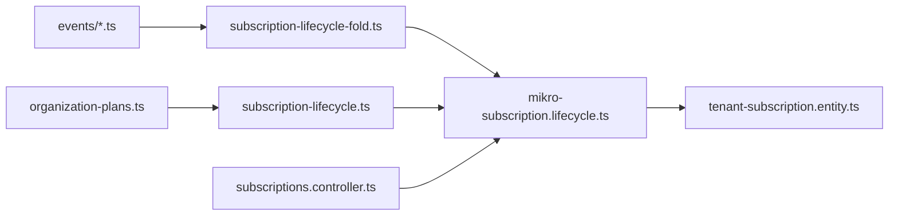

# 订阅生命周期管理

<cite>
**本文引用的文件**   
- [libs/core/src/modules/subscriptions/domain/subscription-lifecycle.ts](file://libs/core/src/modules/subscriptions/domain/subscription-lifecycle.ts)
- [libs/core/src/modules/subscriptions/domain/subscription-lifecycle-fold.ts](file://libs/core/src/modules/subscriptions/domain/subscription-lifecycle-fold.ts)
- [libs/core/src/modules/subscriptions/domain/events/subscription-created.event.ts](file://libs/core/src/modules/subscriptions/domain/events/subscription-created.event.ts)
- [libs/core/src/modules/subscriptions/domain/events/subscription-bootstrapped.event.ts](file://libs/core/src/modules/subscriptions/domain/events/subscription-bootstrapped.event.ts)
- [libs/core/src/modules/subscriptions/domain/events/subscription-status-transitioned.event.ts](file://libs/core/src/modules/subscriptions/domain/events/subscription-status-transitioned.event.ts)
- [libs/core/src/modules/subscriptions/quota/organization-plans.ts](file://libs/core/src/modules/subscriptions/quota/organization-plans.ts)
- [apps/api/src/modules/subscriptions/api/subscriptions.controller.ts](file://apps/api/src/modules/subscriptions/api/subscriptions.controller.ts)
- [apps/api/src/modules/subscriptions/infrastructure/mikro-subscription.lifecycle.ts](file://apps/api/src/modules/subscriptions/infrastructure/mikro-subscription.lifecycle.ts)
- [apps/api/src/modules/subscriptions/infrastructure/entities/tenant-subscription.entity.ts](file://apps/api/src/modules/subscriptions/infrastructure/entities/tenant-subscription.entity.ts)
- [apps/api/src/modules/subscriptions/infrastructure/dispatchers/org-status-subscription-link.handler.ts](file://apps/api/src/modules/subscriptions/infrastructure/dispatchers/org-status-subscription-link.handler.ts)
</cite>

## 目录
1. [引言](#引言)
2. [项目结构](#项目结构)
3. [核心组件](#核心组件)
4. [架构总览](#架构总览)
5. [详细组件分析](#详细组件分析)
6. [依赖关系分析](#依赖关系分析)
7. [性能与一致性考虑](#性能与一致性考虑)
8. [故障排查指南](#故障排查指南)
9. [结论](#结论)

## 引言
本文面向订阅生命周期管理，聚焦以下目标：
- 明确订阅状态转换机制与合法迁移路径。
- 解释事件溯源模式在订阅状态管理中的应用，包括事件生成、存储与重放。
- 描述订阅投影更新策略，确保数据库状态与事件流一致。
- 给出订阅生命周期配置、状态验证规则、异常处理机制。
- 提供订阅状态转换的 API 接口示例与故障排查建议。

本仓库中订阅能力由领域层（libs/core）定义状态机与事件模型，应用层通过命令/查询总线暴露 HTTP 接口；基础设施层使用 MikroORM 维护投影表，并在开启“真相源”时以事件流为权威来源，投影仅作为读侧快照。

## 项目结构
订阅相关代码分布在两个主要区域：
- 领域与事件（libs/core）：定义订阅状态、合法迁移、事件类型与折叠回放逻辑。
- 应用与基础设施（apps/api）：控制器暴露 API，MikroORM 实现订阅生命周期收敛与投影重建，组织状态变更联动订阅挂起/恢复。

图表来源
- [libs/core/src/modules/subscriptions/domain/subscription-lifecycle.ts:18-69](file://libs/core/src/modules/subscriptions/domain/subscription-lifecycle.ts#L18-L69)
- [libs/core/src/modules/subscriptions/domain/subscription-lifecycle-fold.ts:121-136](file://libs/core/src/modules/subscriptions/domain/subscription-lifecycle-fold.ts#L121-L136)
- [libs/core/src/modules/subscriptions/domain/events/subscription-status-transitioned.event.ts:31-52](file://libs/core/src/modules/subscriptions/domain/events/subscription-status-transitioned.event.ts#L31-L52)
- [apps/api/src/modules/subscriptions/api/subscriptions.controller.ts:42-90](file://apps/api/src/modules/subscriptions/api/subscriptions.controller.ts#L42-L90)
- [apps/api/src/modules/subscriptions/infrastructure/mikro-subscription.lifecycle.ts:45-156](file://apps/api/src/modules/subscriptions/infrastructure/mikro-subscription.lifecycle.ts#L45-L156)
- [apps/api/src/modules/subscriptions/infrastructure/entities/tenant-subscription.entity.ts:19-45](file://apps/api/src/modules/subscriptions/infrastructure/entities/tenant-subscription.entity.ts#L19-L45)

章节来源
- [apps/api/src/modules/subscriptions/api/subscriptions.controller.ts:19-35](file://apps/api/src/modules/subscriptions/api/subscriptions.controller.ts#L19-L35)
- [apps/api/src/modules/subscriptions/infrastructure/mikro-subscription.lifecycle.ts:25-44](file://apps/api/src/modules/subscriptions/infrastructure/mikro-subscription.lifecycle.ts#L25-L44)

## 核心组件
- 订阅状态与迁移规则：集中定义状态值与合法迁移边，供写端裁决与读侧重放校验。
- 事件模型：包含创建、存量启动、状态迁移三类事件，统一聚合类型为 subscription。
- 折叠回放器：纯函数将事件序列折叠为当前态，支持“最后快照重启”，并严格校验 from/to 漂移与非法迁移。
- 订阅生命周期实现：按租户维度查找最新 from 行，执行幂等收敛；可切换至“真相源”模式，以事件流为权威，投影同步更新。
- 控制器与联动处理器：对外暴露创建/读取接口；监听组织状态变更，联动订阅挂起/恢复。

章节来源
- [libs/core/src/modules/subscriptions/domain/subscription-lifecycle.ts:18-69](file://libs/core/src/modules/subscriptions/domain/subscription-lifecycle.ts#L18-L69)
- [libs/core/src/modules/subscriptions/domain/subscription-lifecycle-fold.ts:35-42](file://libs/core/src/modules/subscriptions/domain/subscription-lifecycle-fold.ts#L35-L42)
- [libs/core/src/modules/subscriptions/domain/events/subscription-created.event.ts:19-30](file://libs/core/src/modules/subscriptions/domain/events/subscription-created.event.ts#L19-L30)
- [libs/core/src/modules/subscriptions/domain/events/subscription-bootstrapped.event.ts:19-30](file://libs/core/src/modules/subscriptions/domain/events/subscription-bootstrapped.event.ts#L19-L30)
- [libs/core/src/modules/subscriptions/domain/events/subscription-status-transitioned.event.ts:21-30](file://libs/core/src/modules/subscriptions/domain/events/subscription-status-transitioned.event.ts#L21-L30)
- [apps/api/src/modules/subscriptions/infrastructure/mikro-subscription.lifecycle.ts:69-134](file://apps/api/src/modules/subscriptions/infrastructure/mikro-subscription.lifecycle.ts#L69-L134)

## 架构总览
订阅生命周期采用“事件溯源 + 投影”的双轨设计：
- 写路径：调用 convergeStatus → 根据 truthSource 开关选择直接投影更新或先追加事件到事件流，再回写投影。
- 读路径：replaySubscriptionLifecycle 从事件流折叠出当前态；当 truthSource=true 时，该态即为权威状态。
- 联动：组织状态变化触发订阅挂起/恢复，保持平台治理与计费状态一致。

图表来源
- [apps/api/src/modules/subscriptions/api/subscriptions.controller.ts:66-89](file://apps/api/src/modules/subscriptions/api/subscriptions.controller.ts#L66-L89)
- [apps/api/src/modules/subscriptions/infrastructure/mikro-subscription.lifecycle.ts:69-134](file://apps/api/src/modules/subscriptions/infrastructure/mikro-subscription.lifecycle.ts#L69-L134)
- [libs/core/src/modules/subscriptions/domain/subscription-lifecycle-fold.ts:121-136](file://libs/core/src/modules/subscriptions/domain/subscription-lifecycle-fold.ts#L121-L136)

## 详细组件分析

### 订阅状态与合法迁移
- 状态集合：active、suspended、expired、cancelled。
- 合法迁移：
  - active → suspended/expired/cancelled
  - suspended → active/expired/cancelled
  - expired/cancelled 为终态，不接受任何迁移。
- 无状态记录（空流起点）按 active 对待，保证与现有租户状态语义一致。

图表来源
- [libs/core/src/modules/subscriptions/domain/subscription-lifecycle.ts:41-69](file://libs/core/src/modules/subscriptions/domain/subscription-lifecycle.ts#L41-L69)

章节来源
- [libs/core/src/modules/subscriptions/domain/subscription-lifecycle.ts:18-69](file://libs/core/src/modules/subscriptions/domain/subscription-lifecycle.ts#L18-L69)
- [libs/core/src/modules/subscriptions/quota/organization-plans.ts:22-34](file://libs/core/src/modules/subscriptions/quota/organization-plans.ts#L22-L34)

### 事件溯源与折叠回放
- 事件类型：
  - subscription.created：实时创建的流起点，携带 plan/status/actorId。
  - subscription.bootstrapped：存量数据成流的快照起点，携带 status/plan/actorId。
  - subscription.status.transitioned：状态迁移事件，携带 from/to/actorId/reason。
- 折叠规则：
  - 最后快照重启：若存在 bootstrapped，以其最后一次出现为起点折叠，不重排历史。
  - 漂移校验：transitioned 事件的 from 必须等于重放态，否则 fail-loud。
  - 迁移合法性：对 to 进行 canTransition 校验，非法迁移 fail-loud。
  - 未知 eventType 或非 subscription 聚合：fail-loud。

图表来源
- [libs/core/src/modules/subscriptions/domain/subscription-lifecycle-fold.ts:59-108](file://libs/core/src/modules/subscriptions/domain/subscription-lifecycle-fold.ts#L59-L108)
- [libs/core/src/modules/subscriptions/domain/subscription-lifecycle-fold.ts:121-136](file://libs/core/src/modules/subscriptions/domain/subscription-lifecycle-fold.ts#L121-L136)

章节来源
- [libs/core/src/modules/subscriptions/domain/events/subscription-created.event.ts:19-30](file://libs/core/src/modules/subscriptions/domain/events/subscription-created.event.ts#L19-L30)
- [libs/core/src/modules/subscriptions/domain/events/subscription-bootstrapped.event.ts:19-30](file://libs/core/src/modules/subscriptions/domain/events/subscription-bootstrapped.event.ts#L19-L30)
- [libs/core/src/modules/subscriptions/domain/events/subscription-status-transitioned.event.ts:21-30](file://libs/core/src/modules/subscriptions/domain/events/subscription-status-transitioned.event.ts#L21-L30)
- [libs/core/src/modules/subscriptions/domain/subscription-lifecycle-fold.ts:12-34](file://libs/core/src/modules/subscriptions/domain/subscription-lifecycle-fold.ts#L12-L34)

### 订阅生命周期实现（投影与真相源）
- 非真相源模式（缺省）：
  - 按 tenantId + from 状态查找最新一行，存在则更新为 to，并显式盖 updatedAt。
  - 不存在则返回 false，天然幂等。
- 真相源模式（truthSource=true）：
  - 要求装配 EventStore 与 DomainEventPublisher.publishDurable。
  - 流程：load 事件流 → replaySubscriptionLifecycle → canTransition(previous, to) → publishDurable([event], stream.length+1) → applySubscriptionEvent(next) → nativeUpdate 投影。
  - 乐观锁：expectedVersion=流长度+1，保证 append 连续性。
  - 投影更新：使用 fold 结果 next.status，而非直接写入 to，确保投影与事件流一致。
- 诊断面：rebuildProjection 可从事件流重建投影，空流不写，避免凭空造态。

图表来源
- [apps/api/src/modules/subscriptions/infrastructure/mikro-subscription.lifecycle.ts:45-156](file://apps/api/src/modules/subscriptions/infrastructure/mikro-subscription.lifecycle.ts#L45-L156)
- [libs/core/src/modules/subscriptions/domain/subscription-lifecycle-fold.ts:35-42](file://libs/core/src/modules/subscriptions/domain/subscription-lifecycle-fold.ts#L35-L42)

章节来源
- [apps/api/src/modules/subscriptions/infrastructure/mikro-subscription.lifecycle.ts:55-134](file://apps/api/src/modules/subscriptions/infrastructure/mikro-subscription.lifecycle.ts#L55-L134)
- [apps/api/src/modules/subscriptions/infrastructure/entities/tenant-subscription.entity.ts:19-45](file://apps/api/src/modules/subscriptions/infrastructure/entities/tenant-subscription.entity.ts#L19-L45)

### 组织状态与订阅联动
- 当组织状态变为 SUSPENDED：调用 lifecycle.convergeStatus(organizationId, ACTIVE, SUSPENDED)。
- 当组织状态变为 ACTIVE：调用 lifecycle.convergeStatus(organizationId, SUSPENDED, ACTIVE)，仅回收本次治理挂起的可恢复行，不回溯历史 cancelled/expired。
- 其他状态（deleted/pending_approval）：不做订阅联动，仅留观测日志。

图表来源
- [apps/api/src/modules/subscriptions/infrastructure/dispatchers/org-status-subscription-link.handler.ts:28-62](file://apps/api/src/modules/subscriptions/infrastructure/dispatchers/org-status-subscription-link.handler.ts#L28-L62)
- [apps/api/src/modules/subscriptions/infrastructure/mikro-subscription.lifecycle.ts:69-134](file://apps/api/src/modules/subscriptions/infrastructure/mikro-subscription.lifecycle.ts#L69-L134)

章节来源
- [apps/api/src/modules/subscriptions/infrastructure/dispatchers/org-status-subscription-link.handler.ts:28-62](file://apps/api/src/modules/subscriptions/infrastructure/dispatchers/org-status-subscription-link.handler.ts#L28-L62)

### API 接口与用法
- GET /subscriptions/current
  - 鉴权：TenantIsolationGuard（失败关闭）。
  - 功能：读取当前组织的有效订阅快照（套餐/席位配额/用量/客户映射）。
  - 返回：OrganizationSubscriptionView。
- POST /subscriptions
  - 鉴权：TenantIsolationGuard + AuthorizationGuard + @Can('update','Organization')。
  - 功能：开通/升级组织订阅（创建支付供应商客户并落席位/存储/API 配额）。
  - 输入：plan/customerEmail/seatsLimit/storageQuota/apiQuota。
  - 返回：OrganizationSubscriptionView。

图表来源
- [apps/api/src/modules/subscriptions/api/subscriptions.controller.ts:42-90](file://apps/api/src/modules/subscriptions/api/subscriptions.controller.ts#L42-L90)

章节来源
- [apps/api/src/modules/subscriptions/api/subscriptions.controller.ts:19-35](file://apps/api/src/modules/subscriptions/api/subscriptions.controller.ts#L19-L35)
- [apps/api/src/modules/subscriptions/api/subscriptions.controller.ts:49-89](file://apps/api/src/modules/subscriptions/api/subscriptions.controller.ts#L49-L89)

## 依赖关系分析
- 领域层依赖：
  - subscription-lifecycle.ts 依赖 quota/organization-plans.ts 中的 SubscriptionStatus 联合类型，保证状态值单源。
  - subscription-lifecycle-fold.ts 依赖事件类型常量与 canTransition，确保回放与迁移规则一致。
- 应用层依赖：
  - SubscriptionsController 依赖 CommandBus/QueryBus 与契约 schema。
  - MikroSubscriptionLifecycle 依赖 MikroOrmService、可选 EventStore/Publisher/UnitOfWork。
- 基础设施层依赖：
  - tenant-subscription.entity.ts 定义投影表结构与索引，支撑 findFromRow 与 nativeUpdate。

图表来源
- [libs/core/src/modules/subscriptions/quota/organization-plans.ts:22-34](file://libs/core/src/modules/subscriptions/quota/organization-plans.ts#L22-L34)
- [libs/core/src/modules/subscriptions/domain/subscription-lifecycle.ts:1-2](file://libs/core/src/modules/subscriptions/domain/subscription-lifecycle.ts#L1-L2)
- [libs/core/src/modules/subscriptions/domain/subscription-lifecycle-fold.ts:1-10](file://libs/core/src/modules/subscriptions/domain/subscription-lifecycle-fold.ts#L1-L10)
- [apps/api/src/modules/subscriptions/infrastructure/mikro-subscription.lifecycle.ts:1-23](file://apps/api/src/modules/subscriptions/infrastructure/mikro-subscription.lifecycle.ts#L1-L23)
- [apps/api/src/modules/subscriptions/infrastructure/entities/tenant-subscription.entity.ts:19-45](file://apps/api/src/modules/subscriptions/infrastructure/entities/tenant-subscription.entity.ts#L19-L45)
- [apps/api/src/modules/subscriptions/api/subscriptions.controller.ts:1-17](file://apps/api/src/modules/subscriptions/api/subscriptions.controller.ts#L1-L17)

章节来源
- [libs/core/src/modules/subscriptions/domain/subscription-lifecycle.ts:1-2](file://libs/core/src/modules/subscriptions/domain/subscription-lifecycle.ts#L1-L2)
- [libs/core/src/modules/subscriptions/domain/subscription-lifecycle-fold.ts:1-10](file://libs/core/src/modules/subscriptions/domain/subscription-lifecycle-fold.ts#L1-L10)
- [apps/api/src/modules/subscriptions/infrastructure/mikro-subscription.lifecycle.ts:1-23](file://apps/api/src/modules/subscriptions/infrastructure/mikro-subscription.lifecycle.ts#L1-L23)

## 性能与一致性考虑
- 投影查询优化：
  - tenant_subscription 表对 (tenantId, status) 与 (tenantId, periodStart) 建立索引，加速 findFromRow 与周期查询。
- 幂等性：
  - convergeStatus 在无 from 行时返回 false，重复事件不写，满足 at-least-once 幂等要求。
- 真相源一致性：
  - 乐观锁 expectedVersion=stream.length+1，防止并发覆盖。
  - 投影更新使用 applySubscriptionEvent(next) 的结果，避免手写 to 导致漂移。
- 回放效率：
  - 最后快照重启减少无效历史回放，提升 bootstrap 场景下的回放速度。

章节来源
- [apps/api/src/modules/subscriptions/infrastructure/entities/tenant-subscription.entity.ts:38-41](file://apps/api/src/modules/subscriptions/infrastructure/entities/tenant-subscription.entity.ts#L38-L41)
- [apps/api/src/modules/subscriptions/infrastructure/mikro-subscription.lifecycle.ts:75-87](file://apps/api/src/modules/subscriptions/infrastructure/mikro-subscription.lifecycle.ts#L75-L87)
- [apps/api/src/modules/subscriptions/infrastructure/mikro-subscription.lifecycle.ts:122-130](file://apps/api/src/modules/subscriptions/infrastructure/mikro-subscription.lifecycle.ts#L122-L130)
- [libs/core/src/modules/subscriptions/domain/subscription-lifecycle-fold.ts:114-116](file://libs/core/src/modules/subscriptions/domain/subscription-lifecycle-fold.ts#L114-L116)

## 故障排查指南
- 现象：订阅状态未更新
  - 检查是否存在 from 行；若无，convergeStatus 返回 false。
  - 确认 truthSource 开关与 EventStore/Publisher 装配是否正确。
- 现象：真相源模式下抛出需装配错误
  - 当 ES_TRUTH_SOURCE_SUBSCRIPTIONS=true 但未装配 EVENT_STORE 或未实现 publishDurable，会抛出错误。
- 现象：回放失败（fail-loud）
  - 检查事件 from 是否与重放态一致；不一致将抛错。
  - 检查 to 是否合法迁移；非法迁移将抛错。
  - 检查 eventType 是否注册；未知事件将抛错。
- 现象：组织状态变更后订阅未联动
  - 检查组织状态事件是否到达处理器；确认 to 为 SUSPENDED/ACTIVE 分支。
  - 查看日志中 tenant.suspended/active → 订阅联动 的输出。

章节来源
- [apps/api/src/modules/subscriptions/infrastructure/mikro-subscription.lifecycle.ts:90-97](file://apps/api/src/modules/subscriptions/infrastructure/mikro-subscription.lifecycle.ts#L90-L97)
- [libs/core/src/modules/subscriptions/domain/subscription-lifecycle-fold.ts:91-107](file://libs/core/src/modules/subscriptions/domain/subscription-lifecycle-fold.ts#L91-L107)
- [apps/api/src/modules/subscriptions/infrastructure/dispatchers/org-status-subscription-link.handler.ts:30-61](file://apps/api/src/modules/subscriptions/infrastructure/dispatchers/org-status-subscription-link.handler.ts#L30-L61)

## 结论
订阅生命周期管理在本仓库中实现了清晰的状态机与事件溯源双轨：
- 状态机定义简洁且严格，确保 only valid transitions are allowed。
- 事件溯源提供可审计、可重放的真相源，投影仅作为读侧快照。
- 组织状态与订阅状态联动，保障平台治理与计费一致性。
- API 层通过严格的鉴权与隔离守卫，保护订阅操作安全。
- 通过索引、幂等与乐观锁，兼顾性能与一致性。