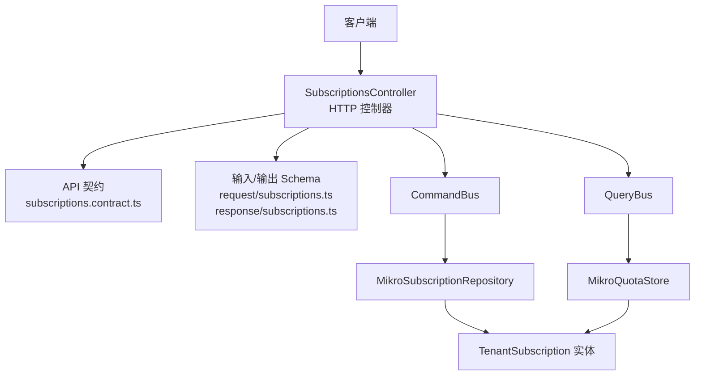
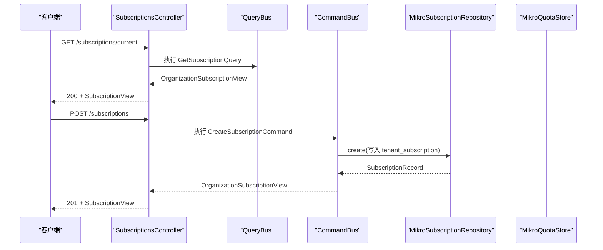
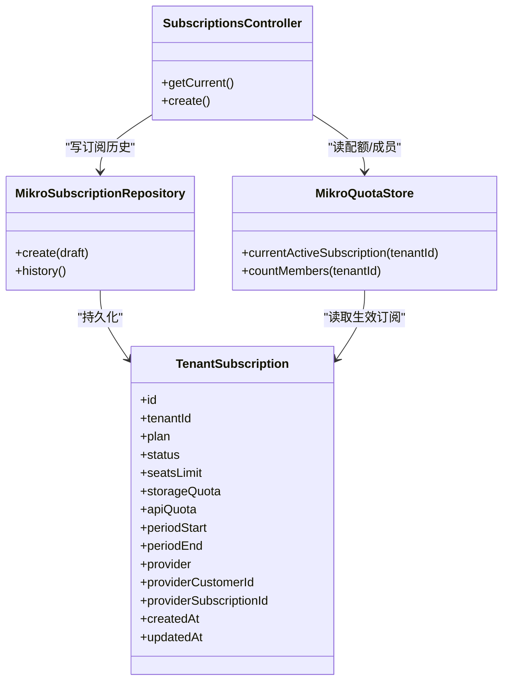

# 订阅管理 API

<cite>
**本文引用的文件**   
- [apps/api/src/modules/subscriptions/api/subscriptions.controller.ts](file://apps/api/src/modules/subscriptions/api/subscriptions.controller.ts)
- [libs/api-contract/src/subscriptions.contract.ts](file://libs/api-contract/src/subscriptions.contract.ts)
- [libs/contracts/src/request/subscriptions.ts](file://libs/contracts/src/request/subscriptions.ts)
- [libs/contracts/src/response/subscriptions.ts](file://libs/contracts/src/response/subscriptions.ts)
- [apps/api/src/modules/subscriptions/api/response/subscription.response.ts](file://apps/api/src/modules/subscriptions/api/response/subscription.response.ts)
- [apps/api/src/modules/subscriptions/infrastructure/entities/tenant-subscription.entity.ts](file://apps/api/src/modules/subscriptions/infrastructure/entities/tenant-subscription.entity.ts)
- [apps/api/src/modules/subscriptions/infrastructure/repositories/mikro-subscription.repository.ts](file://apps/api/src/modules/subscriptions/infrastructure/repositories/mikro-subscription.repository.ts)
- [apps/api/src/modules/subscriptions/infrastructure/mikro-quota.store.ts](file://apps/api/src/modules/subscriptions/infrastructure/mikro-quota.store.ts)
- [libs/core/src/modules/subscriptions/domain/subscription-lifecycle.ts](file://libs/core/src/modules/subscriptions/domain/subscription-lifecycle.ts)
</cite>

## 目录
1. [简介](#简介)
2. [项目结构](#项目结构)
3. [核心组件](#核心组件)
4. [架构总览](#架构总览)
5. [详细接口说明](#详细接口说明)
6. [依赖关系分析](#依赖关系分析)
7. [性能与一致性](#性能与一致性)
8. [错误处理与排障](#错误处理与排障)
9. [版本管理与兼容性](#版本管理与兼容性)
10. [迁移指南](#迁移指南)
11. [结论](#结论)

## 简介
本文件面向订阅管理域，提供完整的 RESTful API 文档。该能力用于为租户开通、升级或查询组织订阅，并返回套餐档位、席位配额、用量与支付通道客户映射等关键信息。API 采用 CQRS 风格：控制器通过命令总线与查询总线调用领域应用层；数据访问由仓储与配额存储实现；权限与租户隔离由守卫统一拦截。

## 项目结构
订阅管理相关代码分布在以下位置：
- HTTP 控制器：`apps/api/src/modules/subscriptions/api/subscriptions.controller.ts`
- API 契约（OpenAPI 元信息与 procedure 契约）：`libs/api-contract/src/subscriptions.contract.ts`
- 请求/响应 schema（Zod 单源）：`libs/contracts/src/request/subscriptions.ts`、`libs/contracts/src/response/subscriptions.ts`
- 持久化实体与仓储：`apps/api/src/modules/subscriptions/infrastructure/entities/tenant-subscription.entity.ts`、`apps/api/src/modules/subscriptions/infrastructure/repositories/mikro-subscription.repository.ts`
- 配额读取与成员计数：`apps/api/src/modules/subscriptions/infrastructure/mikro-quota.store.ts`
- 订阅状态词汇：`libs/core/src/modules/subscriptions/domain/subscription-lifecycle.ts`

**图表来源**
- [apps/api/src/modules/subscriptions/api/subscriptions.controller.ts:42-90](file://apps/api/src/modules/subscriptions/api/subscriptions.controller.ts#L42-L90)
- [libs/api-contract/src/subscriptions.contract.ts:12-30](file://libs/api-contract/src/subscriptions.contract.ts#L12-L30)
- [libs/contracts/src/request/subscriptions.ts:25-31](file://libs/contracts/src/request/subscriptions.ts#L25-L31)
- [libs/contracts/src/response/subscriptions.ts:8-21](file://libs/contracts/src/response/subscriptions.ts#L8-L21)
- [apps/api/src/modules/subscriptions/infrastructure/repositories/mikro-subscription.repository.ts:29-87](file://apps/api/src/modules/subscriptions/infrastructure/repositories/mikro-subscription.repository.ts#L29-L87)
- [apps/api/src/modules/subscriptions/infrastructure/mikro-quota.store.ts:26-79](file://apps/api/src/modules/subscriptions/infrastructure/mikro-quota.store.ts#L26-L79)
- [apps/api/src/modules/subscriptions/infrastructure/entities/tenant-subscription.entity.ts:19-45](file://apps/api/src/modules/subscriptions/infrastructure/entities/tenant-subscription.entity.ts#L19-L45)

**章节来源**
- [apps/api/src/modules/subscriptions/api/subscriptions.controller.ts:42-90](file://apps/api/src/modules/subscriptions/api/subscriptions.controller.ts#L42-L90)
- [libs/api-contract/src/subscriptions.contract.ts:12-30](file://libs/api-contract/src/subscriptions.contract.ts#L12-L30)

## 核心组件
- SubscriptionsController：暴露两个 HTTP 端点，分别用于“获取当前订阅”和“创建/升级订阅”。
- API 契约：定义 OpenAPI 元信息（方法、路径、成功码）与 procedure 的输入/输出 schema。
- 请求/响应 Schema：使用 Zod 定义入参与出参结构，保证前后端类型一致。
- 仓储与配额存储：基于 MikroORM 的订阅历史读写与会话配额读取。
- 实体模型：tenant_subscription 表结构与列元数据。
- 订阅状态：active/suspended/expired/cancelled 等状态词源。

**章节来源**
- [apps/api/src/modules/subscriptions/api/subscriptions.controller.ts:42-90](file://apps/api/src/modules/subscriptions/api/subscriptions.controller.ts#L42-L90)
- [libs/api-contract/src/subscriptions.contract.ts:12-30](file://libs/api-contract/src/subscriptions.contract.ts#L12-L30)
- [libs/contracts/src/request/subscriptions.ts:25-31](file://libs/contracts/src/request/subscriptions.ts#L25-L31)
- [libs/contracts/src/response/subscriptions.ts:8-21](file://libs/contracts/src/response/subscriptions.ts#L8-L21)
- [apps/api/src/modules/subscriptions/infrastructure/repositories/mikro-subscription.repository.ts:29-87](file://apps/api/src/modules/subscriptions/infrastructure/repositories/mikro-subscription.repository.ts#L29-L87)
- [apps/api/src/modules/subscriptions/infrastructure/mikro-quota.store.ts:26-79](file://apps/api/src/modules/subscriptions/infrastructure/mikro-quota.store.ts#L26-L79)
- [apps/api/src/modules/subscriptions/infrastructure/entities/tenant-subscription.entity.ts:19-45](file://apps/api/src/modules/subscriptions/infrastructure/entities/tenant-subscription.entity.ts#L19-L45)
- [libs/core/src/modules/subscriptions/domain/subscription-lifecycle.ts:18-23](file://libs/core/src/modules/subscriptions/domain/subscription-lifecycle.ts#L18-L23)

## 架构总览
订阅管理 API 的请求处理流程如下：
- 客户端发起 HTTP 请求到控制器。
- 控制器先经过租户隔离守卫与授权守卫校验。
- 读操作通过查询总线执行查询对象，写操作通过命令总线执行命令对象。
- 仓储负责订阅记录的持久化；配额存储负责读取生效订阅与成员计数。
- 最终返回统一的订阅视图（包含是否有效订阅、套餐、席位上限、已用与剩余、支付通道客户 id）。

**图表来源**
- [apps/api/src/modules/subscriptions/api/subscriptions.controller.ts:53-64](file://apps/api/src/modules/subscriptions/api/subscriptions.controller.ts#L53-L64)
- [apps/api/src/modules/subscriptions/api/subscriptions.controller.ts:70-89](file://apps/api/src/modules/subscriptions/api/subscriptions.controller.ts#L70-L89)
- [apps/api/src/modules/subscriptions/infrastructure/repositories/mikro-subscription.repository.ts:56-77](file://apps/api/src/modules/subscriptions/infrastructure/repositories/mikro-subscription.repository.ts#L56-L77)

## 详细接口说明

### 获取当前订阅
- 方法与路径：GET `/subscriptions/current`
- 认证与授权：需要有效的会话上下文；自动注入当前租户（租户隔离守卫），无需显式组织级权限。
- 请求参数：无
- 响应体：SubscriptionView（见下方字段说明）
- 成功状态码：200
- 行为说明：返回当前租户的有效订阅快照；若无有效订阅，则回退到免费档位的默认配额。

**章节来源**
- [libs/api-contract/src/subscriptions.contract.ts:12-16](file://libs/api-contract/src/subscriptions.contract.ts#L12-L16)
- [apps/api/src/modules/subscriptions/api/subscriptions.controller.ts:53-64](file://apps/api/src/modules/subscriptions/api/subscriptions.controller.ts#L53-L64)
- [libs/contracts/src/response/subscriptions.ts:8-21](file://libs/contracts/src/response/subscriptions.ts#L8-L21)

### 创建/升级订阅
- 方法与路径：POST `/subscriptions`
- 认证与授权：需要有效的会话上下文；同时要求具备组织的 `update` 权限（组织所有者或管理员）。
- 请求体：CreateSubscription（见下方字段说明）
- 响应体：SubscriptionView（见下方字段说明）
- 成功状态码：201
- 行为说明：根据传入档位与配额创建或升级订阅；必要时建立支付通道客户映射；落库后返回最新订阅视图。

**章节来源**
- [libs/api-contract/src/subscriptions.contract.ts:17-22](file://libs/api-contract/src/subscriptions.contract.ts#L17-L22)
- [apps/api/src/modules/subscriptions/api/subscriptions.controller.ts:70-89](file://apps/api/src/modules/subscriptions/api/subscriptions.controller.ts#L70-L89)
- [libs/contracts/src/request/subscriptions.ts:25-31](file://libs/contracts/src/request/subscriptions.ts#L25-L31)
- [libs/contracts/src/response/subscriptions.ts:8-21](file://libs/contracts/src/response/subscriptions.ts#L8-L21)

### 请求体：CreateSubscription
| 字段 | 类型 | 必填 | 约束 | 说明 |
| --- | --- | --- | --- | --- |
| plan | string | 是 | 枚举值：free、pro、enterprise | 订阅档位标识 |
| customerEmail | string | 是 | 合法邮箱格式，长度不超过 254 | 支付通道侧客户邮箱 |
| seatsLimit | number | 否 | 整数且 ≥ 1 | 席位上限；未传时按档位目录默认值 |
| storageQuota | number | 否 | 整数且 ≥ 0 | 存储配额；未传时按档位目录默认值 |
| apiQuota | number | 否 | 整数且 ≥ 0 | API 配额；未传时按档位目录默认值 |

**章节来源**
- [libs/contracts/src/request/subscriptions.ts:14-31](file://libs/contracts/src/request/subscriptions.ts#L14-L31)

### 响应体：SubscriptionView
| 字段 | 类型 | 说明 |
| --- | --- | --- |
| hasSubscription | boolean | 是否存在有效订阅 |
| plan | string | 生效档位 plan key（无订阅时回落 FREE_PLAN） |
| seatsLimit | number | 座位上限 |
| used | number | 已用座位（= 成员数，实时计算） |
| remaining | number | 剩余座位 |
| providerCustomerId | string \| null | 支付通道 customer id；无订阅时为 null |

**章节来源**
- [libs/contracts/src/response/subscriptions.ts:8-21](file://libs/contracts/src/response/subscriptions.ts#L8-L21)
- [apps/api/src/modules/subscriptions/api/response/subscription.response.ts:13-41](file://apps/api/src/modules/subscriptions/api/response/subscription.response.ts#L13-L41)

### 错误码与异常
- 401/403：未认证或缺少组织更新权限（AuthorizationGuard 拒绝）。
- 403：缺少活跃租户上下文（TenantIsolationGuard fail-closed）。
- 422：请求体验证失败（Zod schema 校验不通过）。
- 5xx：服务端内部错误（如外部支付通道不可用等）。

**章节来源**
- [apps/api/src/modules/subscriptions/api/subscriptions.controller.ts:53-71](file://apps/api/src/modules/subscriptions/api/subscriptions.controller.ts#L53-L71)
- [libs/contracts/src/request/subscriptions.ts:25-31](file://libs/contracts/src/request/subscriptions.ts#L25-L31)

## 依赖关系分析
订阅管理 API 的关键依赖关系如下：
- 控制器依赖 CommandBus/QueryBus 进行领域调用。
- 仓储依赖 MikroOrmService 与 TenantIsolationService，确保在正确的租户上下文中写订阅历史。
- 配额存储依赖 MikroOrmService，读取生效订阅与成员数量。
- 实体模型定义 tenant_subscription 表的列与索引，并启用租户隔离过滤器。
- 订阅状态词汇集中管理，避免漂移。

**图表来源**
- [apps/api/src/modules/subscriptions/api/subscriptions.controller.ts:42-90](file://apps/api/src/modules/subscriptions/api/subscriptions.controller.ts#L42-L90)
- [apps/api/src/modules/subscriptions/infrastructure/repositories/mikro-subscription.repository.ts:29-87](file://apps/api/src/modules/subscriptions/infrastructure/repositories/mikro-subscription.repository.ts#L29-L87)
- [apps/api/src/modules/subscriptions/infrastructure/mikro-quota.store.ts:26-79](file://apps/api/src/modules/subscriptions/infrastructure/mikro-quota.store.ts#L26-L79)
- [apps/api/src/modules/subscriptions/infrastructure/entities/tenant-subscription.entity.ts:19-65](file://apps/api/src/modules/subscriptions/infrastructure/entities/tenant-subscription.entity.ts#L19-L65)

**章节来源**
- [apps/api/src/modules/subscriptions/api/subscriptions.controller.ts:42-90](file://apps/api/src/modules/subscriptions/api/subscriptions.controller.ts#L42-L90)
- [apps/api/src/modules/subscriptions/infrastructure/repositories/mikro-subscription.repository.ts:29-87](file://apps/api/src/modules/subscriptions/infrastructure/repositories/mikro-subscription.repository.ts#L29-L87)
- [apps/api/src/modules/subscriptions/infrastructure/mikro-quota.store.ts:26-79](file://apps/api/src/modules/subscriptions/infrastructure/mikro-quota.store.ts#L26-L79)
- [apps/api/src/modules/subscriptions/infrastructure/entities/tenant-subscription.entity.ts:19-65](file://apps/api/src/modules/subscriptions/infrastructure/entities/tenant-subscription.entity.ts#L19-L65)

## 性能与一致性
- 仓储每次 fork 独立 EntityManager，避免共享连接导致的并发问题。
- 订阅历史按 periodStart 倒序查询，便于快速定位最近生效记录。
- 配额读取走 QuotaStore，成员计数基于 live 表 count，减少物化列不一致风险。
- 订阅状态机与配额逻辑解耦，便于扩展与测试。

[本节为通用指导，不直接分析具体文件]

## 错误处理与排障
- 租户隔离失败：检查请求是否携带有效会话与租户上下文。
- 权限不足：确认调用者对目标组织具有 update 权限。
- 请求体验证失败：核对 plan 是否为允许枚举、customerEmail 是否为合法邮箱、配额字段是否为非负整数。
- 配额超限：席位超限时应拒绝新增成员；可通过 QuotaService 的 checkSeats 语义判断。

**章节来源**
- [apps/api/src/modules/subscriptions/api/subscriptions.controller.ts:53-71](file://apps/api/src/modules/subscriptions/api/subscriptions.controller.ts#L53-L71)
- [libs/contracts/src/request/subscriptions.ts:25-31](file://libs/contracts/src/request/subscriptions.ts#L25-L31)

## 版本管理与兼容性
- API 契约集中在 `libs/api-contract/src/subscriptions.contract.ts`，OpenAPI 元信息（方法、路径、成功码）在此维护。
- 输入/输出 schema 集中在 `libs/contracts`，通过 zod 保证前后端类型一致。
- 向后兼容策略：
  - 新增可选字段（如配额覆盖字段）不影响现有调用方。
  - 保留旧字段与行为，逐步废弃需通过变更日志与迁移步骤。
  - 状态词与档位枚举保持单源，避免漂移。

**章节来源**
- [libs/api-contract/src/subscriptions.contract.ts:12-30](file://libs/api-contract/src/subscriptions.contract.ts#L12-L30)
- [libs/contracts/src/request/subscriptions.ts:25-31](file://libs/contracts/src/request/subscriptions.ts#L25-L31)
- [libs/contracts/src/response/subscriptions.ts:8-21](file://libs/contracts/src/response/subscriptions.ts#L8-L21)
- [libs/core/src/modules/subscriptions/domain/subscription-lifecycle.ts:18-23](file://libs/core/src/modules/subscriptions/domain/subscription-lifecycle.ts#L18-L23)

## 迁移指南
- 计费单位从 organization 上移至 tenant：
  - 新表 tenant_subscription 替代旧的 organization_subscription。
  - 仓储与配额存储均改为以 tenantId 为锚点进行读写与聚合。
  - 存量数据通过回填工件进行 1:1 骨架对偶搬入。
- 订阅状态与生命周期：
  - 使用统一的 SUBSCRIPTION_STATUS 词源，确保状态机一致性。
- 配额与成员计数：
  - 席位真相回归 live 的 tenant_membership 计数，避免触发器物化列不一致。

**章节来源**
- [apps/api/src/modules/subscriptions/infrastructure/entities/tenant-subscription.entity.ts:5-16](file://apps/api/src/modules/subscriptions/infrastructure/entities/tenant-subscription.entity.ts#L5-L16)
- [apps/api/src/modules/subscriptions/infrastructure/repositories/mikro-subscription.repository.ts:14-28](file://apps/api/src/modules/subscriptions/infrastructure/repositories/mikro-subscription.repository.ts#L14-L28)
- [apps/api/src/modules/subscriptions/infrastructure/mikro-quota.store.ts:16-25](file://apps/api/src/modules/subscriptions/infrastructure/mikro-quota.store.ts#L16-L25)
- [libs/core/src/modules/subscriptions/domain/subscription-lifecycle.ts:18-23](file://libs/core/src/modules/subscriptions/domain/subscription-lifecycle.ts#L18-L23)

## 结论
订阅管理 API 通过清晰的控制器、契约与 schema 分层，结合仓储与配额存储，实现了安全的租户隔离与权限控制。API 设计遵循单一职责与最小暴露原则，便于扩展与维护。建议在集成时严格遵循请求体验证与错误处理最佳实践，并在迁移过程中关注计费单位上移与配额真相源的变更。