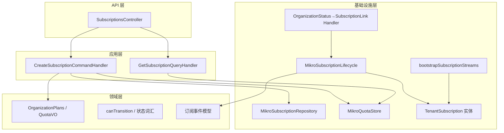
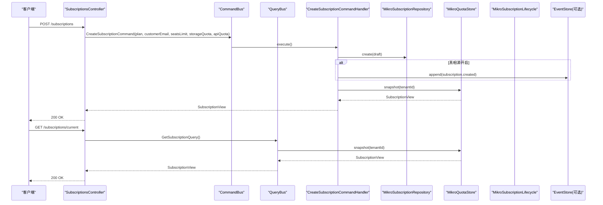
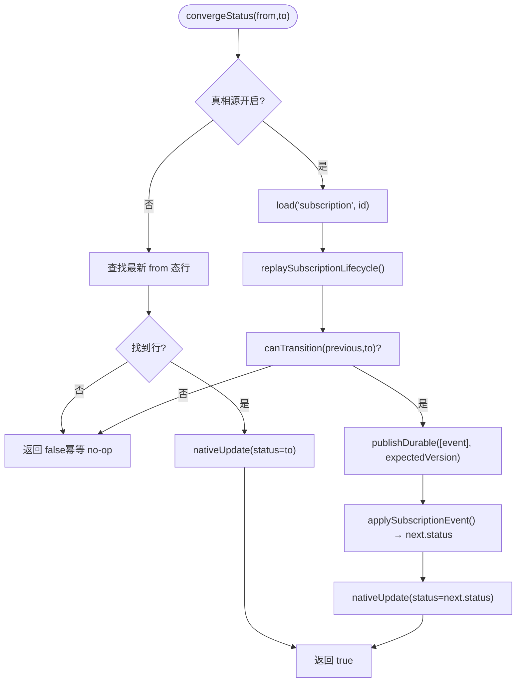
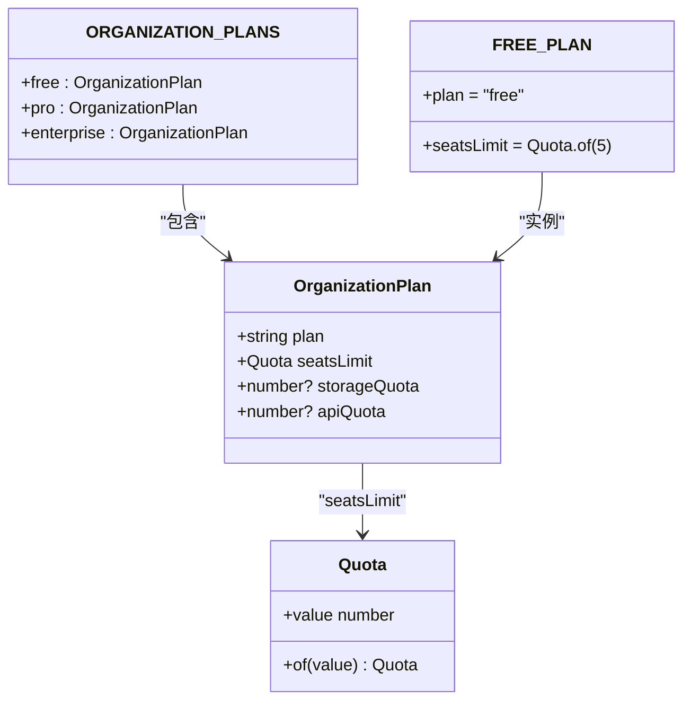
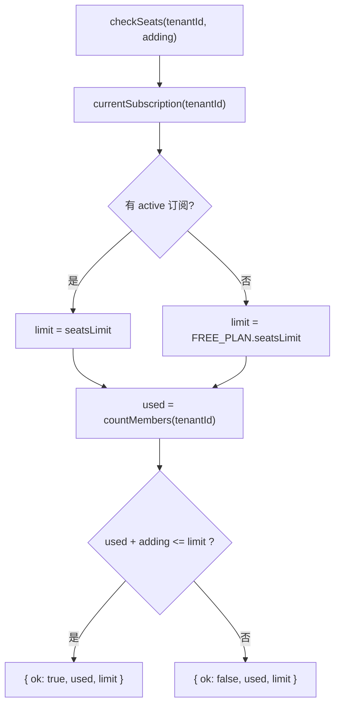
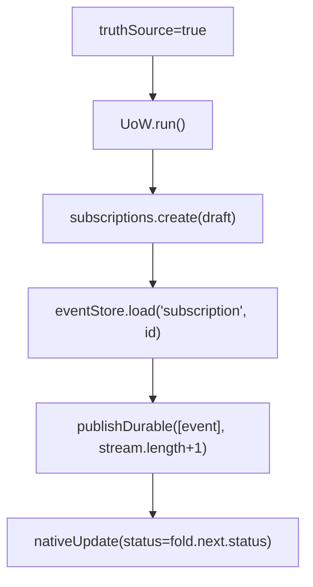
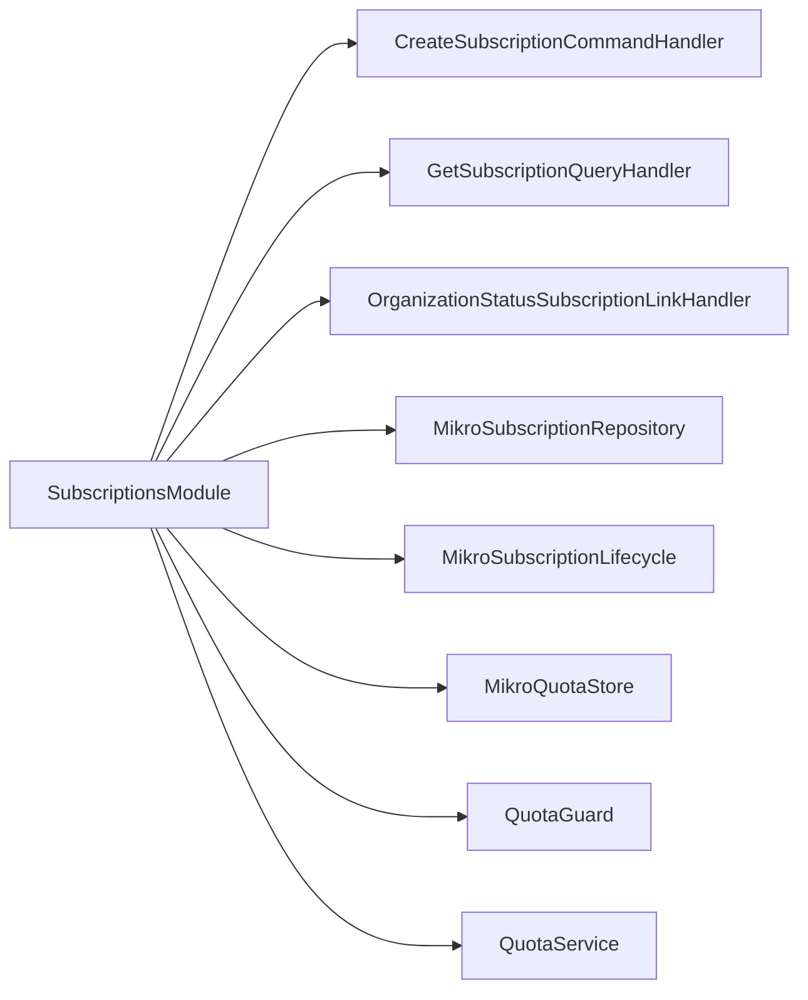

# 订阅管理

<cite>
**本文引用的文件**   
- [subscriptions.module.ts](file://apps/api/src/modules/subscriptions/subscriptions.module.ts)
- [subscriptions.controller.ts](file://apps/api/src/modules/subscriptions/api/subscriptions.controller.ts)
- [tenant-subscription.entity.ts](file://apps/api/src/modules/subscriptions/infrastructure/entities/tenant-subscription.entity.ts)
- [mikro-subscription.lifecycle.ts](file://apps/api/src/modules/subscriptions/infrastructure/mikro-subscription.lifecycle.ts)
- [mikro-subscription.repository.ts](file://apps/api/src/modules/subscriptions/infrastructure/repositories/mikro-subscription.repository.ts)
- [mikro-quota.store.ts](file://apps/api/src/modules/subscriptions/infrastructure/mikro-quota.store.ts)
- [org-status-subscription-link.handler.ts](file://apps/api/src/modules/subscriptions/infrastructure/dispatchers/org-status-subscription-link.handler.ts)
- [bootstrap-subscription-streams.ts](file://apps/api/src/database/eventing/bootstrap-subscription-streams.ts)
- [organization-plans.ts](file://libs/core/src/modules/subscriptions/quota/organization-plans.ts)
- [create-subscription.command-handler.ts](file://libs/core/src/modules/subscriptions/application/commands/handlers/create-subscription.command-handler.ts)
- [get-current-subscription.query-handler.ts](file://libs/core/src/modules/subscriptions/application/queries/handlers/get-current-subscription.query-handler.ts)
- [subscription.read-model.ts](file://libs/core/src/modules/subscriptions/application/read-models/subscription.read-model.ts)
- [subscriptions.ts（请求契约）](file://libs/contracts/src/request/subscriptions.ts)
- [subscriptions.ts（响应契约）](file://libs/contracts/src/response/subscriptions.ts)
- [subscription.response.ts](file://apps/api/src/modules/subscriptions/api/response/subscription.response.ts)
- [quota.service.test.ts](file://apps/api/src/modules/subscriptions/quota/quota.service.test.ts)
- [quota.guard.test.ts](file://apps/api/src/modules/subscriptions/quota/quota.guard.test.ts)
</cite>

## 目录
1. [简介](#简介)
2. [项目结构](#项目结构)
3. [核心组件](#核心组件)
4. [架构总览](#架构总览)
5. [详细组件分析](#详细组件分析)
6. [依赖关系分析](#依赖关系分析)
7. [性能与一致性](#性能与一致性)
8. [API 接口与配置示例](#api-接口与配置示例)
9. [故障排查指南](#故障排查指南)
10. [结论](#结论)

## 简介
本模块实现 SaaS 多租户订阅管理，覆盖订阅生命周期、计划与配额、席位限制、Webhook 事件联动、事件溯源真相源、异步任务与数据一致性保障。系统通过 CQRS 暴露 HTTP API，结合 NestJS Guard/Can 进行租户隔离与授权校验；配额策略由 QuotaService 统一装配，仓储与状态机分别由 MikroORM 适配与纯函数状态机实现；治理侧组织状态变更通过领域事件驱动订阅状态收敛。

## 项目结构
订阅模块采用“应用层命令/查询 + 领域端口 + 基础设施适配”的分层组织：
- API 层：控制器定义路由、守卫与输入输出契约。
- 应用层：命令处理器负责开通/改档流程；查询处理器组装当前订阅快照。
- 领域层：计划档位、配额 VO、状态机与事件模型。
- 基础设施层：MikroORM 实体、仓储、配额存储、生命周期收敛、支付客户映射、事件流 bootstrap。



**图示来源**
- [subscriptions.controller.ts:42-90](file://apps/api/src/modules/subscriptions/api/subscriptions.controller.ts#L42-L90)
- [create-subscription.command-handler.ts:41-118](file://libs/core/src/modules/subscriptions/application/commands/handlers/create-subscription.command-handler.ts#L41-L118)
- [get-current-subscription.query-handler.ts:17-34](file://libs/core/src/modules/subscriptions/application/queries/handlers/get-current-subscription.query-handler.ts#L17-L34)
- [organization-plans.ts:1-80](file://libs/core/src/modules/subscriptions/quota/organization-plans.ts#L1-L80)
- [mikro-subscription.lifecycle.ts:45-156](file://apps/api/src/modules/subscriptions/infrastructure/mikro-subscription.lifecycle.ts#L45-L156)
- [mikro-subscription.repository.ts:29-88](file://apps/api/src/modules/subscriptions/infrastructure/repositories/mikro-subscription.repository.ts#L29-L88)
- [mikro-quota.store.ts:26-80](file://apps/api/src/modules/subscriptions/infrastructure/mikro-quota.store.ts#L26-L80)
- [tenant-subscription.entity.ts:19-65](file://apps/api/src/modules/subscriptions/infrastructure/entities/tenant-subscription.entity.ts#L19-L65)
- [bootstrap-subscription-streams.ts:44-96](file://apps/api/src/database/eventing/bootstrap-subscription-streams.ts#L44-L96)
- [org-status-subscription-link.handler.ts:28-62](file://apps/api/src/modules/subscriptions/infrastructure/dispatchers/org-status-subscription-link.handler.ts#L28-L62)

**章节来源**
- [subscriptions.module.ts:20-72](file://apps/api/src/modules/subscriptions/subscriptions.module.ts#L20-L72)

## 核心组件
- 控制器与契约
  - SubscriptionsController：提供 GET 当前订阅、POST 开通/改档两个端点，使用 TenantIsolationGuard 与 AuthorizationGuard 保护。
  - 输入/输出契约：TENANT_PLAN_IDS、createSubscriptionSchema、subscriptionViewSchema。
- 应用层命令/查询
  - CreateSubscriptionCommandHandler：创建支付供应商客户 → 写入订阅行 → 返回 QuotaService.snapshot。
  - GetSubscriptionQueryHandler：从 ALS 取租户并调用 QuotaService.snapshot。
- 领域与配额
  - OrganizationPlans：免费/专业/企业三档，seatsLimit 经 Quota VO 保证非负安全整数。
  - QuotaService：currentSubscription/effectiveSeatsLimit/currentSeats/snapshot/checkSeats。
- 基础设施
  - TenantSubscription 实体：订阅行字段含 plan/status/seatsLimit/storageQuota/apiQuota/periodStart/periodEnd/provider* 等。
  - MikroSubscriptionRepository：按 tenantId 写 active 历史行、按 periodStart 倒序读历史。
  - MikroQuotaStore：读取生效订阅、统计成员数（席位用量）。
  - MikroSubscriptionLifecycle：订阅状态迁移收敛（支持 ES 真相源模式）。
  - bootstrapSubscriptionStreams：存量订阅行生成事件流起点。
  - OrganizationStatus→SubscriptionLink Handler：组织挂起/恢复联动订阅状态。

**章节来源**
- [subscriptions.controller.ts:42-90](file://apps/api/src/modules/subscriptions/api/subscriptions.controller.ts#L42-L90)
- [subscriptions.ts（请求契约）:14-32](file://libs/contracts/src/request/subscriptions.ts#L14-L32)
- [subscriptions.ts（响应契约）:8-22](file://libs/contracts/src/response/subscriptions.ts#L8-L22)
- [create-subscription.command-handler.ts:41-118](file://libs/core/src/modules/subscriptions/application/commands/handlers/create-subscription.command-handler.ts#L41-L118)
- [get-current-subscription.query-handler.ts:17-34](file://libs/core/src/modules/subscriptions/application/queries/handlers/get-current-subscription.query-handler.ts#L17-L34)
- [organization-plans.ts:1-80](file://libs/core/src/modules/subscriptions/quota/organization-plans.ts#L1-L80)
- [tenant-subscription.entity.ts:19-65](file://apps/api/src/modules/subscriptions/infrastructure/entities/tenant-subscription.entity.ts#L19-L65)
- [mikro-subscription.repository.ts:29-88](file://apps/api/src/modules/subscriptions/infrastructure/repositories/mikro-subscription.repository.ts#L29-L88)
- [mikro-quota.store.ts:26-80](file://apps/api/src/modules/subscriptions/infrastructure/mikro-quota.store.ts#L26-L80)
- [mikro-subscription.lifecycle.ts:45-156](file://apps/api/src/modules/subscriptions/infrastructure/mikro-subscription.lifecycle.ts#L45-L156)
- [bootstrap-subscription-streams.ts:44-96](file://apps/api/src/database/eventing/bootstrap-subscription-streams.ts#L44-L96)
- [org-status-subscription-link.handler.ts:28-62](file://apps/api/src/modules/subscriptions/infrastructure/dispatchers/org-status-subscription-link.handler.ts#L28-L62)

## 架构总览
订阅系统以 CQRS 为入口，通过命令/查询处理器协调仓储与配额服务；治理事件驱动订阅状态收敛；可选启用事件溯源作为真相源，将状态迁移落盘为事件流，投影回写物理表。



**图示来源**
- [subscriptions.controller.ts:42-90](file://apps/api/src/modules/subscriptions/api/subscriptions.controller.ts#L42-L90)
- [create-subscription.command-handler.ts:65-116](file://libs/core/src/modules/subscriptions/application/commands/handlers/create-subscription.command-handler.ts#L65-L116)
- [get-current-subscription.query-handler.ts:30-33](file://libs/core/src/modules/subscriptions/application/queries/handlers/get-current-subscription.query-handler.ts#L30-L33)
- [mikro-subscription.repository.ts:56-77](file://apps/api/src/modules/subscriptions/infrastructure/repositories/mikro-subscription.repository.ts#L56-L77)
- [mikro-quota.store.ts:30-44](file://apps/api/src/modules/subscriptions/infrastructure/mikro-quota.store.ts#L30-L44)

## 详细组件分析

### 订阅生命周期与状态转换
- 状态集合：active、suspended、expired、cancelled。
- 合法迁移：
  - active → suspended/expired/cancelled
  - suspended → active/expired/cancelled
  - expired/cancelled 为终态，不接受迁移。
- 收敛机制：
  - 默认路径：根据 from 态查找最新行，直接更新 to 态。
  - 真相源路径：先 load 事件流 → fold 得到前态 → canTransition 裁决 → publishDurable 追加事件 → fold 结果回写 status。
- 治理联动：
  - 组织状态 SUSPENDED → 订阅 ACTIVE→SUSPENDED
  - 组织状态 ACTIVE → 订阅 SUSPENDED→ACTIVE（仅恢复本次挂起行）



**图示来源**
- [mikro-subscription.lifecycle.ts:69-134](file://apps/api/src/modules/subscriptions/infrastructure/mikro-subscription.lifecycle.ts#L69-L134)
- [organization-plans.ts:22-34](file://libs/core/src/modules/subscriptions/quota/organization-plans.ts#L22-L34)

**章节来源**
- [mikro-subscription.lifecycle.ts:25-156](file://apps/api/src/modules/subscriptions/infrastructure/mikro-subscription.lifecycle.ts#L25-L156)
- [org-status-subscription-link.handler.ts:28-62](file://apps/api/src/modules/subscriptions/infrastructure/dispatchers/org-status-subscription-link.handler.ts#L28-L62)

### 订阅计划配置与定价模型
- 档位目录：free、pro、enterprise。
- seatsLimit：经 Quota VO 约束为非负安全整数；无 active 订阅时回落 FREE_PLAN。
- storageQuota/apiQuota：占位维度，可为 null（不限）。
- 未知 plan 回落 FREE_PLAN。



**图示来源**
- [organization-plans.ts:1-80](file://libs/core/src/modules/subscriptions/quota/organization-plans.ts#L1-L80)

**章节来源**
- [organization-plans.ts:1-80](file://libs/core/src/modules/subscriptions/quota/organization-plans.ts#L1-L80)

### 配额管理与席位限制
- 生效订阅：按 tenantId 过滤 status=active，按 periodStart 倒序取最新一行。
- 席位用量：count(tenant_membership)，跨组织聚合（一租多组织场景）。
- 限额决策：effectiveSeatsLimit 优先使用 active 订阅的 seatsLimit，否则回落 FREE_PLAN。
- 超配额处理：QuotaGuard 将 checkSeats 的失败判定翻译为 HTTP 402（PAYMENT_REQUIRED），errorCode 透传。



**图示来源**
- [mikro-quota.store.ts:30-62](file://apps/api/src/modules/subscriptions/infrastructure/mikro-quota.store.ts#L30-L62)
- [quota.service.test.ts:55-67](file://apps/api/src/modules/subscriptions/quota/quota.service.test.ts#L55-L67)
- [quota.guard.test.ts:68-80](file://apps/api/src/modules/subscriptions/quota/quota.guard.test.ts#L68-L80)

**章节来源**
- [mikro-quota.store.ts:16-80](file://apps/api/src/modules/subscriptions/infrastructure/mikro-quota.store.ts#L16-L80)
- [quota.service.test.ts:22-95](file://apps/api/src/modules/subscriptions/quota/quota.service.test.ts#L22-L95)
- [quota.guard.test.ts:33-81](file://apps/api/src/modules/subscriptions/quota/quota.guard.test.ts#L33-L81)

### Webhook 事件处理与异步调度
- 治理事件：组织状态迁移（如 SUSPENDED/ACTIVE）触发订阅状态联动。
- 事件链路：组织状态事件 → OrganizationStatusSubscriptionLinkHandler → lifecycle.convergeStatus。
- 事件溯源：可开启 ES 真相源，状态迁移以事件形式持久化，支持重放与诊断重建。

```mermaid
sequenceDiagram
participant Org as "组织状态事件"
participant Link as "OrganizationStatusSubscriptionLinkHandler"
participant Life as "MikroSubscriptionLifecycle"
participant ES as "EventStore(可选)"
Org->>Link : handle(OrganizationStatusTransitionedEvent)
alt to=SUSPENDED
Link->>Life : convergeStatus(tenantId, ACTIVE, SUSPENDED)
else to=ACTIVE
Link->>Life : convergeStatus(tenantId, SUSPENDED, ACTIVE)
end
Life->>ES : (可选) append 状态迁移事件
```

**图示来源**
- [org-status-subscription-link.handler.ts:28-62](file://apps/api/src/modules/subscriptions/infrastructure/dispatchers/org-status-subscription-link.handler.ts#L28-L62)
- [mikro-subscription.lifecycle.ts:89-134](file://apps/api/src/modules/subscriptions/infrastructure/mikro-subscription.lifecycle.ts#L89-L134)

**章节来源**
- [org-status-subscription-link.handler.ts:28-62](file://apps/api/src/modules/subscriptions/infrastructure/dispatchers/org-status-subscription-link.handler.ts#L28-L62)

### 数据一致性保证
- 租户隔离：仓储与配额 store 均通过 requireActiveTenantId 或显式 tenantId 锚定，避免跨租访问。
- 事务与乐观锁：真相源模式下，新建订阅与追加事件在 UoW 中同事务执行；状态迁移使用 expectedVersion 乐观锁。
- 幂等性：convergeStatus 对缺失 from 行返回 false；bootstrap 对已存在 bootstrapped 事件跳过。
- 投影一致性：fold 结果严格回写 status，确保物理表与事件流一致。



**图示来源**
- [create-subscription.command-handler.ts:86-116](file://libs/core/src/modules/subscriptions/application/commands/handlers/create-subscription.command-handler.ts#L86-L116)
- [mikro-subscription.lifecycle.ts:109-134](file://apps/api/src/modules/subscriptions/infrastructure/mikro-subscription.lifecycle.ts#L109-L134)

**章节来源**
- [create-subscription.command-handler.ts:80-116](file://libs/core/src/modules/subscriptions/application/commands/handlers/create-subscription.command-handler.ts#L80-L116)
- [mikro-subscription.lifecycle.ts:89-134](file://apps/api/src/modules/subscriptions/infrastructure/mikro-subscription.lifecycle.ts#L89-L134)

## 依赖关系分析
- 模块装配：SubscriptionsModule 注册 Command/Query/EventHandler、绑定 SUBSCRIPTION_REPOSITORY、SUBSCRIPTION_LIFECYCLE、CUSTOMER_PROVISIONER、QUOTA_STORE，并导出 QuotaService/QuotaGuard。
- 外部依赖：CqrsModule、DatabaseModule（@Global）、PaymentModule（@Global）、TenantIsolationModule（@Global）。
- 端口倒置：domain/application 通过端口消费 PaymentService、EventStore、DomainEventPublisher、UnitOfWork，具体实现位于应用层。



**图示来源**
- [subscriptions.module.ts:20-72](file://apps/api/src/modules/subscriptions/subscriptions.module.ts#L20-L72)

**章节来源**
- [subscriptions.module.ts:20-72](file://apps/api/src/modules/subscriptions/subscriptions.module.ts#L20-L72)

## 性能与一致性
- 查询优化：生效订阅按 periodStart 倒序 + limit 1；成员计数基于 tenant_membership 索引。
- 写路径优化：真相源模式仅在开关开启时启用事件追加与投影回写；默认路径仅 CRUD 插行。
- 幂等与容错：convergeStatus 对重复事件 no-op；bootstrap 对已有事件跳过。
- 隔离与审计：所有写操作显式携带 tenantId 或从 ALS 注入；事件携带 actorId/correlationId 便于追踪。

[本节为通用指导，不直接分析具体文件]

## API 接口与配置示例

### 接口定义
- GET /subscriptions/current
  - 鉴权：TenantIsolationGuard
  - 返回：subscriptionViewSchema（hasSubscription/plan/seatsLimit/used/remaining/providerCustomerId）
- POST /subscriptions
  - 鉴权：TenantIsolationGuard + AuthorizationGuard(can update Organization)
  - 入参：createSubscriptionSchema（plan/customerEmail/seatsLimit/storageQuota/apiQuota）
  - 返回：subscriptionViewSchema

**章节来源**
- [subscriptions.controller.ts:42-90](file://apps/api/src/modules/subscriptions/api/subscriptions.controller.ts#L42-L90)
- [subscriptions.ts（请求契约）:14-32](file://libs/contracts/src/request/subscriptions.ts#L14-L32)
- [subscriptions.ts（响应契约）:8-22](file://libs/contracts/src/response/subscriptions.ts#L8-L22)
- [subscription.response.ts:13-41](file://apps/api/src/modules/subscriptions/api/response/subscription.response.ts#L13-L41)

### 配置项与环境变量
- ES_TRUTH_SOURCE_SUBSCRIPTIONS：布尔开关，控制订阅真相源是否启用（缺省关闭）。
- 相关配置接口与默认值见配置模块与环境文件。

**章节来源**
- [config/interfaces/config.interface.ts:110-118](file://apps/api/src/config/interfaces/config.interface.ts#L110-L118)
- [config/envs/default.ts:76](file://apps/api/src/config/envs/default.ts#L76)

### 前端计费页面调用
- 前端 settings.billing 页面调用 rpc.subscriptions.current 与 rpc.subscriptions.create，展示当前订阅与升级表单。

**章节来源**
- [settings.billing.tsx:16-94](file://apps/web/src/routes/settings.billing.tsx#L16-L94)

## 故障排查指南
- 席位超限 402
  - 现象：路由被 @Quota 装饰后，若 checkSeats 返回 not-ok，守卫抛出 402（PAYMENT_REQUIRED），errorCode 为 BILLING:SEAT_LIMIT_EXCEEDED。
  - 排查：确认 QuotaGuard 是否 opt-in、传入 seats delta 是否正确；检查 currentActiveSubscription 与 countMembers 返回值。
- 订阅状态未收敛
  - 现象：组织状态变更后订阅状态未变化。
  - 排查：确认 OrganizationStatusSubscriptionLinkHandler 是否触发；查看 lifecycle.convergeStatus 日志；若开启真相源，检查 EventStore 与 publishDurable 是否正常。
- 真相源模式报错
  - 现象：truthSource=true 但缺少 EVENT_STORE/UNIT_OF_WORK/publishDurable。
  - 排查：在 SubscriptionsModule 中正确装配 ES_TRUTH_SOURCE_SUBSCRIPTIONS 工厂与 DatabaseModule 提供的端口。
- 存量数据未成流
  - 现象：启动后事件流为空。
  - 排查：运行 bootstrapSubscriptionStreams 对存量 tenant_subscription 生成 subscription.bootstrapped 事件；注意幂等与版本续位。

**章节来源**
- [quota.guard.test.ts:68-80](file://apps/api/src/modules/subscriptions/quota/quota.guard.test.ts#L68-L80)
- [mikro-subscription.lifecycle.ts:89-134](file://apps/api/src/modules/subscriptions/infrastructure/mikro-subscription.lifecycle.ts#L89-L134)
- [bootstrap-subscription-streams.ts:44-96](file://apps/api/src/database/eventing/bootstrap-subscription-streams.ts#L44-L96)

## 结论
订阅管理系统以清晰的 CQRS 分层、严格的租户隔离与配额策略、可选的事件溯源真相源，实现了订阅创建、激活、续费、升级、降级、取消的全生命周期管理。通过治理事件联动与幂等收敛机制，系统在复杂多租户环境下保持了数据一致性与可扩展性。API 契约与前端计费页面形成闭环，便于运营与用户自助管理订阅与配额。