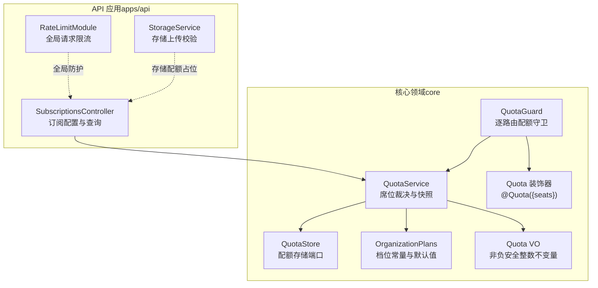
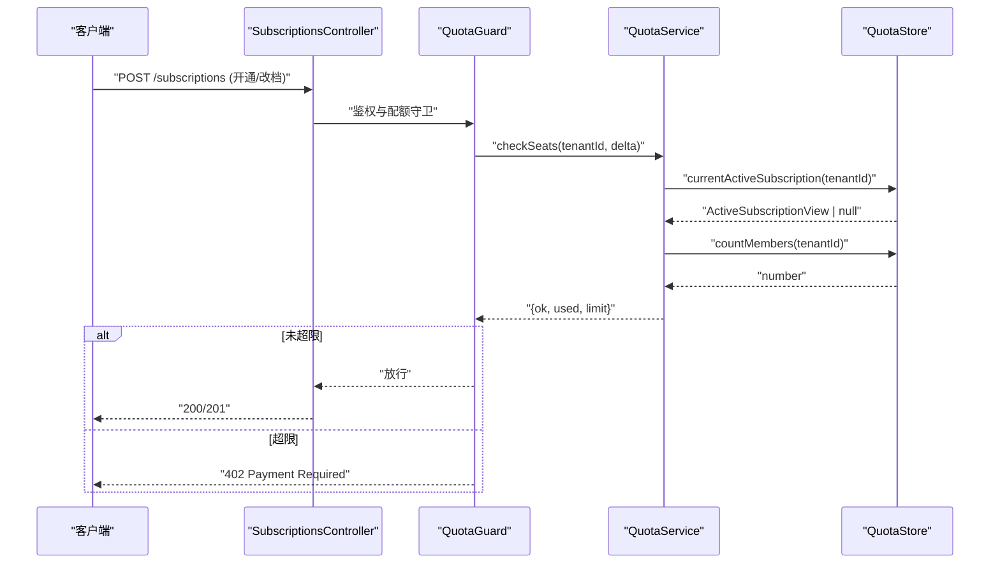
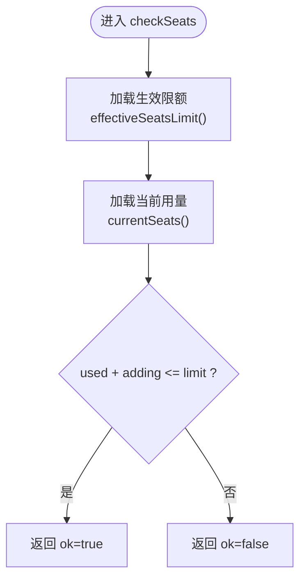
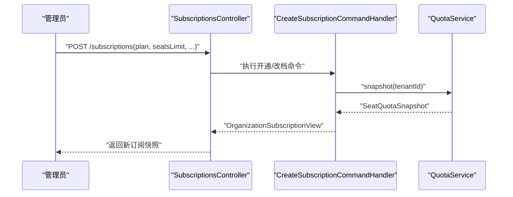
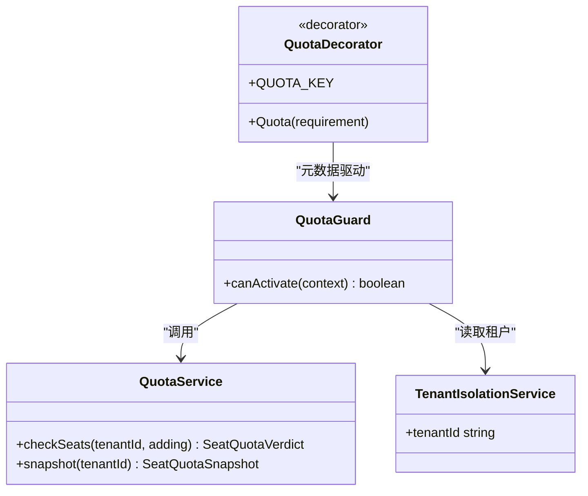
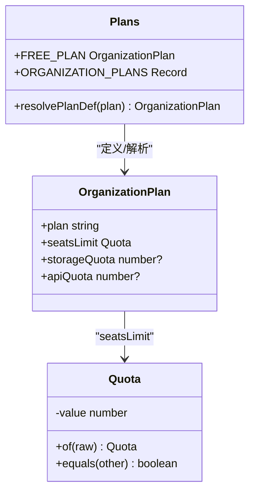
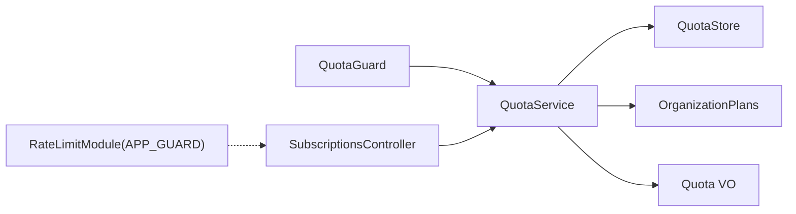

# 配额管理系统

<cite>
**本文引用的文件**   
- [libs/core/src/modules/subscriptions/quota/quota.service.ts](file://libs/core/src/modules/subscriptions/quota/quota.service.ts)
- [libs/core/src/modules/subscriptions/quota/quota.guard.ts](file://libs/core/src/modules/subscriptions/quota/quota.guard.ts)
- [libs/core/src/modules/subscriptions/quota/quota.store.ts](file://libs/core/src/modules/subscriptions/quota/quota.store.ts)
- [libs/core/src/modules/subscriptions/quota/organization-plans.ts](file://libs/core/src/modules/subscriptions/quota/organization-plans.ts)
- [libs/core/src/modules/subscriptions/quota/quota.vo.ts](file://libs/core/src/modules/subscriptions/quota/quota.vo.ts)
- [libs/core/src/modules/subscriptions/quota/quota.decorator.ts](file://libs/core/src/modules/subscriptions/quota/quota.decorator.ts)
- [apps/api/src/modules/subscriptions/api/subscriptions.controller.ts](file://apps/api/src/modules/subscriptions/api/subscriptions.controller.ts)
- [libs/core/src/modules/subscriptions/application/commands/handlers/create-subscription.command-handler.ts](file://libs/core/src/modules/subscriptions/application/commands/handlers/create-subscription.command-handler.ts)
- [apps/api/src/common/rate-limit.module.ts](file://apps/api/src/common/rate-limit.module.ts)
- [apps/api/src/modules/storage/application/storage.service.ts](file://apps/api/src/modules/storage/application/storage.service.ts)
</cite>

## 目录
1. [引言](#引言)
2. [项目结构](#项目结构)
3. [核心组件](#核心组件)
4. [架构总览](#架构总览)
5. [详细组件分析](#详细组件分析)
6. [依赖关系分析](#依赖关系分析)
7. [性能与缓存策略](#性能与缓存策略)
8. [API 接口与监控指标](#api-接口与监控指标)
9. [故障排查指南](#故障排查指南)
10. [结论](#结论)
11. [附录：扩展开发指南](#附录扩展开发指南)

## 引言
本文件系统性地梳理并文档化“配额管理系统”，覆盖席位限制管理、使用额度跟踪机制、超配额处理策略、配额检查守卫实现原理、性能优化与缓存机制，以及配额配置的 API 接口、监控指标与扩展开发指南。系统以租户为计费单位，当前已落地席位（成员数）维度，并为存储与 API 调用额度预留扩展点；通过装饰器 + 守卫的逐路由接入方式，在写路径进行硬拦截，同时提供读侧快照用于前端展示与升级引导。

## 项目结构
配额相关能力集中在订阅模块的 quota 子域，并在 API 层暴露订阅配置与查询接口；全局请求限流作为另一维度的保护墙独立存在。

图示来源
- [libs/core/src/modules/subscriptions/quota/quota.service.ts:1-131](file://libs/core/src/modules/subscriptions/quota/quota.service.ts#L1-L131)
- [libs/core/src/modules/subscriptions/quota/quota.guard.ts:1-74](file://libs/core/src/modules/subscriptions/quota/quota.guard.ts#L1-L74)
- [libs/core/src/modules/subscriptions/quota/quota.store.ts:1-61](file://libs/core/src/modules/subscriptions/quota/quota.store.ts#L1-L61)
- [libs/core/src/modules/subscriptions/quota/organization-plans.ts:1-80](file://libs/core/src/modules/subscriptions/quota/organization-plans.ts#L1-L80)
- [libs/core/src/modules/subscriptions/quota/quota.vo.ts:1-38](file://libs/core/src/modules/subscriptions/quota/quota.vo.ts#L1-L38)
- [libs/core/src/modules/subscriptions/quota/quota.decorator.ts:1-35](file://libs/core/src/modules/subscriptions/quota/quota.decorator.ts#L1-L35)
- [apps/api/src/modules/subscriptions/api/subscriptions.controller.ts:1-91](file://apps/api/src/modules/subscriptions/api/subscriptions.controller.ts#L1-L91)
- [apps/api/src/common/rate-limit.module.ts:1-29](file://apps/api/src/common/rate-limit.module.ts#L1-L29)
- [apps/api/src/modules/storage/application/storage.service.ts:1-100](file://apps/api/src/modules/storage/application/storage.service.ts#L1-L100)

章节来源
- [libs/core/src/modules/subscriptions/quota/quota.service.ts:1-131](file://libs/core/src/modules/subscriptions/quota/quota.service.ts#L1-L131)
- [libs/core/src/modules/subscriptions/quota/quota.guard.ts:1-74](file://libs/core/src/modules/subscriptions/quota/quota.guard.ts#L1-L74)
- [libs/core/src/modules/subscriptions/quota/quota.store.ts:1-61](file://libs/core/src/modules/subscriptions/quota/quota.store.ts#L1-L61)
- [libs/core/src/modules/subscriptions/quota/organization-plans.ts:1-80](file://libs/core/src/modules/subscriptions/quota/organization-plans.ts#L1-L80)
- [libs/core/src/modules/subscriptions/quota/quota.vo.ts:1-38](file://libs/core/src/modules/subscriptions/quota/quota.vo.ts#L1-L38)
- [libs/core/src/modules/subscriptions/quota/quota.decorator.ts:1-35](file://libs/core/src/modules/subscriptions/quota/quota.decorator.ts#L1-L35)
- [apps/api/src/modules/subscriptions/api/subscriptions.controller.ts:1-91](file://apps/api/src/modules/subscriptions/api/subscriptions.controller.ts#L1-L91)
- [apps/api/src/common/rate-limit.module.ts:1-29](file://apps/api/src/common/rate-limit.module.ts#L1-L29)
- [apps/api/src/modules/storage/application/storage.service.ts:1-100](file://apps/api/src/modules/storage/application/storage.service.ts#L1-L100)

## 核心组件
- QuotaService：席位限额裁决与读侧快照装配的唯一卡点，聚合生效订阅与成员用量，返回纯结果对象供消费点翻译 HTTP。
- QuotaGuard：基于 @Quota 元数据的逐路由配额守卫，无租户上下文抛 403，超席位限额抛 402。
- QuotaStore：配额持久化端口，抽象出“取当前生效订阅视图”和“计数成员”两个原语，屏蔽 ORM/表结构细节。
- OrganizationPlans：档位定义与默认免费档，seatsLimit 经 Quota VO 约束为非负安全整数。
- Quota VO：不可变配额值对象，保证非负安全整数不变量，违约 fail-loud。
- Quota 装饰器：声明某写路径预计新增成员数 seats，供 QuotaGuard 读取。
- SubscriptionsController：订阅配置与查询控制器，负责开通/改档与获取当前订阅快照。
- RateLimitModule：全局请求限流墙，独立于业务配额，防止洪水攻击。
- StorageService：存储上传编排层，包含文件大小与类型校验（存储配额维度暂为占位）。

章节来源
- [libs/core/src/modules/subscriptions/quota/quota.service.ts:1-131](file://libs/core/src/modules/subscriptions/quota/quota.service.ts#L1-L131)
- [libs/core/src/modules/subscriptions/quota/quota.guard.ts:1-74](file://libs/core/src/modules/subscriptions/quota/quota.guard.ts#L1-L74)
- [libs/core/src/modules/subscriptions/quota/quota.store.ts:1-61](file://libs/core/src/modules/subscriptions/quota/quota.store.ts#L1-L61)
- [libs/core/src/modules/subscriptions/quota/organization-plans.ts:1-80](file://libs/core/src/modules/subscriptions/quota/organization-plans.ts#L1-L80)
- [libs/core/src/modules/subscriptions/quota/quota.vo.ts:1-38](file://libs/core/src/modules/subscriptions/quota/quota.vo.ts#L1-L38)
- [libs/core/src/modules/subscriptions/quota/quota.decorator.ts:1-35](file://libs/core/src/modules/subscriptions/quota/quota.decorator.ts#L1-L35)
- [apps/api/src/modules/subscriptions/api/subscriptions.controller.ts:1-91](file://apps/api/src/modules/subscriptions/api/subscriptions.controller.ts#L1-L91)
- [apps/api/src/common/rate-limit.module.ts:1-29](file://apps/api/src/common/rate-limit.module.ts#L1-L29)
- [apps/api/src/modules/storage/application/storage.service.ts:1-100](file://apps/api/src/modules/storage/application/storage.service.ts#L1-L100)

## 架构总览
配额系统采用“领域服务 + 存储端口 + 守卫拦截 + 控制器暴露”的分层设计：
- 领域层：QuotaService 聚合规则与计算，OrganizationPlans 提供档位常量，Quota VO 承载不变量。
- 适配层：QuotaGuard 将领域结果映射为 HTTP 语义（402/403），SubscriptionsController 暴露订阅配置与查询。
- 基础设施层：QuotaStore 抽象持久化访问，具体实现由外部注入。

图示来源
- [apps/api/src/modules/subscriptions/api/subscriptions.controller.ts:1-91](file://apps/api/src/modules/subscriptions/api/subscriptions.controller.ts#L1-L91)
- [libs/core/src/modules/subscriptions/quota/quota.guard.ts:1-74](file://libs/core/src/modules/subscriptions/quota/quota.guard.ts#L1-L74)
- [libs/core/src/modules/subscriptions/quota/quota.service.ts:1-131](file://libs/core/src/modules/subscriptions/quota/quota.service.ts#L1-L131)
- [libs/core/src/modules/subscriptions/quota/quota.store.ts:1-61](file://libs/core/src/modules/subscriptions/quota/quota.store.ts#L1-L61)

## 详细组件分析

### 席位限制管理（用户席位数量控制、成员邀请限制、工作区容量限制）
- 席位上限来源：当前生效订阅的 seatsLimit；若无 active 订阅则回落 FREE_PLAN.seatsLimit。
- 用量口径：按租户成员总数实时计数（COUNT(member where tenantId)），不维护 usage 表。
- 决策入口：QuotaService.checkSeats 返回 { ok, used, limit }，由 QuotaGuard 或门面逻辑决定是否拒绝。
- 工作区容量：当前代码以席位为核心；存储与 API 配额维度在档位定义中预留字段 storageQuota/apiQuota，尚未成为热路径硬限制。

图示来源
- [libs/core/src/modules/subscriptions/quota/quota.service.ts:93-106](file://libs/core/src/modules/subscriptions/quota/quota.service.ts#L93-L106)
- [libs/core/src/modules/subscriptions/quota/organization-plans.ts:52-68](file://libs/core/src/modules/subscriptions/quota/organization-plans.ts#L52-L68)

章节来源
- [libs/core/src/modules/subscriptions/quota/quota.service.ts:40-106](file://libs/core/src/modules/subscriptions/quota/quota.service.ts#L40-L106)
- [libs/core/src/modules/subscriptions/quota/organization-plans.ts:1-80](file://libs/core/src/modules/subscriptions/quota/organization-plans.ts#L1-L80)

### 使用额度跟踪机制（API 调用次数、存储空间使用量、功能模块访问权限）
- API 调用次数：当前未在配额系统中实现；可通过扩展 QuotaStore 增加 apiUsage 计数器并在 QuotaService 中增加对应判断。
- 存储空间使用量：档位定义含 storageQuota 占位；StorageService 仅做文件大小与类型校验，未与配额联动。
- 功能模块访问权限：由授权子系统（AuthorizationGuard/RBAC）负责，与配额解耦。

章节来源
- [libs/core/src/modules/subscriptions/quota/organization-plans.ts:36-50](file://libs/core/src/modules/subscriptions/quota/organization-plans.ts#L36-L50)
- [apps/api/src/modules/storage/application/storage.service.ts:1-100](file://apps/api/src/modules/storage/application/storage.service.ts#L1-L100)

### 超配额处理策略（软限制警告、硬限制拦截、配额升级流程）
- 硬限制拦截：QuotaGuard 对超席位限额的请求直接返回 402（Payment Required），errorCode 指示需升级。
- 软限制警告：当前未实现告警通道；可在 QuotaService.snapshot 或守卫前插告警中间件，结合日志/事件上报。
- 配额升级流程：SubscriptionsController.create 创建/改档，命令处理器写入订阅行并返回快照；前端据此引导升级。

图示来源
- [apps/api/src/modules/subscriptions/api/subscriptions.controller.ts:49-89](file://apps/api/src/modules/subscriptions/api/subscriptions.controller.ts#L49-L89)
- [libs/core/src/modules/subscriptions/application/commands/handlers/create-subscription.command-handler.ts:59-84](file://libs/core/src/modules/subscriptions/application/commands/handlers/create-subscription.command-handler.ts#L59-L84)
- [libs/core/src/modules/subscriptions/quota/quota.service.ts:108-129](file://libs/core/src/modules/subscriptions/quota/quota.service.ts#L108-L129)

章节来源
- [libs/core/src/modules/subscriptions/quota/quota.guard.ts:38-73](file://libs/core/src/modules/subscriptions/quota/quota.guard.ts#L38-L73)
- [apps/api/src/modules/subscriptions/api/subscriptions.controller.ts:49-89](file://apps/api/src/modules/subscriptions/api/subscriptions.controller.ts#L49-L89)
- [libs/core/src/modules/subscriptions/application/commands/handlers/create-subscription.command-handler.ts:59-84](file://libs/core/src/modules/subscriptions/application/commands/handlers/create-subscription.command-handler.ts#L59-L84)

### 配额检查守卫的实现原理
- 装饰器 @Quota({ seats }) 在路由上标记配额需求。
- QuotaGuard 从反射读取需求，从租户隔离上下文取 tenantId，调用 QuotaService.checkSeats 判定。
- 无活动租户 → 403；超限额 → 402；否则放行。

图示来源
- [libs/core/src/modules/subscriptions/quota/quota.decorator.ts:1-35](file://libs/core/src/modules/subscriptions/quota/quota.decorator.ts#L1-L35)
- [libs/core/src/modules/subscriptions/quota/quota.guard.ts:1-74](file://libs/core/src/modules/subscriptions/quota/quota.guard.ts#L1-L74)
- [libs/core/src/modules/subscriptions/quota/quota.service.ts:1-131](file://libs/core/src/modules/subscriptions/quota/quota.service.ts#L1-L131)

章节来源
- [libs/core/src/modules/subscriptions/quota/quota.decorator.ts:1-35](file://libs/core/src/modules/subscriptions/quota/quota.decorator.ts#L1-L35)
- [libs/core/src/modules/subscriptions/quota/quota.guard.ts:1-74](file://libs/core/src/modules/subscriptions/quota/quota.guard.ts#L1-L74)

### 配额值对象与档位常量
- Quota VO：唯一构造口 of(raw)，强制非负安全整数，违约抛出原生 Error。
- OrganizationPlans：FREE_PLAN 默认 seatsLimit=5；pro/enterprise 分别定义更高限额；未知 plan 回落免费档。

图示来源
- [libs/core/src/modules/subscriptions/quota/quota.vo.ts:1-38](file://libs/core/src/modules/subscriptions/quota/quota.vo.ts#L1-L38)
- [libs/core/src/modules/subscriptions/quota/organization-plans.ts:1-80](file://libs/core/src/modules/subscriptions/quota/organization-plans.ts#L1-L80)

章节来源
- [libs/core/src/modules/subscriptions/quota/quota.vo.ts:1-38](file://libs/core/src/modules/subscriptions/quota/quota.vo.ts#L1-L38)
- [libs/core/src/modules/subscriptions/quota/organization-plans.ts:1-80](file://libs/core/src/modules/subscriptions/quota/organization-plans.ts#L1-L80)

## 依赖关系分析
- QuotaGuard 依赖 QuotaService 与租户隔离上下文，依赖装饰器元数据。
- QuotaService 依赖 QuotaStore（端口倒置）与 OrganizationPlans、Quota VO。
- SubscriptionsController 依赖 CQRS CommandBus/QueryBus，间接依赖 QuotaService 的 snapshot。
- RateLimitModule 作为全局 APP_GUARD 先于认证/租户守卫执行，属于系统级保护。

图示来源
- [libs/core/src/modules/subscriptions/quota/quota.guard.ts:1-74](file://libs/core/src/modules/subscriptions/quota/quota.guard.ts#L1-L74)
- [libs/core/src/modules/subscriptions/quota/quota.service.ts:1-131](file://libs/core/src/modules/subscriptions/quota/quota.service.ts#L1-L131)
- [libs/core/src/modules/subscriptions/quota/quota.store.ts:1-61](file://libs/core/src/modules/subscriptions/quota/quota.store.ts#L1-L61)
- [libs/core/src/modules/subscriptions/quota/organization-plans.ts:1-80](file://libs/core/src/modules/subscriptions/quota/organization-plans.ts#L1-L80)
- [apps/api/src/modules/subscriptions/api/subscriptions.controller.ts:1-91](file://apps/api/src/modules/subscriptions/api/subscriptions.controller.ts#L1-L91)
- [apps/api/src/common/rate-limit.module.ts:1-29](file://apps/api/src/common/rate-limit.module.ts#L1-L29)

章节来源
- [libs/core/src/modules/subscriptions/quota/quota.guard.ts:1-74](file://libs/core/src/modules/subscriptions/quota/quota.guard.ts#L1-L74)
- [libs/core/src/modules/subscriptions/quota/quota.service.ts:1-131](file://libs/core/src/modules/subscriptions/quota/quota.service.ts#L1-L131)
- [apps/api/src/modules/subscriptions/api/subscriptions.controller.ts:1-91](file://apps/api/src/modules/subscriptions/api/subscriptions.controller.ts#L1-L91)
- [apps/api/src/common/rate-limit.module.ts:1-29](file://apps/api/src/common/rate-limit.module.ts#L1-L29)

## 性能与缓存策略
- 并发读取：QuotaService.checkSeats 并行加载限额与用量（Promise.all），减少串行等待。
- 只读快照：snapshot 复用 currentSubscription/currentSeats，避免重复计算。
- 全局限流：RateLimitModule 提供 IP 维度的宽档限流（300 次/60s），在最外层快速拒绝洪水请求。
- 存储前置校验：StorageService 在 IO 前进行大小与类型校验，降低无效 IO 开销。

建议（面向未来扩展）：
- 对 effectiveSeatsLimit 与 countMembers 引入短期缓存（如内存缓存 + 失效键），以降低热点租户的 DB 压力。
- 对 snapshot 可考虑带 ETag/Last-Modified 的缓存策略，便于前端增量更新。
- 对 QuotaStore.countMembers 可引入物化列或异步统计任务，配合最终一致性开关。

章节来源
- [libs/core/src/modules/subscriptions/quota/quota.service.ts:100-129](file://libs/core/src/modules/subscriptions/quota/quota.service.ts#L100-L129)
- [apps/api/src/common/rate-limit.module.ts:1-29](file://apps/api/src/common/rate-limit.module.ts#L1-L29)
- [apps/api/src/modules/storage/application/storage.service.ts:36-79](file://apps/api/src/modules/storage/application/storage.service.ts#L36-L79)

## API 接口与监控指标

### 订阅配置与查询接口
- GET /subscriptions/current
  - 鉴权：TenantIsolationGuard
  - 行为：返回当前组织的有效订阅快照（套餐、席位限额、用量、剩余额度、providerCustomerId）
- POST /subscriptions
  - 鉴权：TenantIsolationGuard + AuthorizationGuard（update Organization）
  - 行为：创建/升级订阅，建立支付供应商客户映射，落盘 seatsLimit/storageQuota/apiQuota，返回新快照

章节来源
- [apps/api/src/modules/subscriptions/api/subscriptions.controller.ts:49-89](file://apps/api/src/modules/subscriptions/api/subscriptions.controller.ts#L49-L89)

### 监控指标（建议）
- 席位使用率：used/seatsLimit（来自 snapshot）
- 配额拒绝率：402 错误占比（来自网关/异常过滤器统计）
- 订阅状态分布：active/suspended/expired/cancelled 比例
- 存储与 API 配额使用量（待扩展）：当前为占位字段，后续可接入计量管道

[本节为概念性说明，不直接分析具体文件]

## 故障排查指南
- 403 无活动租户上下文
  - 现象：QuotaGuard 在未设置租户时抛出 403。
  - 排查：确认租户隔离守卫是否生效，ALS 上下文是否正确注入。
- 402 席位配额超限
  - 现象：QuotaGuard 在 checkSeats.ok=false 时返回 402。
  - 排查：核对当前成员数与 seatsLimit；必要时升级订阅。
- 存储上传失败
  - 现象：StorageService 捕获底层异常并返回 400。
  - 排查：检查 provider 选择、临时文件/流式上传链路。

章节来源
- [libs/core/src/modules/subscriptions/quota/quota.guard.ts:55-70](file://libs/core/src/modules/subscriptions/quota/quota.guard.ts#L55-L70)
- [apps/api/src/modules/storage/application/storage.service.ts:67-79](file://apps/api/src/modules/storage/application/storage.service.ts#L67-L79)

## 结论
配额管理系统以 QuotaService 为核心，结合 QuotaGuard 的逐路由拦截与 SubscriptionsController 的配置/查询能力，实现了席位维度的硬限制与读侧可视化。系统通过 QuotaStore 端口倒置解耦持久化细节，并通过 Quota VO 与 OrganizationPlans 保障配额值的正确性与可扩展性。全局 RateLimitModule 提供系统级防护，StorageService 提供存储前置校验。未来可按需扩展 API 调用与存储使用量的硬限制与监控。

[本节为总结性内容，不直接分析具体文件]

## 附录：扩展开发指南

### 新增配额维度（例如 API 调用次数）
- 在 QuotaStore 中新增 apiUsage 计数原语。
- 在 QuotaService 中新增 checkApiQuota 方法，与现有 checkSeats 并列。
- 在 QuotaRequirement 中扩展 apiDelta 字段，并在 QuotaGuard 中增加对应分支。
- 在 OrganizationPlans 中完善 apiQuota 默认值与校验。

章节来源
- [libs/core/src/modules/subscriptions/quota/quota.store.ts:30-60](file://libs/core/src/modules/subscriptions/quota/quota.store.ts#L30-L60)
- [libs/core/src/modules/subscriptions/quota/quota.service.ts:93-106](file://libs/core/src/modules/subscriptions/quota/quota.service.ts#L93-L106)
- [libs/core/src/modules/subscriptions/quota/quota.decorator.ts:10-18](file://libs/core/src/modules/subscriptions/quota/quota.decorator.ts#L10-L18)
- [libs/core/src/modules/subscriptions/quota/organization-plans.ts:36-50](file://libs/core/src/modules/subscriptions/quota/organization-plans.ts#L36-L50)

### 接入软限制告警
- 在 QuotaService.snapshot 或 QuotaGuard 前插入告警中间件，当 remaining 低于阈值时记录事件/日志。
- 结合外部通知渠道（邮件/IM）推送升级提醒。

[本节为概念性指导，不直接分析具体文件]

### 性能优化建议
- 对 effectiveSeatsLimit 与 countMembers 加短期缓存，设置合理 TTL 与失效键。
- 对 snapshot 启用 ETag/If-None-Match 缓存，减少重复传输。
- 对 countMembers 引入异步统计任务与物化列，开启最终一致性开关。

[本节为通用优化建议，不直接分析具体文件]