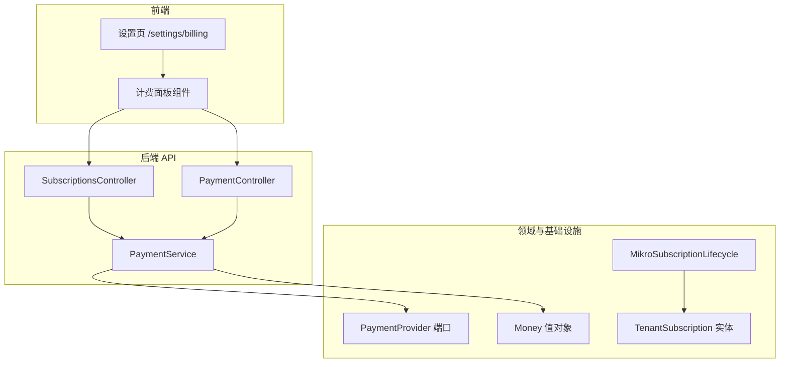
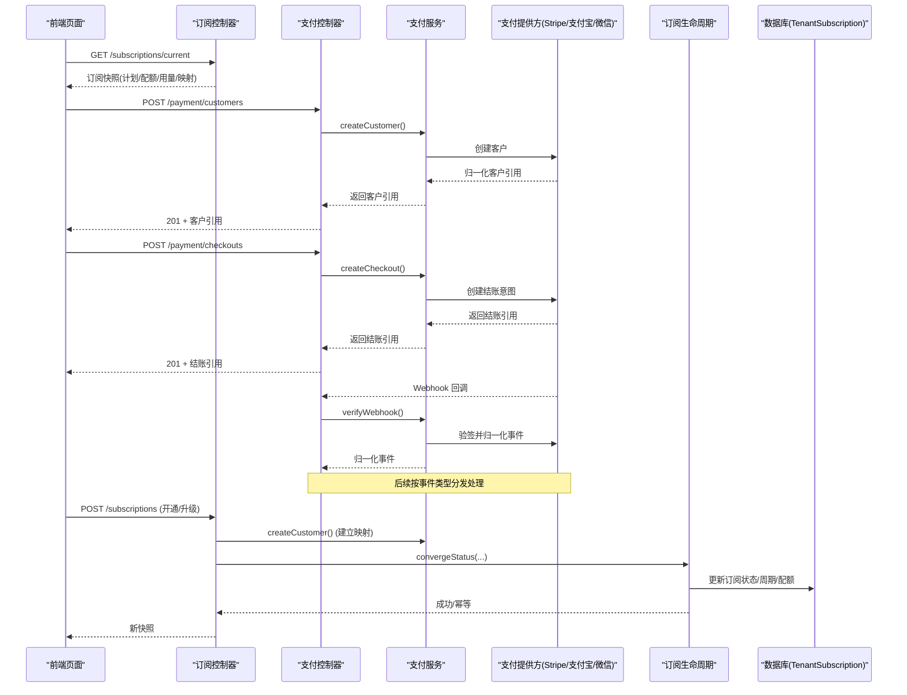
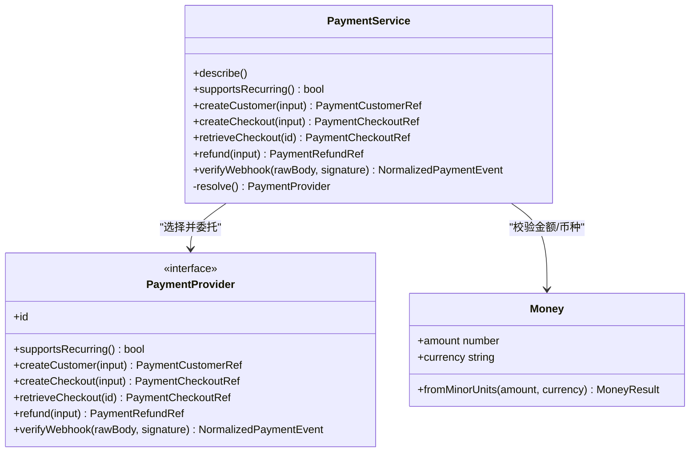
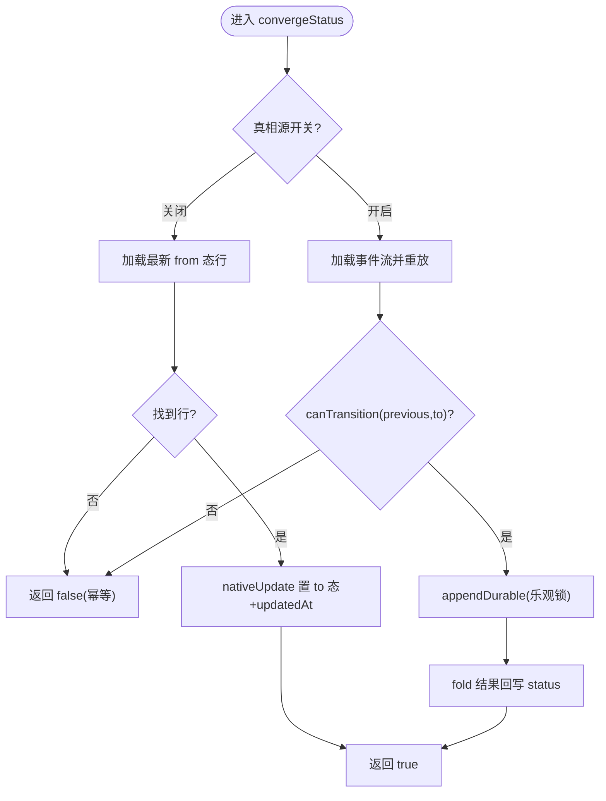
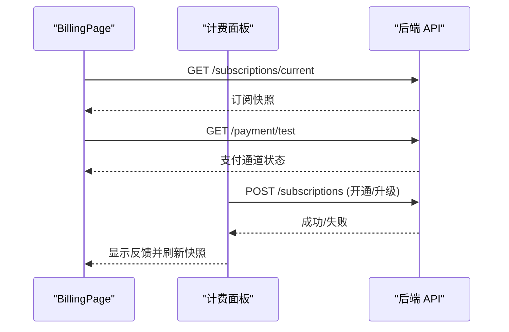
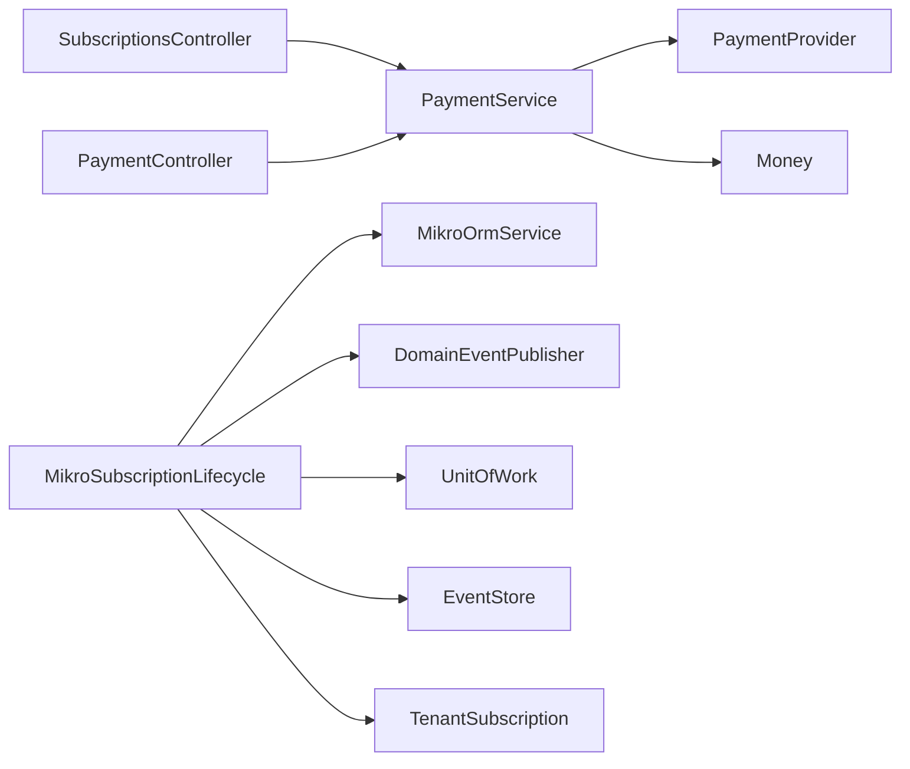

# 账单与发票

<cite>
**本文引用的文件**   
- [apps/api/src/modules/payment/application/payment.service.ts](file://apps/api/src/modules/payment/application/payment.service.ts)
- [apps/api/src/modules/payment/api/payment.controller.ts](file://apps/api/src/modules/payment/api/payment.controller.ts)
- [apps/api/src/modules/payment/domain/ports/payment-provider.port.ts](file://apps/api/src/modules/payment/domain/ports/payment-provider.port.ts)
- [apps/api/src/modules/payment/domain/value-objects/money.ts](file://apps/api/src/modules/payment/domain/value-objects/money.ts)
- [apps/api/src/modules/subscriptions/api/subscriptions.controller.ts](file://apps/api/src/modules/subscriptions/api/subscriptions.controller.ts)
- [apps/api/src/modules/subscriptions/infrastructure/mikro-subscription.lifecycle.ts](file://apps/api/src/modules/subscriptions/infrastructure/mikro-subscription.lifecycle.ts)
- [apps/api/src/modules/subscriptions/infrastructure/entities/tenant-subscription.entity.ts](file://apps/api/src/modules/subscriptions/infrastructure/entities/tenant-subscription.entity.ts)
- [apps/web/src/routes/settings.billing.tsx](file://apps/web/src/routes/settings.billing.tsx)
- [apps/web/src/components/billing-panels.tsx](file://apps/web/src/components/billing-panels.tsx)
</cite>

## 目录
1. [简介](#简介)
2. [项目结构](#项目结构)
3. [核心组件](#核心组件)
4. [架构总览](#架构总览)
5. [详细组件分析](#详细组件分析)
6. [依赖关系分析](#依赖关系分析)
7. [性能与扩展性](#性能与扩展性)
8. [故障排查指南](#故障排查指南)
9. [结论](#结论)
10. [附录：API 与使用示例](#附录api-与使用示例)

## 简介
本文件面向“账单与发票”能力，聚焦当前代码库中已实现的订阅、支付与配额相关实现，并明确尚未实现的账单生成、发票模板、电子/纸质发票、税务处理、多币种汇率换算等边界。文档从系统架构、数据流、处理逻辑、集成点、错误处理与性能特性展开，并提供 API 调用与前端交互示例，帮助读者快速理解与扩展该领域。

## 项目结构
围绕计费与支付，后端采用分层与领域驱动设计：
- 表现层（HTTP）：控制器暴露 REST 接口，统一通过 oRPC 契约与 zod schema 校验。
- 应用层：编排具体流程（如创建客户、结账、退款、Webhook 验签）。
- 领域层：定义端口与值对象（如 PaymentProvider、Money），隔离第三方通道差异。
- 基础设施层：对接 Stripe 等支付提供方；持久化订阅生命周期与实体。
- 前端页面：订阅快照展示、支付通道状态、开通/升级表单。

图表来源
- [apps/web/src/routes/settings.billing.tsx:20-47](file://apps/web/src/routes/settings.billing.tsx#L20-L47)
- [apps/web/src/components/billing-panels.tsx:130-248](file://apps/web/src/components/billing-panels.tsx#L130-L248)
- [apps/api/src/modules/subscriptions/api/subscriptions.controller.ts:42-90](file://apps/api/src/modules/subscriptions/api/subscriptions.controller.ts#L42-L90)
- [apps/api/src/modules/payment/api/payment.controller.ts:66-172](file://apps/api/src/modules/payment/api/payment.controller.ts#L66-L172)
- [apps/api/src/modules/payment/application/payment.service.ts:32-123](file://apps/api/src/modules/payment/application/payment.service.ts#L32-L123)
- [apps/api/src/modules/payment/domain/ports/payment-provider.port.ts:124-157](file://apps/api/src/modules/payment/domain/ports/payment-provider.port.ts#L124-L157)
- [apps/api/src/modules/payment/domain/value-objects/money.ts:23-44](file://apps/api/src/modules/payment/domain/value-objects/money.ts#L23-L44)
- [apps/api/src/modules/subscriptions/infrastructure/mikro-subscription.lifecycle.ts:45-156](file://apps/api/src/modules/subscriptions/infrastructure/mikro-subscription.lifecycle.ts#L45-L156)
- [apps/api/src/modules/subscriptions/infrastructure/entities/tenant-subscription.entity.ts:19-65](file://apps/api/src/modules/subscriptions/infrastructure/entities/tenant-subscription.entity.ts#L19-L65)

章节来源
- [apps/web/src/routes/settings.billing.tsx:20-47](file://apps/web/src/routes/settings.billing.tsx#L20-L47)
- [apps/web/src/components/billing-panels.tsx:130-248](file://apps/web/src/components/billing-panels.tsx#L130-L248)
- [apps/api/src/modules/subscriptions/api/subscriptions.controller.ts:42-90](file://apps/api/src/modules/subscriptions/api/subscriptions.controller.ts#L42-L90)
- [apps/api/src/modules/payment/api/payment.controller.ts:66-172](file://apps/api/src/modules/payment/api/payment.controller.ts#L66-L172)
- [apps/api/src/modules/payment/application/payment.service.ts:32-123](file://apps/api/src/modules/payment/application/payment.service.ts#L32-L123)
- [apps/api/src/modules/payment/domain/ports/payment-provider.port.ts:124-157](file://apps/api/src/modules/payment/domain/ports/payment-provider.port.ts#L124-L157)
- [apps/api/src/modules/payment/domain/value-objects/money.ts:23-44](file://apps/api/src/modules/payment/domain/value-objects/money.ts#L23-L44)
- [apps/api/src/modules/subscriptions/infrastructure/mikro-subscription.lifecycle.ts:45-156](file://apps/api/src/modules/subscriptions/infrastructure/mikro-subscription.lifecycle.ts#L45-L156)
- [apps/api/src/modules/subscriptions/infrastructure/entities/tenant-subscription.entity.ts:19-65](file://apps/api/src/modules/subscriptions/infrastructure/entities/tenant-subscription.entity.ts#L19-L65)

## 核心组件
- 支付服务（PaymentService）：选择已注册支付通道，封装创建客户、结账、查询结账、退款、Webhook 验签等能力；无可用通道时返回 503。
- 支付控制器（PaymentController）：对外暴露测试、创建客户、创建结账、查询结账、退款、Webhook 回调等 HTTP 端点。
- 订阅控制器（SubscriptionsController）：读取当前组织订阅快照；在授权后执行开通/升级命令。
- 订阅生命周期（MikroSubscriptionLifecycle）：基于事件溯源的订阅状态收敛与投影更新，支持真相源开关。
- 租户订阅实体（TenantSubscription）：承载订阅计划、配额、周期、支付方映射等字段。
- 金额值对象（Money）：对最小货币单位与币种进行不可变封装与不变量校验。
- 前端计费面：展示订阅快照、支付通道状态，提供开通/升级表单。

章节来源
- [apps/api/src/modules/payment/application/payment.service.ts:32-123](file://apps/api/src/modules/payment/application/payment.service.ts#L32-L123)
- [apps/api/src/modules/payment/api/payment.controller.ts:66-172](file://apps/api/src/modules/payment/api/payment.controller.ts#L66-L172)
- [apps/api/src/modules/subscriptions/api/subscriptions.controller.ts:42-90](file://apps/api/src/modules/subscriptions/api/subscriptions.controller.ts#L42-L90)
- [apps/api/src/modules/subscriptions/infrastructure/mikro-subscription.lifecycle.ts:45-156](file://apps/api/src/modules/subscriptions/infrastructure/mikro-subscription.lifecycle.ts#L45-L156)
- [apps/api/src/modules/subscriptions/infrastructure/entities/tenant-subscription.entity.ts:19-65](file://apps/api/src/modules/subscriptions/infrastructure/entities/tenant-subscription.entity.ts#L19-L65)
- [apps/api/src/modules/payment/domain/value-objects/money.ts:23-44](file://apps/api/src/modules/payment/domain/value-objects/money.ts#L23-L44)
- [apps/web/src/routes/settings.billing.tsx:20-95](file://apps/web/src/routes/settings.billing.tsx#L20-L95)
- [apps/web/src/components/billing-panels.tsx:130-248](file://apps/web/src/components/billing-panels.tsx#L130-L248)

## 架构总览
下图展示了从前端到后端的端到端调用链，以及支付通道的抽象与生命周期管理。

图表来源
- [apps/api/src/modules/subscriptions/api/subscriptions.controller.ts:42-90](file://apps/api/src/modules/subscriptions/api/subscriptions.controller.ts#L42-L90)
- [apps/api/src/modules/payment/api/payment.controller.ts:66-172](file://apps/api/src/modules/payment/api/payment.controller.ts#L66-L172)
- [apps/api/src/modules/payment/application/payment.service.ts:32-123](file://apps/api/src/modules/payment/application/payment.service.ts#L32-L123)
- [apps/api/src/modules/subscriptions/infrastructure/mikro-subscription.lifecycle.ts:69-134](file://apps/api/src/modules/subscriptions/infrastructure/mikro-subscription.lifecycle.ts#L69-L134)
- [apps/api/src/modules/subscriptions/infrastructure/entities/tenant-subscription.entity.ts:19-65](file://apps/api/src/modules/subscriptions/infrastructure/entities/tenant-subscription.entity.ts#L19-L65)

## 详细组件分析

### 支付模块（Payment）
- 职责
  - 根据配置选择已注册的支付通道（stripe/alipay/wechat_pay）。
  - 创建支付客户、创建结账意图、查询结账、退款。
  - 验签并归一化 Webhook 事件，作为后续业务处理的入口。
- 关键行为
  - 未配置任何通道时，所有写操作抛出 503（包含错误码）。
  - 结账金额与币种经 Money 值对象校验，非法则抛 400。
  - supportsRecurring 用于判断是否支持周期扣款/订阅。
- 数据结构
  - 输入/输出均使用跨通道归一化引用（含 providerId、id、status、raw 透传）。
  - Money 值对象保证金额与币种的不可变性与不变量。

图表来源
- [apps/api/src/modules/payment/application/payment.service.ts:32-123](file://apps/api/src/modules/payment/application/payment.service.ts#L32-L123)
- [apps/api/src/modules/payment/domain/ports/payment-provider.port.ts:124-157](file://apps/api/src/modules/payment/domain/ports/payment-provider.port.ts#L124-L157)
- [apps/api/src/modules/payment/domain/value-objects/money.ts:23-44](file://apps/api/src/modules/payment/domain/value-objects/money.ts#L23-L44)

章节来源
- [apps/api/src/modules/payment/application/payment.service.ts:32-123](file://apps/api/src/modules/payment/application/payment.service.ts#L32-L123)
- [apps/api/src/modules/payment/domain/ports/payment-provider.port.ts:1-157](file://apps/api/src/modules/payment/domain/ports/payment-provider.port.ts#L1-L157)
- [apps/api/src/modules/payment/domain/value-objects/money.ts:1-45](file://apps/api/src/modules/payment/domain/value-objects/money.ts#L1-L45)

### 订阅与配额（Subscriptions & Quota）
- 职责
  - 读取当前组织的订阅快照（计划、席位配额、用量、支付客户映射）。
  - 在授权后执行开通/升级，建立支付方客户映射，并更新订阅生命周期。
- 生命周期
  - 基于事件溯源的状态机收敛：从 from 态迁移到 to 态，支持乐观锁与投影回写。
  - 支持“真相源”开关：可切换为以事件流为真相源，表行作为投影。
- 实体
  - TenantSubscription 承载 plan、status、seatsLimit、storageQuota、apiQuota、periodStart/End、provider/providerCustomerId/providerSubscriptionId 等。

图表来源
- [apps/api/src/modules/subscriptions/infrastructure/mikro-subscription.lifecycle.ts:69-134](file://apps/api/src/modules/subscriptions/infrastructure/mikro-subscription.lifecycle.ts#L69-L134)

章节来源
- [apps/api/src/modules/subscriptions/api/subscriptions.controller.ts:42-90](file://apps/api/src/modules/subscriptions/api/subscriptions.controller.ts#L42-L90)
- [apps/api/src/modules/subscriptions/infrastructure/mikro-subscription.lifecycle.ts:25-156](file://apps/api/src/modules/subscriptions/infrastructure/mikro-subscription.lifecycle.ts#L25-L156)
- [apps/api/src/modules/subscriptions/infrastructure/entities/tenant-subscription.entity.ts:19-65](file://apps/api/src/modules/subscriptions/infrastructure/entities/tenant-subscription.entity.ts#L19-L65)

### 前端计费面（Web Billing）
- 功能
  - 加载订阅快照与支付通道状态。
  - 展示席位用量进度条与提示。
  - 提交开通/升级表单（plan/customerEmail/可选配额）。
- 交互
  - 读面 typed GET，写面 POST 经 mutation 触发，成功后刷新快照。

图表来源
- [apps/web/src/routes/settings.billing.tsx:20-95](file://apps/web/src/routes/settings.billing.tsx#L20-L95)
- [apps/web/src/components/billing-panels.tsx:130-248](file://apps/web/src/components/billing-panels.tsx#L130-L248)

章节来源
- [apps/web/src/routes/settings.billing.tsx:20-95](file://apps/web/src/routes/settings.billing.tsx#L20-L95)
- [apps/web/src/components/billing-panels.tsx:1-249](file://apps/web/src/components/billing-panels.tsx#L1-L249)

## 依赖关系分析
- 控制器依赖服务：SubscriptionsController 与 PaymentController 分别依赖 CommandBus/QueryBus 与 PaymentService。
- 服务依赖领域端口与值对象：PaymentService 依赖 PaymentProvider 端口与 Money 值对象。
- 生命周期依赖 ORM 与事件存储：MikroSubscriptionLifecycle 依赖 MikroOrmService、DomainEventPublisher、UnitOfWork、EventStore。
- 实体承载订阅元数据：TenantSubscription 提供 DDL 与运行时实体定义。

图表来源
- [apps/api/src/modules/subscriptions/api/subscriptions.controller.ts:42-90](file://apps/api/src/modules/subscriptions/api/subscriptions.controller.ts#L42-L90)
- [apps/api/src/modules/payment/api/payment.controller.ts:66-172](file://apps/api/src/modules/payment/api/payment.controller.ts#L66-L172)
- [apps/api/src/modules/payment/application/payment.service.ts:32-123](file://apps/api/src/modules/payment/application/payment.service.ts#L32-L123)
- [apps/api/src/modules/subscriptions/infrastructure/mikro-subscription.lifecycle.ts:45-156](file://apps/api/src/modules/subscriptions/infrastructure/mikro-subscription.lifecycle.ts#L45-L156)
- [apps/api/src/modules/subscriptions/infrastructure/entities/tenant-subscription.entity.ts:19-65](file://apps/api/src/modules/subscriptions/infrastructure/entities/tenant-subscription.entity.ts#L19-L65)

章节来源
- [apps/api/src/modules/subscriptions/api/subscriptions.controller.ts:42-90](file://apps/api/src/modules/subscriptions/api/subscriptions.controller.ts#L42-L90)
- [apps/api/src/modules/payment/api/payment.controller.ts:66-172](file://apps/api/src/modules/payment/api/payment.controller.ts#L66-L172)
- [apps/api/src/modules/payment/application/payment.service.ts:32-123](file://apps/api/src/modules/payment/application/payment.service.ts#L32-L123)
- [apps/api/src/modules/subscriptions/infrastructure/mikro-subscription.lifecycle.ts:45-156](file://apps/api/src/modules/subscriptions/infrastructure/mikro-subscription.lifecycle.ts#L45-L156)
- [apps/api/src/modules/subscriptions/infrastructure/entities/tenant-subscription.entity.ts:19-65](file://apps/api/src/modules/subscriptions/infrastructure/entities/tenant-subscription.entity.ts#L19-L65)

## 性能与扩展性
- 懒解析与降级：PaymentService 构造期不校验通道，避免未配通道导致启动失败；实际调用时才检测可用性。
- 幂等与重投：订阅生命周期收敛路径在无 from 态行时直接返回 false，天然支持 at-least-once 的重投幂等。
- 真相源与投影：ES R4c 开关下，事件流为真相源，表行仅作为投影，便于审计与诊断。
- 扩展通道：新增支付通道只需实现 PaymentProvider 端口并在装配时注册，控制器与服务无需改动。

[本节为通用指导，不直接分析具体文件]

## 故障排查指南
- 无可用支付通道
  - 现象：调用支付相关接口返回 503，错误码指示未配置通道。
  - 排查：检查 payment.provider 配置与已注册通道；确认至少一个通道可用。
- 结账金额或币种非法
  - 现象：创建结账返回 400。
  - 排查：确保 amount ≥ 1 且为有限数，currency 非空。
- Webhook 未生效
  - 现象：支付完成后订阅状态未更新。
  - 排查：确认 Webhook 路由 /payment/webhooks 可达；签名头 stripe-signature 正确；事件分发分支覆盖目标事件类型。
- 订阅状态不一致
  - 现象：表行 status 与事件流不一致。
  - 排查：开启真相源开关后，使用 rebuildProjection 重建投影；检查 canTransition 规则与 expectedVersion 乐观锁。

章节来源
- [apps/api/src/modules/payment/application/payment.service.ts:112-123](file://apps/api/src/modules/payment/application/payment.service.ts#L112-L123)
- [apps/api/src/modules/payment/application/payment.service.ts:75-82](file://apps/api/src/modules/payment/application/payment.service.ts#L75-L82)
- [apps/api/src/modules/payment/api/payment.controller.ts:147-171](file://apps/api/src/modules/payment/api/payment.controller.ts#L147-L171)
- [apps/api/src/modules/subscriptions/infrastructure/mikro-subscription.lifecycle.ts:136-155](file://apps/api/src/modules/subscriptions/infrastructure/mikro-subscription.lifecycle.ts#L136-L155)

## 结论
当前代码库实现了订阅管理与支付通道的抽象与编排，具备创建客户、结账、退款与 Webhook 验签能力；订阅生命周期支持事件溯源与投影回写，具备幂等与真相源模式。尚未实现的部分包括：周期性计费引擎、按量计费计量、折扣计算、发票模板与电子/纸质发票处理、税务处理、多币种汇率换算、账单查询 API、报表生成与导出。这些能力可在现有支付与订阅框架上渐进扩展。

[本节为总结性内容，不直接分析具体文件]

## 附录：API 与使用示例

### 支付相关 API
- 测试支付通道状态
  - 方法：GET
  - 路径：/payment/test
  - 响应：{ status, selected, available }
- 创建支付客户
  - 方法：POST
  - 路径：/payment/customers
  - 请求体：{ email, name?, metadata? }
  - 响应：{ id, providerId, email, raw }
- 创建结账意图
  - 方法：POST
  - 路径：/payment/checkouts
  - 请求体：{ amount, currency, description?, metadata? }
  - 响应：{ id, providerId, status?, clientSecret?, raw }
- 查询结账
  - 方法：GET
  - 路径：/payment/checkouts/:id
  - 响应：同创建结账响应
- 退款
  - 方法：POST
  - 路径：/payment/refunds
  - 请求体：{ checkoutId, amount?, reason? }
  - 响应：{ id, providerId, status?, amount?, raw }
- Webhook 回调
  - 方法：POST
  - 路径：/payment/webhooks
  - 头部：stripe-signature
  - 响应：{ received: true }

章节来源
- [apps/api/src/modules/payment/api/payment.controller.ts:71-171](file://apps/api/src/modules/payment/api/payment.controller.ts#L71-L171)

### 订阅相关 API
- 获取当前订阅快照
  - 方法：GET
  - 路径：/subscriptions/current
  - 权限：租户隔离（认证成员）
  - 响应：{ hasSubscription, plan, seatsLimit, used, remaining, providerCustomerId }
- 开通/升级订阅
  - 方法：POST
  - 路径：/subscriptions
  - 权限：租户隔离 + 组织 update 授权
  - 请求体：{ plan, customerEmail, seatsLimit?, storageQuota?, apiQuota? }
  - 响应：同订阅快照

章节来源
- [apps/api/src/modules/subscriptions/api/subscriptions.controller.ts:49-89](file://apps/api/src/modules/subscriptions/api/subscriptions.controller.ts#L49-L89)

### 前端使用示例
- 打开设置页 /settings/billing，页面会加载订阅快照与支付通道状态。
- 若无可用通道，开通/升级按钮禁用并给出提示。
- 填写档位与客户邮箱，可选择性地填写席位/存储/API 配额，提交后刷新快照。

章节来源
- [apps/web/src/routes/settings.billing.tsx:20-95](file://apps/web/src/routes/settings.billing.tsx#L20-L95)
- [apps/web/src/components/billing-panels.tsx:130-248](file://apps/web/src/components/billing-panels.tsx#L130-L248)