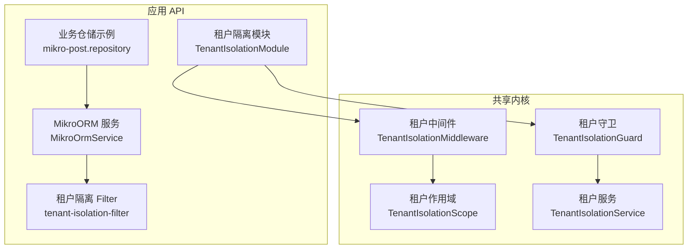
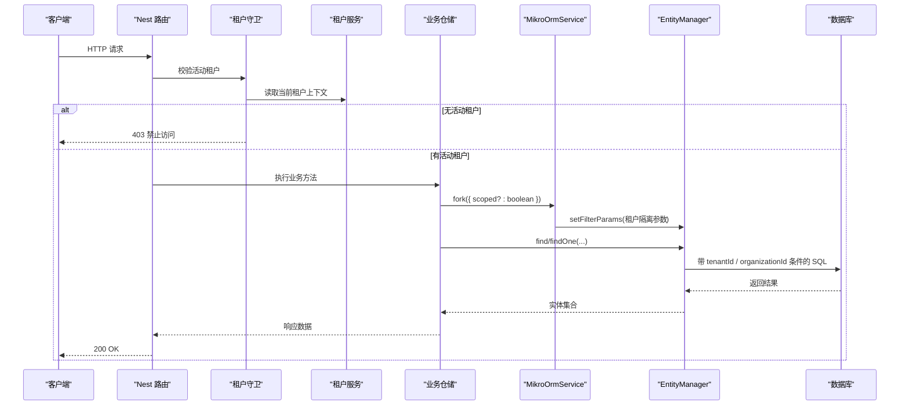
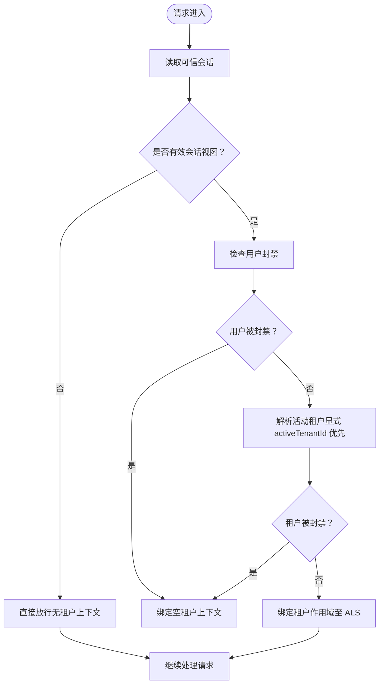
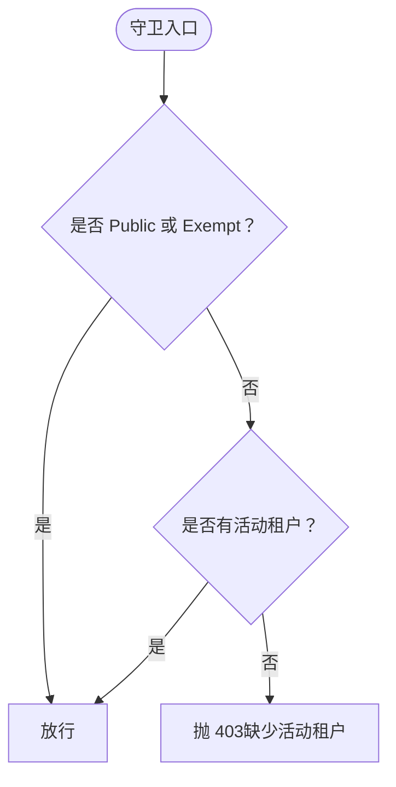
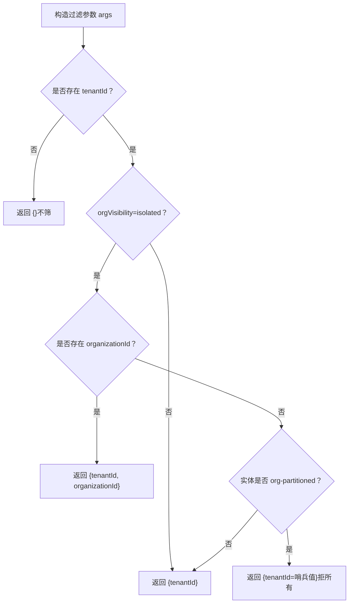
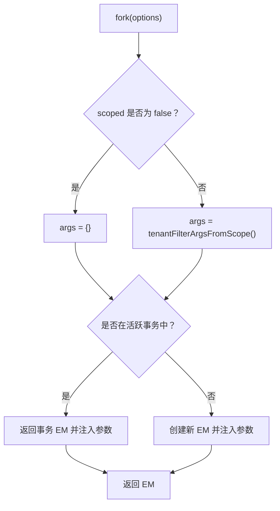
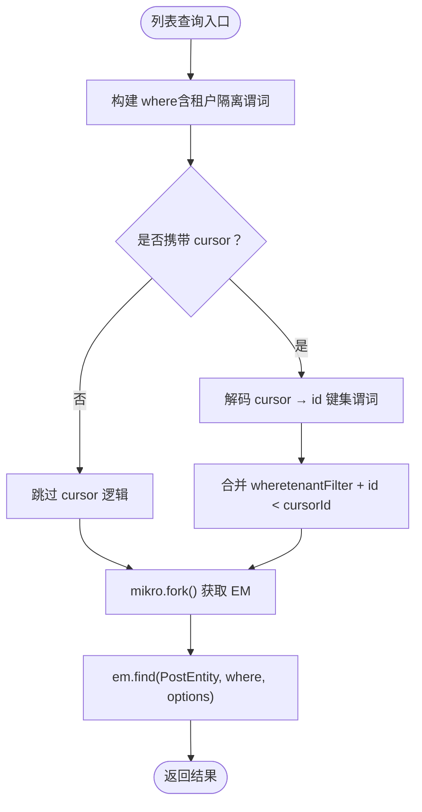
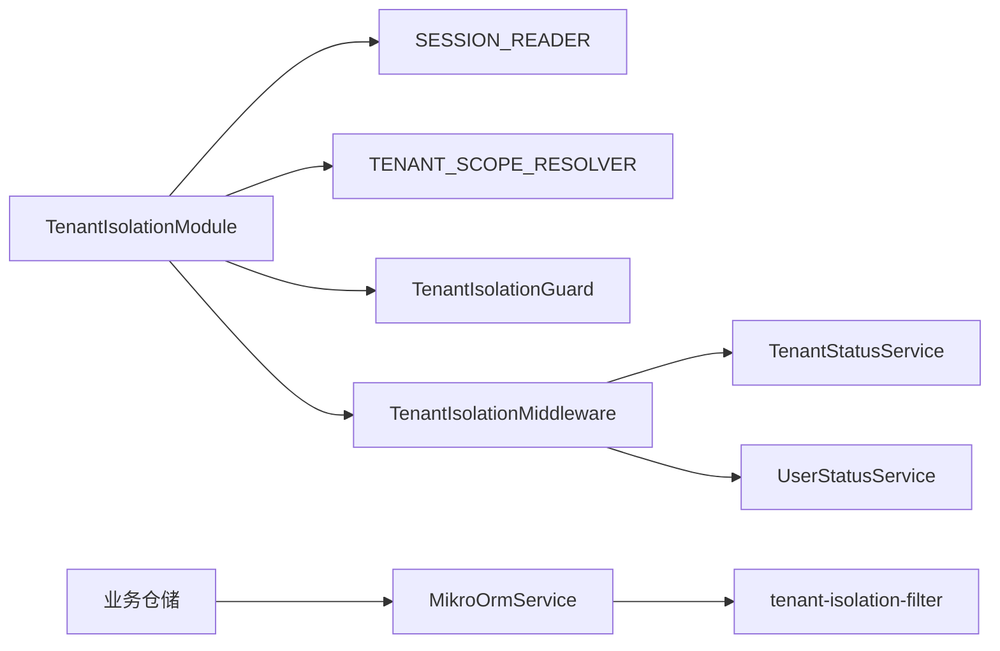

# 多租户数据隔离

<cite>
**本文引用的文件**   
- [libs/core/src/tenant-isolation/tenant-isolation-scope.ts](file://libs/core/src/tenant-isolation/tenant-isolation-scope.ts)
- [libs/core/src/tenant-isolation/tenant-isolation.middleware.ts](file://libs/core/src/tenant-isolation/tenant-isolation.middleware.ts)
- [libs/core/src/tenant-isolation/tenant-isolation.service.ts](file://libs/core/src/tenant-isolation/tenant-isolation.service.ts)
- [libs/core/src/tenant-isolation/tenant-isolation.guard.ts](file://libs/core/src/tenant-isolation/tenant-isolation.guard.ts)
- [apps/api/src/tenant-isolation/tenant-isolation.module.ts](file://apps/api/src/tenant-isolation/tenant-isolation.module.ts)
- [apps/api/src/database/mikro/tenant-isolation-filter.ts](file://apps/api/src/database/mikro/tenant-isolation-filter.ts)
- [apps/api/src/database/mikro/mikro-orm.service.ts](file://apps/api/src/database/mikro/mikro-orm.service.ts)
- [apps/api/src/modules/posts/infrastructure/repositories/mikro-post.repository.ts](file://apps/api/src/modules/posts/infrastructure/repositories/mikro-post.repository.ts)
- [apps/api/src/database/mikro/migration/migrations/Migration20261026192848_tenant_org_visibility.ts](file://apps/api/src/database/mikro/migration/migrations/Migration20261026192848_tenant_org_visibility.ts)
</cite>

## 目录
1. [引言](#引言)
2. [项目结构](#项目结构)
3. [核心组件](#核心组件)
4. [架构总览](#架构总览)
5. [详细组件分析](#详细组件分析)
6. [依赖关系分析](#依赖关系分析)
7. [性能与缓存](#性能与缓存)
8. [配置与模式选择](#配置与模式选择)
9. [监控与故障排查](#监控与故障排查)
10. [结论](#结论)

## 引言
本文件系统性说明该仓库的多租户数据隔离机制，覆盖行级安全、查询过滤、上下文注入、租户标识传递与验证、以及不同隔离模式的适用场景。重点围绕以下目标展开：
- 租户上下文的获取、传递、验证流程
- 全局行级隔离 filter 的装配与执行
- 租内跨组织可见性策略（shared/isolated）对查询的影响
- 单库多租户、分库多租户、混合模式的落地建议
- 批量操作、性能优化与可观测性实践

## 项目结构
多租户相关代码分布在“共享内核”和“应用 API”两层：
- 共享内核（@core/saas-kit）提供租户作用域定义、中间件、服务、守卫等横切能力
- 应用 API 层负责装配模块、ORM 连接、实体级 filter 注册与业务仓储调用

图表来源
- [libs/core/src/tenant-isolation/tenant-isolation-scope.ts:1-42](file://libs/core/src/tenant-isolation/tenant-isolation-scope.ts#L1-L42)
- [libs/core/src/tenant-isolation/tenant-isolation.middleware.ts:1-201](file://libs/core/src/tenant-isolation/tenant-isolation.middleware.ts#L1-L201)
- [libs/core/src/tenant-isolation/tenant-isolation.service.ts:1-116](file://libs/core/src/tenant-isolation/tenant-isolation.service.ts#L1-L116)
- [libs/core/src/tenant-isolation/tenant-isolation.guard.ts:1-69](file://libs/core/src/tenant-isolation/tenant-isolation.guard.ts#L1-L69)
- [apps/api/src/tenant-isolation/tenant-isolation.module.ts:1-73](file://apps/api/src/tenant-isolation/tenant-isolation.module.ts#L1-L73)
- [apps/api/src/database/mikro/mikro-orm.service.ts:1-92](file://apps/api/src/database/mikro/mikro-orm.service.ts#L1-L92)
- [apps/api/src/database/mikro/tenant-isolation-filter.ts:1-138](file://apps/api/src/database/mikro/tenant-isolation-filter.ts#L1-L138)
- [apps/api/src/modules/posts/infrastructure/repositories/mikro-post.repository.ts:80-99](file://apps/api/src/modules/posts/infrastructure/repositories/mikro-post.repository.ts#L80-L99)

章节来源
- [README.md:32-39](file://README.md#L32-L39)
- [README.md:103-112](file://README.md#L103-L112)

## 核心组件
- 租户作用域（TenantIsolationScope）：以 AsyncLocalStorage 承载每请求的租户主轴 tenantId、二级轴 organizationId、工作区 workspaceId、用户 userId、角色 role、租内可见性 orgVisibility
- 租户中间件（TenantIsolationMiddleware）：解析会话、校验封禁状态、派生活动租户、绑定 ALS 作用域
- 租户服务（TenantIsolationService）：暴露只读访问器与 fail-closed 断言 requireActiveTenantId()/requireActiveOrganizationId()
- 租户守卫（TenantIsolationGuard）：全局 fail-closed 闸门，要求存在活动租户；支持 @Public/@TenantIsolationExempt 旁路
- 租户隔离模块（TenantIsolationModule）：全局装配中间件、守卫、端口适配（会话读取、租户范围解析）
- MikroORM 服务（MikroOrmService）：懒建连接、per-operation fork、按 ALS 注入全局 filter 参数
- 租户隔离 Filter（tenant-isolation-filter）：基于 tenantId 恒过滤，并在 orgVisibility=isolated 且存在活动组织时追加 organizationId 收窄；无租户上下文时豁免不筛

章节来源
- [libs/core/src/tenant-isolation/tenant-isolation-scope.ts:1-42](file://libs/core/src/tenant-isolation/tenant-isolation-scope.ts#L1-L42)
- [libs/core/src/tenant-isolation/tenant-isolation.middleware.ts:1-201](file://libs/core/src/tenant-isolation/tenant-isolation.middleware.ts#L1-L201)
- [libs/core/src/tenant-isolation/tenant-isolation.service.ts:1-116](file://libs/core/src/tenant-isolation/tenant-isolation.service.ts#L1-L116)
- [libs/core/src/tenant-isolation/tenant-isolation.guard.ts:1-69](file://libs/core/src/tenant-isolation/tenant-isolation.guard.ts#L1-L69)
- [apps/api/src/tenant-isolation/tenant-isolation.module.ts:1-73](file://apps/api/src/tenant-isolation/tenant-isolation.module.ts#L1-L73)
- [apps/api/src/database/mikro/mikro-orm.service.ts:1-92](file://apps/api/src/database/mikro/mikro-orm.service.ts#L1-L92)
- [apps/api/src/database/mikro/tenant-isolation-filter.ts:1-138](file://apps/api/src/database/mikro/tenant-isolation-filter.ts#L1-L138)

## 架构总览
下图展示一次受保护请求从进入网关到数据库查询的完整链路，体现租户上下文如何被解析、传播并自动附加到 SQL 条件中。

图表来源
- [libs/core/src/tenant-isolation/tenant-isolation.guard.ts:1-69](file://libs/core/src/tenant-isolation/tenant-isolation.guard.ts#L1-L69)
- [libs/core/src/tenant-isolation/tenant-isolation.service.ts:1-116](file://libs/core/src/tenant-isolation/tenant-isolation.service.ts#L1-L116)
- [apps/api/src/database/mikro/mikro-orm.service.ts:46-66](file://apps/api/src/database/mikro/mikro-orm.service.ts#L46-L66)
- [apps/api/src/database/mikro/tenant-isolation-filter.ts:108-137](file://apps/api/src/database/mikro/tenant-isolation-filter.ts#L108-L137)
- [apps/api/src/modules/posts/infrastructure/repositories/mikro-post.repository.ts:80-99](file://apps/api/src/modules/posts/infrastructure/repositories/mikro-post.repository.ts#L80-L99)

## 详细组件分析

### 租户上下文获取与传递
- 中间件从可信会话读取用户与活动组织，必要时通过租户范围解析器将活动组织提升为主轴 tenantId
- 对用户封禁、租户封禁进行 fail-closed 检查；解析失败或不可用时不绑定主轴，守卫后续拒绝
- 将 tenantId、organizationId、workspaceId、userId、role、orgVisibility 写入 AsyncLocalStorage，供下游服务与仓储消费

图表来源
- [libs/core/src/tenant-isolation/tenant-isolation.middleware.ts:50-201](file://libs/core/src/tenant-isolation/tenant-isolation.middleware.ts#L50-L201)

章节来源
- [libs/core/src/tenant-isolation/tenant-isolation.middleware.ts:1-201](file://libs/core/src/tenant-isolation/tenant-isolation.middleware.ts#L1-L201)
- [libs/core/src/tenant-isolation/tenant-isolation-scope.ts:1-42](file://libs/core/src/tenant-isolation/tenant-isolation-scope.ts#L1-L42)

### 租户守卫与验证
- 全局守卫默认要求活动租户存在；@Public 或 @TenantIsolationExempt 可旁路
- 无活动租户时抛出 403，错误码统一为 ISOLATION_NO_ACTIVE_CONTEXT
- 守卫仅做“是否存在活动租户”的闸口判断，具体行级过滤由仓储层机制保障

图表来源
- [libs/core/src/tenant-isolation/tenant-isolation.guard.ts:14-69](file://libs/core/src/tenant-isolation/tenant-isolation.guard.ts#L14-L69)
- [libs/core/src/tenant-isolation/tenant-isolation.service.ts:82-97](file://libs/core/src/tenant-isolation/tenant-isolation.service.ts#L82-L97)

章节来源
- [libs/core/src/tenant-isolation/tenant-isolation.guard.ts:1-69](file://libs/core/src/tenant-isolation/tenant-isolation.guard.ts#L1-L69)
- [libs/core/src/tenant-isolation/tenant-isolation.service.ts:1-116](file://libs/core/src/tenant-isolation/tenant-isolation.service.ts#L1-L116)

### 行级隔离与查询过滤
- 全局 filter 名 tenantIsolation，默认启用；参数来自 ALS 派生的 tenantId、organizationId、orgIsolated
- 当 orgVisibility=isolated 且存在活动组织时，追加 organizationId 条件；若无活动组织且命中 org-partitioned 实体，则使用哨兵值拒所有
- 无 tenantId 上下文时（平台治理、迁移、seed、saga），filter 条件为空，不筛（fail-open 豁免）

图表来源
- [apps/api/src/database/mikro/tenant-isolation-filter.ts:65-87](file://apps/api/src/database/mikro/tenant-isolation-filter.ts#L65-L87)
- [apps/api/src/database/mikro/tenant-isolation-filter.ts:108-137](file://apps/api/src/database/mikro/tenant-isolation-filter.ts#L108-L137)

章节来源
- [apps/api/src/database/mikro/tenant-isolation-filter.ts:1-138](file://apps/api/src/database/mikro/tenant-isolation-filter.ts#L1-L138)

### ORM 装配与 EM fork
- MikroOrmService.fork 默认 scoped=true，从 ALS 派生租户隔离参数并注入 EM
- 在事务 UoW 内复用事务 EM，避免重复 BEGIN；非事务路径创建新 EM
- 支持 scoped=false 绕过全局 filter，用于跨租治理/目录读面

图表来源
- [apps/api/src/database/mikro/mikro-orm.service.ts:46-66](file://apps/api/src/database/mikro/mikro-orm.service.ts#L46-L66)
- [apps/api/src/database/mikro/tenant-isolation-filter.ts:130-137](file://apps/api/src/database/mikro/tenant-isolation-filter.ts#L130-L137)

章节来源
- [apps/api/src/database/mikro/mikro-orm.service.ts:1-92](file://apps/api/src/database/mikro/mikro-orm.service.ts#L1-L92)
- [apps/api/src/database/mikro/tenant-isolation-filter.ts:130-137](file://apps/api/src/database/mikro/tenant-isolation-filter.ts#L130-L137)

### 业务仓储中的租户过滤
- 仓储在查询前组装 where 条件，通常包含租户隔离谓词
- 分页 cursor 解码后追加 id 比较条件，保证稳定排序与无重无漏
- 通过 mikro.fork() 获取 EM，使全局 filter 参数生效

图表来源
- [apps/api/src/modules/posts/infrastructure/repositories/mikro-post.repository.ts:80-99](file://apps/api/src/modules/posts/infrastructure/repositories/mikro-post.repository.ts#L80-L99)

章节来源
- [apps/api/src/modules/posts/infrastructure/repositories/mikro-post.repository.ts:80-99](file://apps/api/src/modules/posts/infrastructure/repositories/mikro-post.repository.ts#L80-L99)

## 依赖关系分析
- 租户隔离模块依赖会话读取端口与租户范围解析端口，解耦认证实现与 ORM 细节
- 中间件依赖租户状态服务与用户状态服务进行封禁检查
- ORM 服务依赖租户隔离 filter 的参数装配函数
- 业务仓储依赖 ORM 服务获取 EM，间接依赖租户隔离 filter

图表来源
- [apps/api/src/tenant-isolation/tenant-isolation.module.ts:1-73](file://apps/api/src/tenant-isolation/tenant-isolation.module.ts#L1-L73)
- [libs/core/src/tenant-isolation/tenant-isolation.middleware.ts:1-201](file://libs/core/src/tenant-isolation/tenant-isolation.middleware.ts#L1-L201)
- [apps/api/src/database/mikro/mikro-orm.service.ts:1-92](file://apps/api/src/database/mikro/mikro-orm.service.ts#L1-L92)
- [apps/api/src/database/mikro/tenant-isolation-filter.ts:1-138](file://apps/api/src/database/mikro/tenant-isolation-filter.ts#L1-L138)

章节来源
- [apps/api/src/tenant-isolation/tenant-isolation.module.ts:1-73](file://apps/api/src/tenant-isolation/tenant-isolation.module.ts#L1-L73)
- [libs/core/src/tenant-isolation/tenant-isolation.middleware.ts:1-201](file://libs/core/src/tenant-isolation/tenant-isolation.middleware.ts#L1-L201)
- [apps/api/src/database/mikro/mikro-orm.service.ts:1-92](file://apps/api/src/database/mikro/mikro-orm.service.ts#L1-L92)
- [apps/api/src/database/mikro/tenant-isolation-filter.ts:1-138](file://apps/api/src/database/mikro/tenant-isolation-filter.ts#L1-L138)

## 性能与缓存
- 懒建 ORM 连接：首次真正使用时才建立连接，避免冒烟测试与健康检查阶段触发数据库连接
- per-operation fork：每次读写取独立 EM，避免跨请求共享导致的作用域污染
- 全局 filter 参数化：通过 setFilterParams 注入，无需在每个仓储手写 where tenantId
- 权限缓存：授权检查器按 (tenant, role) 二元组缓存，减少频繁查授权表
- 分页优化：使用 cursor + id DESC 排序，避免 COUNT 全量扫描

章节来源
- [apps/api/src/database/mikro/mikro-orm.service.ts:10-20](file://apps/api/src/database/mikro/mikro-orm.service.ts#L10-L20)
- [apps/api/src/database/mikro/mikro-orm.service.ts:46-66](file://apps/api/src/database/mikro/mikro-orm.service.ts#L46-L66)
- [apps/api/src/modules/posts/infrastructure/repositories/mikro-post.repository.ts:80-99](file://apps/api/src/modules/posts/infrastructure/repositories/mikro-post.repository.ts#L80-L99)

## 配置与模式选择

### 隔离模式与适用场景
- 单库多租户（推荐默认）
  - 所有租户共享同一数据库实例与 schema
  - 通过 tenantId 列与全局 filter 实现行级隔离
  - 适合中小规模、成本敏感、运维简单场景
- 分库多租户
  - 每个租户独立数据库实例或 schema
  - 可通过连接路由或租户感知 ORM 配置实现
  - 适合强合规、高隔离需求、超大租户体量场景
- 混合模式
  - 核心系统库与租户库分离，或按租户等级拆分
  - 平台治理走系统库，租户数据走租户库
  - 需要跨库事务补偿或事件驱动同步

### 租内跨组织可见性
- shared（默认）：同租内组织间互见
- isolated：同租内组织间隔离，需活动组织时才追加 organizationId 收窄；无活动组织时对 org-partitioned 实体拒所有
- 通过 tenant.orgVisibility 控制，迁移已添加该列并设置默认 shared

章节来源
- [apps/api/src/database/mikro/migration/migrations/Migration20261026192848_tenant_org_visibility.ts:1-26](file://apps/api/src/database/mikro/migration/migrations/Migration20261026192848_tenant_org_visibility.ts#L1-L26)
- [apps/api/src/database/mikro/tenant-isolation-filter.ts:1-21](file://apps/api/src/database/mikro/tenant-isolation-filter.ts#L1-L21)

### 租户标识注入方式
- 请求头 x-workspace-id：作为工作区选择器，仅在受信租户内收窄，不作为独立安全边界
- 会话 activeOrganizationId：作为二级轴，用于归属与派生
- 显式 activeTenantId：优先于活动组织派生，解绑 org 绑架问题
- 角色 role：随活动租户解析，供授权裁决使用

章节来源
- [libs/core/src/tenant-isolation/tenant-isolation.middleware.ts:62-71](file://libs/core/src/tenant-isolation/tenant-isolation.middleware.ts#L62-L71)
- [libs/core/src/tenant-isolation/tenant-isolation.middleware.ts:127-149](file://libs/core/src/tenant-isolation/tenant-isolation.middleware.ts#L127-L149)
- [libs/core/src/tenant-isolation/tenant-isolation.service.ts:38-52](file://libs/core/src/tenant-isolation/tenant-isolation.service.ts#L38-L52)

### 查询条件自动添加
- 全局 filter 在 EM 级别注入 tenantId，必要时追加 organizationId
- 业务仓储无需手写 where tenantId，但保留手写谓词作为双保险
- 跨租治理/迁移/seed 等无 ALS 租户上下文时，filter 条件为空，不筛

章节来源
- [apps/api/src/database/mikro/tenant-isolation-filter.ts:14-21](file://apps/api/src/database/mikro/tenant-isolation-filter.ts#L14-L21)
- [apps/api/src/database/mikro/tenant-isolation-filter.ts:65-87](file://apps/api/src/database/mikro/tenant-isolation-filter.ts#L65-L87)
- [apps/api/src/database/mikro/mikro-orm.service.ts:50-66](file://apps/api/src/database/mikro/mikro-orm.service.ts#L50-L66)

### 数据访问安全保障
- 守卫 fail-closed：无活动租户即 403
- 全局 filter：租户地板永不放松，跨租硬地板始终存在
- 组织隔离：isolated 模式下无活动组织对 org-partitioned 实体拒所有
- 双保险：机制（全局 filter）+ 纪律（仓储手写 where）并存

章节来源
- [libs/core/src/tenant-isolation/tenant-isolation.guard.ts:14-69](file://libs/core/src/tenant-isolation/tenant-isolation.guard.ts#L14-L69)
- [apps/api/src/database/mikro/tenant-isolation-filter.ts:4-21](file://apps/api/src/database/mikro/tenant-isolation-filter.ts#L4-L21)
- [apps/api/src/database/mikro/tenant-isolation-filter.ts:56-87](file://apps/api/src/database/mikro/tenant-isolation-filter.ts#L56-L87)

### 批量操作处理
- 仓储批量插入/更新应使用 em.persistMany/em.flush 或 nativeInsertMany
- 注意外键顺序：先角色再授权，避免 FK 抢跑
- 在事务 UoW 内批量提交，确保域行与事件行同生共死

章节来源
- [apps/api/src/modules/authorization/infrastructure/repositories/mikro-organization-rbac.repository.ts:85-96](file://apps/api/src/modules/authorization/infrastructure/repositories/mikro-organization-rbac.repository.ts#L85-L96)
- [apps/api/src/database/mikro/mikro-orm.service.ts:46-66](file://apps/api/src/database/mikro/mikro-orm.service.ts#L46-L66)

## 监控与故障排查
- 常见错误码
  - ISOLATION_NO_ACTIVE_CONTEXT：无活动租户上下文（守卫或服务断言失败）
- 排查步骤
  - 确认会话是否成功解析（x-workspace-id、activeOrganizationId、activeTenantId）
  - 检查租户/用户封禁状态
  - 核对 orgVisibility 是否为 isolated 且存在活动组织
  - 确认仓储是否通过 mikro.fork() 获取 EM，而非直接使用全局 EM
  - 对于跨租治理/目录读面，确认是否使用 fork({ scoped: false }) 绕过全局 filter
- 日志与指标
  - 中间件捕获异常并记录警告日志
  - 建议在网关层统计 403 比例、租户上下文缺失率、filter 命中率

章节来源
- [libs/core/src/tenant-isolation/tenant-isolation.guard.ts:52-67](file://libs/core/src/tenant-isolation/tenant-isolation.guard.ts#L52-L67)
- [libs/core/src/tenant-isolation/tenant-isolation.service.ts:82-115](file://libs/core/src/tenant-isolation/tenant-isolation.service.ts#L82-L115)
- [libs/core/src/tenant-isolation/tenant-isolation.middleware.ts:195-198](file://libs/core/src/tenant-isolation/tenant-isolation.middleware.ts#L195-L198)

## 结论
该仓库的多租户数据隔离以“机制优先、纪律兜底”为原则：
- 通过中间件解析与会话绑定，守卫 fail-closed 强制活动租户
- 通过全局 filter 在 EM 层面注入 tenantId，必要时追加 organizationId
- 通过 orgVisibility 控制租内跨组织可见性，isolated 模式严格收窄
- 通过 ORM 懒建、per-operation fork、权限缓存与分页优化提升性能
- 通过明确的分层与端口倒置，保持机制与业务解耦，便于演进与扩展