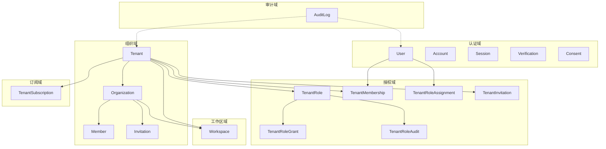
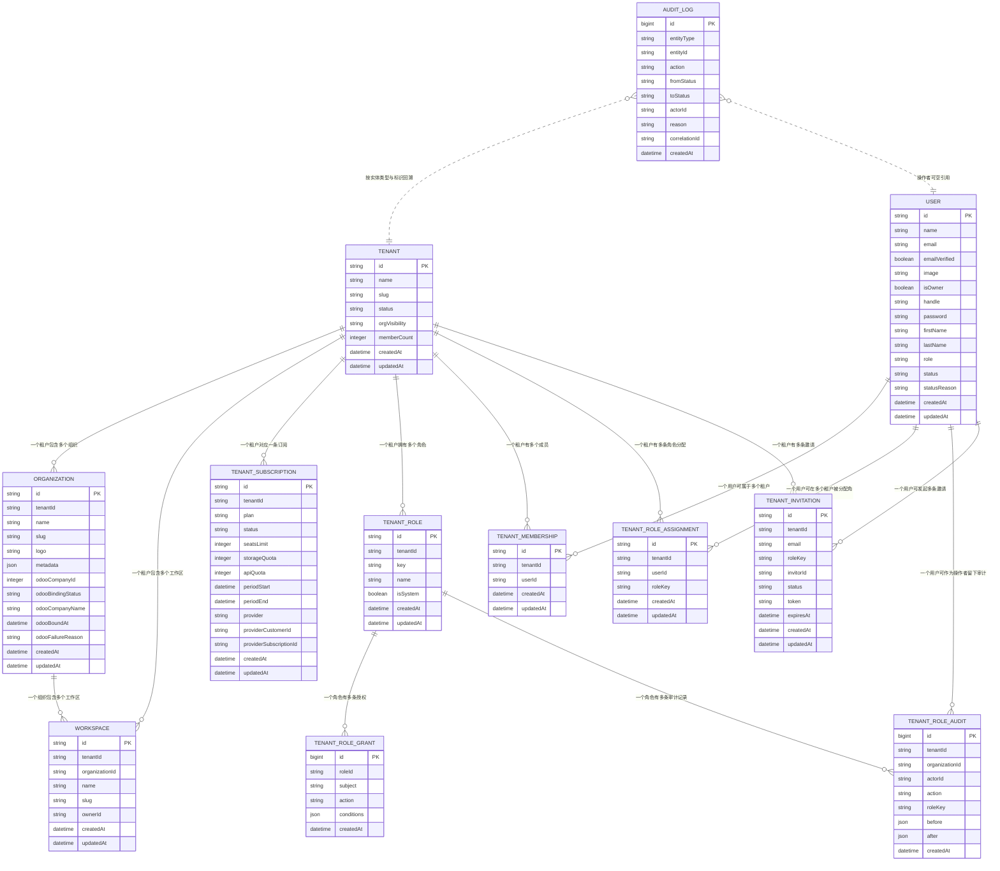
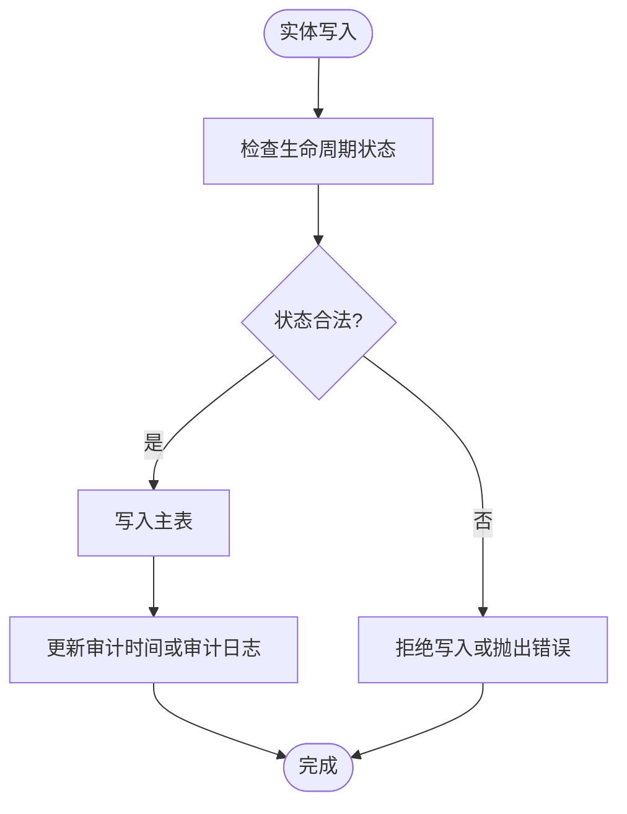
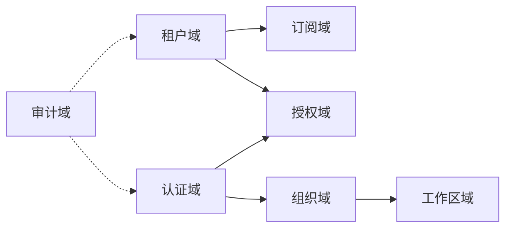

# 实体模型设计

<cite>
**本文引用的文件**   
- [README.md](file://README.md)
- [ba-org.entities.ts](file://apps/api/src/modules/organizations/infrastructure/entities/ba-org.entities.ts)
- [tenant.entity.ts](file://apps/api/src/modules/organizations/infrastructure/entities/tenant.entity.ts)
- [workspace.entity.ts](file://apps/api/src/modules/workspaces/infrastructure/entities/workspace.entity.ts)
- [ba-identity.entities.ts](file://apps/api/src/modules/auth/infrastructure/entities/ba-identity.entities.ts)
- [rbac.entities.ts](file://apps/api/src/modules/authorization/infrastructure/entities/rbac.entities.ts)
- [tenant-subscription.entity.ts](file://apps/api/src/modules/subscriptions/infrastructure/entities/tenant-subscription.entity.ts)
- [audit-log.entity.ts](file://apps/api/src/modules/organizations/infrastructure/entities/audit-log.entity.ts)
- [migration-entities.ts](file://apps/api/src/database/mikro/migration/migration-entities.ts)
</cite>

## 目录
1. [引言](#引言)
2. [项目结构与实体定位](#项目结构与实体定位)
3. [核心业务实体总览](#核心业务实体总览)
4. [架构与实体关系总图](#架构与实体关系总图)
5. [详细实体定义](#详细实体定义)
6. [实体关联关系设计](#实体关联关系设计)
7. [继承体系与抽象基类](#继承体系与抽象基类)
8. [生命周期、软删除与审计字段](#生命周期软删除与审计字段)
9. [数据验证规则与业务约束](#数据验证规则与业务约束)
10. [样例数据说明](#样例数据说明)
11. [依赖分析与隔离机制](#依赖分析与隔离机制)
12. [性能与索引策略](#性能与索引策略)
13. [常见问题排查](#常见问题排查)
14. [结论](#结论)

## 引言
本文件面向“用户、组织、租户、工作区、权限、订阅”等 SaaS 多租户核心实体，给出完整的数据模型设计文档。内容覆盖字段属性、数据类型、约束条件、业务含义、实体间一对一/一对多/多对多关系、继承与抽象基类现状、生命周期管理、软删除与审计机制、数据验证规则、实体关系图与样例数据说明。

本项目采用 NestJS + MikroORM + PostgreSQL，以垂直切片组织模块；多租户能力贯穿认证、授权、组织、工作区、订阅、平台治理等上下文。数据库层通过列元数据单源派生迁移实体与运行时实体，并在多处使用行级租户隔离过滤。

**章节来源**
- [README.md:32-128](file://README.md#L32-L128)

## 项目结构与实体定位
实体主要分布在以下模块：
- 认证域：`User / Account / Session / Verification / Consent`
- 组织域：`Tenant / Organization / Member / Invitation`
- 工作区域：`Workspace`
- 授权域：`TenantRole / TenantRoleGrant / TenantRoleAudit / TenantMembership / TenantRoleAssignment / TenantInvitation`
- 订阅域：`TenantSubscription`
- 审计域：`AuditLog`
- 事件域（扩展）：`Event`

**图表来源**
- [ba-identity.entities.ts:31-145](file://apps/api/src/modules/auth/infrastructure/entities/ba-identity.entities.ts#L31-L145)
- [ba-org.entities.ts:27-95](file://apps/api/src/modules/organizations/infrastructure/entities/ba-org.entities.ts#L27-L95)
- [tenant.entity.ts:34-73](file://apps/api/src/modules/organizations/infrastructure/entities/tenant.entity.ts#L34-L73)
- [workspace.entity.ts:16-55](file://apps/api/src/modules/workspaces/infrastructure/entities/workspace.entity.ts#L16-L55)
- [rbac.entities.ts:27-248](file://apps/api/src/modules/authorization/infrastructure/entities/rbac.entities.ts#L27-L248)
- [tenant-subscription.entity.ts:19-65](file://apps/api/src/modules/subscriptions/infrastructure/entities/tenant-subscription.entity.ts#L19-L65)
- [audit-log.entity.ts:22-62](file://apps/api/src/modules/organizations/infrastructure/entities/audit-log.entity.ts#L22-L62)

**章节来源**
- [README.md:80-128](file://README.md#L80-L128)

## 核心业务实体总览
| 实体 | 表名 | 主键 | 关键外键 | 主要职责 |
|---|---|---|---|---|
| `User` | `user` | `id` | 无强外键（仅逻辑关联） | 全局用户身份、登录态、治理状态、基础资料 |
| `Tenant` | `tenant` | `id` | 无 | 租户顶层边界、准入状态、成员计数、可见性策略 |
| `Organization` | `organization` | `id` | `tenantId` | 租户下的组织容器、Odoo 公司映射、租内 slug 唯一 |
| `Workspace` | `workspace` | `id` | `tenantId`, `organizationId` | 租户与工作区两级边界中的工作区实例 |
| `TenantRole` | `tenant_role` | `id` | `tenantId` | 租户级角色定义 |
| `TenantRoleGrant` | `tenant_role_grant` | `id` | `roleId` | 角色授权明细（subject/action/conditions） |
| `TenantRoleAudit` | `tenant_role_audit` | `id` | `tenantId`, `organizationId`, `actorId` | 角色授权变更审计 |
| `TenantMembership` | `tenant_membership` | `id` | `tenantId`, `userId` | 用户与租户的成员关系 |
| `TenantRoleAssignment` | `tenant_role_assignment` | `id` | `tenantId`, `userId` | 用户在租户内的角色分配 |
| `TenantInvitation` | `tenant_invitation` | `id` | `tenantId`, `invitorId` | 租户邀请流程 |
| `TenantSubscription` | `tenant_subscription` | `id` | `tenantId` | 租户订阅计划、席位、配额、支付通道信息 |
| `AuditLog` | `audit_log` | `id` | `actorId` | 治理生命周期审计日志 |

**章节来源**
- [ba-identity.entities.ts:31-145](file://apps/api/src/modules/auth/infrastructure/entities/ba-identity.entities.ts#L31-L145)
- [tenant.entity.ts:34-73](file://apps/api/src/modules/organizations/infrastructure/entities/tenant.entity.ts#L34-L73)
- [ba-org.entities.ts:27-95](file://apps/api/src/modules/organizations/infrastructure/entities/ba-org.entities.ts#L27-L95)
- [workspace.entity.ts:16-55](file://apps/api/src/modules/workspaces/infrastructure/entities/workspace.entity.ts#L16-L55)
- [rbac.entities.ts:27-248](file://apps/api/src/modules/authorization/infrastructure/entities/rbac.entities.ts#L27-L248)
- [tenant-subscription.entity.ts:19-65](file://apps/api/src/modules/subscriptions/infrastructure/entities/tenant-subscription.entity.ts#L19-L65)
- [audit-log.entity.ts:22-62](file://apps/api/src/modules/organizations/infrastructure/entities/audit-log.entity.ts#L22-L62)

## 架构与实体关系总图
下图展示核心实体的关系与约束方向，包括一对一、一对多、多对多语义的落库实现方式。

**图表来源**
- [ba-identity.entities.ts:31-145](file://apps/api/src/modules/auth/infrastructure/entities/ba-identity.entities.ts#L31-L145)
- [tenant.entity.ts:34-73](file://apps/api/src/modules/organizations/infrastructure/entities/tenant.entity.ts#L34-L73)
- [ba-org.entities.ts:27-95](file://apps/api/src/modules/organizations/infrastructure/entities/ba-org.entities.ts#L27-L95)
- [workspace.entity.ts:16-55](file://apps/api/src/modules/workspaces/infrastructure/entities/workspace.entity.ts#L16-L55)
- [rbac.entities.ts:27-248](file://apps/api/src/modules/authorization/infrastructure/entities/rbac.entities.ts#L27-L248)
- [tenant-subscription.entity.ts:19-65](file://apps/api/src/modules/subscriptions/infrastructure/entities/tenant-subscription.entity.ts#L19-L65)
- [audit-log.entity.ts:22-62](file://apps/api/src/modules/organizations/infrastructure/entities/audit-log.entity.ts#L22-L62)

## 详细实体定义

### 用户实体（User）
- 主键：`id`（字符串）
- 身份字段：`name`、`email`、`emailVerified`、`image`
- 认证扩展：`isOwner`、`handle`、`password`
- 个人资料：`firstName`、`lastName`
- 平台角色：`role`（默认 `USER`）
- 治理状态：`status`（默认 `active`）、`statusReason`
- 审计时间：`createdAt`、`updatedAt`

业务含义：
- 全局用户身份，承载认证与基础资料。
- 治理状态用于用户暂停、恢复、软删等生命周期控制。
- `role` 为平台侧角色文本，供仓储与查询使用。

约束与校验：
- `status` 值域受 CHECK 约束，限制为 `active/suspended/deleted`。
- `email` 在迁移实体中建立唯一索引。

**章节来源**
- [ba-identity.entities.ts:31-65](file://apps/api/src/modules/auth/infrastructure/entities/ba-identity.entities.ts#L31-L65)
- [migration-entities.ts:51-90](file://apps/api/src/database/mikro/migration/migration-entities.ts#L51-L90)

### 租户实体（Tenant）
- 主键：`id`（字符串）
- 基本信息：`name`、`slug`
- 治理状态：`status`（默认 `active`）
- 组织可见性策略：`orgVisibility`（默认 `shared`）
- 成员数物化：`memberCount`（默认 `0`）
- 审计时间：`createdAt`、`updatedAt`

业务含义：
- 租户是 SaaS 多租户顶层边界。
- `status` 决定租户准入与治理阶段。
- `orgVisibility` 控制租内跨组织可见性策略。
- `memberCount` 由触发器维护，提供 O(1) 成员计数。

约束与校验：
- `slug` 全局唯一。
- `status` 与 `orgVisibility` 均受 CHECK 约束。

**章节来源**
- [tenant.entity.ts:34-73](file://apps/api/src/modules/organizations/infrastructure/entities/tenant.entity.ts#L34-L73)

### 组织实体（Organization）
- 主键：`id`（字符串）
- 归属：`tenantId`（可空，写路径强制盖章）
- 基本信息：`name`、`slug`、`logo`、`metadata`
- Odoo 绑定：`odooCompanyId`（唯一）、`odooBindingStatus`、`odooCompanyName`、`odooBoundAt`、`odooFailureReason`
- 审计时间：`createdAt`、`updatedAt`

业务含义：
- 组织是租户下的业务容器。
- `tenantId` 表示新层级 `Tenant ⊃ Organization`。
- Odoo 绑定列组用于双库物理隔离下的公司映射。

约束与校验：
- 租内 `slug` 唯一（复合唯一）。
- `odooBindingStatus` 值域受 CHECK 约束。
- 行级隔离过滤器已注册。

**章节来源**
- [ba-org.entities.ts:27-65](file://apps/api/src/modules/organizations/infrastructure/entities/ba-org.entities.ts#L27-L65)
- [migration-entities.ts:153-195](file://apps/api/src/database/mikro/migration/migration-entities.ts#L153-L195)

### 工作区实体（Workspace）
- 主键：`id`（字符串）
- 归属：`tenantId`（可空，写路径强制盖章）、`organizationId`
- 基本信息：`name`、`slug`
- 实例属主：`ownerId`（可空）
- 审计时间：`createdAt`、`updatedAt`

业务含义：
- 工作区是租户之下的强数据分区。
- `ownerId` 表示实例属主，NULL 表示不属任何人。

约束与校验：
- 组织内 `slug` 唯一。
- 行级隔离过滤器已注册。

**章节来源**
- [workspace.entity.ts:16-55](file://apps/api/src/modules/workspaces/infrastructure/entities/workspace.entity.ts#L16-L55)

### 角色与授权实体（RBAC）
- `TenantRole`：租户级角色定义，含系统角色标记。
- `TenantRoleGrant`：角色授权明细，支持 subject/action/conditions。
- `TenantRoleAudit`：角色授权变更审计，append-only。
- `TenantMembership`：用户与租户的成员关系。
- `TenantRoleAssignment`：用户在租户内的角色分配。
- `TenantInvitation`：租户邀请流程。

业务含义：
- RBAC 上收至租户维度，授权粒度支持实例条件模板。
- 成员关系与角色分配独立于 BA 组织维，形成租级 SSOT。
- 邀请接受后生成成员与角色分配。

约束与校验：
- `tenant_role` 在租户内 `key` 唯一。
- `tenant_membership`、`tenant_role_assignment`、`tenant_invitation` 均有复合唯一索引。
- 多表启用行级隔离过滤器。

**章节来源**
- [rbac.entities.ts:27-248](file://apps/api/src/modules/authorization/infrastructure/entities/rbac.entities.ts#L27-L248)

### 订阅实体（TenantSubscription）
- 主键：`id`（字符串）
- 归属：`tenantId`
- 计划与状态：`plan`、`status`（默认 `active`）
- 配额：`seatsLimit`、`storageQuota`、`apiQuota`
- 周期：`periodStart`、`periodEnd`
- 支付通道：`provider`、`providerCustomerId`、`providerSubscriptionId`
- 审计时间：`createdAt`、`updatedAt`

业务含义：
- 订阅计费单位上移至租户，按租户总量控制。
- 支持多云支付通道与周期计费。

约束与校验：
- 针对租户+状态、租户+周期建立索引。
- 行级隔离过滤器已注册。

**章节来源**
- [tenant-subscription.entity.ts:19-65](file://apps/api/src/modules/subscriptions/infrastructure/entities/tenant-subscription.entity.ts#L19-L65)

### 审计日志实体（AuditLog）
- 主键：`id`（自增）
- 实体追踪：`entityType`、`entityId`
- 动作与状态变迁：`action`、`fromStatus`、`toStatus`
- 操作者：`actorId`（可空）
- 原因与关联：`reason`、`correlationId`
- 审计时间：`createdAt`

业务含义：
- 治理生命周期审计账本，append-only。
- 支持多态实体追踪（租户/用户），即使被硬删仍保留痕迹。

约束与校验：
- 按实体类型+标识+时间建立索引。
- 操作者可空，避免操作者消亡导致留痕丢失。

**章节来源**
- [audit-log.entity.ts:22-62](file://apps/api/src/modules/organizations/infrastructure/entities/audit-log.entity.ts#L22-L62)

## 实体关联关系设计

### 一对一关系
- 租户与订阅：`Tenant` 与 `TenantSubscription` 为一对一语义（每租户一条订阅记录）。
- 组织与 Odoo 公司：`Organization.odooCompanyId` 唯一，表示一组织一公司映射。

实现方式：
- 通过唯一约束或应用层保证一对一语义。

**章节来源**
- [tenant-subscription.entity.ts:19-65](file://apps/api/src/modules/subscriptions/infrastructure/entities/tenant-subscription.entity.ts#L19-L65)
- [ba-org.entities.ts:41-49](file://apps/api/src/modules/organizations/infrastructure/entities/ba-org.entities.ts#L41-L49)

### 一对多关系
- 租户 → 组织：`Tenant.id` → `Organization.tenantId`
- 租户 → 工作区：`Tenant.id` → `Workspace.tenantId`
- 组织 → 工作区：`Organization.id` → `Workspace.organizationId`
- 租户 → 角色：`Tenant.id` → `TenantRole.tenantId`
- 角色 → 授权：`TenantRole.id` → `TenantRoleGrant.roleId`
- 角色 → 审计：`TenantRole.id` → `TenantRoleAudit.roleId`

实现方式：
- 通过外键列与级联删除策略表达父子关系。

**章节来源**
- [ba-org.entities.ts:31-36](file://apps/api/src/modules/organizations/infrastructure/entities/ba-org.entities.ts#L31-L36)
- [workspace.entity.ts:21-25](file://apps/api/src/modules/workspaces/infrastructure/entities/workspace.entity.ts#L21-L25)
- [rbac.entities.ts:30-40](file://apps/api/src/modules/authorization/infrastructure/entities/rbac.entities.ts#L30-L40)
- [rbac.entities.ts:45-59](file://apps/api/src/modules/authorization/infrastructure/entities/rbac.entities.ts#L45-L59)

### 多对多关系
- 用户 ↔ 租户：通过 `TenantMembership` 实现。
- 用户 ↔ 租户角色：通过 `TenantRoleAssignment` 实现。
- 组织 ↔ 成员：BA `Member` 表维持组织成员关系。

实现方式：
- 中间表承载多对多语义，并附加角色、状态、时间等维度。

**章节来源**
- [rbac.entities.ts:141-175](file://apps/api/src/modules/authorization/infrastructure/entities/rbac.entities.ts#L141-L175)
- [ba-org.entities.ts:67-77](file://apps/api/src/modules/organizations/infrastructure/entities/ba-org.entities.ts#L67-L77)

## 继承体系与抽象基类
当前代码未使用 ORM 层面的类继承或抽象基类来共享字段；审计字段（如 `createdAt`、`updatedAt`）在各实体中重复声明。项目采用“列元数据单源 + 运行时实体派生”的方式统一 DDL 与运行时形状，而非类继承。

因此：
- 不存在 ORM 继承体系。
- 审计字段通过各实体显式声明。
- 一致性通过迁移实体与运行时实体同源工厂保障。

**章节来源**
- [tenant.entity.ts:34-73](file://apps/api/src/modules/organizations/infrastructure/entities/tenant.entity.ts#L34-L73)
- [workspace.entity.ts:16-55](file://apps/api/src/modules/workspaces/infrastructure/entities/workspace.entity.ts#L16-L55)
- [tenant-subscription.entity.ts:19-65](file://apps/api/src/modules/subscriptions/infrastructure/entities/tenant-subscription.entity.ts#L19-L65)

## 生命周期、软删除与审计字段

### 生命周期
- 租户：`status` 控制准入与治理阶段（如 `active`）。
- 用户：`status` 控制用户治理状态（`active/suspended/deleted`）。
- 组织：不再持有准入态，治理真相收敛到租户 `status`。
- 订阅：`status` 控制订阅状态（默认 `active`）。

### 软删除
- 用户治理状态包含 `deleted`，体现软删语义。
- 其他实体未使用统一的 `deletedAt` 软删除列；治理行为通过状态列与审计日志表达。

### 审计字段
- 多数实体包含 `createdAt`、`updatedAt`。
- `AuditLog` 为 append-only 审计账本，无 `updatedAt`。
- 角色授权变更通过 `TenantRoleAudit` 记录。

**图表来源**
- [tenant.entity.ts:41-52](file://apps/api/src/modules/organizations/infrastructure/entities/tenant.entity.ts#L41-L52)
- [ba-identity.entities.ts:56-64](file://apps/api/src/modules/auth/infrastructure/entities/ba-identity.entities.ts#L56-L64)
- [audit-log.entity.ts:22-62](file://apps/api/src/modules/organizations/infrastructure/entities/audit-log.entity.ts#L22-L62)

**章节来源**
- [tenant.entity.ts:41-52](file://apps/api/src/modules/organizations/infrastructure/entities/tenant.entity.ts#L41-L52)
- [ba-identity.entities.ts:56-64](file://apps/api/src/modules/auth/infrastructure/entities/ba-identity.entities.ts#L56-L64)
- [audit-log.entity.ts:22-62](file://apps/api/src/modules/organizations/infrastructure/entities/audit-log.entity.ts#L22-L62)

## 数据验证规则与业务约束

### 值域约束
- 租户状态：`status` 受 CHECK 约束。
- 组织 Odoo 绑定状态：`odooBindingStatus` 受 CHECK 约束。
- 用户状态：`status` 受 CHECK 约束。
- 组织可见性策略：`orgVisibility` 受 CHECK 约束。

### 唯一性与索引
- 租户 `slug` 全局唯一。
- 组织租内 `slug` 唯一。
- 工作区组织内 `slug` 唯一。
- 角色租户内 `key` 唯一。
- 成员、角色分配、邀请均有复合唯一索引。
- 订阅针对租户+状态、租户+周期建立索引。

### 外键与级联
- 工作区、订阅、角色、成员、邀请等表对 `tenantId` 使用级联删除。
- 审计表对 `actorId` 使用 set null，避免操作者消亡导致留痕丢失。

**章节来源**
- [tenant.entity.ts:54-60](file://apps/api/src/modules/organizations/infrastructure/entities/tenant.entity.ts#L54-L60)
- [ba-org.entities.ts:55-59](file://apps/api/src/modules/organizations/infrastructure/entities/ba-org.entities.ts#L55-L59)
- [workspace.entity.ts:34-38](file://apps/api/src/modules/workspaces/infrastructure/entities/workspace.entity.ts#L34-L38)
- [rbac.entities.ts:42-59](file://apps/api/src/modules/authorization/infrastructure/entities/rbac.entities.ts#L42-L59)
- [rbac.entities.ts:151-199](file://apps/api/src/modules/authorization/infrastructure/entities/rbac.entities.ts#L151-L199)
- [tenant-subscription.entity.ts:38-44](file://apps/api/src/modules/subscriptions/infrastructure/entities/tenant-subscription.entity.ts#L38-L44)
- [audit-log.entity.ts:34-43](file://apps/api/src/modules/organizations/infrastructure/entities/audit-log.entity.ts#L34-L43)

## 样例数据说明
以下为概念性样例，用于帮助理解实体关系与字段取值范围（非仓库真实数据）：

- 租户样例：
  - `id`: "t1"
  - `name`: "示例租户"
  - `slug`: "example-tenant"
  - `status`: "active"
  - `orgVisibility`: "shared"
  - `memberCount`: 3

- 用户样例：
  - `id`: "u1"
  - `name`: "张三"
  - `email`: "zhangsan@example.com"
  - `emailVerified`: true
  - `role`: "USER"
  - `status`: "active"

- 组织样例：
  - `id`: "org1"
  - `tenantId`: "t1"
  - `name`: "示例组织"
  - `slug`: "example-org"
  - `odooBindingStatus`: "bound"

- 工作区样例：
  - `id`: "w1"
  - `tenantId`: "t1"
  - `organizationId`: "org1"
  - `name`: "示例工作区"
  - `slug`: "example-workspace"
  - `ownerId`: "u1"

- 角色与授权样例：
  - `TenantRole`: `tenantId`="t1", `key`="admin", `name`="管理员", `isSystem`=true
  - `TenantRoleGrant`: `roleId`=角色ID, `subject`="workspace", `action`="create", `conditions`=null
  - `TenantRoleAssignment`: `tenantId`="t1", `userId`="u1", `roleKey`="admin"

- 订阅样例：
  - `id`: "sub1"
  - `tenantId`: "t1"
  - `plan`: "pro"
  - `status`: "active"
  - `seatsLimit`: 10
  - `storageQuota`: 100
  - `apiQuota`: 1000
  - `periodStart`: "2026-01-01T00:00:00Z"
  - `periodEnd`: "2027-01-01T00:00:00Z"

- 审计日志样例：
  - `entityType`: "tenant"
  - `entityId`: "t1"
  - `action`: "approve"
  - `fromStatus`: "pending_approval"
  - `toStatus`: "active"
  - `actorId`: "u1"
  - `reason`: "平台审批通过"

[本节为概念性样例，不直接分析具体源码文件]

## 依赖分析与隔离机制

### 组件耦合与内聚
- 认证域与授权域通过用户与成员关系解耦。
- 组织与工作区通过租户与工作区双重归属形成清晰层次。
- 订阅与租户绑定，体现计费单位上移。
- 审计日志作为横切关注点，独立于业务实体。

### 外部依赖
- Better Auth 契约影响 `User/Account/Session/Verification/Consent` 表结构。
- MikroORM 迁移实体与运行时实体同源派生。
- 租户隔离过滤器在多表注册，实现行级数据隔离。

**图表来源**
- [ba-identity.entities.ts:31-145](file://apps/api/src/modules/auth/infrastructure/entities/ba-identity.entities.ts#L31-L145)
- [rbac.entities.ts:27-248](file://apps/api/src/modules/authorization/infrastructure/entities/rbac.entities.ts#L27-L248)
- [tenant.entity.ts:34-73](file://apps/api/src/modules/organizations/infrastructure/entities/tenant.entity.ts#L34-L73)
- [tenant-subscription.entity.ts:19-65](file://apps/api/src/modules/subscriptions/infrastructure/entities/tenant-subscription.entity.ts#L19-L65)
- [audit-log.entity.ts:22-62](file://apps/api/src/modules/organizations/infrastructure/entities/audit-log.entity.ts#L22-L62)

**章节来源**
- [README.md:80-128](file://README.md#L80-L128)

## 性能与索引策略
- 租户成员计数物化于 `tenant.memberCount`，避免频繁聚合计算。
- 订阅针对租户+状态、租户+周期建立索引，提升查询效率。
- 工作区针对组织+属主建立索引，优化按组织与属主查询。
- 审计日志按实体类型+标识+时间建立索引，支持按实体回溯。

**章节来源**
- [tenant.entity.ts:47-50](file://apps/api/src/modules/organizations/infrastructure/entities/tenant.entity.ts#L47-L50)
- [tenant-subscription.entity.ts:38-41](file://apps/api/src/modules/subscriptions/infrastructure/entities/tenant-subscription.entity.ts#L38-L41)
- [workspace.entity.ts:34-36](file://apps/api/src/modules/workspaces/infrastructure/entities/workspace.entity.ts#L34-L36)
- [audit-log.entity.ts:41-43](file://apps/api/src/modules/organizations/infrastructure/entities/audit-log.entity.ts#L41-L43)

## 常见问题排查
- 租户隔离失效：检查是否在使用 `fork({ scoped: false })` 绕过过滤，或是否正确设置 ALS 租户上下文。
- 角色授权漂移：核对 `tenant_role` 与 `tenant_role_grant` 的一致性，确认 conditions 模板解析正确。
- 订阅计费异常：确认 `tenant_subscription` 的 `tenantId` 与 `periodStart/periodEnd` 是否正确。
- 审计缺失：检查治理流程是否调用审计存储，确认 append-only 写入成功。

**章节来源**
- [tenant-isolation-filter.test.ts:144-182](file://apps/api/src/database/mikro/tenant-isolation-filter.test.ts#L144-L182)
- [rbac.entities.ts:45-59](file://apps/api/src/modules/authorization/infrastructure/entities/rbac.entities.ts#L45-L59)
- [tenant-subscription.entity.ts:19-65](file://apps/api/src/modules/subscriptions/infrastructure/entities/tenant-subscription.entity.ts#L19-L65)
- [audit-log.entity.ts:22-62](file://apps/api/src/modules/organizations/infrastructure/entities/audit-log.entity.ts#L22-L62)

## 结论
本实体模型围绕多租户 SaaS 的核心需求构建，明确划分了用户、租户、组织、工作区、权限、订阅与审计的职责边界。通过值域 CHECK 约束、唯一索引、外键级联与行级隔离过滤器，确保数据一致性与安全性。虽然未使用 ORM 继承体系，但通过列元数据单源与运行时实体派生实现了 DDL 与运行时形状的一致性。未来可在需要时引入抽象基类或领域对象封装，进一步提升建模清晰度与维护性。