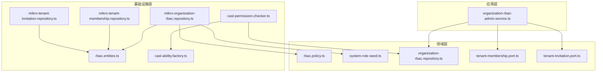
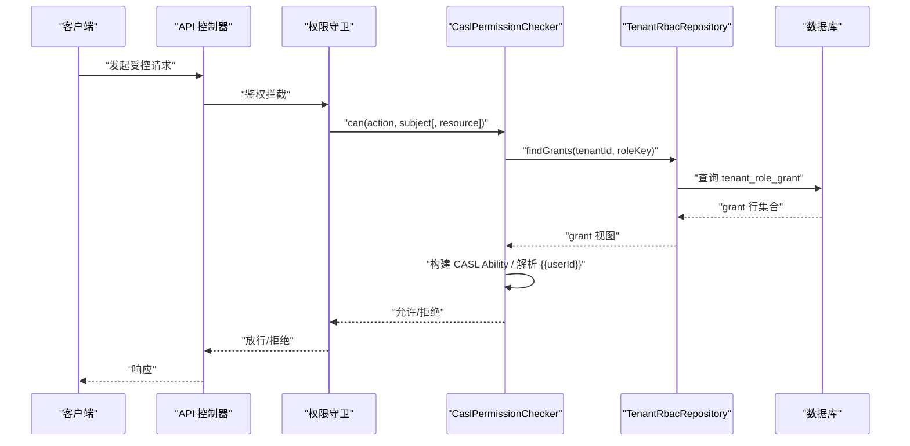
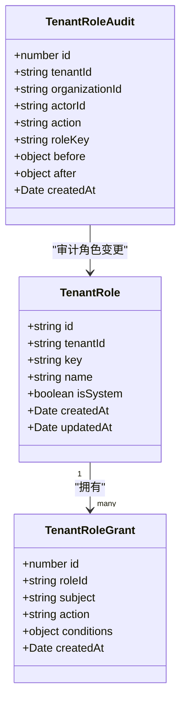
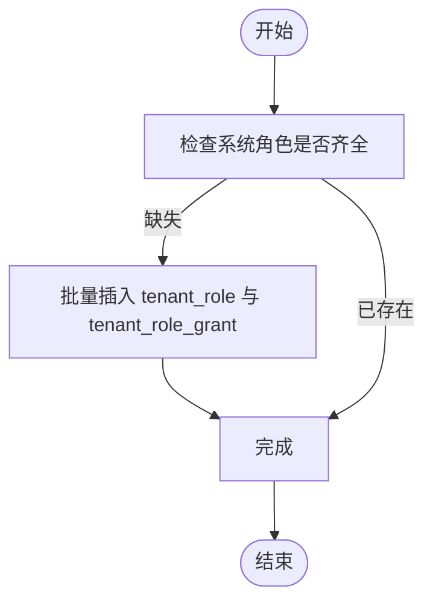
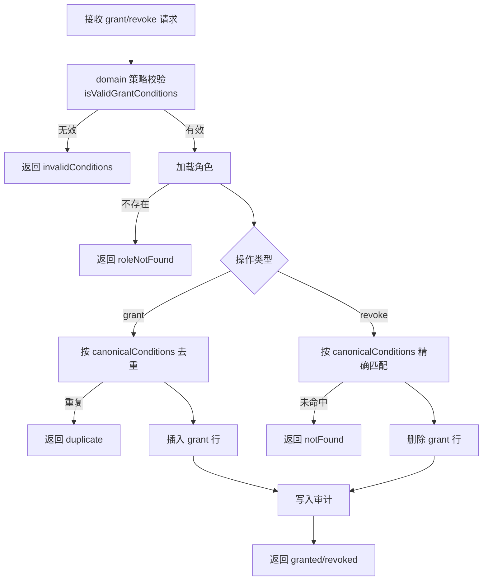
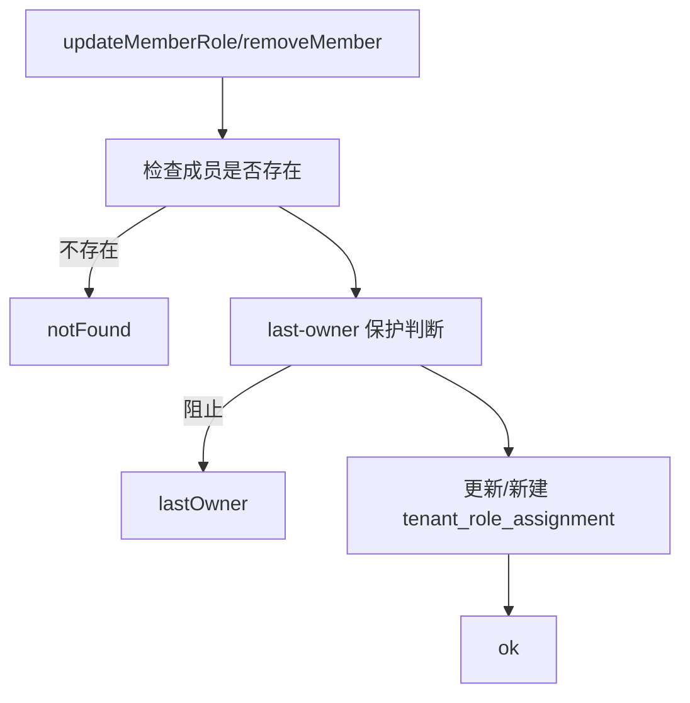
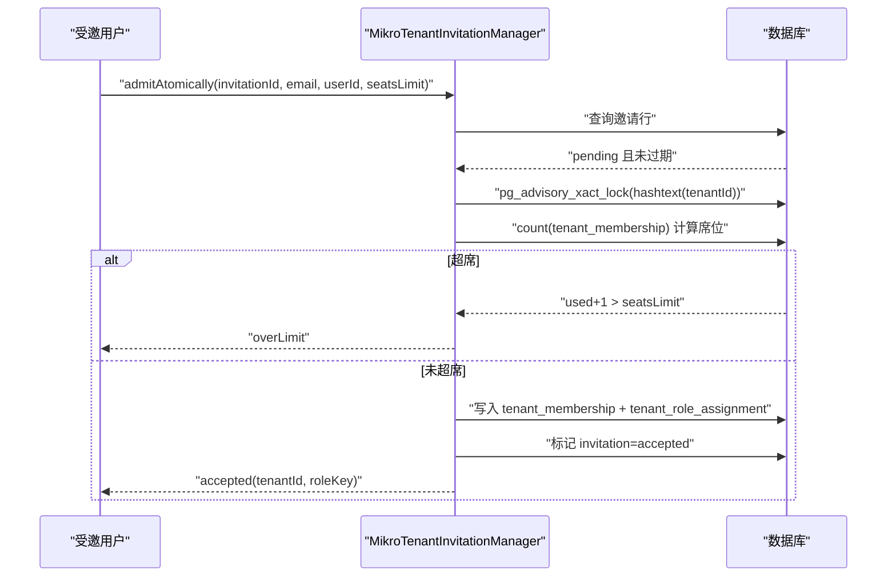
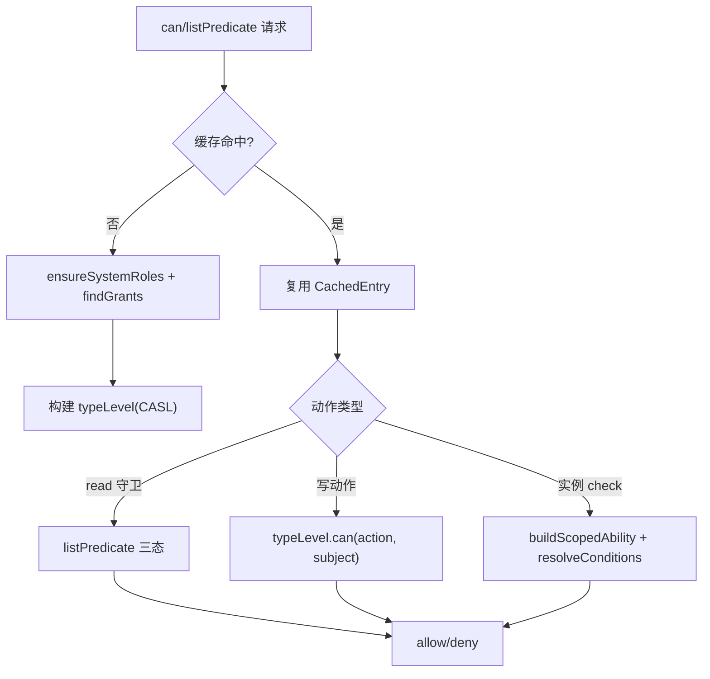
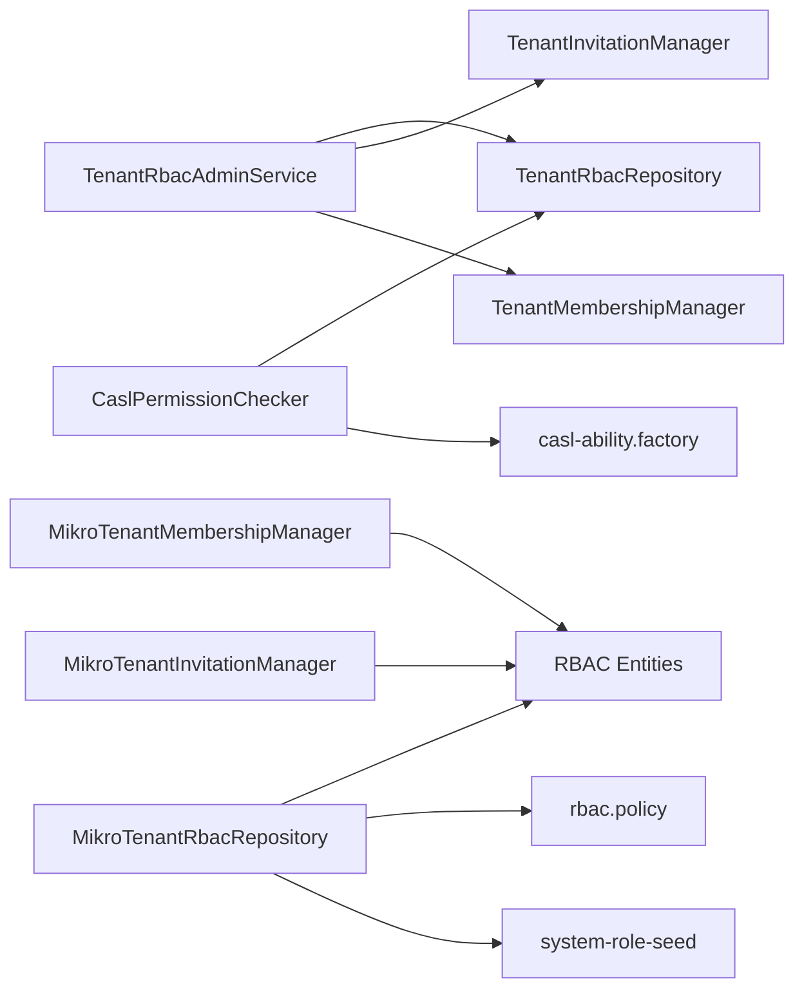
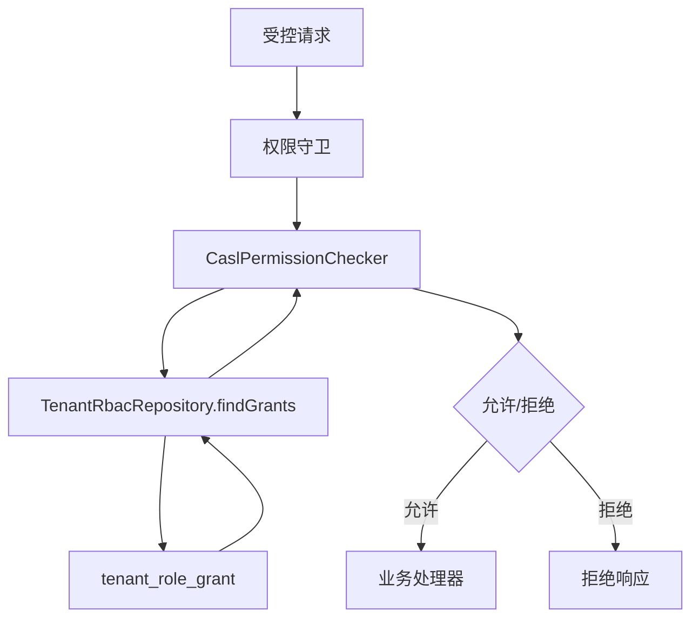

# 权限控制实体

<cite>
**本文引用的文件**   
- [rbac.entities.ts](file://apps/api/src/modules/authorization/infrastructure/entities/rbac.entities.ts)
- [system-role-seed.ts](file://apps/api/src/modules/authorization/domain/constants/system-role-seed.ts)
- [rbac.policy.ts](file://apps/api/src/modules/authorization/domain/policies/rbac.policy.ts)
- [organization-rbac.repository.ts](file://apps/api/src/modules/authorization/domain/repositories/organization-rbac.repository.ts)
- [mikro-organization-rbac.repository.ts](file://apps/api/src/modules/authorization/infrastructure/repositories/mikro-organization-rbac.repository.ts)
- [organization-rbac-admin.service.ts](file://apps/api/src/modules/authorization/application/organization-rbac-admin.service.ts)
- [tenant-membership.port.ts](file://apps/api/src/modules/authorization/domain/ports/tenant-membership.port.ts)
- [tenant-invitation.port.ts](file://apps/api/src/modules/authorization/domain/ports/tenant-invitation.port.ts)
- [mikro-tenant-membership.repository.ts](file://apps/api/src/modules/authorization/infrastructure/repositories/mikro-tenant-membership.repository.ts)
- [mikro-tenant-invitation.repository.ts](file://apps/api/src/modules/authorization/infrastructure/repositories/mikro-tenant-invitation.repository.ts)
- [casl-permission.checker.ts](file://apps/api/src/modules/authorization/infrastructure/casl-permission.checker.ts)
- [casl-ability.factory.ts](file://apps/api/src/modules/authorization/infrastructure/casl-ability.factory.ts)
</cite>

## 目录
1. [引言](#引言)
2. [项目结构](#项目结构)
3. [核心组件](#核心组件)
4. [架构总览](#架构总览)
5. [详细组件分析](#详细组件分析)
6. [依赖关系分析](#依赖关系分析)
7. [性能与可扩展性](#性能与可扩展性)
8. [故障排查指南](#故障排查指南)
9. [结论](#结论)
10. [附录：权限矩阵与访问控制流程](#附录权限矩阵与访问控制流程)

## 引言
本文件面向 RBAC（基于角色的访问控制）权限体系，围绕角色、授权授予与撤销、成员关系、邀请机制以及权限审计等关键实体与流程进行系统化说明。系统采用“租户级”作为权限主轴，将原组织维度的成员、角色与邀请上收至租户维度，实现跨组织的通配授权与更清晰的隔离边界；同时保留组织作为数据分组维度，由行级可见性策略独立管理。

## 项目结构
权限相关代码集中在 authorization 模块内，按领域层、应用层、基础设施层划分：
- 领域层：系统角色种子、RBAC 写侧策略、仓储端口定义
- 应用层：角色与授权管理门面服务
- 基础设施层：MikroORM 仓储适配、CASL 能力构建与权限检查器
- 实体层：租户 RBAC 三表（角色、授权、审计）与成员/分配/邀请三表

图表来源
- [organization-rbac-admin.service.ts:1-242](file://apps/api/src/modules/authorization/application/organization-rbac-admin.service.ts#L1-L242)
- [organization-rbac.repository.ts:1-198](file://apps/api/src/modules/authorization/domain/repositories/organization-rbac.repository.ts#L1-L198)
- [mikro-organization-rbac.repository.ts:1-295](file://apps/api/src/modules/authorization/infrastructure/repositories/mikro-organization-rbac.repository.ts#L1-L295)
- [mikro-tenant-membership.repository.ts:1-154](file://apps/api/src/modules/authorization/infrastructure/repositories/mikro-tenant-membership.repository.ts#L1-L154)
- [mikro-tenant-invitation.repository.ts:1-198](file://apps/api/src/modules/authorization/infrastructure/repositories/mikro-tenant-invitation.repository.ts#L1-L198)
- [casl-permission.checker.ts:1-199](file://apps/api/src/modules/authorization/infrastructure/casl-permission.checker.ts#L1-L199)
- [casl-ability.factory.ts:1-47](file://apps/api/src/modules/authorization/infrastructure/casl-ability.factory.ts#L1-L47)
- [rbac.entities.ts:1-249](file://apps/api/src/modules/authorization/infrastructure/entities/rbac.entities.ts#L1-L249)

章节来源
- [organization-rbac-admin.service.ts:1-242](file://apps/api/src/modules/authorization/application/organization-rbac-admin.service.ts#L1-L242)
- [organization-rbac.repository.ts:1-198](file://apps/api/src/modules/authorization/domain/repositories/organization-rbac.repository.ts#L1-L198)

## 核心组件
- 角色与授权
  - 角色实体：租户级唯一 key，支持系统角色与自定义角色，系统角色不可改删。
  - 授权行：以 subject×action×conditions 为粒度，conditions 支持平铺等值与 $in 白名单。
  - 审计表：记录每次角色/授权变更的 who/what/before/after，仅追加不修改删除。
- 成员与角色分配
  - 成员关系：(tenantId, userId) 唯一，SSOT。
  - 角色分配：(tenantId, userId) 唯一，一人一租一角色；缺省为 member。
- 邀请机制
  - 邀请行：(tenantId, email) 唯一，状态机 pending/accepted/cancelled/expired。
  - 原子入租：单事务 + advisory 锁串行化并发接受，校验席位上限后落成员与角色。
- 权限检查
  - CASL 能力构建：从 grant 行投影为 MongoAbility，支持条件匹配与模板解析。
  - 进程内缓存：按 (tenant, role) 缓存 ability，热改失效。

章节来源
- [rbac.entities.ts:1-249](file://apps/api/src/modules/authorization/infrastructure/entities/rbac.entities.ts#L1-L249)
- [system-role-seed.ts:1-83](file://apps/api/src/modules/authorization/domain/constants/system-role-seed.ts#L1-L83)
- [rbac.policy.ts:1-95](file://apps/api/src/modules/authorization/domain/policies/rbac.policy.ts#L1-L95)
- [tenant-membership.port.ts:1-98](file://apps/api/src/modules/authorization/domain/ports/tenant-membership.port.ts#L1-L98)
- [tenant-invitation.port.ts:1-130](file://apps/api/src/modules/authorization/domain/ports/tenant-invitation.port.ts#L1-L130)
- [casl-permission.checker.ts:1-199](file://apps/api/src/modules/authorization/infrastructure/casl-permission.checker.ts#L1-L199)
- [casl-ability.factory.ts:1-47](file://apps/api/src/modules/authorization/infrastructure/casl-ability.factory.ts#L1-L47)

## 架构总览
下图展示 RBAC 在请求路径中的位置：控制器经守卫调用权限检查器，检查器读取仓库中的 grant 行并构建 CASL 能力，结合实例资源进行判定；管理面通过应用服务调用仓储完成角色与授权的 CRUD，并触发权限缓存失效。

图表来源
- [casl-permission.checker.ts:88-127](file://apps/api/src/modules/authorization/infrastructure/casl-permission.checker.ts#L88-L127)
- [mikro-organization-rbac.repository.ts:116-123](file://apps/api/src/modules/authorization/infrastructure/repositories/mikro-organization-rbac.repository.ts#L116-L123)

## 详细组件分析

### 角色与授权模型
- 角色表 tenant_role
  - 字段：id、tenantId、key、name、isSystem、createdAt、updatedAt
  - 约束：(tenantId, key) 唯一；系统角色 isSystem=true 不可改删
- 授权表 tenant_role_grant
  - 字段：roleId、subject、action、conditions、createdAt
  - 语义：同 (subject, action) 多行 = OR 并集；conditions 为空表示整 subject 级
- 审计表 tenant_role_audit
  - 字段：tenantId、organizationId（可空）、actorId、action、roleKey、before、after、createdAt
  - 语义：只插不改不删，before/after 规范化 JSON

图表来源
- [rbac.entities.ts:27-128](file://apps/api/src/modules/authorization/infrastructure/entities/rbac.entities.ts#L27-L128)

章节来源
- [rbac.entities.ts:27-128](file://apps/api/src/modules/authorization/infrastructure/entities/rbac.entities.ts#L27-L128)
- [mikro-organization-rbac.repository.ts:55-96](file://apps/api/src/modules/authorization/infrastructure/repositories/mikro-organization-rbac.repository.ts#L55-L96)
- [mikro-organization-rbac.repository.ts:125-248](file://apps/api/src/modules/authorization/infrastructure/repositories/mikro-organization-rbac.repository.ts#L125-L248)

### 系统角色种子与动态角色创建
- 系统角色 seed：owner/admin/member，内置 grants 固定
- lazy-ensure：首次解析授权时补种缺失的系统角色与 grants
- 自定义角色：key 词法校验 + 非系统保留 key；创建/改名/删除均落审计

图表来源
- [system-role-seed.ts:48-82](file://apps/api/src/modules/authorization/domain/constants/system-role-seed.ts#L48-L82)
- [mikro-organization-rbac.repository.ts:55-96](file://apps/api/src/modules/authorization/infrastructure/repositories/mikro-organization-rbac.repository.ts#L55-L96)

章节来源
- [system-role-seed.ts:1-83](file://apps/api/src/modules/authorization/domain/constants/system-role-seed.ts#L1-L83)
- [mikro-organization-rbac.repository.ts:55-96](file://apps/api/src/modules/authorization/infrastructure/repositories/mikro-organization-rbac.repository.ts#L55-L96)

### 授权授予与撤销流程
- 授予 grant
  - 先过 domain 策略闸（conditions 白名单）
  - 去重：按 canonicalConditions 比较，避免重复行
  - 写入并落审计
- 撤销 grant
  - 精确匹配：conditions 传 null 表示整 subject 级行；传对象则按规范化 JSON 精确撤除
  - 写入审计

图表来源
- [rbac.policy.ts:51-94](file://apps/api/src/modules/authorization/domain/policies/rbac.policy.ts#L51-L94)
- [mikro-organization-rbac.repository.ts:184-248](file://apps/api/src/modules/authorization/infrastructure/repositories/mikro-organization-rbac.repository.ts#L184-L248)

章节来源
- [rbac.policy.ts:1-95](file://apps/api/src/modules/authorization/domain/policies/rbac.policy.ts#L1-L95)
- [mikro-organization-rbac.repository.ts:184-248](file://apps/api/src/modules/authorization/infrastructure/repositories/mikro-organization-rbac.repository.ts#L184-L248)

### 成员关系与角色分配
- 成员 SSOT：tenant_membership(tenantId, userId) 唯一
- 角色分配：tenant_role_assignment(tenantId, userId) 唯一；缺省角色 member
- 更新成员角色
  - last-owner 保护：不允许将最后一个 owner 降级为非 owner
  - 若无分配行则新建
- 移除成员
  - 管理员移除禁止自移（自助退租走 leave 通道）
  - revokeMembership 统一逻辑：删除成员与分配两行

图表来源
- [mikro-tenant-membership.repository.ts:61-118](file://apps/api/src/modules/authorization/infrastructure/repositories/mikro-tenant-membership.repository.ts#L61-L118)
- [tenant-membership.port.ts:46-97](file://apps/api/src/modules/authorization/domain/ports/tenant-membership.port.ts#L46-L97)

章节来源
- [mikro-tenant-membership.repository.ts:1-154](file://apps/api/src/modules/authorization/infrastructure/repositories/mikro-tenant-membership.repository.ts#L1-L154)
- [tenant-membership.port.ts:1-98](file://apps/api/src/modules/authorization/domain/ports/tenant-membership.port.ts#L1-L98)

### 邀请机制与原子入租
- 邀请生命周期：pending → accepted/cancelled/expired
- 发邀请：(tenantId, email) 唯一；重复 pending 直接拒绝；历史消费过的可复位
- 取消邀请：仅 pending 可取消
- 原子入租 admitAtomically
  - 事务内重查邀请 + 邮箱匹配
  - advisory_xact_lock(hashtext(tenantId)) 串行化并发 accept
  - 计数 live 成员数，超过 seatsLimit 则 overLimit
  - 成功则写入 tenant_membership + tenant_role_assignment，并标记 accepted

图表来源
- [mikro-tenant-invitation.repository.ts:117-158](file://apps/api/src/modules/authorization/infrastructure/repositories/mikro-tenant-invitation.repository.ts#L117-L158)
- [tenant-invitation.port.ts:37-113](file://apps/api/src/modules/authorization/domain/ports/tenant-invitation.port.ts#L37-L113)

章节来源
- [mikro-tenant-invitation.repository.ts:1-198](file://apps/api/src/modules/authorization/infrastructure/repositories/mikro-tenant-invitation.repository.ts#L1-L198)
- [tenant-invitation.port.ts:1-130](file://apps/api/src/modules/authorization/domain/ports/tenant-invitation.port.ts#L1-L130)

### 权限检查与缓存失效
- 类型级判定 can(action, subject)：使用 conditions=null 的行构建能力，防 over-grant
- 实例级判定 can(action, subject, resource)：纳入全部 grant 行，解析 {{userId}} 模板后交由 CASL mongo 匹配
- 列表谓词 listPredicate：将 conditions 转换为 Mikro ORM where，合并为 $or
- 缓存键 (tenantId, roleKey)，写操作后 invalidate 整个租户的缓存条目

图表来源
- [casl-permission.checker.ts:88-199](file://apps/api/src/modules/authorization/infrastructure/casl-permission.checker.ts#L88-L199)
- [casl-ability.factory.ts:39-46](file://apps/api/src/modules/authorization/infrastructure/casl-ability.factory.ts#L39-L46)

章节来源
- [casl-permission.checker.ts:1-199](file://apps/api/src/modules/authorization/infrastructure/casl-permission.checker.ts#L1-L199)
- [casl-ability.factory.ts:1-47](file://apps/api/src/modules/authorization/infrastructure/casl-ability.factory.ts#L1-L47)

## 依赖关系分析
- 应用服务依赖仓储端口与权限失效端口
- 仓储适配器依赖实体与 domain 策略
- 权限检查器依赖仓储端口与 CASL 能力工厂
- 成员与邀请管理器依赖实体与 MikroOrmService

图表来源
- [organization-rbac-admin.service.ts:1-242](file://apps/api/src/modules/authorization/application/organization-rbac-admin.service.ts#L1-L242)
- [mikro-organization-rbac.repository.ts:1-295](file://apps/api/src/modules/authorization/infrastructure/repositories/mikro-organization-rbac.repository.ts#L1-L295)
- [mikro-tenant-membership.repository.ts:1-154](file://apps/api/src/modules/authorization/infrastructure/repositories/mikro-tenant-membership.repository.ts#L1-L154)
- [mikro-tenant-invitation.repository.ts:1-198](file://apps/api/src/modules/authorization/infrastructure/repositories/mikro-tenant-invitation.repository.ts#L1-L198)
- [casl-permission.checker.ts:1-199](file://apps/api/src/modules/authorization/infrastructure/casl-permission.checker.ts#L1-L199)

## 性能与可扩展性
- 进程内缓存：按 (tenant, role) 缓存 CASL Ability，容量上限 2048，LRU 驱逐最久未访问项
- 列表过滤下推：listPredicate 将 conditions 转为 where 子句，减少内存处理
- 并发安全：邀请原子入租使用 advisory_xact_lock 串行化同一租户的 accept 操作
- 批量优化：成员列表读取 user 信息采用 $in 批量查询，避免 N+1

[本节为通用指导，无需特定文件引用]

## 故障排查指南
- 无法创建自定义角色
  - 检查 key 是否符合词法规则且非系统保留 key
  - 参考：[rbac.policy.ts:11-36](file://apps/api/src/modules/authorization/domain/policies/rbac.policy.ts#L11-L36)
- 授予 grant 报 invalidConditions
  - 检查 conditions 是否为空对象或包含非法运算符；仅允许原始量与 $in
  - 参考：[rbac.policy.ts:51-71](file://apps/api/src/modules/authorization/domain/policies/rbac.policy.ts#L51-L71)
- 撤销 grant 报 notFound
  - 确认 conditions 规范化串是否与库中一致；null 表示整 subject 级行
  - 参考：[mikro-organization-rbac.repository.ts:218-248](file://apps/api/src/modules/authorization/infrastructure/repositories/mikro-organization-rbac.repository.ts#L218-L248)
- 邀请接受报 overLimit
  - 检查当前租户成员数是否已达 seatsLimit
  - 参考：[mikro-tenant-invitation.repository.ts:117-158](file://apps/api/src/modules/authorization/infrastructure/repositories/mikro-tenant-invitation.repository.ts#L117-L158)
- 权限检查失败但预期应通过
  - 确认活动租户与角色是否正确；检查是否有 conditions 行导致类型级 deny
  - 参考：[casl-permission.checker.ts:88-127](file://apps/api/src/modules/authorization/infrastructure/casl-permission.checker.ts#L88-L127)

章节来源
- [rbac.policy.ts:11-71](file://apps/api/src/modules/authorization/domain/policies/rbac.policy.ts#L11-L71)
- [mikro-organization-rbac.repository.ts:218-248](file://apps/api/src/modules/authorization/infrastructure/repositories/mikro-organization-rbac.repository.ts#L218-L248)
- [mikro-tenant-invitation.repository.ts:117-158](file://apps/api/src/modules/authorization/infrastructure/repositories/mikro-tenant-invitation.repository.ts#L117-L158)
- [casl-permission.checker.ts:88-127](file://apps/api/src/modules/authorization/infrastructure/casl-permission.checker.ts#L88-L127)

## 结论
本 RBAC 方案以租户为权限主轴，将角色、授权、成员、邀请统一收敛到 authorization 模块，形成清晰的数据所有权与职责边界。通过 domain 策略闸、CASL 能力投影、进程内缓存与审计留痕，系统在正确性、性能与可观测性之间取得平衡。未来扩展可在 conditions 白名单、列表谓词优化与缓存策略方面持续演进。

[本节为总结性内容，无需特定文件引用]

## 附录：权限矩阵与访问控制流程

### 权限矩阵（系统角色）
- owner
  - Organization: update, delete
  - Member: read, update, delete
  - Invitation: read, create, cancel
  - Workspace: create, read, update, delete
  - Role: create, read, update, delete
  - RoleGrant: create, read, delete
- admin
  - Organization: update
  - Member: read, update, delete
  - Invitation: read, create, cancel
  - Workspace: create, read, update, delete
  - Role: create, read, update, delete
  - RoleGrant: create, read, delete
- member
  - Member: read
  - Invitation: read
  - Workspace: read

章节来源
- [system-role-seed.ts:48-82](file://apps/api/src/modules/authorization/domain/constants/system-role-seed.ts#L48-L82)

### 访问控制流程图（请求级）

图表来源
- [casl-permission.checker.ts:88-127](file://apps/api/src/modules/authorization/infrastructure/casl-permission.checker.ts#L88-L127)
- [mikro-organization-rbac.repository.ts:116-123](file://apps/api/src/modules/authorization/infrastructure/repositories/mikro-organization-rbac.repository.ts#L116-L123)