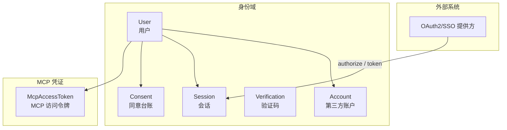
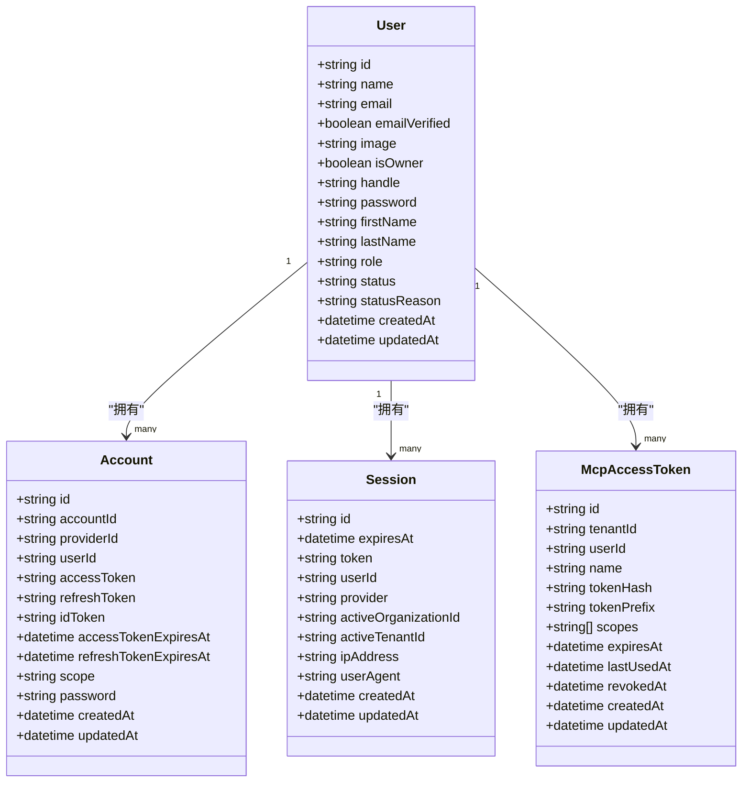
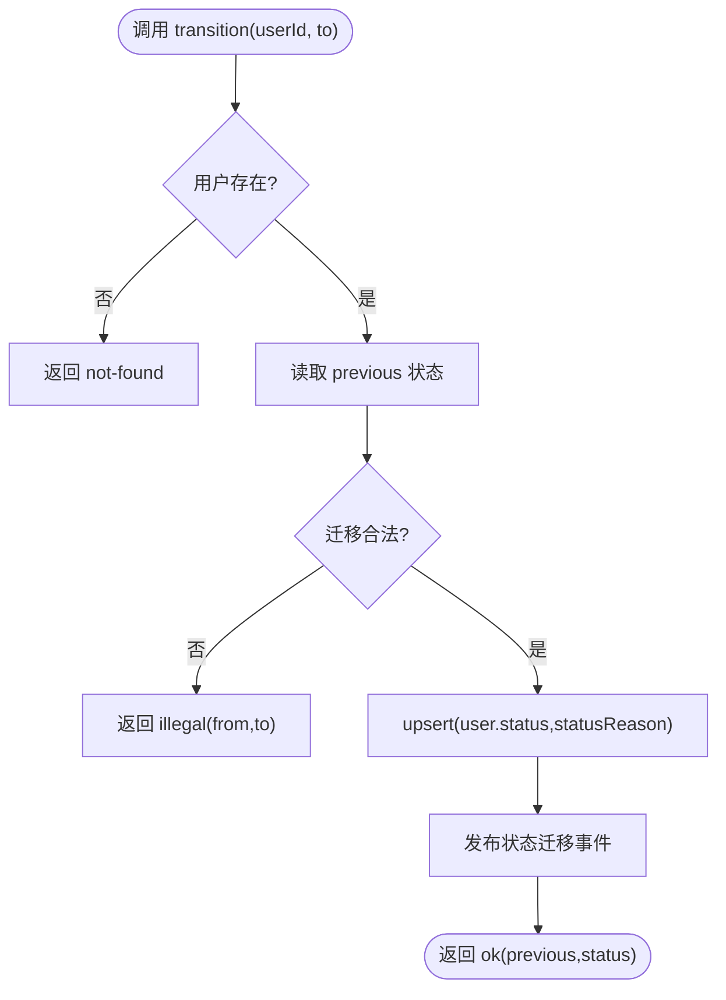
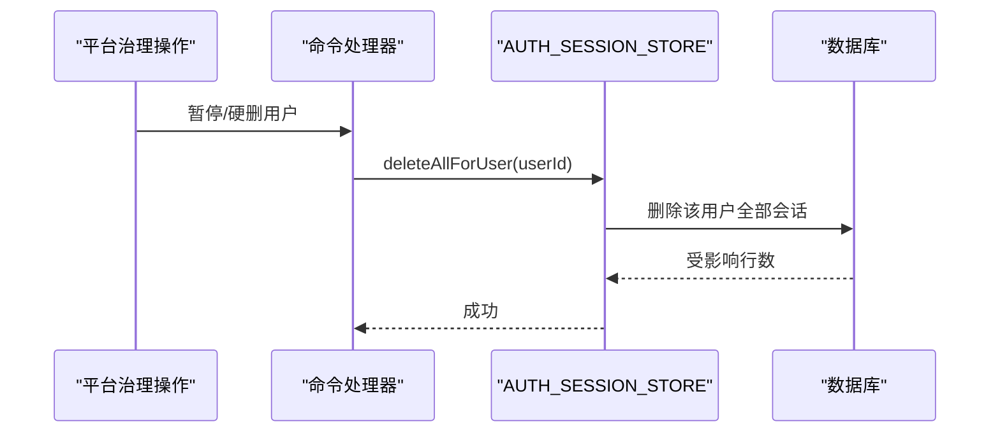
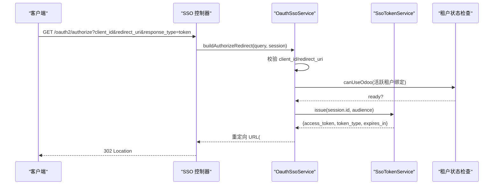
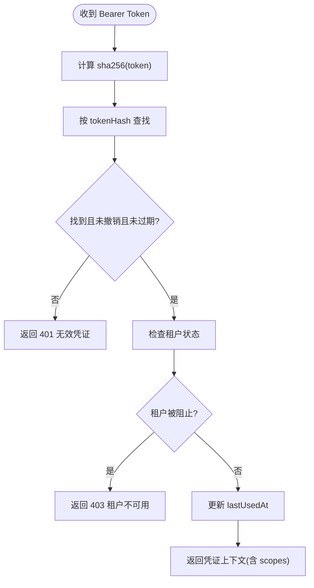
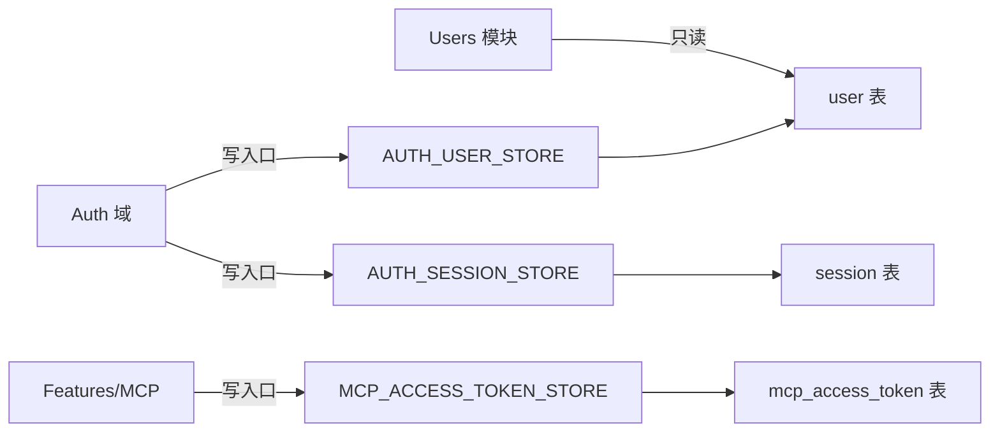

# 用户身份实体

<cite>
**本文引用的文件**   
- [ba-identity.entities.ts](file://apps/api/src/modules/auth/infrastructure/entities/ba-identity.entities.ts)
- [migration-entities.ts](file://apps/api/src/database/mikro/migration/migration-entities.ts)
- [user-store.port.ts](file://apps/api/src/modules/auth/domain/ports/user-store.port.ts)
- [session-store.port.ts](file://apps/api/src/modules/auth/domain/ports/session-store.port.ts)
- [mcp-access-token-store.port.ts](file://apps/api/src/modules/auth/application/ports/mcp-access-token-store.port.ts)
- [mcp-access-token.entity.ts](file://apps/api/src/modules/auth/infrastructure/entities/mcp-access-token.entity.ts)
- [oauth-sso.service.ts](file://apps/api/src/modules/auth/infrastructure/oauth-sso.service.ts)
- [session-store.adapter.ts](file://apps/api/src/modules/auth/infrastructure/session-store.adapter.ts)
- [mcp-access-token-store.adapter.ts](file://apps/api/src/modules/auth/infrastructure/mcp-access-token-store.adapter.ts)
- [mcp-token-verifier.service.ts](file://apps/api/src/features/mcp/application/mcp-token-verifier.service.ts)
- [Migration20261023100000_consolidate_user_status_into_user.ts](file://apps/api/src/database/mikro/migration/migrations/Migration20261023100000_consolidate_user_status_into_user.ts)
- [Migration20261028131045_add_mcp_access_token.ts](file://apps/api/src/database/mikro/migration/migrations/Migration20261028131045_add_mcp_access_token.ts)
- [user-status.service.ts](file://libs/core/src/modules/organizations/lifecycle/user-status.service.ts)
- [user-status.store.ts](file://libs/core/src/modules/organizations/lifecycle/user-status.store.ts)
</cite>

## 目录
1. [引言](#引言)
2. [项目结构](#项目结构)
3. [核心实体与字段定义](#核心实体与字段定义)
4. [架构总览](#架构总览)
5. [详细组件分析](#详细组件分析)
6. [依赖关系分析](#依赖关系分析)
7. [性能与索引设计](#性能与索引设计)
8. [故障排查指南](#故障排查指南)
9. [结论](#结论)

## 引言
本文件系统性梳理“用户身份”相关核心实体与流程，覆盖：
- 用户、账户、会话、验证、同意等身份机器族实体定义；
- 本地认证与 OAuth2/SSO 集成中的实体关系与校验规则；
- 会话状态管理与租级激活位；
- MCP（Model Context Protocol）访问令牌的签发、校验、撤销与生命周期；
- 用户状态管理、软删除机制与审计字段；
- 实体关系图与样例数据说明。

## 项目结构
身份相关代码主要分布在以下位置：
- 身份实体定义：auth 域基础设施层；
- 迁移基线：数据库表结构与约束的忠实描述；
- 领域端口与应用端口：隔离属主写入口；
- SSO/OAuth 服务：授权端点与令牌生成；
- MCP 凭证：租户级委托令牌；
- 用户状态服务：统一的用户治理态读写卡点。

**图示来源**
- [ba-identity.entities.ts:31-145](file://apps/api/src/modules/auth/infrastructure/entities/ba-identity.entities.ts#L31-L145)
- [mcp-access-token.entity.ts:20-52](file://apps/api/src/modules/auth/infrastructure/entities/mcp-access-token.entity.ts#L20-L52)

**章节来源**
- [ba-identity.entities.ts:1-146](file://apps/api/src/modules/auth/infrastructure/entities/ba-identity.entities.ts#L1-L146)
- [migration-entities.ts:51-148](file://apps/api/src/database/mikro/migration/migration-entities.ts#L51-L148)

## 核心实体与字段定义
本节聚焦身份机器族与 MCP 凭证实体的字段、类型、约束与业务含义。

### 用户 User
- 标识与基础信息
  - id：主键，字符串
  - name：显示名
  - email：邮箱（唯一索引在迁移基线中声明）
  - emailVerified：是否已验证邮箱
  - image：头像链接（可空）
- 平台扩展字段
  - isOwner：是否拥有者（默认 false）
  - handle：用户名别名（可空）
- 本地认证与角色
  - password：本地密码（可空）
  - role：角色（USER/ADMIN），默认 USER
- 治理状态
  - status：用户治理态（active/suspended/deleted），默认 active，受 CHECK 约束
  - statusReason：治理理由（可空）
- 审计时间
  - createdAt：创建时间
  - updatedAt：更新时间（可空）

业务要点
- 用户治理态采用“deny-list”语义：仅显式 suspended/deleted 才失能；不存在记录视为 active。
- 通过 DB 层 CHECK 约束保证 status 值域合法。

**章节来源**
- [ba-identity.entities.ts:31-65](file://apps/api/src/modules/auth/infrastructure/entities/ba-identity.entities.ts#L31-L65)
- [migration-entities.ts:51-90](file://apps/api/src/database/mikro/migration/migration-entities.ts#L51-L90)
- [Migration20261023100000_consolidate_user_status_into_user.ts:24-39](file://apps/api/src/database/mikro/migration/migrations/Migration20261023100000_consolidate_user_status_into_user.ts#L24-L39)

### 账户 Account
- 标识与关联
  - id：主键
  - accountId/providerId：第三方提供方标识
  - userId：关联用户（级联删除）
- 凭据与有效期
  - accessToken/refreshToken/idToken：第三方令牌（可空）
  - accessTokenExpiresAt/refreshTokenExpiresAt：过期时间（可空）
  - scope：授权范围（可空）
  - password：本地密码（可空）
- 审计时间
  - createdAt/updatedAt

业务要点
- 用于聚合第三方登录（如 OAuth）凭据；与用户 1:N。

**章节来源**
- [ba-identity.entities.ts:67-85](file://apps/api/src/modules/auth/infrastructure/entities/ba-identity.entities.ts#L67-L85)
- [migration-entities.ts:92-110](file://apps/api/src/database/mikro/migration/migration-entities.ts#L92-L110)

### 会话 Session
- 标识与会话主体
  - id：主键
  - token：会话令牌（迁移基线中具名唯一约束）
  - userId：关联用户（级联删除）
- 会话上下文
  - provider：来源提供方（可空）
  - activeOrganizationId：活动组织（可空）
  - activeTenantId：活动租户（可空，独立于 activeOrganizationId）
  - ipAddress/userAgent：客户端信息（可空）
- 有效期与审计
  - expiresAt：过期时间
  - createdAt/updatedAt

业务要点
- 会话回收依赖 expiresAt 索引；token 唯一约束提升鉴权查询性能。
- activeTenantId 为第三次层级复裁引入的租级激活位，避免与组织激活混用。

**章节来源**
- [ba-identity.entities.ts:87-107](file://apps/api/src/modules/auth/infrastructure/entities/ba-identity.entities.ts#L87-L107)
- [migration-entities.ts:112-135](file://apps/api/src/database/mikro/migration/migration-entities.ts#L112-L135)
- [Migration20261020150833.ts:11-14](file://apps/api/src/database/mikro/migration/migrations/Migration20261020150833.ts#L11-L14)

### 验证 Verification
- 标识与用途
  - id：主键
  - identifier：标识（如邮箱/手机号）
  - value：验证码值
  - expiresAt：过期时间
  - createdAt/updatedAt

**章节来源**
- [ba-identity.entities.ts:109-120](file://apps/api/src/modules/auth/infrastructure/entities/ba-identity.entities.ts#L109-L120)
- [migration-entities.ts:137-148](file://apps/api/src/database/mikro/migration/migration-entities.ts#L137-L148)

### 同意 Consent
- 合规与审计
  - id：主键
  - userId：关联用户（可空，级联 set null）
  - purpose：目的
  - version：版本
  - grantedAt：授予时间
  - revokedAt：撤销时间（可空）
  - evidence：证据（IP/UA 等，可空）
  - createdAt/updatedAt

**章节来源**
- [ba-identity.entities.ts:122-142](file://apps/api/src/modules/auth/infrastructure/entities/ba-identity.entities.ts#L122-L142)
- [migration-entities.ts:230-245](file://apps/api/src/database/mikro/migration/migration-entities.ts#L230-L245)

### MCP 访问令牌 McpAccessToken
- 标识与归属
  - id：主键
  - tenantId：所属租户（NOT NULL，级联删除）
  - userId：委托主体用户（级联删除）
- 令牌元数据
  - name：名称
  - tokenHash：明文 token 的 sha256 hex（唯一索引）
  - tokenPrefix：明文前缀（辨认用，非秘密）
  - scopes：授权面词汇（JSON 数组）
- 生命周期
  - expiresAt：过期时间
  - lastUsedAt：最后使用时间（可空）
  - revokedAt：撤销时间（可空，软撤销）
  - createdAt/updatedAt

安全与设计要点
- 明文 token 永不落库，仅存哈希；查找走哈希唯一索引。
- 撤销使用软位 revokedAt，保留审计痕迹。
- 租户作用行级隔离，读侧按租户过滤。

**章节来源**
- [mcp-access-token.entity.ts:20-52](file://apps/api/src/modules/auth/infrastructure/entities/mcp-access-token.entity.ts#L20-L52)
- [Migration20261028131045_add_mcp_access_token.ts:6-20](file://apps/api/src/database/mikro/migration/migrations/Migration20261028131045_add_mcp_access_token.ts#L6-L20)

## 架构总览
身份域围绕 Better Auth 提供的实体族（User/Account/Session/Verification/Consent）进行扩展与治理，并通过领域端口将跨域写入收口到 auth 属主侧。MCP 凭证作为“租户级委托令牌”，由 auth 域提供持久化与校验能力。

**图示来源**
- [ba-identity.entities.ts:31-107](file://apps/api/src/modules/auth/infrastructure/entities/ba-identity.entities.ts#L31-L107)
- [mcp-access-token.entity.ts:54-72](file://apps/api/src/modules/auth/infrastructure/entities/mcp-access-token.entity.ts#L54-L72)

## 详细组件分析

### 用户状态管理与软删除
- 状态三态：active/suspended/deleted，默认 active；DB 层 CHECK 约束保障值域。
- 软删除：deleted 表示软删；硬删除经 AUTH_USER_STORE.hardDelete 执行（级联删除 account/session）。
- 治理写入口：AUTH_USER_STORE.updateStatus 直写 user.status/statusReason，并盖 updatedAt。
- 状态服务：UserStatusService 是统一读写卡点，封装 read/isBlocked/transition，结合事件发布与 UoW 事务。

**图示来源**
- [user-status.service.ts:100-127](file://libs/core/src/modules/organizations/lifecycle/user-status.service.ts#L100-L127)
- [user-status.store.ts:18-41](file://libs/core/src/modules/organizations/lifecycle/user-status.store.ts#L18-L41)
- [user-store.port.ts:16-31](file://apps/api/src/modules/auth/domain/ports/user-store.port.ts#L16-L31)

**章节来源**
- [user-status.service.ts:43-128](file://libs/core/src/modules/organizations/lifecycle/user-status.service.ts#L43-L128)
- [user-status.store.ts:1-41](file://libs/core/src/modules/organizations/lifecycle/user-status.store.ts#L1-L41)
- [user-store.port.ts:1-32](file://apps/api/src/modules/auth/domain/ports/user-store.port.ts#L1-L32)
- [Migration20261023100000_consolidate_user_status_into_user.ts:24-58](file://apps/api/src/database/mikro/migration/migrations/Migration20261023100000_consolidate_user_status_into_user.ts#L24-L58)

### 会话管理与租级激活位
- 会话删除：当用户被暂停或硬删时，需即时失效其所有会话。
- 受控写入口：AUTH_SESSION_STORE.deleteAllForUser 由 auth 域实现，确保跨域写路径收敛。
- 租级激活位：setActiveTenant/clearActiveTenant 对 session.activeTenantId 进行受控写入，避免与 activeOrganizationId 混用导致权限错配。

**图示来源**
- [session-store.port.ts:18-42](file://apps/api/src/modules/auth/domain/ports/session-store.port.ts#L18-L42)
- [session-store.adapter.ts:14-21](file://apps/api/src/modules/auth/infrastructure/session-store.adapter.ts#L14-L21)

**章节来源**
- [session-store.port.ts:1-43](file://apps/api/src/modules/auth/domain/ports/session-store.port.ts#L1-L43)
- [session-store.adapter.ts:1-21](file://apps/api/src/modules/auth/infrastructure/session-store.adapter.ts#L1-L21)

### OAuth2/SSO 集成流程
- authorize 端点校验顺序（fail-closed）：
  1) client_id 必须命中已注册 client；
  2) redirect_uri 必须精确匹配白名单；
  3) 活跃租户 Odoo 可用性门禁（未就绪则 403）；
  4) 生成超短 TTL 的 aud 绑定令牌，以隐式流 fragment 返回 access_token。

**图示来源**
- [oauth-sso.service.ts:22-90](file://apps/api/src/modules/auth/infrastructure/oauth-sso.service.ts#L22-L90)

**章节来源**
- [oauth-sso.service.ts:22-90](file://apps/api/src/modules/auth/infrastructure/oauth-sso.service.ts#L22-L90)

### MCP 访问令牌生命周期
- 签发（mint）
  - 输入：userId、name、tokenHash（sha256 hex）、tokenPrefix、scopes、expiresAt；
  - tenantId 由可信 ALS 盖章（fail-closed），禁止调用方伪造；
  - 存储：tokenHash 唯一索引，明文不落库。
- 校验（verify）
  - 计算请求 token 的 sha256 hex，查库比对；
  - 检查 revokedAt/expiresAt；
  - 检查租户状态（blocked 则拒绝）；
  - 更新 lastUsedAt（失败不阻断）。
- 撤销（revoke）
  - 软撤销：设置 revokedAt；重复撤销幂等；
  - 列表查询保留已撤销行供辨认。

**图示来源**
- [mcp-token-verifier.service.ts:40-67](file://apps/api/src/features/mcp/application/mcp-token-verifier.service.ts#L40-L67)
- [mcp-access-token-store.port.ts:16-70](file://apps/api/src/modules/auth/application/ports/mcp-access-token-store.port.ts#L16-L70)

**章节来源**
- [mcp-access-token-store.port.ts:1-70](file://apps/api/src/modules/auth/application/ports/mcp-access-token-store.port.ts#L1-L70)
- [mcp-access-token-store.adapter.ts:1-27](file://apps/api/src/modules/auth/infrastructure/mcp-access-token-store.adapter.ts#L1-L27)
- [mcp-token-verifier.service.ts:30-80](file://apps/api/src/features/mcp/application/mcp-token-verifier.service.ts#L30-L80)
- [mcp-access-token.entity.ts:20-76](file://apps/api/src/modules/auth/infrastructure/entities/mcp-access-token.entity.ts#L20-L76)

## 依赖关系分析
- 属主写入口与跨域解耦
  - AUTH_USER_STORE：users 模块对 user 表纯读，写经由 auth 域；
  - AUTH_SESSION_STORE：治理面对 session 表的受控写入口；
  - MCP_ACCESS_TOKEN_STORE：features/mcp 编排面经此端口落属主。
- 实体与迁移一致性
  - ba-identity.entities.ts 为运行时 BA 契约面（扁平列、无 ORM 关系对象）；
  - migration-entities.ts 为迁移基线（忠实全模型，含 FK/索引/唯一约束）。

**图示来源**
- [user-store.port.ts:1-32](file://apps/api/src/modules/auth/domain/ports/user-store.port.ts#L1-L32)
- [session-store.port.ts:1-43](file://apps/api/src/modules/auth/domain/ports/session-store.port.ts#L1-L43)
- [mcp-access-token-store.port.ts:1-70](file://apps/api/src/modules/auth/application/ports/mcp-access-token-store.port.ts#L1-L70)

**章节来源**
- [user-store.port.ts:1-32](file://apps/api/src/modules/auth/domain/ports/user-store.port.ts#L1-L32)
- [session-store.port.ts:1-43](file://apps/api/src/modules/auth/domain/ports/session-store.port.ts#L1-L43)
- [mcp-access-token-store.port.ts:1-70](file://apps/api/src/modules/auth/application/ports/mcp-access-token-store.port.ts#L1-L70)

## 性能与索引设计
- 会话表
  - session.token 唯一约束：终结每请求按 token 全表扫描；
  - session.expiresAt 普通索引：支持过期会话回收谓词。
- MCP 凭证表
  - mcp_access_token.tokenHash 唯一索引：鉴权查找键；
  - mcp_access_token.tenant_idx/user_idx：读锚索引（租级列表/我的凭证）。

**章节来源**
- [Migration20261020150833.ts:11-14](file://apps/api/src/database/mikro/migration/migrations/Migration20261020150833.ts#L11-L14)
- [Migration20261028131045_add_mcp_access_token.ts:10-14](file://apps/api/src/database/mikro/migration/migrations/Migration20261028131045_add_mcp_access_token.ts#L10-L14)
- [mcp-access-token.entity.ts:43-52](file://apps/api/src/modules/auth/infrastructure/entities/mcp-access-token.entity.ts#L43-L52)

## 故障排查指南
- 用户状态异常
  - 现象：用户无法登录或权限受限；
  - 排查：确认 user.status 是否为 suspended/deleted；检查 statusReason；
  - 处理：通过 UserStatusService.transition 恢复或标记；必要时调用 AUTH_USER_STORE.updateStatus。
- 会话未失效
  - 现象：用户被暂停后仍可访问；
  - 排查：确认 AUTH_SESSION_STORE.deleteAllForUser 是否执行成功；
  - 处理：重新触发会话清理，检查事务边界与 UoW。
- MCP 凭证无效
  - 现象：Bearer Token 校验失败；
  - 排查：检查 tokenHash 是否存在、是否已撤销或过期；确认租户状态未被阻止；
  - 处理：重新签发凭证或撤销旧凭证；检查 lastUsedAt 更新是否成功（不影响鉴权）。

**章节来源**
- [user-status.service.ts:74-127](file://libs/core/src/modules/organizations/lifecycle/user-status.service.ts#L74-L127)
- [session-store.adapter.ts:14-21](file://apps/api/src/modules/auth/infrastructure/session-store.adapter.ts#L14-L21)
- [mcp-token-verifier.service.ts:40-79](file://apps/api/src/features/mcp/application/mcp-token-verifier.service.ts#L40-L79)

## 结论
本仓库的身份体系以 Better Auth 实体族为基础，通过领域端口将跨域写操作收敛至 auth 属主侧，确保表所有权纪律与事务原子性。用户治理态通过 DB 层 CHECK 与服务层状态机双重保障；会话管理提供租级激活位与过期回收；MCP 访问令牌以哈希唯一与软撤销实现安全可控的租户级委托。整体设计兼顾安全性、可维护性与可扩展性。