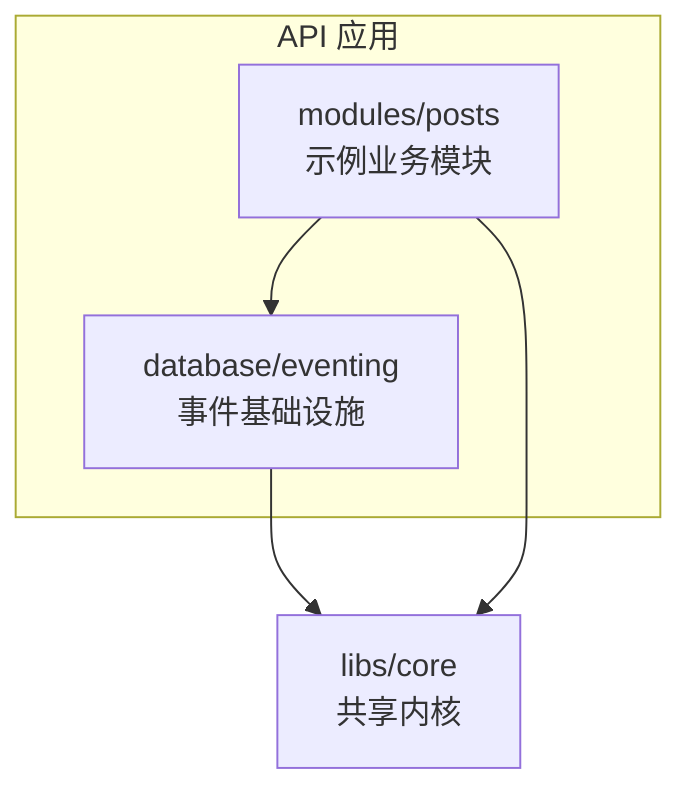
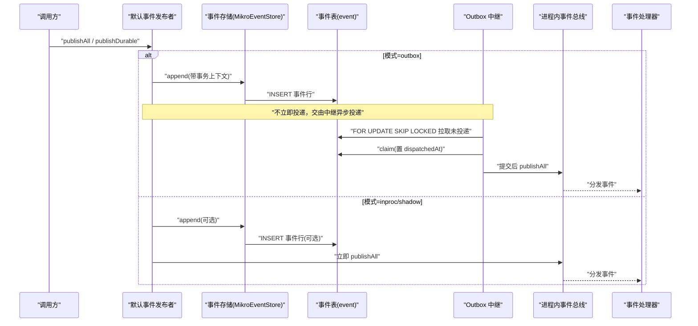
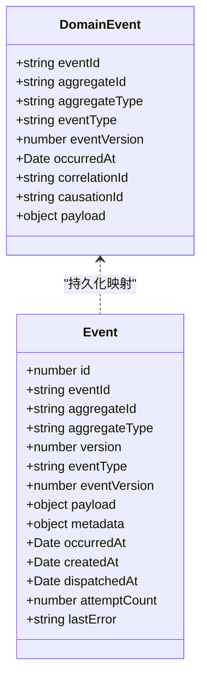
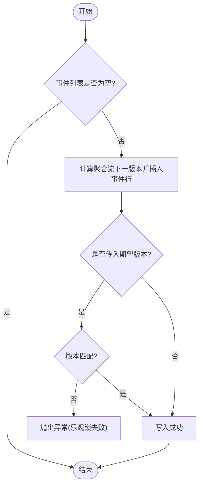
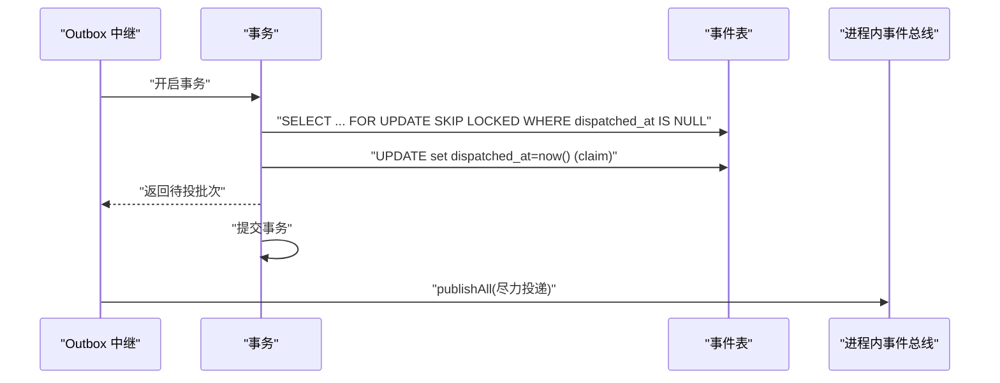
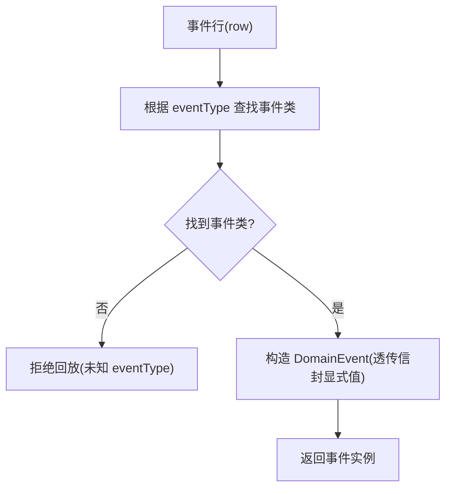
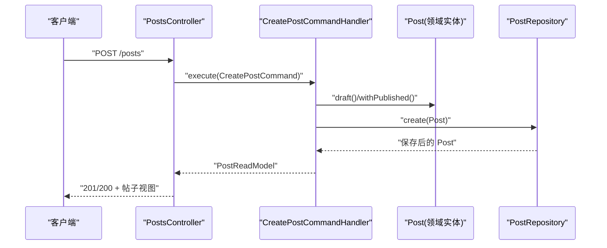
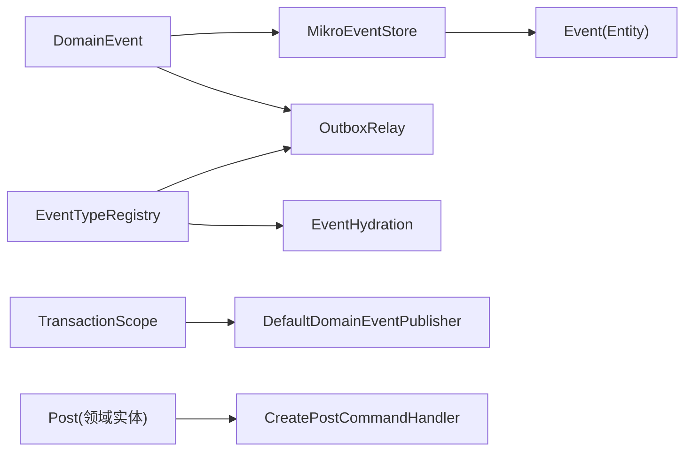

# 系统支撑实体

<cite>
**本文引用的文件**   
- [event.entity.ts](file://apps/api/src/database/eventing/entities/event.entity.ts)
- [domain-event-publisher.ts](file://apps/api/src/database/eventing/domain-event-publisher.ts)
- [mikro-event-store.ts](file://apps/api/src/database/eventing/mikro-event-store.ts)
- [outbox-relay.ts](file://apps/api/src/database/eventing/outbox-relay.ts)
- [event-hydration.ts](file://apps/api/src/database/eventing/event-hydration.ts)
- [event-type-registry.ts](file://apps/api/src/database/eventing/event-type-registry.ts)
- [transaction-scope.ts](file://apps/api/src/database/eventing/transaction-scope.ts)
- [domain-event.ts](file://libs/core/src/shared-kernel/domain/domain-event.ts)
- [post.ts](file://apps/api/src/modules/posts/domain/entities/post.ts)
- [create-post.command-handler.ts](file://apps/api/src/modules/posts/application/commands/handlers/create-post.command-handler.ts)
- [posts.controller.ts](file://apps/api/src/modules/posts/api/posts.controller.ts)
</cite>

## 目录
1. [引言](#引言)
2. [项目结构](#项目结构)
3. [核心组件](#核心组件)
4. [架构总览](#架构总览)
5. [详细组件分析](#详细组件分析)
6. [依赖关系分析](#依赖关系分析)
7. [性能与一致性考量](#性能与一致性考量)
8. [故障排查指南](#故障排查指南)
9. [结论](#结论)

## 引言
本文聚焦系统级支撑实体，围绕领域事件、事件溯源（Event Sourcing）与示例帖子（Posts）模块展开，目标是：
- 明确领域事件实体的字段设计与语义，包括事件类型、事件载荷、时间戳、聚合根标识等。
- 解释事件持久化、查询与回放机制，以及事件发布与订阅的处理流程，确保一致性与可靠性。
- 以 Posts 模块作为 DDD 与 CQRS 的演示案例，展示命令/查询分离、领域实体建模与仓储映射。
- 通过事件流图与数据处理流程图，说明系统支撑功能的实现原理与使用场景。

## 项目结构
本仓库采用多应用+模块化组织方式。与“系统支撑实体”直接相关的代码集中在以下位置：
- 数据库事件支撑层：`apps/api/src/database/eventing/**`
- 共享内核领域模型：`libs/core/src/shared-kernel/domain/**`
- 示例业务模块 Posts：`apps/api/src/modules/posts/**`

图表来源
- [domain-event.ts:1-76](file://libs/core/src/shared-kernel/domain/domain-event.ts#L1-L76)
- [event.entity.ts:1-65](file://apps/api/src/database/eventing/entities/event.entity.ts#L1-L65)
- [post.ts:1-159](file://apps/api/src/modules/posts/domain/entities/post.ts#L1-L159)

章节来源
- [event.entity.ts:1-65](file://apps/api/src/database/eventing/entities/event.entity.ts#L1-L65)
- [domain-event.ts:1-76](file://libs/core/src/shared-kernel/domain/domain-event.ts#L1-L76)
- [post.ts:1-159](file://apps/api/src/modules/posts/domain/entities/post.ts#L1-L159)

## 核心组件
- 领域事件基类与契约：定义事件信封字段与构造约束，为事件溯源提供统一抽象。
- 事件存储适配：将领域事件追加到持久化表，支持按聚合流读取与条件版本校验。
- Outbox 投递中继：在事务内 claim 未投递事件，提交后尽力投递至进程内总线，保证至少一次投递。
- 事件类型注册表：集中维护 eventType 到事件类的映射，用于反序列化与回放。
- 事务作用域：基于 AsyncLocalStorage 暴露当前活跃事务 EntityManager，确保域行与事件行同事务。
- 示例帖子领域实体：DDD 充血实体，封装不可变状态与纯转移函数，配合 CQRS 命令处理器完成写侧逻辑。

章节来源
- [domain-event.ts:1-76](file://libs/core/src/shared-kernel/domain/domain-event.ts#L1-L76)
- [mikro-event-store.ts:1-110](file://apps/api/src/database/eventing/mikro-event-store.ts#L1-L110)
- [outbox-relay.ts:1-190](file://apps/api/src/database/eventing/outbox-relay.ts#L1-L190)
- [event-type-registry.ts:1-39](file://apps/api/src/database/eventing/event-type-registry.ts#L1-L39)
- [transaction-scope.ts:1-28](file://apps/api/src/database/eventing/transaction-scope.ts#L1-L28)
- [post.ts:1-159](file://apps/api/src/modules/posts/domain/entities/post.ts#L1-L159)

## 架构总览
事件驱动与事件溯源的整体交互如下：

图表来源
- [domain-event-publisher.ts:1-73](file://apps/api/src/database/eventing/domain-event-publisher.ts#L1-L73)
- [mikro-event-store.ts:1-110](file://apps/api/src/database/eventing/mikro-event-store.ts#L1-L110)
- [outbox-relay.ts:1-190](file://apps/api/src/database/eventing/outbox-relay.ts#L1-L190)

## 详细组件分析

### 领域事件实体设计
- 事件信封（DomainEvent）包含：
  - 事件唯一 id、聚合根 id、聚合类型、事件类型、事件 schema 版本、发生时间、关联 id、因果链、负载。
- 持久化事件（Event 表）包含：
  - 自增主键、eventId、aggregateId、aggregateType、version（聚合内序号）、eventType、eventVersion、payload、metadata（correlationId/causationId）、occurredAt、createdAt、dispatchedAt、attemptCount、lastError。
- 关键约束：
  - 唯一键：(aggregateType, aggregateId, version)、eventId。
  - 索引：按聚合流查询、按 dispatchedAt 拉取未投递。
  - Outbox 扩展列：dispatchedAt 为空表示未投递；attemptCount/lastError 承载重试上限与拒收留痕。

图表来源
- [domain-event.ts:1-76](file://libs/core/src/shared-kernel/domain/domain-event.ts#L1-L76)
- [event.entity.ts:1-65](file://apps/api/src/database/eventing/entities/event.entity.ts#L1-L65)

章节来源
- [domain-event.ts:1-76](file://libs/core/src/shared-kernel/domain/domain-event.ts#L1-L76)
- [event.entity.ts:1-65](file://apps/api/src/database/eventing/entities/event.entity.ts#L1-L65)

### 事件溯源：持久化、查询与回放
- 持久化（append）：
  - 计算聚合流下一个 version（max+1），并发由 DB 唯一键 fail-loud 保护。
  - 支持 expectedVersion 乐观锁校验，不符则整批不写。
- 查询（load）：
  - 按聚合流 version 升序读取，经 hydrateEventRow 重建 DomainEvent 实例。
  - 未知 eventType 拒绝回放，保障安全。
- 回放（replay）：
  - 通过 load 获取历史事件序列，供读模型重建或审计验证。

图表来源
- [mikro-event-store.ts:37-68](file://apps/api/src/database/eventing/mikro-event-store.ts#L37-L68)

章节来源
- [mikro-event-store.ts:1-110](file://apps/api/src/database/eventing/mikro-event-store.ts#L1-L110)
- [event-hydration.ts:1-50](file://apps/api/src/database/eventing/event-hydration.ts#L1-L50)

### 事件发布与订阅：Outbox 事务性投递
- 发布模式：
  - inproc：仅投递进程内总线，不落库。
  - shadow：先落库再投递进程内总线。
  - outbox：仅在活跃 UoW 事务内 append，不立即投递；由 Outbox 中继异步投递。
- Outbox 中继流程：
  - 定时轮询，事务内 FOR UPDATE SKIP LOCKED 拉取未投递事件。
  - 对不支持的事件版本或未知 eventType 进行行级停重试（parkRow）。
  - 去重已投递 eventId，避免重复消费。
  - 事务提交后尽力投递至进程内总线，不捕获 handler 异常（无 ack）。

图表来源
- [outbox-relay.ts:81-129](file://apps/api/src/database/eventing/outbox-relay.ts#L81-L129)

章节来源
- [domain-event-publisher.ts:1-73](file://apps/api/src/database/eventing/domain-event-publisher.ts#L1-L73)
- [outbox-relay.ts:1-190](file://apps/api/src/database/eventing/outbox-relay.ts#L1-L190)
- [transaction-scope.ts:1-28](file://apps/api/src/database/eventing/transaction-scope.ts#L1-L28)

### 事件类型注册与反序列化
- 注册表集中维护 eventType → 事件类映射，供 Outbox 中继与回放使用。
- 反序列化时要求事件类接受完整信封显式值（eventId/occurredAt/correlationId/causationId），不重掷 uuidv7 或 now，保证审计事实可复原。
- 未知 eventType 直接拒绝，防止运行期误判。

图表来源
- [event-type-registry.ts:1-39](file://apps/api/src/database/eventing/event-type-registry.ts#L1-L39)
- [event-hydration.ts:23-44](file://apps/api/src/database/eventing/event-hydration.ts#L23-L44)

章节来源
- [event-type-registry.ts:1-39](file://apps/api/src/database/eventing/event-type-registry.ts#L1-L39)
- [event-hydration.ts:1-50](file://apps/api/src/database/eventing/event-hydration.ts#L1-L50)

### 示例帖子实体与 CQRS 工作流
- 领域实体 Post：
  - 两阶段构造：draft（草稿态）与 restore（从持久层复原）。
  - 纯转移函数：withPublished/withUnpublished 返回新实例，保持不可变。
- CQRS 命令处理器：
  - CreatePostCommandHandler 负责创建帖子，调用领域工厂与仓储，返回传输投影。
- API 控制器：
  - 接收 HTTP 请求，执行命令或查询，返回标准化响应。

图表来源
- [posts.controller.ts:55-90](file://apps/api/src/modules/posts/api/posts.controller.ts#L55-L90)
- [create-post.command-handler.ts:1-29](file://apps/api/src/modules/posts/application/commands/handlers/create-post.command-handler.ts#L1-L29)
- [post.ts:1-159](file://apps/api/src/modules/posts/domain/entities/post.ts#L1-L159)

章节来源
- [post.ts:1-159](file://apps/api/src/modules/posts/domain/entities/post.ts#L1-L159)
- [create-post.command-handler.ts:1-29](file://apps/api/src/modules/posts/application/commands/handlers/create-post.command-handler.ts#L1-L29)
- [posts.controller.ts:55-90](file://apps/api/src/modules/posts/api/posts.controller.ts#L55-L90)

## 依赖关系分析
- 领域事件基类（DomainEvent）被事件存储、中继、注册表共同依赖。
- 事件存储（MikroEventStore）依赖 ORM 服务与事件实体，提供 append/load/deleteByAggregate。
- Outbox 中继依赖配置、ORM、事件总线与事件类型注册表，负责可靠投递。
- 事务作用域为发布者提供当前事务 em 的检测能力，保证 outbox 模式的事务一致性。
- Posts 模块依赖领域实体与仓储端口，体现 DDD/CQRS 分层解耦。

图表来源
- [domain-event.ts:1-76](file://libs/core/src/shared-kernel/domain/domain-event.ts#L1-L76)
- [mikro-event-store.ts:1-110](file://apps/api/src/database/eventing/mikro-event-store.ts#L1-L110)
- [outbox-relay.ts:1-190](file://apps/api/src/database/eventing/outbox-relay.ts#L1-L190)
- [event-type-registry.ts:1-39](file://apps/api/src/database/eventing/event-type-registry.ts#L1-L39)
- [event-hydration.ts:1-50](file://apps/api/src/database/eventing/event-hydration.ts#L1-L50)
- [transaction-scope.ts:1-28](file://apps/api/src/database/eventing/transaction-scope.ts#L1-L28)
- [post.ts:1-159](file://apps/api/src/modules/posts/domain/entities/post.ts#L1-L159)
- [create-post.command-handler.ts:1-29](file://apps/api/src/modules/posts/application/commands/handlers/create-post.command-handler.ts#L1-L29)

章节来源
- [domain-event.ts:1-76](file://libs/core/src/shared-kernel/domain/domain-event.ts#L1-L76)
- [mikro-event-store.ts:1-110](file://apps/api/src/database/eventing/mikro-event-store.ts#L1-L110)
- [outbox-relay.ts:1-190](file://apps/api/src/database/eventing/outbox-relay.ts#L1-L190)
- [event-type-registry.ts:1-39](file://apps/api/src/database/eventing/event-type-registry.ts#L1-L39)
- [event-hydration.ts:1-50](file://apps/api/src/database/eventing/event-hydration.ts#L1-L50)
- [transaction-scope.ts:1-28](file://apps/api/src/database/eventing/transaction-scope.ts#L1-L28)
- [post.ts:1-159](file://apps/api/src/modules/posts/domain/entities/post.ts#L1-L159)
- [create-post.command-handler.ts:1-29](file://apps/api/src/modules/posts/application/commands/handlers/create-post.command-handler.ts#L1-L29)

## 性能与一致性考量
- 追加幂等与并发控制：
  - 通过 (aggregateType, aggregateId, version) 唯一键与 eventId 唯一键保证 fail-loud，避免静默覆盖。
  - expectedVersion 乐观锁校验，冲突即整批不写。
- Outbox 投递吞吐与可靠性：
  - 批量拉取（BATCH_SIZE）+ SKIP LOCKED 多实例并发安全。
  - 去重窗（LRU）限制内存占用，避免无限增长。
  - 行级停重试（attemptCount 上限）隔离毒事件，保障中继不停摆。
- 事务边界：
  - outbox 模式下，发布点必须在活跃 UoW 事务内，确保域行与事件行同生共死。
- 回放性能：
  - 按聚合流 version 升序读取，避免全表扫描；未知 eventType 快速失败。

[本节为通用指导，无需具体文件引用]

## 故障排查指南
- 事件回放失败（未知 eventType）：
  - 检查事件类型注册表是否登记该 eventType。
  - 确认事件类 EVENT_TYPE 常量与注册表一致。
- Outbox 中继未投递：
  - 检查 dispatchedAt 是否为 null，attemptCount 是否达到上限。
  - 查看 lastError 是否记录毒事件原因。
- 事件追加冲突：
  - 检查 expectedVersion 是否与流 max+1 一致。
  - 确认并发写入路径是否正确使用事务作用域。
- 事务上下文缺失（outbox 模式）：
  - 确认发布点在 `MikroUnitOfWork.run` 或等效事务上下文中调用。

章节来源
- [event-type-registry.ts:1-39](file://apps/api/src/database/eventing/event-type-registry.ts#L1-L39)
- [event-hydration.ts:23-44](file://apps/api/src/database/eventing/event-hydration.ts#L23-L44)
- [outbox-relay.ts:131-178](file://apps/api/src/database/eventing/outbox-relay.ts#L131-L178)
- [mikro-event-store.ts:37-68](file://apps/api/src/database/eventing/mikro-event-store.ts#L37-L68)
- [domain-event-publisher.ts:33-52](file://apps/api/src/database/eventing/domain-event-publisher.ts#L33-L52)

## 结论
本系统通过统一的领域事件抽象、事件存储适配与 Outbox 中继，构建了可扩展且可靠的事件驱动架构。事件溯源提供了完整的审计与回放能力，结合事务作用域保证了域行与事件行的强一致性。Posts 模块展示了 DDD 与 CQRS 的最佳实践，便于团队在复杂业务中保持清晰的职责边界与演进节奏。