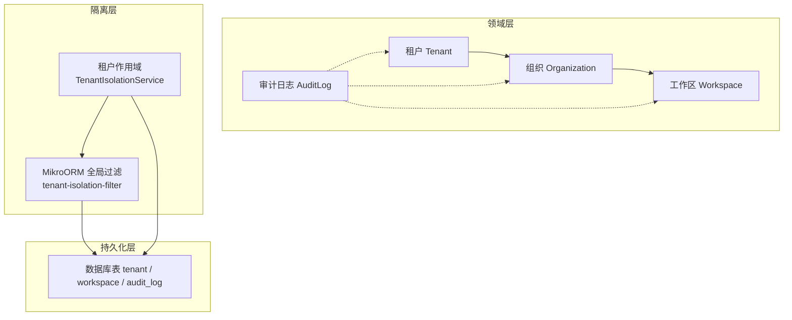
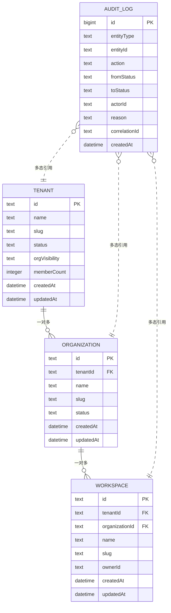
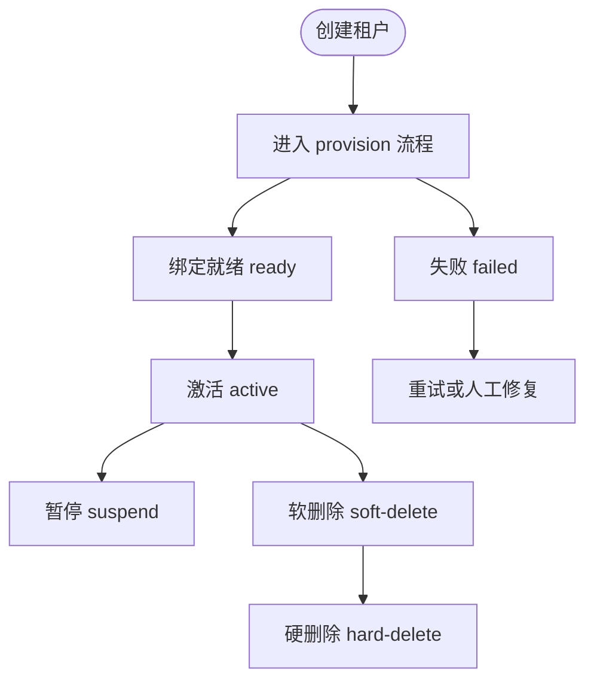
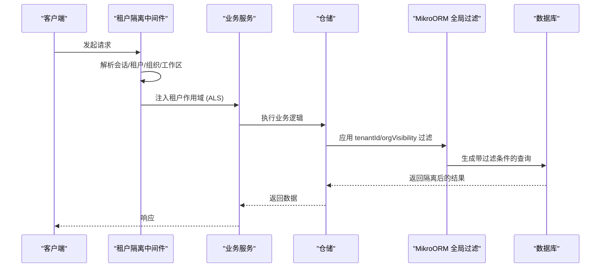
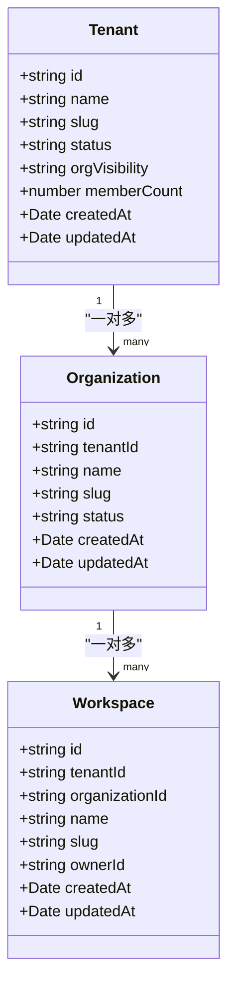
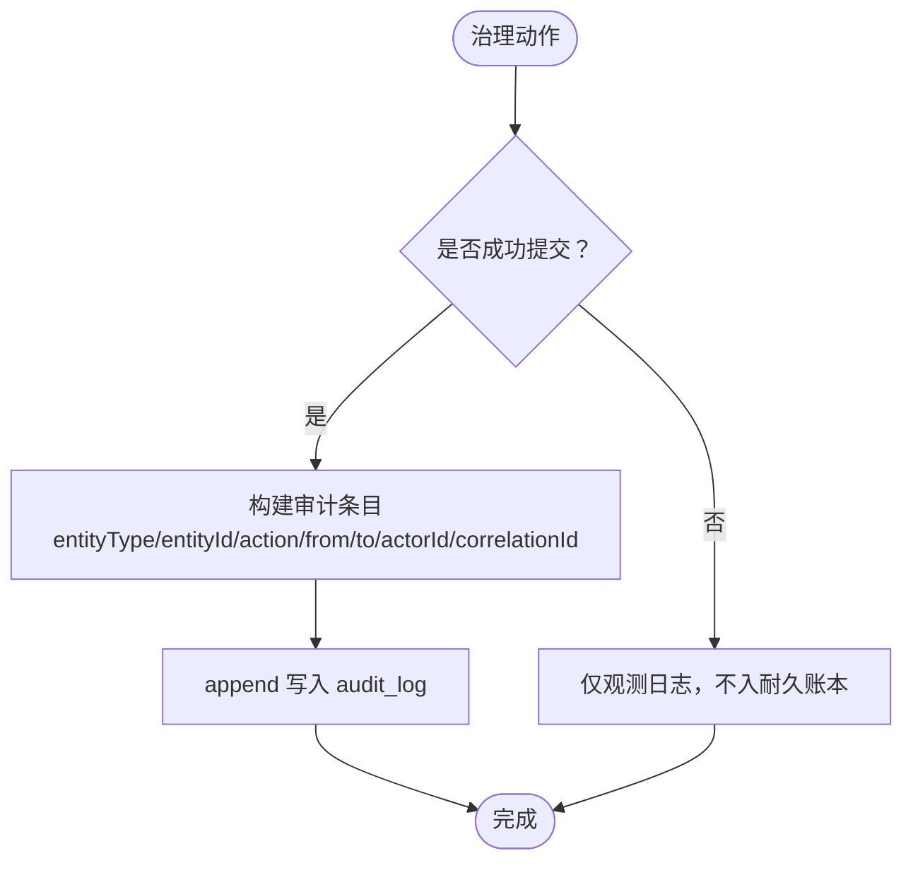
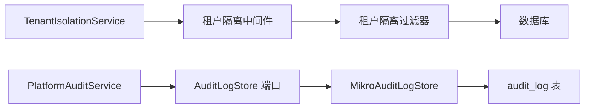

# 组织架构实体

<cite>
**本文引用的文件 **
- [tenant.entity.ts](file://apps/api/src/modules/organizations/infrastructure/entities/tenant.entity.ts)
- [workspace.entity.ts](file://apps/api/src/modules/workspaces/infrastructure/entities/workspace.entity.ts)
- [audit-log.entity.ts](file://apps/api/src/modules/organizations/infrastructure/entities/audit-log.entity.ts)
- [tenant-isolation.service.ts](file://libs/core/src/tenant-isolation/tenant-isolation.service.ts)
- [tenant-isolation.middleware.ts](file://libs/core/src/tenant-isolation/tenant-isolation.middleware.ts)
- [tenant-isolation-filter.ts](file://apps/api/src/database/mikro/tenant-isolation-filter.ts)
- [mikro-audit-log.store.ts](file://apps/api/src/modules/organizations/infrastructure/mikro-audit-log.store.ts)
- [audit-log.store.ts](file://libs/core/src/shared-kernel/audit/audit-log.store.ts)
- [platform-audit.service.test.ts](file://apps/api/src/modules/platform/platform-audit.service.test.ts)
</cite>

## 目录
1. [引言](#引言)
2. [项目结构](#项目结构)
3. [核心架构实体](#核心架构实体)
4. [架构总览](#架构总览)
5. [详细组件分析](#详细组件分析)
6. [依赖关系分析](#依赖关系分析)
7. [性能与可扩展性](#性能与可扩展性)
8. [故障排查指南](#故障排查指南)
9. [结论](#结论)

## 引言
本文件面向“组织、租户、工作区、审计日志”等核心架构实体，系统性说明其数据模型、层级关系、生命周期状态、成员管理、租户隔离机制、多租户数据访问模式以及审计日志的 append-only 设计与合规约束。文档同时提供实体关系图和数据流向图，帮助读者从业务规则到实现细节建立完整认知。

## 项目结构
围绕组织架构实体的关键代码分布在以下位置：
- 租户实体定义位于 `modules/organizations/infrastructure/entities/tenant.entity.ts`
- 工作区实体定义位于 `modules/workspaces/infrastructure/entities/workspace.entity.ts`
- 审计日志实体定义位于 `modules/organizations/infrastructure/entities/audit-log.entity.ts`
- 租户隔离上下文与服务位于 `libs/core/src/tenant-isolation/tenant-isolation.service.ts` 与中间件
- 全局行级租户隔离过滤器位于 `database/mikro/tenant-isolation-filter.ts`
- 审计日志持久化适配位于 `modules/organizations/infrastructure/mikro-audit-log.store.ts`
- 审计端口契约位于 `libs/core/src/shared-kernel/audit/audit-log.store.ts`
- 平台审计行为验证位于 `modules/platform/platform-audit.service.test.ts`

**图表来源**
- [tenant.entity.ts:6-18](file://apps/api/src/modules/organizations/infrastructure/entities/tenant.entity.ts#L6-L18)
- [workspace.entity.ts:5-14](file://apps/api/src/modules/workspaces/infrastructure/entities/workspace.entity.ts#L5-L14)
- [audit-log.entity.ts:4-20](file://apps/api/src/modules/organizations/infrastructure/entities/audit-log.entity.ts#L4-L20)
- [tenant-isolation.service.ts:6-17](file://libs/core/src/tenant-isolation/tenant-isolation.service.ts#L6-L17)
- [tenant-isolation-filter.ts:4-21](file://apps/api/src/database/mikro/tenant-isolation-filter.ts#L4-L21)

**章节来源**
- [tenant.entity.ts:6-18](file://apps/api/src/modules/organizations/infrastructure/entities/tenant.entity.ts#L6-L18)
- [workspace.entity.ts:5-14](file://apps/api/src/modules/workspaces/infrastructure/entities/workspace.entity.ts#L5-L14)
- [audit-log.entity.ts:4-20](file://apps/api/src/modules/organizations/infrastructure/entities/audit-log.entity.ts#L4-L20)
- [tenant-isolation.service.ts:6-17](file://libs/core/src/tenant-isolation/tenant-isolation.service.ts#L6-L17)
- [tenant-isolation-filter.ts:4-21](file://apps/api/src/database/mikro/tenant-isolation-filter.ts#L4-L21)

## 核心架构实体
本节聚焦四个核心实体的字段、约束与语义。

### 租户（Tenant）
- 主键：`id`
- 名称与标识：`name`、`slug`（全局唯一）
- 治理状态：`status`（值域由统一生命周期枚举约束）
- 租内跨组织可见性策略：`orgVisibility`（默认共享；isolated 时启用组织级收窄）
- 成员数物化计数：`memberCount`（库级触发器维护，读 O(1)）
- 时间戳：`createdAt`、`updatedAt`（nullable）

设计要点：
- 租户是组织的父级，支持“一租户多组织”。
- `slug` 具备全局唯一约束，迁移阶段先清洗重复再添加约束。
- `orgVisibility` 通过 CHECK 表达式限制取值，配合全局 filter 实现组织级隔离。

**章节来源**
- [tenant.entity.ts:20-60](file://apps/api/src/modules/organizations/infrastructure/entities/tenant.entity.ts#L20-L60)
- [tenant.entity.ts:63-73](file://apps/api/src/modules/organizations/infrastructure/entities/tenant.entity.ts#L63-L73)

### 工作区（Workspace）
- 主键：`id`
- 归属租户：`tenantId`（可空，FK→Tenant，级联删除）
- 归属组织：`organizationId`（FK→Organization，级联删除）
- 名称与标识：`name`、`slug`（在组织维度唯一）
- 实例属主：`ownerId`（可空；受限 grant 下 fail-closed 不可见）
- 时间戳：`createdAt`、`updatedAt`

设计要点：
- 工作区属于组织，并可选归属租户；写路径要求 ALS 全量盖章，不信任请求体伪造。
- 索引优化查询：`(organizationId, ownerId)`。
- 注册租户隔离过滤器，确保在册租户作用域内的安全读写。

**章节来源**
- [workspace.entity.ts:16-39](file://apps/api/src/modules/workspaces/infrastructure/entities/workspace.entity.ts#L16-L39)
- [workspace.entity.ts:41-52](file://apps/api/src/modules/workspaces/infrastructure/entities/workspace.entity.ts#L41-L52)

### 审计日志（AuditLog）
- 自增主键：`id`
- 实体类别：`entityType`（tenant/user）
- 实体标识：`entityId`（多态裸值，非 FK）
- 动作：`action`（approve/reject/suspend/resume/delete/hard_delete）
- 状态迁移端点：`fromStatus`、`toStatus`（物理列名避 SQL 保留字）
- 操作者：`actorId`（FK→User，onDelete set null）
- 理由：`reason`
- 关联 id：`correlationId`
- 时间戳：`createdAt`

设计要点：
- Append-only：无 `updatedAt`，只插不改不删，进入不可变表集合。
- PII 最小化：仅记录裸标识符，不携带邮箱、姓名等个人数据。
- 索引：按 `(entityType, entityId, createdAt)` 回溯某实体的治理时序。

**章节来源**
- [audit-log.entity.ts:22-44](file://apps/api/src/modules/organizations/infrastructure/entities/audit-log.entity.ts#L22-L44)
- [audit-log.entity.ts:46-59](file://apps/api/src/modules/organizations/infrastructure/entities/audit-log.entity.ts#L46-L59)

## 架构总览
下图展示租户、组织与工作区的层级关系，以及审计日志如何作为独立账本记录治理动作。

**图表来源**
- [tenant.entity.ts:34-60](file://apps/api/src/modules/organizations/infrastructure/entities/tenant.entity.ts#L34-L60)
- [workspace.entity.ts:16-39](file://apps/api/src/modules/workspaces/infrastructure/entities/workspace.entity.ts#L16-L39)
- [audit-log.entity.ts:22-44](file://apps/api/src/modules/organizations/infrastructure/entities/audit-log.entity.ts#L22-L44)

## 详细组件分析

### 组织层级结构与生命周期
- 层级：Tenant ⊃ Organization ⊃ Workspace
- 生命周期状态：
  - 租户治理状态 `status` 由统一生命周期枚举驱动（如 pending_approval → active）。
  - 组织绑定外部系统（Odoo）的状态机包含 provisioning、ready、failed 等阶段，并通过仓储方法更新。
- 成员管理：
  - 租户成员数通过库级触发器维护至 `memberCount`，读侧走 O(1)。
  - 成员相关实体（如成员表、角色分配、邀请）受租户隔离过滤器保护。

**图表来源**
- [tenant.entity.ts:41-46](file://apps/api/src/modules/organizations/infrastructure/entities/tenant.entity.ts#L41-L46)
- [mikro-audit-log.store.ts:9-18](file://apps/api/src/modules/organizations/infrastructure/mikro-audit-log.store.ts#L9-L18)

**章节来源**
- [tenant.entity.ts:6-18](file://apps/api/src/modules/organizations/infrastructure/entities/tenant.entity.ts#L6-L18)
- [tenant.entity.ts:41-50](file://apps/api/src/modules/organizations/infrastructure/entities/tenant.entity.ts#L41-L50)

### 租户隔离与多租户数据访问
- 活动上下文：
  - `TenantIsolationService` 暴露当前请求的租户作用域（tenantId、organizationId、workspaceId、userId、role、orgVisibility）。
  - 中间件将认证与会话解析出的上下文注入 AsyncLocalStorage，供后续服务与仓储读取。
- 数据隔离策略：
  - 全局 MikroORM filter 对在册租户作用域的业务实体追加 `tenantId` 恒过滤。
  - 当 `orgVisibility=isolated` 且存在活动组织时，追加 `organizationId` 收窄。
  - 若 isolated 且无活动组织，针对带 `organizationId` 分区列的实体返回拒所有哨兵谓词，避免跨组织泄露。
- 多租户访问模式：
  - 常规 fork 使用 ALS 派生参数；`scoped:false` 用于跨租/治理/seed 面，filter 条件为空即恒真不筛。
  - 仓储层仍保留手写 `{tenantId}` where 谓词，形成机制+纪律双保险。

**图表来源**
- [tenant-isolation.middleware.ts:84-103](file://libs/core/src/tenant-isolation/tenant-isolation.middleware.ts#L84-L103)
- [tenant-isolation.service.ts:25-69](file://libs/core/src/tenant-isolation/tenant-isolation.service.ts#L25-L69)
- [tenant-isolation-filter.ts:65-87](file://apps/api/src/database/mikro/tenant-isolation-filter.ts#L65-L87)

**章节来源**
- [tenant-isolation.service.ts:25-69](file://libs/core/src/tenant-isolation/tenant-isolation.service.ts#L25-L69)
- [tenant-isolation.middleware.ts:84-103](file://libs/core/src/tenant-isolation/tenant-isolation.middleware.ts#L84-L103)
- [tenant-isolation-filter.ts:4-21](file://apps/api/src/database/mikro/tenant-isolation-filter.ts#L4-L21)
- [tenant-isolation-filter.ts:65-87](file://apps/api/src/database/mikro/tenant-isolation-filter.ts#L65-L87)

### 工作区的概念与作用
- 工作区是组织下的协作单元，可归属租户，便于在租户范围内进一步划分资源边界。
- 工作区拥有实例属主，结合 RBAC 与受限 grant，可实现更细粒度的可见性与权限控制。
- 工作区与组织的关系为强约束（organizationId），与租户的关系为弱约束（tenantId 可空），体现“组织为主、租户为辅”的设计。

**图表来源**
- [tenant.entity.ts:63-73](file://apps/api/src/modules/organizations/infrastructure/entities/tenant.entity.ts#L63-L73)
- [workspace.entity.ts:41-52](file://apps/api/src/modules/workspaces/infrastructure/entities/workspace.entity.ts#L41-L52)

**章节来源**
- [workspace.entity.ts:16-39](file://apps/api/src/modules/workspaces/infrastructure/entities/workspace.entity.ts#L16-L39)
- [workspace.entity.ts:41-52](file://apps/api/src/modules/workspaces/infrastructure/entities/workspace.entity.ts#L41-L52)

### 审计日志的 Append-Only 设计与合规
- 设计原则：
  - Append-only：仅插入，不提供 update/delete 原语，保障账本不可篡改。
  - PII 最小化：仅记录裸标识符（entityId、actorId），不记录邮箱、姓名等敏感信息。
  - 多态引用：entityId 为非 FK 裸值，即使被治理实体被硬删，审计行仍留存。
- 合规要求：
  - 审计条目需包含动作语义、状态迁移端点、操作者与关联链。
  - 失败尝试仅观测不入耐久账本；驳回/硬删无 to 时 from 落账、to 归 null。
- 持久化实现：
  - 通过 `AUDIT_LOG_STORE` 端口抽象，参考应用实现 `MikroAuditLogStore` 写入 `audit_log` 表。
  - 平台审计服务统一消费，输出结构化日志并调用 store.append。

**图表来源**
- [audit-log.store.ts:1-64](file://libs/core/src/shared-kernel/audit/audit-log.store.ts#L1-L64)
- [mikro-audit-log.store.ts:9-37](file://apps/api/src/modules/organizations/infrastructure/mikro-audit-log.store.ts#L9-L37)
- [platform-audit.service.test.ts:19-93](file://apps/api/src/modules/platform/platform-audit.service.test.ts#L19-L93)

**章节来源**
- [audit-log.entity.ts:4-20](file://apps/api/src/modules/organizations/infrastructure/entities/audit-log.entity.ts#L4-L20)
- [audit-log.store.ts:1-64](file://libs/core/src/shared-kernel/audit/audit-log.store.ts#L1-L64)
- [mikro-audit-log.store.ts:9-37](file://apps/api/src/modules/organizations/infrastructure/mikro-audit-log.store.ts#L9-L37)
- [platform-audit.service.test.ts:19-93](file://apps/api/src/modules/platform/platform-audit.service.test.ts#L19-L93)

## 依赖关系分析
- 租户隔离依赖：
  - `TenantIsolationService` 读取 ALS 中的租户作用域。
  - 中间件负责解析并注入上下文。
  - 全局 filter 根据上下文生成过滤条件。
- 审计日志依赖：
  - 平台审计服务消费 `PlatformAuditService`，调用 `AuditLogStore.append`。
  - `MikroAuditLogStore` 将条目映射到 `audit_log` 表。

**图表来源**
- [tenant-isolation.service.ts:25-69](file://libs/core/src/tenant-isolation/tenant-isolation.service.ts#L25-L69)
- [tenant-isolation.middleware.ts:84-103](file://libs/core/src/tenant-isolation/tenant-isolation.middleware.ts#L84-L103)
- [tenant-isolation-filter.ts:108-137](file://apps/api/src/database/mikro/tenant-isolation-filter.ts#L108-L137)
- [audit-log.store.ts:1-64](file://libs/core/src/shared-kernel/audit/audit-log.store.ts#L1-L64)
- [mikro-audit-log.store.ts:9-37](file://apps/api/src/modules/organizations/infrastructure/mikro-audit-log.store.ts#L9-L37)

**章节来源**
- [tenant-isolation.service.ts:25-69](file://libs/core/src/tenant-isolation/tenant-isolation.service.ts#L25-L69)
- [tenant-isolation.middleware.ts:84-103](file://libs/core/src/tenant-isolation/tenant-isolation.middleware.ts#L84-L103)
- [tenant-isolation-filter.ts:108-137](file://apps/api/src/database/mikro/tenant-isolation-filter.ts#L108-L137)
- [audit-log.store.ts:1-64](file://libs/core/src/shared-kernel/audit/audit-log.store.ts#L1-L64)
- [mikro-audit-log.store.ts:9-37](file://apps/api/src/modules/organizations/infrastructure/mikro-audit-log.store.ts#L9-L37)

## 性能与可扩展性
- 租户成员数物化计数：通过库级触发器维护 `memberCount`，读侧 O(1)，避免频繁联表统计。
- 索引优化：
  - 工作区 `(organizationId, ownerId)` 提升按组织与属主的查询效率。
  - 审计日志 `(entityType, entityId, createdAt)` 支持按实体回溯时序。
- 隔离机制：
  - 全局 filter 以机制兜底，减少手写谓词遗漏风险。
  - `scoped:false` 允许治理/跨租场景高效执行，无需禁用 filter。

[本节为通用指导，不直接分析具体文件]

## 故障排查指南
- 缺少活动租户上下文：
  - 现象：抛出“Missing active tenant context”错误。
  - 原因：未解析出租户作用域或中间件未注入。
  - 处理：检查认证与会话解析链路，确认中间件已绑定 ALS。
- 组织隔离导致查询为空：
  - 现象：在 `orgVisibility=isolated` 且无活动组织时，查询结果为空。
  - 原因：针对带 `organizationId` 分区列的实体返回拒所有哨兵谓词。
  - 处理：确保选择活动组织或调整可见性策略。
- 审计日志未落盘：
  - 现象：成功动作未写入 `audit_log`。
  - 原因：失败尝试仅观测不入耐久账本；或 store.append 未调用。
  - 处理：检查平台审计服务调用链与 store 实现。

**章节来源**
- [tenant-isolation.service.ts:82-114](file://libs/core/src/tenant-isolation/tenant-isolation.service.ts#L82-L114)
- [tenant-isolation-filter.ts:65-87](file://apps/api/src/database/mikro/tenant-isolation-filter.ts#L65-L87)
- [platform-audit.service.test.ts:59-78](file://apps/api/src/modules/platform/platform-audit.service.test.ts#L59-L78)

## 结论
本项目通过明确的实体定义与严格的隔离机制，构建了“租户—组织—工作区”的清晰层级结构。租户隔离借助中间件注入上下文与全局 filter 双重保障，确保多租户数据访问的安全与可控。审计日志采用 append-only 与 PII 最小化设计，满足合规与可追溯性要求。整体架构兼顾性能与扩展性，适合 SaaS 场景下的复杂组织管理与治理需求。