# 订阅计费实体

<cite>
**本文引用的文件**   
- [subscriptions.module.ts](file://apps/api/src/modules/subscriptions/subscriptions.module.ts)
- [tenant-subscription.entity.ts](file://apps/api/src/modules/subscriptions/infrastructure/entities/tenant-subscription.entity.ts)
- [mikro-quota.store.ts](file://apps/api/src/modules/subscriptions/infrastructure/mikro-quota.store.ts)
- [mikro-subscription.lifecycle.ts](file://apps/api/src/modules/subscriptions/infrastructure/mikro-subscription.lifecycle.ts)
- [payment-customer.provisioner.ts](file://apps/api/src/modules/subscriptions/infrastructure/payment-customer.provisioner.ts)
- [stripe-payment.provider.ts](file://apps/api/src/modules/payment/infrastructure/stripe-payment.provider.ts)
- [organization-plans.ts](file://libs/core/src/modules/subscriptions/quota/organization-plans.ts)
- [quota.service.ts](file://libs/core/src/modules/subscriptions/quota/quota.service.ts)
- [quota.vo.ts](file://libs/core/src/modules/subscriptions/quota/quota.vo.ts)
- [subscription-lifecycle.ts](file://libs/core/src/modules/subscriptions/domain/subscription-lifecycle.ts)
- [subscription-lifecycle-fold.ts](file://libs/core/src/modules/subscriptions/domain/subscription-lifecycle-fold.ts)
- [subscription-created.event.ts](file://libs/core/src/modules/subscriptions/domain/events/subscription-created.event.ts)
- [subscription-bootstrapped.event.ts](file://libs/core/src/modules/subscriptions/domain/events/subscription-bootstrapped.event.ts)
- [subscription-status-transitioned.event.ts](file://libs/core/src/modules/subscriptions/domain/events/subscription-status-transitioned.event.ts)
- [subscriptions.controller.ts](file://apps/api/src/modules/subscriptions/api/subscriptions.controller.ts)
</cite>

## 目录
1. [简介](#简介)
2. [项目结构](#项目结构)
3. [核心组件](#核心组件)
4. [架构总览](#架构总览)
5. [详细组件分析](#详细组件分析)
6. [依赖关系分析](#依赖关系分析)
7. [性能与扩展性](#性能与扩展性)
8. [故障排查指南](#故障排查指南)
9. [结论](#结论)

## 简介
本文件面向“订阅计费”领域，系统化梳理租户订阅、配额管理与计费周期等核心实体的定义与实现。文档覆盖：
- 订阅生命周期状态与迁移规则（激活、暂停、到期、取消）
- 计划类型与配额配置（席位、存储、API 调用）
- 配额检查与超额处理策略
- 订阅状态机与事件真相源（Event Sourcing）重放机制
- 与支付系统（Stripe）的集成点

该文档既适合开发者深入理解代码结构与数据流，也适合非技术读者把握业务规则与约束条件。

## 项目结构
订阅计费能力由“应用层模块 + 核心领域库”共同构成：
- 应用层模块负责控制器、ORM 适配、仓储、生命周期收敛、支付客户映射等
- 核心领域库提供计划定义、配额值对象、配额服务、生命周期纯函数与折叠器、领域事件契约

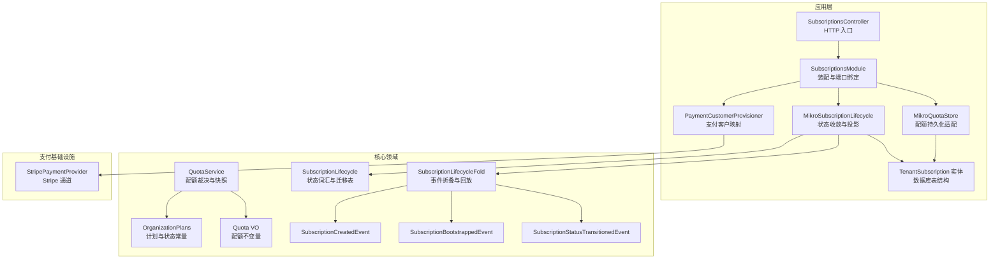

图表来源
- [subscriptions.module.ts:20-64](file://apps/api/src/modules/subscriptions/subscriptions.module.ts#L20-L64)
- [tenant-subscription.entity.ts:19-45](file://apps/api/src/modules/subscriptions/infrastructure/entities/tenant-subscription.entity.ts#L19-L45)
- [mikro-quota.store.ts:27-45](file://apps/api/src/modules/subscriptions/infrastructure/mikro-quota.store.ts#L27-L45)
- [mikro-subscription.lifecycle.ts:45-53](file://apps/api/src/modules/subscriptions/infrastructure/mikro-subscription.lifecycle.ts#L45-L53)
- [payment-customer.provisioner.ts:15-22](file://apps/api/src/modules/subscriptions/infrastructure/payment-customer.provisioner.ts#L15-L22)
- [organization-plans.ts:41-68](file://libs/core/src/modules/subscriptions/quota/organization-plans.ts#L41-L68)
- [quota.service.ts:58-81](file://libs/core/src/modules/subscriptions/quota/quota.service.ts#L58-L81)
- [subscription-lifecycle.ts:18-54](file://libs/core/src/modules/subscriptions/domain/subscription-lifecycle.ts#L18-L54)
- [subscription-lifecycle-fold.ts:121-136](file://libs/core/src/modules/subscriptions/domain/subscription-lifecycle-fold.ts#L121-L136)
- [stripe-payment.provider.ts:19-37](file://apps/api/src/modules/payment/infrastructure/stripe-payment.provider.ts#L19-L37)

章节来源
- [subscriptions.module.ts:20-64](file://apps/api/src/modules/subscriptions/subscriptions.module.ts#L20-L64)

## 核心组件
本节聚焦订阅计费的关键实体与服务：
- 租户订阅实体：承载订阅计划、状态、配额、计费周期与支付提供方关联
- 计划与配额：定义档位、默认免费档、配额值对象与配额服务
- 生命周期与事件：定义状态集合、合法迁移、事件折叠与重放
- 配额存储与裁决：读取生效订阅、统计成员数、计算用量与剩余额度
- 支付客户映射：将租户与第三方支付提供商客户建立映射

章节来源
- [tenant-subscription.entity.ts:19-65](file://apps/api/src/modules/subscriptions/infrastructure/entities/tenant-subscription.entity.ts#L19-L65)
- [organization-plans.ts:12-79](file://libs/core/src/modules/subscriptions/quota/organization-plans.ts#L12-L79)
- [quota.vo.ts:12-37](file://libs/core/src/modules/subscriptions/quota/quota.vo.ts#L12-L37)
- [quota.service.ts:58-130](file://libs/core/src/modules/subscriptions/quota/quota.service.ts#L58-L130)
- [subscription-lifecycle.ts:18-69](file://libs/core/src/modules/subscriptions/domain/subscription-lifecycle.ts#L18-L69)
- [subscription-lifecycle-fold.ts:12-42](file://libs/core/src/modules/subscriptions/domain/subscription-lifecycle-fold.ts#L12-L42)
- [mikro-quota.store.ts:27-80](file://apps/api/src/modules/subscriptions/infrastructure/mikro-quota.store.ts#L27-L80)
- [payment-customer.provisioner.ts:15-22](file://apps/api/src/modules/subscriptions/infrastructure/payment-customer.provisioner.ts#L15-L22)

## 架构总览
订阅计费采用“命令/查询 + 领域事件真相源”的分层架构：
- HTTP 控制器暴露创建与查询接口
- 命令/查询处理器驱动领域逻辑
- 领域事件作为订阅状态的真相源，支持重放与投影
- 配额服务通过仓储读取生效订阅并计算用量
- 支付系统集成 Stripe，完成客户创建与结算

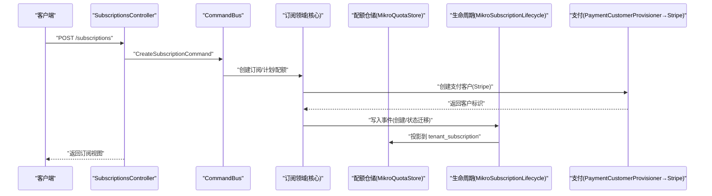

图表来源
- [subscriptions.controller.ts:66-89](file://apps/api/src/modules/subscriptions/api/subscriptions.controller.ts#L66-L89)
- [payment-customer.provisioner.ts:19-22](file://apps/api/src/modules/subscriptions/infrastructure/payment-customer.provisioner.ts#L19-L22)
- [mikro-subscription.lifecycle.ts:69-134](file://apps/api/src/modules/subscriptions/infrastructure/mikro-subscription.lifecycle.ts#L69-L134)
- [mikro-quota.store.ts:30-45](file://apps/api/src/modules/subscriptions/infrastructure/mikro-quota.store.ts#L30-L45)

## 详细组件分析

### 租户订阅实体（TenantSubscription）
- 字段说明
  - id：主键
  - tenantId：租户标识（计费单位上移至租户）
  - plan：计划标识（如 free/pro/enterprise）
  - status：订阅状态（active/suspended/expired/cancelled）
  - seatsLimit：席位限额
  - storageQuota：存储配额（可空）
  - apiQuota：API 调用配额（可空）
  - periodStart/periodEnd：计费周期起止
  - provider/providerCustomerId/providerSubscriptionId：支付提供方及关联标识
  - createdAt/updatedAt：审计时间戳

- 索引与隔离
  - 复合索引：按 (tenantId, status)、(tenantId, periodStart)
  - 行级隔离：遵循租户隔离过滤器

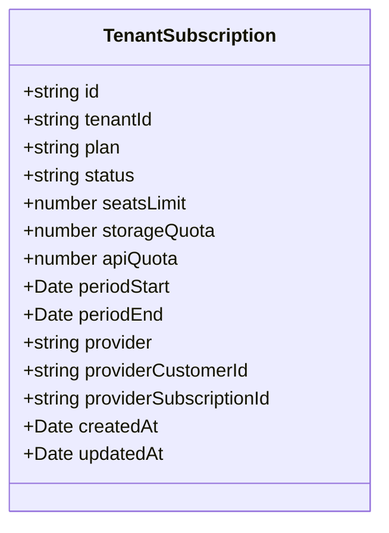

图表来源
- [tenant-subscription.entity.ts:19-65](file://apps/api/src/modules/subscriptions/infrastructure/entities/tenant-subscription.entity.ts#L19-L65)

章节来源
- [tenant-subscription.entity.ts:19-65](file://apps/api/src/modules/subscriptions/infrastructure/entities/tenant-subscription.entity.ts#L19-L65)

### 计划类型与配额模型
- 计划定义
  - 免费档 FREE_PLAN：seatsLimit=5
  - pro：seatsLimit=50
  - enterprise：seatsLimit=最大安全整数
  - 未知计划回落免费档

- 配额值对象 Quota
  - 不变量：非负安全整数
  - 构造失败 fail-loud，保证内部纯度

- 配额服务 QuotaService
  - currentSubscription：读取最新 active 订阅
  - effectiveSeatsLimit：有订阅取 seatsLimit，否则回退免费档
  - currentSeats：当前用量 = 成员数
  - checkSeats：used + adding <= limit 判定
  - snapshot：聚合 hasSubscription/plan/seatsLimit/used/remaining/providerCustomerId

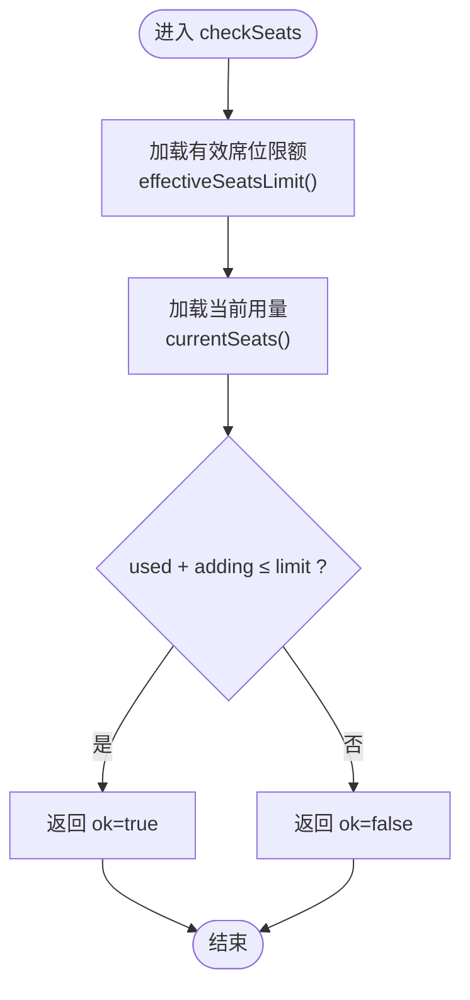

图表来源
- [quota.service.ts:93-106](file://libs/core/src/modules/subscriptions/quota/quota.service.ts#L93-L106)
- [organization-plans.ts:52-79](file://libs/core/src/modules/subscriptions/quota/organization-plans.ts#L52-L79)
- [quota.vo.ts:12-37](file://libs/core/src/modules/subscriptions/quota/quota.vo.ts#L12-L37)

章节来源
- [organization-plans.ts:12-79](file://libs/core/src/modules/subscriptions/quota/organization-plans.ts#L12-L79)
- [quota.service.ts:58-130](file://libs/core/src/modules/subscriptions/quota/quota.service.ts#L58-L130)
- [quota.vo.ts:12-37](file://libs/core/src/modules/subscriptions/quota/quota.vo.ts#L12-L37)

### 订阅生命周期与状态机
- 状态集合
  - active：活跃
  - suspended：暂停（可恢复）
  - expired：到期
  - cancelled：取消（终态）

- 合法迁移
  - active → suspended/expired/cancelled
  - suspended → active/expired/cancelled
  - expired/cancelled：不接受任何迁移

- 迁移判定 canTransition
  - from 缺省视为 active
  - 终态不可迁移

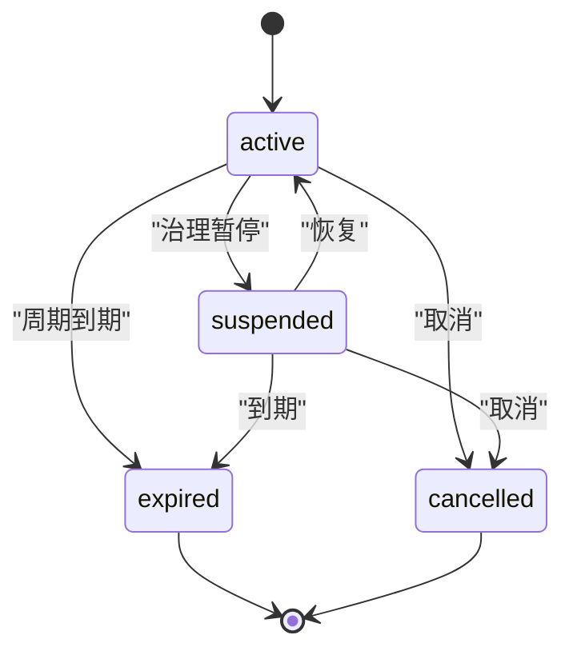

图表来源
- [subscription-lifecycle.ts:18-54](file://libs/core/src/modules/subscriptions/domain/subscription-lifecycle.ts#L18-L54)
- [subscription-lifecycle.ts:64-69](file://libs/core/src/modules/subscriptions/domain/subscription-lifecycle.ts#L64-L69)

章节来源
- [subscription-lifecycle.ts:18-69](file://libs/core/src/modules/subscriptions/domain/subscription-lifecycle.ts#L18-L69)

### 事件真相源与折叠回放
- 事件类型
  - subscription.created：新订阅起点
  - subscription.bootstrapped：存量快照起点（最后快照重启）
  - subscription.status.transitioned：状态迁移（携带 from/to/actor/reason）

- 折叠规则
  - 起点事件仅允许在流起点出现
  - 迁移事件 from 必须等于重放态
  - 非法迁移或未知 eventType fail-loud

- 重放策略
  - 存在 bootstrapped 时以最后一个为起点折叠
  - 无快照则全流严格回放

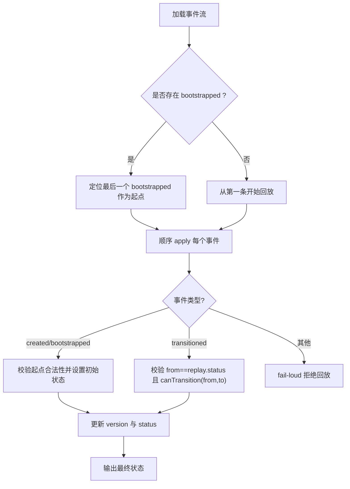

图表来源
- [subscription-lifecycle-fold.ts:12-42](file://libs/core/src/modules/subscriptions/domain/subscription-lifecycle-fold.ts#L12-L42)
- [subscription-lifecycle-fold.ts:59-108](file://libs/core/src/modules/subscriptions/domain/subscription-lifecycle-fold.ts#L59-L108)
- [subscription-lifecycle-fold.ts:121-136](file://libs/core/src/modules/subscriptions/domain/subscription-lifecycle-fold.ts#L121-L136)
- [subscription-created.event.ts:10-51](file://libs/core/src/modules/subscriptions/domain/events/subscription-created.event.ts#L10-L51)
- [subscription-bootstrapped.event.ts:10-17](file://libs/core/src/modules/subscriptions/domain/events/subscription-bootstrapped.event.ts#L10-L17)
- [subscription-status-transitioned.event.ts:10-19](file://libs/core/src/modules/subscriptions/domain/events/subscription-status-transitioned.event.ts#L10-L19)

章节来源
- [subscription-lifecycle-fold.ts:12-136](file://libs/core/src/modules/subscriptions/domain/subscription-lifecycle-fold.ts#L12-L136)
- [subscription-created.event.ts:10-51](file://libs/core/src/modules/subscriptions/domain/events/subscription-created.event.ts#L10-L51)
- [subscription-bootstrapped.event.ts:10-17](file://libs/core/src/modules/subscriptions/domain/events/subscription-bootstrapped.event.ts#L10-L17)
- [subscription-status-transitioned.event.ts:10-19](file://libs/core/src/modules/subscriptions/domain/events/subscription-status-transitioned.event.ts#L10-L19)

### 配额存储与用量计算
- 生效订阅读取
  - 按 tenantId 与 status=active 排序 periodStart desc，取最新一行
  - 返回 plan/seatsLimit/providerCustomerId

- 成员计数
  - 使用 tenant_membership 表 count(tenantId)
  - 绕过环境 ALS 过滤，显式锚定 tenantId

- 对拍诊断
  - reconcileMembers：联表组织轴成员求和（过渡观测）

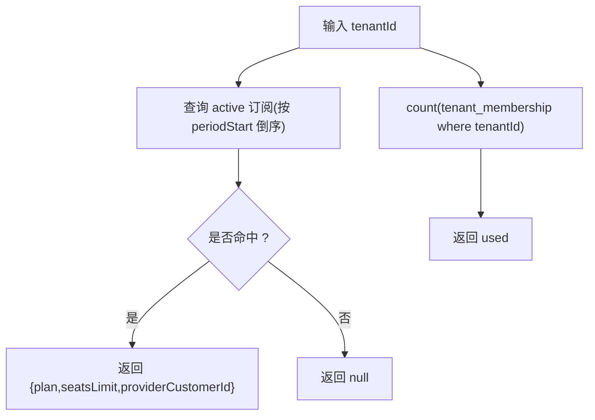

图表来源
- [mikro-quota.store.ts:30-45](file://apps/api/src/modules/subscriptions/infrastructure/mikro-quota.store.ts#L30-L45)
- [mikro-quota.store.ts:59-62](file://apps/api/src/modules/subscriptions/infrastructure/mikro-quota.store.ts#L59-L62)
- [mikro-quota.store.ts:73-79](file://apps/api/src/modules/subscriptions/infrastructure/mikro-quota.store.ts#L73-L79)

章节来源
- [mikro-quota.store.ts:27-80](file://apps/api/src/modules/subscriptions/infrastructure/mikro-quota.store.ts#L27-L80)

### 订阅状态收敛与投影
- 旧路径（旋钮关闭）
  - 查找 from 态最新行 → nativeUpdate 置 to 态并盖 updatedAt

- 真相源写路径（旋钮开启）
  - 加载事件流 → replaySubscriptionLifecycle 得到 previous
  - canTransition(previous, to) 校验
  - publishDurable 追加事件（乐观锁 expectedVersion=stream.length+1）
  - applySubscriptionEvent 计算 next 状态 → nativeUpdate 投影

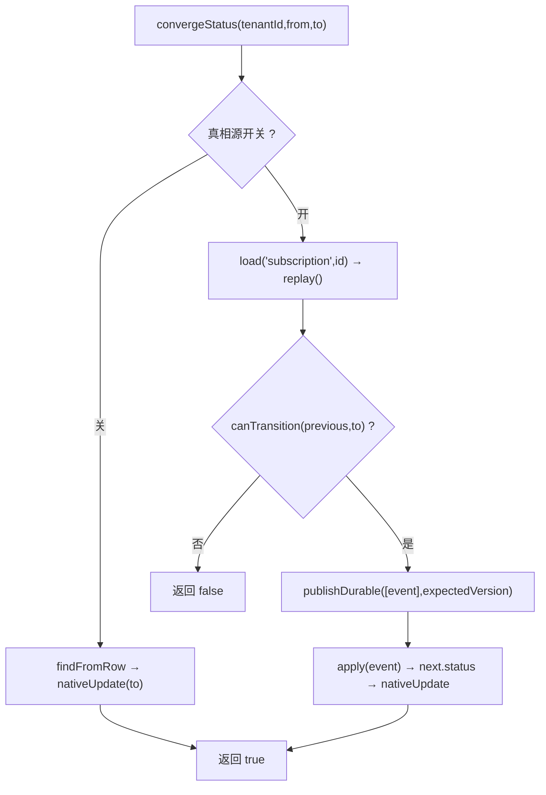

图表来源
- [mikro-subscription.lifecycle.ts:69-134](file://apps/api/src/modules/subscriptions/infrastructure/mikro-subscription.lifecycle.ts#L69-L134)
- [subscription-lifecycle-fold.ts:121-136](file://libs/core/src/modules/subscriptions/domain/subscription-lifecycle-fold.ts#L121-L136)
- [subscription-lifecycle.ts:64-69](file://libs/core/src/modules/subscriptions/domain/subscription-lifecycle.ts#L64-L69)

章节来源
- [mikro-subscription.lifecycle.ts:45-157](file://apps/api/src/modules/subscriptions/infrastructure/mikro-subscription.lifecycle.ts#L45-L157)

### 支付系统集成（Stripe）
- 支付客户映射
  - PaymentCustomerProvisioner 调用 PaymentService.createCustomer
  - 返回 {id, providerId}

- Stripe 提供者
  - supportsRecurring=true
  - createCustomer/createCheckout/refund/webhook 标准化

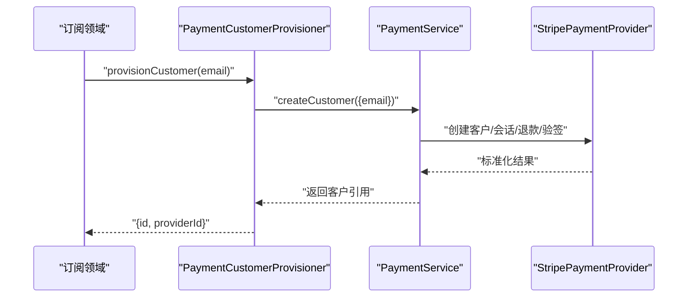

图表来源
- [payment-customer.provisioner.ts:19-22](file://apps/api/src/modules/subscriptions/infrastructure/payment-customer.provisioner.ts#L19-L22)
- [stripe-payment.provider.ts:43-96](file://apps/api/src/modules/payment/infrastructure/stripe-payment.provider.ts#L43-L96)

章节来源
- [payment-customer.provisioner.ts:15-22](file://apps/api/src/modules/subscriptions/infrastructure/payment-customer.provisioner.ts#L15-L22)
- [stripe-payment.provider.ts:19-108](file://apps/api/src/modules/payment/infrastructure/stripe-payment.provider.ts#L19-L108)

### HTTP 接口与访问控制
- GET /subscriptions/current
  - 守卫：TenantIsolationGuard
  - 返回：当前订阅视图（套餐/席位配额/用量/客户映射）

- POST /subscriptions
  - 守卫：TenantIsolationGuard + AuthorizationGuard + @Can('update','Organization')
  - 入参：plan/customerEmail/seatsLimit/storageQuota/apiQuota
  - 行为：创建支付供应商客户并落配额

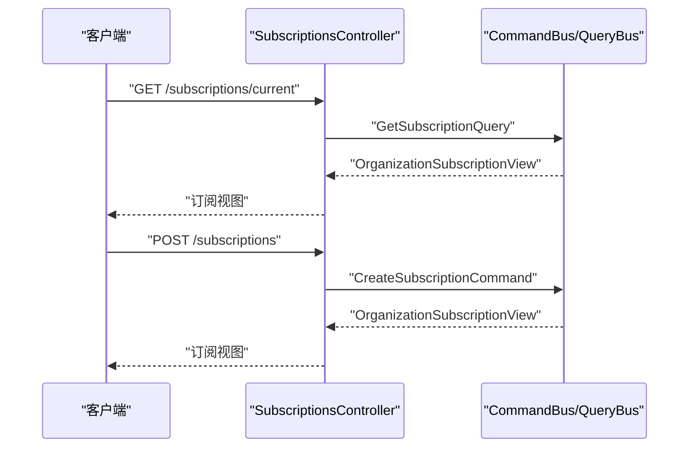

图表来源
- [subscriptions.controller.ts:49-89](file://apps/api/src/modules/subscriptions/api/subscriptions.controller.ts#L49-L89)

章节来源
- [subscriptions.controller.ts:19-89](file://apps/api/src/modules/subscriptions/api/subscriptions.controller.ts#L19-L89)

## 依赖关系分析
- 模块装配
  - SubscriptionsModule 注入 CqrsModule、控制器、命令/查询处理器、事件处理器
  - 绑定 SUBSCRIPTION_REPOSITORY、SUBSCRIPTION_LIFECYCLE、CUSTOMER_PROVISIONER、QUOTA_STORE
  - 导出 QuotaService、QuotaGuard、QUOTA_STORE 供跨上下文消费

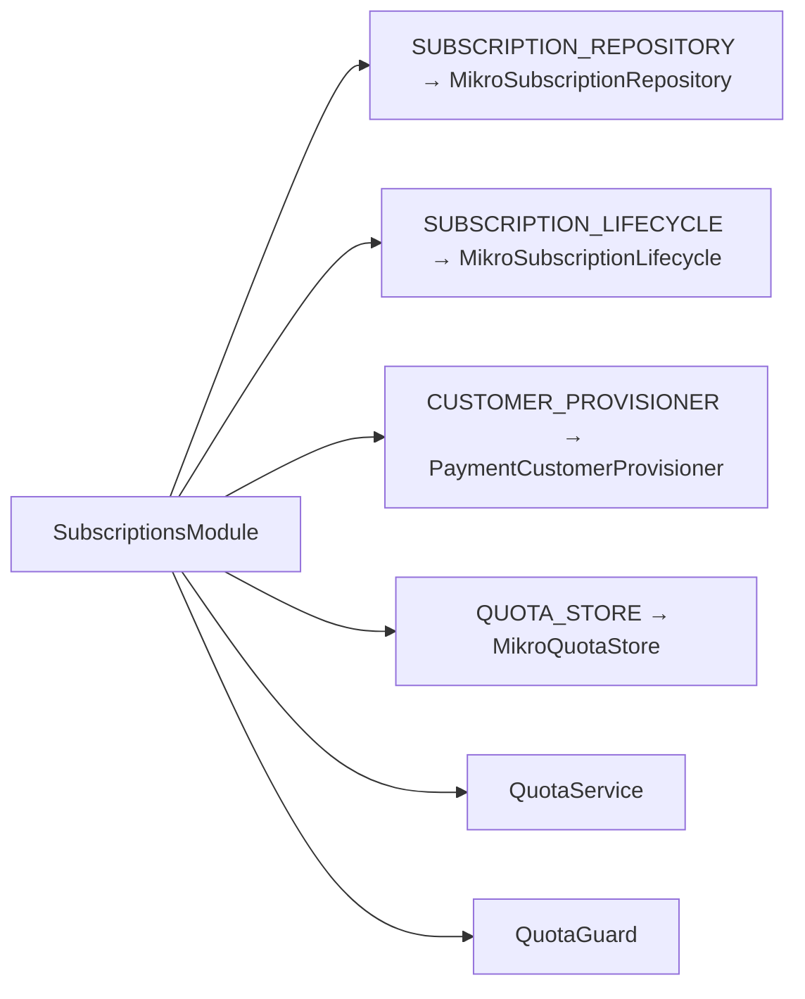

图表来源
- [subscriptions.module.ts:20-64](file://apps/api/src/modules/subscriptions/subscriptions.module.ts#L20-L64)

章节来源
- [subscriptions.module.ts:20-64](file://apps/api/src/modules/subscriptions/subscriptions.module.ts#L20-L64)

## 性能与扩展性
- 配额计算
  - 使用 Promise.all 并行获取限额与用量，降低延迟
  - 成员计数基于 tenant_membership 直接 count，避免物化列漂移

- 状态收敛
  - 真相源写路径使用乐观锁 expectedVersion 避免并发覆盖
  - 投影 nativeUpdate 仅在 fold 结果变化后执行

- 可扩展性
  - 计划目录 ORGANIZATION_PLANS 可扩展新档位
  - 配额维度预留 storageQuota/apiQuota，便于后续接入
  - 支付 Provider 端口化，新增第三方仅需实现 PaymentProvider

[本节为通用指导，不直接分析具体文件]

## 故障排查指南
- 配额超限
  - 现象：checkSeats 返回 ok=false
  - 排查：确认 effectiveSeatsLimit 与 currentSeats；检查是否有 active 订阅；核对 member 计数是否正确

- 状态迁移失败
  - 现象：convergeStatus 返回 false 或抛错
  - 排查：确认 from→to 是否在 TRANSITIONS 中；真相源模式下检查 replay.previous 与 canTransition；验证事件流连续性（expectedVersion）

- 事件回放异常
  - 现象：fold 抛错（非法迁移/未知事件/起点重复）
  - 排查：检查事件 payload 关键字段；确认 bootstrapped 位置；确保事件 aggregateType=subscription

- 支付客户映射失败
  - 现象：provisionCustomer 抛错或返回缺失 providerId
  - 排查：检查 PaymentService 与 Stripe 配置；确认 webhook 签名与回调处理

章节来源
- [quota.service.ts:93-106](file://libs/core/src/modules/subscriptions/quota/quota.service.ts#L93-L106)
- [mikro-subscription.lifecycle.ts:69-134](file://apps/api/src/modules/subscriptions/infrastructure/mikro-subscription.lifecycle.ts#L69-L134)
- [subscription-lifecycle-fold.ts:59-108](file://libs/core/src/modules/subscriptions/domain/subscription-lifecycle-fold.ts#L59-L108)
- [payment-customer.provisioner.ts:19-22](file://apps/api/src/modules/subscriptions/infrastructure/payment-customer.provisioner.ts#L19-L22)

## 结论
本订阅计费体系以“租户订阅 + 配额管理 + 事件真相源”为核心，实现了：
- 清晰的订阅生命周期与迁移约束
- 灵活的计划与配额模型（席位为主，预留存储/API）
- 可靠的配额检查与超额处理
- 幂等的状态收敛与投影机制
- 可扩展的支付集成（Stripe）

建议在后续迭代中：
- 完善 storageQuota/apiQuota 的使用与计量
- 强化配额审计与告警
- 持续优化事件流回放与投影一致性
- 扩展更多支付渠道并保持端口抽象

[本节为总结性内容，不直接分析具体文件]