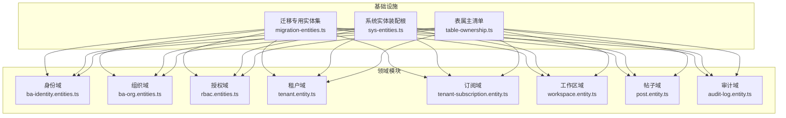
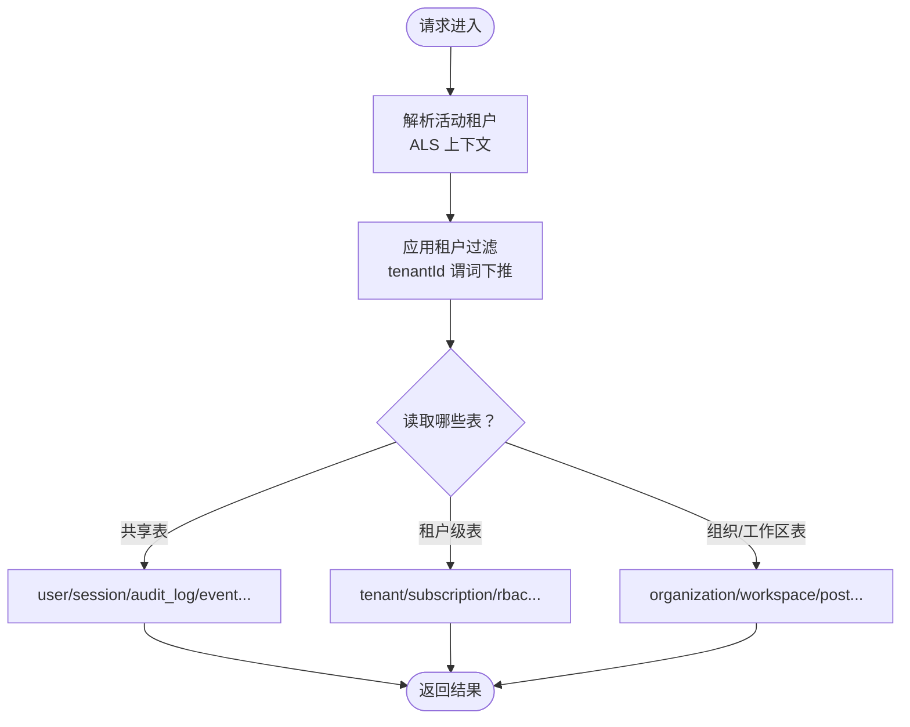
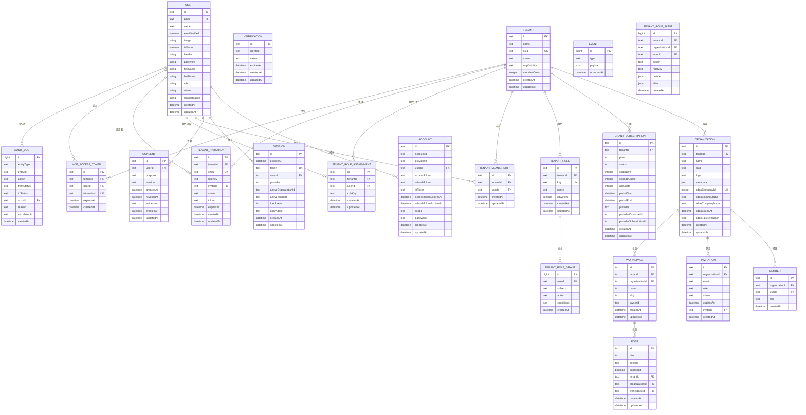
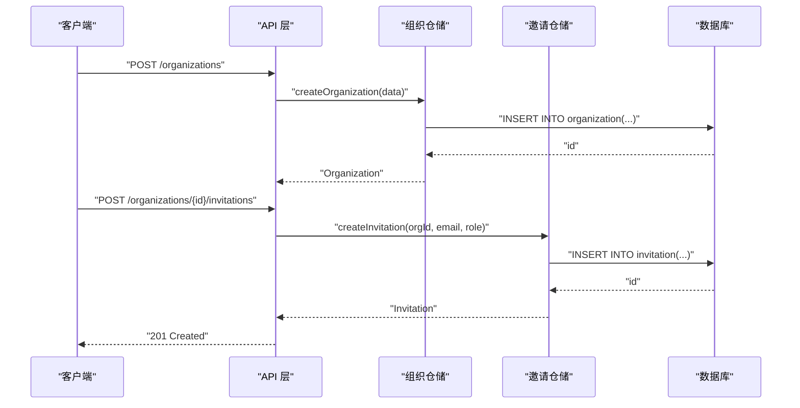
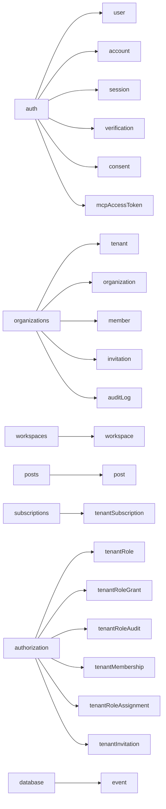

# 数据库表结构

<cite>
**本文引用的文件**   
- [apps/api/src/database/mikro/migration/migration-entities.ts](file://apps/api/src/database/mikro/migration/migration-entities.ts)
- [apps/api/src/modules/auth/infrastructure/entities/ba-identity.entities.ts](file://apps/api/src/modules/auth/infrastructure/entities/ba-identity.entities.ts)
- [apps/api/src/modules/organizations/infrastructure/entities/ba-org.entities.ts](file://apps/api/src/modules/organizations/infrastructure/entities/ba-org.entities.ts)
- [apps/api/src/modules/authorization/infrastructure/entities/rbac.entities.ts](file://apps/api/src/modules/authorization/infrastructure/entities/rbac.entities.ts)
- [apps/api/src/modules/organizations/infrastructure/entities/tenant.entity.ts](file://apps/api/src/modules/organizations/infrastructure/entities/tenant.entity.ts)
- [apps/api/src/modules/subscriptions/infrastructure/entities/tenant-subscription.entity.ts](file://apps/api/src/modules/subscriptions/infrastructure/entities/tenant-subscription.entity.ts)
- [apps/api/src/modules/workspaces/infrastructure/entities/workspace.entity.ts](file://apps/api/src/modules/workspaces/infrastructure/entities/workspace.entity.ts)
- [apps/api/src/modules/posts/infrastructure/entities/post.entity.ts](file://apps/api/src/modules/posts/infrastructure/entities/post.entity.ts)
- [apps/api/src/modules/organizations/infrastructure/entities/audit-log.entity.ts](file://apps/api/src/modules/organizations/infrastructure/entities/audit-log.entity.ts)
- [apps/api/src/database/table-ownership.ts](file://apps/api/src/database/table-ownership.ts)
- [apps/api/src/database/mikro/sys-entities.ts](file://apps/api/src/database/mikro/sys-entities.ts)
</cite>

## 目录
1. [引言](#引言)
2. [项目结构与数据建模总览](#项目结构与数据建模总览)
3. [核心物理表定义与约束](#核心物理表定义与约束)
4. [多租户隔离的表结构设计](#多租户隔离的表结构设计)
5. [分区、大表优化与历史归档策略](#分区大表优化与历史归档策略)
6. [外键关系、唯一性与检查约束设计原则](#外键关系唯一性与检查约束设计原则)
7. [索引设计与查询优化建议](#索引设计与查询优化建议)
8. [连接池与持久化配置要点](#连接池与持久化配置要点)
9. [ER 图与数据流图](#er-图与数据流图)
10. [依赖分析与表属主纪律](#依赖分析与表属主纪律)
11. [故障排查指南](#故障排查指南)
12. [结论](#结论)

## 引言
本文件面向 SaaS 平台的数据库层，系统性梳理所有物理表的字段类型、索引策略与约束条件；解释多租户数据隔离（共享表、独立表、混合模式）在表结构中的落地方式；给出分区与大表优化、历史归档方案；说明外键、唯一性、检查约束的设计原则；并提供性能相关的索引设计、查询优化建议与连接池配置要点。文档同时提供 ER 图和数据流图，帮助读者从全局理解表间关系与数据流转过程。

## 项目结构与数据建模总览
本项目采用 MikroORM v7 零装饰器实体模型，并通过“迁移专用忠实全模型”与“运行时扁平实体”双变体实现：
- 迁移专用实体集负责生成和校验 DDL，严格对齐生产表面，避免未来 DDL 漂移导致 FK/索引丢失。
- 运行时实体用于应用仓储读写，保持扁平列与 BA 契约兼容。
- 表属主通过 `table-ownership.ts` 集中声明，写侧严格受守卫约束，读侧允许跨上下文聚合（CQRS）。

图表来源
- [apps/api/src/database/mikro/migration/migration-entities.ts:20-46](file://apps/api/src/database/mikro/migration/migration-entities.ts#L20-L46)
- [apps/api/src/database/mikro/sys-entities.ts:32-45](file://apps/api/src/database/mikro/sys-entities.ts#L32-L45)
- [apps/api/src/database/table-ownership.ts:1-16](file://apps/api/src/database/table-ownership.ts#L1-L16)

章节来源
- [apps/api/src/database/mikro/migration/migration-entities.ts:20-46](file://apps/api/src/database/mikro/migration/migration-entities.ts#L20-L46)
- [apps/api/src/database/mikro/sys-entities.ts:32-45](file://apps/api/src/database/mikro/sys-entities.ts#L32-L45)
- [apps/api/src/database/table-ownership.ts:1-16](file://apps/api/src/database/table-ownership.ts#L1-L16)

## 核心物理表定义与约束
以下按领域分组列出关键物理表、字段类型、索引与约束要点。为便于阅读，仅摘要关键字段与约束语义，不直接粘贴代码。

- 身份域（auth）
  - user：主键 id(text)，邮箱 email(唯一约束 user_email_idx)，角色 role(枚举文本)，治理状态 status(检查约束 user_status_check，值域 active/suspended/deleted)，时间戳 createdAt/updatedAt。
  - account：主键 id(text)，第三方账户关联 userId(FK→user,cascade)，令牌与过期时间等扩展字段。
  - session：主键 id(text)，token(唯一约束 session_token_idx)，expiresAt(普通索引 session_expires_at_idx)，userId(FK→user,cascade)，activeOrganizationId/activeTenantId/IP/UA 等附加字段。
  - verification：验证码/验证流程相关表，含 identifier/value/expiresAt 等。
  - consent：PIPL 同意台账，userId(可空 FK→user,set null)，purpose/version/grantedAt/revokedAt/evidence 等。

- 组织与成员（organizations）
  - organization：主键 id(text)，tenantId(FK→tenant,cascade,nullable)，slug(租内唯一 organization_tenantId_slug_unique)，Odoo 绑定列组 odooCompanyId(unique)/odooBindingStatus(CHECK)/odooCompanyName/odooBoundAt/odooFailureReason，createdAt/updatedAt。
  - member：成员关系 (organizationId,userId) 唯一约束 member_org_user_idx，role 字符串。
  - invitation：邀请记录，组织维度索引 invitation_org_email_idx，status/inviterId 等。

- 租户与订阅（tenants & subscriptions）
  - tenant：主键 id(text)，name/slug(global unique tenant_slug_unique)，status(CHECK tenant_status_check)，orgVisibility(CHECK tenant_org_visibility_check)，memberCount(物化计数，由触发器维护)，createdAt/updatedAt。
  - tenant_subscription：计费上移至租户级，tenantId(FK→tenant,cascade)，plan/status/seatsLimit/storageQuota/apiQuota/periodStart/periodEnd/provider* 等；复合索引 tenant_subscription_tenant_status_idx、tenant_subscription_tenant_period_idx。

- 工作区与帖子（workspaces & posts）
  - workspace：主键 id(text)，tenantId(FK→tenant,cascade,nullable)，organizationId(FK→organization,cascade)，slug(组织内唯一 workspace_org_slug_idx)，ownerId(实例属主，可空)，createdAt/updatedAt；索引 workspace_org_owner_idx。
  - post：主键 id(text)，title/content/published，tenantId(FK→tenant,cascade,nullable)，organizationId(FK→organization,cascade)，workspaceId(FK→workspace,set null), createdAt/updatedAt；索引 post_organization_created_idx、post_organization_workspace_idx。

- 授权域（authorization）
  - tenant_role：角色定义，tenantId(FK→tenant,cascade)，key(租户内唯一 tenant_role_tenant_key_idx)，isSystem/name/时间戳。
  - tenant_role_grant：行式授权，roleId(FK→tenant_role,cascade)，subject/action/conditions(jsonb)，索引 tenant_role_grant_role_subject_idx。
  - tenant_role_audit：变更留痕，tenantId/organizationId/actorId(FK→user,set null)，action/roleKey/before/after/时间戳；索引 tenant_role_audit_org_created_idx。
  - tenant_membership：租户级成员关系，unique(tenantId,userId)。
  - tenant_role_assignment：租户级角色分配，unique(tenantId,userId)，roleKey 逻辑关联 tenant_role(key)。
  - tenant_invitation：租户级邀请，unique(tenantId,email)，token 索引。

- 审计日志（organizations）
  - audit_log：append-only 审计账本，entityType/entityId/action/fromStatus/toStatus/actorId(FK→user,set null)/reason/correlationId/createdAt；索引 audit_log_entity_created_idx。

- MCP 访问凭证（auth）
  - mcp_access_token：租户级凭证，FK→tenant/user，哈希唯一（元数据驱动）。

章节来源
- [apps/api/src/modules/auth/infrastructure/entities/ba-identity.entities.ts:31-145](file://apps/api/src/modules/auth/infrastructure/entities/ba-identity.entities.ts#L31-L145)
- [apps/api/src/modules/organizations/infrastructure/entities/ba-org.entities.ts:27-95](file://apps/api/src/modules/organizations/infrastructure/entities/ba-org.entities.ts#L27-L95)
- [apps/api/src/modules/authorization/infrastructure/entities/rbac.entities.ts:27-249](file://apps/api/src/modules/authorization/infrastructure/entities/rbac.entities.ts#L27-L249)
- [apps/api/src/modules/organizations/infrastructure/entities/tenant.entity.ts:34-73](file://apps/api/src/modules/organizations/infrastructure/entities/tenant.entity.ts#L34-L73)
- [apps/api/src/modules/subscriptions/infrastructure/entities/tenant-subscription.entity.ts:19-65](file://apps/api/src/modules/subscriptions/infrastructure/entities/tenant-subscription.entity.ts#L19-L65)
- [apps/api/src/modules/workspaces/infrastructure/entities/workspace.entity.ts:16-55](file://apps/api/src/modules/workspaces/infrastructure/entities/workspace.entity.ts#L16-L55)
- [apps/api/src/modules/posts/infrastructure/entities/post.entity.ts:32-66](file://apps/api/src/modules/posts/infrastructure/entities/post.entity.ts#L32-L66)
- [apps/api/src/modules/organizations/infrastructure/entities/audit-log.entity.ts:22-62](file://apps/api/src/modules/organizations/infrastructure/entities/audit-log.entity.ts#L22-L62)
- [apps/api/src/database/mikro/migration/migration-entities.ts:51-330](file://apps/api/src/database/mikro/migration/migration-entities.ts#L51-L330)

## 多租户隔离的表结构设计
本项目以“租户轴”为核心，构建 Tenant ⊃ Organization ⊃ Workspace 的层级关系，并在多个业务表中保留 tenantId 作为作用域锚点，结合运行时过滤机制实现行级隔离。

- 共享表（平台级/跨租户）
  - user/account/session/verification/consent/mcp_access_token：身份与认证相关，属于 auth 域，跨租户共享。
  - audit_log：治理审计耐久账本，跨租户共享，append-only。
  - event：事件存储（ES 端口独占写面），跨租户共享。

- 租户级表（租户内共享）
  - tenant：租户根表，承载生命周期态、可见性策略、成员数物化计数。
  - tenant_subscription：计费与配额按租户总量控制。
  - tenant_role / tenant_role_grant / tenant_role_audit：授权事实 SSOT，角色与授权按租户管理。
  - tenant_membership / tenant_role_assignment / tenant_invitation：成员、角色分配与邀请均按租户维度。

- 组织与工作区级表（租户内组织/工作区粒度）
  - organization/member/invitation：组织容器族，BA 契约表，组织内成员与邀请。
  - workspace：工作区，归属组织并可归属租户（expand 阶段 nullable）。
  - post：帖子，归属组织与工作区，并携带租户轴。

- 混合模式
  - 部分表（如 organization/workspace/post）在 expand 阶段保留 tenantId nullable，写路径通过 ALS 上下文盖章，读路径通过租户过滤自动收窄；既兼容旧链路，又逐步过渡到租户轴。

图表来源
- [apps/api/src/modules/authorization/infrastructure/entities/rbac.entities.ts:130-200](file://apps/api/src/modules/authorization/infrastructure/entities/rbac.entities.ts#L130-L200)
- [apps/api/src/modules/workspaces/infrastructure/entities/workspace.entity.ts:34-38](file://apps/api/src/modules/workspaces/infrastructure/entities/workspace.entity.ts#L34-L38)
- [apps/api/src/modules/posts/infrastructure/entities/post.entity.ts:63-66](file://apps/api/src/modules/posts/infrastructure/entities/post.entity.ts#L63-L66)

章节来源
- [apps/api/src/modules/authorization/infrastructure/entities/rbac.entities.ts:130-200](file://apps/api/src/modules/authorization/infrastructure/entities/rbac.entities.ts#L130-L200)
- [apps/api/src/modules/workspaces/infrastructure/entities/workspace.entity.ts:34-38](file://apps/api/src/modules/workspaces/infrastructure/entities/workspace.entity.ts#L34-L38)
- [apps/api/src/modules/posts/infrastructure/entities/post.entity.ts:63-66](file://apps/api/src/modules/posts/infrastructure/entities/post.entity.ts#L63-L66)

## 分区、大表优化与历史归档策略
- 分区表
  - 当前仓库未显式定义分区表。对于高增长表（如 audit_log、event、tenant_role_audit、tenant_invitation），建议按时间范围（例如按月/季度）进行分区，以提升查询与归档效率。
  - 若引入分区，应同步更新索引策略（局部索引或全局索引）与统计信息收集计划。

- 大表优化
  - 对高频查询列建立覆盖索引或复合索引（例如 tenant_subscription 的 tenantId+status/periodStart，post 的 organizationId+createdAt/workspaceId）。
  - 使用物化视图或物化计数列（如 tenant.memberCount）减少复杂聚合开销。
  - 对 JSONB 字段（如 conditions/reason/before/after）按需建立 GIN 索引，但需评估写入放大。

- 历史数据归档
  - append-only 表（audit_log、tenant_role_audit）适合定期归档至历史库或冷存储。
  - 会话与验证码表（session、verification）可按 expiresAt 清理或归档。
  - 订阅与配额表（tenant_subscription）可按 periodEnd 归档到期周期数据。

[本节为通用指导，不直接分析具体文件]

## 外键关系、唯一性与检查约束设计原则
- 外键关系
  - 优先使用 FK cascade 保证级联删除一致性（如 organization.tenantId、workspace.organizationId、post.workspaceId set null 等）。
  - 跨上下文弱引用（如 organization.odooCompanyId）不建 FK，由应用层预检查 + 库级唯一兜底。

- 唯一性约束
  - 租户内唯一：organization_tenantId_slug_unique、workspace_org_slug_idx、tenant_role_tenant_key_idx、tenant_membership_tenant_user_idx、tenant_role_assignment_tenant_user_idx、tenant_invitation_tenant_email_idx。
  - 全局唯一：tenant_slug_unique、user_email_idx、session_token_idx、organization_odooCompanyId_unique。

- 检查约束
  - 值域约束：user_status_check、tenant_status_check、tenant_org_visibility_check、organization_odoo_binding_status_check。
  - CHECK 表达式中驼峰列名需加引号，避免 PG 折叠小写导致 errorMissingColumn。

- 设计原则
  - 将业务不变式下沉至 DB 层（CHECK/UNIQUE/FK），减少应用层校验负担。
  - 对跨上下文引用采用“逻辑关联 + 应用层校验”，避免跨域强耦合。
  - 命名规范：约束与索引具名，便于迁移与排障。

章节来源
- [apps/api/src/modules/auth/infrastructure/entities/ba-identity.entities.ts:31-65](file://apps/api/src/modules/auth/infrastructure/entities/ba-identity.entities.ts#L31-L65)
- [apps/api/src/modules/organizations/infrastructure/entities/ba-org.entities.ts:27-65](file://apps/api/src/modules/organizations/infrastructure/entities/ba-org.entities.ts#L27-L65)
- [apps/api/src/modules/authorization/infrastructure/entities/rbac.entities.ts:27-85](file://apps/api/src/modules/authorization/infrastructure/entities/rbac.entities.ts#L27-L85)
- [apps/api/src/modules/organizations/infrastructure/entities/tenant.entity.ts:34-60](file://apps/api/src/modules/organizations/infrastructure/entities/tenant.entity.ts#L34-L60)
- [apps/api/src/database/mikro/migration/migration-entities.ts:153-195](file://apps/api/src/database/mikro/migration/migration-entities.ts#L153-L195)

## 索引设计与查询优化建议
- 已实现的索引
  - user.email → user_email_idx
  - session.token → session_token_idx；session.expiresAt → session_expires_at_idx
  - organization.tenantId+slug → organization_tenantId_slug_unique
  - organization.odooCompanyId → organization_odooCompanyId_unique
  - member.organizationId+userId → member_org_user_idx
  - invitation.organizationId+email → invitation_org_email_idx
  - workspace.organizationId+slug → workspace_org_slug_idx；workspace.organizationId+ownerId → workspace_org_owner_idx
  - post.organizationId+createdAt → post_organization_created_idx；post.organizationId+workspaceId → post_organization_workspace_idx
  - tenant.slug → tenant_slug_unique
  - tenant_subscription.tenantId+status → tenant_subscription_tenant_status_idx；tenant_subscription.tenantId+periodStart → tenant_subscription_tenant_period_idx
  - tenant_role.tenantId+key → tenant_role_tenant_key_idx
  - tenant_role_grant.roleId+subject → tenant_role_grant_role_subject_idx
  - tenant_role_audit.organizationId+createdAt → tenant_role_audit_org_created_idx
  - tenant_membership.tenantId+userId → tenant_membership_tenant_user_idx
  - tenant_role_assignment.tenantId+userId → tenant_role_assignment_tenant_user_idx
  - tenant_invitation.tenantId+email → tenant_invitation_tenant_email_idx；tenant_invitation.token → token 索引
  - audit_log.entityType+entityId+createdAt → audit_log_entity_created_idx

- 查询优化建议
  - 优先使用复合索引匹配 WHERE 前缀列（如 tenantId+status/periodStart）。
  - 对 JSONB 条件查询按需添加 GIN 索引（如 tenant_role_grant.conditions）。
  - 避免 SELECT *，仅投影必要列，减少网络与序列化开销。
  - 对分页查询使用基于索引的游标分页（如 createdAt 或 id）。
  - 对跨上下文聚合（CQRS read-model）允许 JOIN，但注意租户过滤下推，避免全表扫描。

章节来源
- [apps/api/src/database/mikro/migration/migration-entities.ts:112-135](file://apps/api/src/database/mikro/migration/migration-entities.ts#L112-L135)
- [apps/api/src/modules/organizations/infrastructure/entities/ba-org.entities.ts:55-65](file://apps/api/src/modules/organizations/infrastructure/entities/ba-org.entities.ts#L55-L65)
- [apps/api/src/modules/authorization/infrastructure/entities/rbac.entities.ts:42-85](file://apps/api/src/modules/authorization/infrastructure/entities/rbac.entities.ts#L42-L85)
- [apps/api/src/modules/subscriptions/infrastructure/entities/tenant-subscription.entity.ts:38-44](file://apps/api/src/modules/subscriptions/infrastructure/entities/tenant-subscription.entity.ts#L38-L44)
- [apps/api/src/modules/workspaces/infrastructure/entities/workspace.entity.ts:34-38](file://apps/api/src/modules/workspaces/infrastructure/entities/workspace.entity.ts#L34-L38)
- [apps/api/src/modules/posts/infrastructure/entities/post.entity.ts:49-66](file://apps/api/src/modules/posts/infrastructure/entities/post.entity.ts#L49-L66)
- [apps/api/src/modules/organizations/infrastructure/entities/audit-log.entity.ts:40-43](file://apps/api/src/modules/organizations/infrastructure/entities/audit-log.entity.ts#L40-L43)

## 连接池与持久化配置要点
- 连接池
  - 单连接池承载所有实体（sys-entities.ts 装配根），确保事务与隔离级别一致。
  - 根据并发与负载调整最大连接数、空闲超时与获取超时。
  - 针对长事务与批量操作，适当增大连接池上限，避免等待队列过长。

- ORM 配置
  - 使用 MikroORM v7 零装饰器 defineEntity，避免装饰器副作用影响迁移/tsx 加载路径。
  - 命名策略：EntityCaseNamingStrategy 使属性名原样作列名（camelCase），与 BA 契约对齐。
  - 迁移专用实体集与运行时实体解耦，避免 DDL 漂移风险。

- 事务与隔离
  - 对跨上下文写操作（如 audit_log、event）使用明确的事务边界。
  - 对租户级写操作确保 ALS 租户上下文存在，避免跨租写入。

[本节为通用指导，不直接分析具体文件]

## ER 图与数据流图
### ER 图（核心实体关系）

图表来源
- [apps/api/src/modules/auth/infrastructure/entities/ba-identity.entities.ts:31-145](file://apps/api/src/modules/auth/infrastructure/entities/ba-identity.entities.ts#L31-L145)
- [apps/api/src/modules/organizations/infrastructure/entities/ba-org.entities.ts:27-95](file://apps/api/src/modules/organizations/infrastructure/entities/ba-org.entities.ts#L27-L95)
- [apps/api/src/modules/authorization/infrastructure/entities/rbac.entities.ts:27-249](file://apps/api/src/modules/authorization/infrastructure/entities/rbac.entities.ts#L27-L249)
- [apps/api/src/modules/organizations/infrastructure/entities/tenant.entity.ts:34-73](file://apps/api/src/modules/organizations/infrastructure/entities/tenant.entity.ts#L34-L73)
- [apps/api/src/modules/subscriptions/infrastructure/entities/tenant-subscription.entity.ts:19-65](file://apps/api/src/modules/subscriptions/infrastructure/entities/tenant-subscription.entity.ts#L19-L65)
- [apps/api/src/modules/workspaces/infrastructure/entities/workspace.entity.ts:16-55](file://apps/api/src/modules/workspaces/infrastructure/entities/workspace.entity.ts#L16-L55)
- [apps/api/src/modules/posts/infrastructure/entities/post.entity.ts:32-66](file://apps/api/src/modules/posts/infrastructure/entities/post.entity.ts#L32-L66)
- [apps/api/src/modules/organizations/infrastructure/entities/audit-log.entity.ts:22-62](file://apps/api/src/modules/organizations/infrastructure/entities/audit-log.entity.ts#L22-L62)

### 数据流图（典型写流程：创建组织并邀请成员）

图表来源
- [apps/api/src/modules/organizations/infrastructure/entities/ba-org.entities.ts:27-95](file://apps/api/src/modules/organizations/infrastructure/entities/ba-org.entities.ts#L27-L95)

## 依赖分析与表属主纪律
- 表属主
  - user/account/session/verification/consent/mcp_access_token → auth
  - tenant/organization/member/invitation/auditLog → organizations
  - workspace → workspaces
  - post → posts
  - tenantSubscription → subscriptions
  - tenantRole/tenantRoleGrant/tenantRoleAudit/tenantMembership/tenantRoleAssignment/tenantInvitation → authorization
  - event → database

- 写侧严格
  - 任何 insert/update/delete 目标表必须属该上下文 owned 集，或命中 WRITE_EXCEPTIONS 显式例外。
  - 读侧宽松：跨上下文 select/join 允许（CQRS read-model 固有形态）。

图表来源
- [apps/api/src/database/table-ownership.ts:17-60](file://apps/api/src/database/table-ownership.ts#L17-L60)

章节来源
- [apps/api/src/database/table-ownership.ts:1-80](file://apps/api/src/database/table-ownership.ts#L1-L80)

## 故障排查指南
- 常见错误
  - errorMissingColumn：CHECK 表达式中驼峰列名未加引号，PG 折叠小写导致列不存在。
  - 跨租数据泄露：未启用租户过滤或显式 fork({ scoped:false }) 绕筛时误读跨租数据。
  - 迁移漂移：迁移专用实体集与运行时实体不一致，导致 DDL 静默 DROP 约束。

- 排查步骤
  - 核对 CHECK 表达式列名是否带引号。
  - 确认租户过滤是否生效（TENANT_ISOLATION_FILTERS 是否在册）。
  - 比对 migration-entities.ts 与运行时实体，确保逐列对齐。
  - 审查表属主与写侧守卫，确认写入通道合规。

章节来源
- [apps/api/src/modules/organizations/infrastructure/entities/tenant.entity.ts:25-32](file://apps/api/src/modules/organizations/infrastructure/entities/tenant.entity.ts#L25-L32)
- [apps/api/src/modules/authorization/infrastructure/entities/rbac.entities.ts:130-200](file://apps/api/src/modules/authorization/infrastructure/entities/rbac.entities.ts#L130-L200)
- [apps/api/src/database/mikro/migration/migration-entities.ts:30-46](file://apps/api/src/database/mikro/migration/migration-entities.ts#L30-L46)

## 结论
本项目通过“租户轴”为核心的表结构设计，实现了清晰的多租户隔离与灵活的共享/独立/混合模式。借助迁移专用忠实全模型与运行时扁平实体双变体，确保了 DDL 稳定性与运行期性能。外键、唯一性与检查约束下沉至 DB 层，配合索引设计与查询优化建议，提升了整体性能与可维护性。建议在后续演进中持续遵循表属主纪律、完善分区与归档策略，并强化连接池与事务管理，以支撑更大规模与更高并发场景。