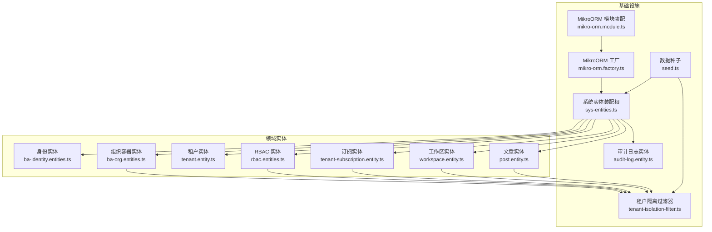
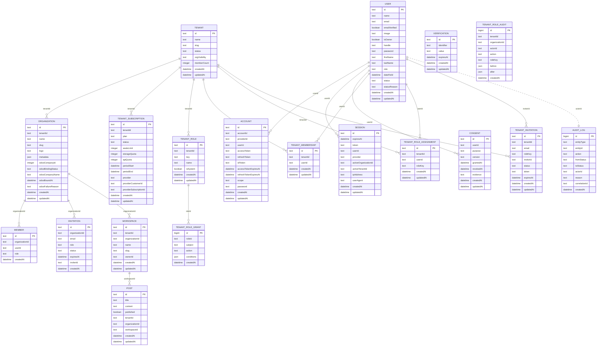
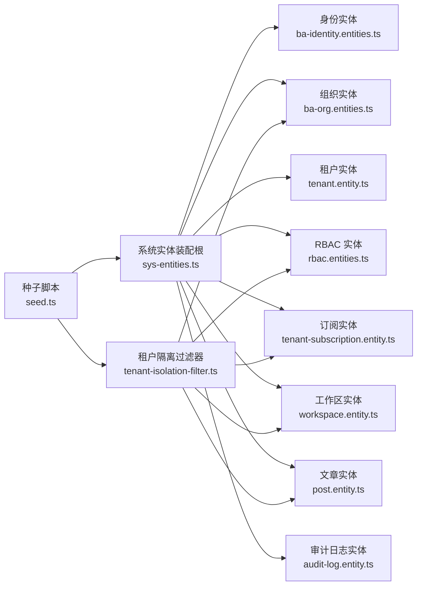
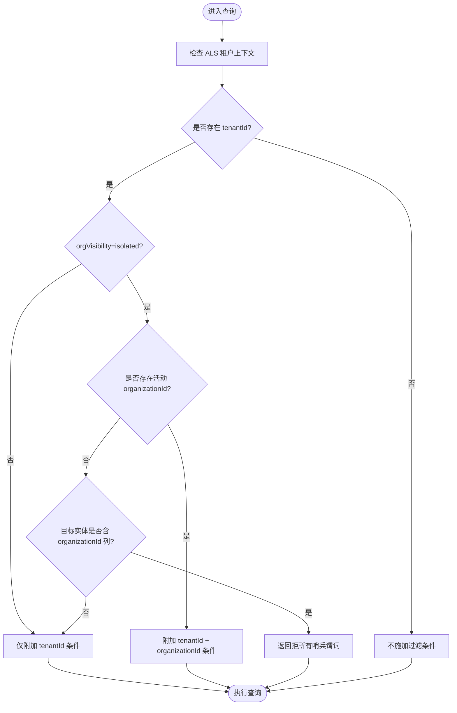
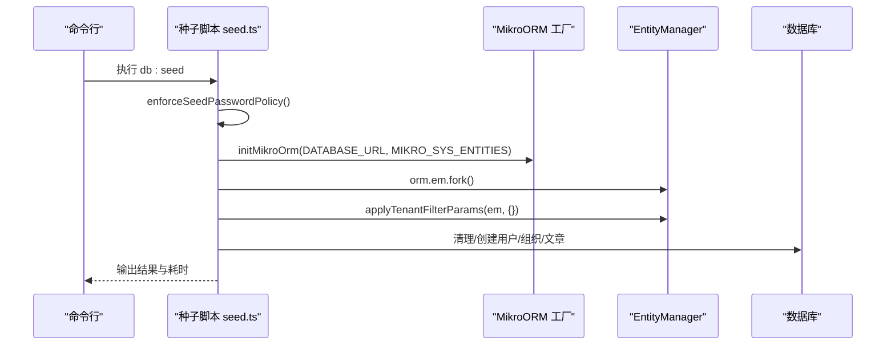

# 数据库设计

<cite>
**本文引用的文件**   
- [apps/api/src/database/seed.ts](file://apps/api/src/database/seed.ts)
- [apps/api/src/database/mikro/sys-entities.ts](file://apps/api/src/database/mikro/sys-entities.ts)
- [apps/api/src/database/mikro/tenant-isolation-filter.ts](file://apps/api/src/database/mikro/tenant-isolation-filter.ts)
- [apps/api/src/modules/auth/infrastructure/entities/ba-identity.entities.ts](file://apps/api/src/modules/auth/infrastructure/entities/ba-identity.entities.ts)
- [apps/api/src/modules/organizations/infrastructure/entities/ba-org.entities.ts](file://apps/api/src/modules/organizations/infrastructure/entities/ba-org.entities.ts)
- [apps/api/src/modules/organizations/infrastructure/entities/tenant.entity.ts](file://apps/api/src/modules/organizations/infrastructure/entities/tenant.entity.ts)
- [apps/api/src/modules/authorization/infrastructure/entities/rbac.entities.ts](file://apps/api/src/modules/authorization/infrastructure/entities/rbac.entities.ts)
- [apps/api/src/modules/subscriptions/infrastructure/entities/tenant-subscription.entity.ts](file://apps/api/src/modules/subscriptions/infrastructure/entities/tenant-subscription.entity.ts)
- [apps/api/src/modules/workspaces/infrastructure/entities/workspace.entity.ts](file://apps/api/src/modules/workspaces/infrastructure/entities/workspace.entity.ts)
- [apps/api/src/modules/posts/infrastructure/entities/post.entity.ts](file://apps/api/src/modules/posts/infrastructure/entities/post.entity.ts)
- [apps/api/src/modules/organizations/infrastructure/entities/audit-log.entity.ts](file://apps/api/src/modules/organizations/infrastructure/entities/audit-log.entity.ts)
- [apps/api/src/database/mikro/migration/migrations/Migration20261023110000_add_audit_log.ts](file://apps/api/src/database/mikro/migration/migrations/Migration20261023110000_add_audit_log.ts)
- [apps/api/src/database/mikro/mikro-orm.factory.ts](file://apps/api/src/database/mikro/mikro-orm.factory.ts)
- [apps/api/src/database/mikro/mikro-orm.module.ts](file://apps/api/src/database/mikro/mikro-orm.module.ts)
</cite>

## 目录
1. [引言](#引言)
2. [项目结构](#项目结构)
3. [核心实体与表结构](#核心实体与表结构)
4. [架构总览](#架构总览)
5. [详细组件分析](#详细组件分析)
6. [依赖关系分析](#依赖关系分析)
7. [多租户数据隔离机制](#多租户数据隔离机制)
8. [迁移、种子与版本控制](#迁移种子与版本控制)
9. [性能优化与索引策略](#性能优化与索引策略)
10. [故障排查指南](#故障排查指南)
11. [结论](#结论)

## 引言
本数据库设计文档面向 SaaS 平台的多租户架构，覆盖用户、组织、租户、工作区、订阅、权限等核心实体的模型、表结构、关系设计与索引策略；说明行级隔离与查询过滤机制；阐述迁移管理、数据种子与版本控制；并给出性能优化建议与 ER 图。

## 项目结构
数据库相关代码集中在 `apps/api/src/database` 与业务模块的 `infrastructure/entities` 下：
- 基础设施层：MikroORM 工厂、全局装配根、租户隔离过滤器、系统实体装配根、审计日志实体、种子脚本。
- 领域实体：身份（User/Account/Session/Verification/Consent）、组织容器（Organization/Member/Invitation）、租户（Tenant）、RBAC（角色/授权/审计/成员/分配/邀请）、订阅（TenantSubscription）、工作区（Workspace）、文章（Post）。

**图表来源**
- [apps/api/src/database/mikro/mikro-orm.factory.ts:22-34](file://apps/api/src/database/mikro/mikro-orm.factory.ts#L22-L34)
- [apps/api/src/database/mikro/mikro-orm.module.ts:19-29](file://apps/api/src/database/mikro/mikro-orm.module.ts#L19-L29)
- [apps/api/src/database/mikro/sys-entities.ts:79-86](file://apps/api/src/database/mikro/sys-entities.ts#L79-L86)
- [apps/api/src/database/mikro/tenant-isolation-filter.ts:113-128](file://apps/api/src/database/mikro/tenant-isolation-filter.ts#L113-L128)
- [apps/api/src/database/seed.ts:551-559](file://apps/api/src/database/seed.ts#L551-L559)

**章节来源**
- [apps/api/src/database/mikro/mikro-orm.factory.ts:1-35](file://apps/api/src/database/mikro/mikro-orm.factory.ts#L1-L35)
- [apps/api/src/database/mikro/mikro-orm.module.ts:1-30](file://apps/api/src/database/mikro/mikro-orm.module.ts#L1-L30)
- [apps/api/src/database/mikro/sys-entities.ts:1-87](file://apps/api/src/database/mikro/sys-entities.ts#L1-L87)
- [apps/api/src/database/mikro/tenant-isolation-filter.ts:1-138](file://apps/api/src/database/mikro/tenant-isolation-filter.ts#L1-L138)
- [apps/api/src/database/seed.ts:1-581](file://apps/api/src/database/seed.ts#L1-L581)

## 核心实体与表结构
本节按领域分组描述核心实体及其关键字段、约束与索引。

- 身份域（auth）
  - 用户 User：id/name/email/emailVerified/image/isOwner/handle/password/firstName/lastName/role/dateField/status/statusReason/createdAt/updatedAt；status 受 CHECK 约束；role 默认 'USER'。
  - 账户 Account：id/accountId/providerId/userId/access/refresh/idToken/expires/scope/password/时间戳。
  - 会话 Session：id/expiresAt/token/userId/provider/activeOrganizationId/activeTenantId/ipAddress/userAgent/时间戳。
  - 验证 Verification：id/identifier/value/expiresAt/时间戳。
  - 同意 Consent：id/userId/purpose/version/grantedAt/revokedAt/evidence/时间戳。

- 组织容器（organizations）
  - 组织 Organization：id/tenantId/name/slug/logo/metadata/odooCompanyId/odooBindingStatus/odooCompanyName/odooBoundAt/odooFailureReason/时间戳；唯一键 (tenantId, slug)；odooBindingStatus 受 CHECK 约束；启用租户隔离 filter。
  - 成员 Member：id/organizationId/userId/role/createdAt。
  - 邀请 Invitation：id/organizationId/email/role/status/expiresAt/inviterId/createdAt。

- 租户（organizations）
  - 租户 Tenant：id/name/slug/status/orgVisibility/memberCount/createdAt/updatedAt；slug 全局唯一；status 与 orgVisibility 受 CHECK 约束；memberCount 由触发器维护。

- 权限（authorization）
  - 角色 TenantRole：id/tenantId/key/name/isSystem/时间戳；唯一键 (tenantId, key)。
  - 授权 TenantRoleGrant：id/roleId/subject/action/conditions/createdAt；索引 (roleId, subject)。
  - 审计 TenantRoleAudit：id/tenantId/organizationId/actorId/action/roleKey/before/after/createdAt；索引 (organizationId, createdAt)。
  - 成员 TenantMembership：id/tenantId/userId/时间戳；唯一键 (tenantId, userId)；启用租户隔离 filter。
  - 分配 TenantRoleAssignment：id/tenantId/userId/roleKey/时间戳；唯一键 (tenantId, userId)；启用租户隔离 filter。
  - 邀请 TenantInvitation：id/tenantId/email/roleKey/invitorId/status/token/expiresAt/时间戳；唯一键 (tenantId, email)，索引 token；启用租户隔离 filter。

- 订阅（subscriptions）
  - 订阅 TenantSubscription：id/tenantId/plan/status/seatsLimit/storageQuota/apiQuota/periodStart/periodEnd/provider/providerCustomerId/providerSubscriptionId/时间戳；索引 (tenantId, status)、(tenantId, periodStart)；启用租户隔离 filter。

- 工作区（workspaces）
  - 工作区 Workspace：id/tenantId/organizationId/name/slug/ownerId/时间戳；唯一键 (organizationId, slug)；索引 (organizationId, ownerId)；启用租户隔离 filter。

- 文章（posts）
  - 文章 PostEntity：id/title/content/published/tenantId/organizationId/workspaceId/时间戳；启用租户隔离 filter。

- 审计日志（organizations）
  - 审计日志 AuditLog：id/entityType/entityId/action/fromStatus/toStatus/actorId/reason/correlationId/createdAt；索引 (entityType, entityId, createdAt)。

**章节来源**
- [apps/api/src/modules/auth/infrastructure/entities/ba-identity.entities.ts:31-145](file://apps/api/src/modules/auth/infrastructure/entities/ba-identity.entities.ts#L31-L145)
- [apps/api/src/modules/organizations/infrastructure/entities/ba-org.entities.ts:27-95](file://apps/api/src/modules/organizations/infrastructure/entities/ba-org.entities.ts#L27-L95)
- [apps/api/src/modules/organizations/infrastructure/entities/tenant.entity.ts:34-73](file://apps/api/src/modules/organizations/infrastructure/entities/tenant.entity.ts#L34-L73)
- [apps/api/src/modules/authorization/infrastructure/entities/rbac.entities.ts:27-249](file://apps/api/src/modules/authorization/infrastructure/entities/rbac.entities.ts#L27-L249)
- [apps/api/src/modules/subscriptions/infrastructure/entities/tenant-subscription.entity.ts:19-65](file://apps/api/src/modules/subscriptions/infrastructure/entities/tenant-subscription.entity.ts#L19-L65)
- [apps/api/src/modules/workspaces/infrastructure/entities/workspace.entity.ts:16-55](file://apps/api/src/modules/workspaces/infrastructure/entities/workspace.entity.ts#L16-L55)
- [apps/api/src/modules/posts/infrastructure/entities/post.entity.ts:32-66](file://apps/api/src/modules/posts/infrastructure/entities/post.entity.ts#L32-L66)
- [apps/api/src/modules/organizations/infrastructure/entities/audit-log.entity.ts:22-62](file://apps/api/src/modules/organizations/infrastructure/entities/audit-log.entity.ts#L22-L62)

## 架构总览
下图展示核心实体之间的关系与隔离边界：租户为顶层聚合，组织与工作区归属租户；订阅绑定租户；RBAC 在租户维度定义角色与授权；成员/分配/邀请以租户为主轴；文章与工作区同时关联组织；审计日志跨租户记录治理动作。

**图表来源**
- [apps/api/src/modules/organizations/infrastructure/entities/tenant.entity.ts:34-73](file://apps/api/src/modules/organizations/infrastructure/entities/tenant.entity.ts#L34-L73)
- [apps/api/src/modules/organizations/infrastructure/entities/ba-org.entities.ts:27-95](file://apps/api/src/modules/organizations/infrastructure/entities/ba-org.entities.ts#L27-L95)
- [apps/api/src/modules/auth/infrastructure/entities/ba-identity.entities.ts:31-145](file://apps/api/src/modules/auth/infrastructure/entities/ba-identity.entities.ts#L31-L145)
- [apps/api/src/modules/workspaces/infrastructure/entities/workspace.entity.ts:16-55](file://apps/api/src/modules/workspaces/infrastructure/entities/workspace.entity.ts#L16-L55)
- [apps/api/src/modules/posts/infrastructure/entities/post.entity.ts:32-66](file://apps/api/src/modules/posts/infrastructure/entities/post.entity.ts#L32-L66)
- [apps/api/src/modules/subscriptions/infrastructure/entities/tenant-subscription.entity.ts:19-65](file://apps/api/src/modules/subscriptions/infrastructure/entities/tenant-subscription.entity.ts#L19-L65)
- [apps/api/src/modules/authorization/infrastructure/entities/rbac.entities.ts:27-249](file://apps/api/src/modules/authorization/infrastructure/entities/rbac.entities.ts#L27-L249)
- [apps/api/src/modules/organizations/infrastructure/entities/audit-log.entity.ts:22-62](file://apps/api/src/modules/organizations/infrastructure/entities/audit-log.entity.ts#L22-L62)

## 详细组件分析

### 身份域实体（User/Account/Session/Verification/Consent）
- 设计要点
  - 采用 Better Auth 契约面，字段类型与列名遵循驼峰命名策略，便于 raw SQL 直连。
  - User.status 使用 CHECK 约束，限制为活跃/暂停/删除三态；role 默认 'USER'，支持显式写入 'ADMIN'。
  - Session.activeTenantId 提供租级激活位，配合租户隔离机制实现会话级上下文。
- 关键约束
  - User.status CHECK；Account/Session/Verification/Consent 时间戳列符合 L1/L2 规范。

**章节来源**
- [apps/api/src/modules/auth/infrastructure/entities/ba-identity.entities.ts:31-145](file://apps/api/src/modules/auth/infrastructure/entities/ba-identity.entities.ts#L31-L145)

### 组织与成员（Organization/Member/Invitation）
- 设计要点
  - Organization.tenantId 作为新层级“租户→组织”的边，expand 段可空，写路径强制盖章。
  - 唯一键 (tenantId, slug) 保证租内 slug 唯一；odooBindingStatus 值域受 CHECK 约束。
  - Member/Invitation 维持 BA 契约，不承载成员 SSOT（SSOT 已上移至租户维）。
- 隔离
  - 启用租户隔离 filter，ALS 有租户上下文时自动追加 tenantId 条件。

**章节来源**
- [apps/api/src/modules/organizations/infrastructure/entities/ba-org.entities.ts:27-95](file://apps/api/src/modules/organizations/infrastructure/entities/ba-org.entities.ts#L27-L95)

### 租户（Tenant）
- 设计要点
  - 租户状态 status 与可见性策略 orgVisibility 均受 CHECK 约束；slug 全局唯一。
  - memberCount 物化计数，由库级触发器维护，读侧 O(1)。
- 隔离
  - orgVisibility=isolated 时，租户隔离 filter 对带 organizationId 的实体追加组织收窄或拒所有哨兵。

**章节来源**
- [apps/api/src/modules/organizations/infrastructure/entities/tenant.entity.ts:34-73](file://apps/api/src/modules/organizations/infrastructure/entities/tenant.entity.ts#L34-L73)

### RBAC（角色/授权/审计/成员/分配/邀请）
- 设计要点
  - 角色与授权上收至租户维度；grant 行式存储，conditions 承载 CASL 模板。
  - 成员/分配/邀请以 tenantId 为主轴，统一纳入租户隔离 filter。
  - 审计表 append-only，actorId 可空（操作者消亡后保留留痕）。
- 索引
  - grant(roleId, subject) 复合索引；audit(organizationId, createdAt) 索引。

**章节来源**
- [apps/api/src/modules/authorization/infrastructure/entities/rbac.entities.ts:27-249](file://apps/api/src/modules/authorization/infrastructure/entities/rbac.entities.ts#L27-L249)

### 订阅（TenantSubscription）
- 设计要点
  - 计费单位锚定租户；seatsLimit/storageQuota/apiQuota 表示配额；provider 字段对接支付方。
  - 索引 (tenantId, status)、(tenantId, periodStart) 支撑常见查询。
- 隔离
  - 启用租户隔离 filter，订阅读取限定当前租户。

**章节来源**
- [apps/api/src/modules/subscriptions/infrastructure/entities/tenant-subscription.entity.ts:19-65](file://apps/api/src/modules/subscriptions/infrastructure/entities/tenant-subscription.entity.ts#L19-L65)

### 工作区（Workspace）
- 设计要点
  - 同时归属租户与组织；ownerId 可空，受限授权下 fail-closed。
  - 唯一键 (organizationId, slug)；索引 (organizationId, ownerId) 加速查询。
- 隔离
  - 启用租户隔离 filter。

**章节来源**
- [apps/api/src/modules/workspaces/infrastructure/entities/workspace.entity.ts:16-55](file://apps/api/src/modules/workspaces/infrastructure/entities/workspace.entity.ts#L16-L55)

### 文章（PostEntity）
- 设计要点
  - 物理表映射实体，与领域实体分离；tenantId/organizationId/workspaceId 外键以普通字符串列存储。
- 隔离
  - 启用租户隔离 filter。

**章节来源**
- [apps/api/src/modules/posts/infrastructure/entities/post.entity.ts:32-66](file://apps/api/src/modules/posts/infrastructure/entities/post.entity.ts#L32-L66)

### 审计日志（AuditLog）
- 设计要点
  - 治理生命周期动作落库，append-only；actorId set null 保留痕迹；索引 (entityType, entityId, createdAt)。
- 迁移
  - 新增 audit_log 表及索引与外键约束。

**章节来源**
- [apps/api/src/modules/organizations/infrastructure/entities/audit-log.entity.ts:22-62](file://apps/api/src/modules/organizations/infrastructure/entities/audit-log.entity.ts#L22-L62)
- [apps/api/src/database/mikro/migration/migrations/Migration20261023110000_add_audit_log.ts:19-36](file://apps/api/src/database/mikro/migration/migrations/Migration20261023110000_add_audit_log.ts#L19-L36)

## 依赖关系分析
- 实体装配根 MIKRO_SYS_ENTITIES 集中聚合各上下文实体，避免分散注册导致冲突。
- 租户隔离过滤器被多个实体引用，形成统一的行级隔离机制。
- 种子脚本通过 initMikroOrm 构建 ORM，再 fork EM 执行幂等建数逻辑。

**图表来源**
- [apps/api/src/database/mikro/sys-entities.ts:79-86](file://apps/api/src/database/mikro/sys-entities.ts#L79-L86)
- [apps/api/src/database/mikro/tenant-isolation-filter.ts:113-128](file://apps/api/src/database/mikro/tenant-isolation-filter.ts#L113-L128)
- [apps/api/src/database/seed.ts:551-559](file://apps/api/src/database/seed.ts#L551-L559)

**章节来源**
- [apps/api/src/database/mikro/sys-entities.ts:1-87](file://apps/api/src/database/mikro/sys-entities.ts#L1-L87)
- [apps/api/src/database/mikro/tenant-isolation-filter.ts:1-138](file://apps/api/src/database/mikro/tenant-isolation-filter.ts#L1-L138)
- [apps/api/src/database/seed.ts:1-581](file://apps/api/src/database/seed.ts#L1-L581)

## 多租户数据隔离机制
- 行级隔离
  - 通过 MikroORM 全局 filter 注入 tenantId 恒条件；当租户可见性为 isolated 且存在活动组织时，追加 organizationId 收窄；若无活动组织且目标实体携带 organizationId，则返回“拒所有”哨兵谓词，确保机密维度 fail-closed。
- 豁免语义
  - 无 ALS 租户上下文时 filter 恒真不筛，允许跨租治理、种子、迁移等场景；需要跨租读时可显式 fork({ scoped:false })。
- 应用层双保险
  - 仓储仍保留手写 where{tenantId} 条件，与机制叠加，降低误用风险。

**图表来源**
- [apps/api/src/database/mikro/tenant-isolation-filter.ts:73-87](file://apps/api/src/database/mikro/tenant-isolation-filter.ts#L73-L87)
- [apps/api/src/database/mikro/tenant-isolation-filter.ts:93-106](file://apps/api/src/database/mikro/tenant-isolation-filter.ts#L93-L106)
- [apps/api/src/database/mikro/tenant-isolation-filter.ts:113-128](file://apps/api/src/database/mikro/tenant-isolation-filter.ts#L113-L128)

**章节来源**
- [apps/api/src/database/mikro/tenant-isolation-filter.ts:1-138](file://apps/api/src/database/mikro/tenant-isolation-filter.ts#L1-L138)

## 迁移、种子与版本控制
- 迁移管理
  - 使用 MikroORM 迁移工具；审计日志迁移新增 audit_log 表、索引与外键约束。
  - 实体元数据单源驱动 DDL，保持迁移工件与运行时实体一致。
- 数据种子
  - 通过 initMikroOrm 构建 ORM，fork EM 并 applyTenantFilterParams(em, {}) 关闭过滤以执行跨租建数。
  - 幂等创建运营者与演示用户（Better Auth signUpEmail），预建活跃组织与成员，按租户/组织维度撒入示例文章。
  - 生产环境要求配置 ADMIN_PASSWORD/USER_PASSWORD，否则拒绝运行。
- 版本控制
  - 迁移文件名包含时间戳前缀，保证单调递增；实体元数据与迁移工件同源，变更需同步更新。

**图表来源**
- [apps/api/src/database/seed.ts:105-118](file://apps/api/src/database/seed.ts#L105-L118)
- [apps/api/src/database/seed.ts:551-559](file://apps/api/src/database/seed.ts#L551-L559)
- [apps/api/src/database/mikro/mikro-orm.factory.ts:22-34](file://apps/api/src/database/mikro/mikro-orm.factory.ts#L22-L34)

**章节来源**
- [apps/api/src/database/mikro/migration/migrations/Migration20261023110000_add_audit_log.ts:19-36](file://apps/api/src/database/mikro/migration/migrations/Migration20261023110000_add_audit_log.ts#L19-L36)
- [apps/api/src/database/seed.ts:1-581](file://apps/api/src/database/seed.ts#L1-L581)
- [apps/api/src/database/mikro/mikro-orm.factory.ts:1-35](file://apps/api/src/database/mikro/mikro-orm.factory.ts#L1-L35)

## 性能优化与索引策略
- 索引设计
  - 订阅：(tenantId, status)、(tenantId, periodStart) 提升按租户与状态的查询效率。
  - RBAC：grant(roleId, subject) 复合索引加速授权投影；audit(organizationId, createdAt) 加速按组织回溯。
  - 工作区：(organizationId, ownerId) 加速按组织与属主的查询。
  - 审计日志：(entityType, entityId, createdAt) 加速按实体回溯。
- 查询优化
  - 租户隔离 filter 在 ALS 上下文中自动注入 tenantId，减少手写遗漏；isolated 模式追加 organizationId 收窄，避免跨组织扫描。
  - 仓储保留手写 where{tenantId} 作为双保险，结合机制保障正确性与性能。
- 连接池与 ORM 配置
  - MikroORM v7 使用 EntityCaseNamingStrategy 直接对齐 BA camelCase 列名，减少转换开销。
  - allowGlobalContext=true 支持 per-request fork，避免共享全局 EM 导致的并发问题。
  - 建议在应用侧根据负载调整连接池参数（如 poolSize、idleTimeout），并结合监控观察慢查询。

**章节来源**
- [apps/api/src/modules/subscriptions/infrastructure/entities/tenant-subscription.entity.ts:38-41](file://apps/api/src/modules/subscriptions/infrastructure/entities/tenant-subscription.entity.ts#L38-L41)
- [apps/api/src/modules/authorization/infrastructure/entities/rbac.entities.ts:59-84](file://apps/api/src/modules/authorization/infrastructure/entities/rbac.entities.ts#L59-L84)
- [apps/api/src/modules/workspaces/infrastructure/entities/workspace.entity.ts:34-36](file://apps/api/src/modules/workspaces/infrastructure/entities/workspace.entity.ts#L34-L36)
- [apps/api/src/modules/organizations/infrastructure/entities/audit-log.entity.ts:41-43](file://apps/api/src/modules/organizations/infrastructure/entities/audit-log.entity.ts#L41-L43)
- [apps/api/src/database/mikro/mikro-orm.factory.ts:14-16](file://apps/api/src/database/mikro/mikro-orm.factory.ts#L14-L16)
- [apps/api/src/database/mikro/mikro-orm.factory.ts:10-12](file://apps/api/src/database/mikro/mikro-orm.factory.ts#L10-L12)

## 故障排查指南
- 租户隔离相关问题
  - 现象：某租户下数据不可见或查询为空。
  - 排查：确认 ALS 是否绑定 tenantId；若 orgVisibility=isolated 且无活动 organizationId，针对带 organizationId 的实体将触发拒所有哨兵。
  - 处理：补充活动组织上下文；或在跨租面显式 fork({ scoped:false }) 并附带 where{tenantId}。
- 种子失败
  - 现象：生产环境拒绝运行种子。
  - 原因：未配置 ADMIN_PASSWORD/USER_PASSWORD。
  - 处理：设置环境变量后重试；非生产环境会 warn 并使用兜底口令。
- 审计日志缺失
  - 现象：治理动作未落库。
  - 排查：确认审计日志迁移已执行；检查审计写入通道是否正确调用持久化存储。
- 订阅查询缓慢
  - 现象：按租户+状态/周期查询慢。
  - 排查：确认索引 (tenantId, status)、(tenantId, periodStart) 存在；检查统计信息是否过期。

**章节来源**
- [apps/api/src/database/mikro/tenant-isolation-filter.ts:56-87](file://apps/api/src/database/mikro/tenant-isolation-filter.ts#L56-L87)
- [apps/api/src/database/seed.ts:105-118](file://apps/api/src/database/seed.ts#L105-L118)
- [apps/api/src/database/mikro/migration/migrations/Migration20261023110000_add_audit_log.ts:22-31](file://apps/api/src/database/mikro/migration/migrations/Migration20261023110000_add_audit_log.ts#L22-L31)
- [apps/api/src/modules/subscriptions/infrastructure/entities/tenant-subscription.entity.ts:38-41](file://apps/api/src/modules/subscriptions/infrastructure/entities/tenant-subscription.entity.ts#L38-L41)

## 结论
本设计以租户为顶层聚合，组织与工作区作为次级分组，订阅与 RBAC 围绕租户展开，文章与工作区承载业务数据；通过 MikroORM 全局 filter 实现强韧的行级隔离，辅以仓储纪律与索引优化，兼顾安全与性能。迁移与种子流程严格幂等，审计日志提供治理可追溯性。建议在部署中完善连接池与监控，持续优化查询计划与索引命中率。