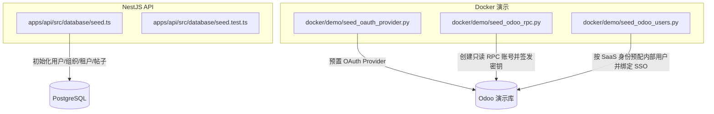
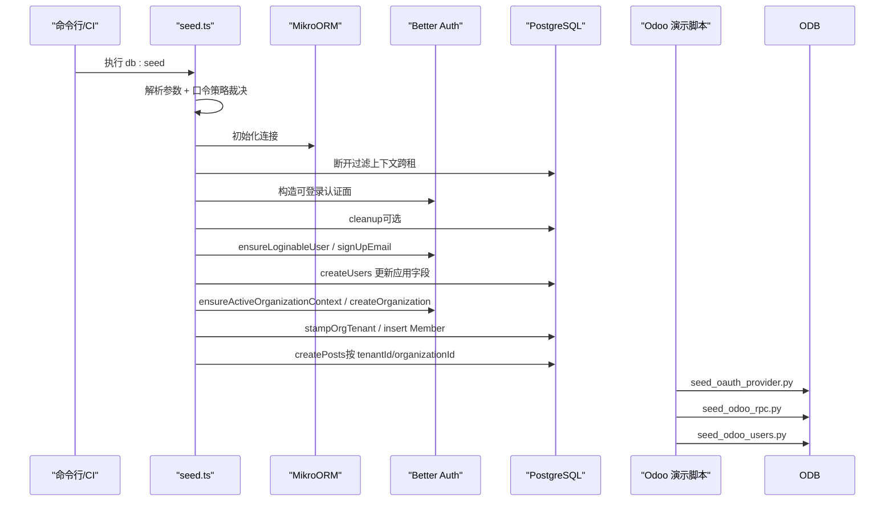
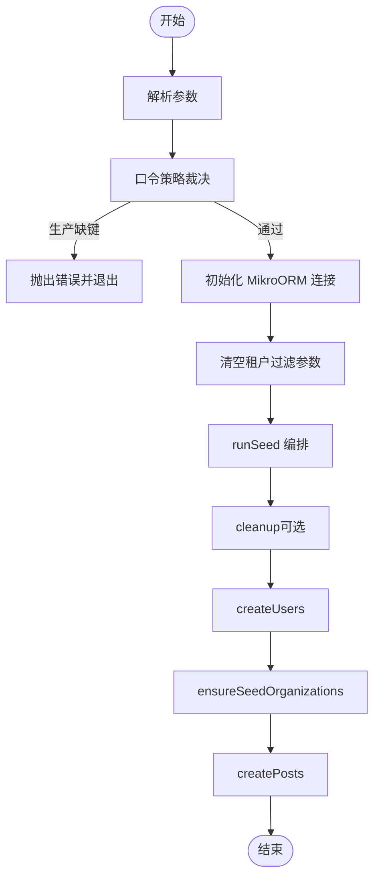
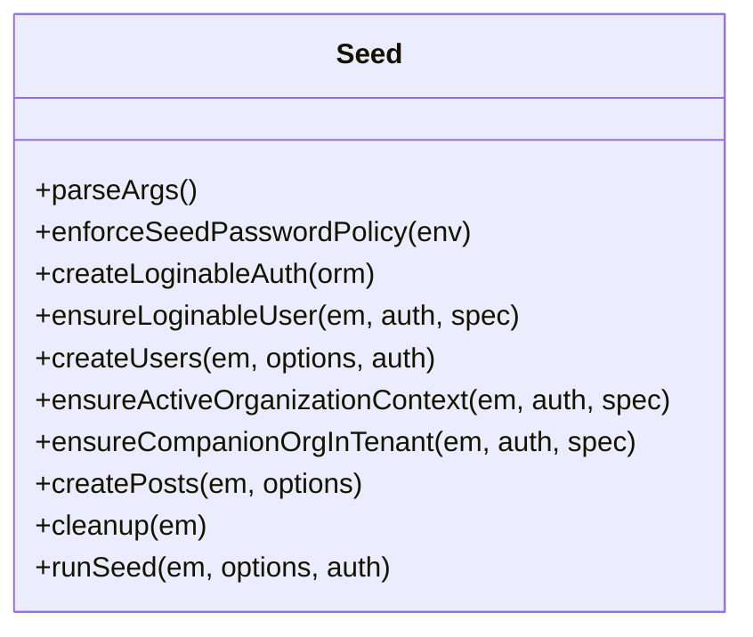
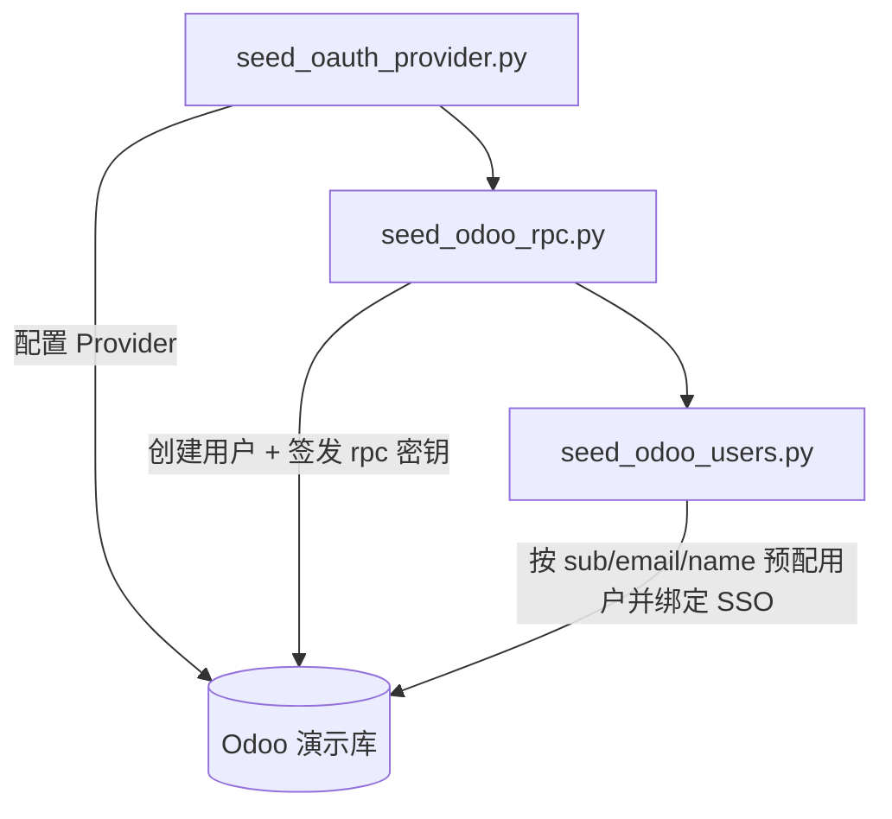
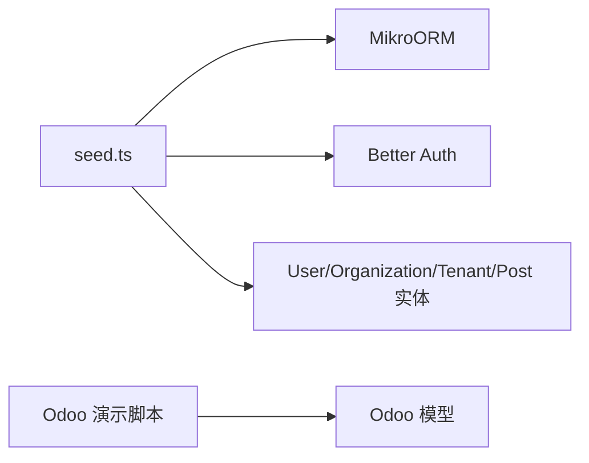
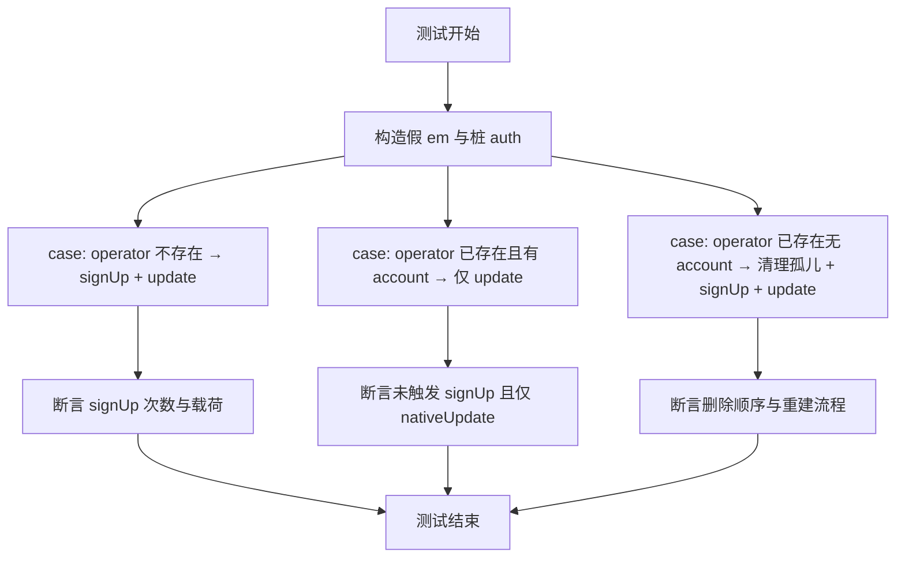

# 数据种子

<cite>
**本文引用的文件**   
- [apps/api/src/database/seed.ts](file://apps/api/src/database/seed.ts)
- [apps/api/src/database/seed.test.ts](file://apps/api/src/database/seed.test.ts)
- [docker/demo/seed_oauth_provider.py](file://docker/demo/seed_oauth_provider.py)
- [docker/demo/seed_odoo_rpc.py](file://docker/demo/seed_odoo_rpc.py)
- [docker/demo/seed_odoo_users.py](file://docker/demo/seed_odoo_users.py)
</cite>

## 目录
1. [引言](#引言)
2. [项目结构](#项目结构)
3. [核心组件](#核心组件)
4. [架构总览](#架构总览)
5. [详细组件分析](#详细组件分析)
6. [依赖关系分析](#依赖关系分析)
7. [性能与可扩展性](#性能与可扩展性)
8. [环境隔离与版本控制](#环境隔离与版本控制)
9. [编写规范与测试方法](#编写规范与测试方法)
10. [故障排查](#故障排查)
11. [结论](#结论)

## 引言
本文件面向平台开发者、运维与演示负责人，系统性说明本仓库的“数据种子”机制：如何生成测试数据与初始数据、如何组织与管理种子、如何实现环境与租户隔离、如何保证幂等性与可重复执行，以及开发、测试、演示三类环境的准备策略。文档同时给出种子数据的编写规范、测试方法与清理机制，帮助团队在保持数据一致性的前提下安全演进系统。

## 项目结构
种子相关代码分布在两个层面：
- NestJS API 侧：基于 MikroORM 的数据库种子脚本，负责用户、组织、租户、示例帖子等应用层基础数据。
- Docker 演示侧：一组 Python 脚本，负责 Odoo 演示库中的 SSO Provider、只读 RPC 账号与 SSO 绑定用户。

**图示来源**
- [apps/api/src/database/seed.ts:541-580](file://apps/api/src/database/seed.ts#L541-L580)
- [docker/demo/seed_oauth_provider.py:1-27](file://docker/demo/seed_oauth_provider.py#L1-L27)
- [docker/demo/seed_odoo_rpc.py:1-43](file://docker/demo/seed_odoo_rpc.py#L1-L43)
- [docker/demo/seed_odoo_users.py:1-70](file://docker/demo/seed_odoo_users.py#L1-L70)

**章节来源**
- [apps/api/src/database/seed.ts:1-580](file://apps/api/src/database/seed.ts#L1-L580)
- [docker/demo/seed_oauth_provider.py:1-27](file://docker/demo/seed_oauth_provider.py#L1-L27)
- [docker/demo/seed_odoo_rpc.py:1-43](file://docker/demo/seed_odoo_rpc.py#L1-L43)
- [docker/demo/seed_odoo_users.py:1-70](file://docker/demo/seed_odoo_users.py#L1-L70)

## 核心组件
- 应用种子入口与编排：`runSeed`、`main`、参数解析、环境变量裁决、MikroORM 连接与会话隔离。
- 可登录用户管理：通过 Better Auth 的 `signUpEmail` 创建可登录账号，再补齐应用字段（角色、姓名等）。
- 组织与租户初始化：为每个 persona 预建活跃组织，必要时补盖租户归属；支持“一租户多组织”演示形态。
- 示例帖子：按租户与组织维度批量插入示例内容。
- 清理器：受 `SEED_CLEANUP` 门控，按依赖顺序删除会话、凭证、验证记录、帖子与用户。
- Odoo 演示种子：预置 OAuth Provider、RPC 只读账号与密钥、按 SaaS 身份预配内部用户。

**章节来源**
- [apps/api/src/database/seed.ts:68-118](file://apps/api/src/database/seed.ts#L68-L118)
- [apps/api/src/database/seed.ts:155-200](file://apps/api/src/database/seed.ts#L155-L200)
- [apps/api/src/database/seed.ts:202-240](file://apps/api/src/database/seed.ts#L202-L240)
- [apps/api/src/database/seed.ts:254-362](file://apps/api/src/database/seed.ts#L254-L362)
- [apps/api/src/database/seed.ts:433-508](file://apps/api/src/database/seed.ts#L433-L508)
- [apps/api/src/database/seed.ts:510-539](file://apps/api/src/database/seed.ts#L510-L539)
- [docker/demo/seed_oauth_provider.py:1-27](file://docker/demo/seed_oauth_provider.py#L1-L27)
- [docker/demo/seed_odoo_rpc.py:1-43](file://docker/demo/seed_odoo_rpc.py#L1-L43)
- [docker/demo/seed_odoo_users.py:1-70](file://docker/demo/seed_odoo_users.py#L1-L70)

## 架构总览
种子运行分为两条主线：
- API 侧种子：启动时加载环境变量，校验口令策略，建立 MikroORM 连接，按“清理→用户→组织/租户→帖子”的顺序执行。
- Odoo 演示侧种子：依次预置 OAuth Provider、RPC 账号与密钥、SaaS 用户绑定。

**图示来源**
- [apps/api/src/database/seed.ts:541-580](file://apps/api/src/database/seed.ts#L541-L580)
- [apps/api/src/database/seed.ts:530-539](file://apps/api/src/database/seed.ts#L530-L539)
- [docker/demo/seed_oauth_provider.py:1-27](file://docker/demo/seed_oauth_provider.py#L1-L27)
- [docker/demo/seed_odoo_rpc.py:1-43](file://docker/demo/seed_odoo_rpc.py#L1-L43)
- [docker/demo/seed_odoo_users.py:1-70](file://docker/demo/seed_odoo_users.py#L1-L70)

## 详细组件分析

### 应用种子主流程（seed.ts）
- 参数解析：支持关闭测试数据、指定演示用户数与帖子数。
- 口令策略：生产环境缺失 `ADMIN_PASSWORD`/`USER_PASSWORD` 直接拒绝运行；非生产环境输出警告并使用兜底弱口令。
- 运行器：使用 `tsx` 执行，避免 Node 原生对扩展名省略导入的限制。
- 连接与隔离：懒初始化 MikroORM，fork EntityManager，显式清空租户过滤参数以允许跨租操作。
- 编排顺序：cleanup → createUsers → ensureSeedOrganizations → createPosts。

**图示来源**
- [apps/api/src/database/seed.ts:68-118](file://apps/api/src/database/seed.ts#L68-L118)
- [apps/api/src/database/seed.ts:541-580](file://apps/api/src/database/seed.ts#L541-L580)
- [apps/api/src/database/seed.ts:530-539](file://apps/api/src/database/seed.ts#L530-L539)

**章节来源**
- [apps/api/src/database/seed.ts:68-118](file://apps/api/src/database/seed.ts#L68-L118)
- [apps/api/src/database/seed.ts:541-580](file://apps/api/src/database/seed.ts#L541-L580)

### 可登录用户与组织/租户初始化
- 可登录用户：通过 Better Auth 的 `signUpEmail` 创建账号，再以 `nativeUpdate` 补齐应用字段（角色、姓名、更新时间），不直接写密码到 user 表。
- 孤儿修复：若存在无 credential 的遗留 user，先删 session/account/user，再重建。
- 组织与租户：为每个 persona 预建活跃组织，并通过 `stampOrgTenant` 确保组织归属租户；支持“一租户多组织”场景。

**图示来源**
- [apps/api/src/database/seed.ts:68-118](file://apps/api/src/database/seed.ts#L68-L118)
- [apps/api/src/database/seed.ts:155-200](file://apps/api/src/database/seed.ts#L155-L200)
- [apps/api/src/database/seed.ts:202-240](file://apps/api/src/database/seed.ts#L202-L240)
- [apps/api/src/database/seed.ts:254-362](file://apps/api/src/database/seed.ts#L254-L362)
- [apps/api/src/database/seed.ts:433-508](file://apps/api/src/database/seed.ts#L433-L508)
- [apps/api/src/database/seed.ts:510-539](file://apps/api/src/database/seed.ts#L510-L539)

**章节来源**
- [apps/api/src/database/seed.ts:155-200](file://apps/api/src/database/seed.ts#L155-L200)
- [apps/api/src/database/seed.ts:202-240](file://apps/api/src/database/seed.ts#L202-L240)
- [apps/api/src/database/seed.ts:254-362](file://apps/api/src/database/seed.ts#L254-L362)

### Odoo 演示种子
- OAuth Provider：幂等设置系统参数与 Provider，用于 SaaS SSO。
- RPC 只读账号：创建只读用户并签发 scope=rpc 的长效密钥，写入临时文件供 entrypoint 持久化。
- SSO 用户绑定：从 SaaS 导出的用户列表预配 Odoo 内部用户，绑定 provider 与 uid，复用内置 admin 权限组以便演示体验。

**图示来源**
- [docker/demo/seed_oauth_provider.py:1-27](file://docker/demo/seed_oauth_provider.py#L1-L27)
- [docker/demo/seed_odoo_rpc.py:1-43](file://docker/demo/seed_odoo_rpc.py#L1-L43)
- [docker/demo/seed_odoo_users.py:1-70](file://docker/demo/seed_odoo_users.py#L1-L70)

**章节来源**
- [docker/demo/seed_oauth_provider.py:1-27](file://docker/demo/seed_oauth_provider.py#L1-L27)
- [docker/demo/seed_odoo_rpc.py:1-43](file://docker/demo/seed_odoo_rpc.py#L1-L43)
- [docker/demo/seed_odoo_users.py:1-70](file://docker/demo/seed_odoo_users.py#L1-L70)

## 依赖关系分析
- 外部依赖
  - MikroORM：用于连接 PostgreSQL 并执行实体插入/更新/删除。
  - Better Auth：提供可登录账号创建与组织创建的系统动作能力。
  - Odoo：演示环境下的 ERP 后端，通过 Python 脚本进行库内数据预置。
- 内部依赖
  - 种子脚本依赖实体定义（User、Account、Session、Verification、Organization、Member、Tenant、PostEntity）。
  - 演示脚本依赖 Odoo 模型（res.users、auth.oauth.provider、ir.config_parameter 等）。

**图示来源**
- [apps/api/src/database/seed.ts:1-25](file://apps/api/src/database/seed.ts#L1-L25)
- [docker/demo/seed_odoo_rpc.py:1-43](file://docker/demo/seed_odoo_rpc.py#L1-L43)

**章节来源**
- [apps/api/src/database/seed.ts:1-25](file://apps/api/src/database/seed.ts#L1-L25)
- [docker/demo/seed_odoo_rpc.py:1-43](file://docker/demo/seed_odoo_rpc.py#L1-L43)

## 性能与可扩展性
- 批量插入：帖子采用批量 insert，减少往返次数。
- 最小化副作用：仅当 `includeTestData=true` 时才创建演示数据，降低非演示环境开销。
- 幂等设计：用户、组织、租户、Odoo 用户均具备幂等逻辑，避免重复执行带来的额外成本。
- 可扩展点：可通过参数调整演示用户数与帖子数；新增 persona 或组织模板可在种子编排中扩展。

[本节为通用指导，不直接分析具体文件]

## 环境隔离与版本控制
- 环境隔离
  - 开发/演示：允许弱口令兜底，但会输出警告；可启用测试数据。
  - 生产：强制要求显式配置 `ADMIN_PASSWORD` 与 `USER_PASSWORD`，否则拒绝运行。
  - 租户隔离：种子在执行前清空租户过滤参数，允许跨租操作；组织与帖子均带 `tenantId`，确保换轴后仍可被正确读取。
- 版本控制
  - 种子脚本纳入代码仓库，变更需配合迁移与测试用例同步演进。
  - Odoo 演示脚本作为镜像 bake 的一部分，随演示镜像版本发布。
- 依赖管理
  - API 种子依赖应用实体与 BA 插件；Odoo 种子依赖 Odoo 模型与系统参数。
  - 演示脚本之间具有顺序依赖：Provider → RPC 账号 → SSO 用户绑定。

**章节来源**
- [apps/api/src/database/seed.ts:105-118](file://apps/api/src/database/seed.ts#L105-L118)
- [apps/api/src/database/seed.ts:551-559](file://apps/api/src/database/seed.ts#L551-L559)
- [docker/demo/seed_oauth_provider.py:1-27](file://docker/demo/seed_oauth_provider.py#L1-L27)
- [docker/demo/seed_odoo_rpc.py:1-43](file://docker/demo/seed_odoo_rpc.py#L1-L43)
- [docker/demo/seed_odoo_users.py:1-70](file://docker/demo/seed_odoo_users.py#L1-L70)

## 编写规范与测试方法
- 编写规范
  - 所有种子必须幂等：按唯一键判断是否存在，存在则跳过或仅补齐必要字段。
  - 明确环境边界：生产禁止弱口令；演示数据默认关闭，按需开启。
  - 遵循依赖顺序：先清理（可选）、再主体数据、最后关联数据。
  - 时间字段：createdAt 由 DB 默认填充，updatedAt 必须显式写入。
  - 租户与组织：新组织必须带 `tenantId`；帖子必须带 `tenantId` 与 `organizationId`。
- 测试方法
  - 使用假 `EntityManager` 与桩 `Better Auth` 接口，断言调用次数、参数与返回状态。
  - 覆盖关键路径：无 user→signUp；有 user+account→仅更新；有 user 无 account→清理孤儿后重建。
  - 清理门控：验证 `SEED_CLEANUP=true` 时按依赖顺序删除，非 true 时不删除。
  - 编排顺序：验证 runSeed 的执行次序与中间步骤调用。

**图示来源**
- [apps/api/src/database/seed.test.ts:87-156](file://apps/api/src/database/seed.test.ts#L87-L156)
- [apps/api/src/database/seed.test.ts:158-233](file://apps/api/src/database/seed.test.ts#L158-L233)

**章节来源**
- [apps/api/src/database/seed.test.ts:26-85](file://apps/api/src/database/seed.test.ts#L26-L85)
- [apps/api/src/database/seed.test.ts:87-156](file://apps/api/src/database/seed.test.ts#L87-L156)
- [apps/api/src/database/seed.test.ts:158-233](file://apps/api/src/database/seed.test.ts#L158-L233)
- [apps/api/src/database/seed.test.ts:348-409](file://apps/api/src/database/seed.test.ts#L348-L409)

## 故障排查
- 生产环境拒绝运行
  - 现象：抛出错误提示缺少 `ADMIN_PASSWORD`/`USER_PASSWORD`。
  - 处理：在 `.env` 中显式设置两键后重试；或切换为非生产口径。
- 演示用户无法登录
  - 现象：用户存在但无 credential，导致登录失败。
  - 处理：种子会自动清理孤儿 session/account/user 并重建；如仍失败，检查 `ensureLoginableUser` 分支是否命中。
- 组织不可见或帖子为空
  - 现象：换轴后查询不到 demo 数据。
  - 处理：确认组织已带 `tenantId`，帖子已按 `tenantId` 与 `organizationId` 写入；检查种子是否已执行 `stampOrgTenant`。
- Odoo 演示登录报错
  - 现象：SSO 登录报 AccessDenied 或菜单为空。
  - 处理：确认 Provider 已预置、RPC 账号已签发密钥、用户已绑定 provider 与 uid；必要时复用内置 admin 权限组。

**章节来源**
- [apps/api/src/database/seed.ts:105-118](file://apps/api/src/database/seed.ts#L105-L118)
- [apps/api/src/database/seed.ts:170-200](file://apps/api/src/database/seed.ts#L170-L200)
- [apps/api/src/database/seed.ts:296-320](file://apps/api/src/database/seed.ts#L296-L320)
- [apps/api/src/database/seed.ts:433-508](file://apps/api/src/database/seed.ts#L433-L508)
- [docker/demo/seed_odoo_users.py:1-70](file://docker/demo/seed_odoo_users.py#L1-L70)

## 结论
本项目的数据种子体系围绕“幂等、可重复、环境隔离”展开：API 侧通过 Better Auth 与 MikroORM 实现可登录用户、组织与租户的可靠初始化；Odoo 演示侧通过 Python 脚本完成 SSO、RPC 与用户绑定的端到端演示链路。配合严格的口令策略、清晰的编排顺序与完善的单元测试，种子能够在开发、测试与演示环境中稳定工作，并为生产环境提供安全的基线数据准备方式。