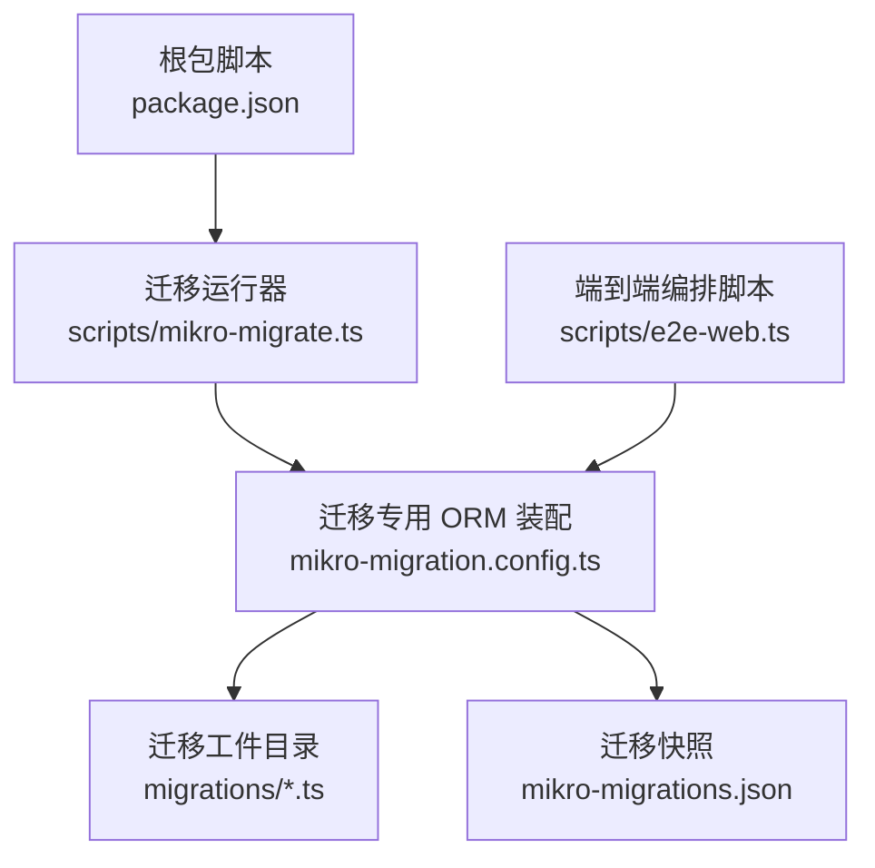
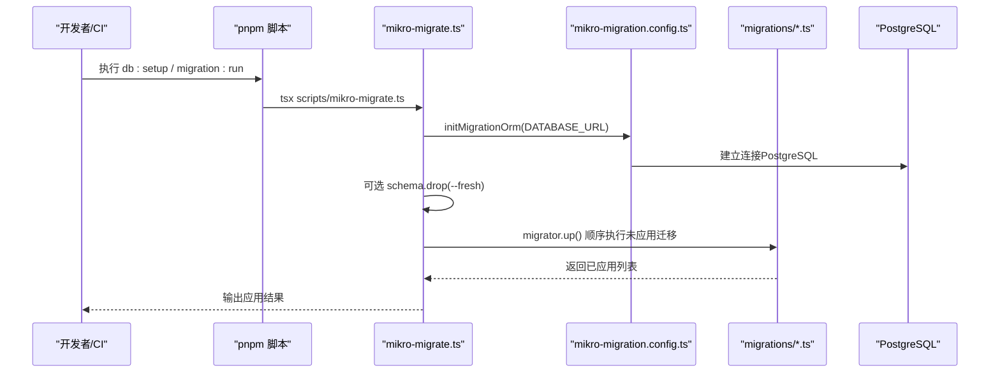
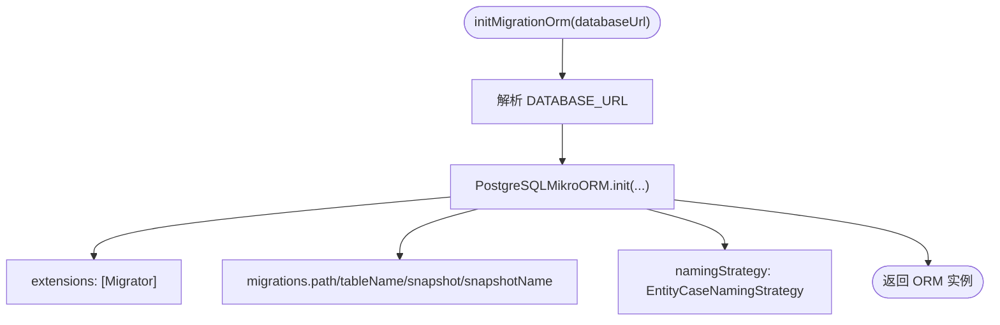
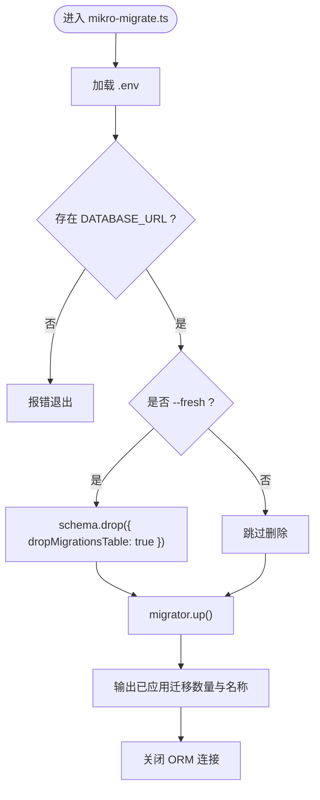
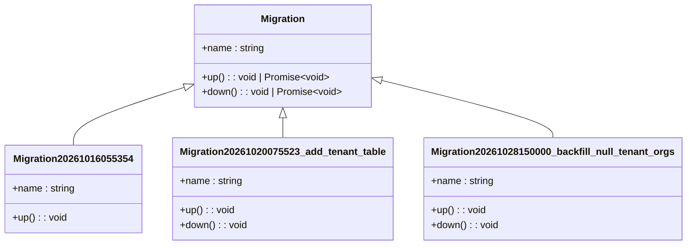
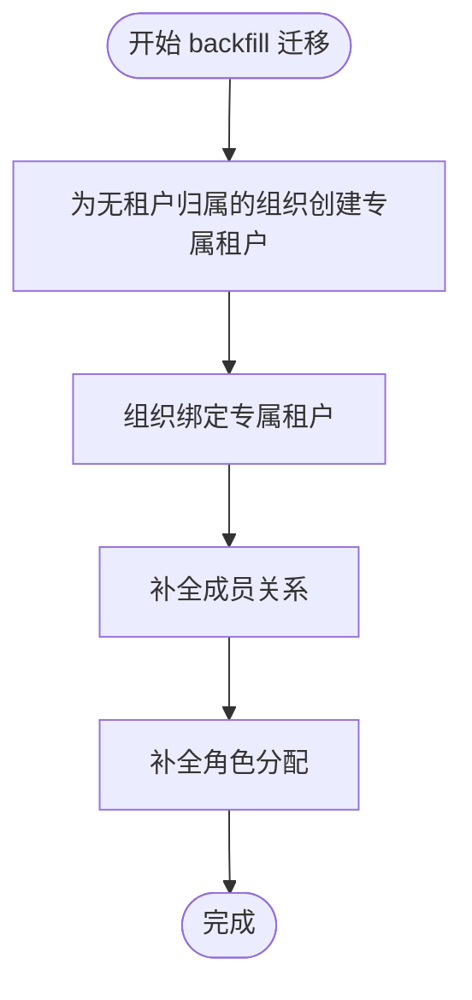
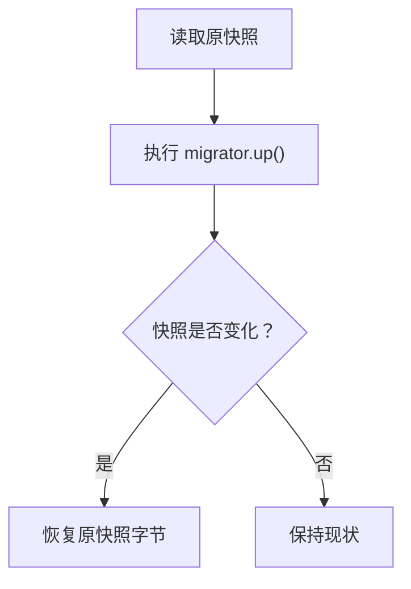
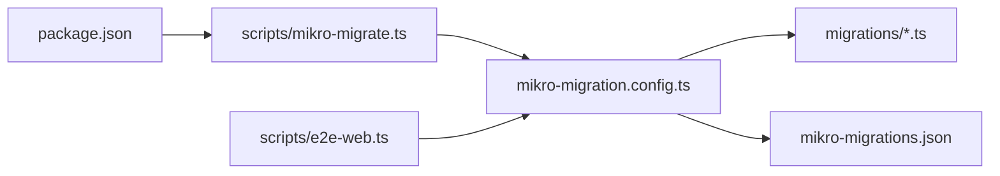
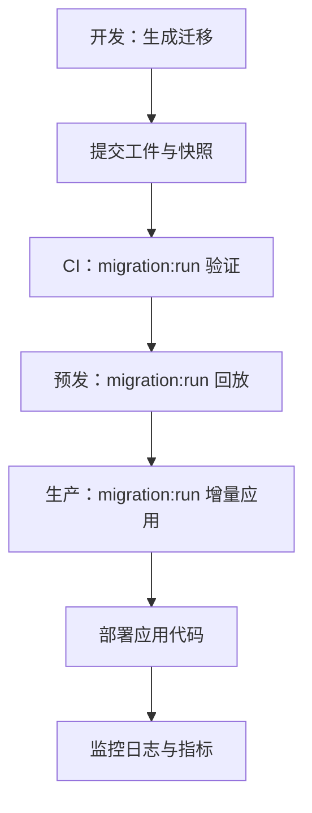

# 迁移管理

<cite>
**本文引用的文件**   
- [package.json](file://package.json)
- [scripts/mikro-migrate.ts](file://scripts/mikro-migrate.ts)
- [apps/api/src/database/mikro/migration/mikro-migration.config.ts](file://apps/api/src/database/mikro/migration/mikro-migration.config.ts)
- [apps/api/src/database/mikro/migration/migrations/Migration20261016055354.ts](file://apps/api/src/database/mikro/migration/migrations/Migration20261016055354.ts)
- [apps/api/src/database/mikro/migration/migrations/Migration20261020075523_add_tenant_table.ts](file://apps/api/src/database/mikro/migration/migrations/Migration20261020075523_add_tenant_table.ts)
- [apps/api/src/database/mikro/migration/migrations/Migration20261028150000_backfill_null_tenant_orgs.ts](file://apps/api/src/database/mikro/migration/migrations/Migration20261028150000_backfill_null_tenant_orgs.ts)
- [apps/api/src/database/mikro/migration/migrations/mikro-migrations.json](file://apps/api/src/database/mikro/migration/migrations/mikro-migrations.json)
- [scripts/e2e-web.ts](file://scripts/e2e-web.ts)
</cite>

## 目录
1. [简介](#简介)
2. [项目结构](#项目结构)
3. [核心组件](#核心组件)
4. [架构总览](#架构总览)
5. [详细组件分析](#详细组件分析)
6. [依赖关系分析](#依赖关系分析)
7. [性能与一致性考量](#性能与一致性考量)
8. [生产环境部署流程](#生产环境部署流程)
9. [回滚与冲突处理](#回滚与冲突处理)
10. [最佳实践](#最佳实践)
11. [命令示例](#命令示例)
12. [故障排查](#故障排查)
13. [结论](#结论)

## 简介
本文面向使用 MikroORM 的 NestJS SaaS 项目，系统化说明数据库迁移的配置、命名规范、版本控制策略、回滚机制、增量更新与数据转换的最佳实践，以及生产环境的自动化部署、错误处理和灰度发布建议。文档同时给出常用命令、常见问题和排障路径，帮助团队在本地开发、CI、预发和生产环境中安全演进数据库结构。

## 项目结构
本项目将迁移工件集中放在应用模块下的迁移目录中，并通过独立的脚本驱动迁移执行；同时维护一个快照文件用于稳定基线比对。

**图示来源**
- [package.json:56-60](file://package.json#L56-L60)
- [scripts/mikro-migrate.ts:1-50](file://scripts/mikro-migrate.ts#L1-L50)
- [apps/api/src/database/mikro/migration/mikro-migration.config.ts:1-38](file://apps/api/src/database/mikro/migration/mikro-migration.config.ts#L1-L38)
- [scripts/e2e-web.ts:100-116](file://scripts/e2e-web.ts#L100-L116)

**章节来源**
- [package.json:56-60](file://package.json#L56-L60)
- [scripts/mikro-migrate.ts:1-50](file://scripts/mikro-migrate.ts#L1-L50)
- [apps/api/src/database/mikro/migration/mikro-migration.config.ts:1-38](file://apps/api/src/database/mikro/migration/mikro-migration.config.ts#L1-L38)

## 核心组件
- 迁移运行器：负责加载环境变量、解析连接串、初始化迁移专用 ORM 实例并执行迁移。
- 迁移专用 ORM 装配：仅用于离线迁移工具，注册 `Migrator`、配置迁移表名、快照开关与命名策略，与应用运行时解耦。
- 迁移工件：每个迁移类继承 `Migration`，提供 `up()`/`down()`，文件名带时间戳前缀。
- 迁移快照：记录当前数据库结构的稳定快照，供未来增量 diff 使用。
- 脚本入口：通过 pnpm scripts 暴露 `migration:run`、`db:setup`、`db:reset` 等命令。

**章节来源**
- [scripts/mikro-migrate.ts:1-50](file://scripts/mikro-migrate.ts#L1-L50)
- [apps/api/src/database/mikro/migration/mikro-migration.config.ts:1-38](file://apps/api/src/database/mikro/migration/mikro-migration.config.ts#L1-L38)
- [apps/api/src/database/mikro/migration/migrations/Migration20261016055354.ts:1-134](file://apps/api/src/database/mikro/migration/migrations/Migration20261016055354.ts#L1-L134)
- [apps/api/src/database/mikro/migration/migrations/mikro-migrations.json:1-800](file://apps/api/src/database/mikro/migration/migrations/mikro-migrations.json#L1-L800)
- [package.json:56-60](file://package.json#L56-L60)

## 架构总览
下图展示从脚本到数据库的完整调用链，以及迁移工件与快照的关系。

**图示来源**
- [package.json:56-60](file://package.json#L56-L60)
- [scripts/mikro-migrate.ts:15-49](file://scripts/mikro-migrate.ts#L15-L49)
- [apps/api/src/database/mikro/migration/mikro-migration.config.ts:17-37](file://apps/api/src/database/mikro/migration/mikro-migration.config.ts#L17-L37)

## 详细组件分析

### 迁移专用 ORM 装配
该工厂函数独立于应用运行时，仅在迁移工具中初始化，避免在生产进程中引入迁移扩展。关键配置包括：
- 启用 `Migrator` 扩展。
- 指定迁移目录与迁移台账表名。
- 开启快照并固定快照名称，保证跨库生成稳定基线。
- 使用统一命名策略，确保对象命名一致。

**图示来源**
- [apps/api/src/database/mikro/migration/mikro-migration.config.ts:17-37](file://apps/api/src/database/mikro/migration/mikro-migration.config.ts#L17-L37)

**章节来源**
- [apps/api/src/database/mikro/migration/mikro-migration.config.ts:1-38](file://apps/api/src/database/mikro/migration/mikro-migration.config.ts#L1-L38)

### 迁移运行器
运行器职责清晰：
- 加载 `.env`，校验 `DATABASE_URL`。
- 支持 `--fresh` 模式：先删除实体表与迁移台账，再重放基线迁移。
- 默认模式：幂等执行 `migrator.up()`，已登记基线则不重复建表。
- 打印已应用迁移清单，便于 CI 审计。

**图示来源**
- [scripts/mikro-migrate.ts:15-49](file://scripts/mikro-migrate.ts#L15-L49)

**章节来源**
- [scripts/mikro-migrate.ts:1-50](file://scripts/mikro-migrate.ts#L1-L50)

### 迁移工件与命名规范
- 文件名以 `MigrationYYYYMMDDHHmmSS_描述.ts` 形式命名，保证时间顺序与可读性。
- 首个迁移作为基线，后续迁移按时间递增。
- 每个迁移类显式声明 `name`，便于日志与审计。
- 典型基线包含多张核心表与约束；新增字段或表时，应编写对应 `up()`/`down()`。

**图示来源**
- [apps/api/src/database/mikro/migration/migrations/Migration20261016055354.ts:1-134](file://apps/api/src/database/mikro/migration/migrations/Migration20261016055354.ts#L1-L134)
- [apps/api/src/database/mikro/migration/migrations/Migration20261020075523_add_tenant_table.ts:1-23](file://apps/api/src/database/mikro/migration/migrations/Migration20261020075523_add_tenant_table.ts#L1-L23)
- [apps/api/src/database/mikro/migration/migrations/Migration20261028150000_backfill_null_tenant_orgs.ts:1-112](file://apps/api/src/database/mikro/migration/migrations/Migration20261028150000_backfill_null_tenant_orgs.ts#L1-L112)

**章节来源**
- [apps/api/src/database/mikro/migration/migrations/Migration20261016055354.ts:1-134](file://apps/api/src/database/mikro/migration/migrations/Migration20261016055354.ts#L1-L134)
- [apps/api/src/database/mikro/migration/migrations/Migration20261020075523_add_tenant_table.ts:1-23](file://apps/api/src/database/mikro/migration/migrations/Migration20261020075523_add_tenant_table.ts#L1-L23)
- [apps/api/src/database/mikro/migration/migrations/Migration20261028150000_backfill_null_tenant_orgs.ts:1-112](file://apps/api/src/database/mikro/migration/migrations/Migration20261028150000_backfill_null_tenant_orgs.ts#L1-L112)

### 数据回填与幂等设计
数据回填型迁移强调幂等性与可逆性：
- 使用条件插入与去重键，避免重复 apply 产生副作用。
- 通过唯一标识（如 slug 哨兵后缀）限定影响范围，便于 down 精确回滚。
- 对关联表进行有序操作，遵循外键与触发器语义。

**图示来源**
- [apps/api/src/database/mikro/migration/migrations/Migration20261028150000_backfill_null_tenant_orgs.ts:34-90](file://apps/api/src/database/mikro/migration/migrations/Migration20261028150000_backfill_null_tenant_orgs.ts#L34-L90)

**章节来源**
- [apps/api/src/database/mikro/migration/migrations/Migration20261028150000_backfill_null_tenant_orgs.ts:1-112](file://apps/api/src/database/mikro/migration/migrations/Migration20261028150000_backfill_null_tenant_orgs.ts#L1-L112)

### 迁移快照
- 快照文件记录当前数据库结构，供未来增量 diff 使用。
- e2e 编排脚本在执行迁移前后会保护快照不被意外改写，保证基线稳定。

**图示来源**
- [scripts/e2e-web.ts:100-116](file://scripts/e2e-web.ts#L100-L116)

**章节来源**
- [scripts/e2e-web.ts:100-116](file://scripts/e2e-web.ts#L100-L116)
- [apps/api/src/database/mikro/migration/mikro-migration.config.ts:27-33](file://apps/api/src/database/mikro/migration/mikro-migration.config.ts#L27-L33)

## 依赖关系分析
- 脚本层：`package.json` 暴露迁移相关命令，统一入口。
- 运行层：`mikro-migrate.ts` 依赖 `mikro-migration.config.ts` 提供的 ORM 工厂。
- 数据层：迁移类位于 `migrations` 目录，由 `Migrator` 按序执行。
- 快照层：`mikro-migrations.json` 由迁移工具写入，被 e2e 脚本保护。

**图示来源**
- [package.json:56-60](file://package.json#L56-L60)
- [scripts/mikro-migrate.ts:15-49](file://scripts/mikro-migrate.ts#L15-L49)
- [apps/api/src/database/mikro/migration/mikro-migration.config.ts:17-37](file://apps/api/src/database/mikro/migration/mikro-migration.config.ts#L17-L37)
- [scripts/e2e-web.ts:100-116](file://scripts/e2e-web.ts#L100-L116)

**章节来源**
- [package.json:56-60](file://package.json#L56-L60)
- [scripts/mikro-migrate.ts:1-50](file://scripts/mikro-migrate.ts#L1-L50)
- [apps/api/src/database/mikro/migration/mikro-migration.config.ts:1-38](file://apps/api/src/database/mikro/migration/mikro-migration.config.ts#L1-L38)
- [scripts/e2e-web.ts:100-116](file://scripts/e2e-web.ts#L100-L116)

## 性能与一致性考量
- 大表变更与数据回填应分步进行，优先使用索引优化查询与更新。
- 回填迁移需具备幂等性，避免重复执行导致数据膨胀或锁竞争。
- 使用事务包裹复杂回填逻辑，保证原子性；必要时分批提交以降低长事务风险。
- 快照保持稳定，避免 CI 或 e2e 环境改写共享基线。

[本节为通用指导，无需具体文件引用]

## 生产环境部署流程
推荐流程：
1. 在开发环境生成并提交迁移工件与快照。
2. 在 CI 中执行 `migration:run` 验证迁移可应用。
3. 在预发环境执行 `migration:run` 进行真实库回放。
4. 在生产环境通过受控流水线执行 `migration:run`，禁止使用 `--fresh`。
5. 部署应用代码后，观察日志确认迁移已应用且无异常。

[本图为概念流程，不直接映射具体源码文件]

## 回滚与冲突处理
- 回滚：每个迁移应尽量实现 `down()`，以便在需要时逆向还原。对于纯 DML 回填，down 应精确撤销本次迁移产生的数据。
- 冲突：当多个分支同时修改同一表结构时，应合并为单一迁移序列，避免并发冲突。
- 不可逆变更：若变更不可逆，应在注释中明确说明，并在 down 中抛出错误或保留最小化回滚逻辑。
- 数据备份：生产回滚前务必进行数据库备份，确保可恢复。

**章节来源**
- [apps/api/src/database/mikro/migration/migrations/Migration20261020075523_add_tenant_table.ts:19-22](file://apps/api/src/database/mikro/migration/migrations/Migration20261020075523_add_tenant_table.ts#L19-L22)
- [apps/api/src/database/mikro/migration/migrations/Migration20261028150000_backfill_null_tenant_orgs.ts:92-111](file://apps/api/src/database/mikro/migration/migrations/Migration20261028150000_backfill_null_tenant_orgs.ts#L92-L111)

## 最佳实践
- 命名规范：迁移文件采用 `MigrationYYYYMMDDHHmmSS_描述.ts`，确保时间顺序与可读性。
- 版本控制：所有迁移工件与快照纳入版本控制，禁止手动修改已提交迁移。
- 增量更新：优先新增字段/表，再逐步废弃旧字段，保持向后兼容。
- 数据转换：回填迁移应幂等，使用条件判断与去重键，避免重复副作用。
- 回滚设计：尽量实现 down，确保可逆；不可逆变更需明确标注。
- 生产纪律：生产只执行增量 up，禁用 fresh；回滚前备份数据库。
- 灰度发布：先在新库或只读副本验证迁移，再逐步切换流量。

[本节为通用指导，无需具体文件引用]

## 命令示例
- 安装依赖后执行：
  - 应用迁移：`pnpm run migration:run`
  - 初始化数据库并填充种子数据：`pnpm run db:setup`
  - 重建数据库并填充种子数据（开发环境破坏性操作）：`pnpm run db:reset`

**章节来源**
- [package.json:56-60](file://package.json#L56-L60)

## 故障排查
- 缺少 `DATABASE_URL`：运行器会在未设置环境变量时报错退出。检查 `.env` 或 CI 环境变量注入。
- 迁移未应用：确认迁移文件已提交且未被忽略；检查迁移台账表是否存在。
- 快照不一致：e2e 脚本会保护快照不被改写；若发现差异，检查是否在临时库执行了可能改写快照的操作。
- 回滚失败：确认 down 实现正确；若为不可逆变更，先评估数据影响并准备恢复方案。

**章节来源**
- [scripts/mikro-migrate.ts:19-23](file://scripts/mikro-migrate.ts#L19-L23)
- [scripts/e2e-web.ts:100-116](file://scripts/e2e-web.ts#L100-L116)

## 结论
本项目通过独立的迁移专用 ORM 装配与脚本运行器，实现了与生产运行时的解耦，确保迁移过程可控、可审计、可回滚。配合时间戳命名的迁移工件与稳定的快照机制，团队可以在本地、CI、预发与生产环境中安全地演进数据库结构。遵循增量更新、幂等回填与严格的生产纪律，可显著降低迁移风险并提升交付质量。

[本节为总结性内容，无需具体文件引用]