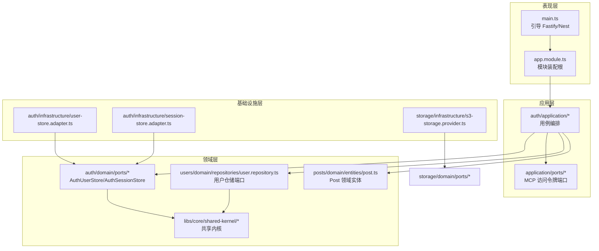
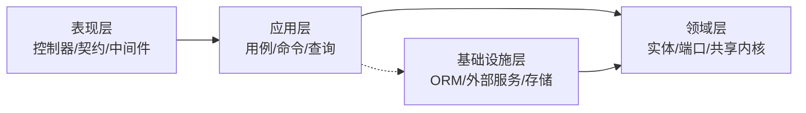
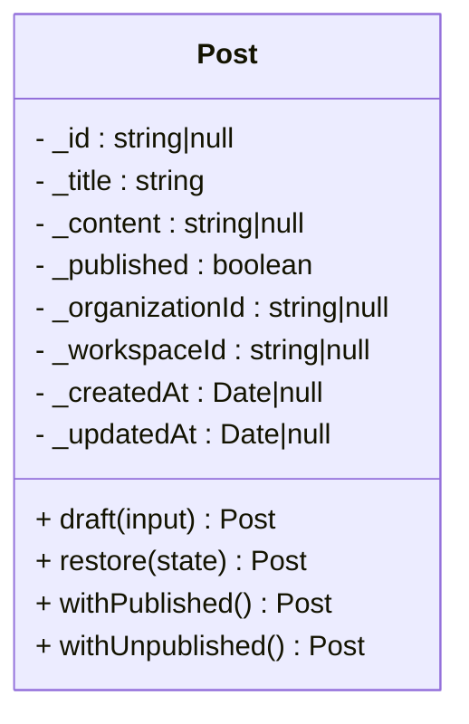
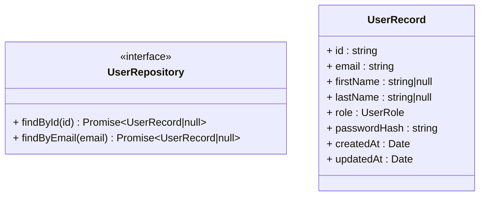
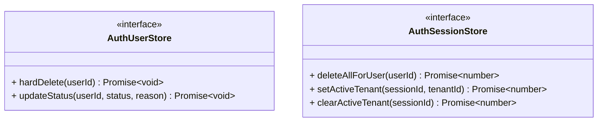
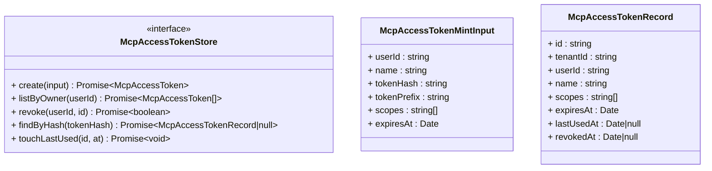
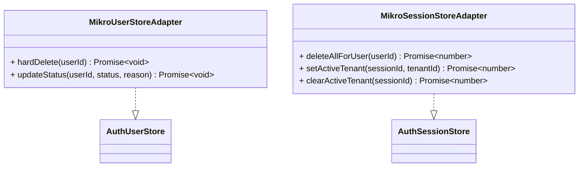
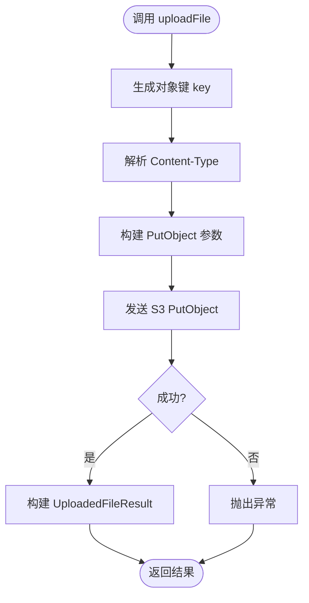
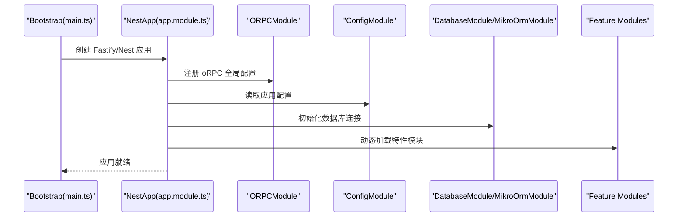
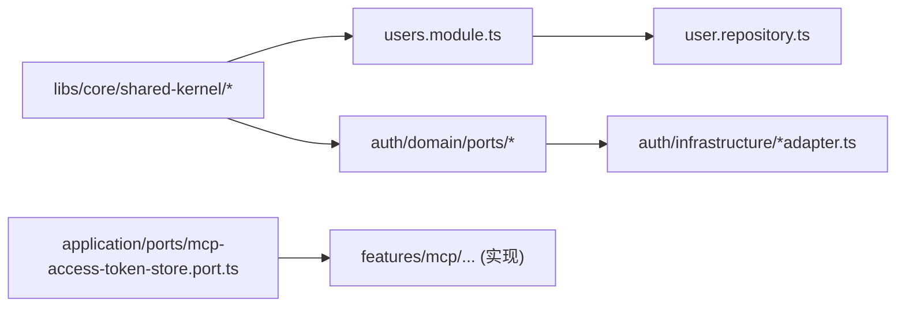

# Clean Architecture 实现

<cite>
**本文引用的文件**   
- [apps/api/src/main.ts](file://apps/api/src/main.ts)
- [apps/api/src/app.module.ts](file://apps/api/src/app.module.ts)
- [apps/api/src/modules/posts/domain/entities/post.ts](file://apps/api/src/modules/posts/domain/entities/post.ts)
- [apps/api/src/modules/users/domain/repositories/user.repository.ts](file://apps/api/src/modules/users/domain/repositories/user.repository.ts)
- [apps/api/src/modules/users/users.module.ts](file://apps/api/src/modules/users/users.module.ts)
- [apps/api/src/modules/auth/domain/ports/user-store.port.ts](file://apps/api/src/modules/auth/domain/ports/user-store.port.ts)
- [apps/api/src/modules/auth/domain/ports/session-store.port.ts](file://apps/api/src/modules/auth/domain/ports/session-store.port.ts)
- [apps/api/src/modules/auth/application/ports/mcp-access-token-store.port.ts](file://apps/api/src/modules/auth/application/ports/mcp-access-token-store.port.ts)
- [apps/api/src/modules/auth/infrastructure/user-store.adapter.ts](file://apps/api/src/modules/auth/infrastructure/user-store.adapter.ts)
- [apps/api/src/modules/auth/infrastructure/session-store.adapter.ts](file://apps/api/src/modules/auth/infrastructure/session-store.adapter.ts)
- [apps/api/src/modules/storage/infrastructure/s3-storage.provider.ts](file://apps/api/src/modules/storage/infrastructure/s3-storage.provider.ts)
- [libs/core/src/shared-kernel/index.ts](file://libs/core/src/shared-kernel/index.ts)
</cite>

## 目录
1. [引言](#引言)
2. [项目结构](#项目结构)
3. [核心组件](#核心组件)
4. [架构总览](#架构总览)
5. [详细组件分析](#详细组件分析)
6. [依赖关系分析](#依赖关系分析)
7. [性能与可维护性考量](#性能与可维护性考量)
8. [故障排查指南](#故障排查指南)
9. [结论](#结论)
10. [附录：分层职责与边界清单](#附录分层职责与边界清单)

## 引言
本仓库采用 Clean Architecture（六边形架构）组织代码，将系统划分为领域层、应用层、基础设施层和表现层。通过端口（Ports）与适配器（Adapters）的接口抽象，实现内外层解耦；领域内核保持纯函数风格与不可变数据，副作用被隔离在基础设施层；上层模块仅依赖下层接口，遵循依赖倒置原则。本文从架构到代码层面，系统性说明各层职责、边界、典型模式与关键实现路径。

## 项目结构
仓库以 NestJS 为运行时框架，按“功能模块 + 分层”组织：
- 表现层：HTTP 入口、路由、控制器、oRPC 契约与中间件。
- 应用层：用例编排、命令/查询处理器、跨域协调。
- 领域层：聚合实体、值对象、仓储端口、领域事件与共享内核。
- 基础设施层：ORM 适配、外部服务客户端、存储提供者、配置与启动装配。

图表来源
- [apps/api/src/main.ts:20-151](file://apps/api/src/main.ts#L20-L151)
- [apps/api/src/app.module.ts:33-73](file://apps/api/src/app.module.ts#L33-L73)
- [apps/api/src/modules/posts/domain/entities/post.ts:35-159](file://apps/api/src/modules/posts/domain/entities/post.ts#L35-L159)
- [apps/api/src/modules/users/domain/repositories/user.repository.ts:1-62](file://apps/api/src/modules/users/domain/repositories/user.repository.ts#L1-L62)
- [apps/api/src/modules/auth/domain/ports/user-store.port.ts:1-32](file://apps/api/src/modules/auth/domain/ports/user-store.port.ts#L1-L32)
- [apps/api/src/modules/auth/domain/ports/session-store.port.ts:1-43](file://apps/api/src/modules/auth/domain/ports/session-store.port.ts#L1-L43)
- [apps/api/src/modules/auth/application/ports/mcp-access-token-store.port.ts:1-78](file://apps/api/src/modules/auth/application/ports/mcp-access-token-store.port.ts#L1-L78)
- [apps/api/src/modules/auth/infrastructure/user-store.adapter.ts:1-43](file://apps/api/src/modules/auth/infrastructure/user-store.adapter.ts#L1-L43)
- [apps/api/src/modules/auth/infrastructure/session-store.adapter.ts:1-48](file://apps/api/src/modules/auth/infrastructure/session-store.adapter.ts#L1-L48)
- [apps/api/src/modules/storage/infrastructure/s3-storage.provider.ts:1-151](file://apps/api/src/modules/storage/infrastructure/s3-storage.provider.ts#L1-L151)
- [libs/core/src/shared-kernel/index.ts:1-9](file://libs/core/src/shared-kernel/index.ts#L1-L9)

章节来源
- [apps/api/src/main.ts:20-151](file://apps/api/src/main.ts#L20-L151)
- [apps/api/src/app.module.ts:33-73](file://apps/api/src/app.module.ts#L33-L73)

## 核心组件
- 领域实体 Post：不可变状态 + 构造期不变量 + 纯转移方法，返回新实例，零框架依赖。
- 用户仓储端口：定义只读接口与记录类型，具体 ORM 实现位于基础设施层。
- Auth 领域端口：AuthUserStore、AuthSessionStore 作为受控写入口，约束跨上下文写权限。
- MCP 访问令牌端口：面向应用层的受控读写契约，屏蔽基础设施细节。
- 存储提供者 S3：基于 StorageProvider 接口的具体实现，封装外部云存储调用。
- 共享内核：领域事件、分页、错误码等通用概念的统一出口。

章节来源
- [apps/api/src/modules/posts/domain/entities/post.ts:35-159](file://apps/api/src/modules/posts/domain/entities/post.ts#L35-L159)
- [apps/api/src/modules/users/domain/repositories/user.repository.ts:1-62](file://apps/api/src/modules/users/domain/repositories/user.repository.ts#L1-L62)
- [apps/api/src/modules/auth/domain/ports/user-store.port.ts:1-32](file://apps/api/src/modules/auth/domain/ports/user-store.port.ts#L1-L32)
- [apps/api/src/modules/auth/domain/ports/session-store.port.ts:1-43](file://apps/api/src/modules/auth/domain/ports/session-store.port.ts#L1-L43)
- [apps/api/src/modules/auth/application/ports/mcp-access-token-store.port.ts:1-78](file://apps/api/src/modules/auth/application/ports/mcp-access-token-store.port.ts#L1-L78)
- [apps/api/src/modules/storage/infrastructure/s3-storage.provider.ts:1-151](file://apps/api/src/modules/storage/infrastructure/s3-storage.provider.ts#L1-L151)
- [libs/core/src/shared-kernel/index.ts:1-9](file://libs/core/src/shared-kernel/index.ts#L1-L9)

## 架构总览
Clean Architecture 在本仓库中的落地要点：
- 依赖方向：表现层 → 应用层 → 领域层 ← 基础设施层。
- 端口与适配器：领域与应用层通过接口（端口）声明能力，基础设施层提供具体实现（适配器）。
- 纯函数领域内核：领域实体与方法不引入副作用，业务规则以不可变数据和纯函数表达。
- 依赖倒置：上层仅依赖下层的接口，DI 容器在装配时绑定具体实现。

图表来源
- [apps/api/src/app.module.ts:33-73](file://apps/api/src/app.module.ts#L33-L73)
- [apps/api/src/modules/users/users.module.ts:15-28](file://apps/api/src/modules/users/users.module.ts#L15-L28)

## 详细组件分析

### 领域层：Post 领域实体（不可变 + 纯转移）
Post 是 posts 上下文的充血领域实体，严格与持久层实体分离：
- 两阶段构造：draft 创建写意图（业务字段），restore 从持久层复原完整实例。
- 纯转移方法：withPublished/withUnpublished 返回新实例，幂等且无副作用。
- 不变量校验：构造期校验标题等业务约束，防御非 HTTP 直调场景。

图表来源
- [apps/api/src/modules/posts/domain/entities/post.ts:35-159](file://apps/api/src/modules/posts/domain/entities/post.ts#L35-L159)

章节来源
- [apps/api/src/modules/posts/domain/entities/post.ts:35-159](file://apps/api/src/modules/posts/domain/entities/post.ts#L35-L159)

### 领域层：用户仓储端口（依赖倒置）
用户仓储端口定义只读接口与记录类型，具体 ORM 实现由基础设施层提供：
- UserRepository：findById、findByEmail。
- UserRecord：不可变记录，密码哈希列存在但对外投影白名单控制。
- DI 绑定：在 users.module 中注入 USER_REPOSITORY 的具体实现。

图表来源
- [apps/api/src/modules/users/domain/repositories/user.repository.ts:1-62](file://apps/api/src/modules/users/domain/repositories/user.repository.ts#L1-L62)
- [apps/api/src/modules/users/users.module.ts:15-28](file://apps/api/src/modules/users/users.module.ts#L15-L28)

章节来源
- [apps/api/src/modules/users/domain/repositories/user.repository.ts:1-62](file://apps/api/src/modules/users/domain/repositories/user.repository.ts#L1-L62)
- [apps/api/src/modules/users/users.module.ts:15-28](file://apps/api/src/modules/users/users.module.ts#L15-L28)

### 领域层：Auth 领域端口（受控写入口）
AuthUserStore 与 AuthSessionStore 作为身份机器族表的受控写入口：
- AuthUserStore：PIPL 硬删、治理迁移更新 status/statusReason。
- AuthSessionStore：删除会话、设置/清除活动租户激活位，保证原子性与权限边界。

图表来源
- [apps/api/src/modules/auth/domain/ports/user-store.port.ts:1-32](file://apps/api/src/modules/auth/domain/ports/user-store.port.ts#L1-L32)
- [apps/api/src/modules/auth/domain/ports/session-store.port.ts:1-43](file://apps/api/src/modules/auth/domain/ports/session-store.port.ts#L1-L43)

章节来源
- [apps/api/src/modules/auth/domain/ports/user-store.port.ts:1-32](file://apps/api/src/modules/auth/domain/ports/user-store.port.ts#L1-L32)
- [apps/api/src/modules/auth/domain/ports/session-store.port.ts:1-43](file://apps/api/src/modules/auth/domain/ports/session-store.port.ts#L1-L43)

### 应用层：MCP 访问令牌端口（应用级契约）
McpAccessTokenStore 暴露应用层对凭证行的受控读写：
- create/listByOwner/revoke/findByHash/touchLastUsed。
- 输入输出使用扁平记录型，避免直接泄露基础设施实体类型。
- 租户上下文由 ALS 盖章，端口不暴露租户参数，防止伪造。

图表来源
- [apps/api/src/modules/auth/application/ports/mcp-access-token-store.port.ts:1-78](file://apps/api/src/modules/auth/application/ports/mcp-access-token-store.port.ts#L1-L78)

章节来源
- [apps/api/src/modules/auth/application/ports/mcp-access-token-store.port.ts:1-78](file://apps/api/src/modules/auth/application/ports/mcp-access-token-store.port.ts#L1-L78)

### 基础设施层：Auth 适配器（ORM 实现）
- MikroUserStoreAdapter：实现 AuthUserStore，使用 MikroORM 原生操作，fork em 感知 UoW 事务。
- MikroSessionStoreAdapter：实现 AuthSessionStore，原生 UPDATE/DELETE，scoped=false 绕过全局过滤。

图表来源
- [apps/api/src/modules/auth/infrastructure/user-store.adapter.ts:1-43](file://apps/api/src/modules/auth/infrastructure/user-store.adapter.ts#L1-L43)
- [apps/api/src/modules/auth/infrastructure/session-store.adapter.ts:1-48](file://apps/api/src/modules/auth/infrastructure/session-store.adapter.ts#L1-L48)

章节来源
- [apps/api/src/modules/auth/infrastructure/user-store.adapter.ts:1-43](file://apps/api/src/modules/auth/infrastructure/user-store.adapter.ts#L1-L43)
- [apps/api/src/modules/auth/infrastructure/session-store.adapter.ts:1-48](file://apps/api/src/modules/auth/infrastructure/session-store.adapter.ts#L1-L48)

### 基础设施层：S3 存储提供者（外部服务适配）
S3StorageProvider 实现 StorageProvider 接口，封装上传、流式上传、删除、签名 URL 生成等能力：
- 支持自定义 endpoint（兼容 MinIO 等）。
- 大文件使用分片上传，提升稳定性与吞吐。
- 统一构建请求参数与结果映射。

图表来源
- [apps/api/src/modules/storage/infrastructure/s3-storage.provider.ts:47-71](file://apps/api/src/modules/storage/infrastructure/s3-storage.provider.ts#L47-L71)
- [apps/api/src/modules/storage/infrastructure/s3-storage.provider.ts:135-149](file://apps/api/src/modules/storage/infrastructure/s3-storage.provider.ts#L135-L149)

章节来源
- [apps/api/src/modules/storage/infrastructure/s3-storage.provider.ts:1-151](file://apps/api/src/modules/storage/infrastructure/s3-storage.provider.ts#L1-L151)

### 表现层与引导：Fastify/Nest 启动与模块装配
- main.ts：创建 Fastify/Nest 应用，注册压缩、Helmet、CORS、多部分上传、Swagger 文档、请求 ID 钩子、全局验证管道等。
- app.module.ts：集中导入 oRPC、配置、数据库、国际化、健康检查、认证、授权、平台治理、租户隔离及各业务模块，并装配 Feature 叠加层。

图表来源
- [apps/api/src/main.ts:20-151](file://apps/api/src/main.ts#L20-L151)
- [apps/api/src/app.module.ts:33-73](file://apps/api/src/app.module.ts#L33-L73)

章节来源
- [apps/api/src/main.ts:20-151](file://apps/api/src/main.ts#L20-L151)
- [apps/api/src/app.module.ts:33-73](file://apps/api/src/app.module.ts#L33-L73)

## 依赖关系分析
- 依赖方向清晰：表现层依赖应用层，应用层依赖领域层；基础设施层实现领域/应用层定义的端口。
- 依赖倒置：users.module 通过 Symbol 注入 USER_REPOSITORY，解耦 ORM 实现。
- 跨上下文写纪律：auth 域拥有 user/session 表写权，其他模块经端口委托写入，避免越界。
- 共享内核：领域事件、分页、错误码等通用概念集中在 libs/core/shared-kernel，供各领域复用。

图表来源
- [apps/api/src/modules/users/users.module.ts:15-28](file://apps/api/src/modules/users/users.module.ts#L15-L28)
- [apps/api/src/modules/users/domain/repositories/user.repository.ts:1-62](file://apps/api/src/modules/users/domain/repositories/user.repository.ts#L1-L62)
- [apps/api/src/modules/auth/domain/ports/user-store.port.ts:1-32](file://apps/api/src/modules/auth/domain/ports/user-store.port.ts#L1-L32)
- [apps/api/src/modules/auth/domain/ports/session-store.port.ts:1-43](file://apps/api/src/modules/auth/domain/ports/session-store.port.ts#L1-L43)
- [apps/api/src/modules/auth/infrastructure/user-store.adapter.ts:1-43](file://apps/api/src/modules/auth/infrastructure/user-store.adapter.ts#L1-L43)
- [apps/api/src/modules/auth/infrastructure/session-store.adapter.ts:1-48](file://apps/api/src/modules/auth/infrastructure/session-store.adapter.ts#L1-L48)
- [apps/api/src/modules/auth/application/ports/mcp-access-token-store.port.ts:1-78](file://apps/api/src/modules/auth/application/ports/mcp-access-token-store.port.ts#L1-L78)
- [libs/core/src/shared-kernel/index.ts:1-9](file://libs/core/src/shared-kernel/index.ts#L1-L9)

章节来源
- [apps/api/src/modules/users/users.module.ts:15-28](file://apps/api/src/modules/users/users.module.ts#L15-L28)
- [libs/core/src/shared-kernel/index.ts:1-9](file://libs/core/src/shared-kernel/index.ts#L1-L9)

## 性能与可维护性考量
- 领域实体不可变与纯转移：减少状态竞态与副作用，便于测试与推理。
- 原生 SQL 与 fork em：在需要精确控制的事务与过滤场景使用 nativeUpdate/nativeDelete，并通过 MikroOrmService.fork() 感知 UoW 事务，兼顾性能与一致性。
- 外部服务调用封装：S3 上传分片、签名 URL 生成等逻辑集中于适配器，便于替换与优化。
- 模块装配顺序：app.module.ts 明确限流、认证、租户隔离等守卫顺序，确保廉价拒绝优先，降低无效处理开销。

[本节为通用指导，无需特定文件引用]

## 故障排查指南
- 数据驻留合规：main.ts 启动阶段校验数据库与存储区域，strict 模式下违规直接退出，便于早期发现部署问题。
- CORS 与凭据：CORS origin 必须回显具体域名以支持 cookie 凭据，未命中白名单的请求将被拒绝。
- 租户隔离与会话激活：AuthSessionStore 的 setActiveTenant/clearActiveTenant 需成对使用，避免双激活位混绑导致越权。
- 用户硬删与生命周期：AUTH_USER_STORE 的 hardDelete/updateStatus 应包裹在 UoW 事务中，确保级联一致。

章节来源
- [apps/api/src/main.ts:40-72](file://apps/api/src/main.ts#L40-L72)
- [apps/api/src/modules/auth/infrastructure/session-store.adapter.ts:23-46](file://apps/api/src/modules/auth/infrastructure/session-store.adapter.ts#L23-L46)
- [apps/api/src/modules/auth/infrastructure/user-store.adapter.ts:18-41](file://apps/api/src/modules/auth/infrastructure/user-store.adapter.ts#L18-L41)

## 结论
该仓库以 Clean Architecture 为核心组织方式，通过端口与适配器实现清晰的内外层解耦，领域层保持纯函数与不可变数据，基础设施层承担所有副作用。依赖倒置贯穿模块装配与 DI 绑定，保障上层稳定、下层可替换。整体架构具备良好的可测试性、可扩展性与可维护性，适合复杂 SaaS 系统的长期演进。

[本节为总结性内容，无需特定文件引用]

## 附录：分层职责与边界清单
- 表现层
  - 职责：HTTP/oRPC 入口、路由、控制器、契约、中间件、全局配置。
  - 边界：不承载业务规则，仅做协议转换、鉴权、限流、校验与响应包装。
- 应用层
  - 职责：用例编排、命令/查询处理器、跨域协调、外部服务编排。
  - 边界：不直接依赖 ORM/外部 SDK，通过领域/应用端口与基础设施交互。
- 领域层
  - 职责：业务规则、聚合实体、值对象、仓储端口、领域事件、共享内核。
  - 边界：零框架依赖，纯函数与不可变数据，不产生副作用。
- 基础设施层
  - 职责：ORM 适配、外部服务客户端、存储提供者、配置与启动装配。
  - 边界：实现领域/应用端口，封装技术细节与外部依赖。

[本节为概念性内容，无需特定文件引用]