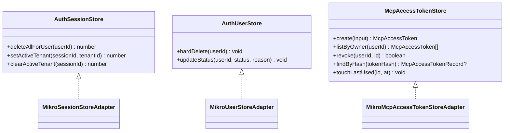
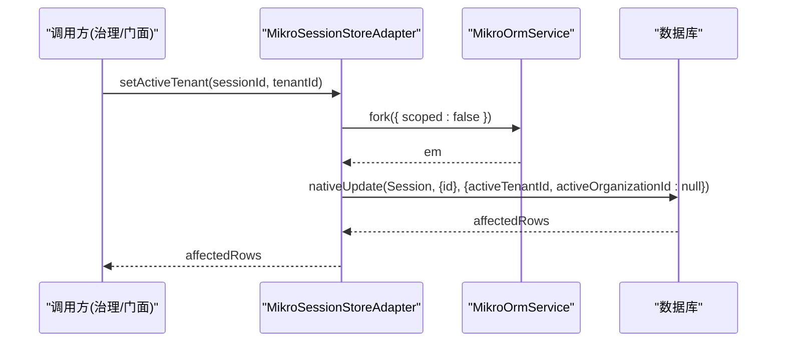
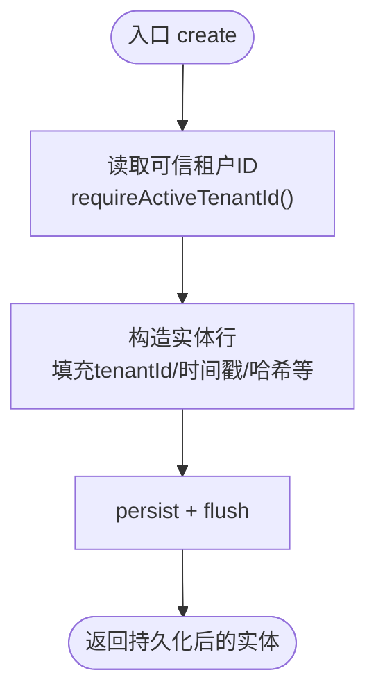
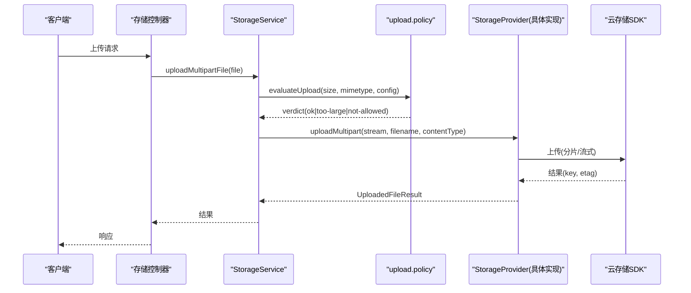
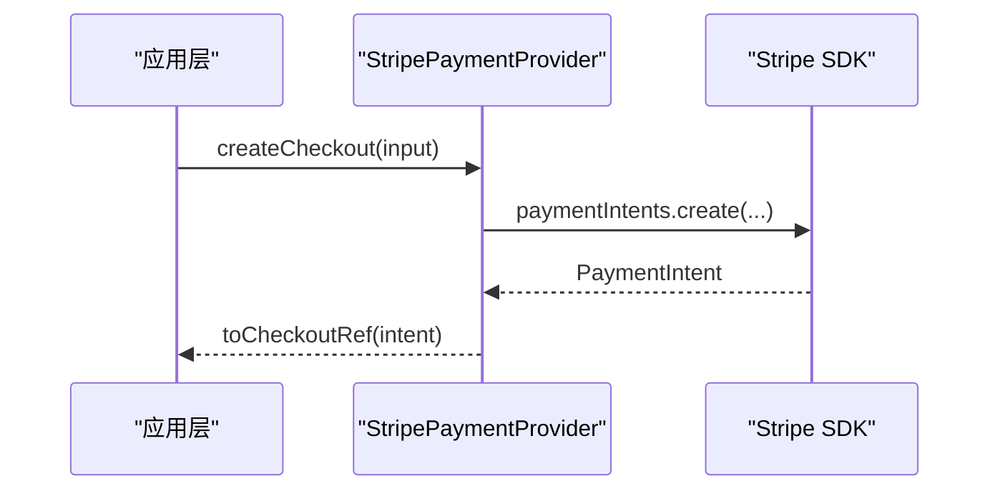
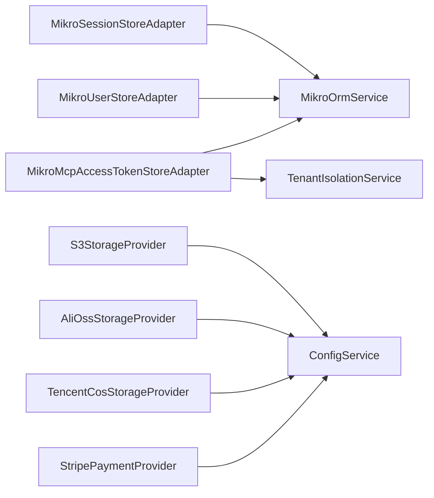

# 基础设施适配器

<cite>
**本文引用的文件**   
- [apps/api/src/modules/auth/domain/ports/session-store.port.ts](file://apps/api/src/modules/auth/domain/ports/session-store.port.ts)
- [apps/api/src/modules/auth/domain/ports/user-store.port.ts](file://apps/api/src/modules/auth/domain/ports/user-store.port.ts)
- [apps/api/src/modules/auth/application/ports/mcp-access-token-store.port.ts](file://apps/api/src/modules/auth/application/ports/mcp-access-token-store.port.ts)
- [apps/api/src/modules/auth/infrastructure/session-store.adapter.ts](file://apps/api/src/modules/auth/infrastructure/session-store.adapter.ts)
- [apps/api/src/modules/auth/infrastructure/user-store.adapter.ts](file://apps/api/src/modules/auth/infrastructure/user-store.adapter.ts)
- [apps/api/src/modules/auth/infrastructure/mcp-access-token-store.adapter.ts](file://apps/api/src/modules/auth/infrastructure/mcp-access-token-store.adapter.ts)
- [apps/api/src/modules/storage/application/storage.service.ts](file://apps/api/src/modules/storage/application/storage.service.ts)
- [apps/api/src/modules/storage/infrastructure/s3-storage.provider.ts](file://apps/api/src/modules/storage/infrastructure/s3-storage.provider.ts)
- [apps/api/src/modules/storage/infrastructure/alioss-storage.provider.ts](file://apps/api/src/modules/storage/infrastructure/alioss-storage.provider.ts)
- [apps/api/src/modules/storage/infrastructure/tencentcos-storage.provider.ts](file://apps/api/src/modules/storage/infrastructure/tencentcos-storage.provider.ts)
- [apps/api/src/modules/payment/infrastructure/stripe-payment.provider.ts](file://apps/api/src/modules/payment/infrastructure/stripe-payment.provider.ts)
</cite>

## 目录
1. [引言](#引言)
2. [项目结构](#项目结构)
3. [核心组件](#核心组件)
4. [架构总览](#架构总览)
5. [详细组件分析](#详细组件分析)
6. [依赖关系分析](#依赖关系分析)
7. [性能与可靠性](#性能与可靠性)
8. [故障排查指南](#故障排查指南)
9. [结论](#结论)
10. [附录：扩展与替换实现](#附录扩展与替换实现)

## 引言
本文件系统性梳理仓库中的“基础设施适配器”设计，围绕端口-适配器模式、仓储适配器的数据访问层模式、第三方服务集成策略（认证、支付、存储），以及配置、日志、监控等横切关注点的适配方式展开。文档以代码级事实为依据，给出架构图、类图、时序图和流程图，帮助读者理解如何通过接口抽象解耦外部依赖，并指导如何扩展新的基础设施组件或替换现有实现。

## 项目结构
本项目采用按领域模块组织的方式，每个业务域（如 auth、storage、payment）内部遵循清晰的层次划分：
- api：控制器、网关、中间件等对外暴露面
- application：编排层，组合领域策略与基础设施端口
- domain：领域模型、端口定义、策略与值对象
- infrastructure：具体实现（数据库、第三方 SDK、消息队列等）

```mermaid
graph TB
subgraph "认证域"
AUTH_API["api/oauth-sso.controller.ts"]
AUTH_APP["application/*"]
AUTH_DOMAIN["domain/ports/*"]
AUTH_INFRA["infrastructure/*adapter*.ts"]
end
subgraph "存储域"
STORAGE_API["api/storage.controller.ts"]
STORAGE_APP["application/storage.service.ts"]
STORAGE_DOMAIN["domain/policies/* + ports/*"]
STORAGE_INFRA["infrastructure/*provider*.ts"]
end
subgraph "支付域"
PAYMENT_API["api/payment.controller.ts"]
PAYMENT_APP["application/payment.service.ts"]
PAYMENT_DOMAIN["domain/ports/*"]
PAYMENT_INFRA["infrastructure/stripe-payment.provider.ts"]
end
AUTH_API --> AUTH_APP --> AUTH_DOMAIN --> AUTH_INFRA
STORAGE_API --> STORAGE_APP --> STORAGE_DOMAIN --> STORAGE_INFRA
PAYMENT_API --> PAYMENT_APP --> PAYMENT_DOMAIN --> PAYMENT_INFRA
```

图表来源
- [apps/api/src/modules/auth/infrastructure/session-store.adapter.ts:1-48](file://apps/api/src/modules/auth/infrastructure/session-store.adapter.ts#L1-L48)
- [apps/api/src/modules/storage/application/storage.service.ts:1-100](file://apps/api/src/modules/storage/application/storage.service.ts#L1-L100)
- [apps/api/src/modules/payment/infrastructure/stripe-payment.provider.ts:1-108](file://apps/api/src/modules/payment/infrastructure/stripe-payment.provider.ts#L1-L108)

章节来源
- [apps/api/src/modules/auth/infrastructure/session-store.adapter.ts:1-48](file://apps/api/src/modules/auth/infrastructure/session-store.adapter.ts#L1-L48)
- [apps/api/src/modules/storage/application/storage.service.ts:1-100](file://apps/api/src/modules/storage/application/storage.service.ts#L1-L100)
- [apps/api/src/modules/payment/infrastructure/stripe-payment.provider.ts:1-108](file://apps/api/src/modules/payment/infrastructure/stripe-payment.provider.ts#L1-L108)

## 核心组件
- 认证仓储端口与适配器
  - 会话写入口：AuthSessionStore（删除用户全部会话、设置/清除活动租户）
  - 用户本体写入口：AuthUserStore（PIPL 硬删、治理状态迁移）
  - MCP 令牌仓储端口：McpAccessTokenStore（铸造、列表、撤销、哈希查找、最后使用时间戳）
- 存储提供者接口与多实现
  - StorageProvider 统一上传、流式上传、删除、签名 URL
  - S3StorageProvider、AliOssStorageProvider、TencentCosStorageProvider 三种云厂商实现
- 支付通道适配器
  - StripePaymentProvider 实现 PaymentProvider，封装 Stripe SDK 并归一化事件与引用

章节来源
- [apps/api/src/modules/auth/domain/ports/session-store.port.ts:1-43](file://apps/api/src/modules/auth/domain/ports/session-store.port.ts#L1-L43)
- [apps/api/src/modules/auth/domain/ports/user-store.port.ts:1-32](file://apps/api/src/modules/auth/domain/ports/user-store.port.ts#L1-L32)
- [apps/api/src/modules/auth/application/ports/mcp-access-token-store.port.ts:1-78](file://apps/api/src/modules/auth/application/ports/mcp-access-token-store.port.ts#L1-L78)
- [apps/api/src/modules/storage/application/storage.service.ts:1-100](file://apps/api/src/modules/storage/application/storage.service.ts#L1-L100)
- [apps/api/src/modules/payment/infrastructure/stripe-payment.provider.ts:1-108](file://apps/api/src/modules/payment/infrastructure/stripe-payment.provider.ts#L1-L108)

## 架构总览
下图展示“端口-适配器”在认证、存储、支付三个域的落地方式：应用层通过领域端口调用，基础设施适配器负责对接数据库或第三方 SDK。

图表来源
- [apps/api/src/modules/auth/domain/ports/session-store.port.ts:1-43](file://apps/api/src/modules/auth/domain/ports/session-store.port.ts#L1-L43)
- [apps/api/src/modules/auth/domain/ports/user-store.port.ts:1-32](file://apps/api/src/modules/auth/domain/ports/user-store.port.ts#L1-L32)
- [apps/api/src/modules/auth/application/ports/mcp-access-token-store.port.ts:1-78](file://apps/api/src/modules/auth/application/ports/mcp-access-token-store.port.ts#L1-L78)
- [apps/api/src/modules/auth/infrastructure/session-store.adapter.ts:1-48](file://apps/api/src/modules/auth/infrastructure/session-store.adapter.ts#L1-L48)
- [apps/api/src/modules/auth/infrastructure/user-store.adapter.ts:1-43](file://apps/api/src/modules/auth/infrastructure/user-store.adapter.ts#L1-L43)
- [apps/api/src/modules/auth/infrastructure/mcp-access-token-store.adapter.ts:1-102](file://apps/api/src/modules/auth/infrastructure/mcp-access-token-store.adapter.ts#L1-L102)

## 详细组件分析

### 认证仓储适配器（会话与用户）
- 设计要点
  - 通过 `MikroOrmService.fork()` 获取 EntityManager，保证在 UoW 事务内复用连接，使跨表写具备原子性。
  - 对 session 表的写被收敛为受控入口，避免跨上下文直写；对 user 表的治理写也收敛到属主域。
  - 针对“活动租户激活位”的双字段互斥逻辑，确保选择租与选择组织时不混绑。
- 关键流程（设置活动租户）

图表来源
- [apps/api/src/modules/auth/infrastructure/session-store.adapter.ts:23-46](file://apps/api/src/modules/auth/infrastructure/session-store.adapter.ts#L23-L46)

章节来源
- [apps/api/src/modules/auth/domain/ports/session-store.port.ts:1-43](file://apps/api/src/modules/auth/domain/ports/session-store.port.ts#L1-L43)
- [apps/api/src/modules/auth/infrastructure/session-store.adapter.ts:1-48](file://apps/api/src/modules/auth/infrastructure/session-store.adapter.ts#L1-L48)
- [apps/api/src/modules/auth/infrastructure/user-store.adapter.ts:1-43](file://apps/api/src/modules/auth/infrastructure/user-store.adapter.ts#L1-L43)

### MCP 访问令牌仓储适配器
- 设计要点
  - 租户隔离：所有写路径先通过 `requireActiveTenantId()` 从可信 ALS 解析租户，fail-closed，杜绝伪造。
  - 读路径中“按哈希查找”发生在无租户上下文的 bearer 校验阶段，使用 `scoped:false` 全库单行查，安全由行自带 tenantId 承担。
  - 撤销幂等：已撤销再撤销视为成功，零写返回 true。
- 关键流程（创建令牌）

图表来源
- [apps/api/src/modules/auth/infrastructure/mcp-access-token-store.adapter.ts:34-54](file://apps/api/src/modules/auth/infrastructure/mcp-access-token-store.adapter.ts#L34-L54)

章节来源
- [apps/api/src/modules/auth/application/ports/mcp-access-token-store.port.ts:1-78](file://apps/api/src/modules/auth/application/ports/mcp-access-token-store.port.ts#L1-L78)
- [apps/api/src/modules/auth/infrastructure/mcp-access-token-store.adapter.ts:1-102](file://apps/api/src/modules/auth/infrastructure/mcp-access-token-store.adapter.ts#L1-L102)

### 存储适配器（S3 / 阿里云 OSS / 腾讯云 COS）
- 设计要点
  - 统一 StorageProvider 接口，屏蔽不同云厂商 SDK 差异。
  - BaseStorageProvider 提供公共能力（键生成、内容类型推断、ETag 标准化、默认公开 URL）。
  - Application 层 StorageService 仅做编排：选择 provider、执行上传策略校验、映射 HTTP 异常。
- 关键流程（multipart 上传）

图表来源
- [apps/api/src/modules/storage/application/storage.service.ts:43-79](file://apps/api/src/modules/storage/application/storage.service.ts#L43-L79)
- [apps/api/src/modules/storage/infrastructure/s3-storage.provider.ts:47-102](file://apps/api/src/modules/storage/infrastructure/s3-storage.provider.ts#L47-L102)
- [apps/api/src/modules/storage/infrastructure/alioss-storage.provider.ts:29-79](file://apps/api/src/modules/storage/infrastructure/alioss-storage.provider.ts#L29-L79)
- [apps/api/src/modules/storage/infrastructure/tencentcos-storage.provider.ts:29-49](file://apps/api/src/modules/storage/infrastructure/tencentcos-storage.provider.ts#L29-L49)

章节来源
- [apps/api/src/modules/storage/application/storage.service.ts:1-100](file://apps/api/src/modules/storage/application/storage.service.ts#L1-L100)
- [apps/api/src/modules/storage/infrastructure/s3-storage.provider.ts:1-151](file://apps/api/src/modules/storage/infrastructure/s3-storage.provider.ts#L1-L151)
- [apps/api/src/modules/storage/infrastructure/alioss-storage.provider.ts:1-129](file://apps/api/src/modules/storage/infrastructure/alioss-storage.provider.ts#L1-L129)
- [apps/api/src/modules/storage/infrastructure/tencentcos-storage.provider.ts:1-142](file://apps/api/src/modules/storage/infrastructure/tencentcos-storage.provider.ts#L1-L142)

### 支付适配器（Stripe）
- 设计要点
  - 将 Stripe 原生对象归一化为统一的 PaymentProvider 接口契约，透传 raw 便于审计与调试。
  - 支持订阅场景（supportsRecurring）、客户创建、结账意图、退款、Webhook 验签。
- 关键流程（创建结账意图）

图表来源
- [apps/api/src/modules/payment/infrastructure/stripe-payment.provider.ts:57-65](file://apps/api/src/modules/payment/infrastructure/stripe-payment.provider.ts#L57-L65)

章节来源
- [apps/api/src/modules/payment/infrastructure/stripe-payment.provider.ts:1-108](file://apps/api/src/modules/payment/infrastructure/stripe-payment.provider.ts#L1-L108)

## 依赖关系分析
- 认证仓储适配器依赖
  - 数据库访问：MikroOrmService（fork 感知 UoW 事务）
  - 租户隔离：TenantIsolationService（MCP 令牌场景）
- 存储适配器依赖
  - 配置：ConfigService（region、bucket、endpoint、密钥等）
  - 云 SDK：@aws-sdk/client-s3、ali-oss、cos-nodejs-sdk-v5
- 支付适配器依赖
  - 配置：ConfigService（Stripe secretKey、apiVersion、webhookSecret）
  - 第三方 SDK：stripe

图表来源
- [apps/api/src/modules/auth/infrastructure/session-store.adapter.ts:1-48](file://apps/api/src/modules/auth/infrastructure/session-store.adapter.ts#L1-L48)
- [apps/api/src/modules/auth/infrastructure/user-store.adapter.ts:1-43](file://apps/api/src/modules/auth/infrastructure/user-store.adapter.ts#L1-L43)
- [apps/api/src/modules/auth/infrastructure/mcp-access-token-store.adapter.ts:1-102](file://apps/api/src/modules/auth/infrastructure/mcp-access-token-store.adapter.ts#L1-L102)
- [apps/api/src/modules/storage/infrastructure/s3-storage.provider.ts:1-151](file://apps/api/src/modules/storage/infrastructure/s3-storage.provider.ts#L1-L151)
- [apps/api/src/modules/storage/infrastructure/alioss-storage.provider.ts:1-129](file://apps/api/src/modules/storage/infrastructure/alioss-storage.provider.ts#L1-L129)
- [apps/api/src/modules/storage/infrastructure/tencentcos-storage.provider.ts:1-142](file://apps/api/src/modules/storage/infrastructure/tencentcos-storage.provider.ts#L1-L142)
- [apps/api/src/modules/payment/infrastructure/stripe-payment.provider.ts:1-108](file://apps/api/src/modules/payment/infrastructure/stripe-payment.provider.ts#L1-L108)

章节来源
- [apps/api/src/modules/auth/infrastructure/session-store.adapter.ts:1-48](file://apps/api/src/modules/auth/infrastructure/session-store.adapter.ts#L1-L48)
- [apps/api/src/modules/auth/infrastructure/user-store.adapter.ts:1-43](file://apps/api/src/modules/auth/infrastructure/user-store.adapter.ts#L1-L43)
- [apps/api/src/modules/auth/infrastructure/mcp-access-token-store.adapter.ts:1-102](file://apps/api/src/modules/auth/infrastructure/mcp-access-token-store.adapter.ts#L1-L102)
- [apps/api/src/modules/storage/infrastructure/s3-storage.provider.ts:1-151](file://apps/api/src/modules/storage/infrastructure/s3-storage.provider.ts#L1-L151)
- [apps/api/src/modules/storage/infrastructure/alioss-storage.provider.ts:1-129](file://apps/api/src/modules/storage/infrastructure/alioss-storage.provider.ts#L1-L129)
- [apps/api/src/modules/storage/infrastructure/tencentcos-storage.provider.ts:1-142](file://apps/api/src/modules/storage/infrastructure/tencentcos-storage.provider.ts#L1-L142)
- [apps/api/src/modules/payment/infrastructure/stripe-payment.provider.ts:1-108](file://apps/api/src/modules/payment/infrastructure/stripe-payment.provider.ts#L1-L108)

## 性能与可靠性
- 数据库访问
  - 使用 `MikroOrmService.fork()` 在 UoW 事务内复用连接，减少连接开销并确保跨表写原子性。
  - 针对高频短操作（如更新 lastUsedAt）使用 nativeUpdate，避免 Entity Manager 的额外跟踪成本。
- 存储上传
  - 大文件优先使用流式/分片上传，降低内存峰值。
  - ETag 标准化与错误信息包装，便于上层统一处理与可观测性。
- 第三方服务
  - Stripe Webhook 验签失败直接抛出异常，保障事件处理的正确性。
  - 存储 provider 的错误统一包装为业务异常码，便于前端提示与监控告警。

[本节为通用指导，不直接分析具体文件]

## 故障排查指南
- 认证侧
  - 会话删除未生效：检查是否通过 AUTH_SESSION_STORE 端口写入，而非直连 entity。
  - 活动租户设置后角色越权：确认同时清除了 activeOrganizationId，避免双激活位混绑。
  - MCP 令牌哈希查询为空：确认 findByHash 走的是 scoped:false 的全库单行查，且 tokenHash 计算一致。
- 存储侧
  - 上传失败：检查 provider 配置（region/bucket/endpoint/密钥）与 MIME 白名单、大小限制。
  - 无法生成签名 URL：核对 bucket 权限与 provider 的签名方法。
- 支付侧
  - Webhook 验签失败：核对 webhookSecret 与 Stripe 控制台配置。
  - 退款金额/原因不一致：检查 RefundInput 参数映射。

章节来源
- [apps/api/src/modules/auth/infrastructure/session-store.adapter.ts:18-46](file://apps/api/src/modules/auth/infrastructure/session-store.adapter.ts#L18-L46)
- [apps/api/src/modules/auth/infrastructure/mcp-access-token-store.adapter.ts:76-100](file://apps/api/src/modules/auth/infrastructure/mcp-access-token-store.adapter.ts#L76-L100)
- [apps/api/src/modules/storage/application/storage.service.ts:43-98](file://apps/api/src/modules/storage/application/storage.service.ts#L43-L98)
- [apps/api/src/modules/payment/infrastructure/stripe-payment.provider.ts:72-96](file://apps/api/src/modules/payment/infrastructure/stripe-payment.provider.ts#L72-L96)

## 结论
该项目通过严格的端口-适配器模式，将认证、存储、支付等外部依赖与核心业务解耦。仓储适配器基于 MikroORM 的 fork 机制保证事务一致性；存储适配器统一了多云厂商的差异；支付适配器将 Stripe 原生对象归一化，提升可测试性与可替换性。整体架构清晰、可扩展性强，适合在多租户、多环境、多供应商场景下持续演进。

[本节为总结性内容，不直接分析具体文件]

## 附录：扩展与替换实现

### 新增存储提供商（例如某兼容 S3 的对象存储）
- 步骤
  1. 新建 provider 类继承 BaseStorageProvider 并实现 StorageProvider。
  2. 在构造函数中从 ConfigService 读取配置并初始化 SDK 客户端。
  3. 实现 uploadFile、uploadFileFromStream、deleteFile、getFileUrl 等方法。
  4. 在 DI 容器中注册该 provider，并在 selectStorageProvider 策略中支持新 provider key。
- 参考实现
  - [apps/api/src/modules/storage/infrastructure/s3-storage.provider.ts:1-151](file://apps/api/src/modules/storage/infrastructure/s3-storage.provider.ts#L1-L151)
  - [apps/api/src/modules/storage/application/storage.service.ts:23-34](file://apps/api/src/modules/storage/application/storage.service.ts#L23-L34)

### 新增支付通道（例如接入另一个支付服务商）
- 步骤
  1. 实现 PaymentProvider 接口（参考 StripePaymentProvider）。
  2. 在构造函数中从 ConfigService 读取对应密钥与版本。
  3. 实现 createCustomer、createCheckout、retrieveCheckout、refund、verifyWebhook 等方法。
  4. 在 DI 容器中注册新 provider，并在应用层选择逻辑中支持新 provider id。
- 参考实现
  - [apps/api/src/modules/payment/infrastructure/stripe-payment.provider.ts:1-108](file://apps/api/src/modules/payment/infrastructure/stripe-payment.provider.ts#L1-L108)

### 新增认证仓储端口与适配器（示例：新增一个“设备令牌”仓储）
- 步骤
  1. 在 domain/application 层定义端口接口（如 DeviceTokenStore），明确输入输出与租户隔离语义。
  2. 在 infrastructure 层实现适配器，使用 MikroOrmService.fork() 访问数据库，遵循 fail-closed 的租户解析。
  3. 在模块装配中将端口绑定到具体适配器实现。
- 参考实现
  - [apps/api/src/modules/auth/application/ports/mcp-access-token-store.port.ts:1-78](file://apps/api/src/modules/auth/application/ports/mcp-access-token-store.port.ts#L1-L78)
  - [apps/api/src/modules/auth/infrastructure/mcp-access-token-store.adapter.ts:1-102](file://apps/api/src/modules/auth/infrastructure/mcp-access-token-store.adapter.ts#L1-L102)

### 替换现有实现（例如将 S3 替换为其他兼容 S3 的服务）
- 步骤
  1. 新增 provider 实现（同“新增存储提供商”）。
  2. 调整配置项（region/endpoint/credentials）。
  3. 在 selectStorageProvider 策略中切换 provider key。
- 参考实现
  - [apps/api/src/modules/storage/application/storage.service.ts:23-34](file://apps/api/src/modules/storage/application/storage.service.ts#L23-L34)
  - [apps/api/src/modules/storage/infrastructure/s3-storage.provider.ts:25-45](file://apps/api/src/modules/storage/infrastructure/s3-storage.provider.ts#L25-L45)