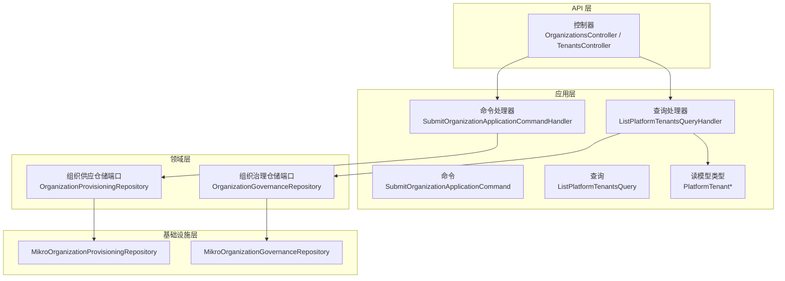
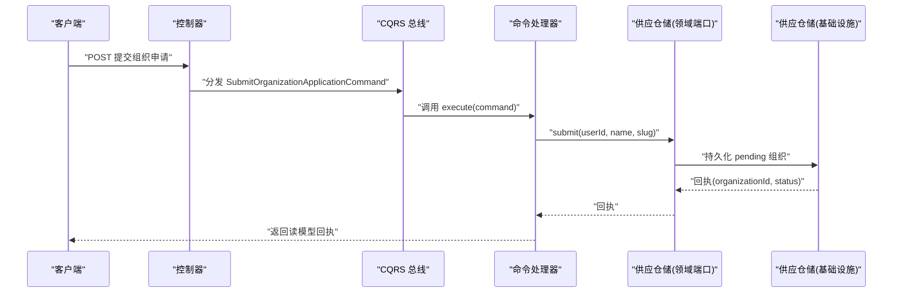
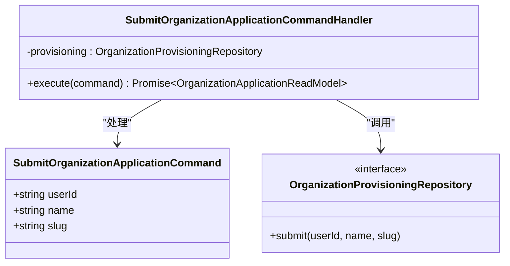
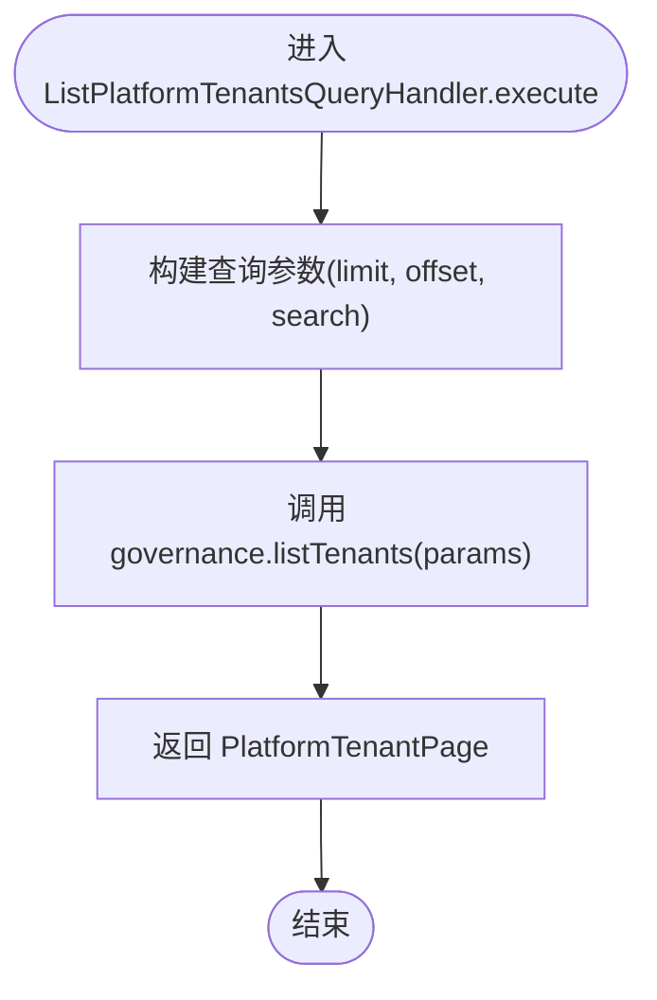
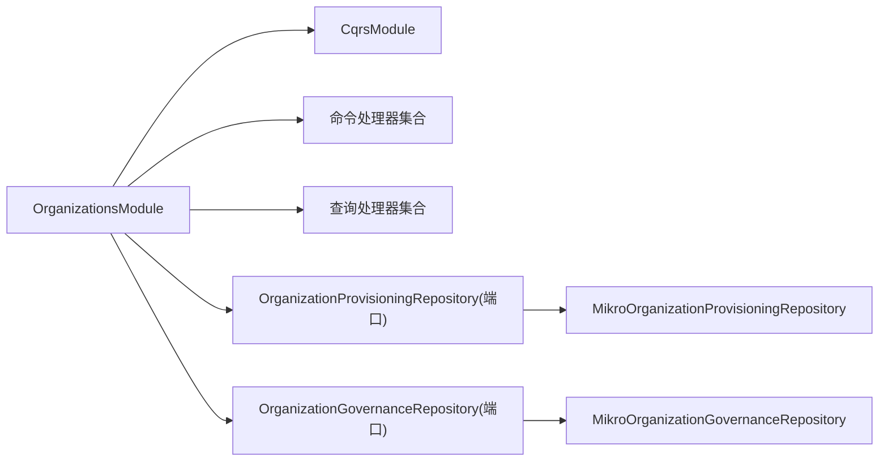

# 应用层模式

<cite>
**本文引用的文件**   
- [organizations.module.ts](file://apps/api/src/modules/organizations/organizations.module.ts)
- [submit-organization-application.command.ts](file://apps/api/src/modules/organizations/application/commands/submit-organization-application.command.ts)
- [submit-organization-application.command-handler.ts](file://apps/api/src/modules/organizations/application/commands/handlers/submit-organization-application.command-handler.ts)
- [list-platform-tenants.query.ts](file://apps/api/src/modules/organizations/application/queries/list-platform-tenants.query.ts)
- [list-platform-tenants.query-handler.ts](file://apps/api/src/modules/organizations/application/queries/handlers/list-platform-tenants.query-handler.ts)
- [platform-tenant.read-model.ts](file://apps/api/src/modules/organizations/application/read-models/platform-tenant.read-model.ts)
</cite>

## 目录
1. [简介](#简介)
2. [项目结构](#项目结构)
3. [核心组件](#核心组件)
4. [架构总览](#架构总览)
5. [详细组件分析](#详细组件分析)
6. [依赖关系分析](#依赖关系分析)
7. [性能与可扩展性](#性能与可扩展性)
8. [故障排查指南](#故障排查指南)
9. [结论](#结论)

## 简介
本文件围绕应用层（Application Layer）在 NestJS + CQRS 中的实现，聚焦命令查询职责分离、用例编排与业务协调。以“组织/租户治理”模块为例，说明：
- 命令处理器如何编排领域仓储完成写操作；
- 查询处理器如何基于读模型返回数据；
- 应用服务如何协调领域对象完成复杂流程；
- 读写模型的设计与同步机制；
- 异步处理与事务管理策略；
- 命令处理器的实现模式与性能优化技巧。

## 项目结构
该模块采用按特性组织的分层结构：
- API 层：控制器暴露 HTTP 端点，负责参数校验、鉴权与调用应用层。
- 应用层：定义命令、查询及其处理器，以及读模型类型；通过 @nestjs/cqrs 的 CommandBus/QueryBus 进行编排。
- 领域层：定义仓储端口（接口），封装跨租户治理、成员目录等能力。
- 基础设施层：提供仓储的具体实现（MikroORM 适配）。

图表来源
- [organizations.module.ts:47-73](file://apps/api/src/modules/organizations/organizations.module.ts#L47-L73)
- [submit-organization-application.command.ts:12-20](file://apps/api/src/modules/organizations/application/commands/submit-organization-application.command.ts#L12-L20)
- [submit-organization-application.command-handler.ts:18-37](file://apps/api/src/modules/organizations/application/commands/handlers/submit-organization-application.command-handler.ts#L18-L37)
- [list-platform-tenants.query.ts:12-20](file://apps/api/src/modules/organizations/application/queries/list-platform-tenants.query.ts#L12-L20)
- [list-platform-tenants.query-handler.ts:18-37](file://apps/api/src/modules/organizations/application/queries/handlers/list-platform-tenants.query-handler.ts#L18-L37)
- [platform-tenant.read-model.ts:1-16](file://apps/api/src/modules/organizations/application/read-models/platform-tenant.read-model.ts#L1-L16)

章节来源
- [organizations.module.ts:1-159](file://apps/api/src/modules/organizations/organizations.module.ts#L1-L159)

## 核心组件
- 命令与命令处理器
  - 命令：表达一次意图（如提交组织申请），携带不可变输入。
  - 命令处理器：接收命令，编排领域仓储执行变更，并返回读模型回执。
- 查询与查询处理器
  - 查询：表达一次读取意图（如列出平台租户），携带分页/过滤参数。
  - 查询处理器：委派领域治理仓储读取数据，返回读模型形状。
- 读模型
  - 读模型类型集中声明，供查询处理器与控制器消费；在本模块中作为“返回形状”，并非物化投影实体。
- 模块装配
  - 使用 @nestjs/cqrs 的 CqrsModule，注册所有命令/查询处理器；通过 DI 将仓储端口绑定到基础设施实现。

章节来源
- [organizations.module.ts:47-73](file://apps/api/src/modules/organizations/organizations.module.ts#L47-L73)
- [submit-organization-application.command.ts:12-20](file://apps/api/src/modules/organizations/application/commands/submit-organization-application.command.ts#L12-L20)
- [submit-organization-application.command-handler.ts:18-37](file://apps/api/src/modules/organizations/application/commands/handlers/submit-organization-application.command-handler.ts#L18-L37)
- [list-platform-tenants.query.ts:12-20](file://apps/api/src/modules/organizations/application/queries/list-platform-tenants.query.ts#L12-L20)
- [list-platform-tenants.query-handler.ts:18-37](file://apps/api/src/modules/organizations/application/queries/handlers/list-platform-tenants.query-handler.ts#L18-L37)
- [platform-tenant.read-model.ts:1-16](file://apps/api/src/modules/organizations/application/read-models/platform-tenant.read-model.ts#L1-L16)

## 架构总览
CQRS 在该模块中的落地方式如下：
- 写路径：控制器 → 命令 → 命令处理器 → 领域供应仓储 → 基础设施持久化。
- 读路径：控制器 → 查询 → 查询处理器 → 领域治理仓储 → 基础设施查询 → 返回读模型形状。
- 模块通过 @Global 暴露状态机服务与审计日志存储，供其他上下文复用。

图表来源
- [submit-organization-application.command.ts:12-20](file://apps/api/src/modules/organizations/application/commands/submit-organization-application.command.ts#L12-L20)
- [submit-organization-application.command-handler.ts:18-37](file://apps/api/src/modules/organizations/application/commands/handlers/submit-organization-application.command-handler.ts#L18-L37)

## 详细组件分析

### 命令与命令处理器：提交组织申请
- 命令设计
  - 仅包含必要输入：申请人 userId、组织名、slug。userId 来自会话，非请求体字段，避免伪造。
- 命令处理器
  - 通过注入的组织供应仓储端口 submit(...) 创建 pending 组织，并将回执映射为读模型返回。
  - 该处理器是典型的“薄编排器”：不承载领域规则，只协调仓储完成写操作。

图表来源
- [submit-organization-application.command.ts:12-20](file://apps/api/src/modules/organizations/application/commands/submit-organization-application.command.ts#L12-L20)
- [submit-organization-application.command-handler.ts:18-37](file://apps/api/src/modules/organizations/application/commands/handlers/submit-organization-application.command-handler.ts#L18-L37)

章节来源
- [submit-organization-application.command.ts:12-20](file://apps/api/src/modules/organizations/application/commands/submit-organization-application.command.ts#L12-L20)
- [submit-organization-application.command-handler.ts:18-37](file://apps/api/src/modules/organizations/application/commands/handlers/submit-organization-application.command-handler.ts#L18-L37)

### 查询与查询处理器：列出平台租户
- 查询设计
  - 支持分页 limit/offset 与可选搜索 search，无租户参数，属于平台级读侧。
- 查询处理器
  - 委派治理仓储 listTenants(...) 获取分页结果，直接返回平台租户读模型形状。
  - 访问控制由控制器侧的平台操作员守卫前置保障，查询处理器本身保持租户无关。

图表来源
- [list-platform-tenants.query.ts:12-20](file://apps/api/src/modules/organizations/application/queries/list-platform-tenants.query.ts#L12-L20)
- [list-platform-tenants.query-handler.ts:18-37](file://apps/api/src/modules/organizations/application/queries/handlers/list-platform-tenants.query-handler.ts#L18-L37)

章节来源
- [list-platform-tenants.query.ts:12-20](file://apps/api/src/modules/organizations/application/queries/list-platform-tenants.query.ts#L12-L20)
- [list-platform-tenants.query-handler.ts:18-37](file://apps/api/src/modules/organizations/application/queries/handlers/list-platform-tenants.query-handler.ts#L18-L37)

### 读模型设计与同步机制
- 读模型定位
  - 当前模块的 read-models 主要作为“返回形状”（read shape），而非独立的物化投影实体；平台治理读模型类型来源于领域仓储端口定义。
- 同步机制
  - 写路径通过供应仓储落库后，读侧通过治理仓储直接读取最新数据；若未来引入独立读库或事件驱动投影，可在应用层增加投影处理器与消息消费者，将事件转换为读模型。

章节来源
- [platform-tenant.read-model.ts:1-16](file://apps/api/src/modules/organizations/application/read-models/platform-tenant.read-model.ts#L1-L16)

### 用例编排与业务协调
- 应用服务/门面
  - 模块内还包含门面服务（如 TenantMemberFacadeService），用于组合多个仓储与状态机服务，编排跨实体的业务流程（例如成员邀请、席位配额检查、RBAC 判定等）。
- 协调原则
  - 命令处理器保持薄编排，复杂跨实体逻辑上移到门面或服务层，便于测试与复用。

章节来源
- [organizations.module.ts:96-146](file://apps/api/src/modules/organizations/organizations.module.ts#L96-L146)

### 异步处理与事务管理策略
- 异步处理
  - 命令/查询处理器通过 @nestjs/cqrs 的总线调度，天然支持异步执行；可结合队列/工作进程扩展为后台任务。
- 事务管理
  - 基础设施仓储实现通常与 ORM 事务配合；对于跨仓储的复合写，建议在应用层使用事务边界（如数据库事务或 Saga）保证一致性。
- 审计与状态机
  - 模块导出审计日志存储与租户/用户状态机服务，确保关键写操作具备审计与状态追踪能力。

章节来源
- [organizations.module.ts:125-135](file://apps/api/src/modules/organizations/organizations.module.ts#L125-L135)

## 依赖关系分析
- 模块装配
  - 通过 CqrsModule 启用 CQRS；将所有命令/查询处理器注册为提供者。
  - 通过 DI 将领域仓储端口绑定到 MikroORM 基础设施实现。
- 耦合与内聚
  - 应用层对领域层的依赖通过端口（接口）解耦；基础设施层对领域层无直接依赖，符合依赖倒置原则。

图表来源
- [organizations.module.ts:85-146](file://apps/api/src/modules/organizations/organizations.module.ts#L85-L146)

章节来源
- [organizations.module.ts:85-146](file://apps/api/src/modules/organizations/organizations.module.ts#L85-L146)

## 性能与可扩展性
- 命令处理器优化
  - 保持处理器薄且专注：只做参数校验后的编排，避免在处理器中做重型计算。
  - 批量写入：当需要批量创建组织时，优先在仓储层聚合 SQL 或分批提交，减少往返次数。
  - 幂等与去重：对重复提交的申请，在仓储层或上游网关做幂等键校验。
- 查询处理器优化
  - 分页与索引：列表查询务必分页，并在治理仓储层建立合适的索引（如名称、slug、状态）。
  - 缓存热点：平台级高频读数据可加读缓存（如 Redis），注意失效策略与一致性。
- 异步与背压
  - 对耗时写操作（如外部系统对接）建议走消息队列，命令处理器仅投递消息并返回受理回执。
- 事务边界
  - 多仓储写操作应包裹在事务中；必要时使用 Saga 补偿失败分支，保证最终一致性。

[本节为通用指导，不直接分析具体文件]

## 故障排查指南
- 命令未触发
  - 确认命令处理器已注册到模块的 providers 数组，且装饰器正确标注。
- 查询返回空或权限错误
  - 检查控制器侧的访问守卫是否放行；平台级查询需平台操作员角色。
- 写成功但读不到
  - 确认读侧是否仍从同一库读取；若引入独立读库，需检查投影同步是否完成。
- 事务不一致
  - 检查仓储实现的事务边界；跨仓储写需统一事务或 Saga 补偿。

章节来源
- [organizations.module.ts:47-73](file://apps/api/src/modules/organizations/organizations.module.ts#L47-L73)
- [list-platform-tenants.query-handler.ts:10-17](file://apps/api/src/modules/organizations/application/queries/handlers/list-platform-tenants.query-handler.ts#L10-L17)

## 结论
该模块以清晰的 CQRS 分层实现了组织/租户治理的应用层：
- 命令处理器编排领域仓储完成写操作，查询处理器基于治理仓储返回读模型形状；
- 读模型在当前模块中作为返回形状，便于跨层共享类型；
- 模块通过 DI 将仓储端口与基础设施实现解耦，具备良好的可测试性与可扩展性；
- 在性能方面，建议结合分页、索引、缓存与异步队列进一步优化；在一致性方面，通过事务或 Saga 保障跨仓储写的一致性。