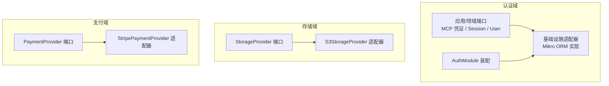
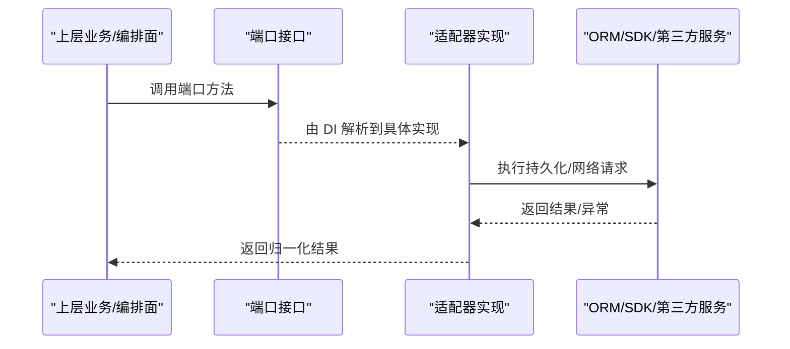
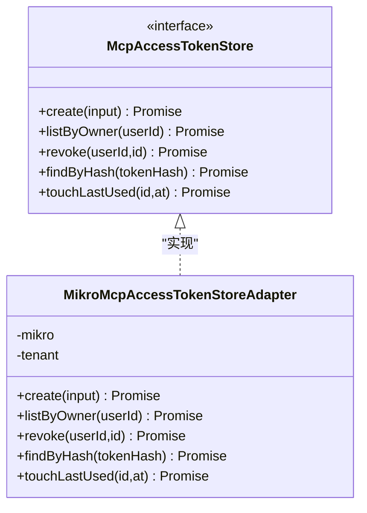
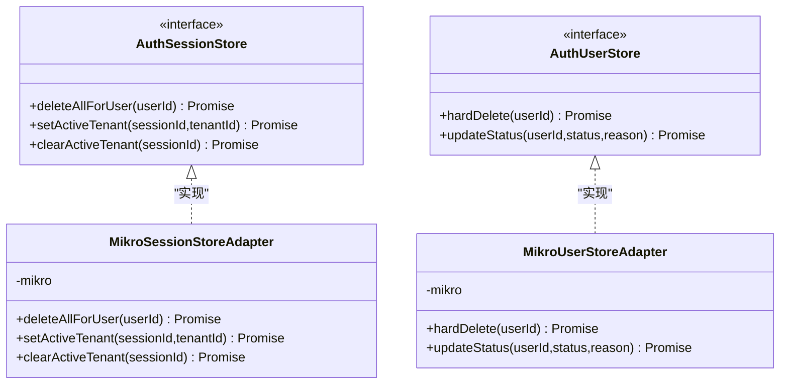
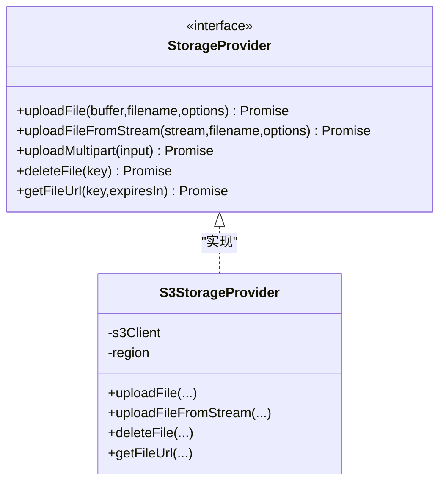
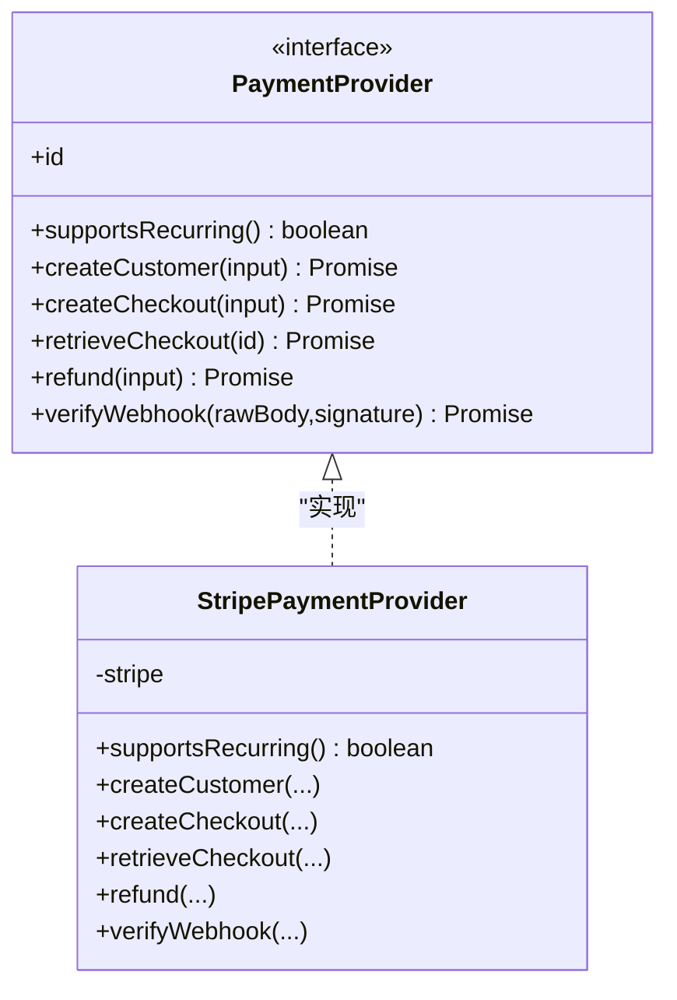
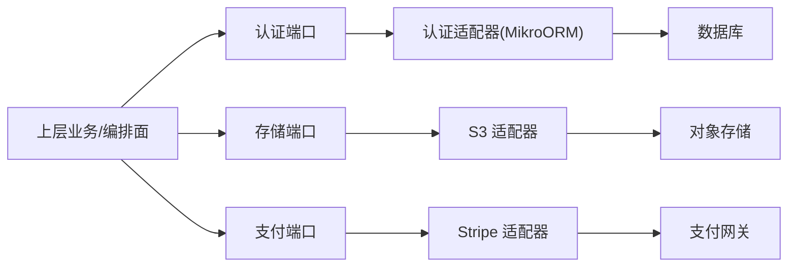

# 端口-适配器模式

<cite>
**本文引用的文件**   
- [apps/api/src/modules/auth/application/ports/mcp-access-token-store.port.ts](file://apps/api/src/modules/auth/application/ports/mcp-access-token-store.port.ts)
- [apps/api/src/modules/auth/domain/ports/session-store.port.ts](file://apps/api/src/modules/auth/domain/ports/session-store.port.ts)
- [apps/api/src/modules/auth/domain/ports/user-store.port.ts](file://apps/api/src/modules/auth/domain/ports/user-store.port.ts)
- [apps/api/src/modules/auth/infrastructure/mcp-access-token-store.adapter.ts](file://apps/api/src/modules/auth/infrastructure/mcp-access-token-store.adapter.ts)
- [apps/api/src/modules/auth/infrastructure/session-store.adapter.ts](file://apps/api/src/modules/auth/infrastructure/session-store.adapter.ts)
- [apps/api/src/modules/auth/infrastructure/user-store.adapter.ts](file://apps/api/src/modules/auth/infrastructure/user-store.adapter.ts)
- [apps/api/src/modules/auth/auth.module.ts](file://apps/api/src/modules/auth/auth.module.ts)
- [apps/api/src/modules/storage/domain/ports/storage-provider.port.ts](file://apps/api/src/modules/storage/domain/ports/storage-provider.port.ts)
- [apps/api/src/modules/storage/infrastructure/s3-storage.provider.ts](file://apps/api/src/modules/storage/infrastructure/s3-storage.provider.ts)
- [apps/api/src/modules/payment/domain/ports/payment-provider.port.ts](file://apps/api/src/modules/payment/domain/ports/payment-provider.port.ts)
- [apps/api/src/modules/payment/infrastructure/stripe-payment.provider.ts](file://apps/api/src/modules/payment/infrastructure/stripe-payment.provider.ts)
</cite>

## 目录
1. [引言](#引言)
2. [项目结构](#项目结构)
3. [核心组件](#核心组件)
4. [架构总览](#架构总览)
5. [详细组件分析](#详细组件分析)
6. [依赖关系分析](#依赖关系分析)
7. [性能与一致性考量](#性能与一致性考量)
8. [版本管理与向后兼容](#版本管理与向后兼容)
9. [测试指南](#测试指南)
10. [结论](#结论)

## 引言
本文件系统性阐述仓库中“端口-适配器模式”的实践：以接口定义系统边界（端口），由基础设施层实现具体通道（适配器），上层业务仅依赖端口，从而解耦框架、存储与第三方服务。文档覆盖内部/外部端口差异、依赖倒置实践、接口演进策略，并给出新增端口与适配器的设计步骤、单测与集成测试要点。

## 项目结构
仓库在多个模块内采用一致的分层组织：
- domain/application 层定义端口（接口 + DI Token）
- infrastructure 层提供具体适配器（ORM、S3、Stripe 等）
- module 装配器将端口绑定到具体实现

图示来源
- [apps/api/src/modules/auth/application/ports/mcp-access-token-store.port.ts:1-78](file://apps/api/src/modules/auth/application/ports/mcp-access-token-store.port.ts#L1-L78)
- [apps/api/src/modules/auth/domain/ports/session-store.port.ts:1-43](file://apps/api/src/modules/auth/domain/ports/session-store.port.ts#L1-L43)
- [apps/api/src/modules/auth/domain/ports/user-store.port.ts:1-32](file://apps/api/src/modules/auth/domain/ports/user-store.port.ts#L1-L32)
- [apps/api/src/modules/auth/infrastructure/mcp-access-token-store.adapter.ts:1-102](file://apps/api/src/modules/auth/infrastructure/mcp-access-token-store.adapter.ts#L1-L102)
- [apps/api/src/modules/auth/infrastructure/session-store.adapter.ts:1-48](file://apps/api/src/modules/auth/infrastructure/session-store.adapter.ts#L1-L48)
- [apps/api/src/modules/auth/infrastructure/user-store.adapter.ts:1-43](file://apps/api/src/modules/auth/infrastructure/user-store.adapter.ts#L1-L43)
- [apps/api/src/modules/auth/auth.module.ts:1-86](file://apps/api/src/modules/auth/auth.module.ts#L1-L86)
- [apps/api/src/modules/storage/domain/ports/storage-provider.port.ts:1-101](file://apps/api/src/modules/storage/domain/ports/storage-provider.port.ts#L1-L101)
- [apps/api/src/modules/storage/infrastructure/s3-storage.provider.ts:1-151](file://apps/api/src/modules/storage/infrastructure/s3-storage.provider.ts#L1-L151)
- [apps/api/src/modules/payment/domain/ports/payment-provider.port.ts:1-158](file://apps/api/src/modules/payment/domain/ports/payment-provider.port.ts#L1-L158)
- [apps/api/src/modules/payment/infrastructure/stripe-payment.provider.ts:1-108](file://apps/api/src/modules/payment/infrastructure/stripe-payment.provider.ts#L1-L108)

章节来源
- [apps/api/src/modules/auth/auth.module.ts:1-86](file://apps/api/src/modules/auth/auth.module.ts#L1-L86)

## 核心组件
- 端口（Port）
  - 定义在 domain/application 层，描述系统对外能力契约，不含框架或基础设施细节。
  - 示例：MCP 访问令牌存储、会话存储、用户存储、对象存储、支付通道。
- 适配器（Adapter）
  - 实现端口接口，封装 ORM、云厂商 SDK 或第三方 API。
  - 示例：基于 MikroORM 的认证相关适配器、S3 存储适配器、Stripe 支付适配器。
- 装配（Wiring）
  - 通过 NestJS Module 将 Symbol 注入键绑定到具体适配器类，供上层消费。

章节来源
- [apps/api/src/modules/auth/application/ports/mcp-access-token-store.port.ts:1-78](file://apps/api/src/modules/auth/application/ports/mcp-access-token-store.port.ts#L1-L78)
- [apps/api/src/modules/auth/domain/ports/session-store.port.ts:1-43](file://apps/api/src/modules/auth/domain/ports/session-store.port.ts#L1-L43)
- [apps/api/src/modules/auth/domain/ports/user-store.port.ts:1-32](file://apps/api/src/modules/auth/domain/ports/user-store.port.ts#L1-L32)
- [apps/api/src/modules/storage/domain/ports/storage-provider.port.ts:1-101](file://apps/api/src/modules/storage/domain/ports/storage-provider.port.ts#L1-L101)
- [apps/api/src/modules/payment/domain/ports/payment-provider.port.ts:1-158](file://apps/api/src/modules/payment/domain/ports/payment-provider.port.ts#L1-L158)
- [apps/api/src/modules/auth/auth.module.ts:40-81](file://apps/api/src/modules/auth/auth.module.ts#L40-L81)

## 架构总览
端口-适配器在本仓库中的典型调用链如下：

图示来源
- [apps/api/src/modules/auth/auth.module.ts:40-81](file://apps/api/src/modules/auth/auth.module.ts#L40-L81)
- [apps/api/src/modules/auth/infrastructure/mcp-access-token-store.adapter.ts:23-101](file://apps/api/src/modules/auth/infrastructure/mcp-access-token-store.adapter.ts#L23-L101)
- [apps/api/src/modules/storage/infrastructure/s3-storage.provider.ts:20-151](file://apps/api/src/modules/storage/infrastructure/s3-storage.provider.ts#L20-L151)
- [apps/api/src/modules/payment/infrastructure/stripe-payment.provider.ts:19-108](file://apps/api/src/modules/payment/infrastructure/stripe-payment.provider.ts#L19-L108)

## 详细组件分析

### 认证域：MCP 访问令牌存储端口与适配器
- 端口职责
  - 定义 MCP 访问令牌的铸造、查询、撤销、按哈希查找与最后使用时间更新等受控入口。
  - 明确租户隔离与属主校验语义，避免调用侧伪造租户上下文。
- 适配器实现
  - 使用 MikroORM fork 获取 EntityManager；对写操作走事务感知路径。
  - 按租户+属主双界过滤，保证跨租不可见、越权不可用。
  - findByHash 在无租户上下文时走全库唯一索引查找，安全由行内 tenantId 承担。

图示来源
- [apps/api/src/modules/auth/application/ports/mcp-access-token-store.port.ts:10-77](file://apps/api/src/modules/auth/application/ports/mcp-access-token-store.port.ts#L10-L77)
- [apps/api/src/modules/auth/infrastructure/mcp-access-token-store.adapter.ts:23-101](file://apps/api/src/modules/auth/infrastructure/mcp-access-token-store.adapter.ts#L23-L101)

章节来源
- [apps/api/src/modules/auth/application/ports/mcp-access-token-store.port.ts:1-78](file://apps/api/src/modules/auth/application/ports/mcp-access-token-store.port.ts#L1-L78)
- [apps/api/src/modules/auth/infrastructure/mcp-access-token-store.adapter.ts:1-102](file://apps/api/src/modules/auth/infrastructure/mcp-access-token-store.adapter.ts#L1-L102)

### 认证域：会话与用户存储端口与适配器
- 会话存储端口
  - 暴露删除用户全部会话、设置/清除活动租户位等受控写入口，确保跨上下文写收敛至 auth 域。
- 用户存储端口
  - 暴露硬删除与生命周期状态更新，统一治理写入口，消除其他模块直写 user 表。
- 适配器实现
  - 均通过 MikroOrmService.fork() 获取 EntityManager，支持 UoW 事务内复用连接。
  - 针对 session 表的 nativeUpdate 绕过租户隔离过滤器，保证精确列级写入。

图示来源
- [apps/api/src/modules/auth/domain/ports/session-store.port.ts:1-43](file://apps/api/src/modules/auth/domain/ports/session-store.port.ts#L1-L43)
- [apps/api/src/modules/auth/domain/ports/user-store.port.ts:1-32](file://apps/api/src/modules/auth/domain/ports/user-store.port.ts#L1-L32)
- [apps/api/src/modules/auth/infrastructure/session-store.adapter.ts:14-47](file://apps/api/src/modules/auth/infrastructure/session-store.adapter.ts#L14-L47)
- [apps/api/src/modules/auth/infrastructure/user-store.adapter.ts:14-42](file://apps/api/src/modules/auth/infrastructure/user-store.adapter.ts#L14-L42)

章节来源
- [apps/api/src/modules/auth/domain/ports/session-store.port.ts:1-43](file://apps/api/src/modules/auth/domain/ports/session-store.port.ts#L1-L43)
- [apps/api/src/modules/auth/domain/ports/user-store.port.ts:1-32](file://apps/api/src/modules/auth/domain/ports/user-store.port.ts#L1-L32)
- [apps/api/src/modules/auth/infrastructure/session-store.adapter.ts:1-48](file://apps/api/src/modules/auth/infrastructure/session-store.adapter.ts#L1-L48)
- [apps/api/src/modules/auth/infrastructure/user-store.adapter.ts:1-43](file://apps/api/src/modules/auth/infrastructure/user-store.adapter.ts#L1-L43)

### 存储域：对象存储端口与 S3 适配器
- 端口职责
  - 抽象上传（缓冲/流式/multipart）、删除、签名 URL 生成等能力，零框架依赖。
- 适配器实现
  - 基于 AWS SDK v3 的 S3Client 与 Upload 工具，封装参数构建、ETag 归一化与错误包装。

图示来源
- [apps/api/src/modules/storage/domain/ports/storage-provider.port.ts:36-101](file://apps/api/src/modules/storage/domain/ports/storage-provider.port.ts#L36-L101)
- [apps/api/src/modules/storage/infrastructure/s3-storage.provider.ts:20-151](file://apps/api/src/modules/storage/infrastructure/s3-storage.provider.ts#L20-L151)

章节来源
- [apps/api/src/modules/storage/domain/ports/storage-provider.port.ts:1-101](file://apps/api/src/modules/storage/domain/ports/storage-provider.port.ts#L1-L101)
- [apps/api/src/modules/storage/infrastructure/s3-storage.provider.ts:1-151](file://apps/api/src/modules/storage/infrastructure/s3-storage.provider.ts#L1-L151)

### 支付域：支付通道端口与 Stripe 适配器
- 端口职责
  - 统一客户创建、结账意图、退款、Webhook 验签等能力，返回跨通道归一化引用与原始载荷透传。
- 适配器实现
  - 基于 Stripe SDK，构造 PaymentIntent/Refund/Webhook 事件，映射为统一模型。

图示来源
- [apps/api/src/modules/payment/domain/ports/payment-provider.port.ts:112-158](file://apps/api/src/modules/payment/domain/ports/payment-provider.port.ts#L112-L158)
- [apps/api/src/modules/payment/infrastructure/stripe-payment.provider.ts:19-108](file://apps/api/src/modules/payment/infrastructure/stripe-payment.provider.ts#L19-L108)

章节来源
- [apps/api/src/modules/payment/domain/ports/payment-provider.port.ts:1-158](file://apps/api/src/modules/payment/domain/ports/payment-provider.port.ts#L1-L158)
- [apps/api/src/modules/payment/infrastructure/stripe-payment.provider.ts:1-108](file://apps/api/src/modules/payment/infrastructure/stripe-payment.provider.ts#L1-L108)

## 依赖关系分析
- 依赖方向
  - 上层（application/features）仅依赖端口（domain/application），不直接依赖基础设施。
  - 适配器依赖 ORM/SDK，但被模块装配器反向注入，形成“控制反转”。
- 耦合与内聚
  - 端口高内聚、低耦合；适配器内聚于具体技术栈；模块装配集中管理绑定关系。
- 潜在循环依赖
  - 端口位于 domain/application，适配器位于 infrastructure，二者单向依赖，无环。

图示来源
- [apps/api/src/modules/auth/auth.module.ts:40-81](file://apps/api/src/modules/auth/auth.module.ts#L40-L81)
- [apps/api/src/modules/storage/domain/ports/storage-provider.port.ts:36-101](file://apps/api/src/modules/storage/domain/ports/storage-provider.port.ts#L36-L101)
- [apps/api/src/modules/payment/domain/ports/payment-provider.port.ts:112-158](file://apps/api/src/modules/payment/domain/ports/payment-provider.port.ts#L112-L158)

章节来源
- [apps/api/src/modules/auth/auth.module.ts:1-86](file://apps/api/src/modules/auth/auth.module.ts#L1-L86)

## 性能与一致性考量
- 事务与 UoW
  - 认证适配器通过 MikroOrmService.fork() 获取 EntityManager，在 UoW 事务内复用连接，保证域状态写与副作用写原子性。
- 隔离与权限
  - MCP 凭证读写遵循“租户+属主”双界过滤；消费面按哈希查找时使用 scoped:false 的全库唯一索引查询，安全性由行内 tenantId 保障。
- I/O 优化
  - 大文件上传使用流式/分片上传；签名 URL 按需生成，减少临时对象驻留。
- 幂等与容错
  - 撤销操作幂等；外部 SDK 调用统一错误包装，便于上层重试与降级。

章节来源
- [apps/api/src/modules/auth/infrastructure/mcp-access-token-store.adapter.ts:29-101](file://apps/api/src/modules/auth/infrastructure/mcp-access-token-store.adapter.ts#L29-L101)
- [apps/api/src/modules/auth/infrastructure/session-store.adapter.ts:18-46](file://apps/api/src/modules/auth/infrastructure/session-store.adapter.ts#L18-L46)
- [apps/api/src/modules/storage/infrastructure/s3-storage.provider.ts:47-129](file://apps/api/src/modules/storage/infrastructure/s3-storage.provider.ts#L47-L129)

## 版本管理与向后兼容
- 接口演进原则
  - 优先扩展而非破坏：新增可选字段、新增方法；旧方法保持行为不变。
  - 对第三方 SDK 的响应体，通过“归一化模型 + raw 透传”保留既有调用方兼容性。
- 渐进迁移
  - 新实现先以并行方式接入，通过配置开关切换提供者；逐步淘汰旧实现。
- 契约稳定性
  - 端口类型定义作为稳定契约；基础设施变更不改变端口签名。
- 建议
  - 为每个端口维护变更记录；对破坏性变更引入新版本端口（如 PaymentProviderV2），并提供迁移桥接。

[本节为通用指导，不直接分析具体文件]

## 测试指南
- 单元测试
  - 针对适配器：Mock ORM/SDK，验证输入输出、错误分支、边界条件（空值、重复撤销、权限不足）。
  - 针对端口：以桩实现验证上层业务逻辑，不触达真实基础设施。
- 集成测试
  - 使用真实或容器化数据库/对象存储/支付沙箱，验证端到端流程（如凭证铸造、列表、撤销、最后使用时间更新）。
- 关键断言点
  - 事务边界：UoW 内多步写是否原子。
  - 隔离约束：跨租户数据不可见、属主校验生效。
  - 幂等性：重复撤销、重复刷新 lastUsedAt 的行为。
  - 错误处理：外部服务异常时的响应与日志。

[本节为通用指导，不直接分析具体文件]

## 结论
本项目在各域内以端口-适配器模式清晰划分系统边界：domain/application 定义稳定契约，infrastructure 实现具体技术细节，module 负责装配。该模式有效降低了耦合度，提升了可测试性与可替换性，并为后续扩展（多存储、多支付通道）提供了稳健基础。建议在新增功能时严格遵循“先端口、后适配器”的设计顺序，配合完善的单测与集成测试，确保长期演进的稳定性与兼容性。